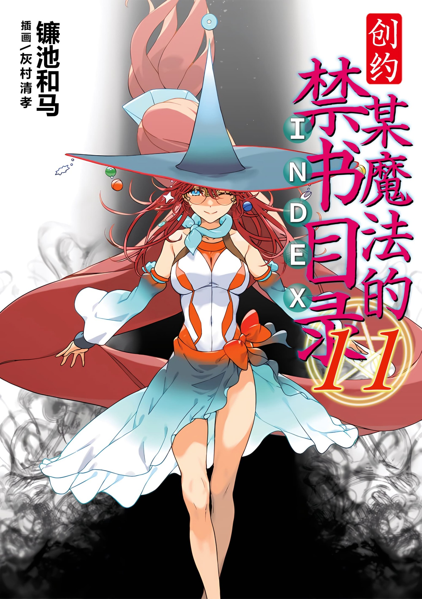
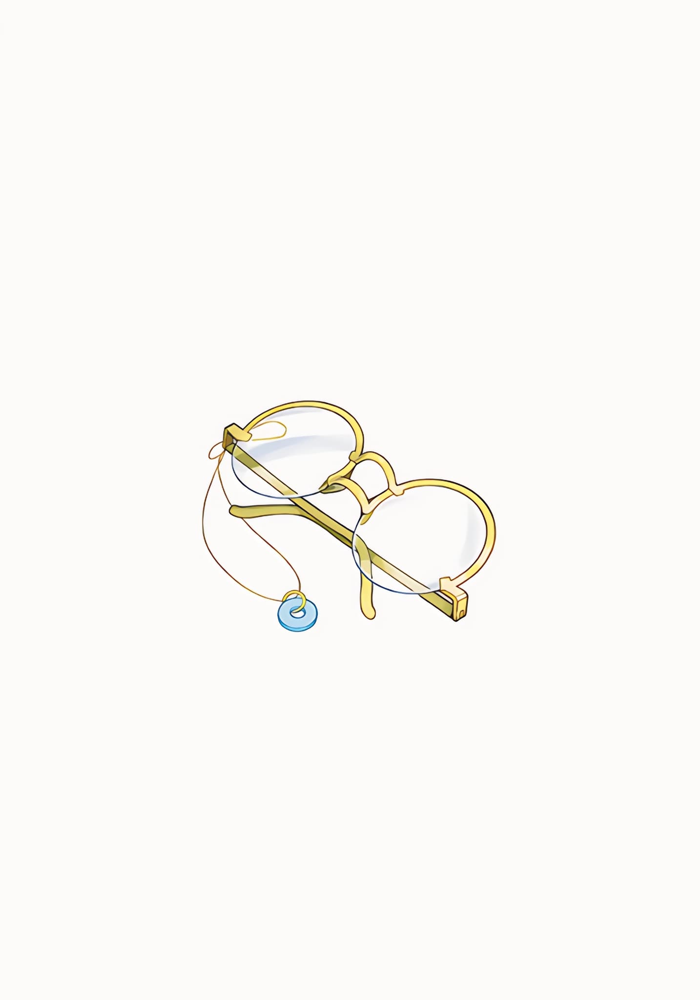

# 简介

**创约·魔法禁书目录11**

作者：镰池和马

## 内容简介

**寒假的最后一天，失去了生命的上条当麻，醒来的地方是——**

上条当麻为了拯救爱丽丝，坚持到了最后。

但是，他的生命之火已经完全消散……生命活动停息了。

寒假的最后一天。学园都市的某个少年被确认死亡。

随后。

虚无。空无一物的空间。上条醒来之处，是他一直以来打消的『幻想』本身——这里有一名女性，安娜·金斯福德。但是为什么会来到这里？上条惊讶着，听到了一个提案。等等，『这种事情』真的办得到吗……？

## 制作信息

* 网翻：某树状图的汉化组
* 翻译：朝菌、悦梦、万象之金、卡帕、莲也、刹那、cd、icerush
* 校对：白河修、IceRush
* 美工：知一一、侠之大者
* 整合：知一一（禁书目录X系列，[index-X](https://github.com/1204244136/index-X)）

> 转载时请保留录入信息
>
> 仅供试看学习交流，禁作商业用途，下载后请在24小时内删除

## 封面与封底

