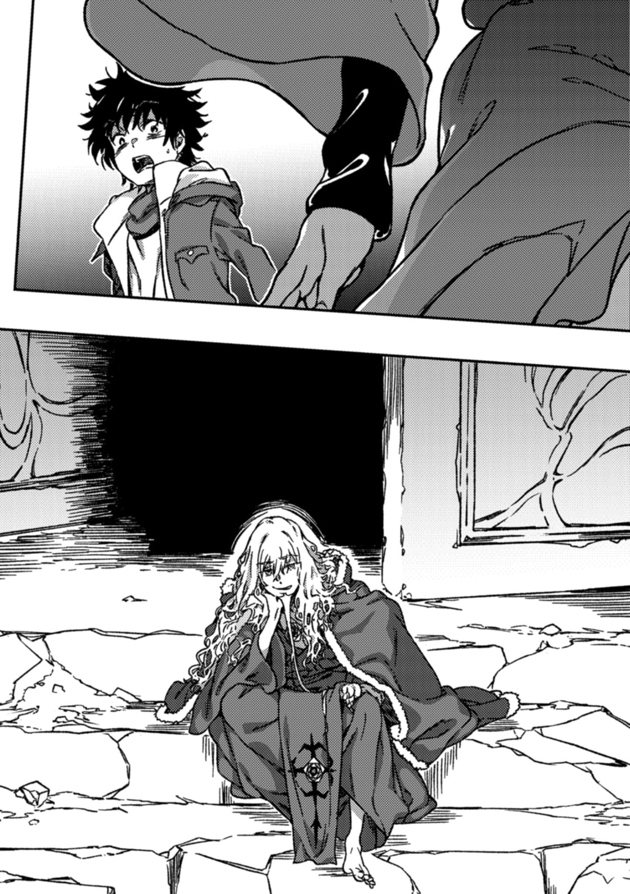

# 序章 欢迎

> the\_DIE\_After\_Tomorrow.

『**可是会死的**。』

『**即便如此**。』

&#x20;

&#x20;

那便是，打一开始就注定好的结局。

上条当麻自己轻易做出了选择的，最后尽头。

&#x20;

&#x20;

『无论以何种形式，我都要达成救出茵蒂克丝，让爱丽丝能笑着迎接的结局。』

『那就凭你的好恶来决定好了。』

&#x20;

『少女想。』

『还要跟老师和好呢。』

&#x20;

『我……』

『……我啊……』

『我就是不想看见有人比我还要不幸！！你有意见吗？？？！！！』

&#x20;

&#x20;

『……一月六日，晚上十一时五十八分。』

『送来的病人已经确认死亡。对已经死去的人，我们真的无能为力。』

&#x20;

&#x20;

『这是哪里？』

&#x20;

『**难道说这里是死后的**——

『哎呀哎呀。』

&#x20;

『这里，还不是你现在该来的地方吧？』

『另一位……叫什么来着？金斯……对了，安娜·金斯福德……？』

『◎(正是)。』

&#x20;

『还是说，你只是不知道「前提」呢？』

『总之，×(死)人对我来说才是正确的身份☆』

&#x20;

『你〼(干得)◎(非常)漂亮，上条当麻。』

『……而我也×(没有)强大到能眼睁睁看着努力的人×(得不到)回报、就这么沉沦下去。』

&#x20;

『喂，我说你，都走到这种死胡同了，到底还打算从这里开始搞什么啊！』

『为了奉献给周围的人。』

『以宗师的绝技，具体来说，我想〼(着)△(来一场)地狱巡礼。』

『……』

『哎呀哎呀。如果听×(不)懂地狱巡礼的比喻的话，那〼(换个)说法，就当是「越狱」吧？』

&#x20;

『来吧。』

『让我们一起踢飞这个混账的既定结局，再次〼(挑战)一下「败者复活」如何？』

&#x20;

&#x20;

&#x20;

&#x20;

&#x20;

&#x20;

&#x20;

&#x20;

……所以谎言在哪里？

不幸的少年绝对不相信，这些事情这么巧合，怎么会全都是真的。

空无一物的纯白空间。在上条当麻面前，有一位女性。

安娜·金斯福德。

她带着高雅而亲切的笑容。

轻轻伸出了右手。

上条虽然一时愣住，但还是暂且握住了那只手。

暂且？

不，全都是上条自己做出的「选择」。

只是一瞬间。

&#x20;

&#x20;

嗡！！！！！！

&#x20;

&#x20;

白色为之一变。

黑漆漆的岩石与潮湿的树木覆盖了视野，总之这里是一片茂盛的森林。但其实他并不知道准确的色彩。这里太过阴暗，黑色主宰了一切。没有月光，只能看到远处模糊的橙色光芒。但是，上条就算看到了黑暗中的光辉，也放不下心来。他凭直觉理解到，那是像熔岩与山火一般，能伤人的光辉。

身体好沉重。

感觉就像是被人抛在了经常发生死亡事故的狭窄隧道里一样。这里的黑暗光是看着，就感觉会有什么东西压过来。

「这里是……」

「地狱的入口，应该可以这么说吧。」

地狱。

果然是从底下开始啊。

自己是任性而死，根本没指望能上天堂。

这倒无所谓，但「越狱」又是什么？

上条做好了心理准备，选择了死。原来这个世界上，在死了之后还可以有「后续」的吗？

还是说自己其实是在被测试？

另一个安娜一点也不惊讶。

难道这也在前定和谐的范围内吗？（_译注：前定和谐（pre-established harmony），戈特弗里德·莱布尼茨提出的哲学概念。指上帝预先安排好一切，使所有事物能自然而然地协调一致，无需直接相互作用。_）

「虽然这里是由多种印象混合构成〼(的)。但还是○(有)前后左右上下更方便行走吧？」

就算做了解释也听不懂。

手猛地一拉，上条的腰也直了起来。完全站直了。

这时，他才意识到手上能感觉到温暖。还有女性手掌特有的柔软，以及细腻的肌肤触感。

呼吸与汗水。

心脏的跳动。

刚才还完全感觉不到的自我，现在全都一下子复苏了。

这里就是现实吗？

看来上条当麻脑海里是这么定义的。

但是，对于本应已经死去的……上条当麻而言，对接下来应该做些什么完全没有一点头绪。地狱巡礼，越狱。真能复活吗？完全无法想象。既然这样，那就只能跟在那位笑眯眯的金斯福德身后了。毕竟她是地狱的向导，要是惹她生气，被丢在这黑暗之中的话，那可就全完了。

两人在看不清路的幽暗森林之中行走着。

根本不敢回头。黑暗里似乎到处都有某种气息。虽然很在意那群吵吵嚷嚷叫着的东西到底是什么，但只要稍微朝别处转个头，就会立刻跟丢理应在前方一米处的金斯福德的背影，彻底分不清东西南北，在原地团团转迷失方向。

「要、要从哪里开始呢？」

「一个一个按顺序来。这是魔法的基础，也是奥义，×(虽然)我〼(能)理解你焦急的心情，但〼(可)×(不能)想着抄近路。」

宗师说的话根本分不清是认真的还是在开玩笑。

实际上，她身为人类，却在此世彼世之间往来。就像在盂兰盆节时回趟家一样随意。

上条觉得，她随便哪一句话里面都有着重大的意义，因此紧张了起来。

「具体来说，先～(从)穿过门开始〼(吧)。这可是地狱之门☆」

「地狱……」

在潮湿的森林里走了一阵，光是迈步前行，每一步都感觉双脚愈发沉重。虽然看起来简单，但要是没有金斯福德在前方引路，像上条这种人说不定早就连灵魂都腐烂掉，变成人脸模样的污渍或者一棵树木了。

能看到点什么了。

虽然是石制的，但却不是建筑物。

那是一扇与地狱这个词汇的印象不相称的，庄严的大门。

那里只有由石头制成的半圆形拱门结构与木制的双开门。左右甚至没有石墙。但这样就已经能够作为一种「分隔」了。感觉上可能会类似于神社的鸟居，不过这么比喻的话有点太不吉利了。

地狱。

也可能是，怪物的嘴巴。

拱形的门上有着金属板，但上条看不懂上面写的是什么。虽然看着像是字母，但至少不是英语。这么一想，上条再次翻了翻自己的衣服，没找到装有翻译软件的手机。

不对。

比起这个板……

「『入此门者，当舍弃一切希望』吗。」

安娜·金斯福德看着金属板喃喃道，然而上条的注意力却不在这里。

半开的门正前方，有人在。

不是看门人。对方看起来很轻松地坐在地面的台阶上，很是悠闲。看上去像是把路边或者公园里的石头台阶当长椅用的不良一样。

没错，身着红衣的银发男子脸上洋溢着在地狱中尽情享受的从容。

宗师。

毫无疑问。

而自己也并非完全不认识他。

这里是地狱。

死者之中罪孽尤为深重之人被毫不留情打落之地。

世界。

阶层。

相位。

而且，既然此地是底层的底层，是魂魄的最终废弃设施——

&#x20;

「怎么啦怎么啦。」

&#x20;

意思是。

意思是，这种情况也是很可能会发生的……？！

&#x20;

「老夫实在过于无聊，差点不由得犹豫是否该继续前行了。原来如此，世界啊，老夫倒对你有些刮目相看了，没想到居然还准备了此等余兴啊？」

&#x20;

CRC。

克里斯蒂安·罗森克鲁兹。

播撒死亡与破坏，最强的宗师，本应先一步死亡的罪人正嘻嘻笑着。

