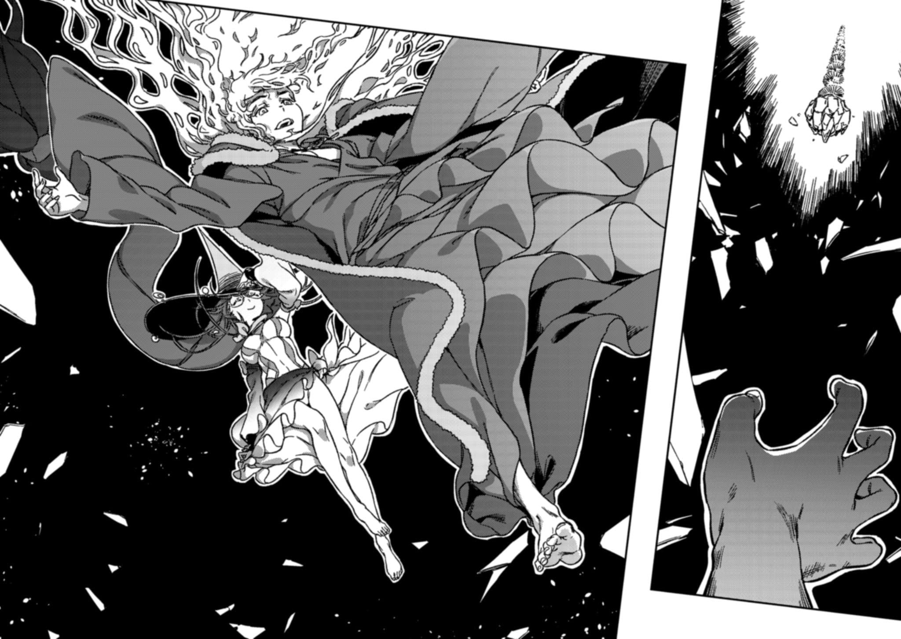

# 终章 仪式的结局

> Flat\_Line...

身着红衣的银发青年仰面朝天，

那是一片支离破碎的冰湖。

&#x20;

他茫然地向上望去。

螺旋阶梯已经启动，如同一缕细微至极的救赎之光。他能看出，整座阶梯正散发着前所未有的光芒。

试炼应该已经开始了。

罗森克鲁兹缓缓地坐起身来。

现在的他毫无留恋？

那当然是骗人的。

「呵呵。」

一道身影从背后将他笼罩其中，

此人正是安娜·金斯福德。

她也一边抬头望向上方，一边说道。

「呀，看来那少年已经顺利登上阶梯了，真是太好了。如果到了这一步，他还能满脸认真地说出『我×(无法)接受任何人牺牲，～(所以)就把机会让给你吧，金斯福德（坚毅的眼神）』这种话，那我至今为止的努力就全都要泡汤了呢☆……不过要真是那样的话，我也只好一拳〆(揍晕)他，然后强行把他〼(推)上去咯。」

「你这家伙……莫非，是『诱导』他那么做的吗？像恶魔蛊惑人类那样，故意带偏了那个小子的思路？！」

「◎(没错)。」

金斯福德露出了笑容。

这手段，与罗森克鲁兹先前用来挑拨上条当麻对她产生怀疑的做法如出一辙。

专门解读亡魂与诅咒领域的邪恶之树(Qliphoth)，常人一旦接触，必将灾祸临头。但在掌握了充分知识并做好万全准备的宗师手中，则又是另一番模样——各种远超常规的秘技与捷径，都能任其随心所欲地使用。

也就是说，安娜·金斯福德甚至能够自在地运用各种与恶魔和地狱相关的秘术，比如恶魔的甜蜜诱惑。

而仅限这一次，她曾与某位「人类」立下了约定——不论使用什么样的犯规手段，她都要救出上条当麻。

尽管如此，

这种行为还是让罗森克鲁兹难以置信。

「你究竟为何……要替他做到这种地步？这样到底又能从中得到什么？既然登不上那唯一一座阶梯，小姑娘，接下来等待我们这些老骨头的会是什么，你也应该心知肚明才对啊。」

「我应该已经说过了，CRC。」

安娜·金斯福德果然毫不犹豫地作出了回应。

善良的宗师从不犯错。

即便这一切都只是约翰·瓦伦汀·安德烈的无聊恶作剧衍生而成的天方夜谭，只要一生坚持不懈地贯彻践行，也能在其中觅得正义的踪迹。

这是毋庸置疑的事实。

「我会拯救被纳入整体计划之中的所有人。」

「……」

「～(接下来)要开始的，可×(不)〼(是)这种虚假的相位。×(不过)，既然有两位宗师在此，所谓的永恒苦难多少也能有所缓解吧。不〼(是)吗，CRC？」

「你这该死的。」

「好了，×(不)一起去见识一下真正的地狱是什么样子吗，CRC？虽说是～(从)相反的方向切入，但这次是真的能亲眼见证真正的神话世界哦。嘿嘿，〼(但愿)×(不会)太让人失望。」

那微小的救赎，甚至超越了创造出这一切的约翰的想象。

咔嚓一声，清脆的裂痕声响起。

一开始只有一道，但随后，声音的频率越来越快。

位于地狱最深处——犹大环的巨大冰湖，终于要彻底崩裂了。不过，那并非指的是表面的厚厚冰层——早在上条当麻与罗森克鲁兹交锋时，那层冰面就已经碎裂得七零八落了。

而是指更为根本的部分。

这个地狱并非「真正的地狱」，这种话早已说过许多次了。

就是这么回事。

撒播死亡与毁灭的宗师——罗森克鲁兹自不用说，善之宗师金斯福德也为了自己的目的使用了邪道的力量。

对此，「某个存在」产生了反应。

于是，「真正的地狱」终于迎来了降临的时刻。

克里斯蒂安·罗森克鲁兹从身后被那位女性紧紧地抓着，他抬头仰望那条长长的螺旋阶梯。它宛如一缕从天而降的光芒，如今的他已无法看清曾与自己拳脚相交的对手现在身在何处。

他低声喃喃道。

「为了奉献给周围的人吗……」

「◎(没错)，这～(正是)你带给世界的思想(救赎)之一。」

仰望上方的眼神中蕴藏的意义，悄然发生了变化。

此刻，身处于此的并不是克里斯蒂安·罗森克鲁兹，

而是约翰·瓦伦汀·安德烈。

他的声音与善之宗师安娜·金斯福德重合。

就在追赶到相同境地的一刻。

「「幸福地活下去吧，上条当麻……」」

&#x20;

&#x20;

&#x20;

冰湖，彻底崩塌了。

虚假之物的底部脱落，

散播死亡的宗师强行插入的相位随之破碎，像揭开了一层薄膜的伪装，显露出隐藏于此的另一个阶层。那一刻，名副其实、货真价实的真正地狱张开了血盆大口。

&#x20;

欢迎来到地狱第一环谷·阿刻戎河的彼岸。

「哈……」

与此同时，另一边。

上条当麻正在剧烈喘息着。

四周传来咔嚓作响的崩塌声，虽然很在意下方的情况，但他根本来不及确认。崩裂的震动不断逼近，大概用不了多久，连这透明的螺旋阶梯也会从底部开始一节一节崩塌，

一切都会被吞噬殆尽。

某种恐怖的巨口已经张开。

真正的地狱。

那种相位原来也真的存在吗？

「哈啊……哈啊……」

那螺旋阶梯看上去像是由一块块透明而厚重的玻璃板构成，但实际情况恐怕并非如此。无论这阶梯多么永无止境，只是迈步攀登的话应该也不会让他遭遇如此异常的现象。

他感到自己的气力在流失，

被从身体中抽离。

「呃……！！」

每迈上一级台阶，他都能感到自己的体力仿佛被削减了一半。起初他还能毫无阻碍地向上攀登，但气力却在切实而稳步地流逝。仿佛有长长的发丝缠满全身，在水中挣扎一般。原本力量的强弱根本无关紧要。无论事先积蓄了多么庞大的力量，在这减半、再减半、又减半的永恒反复之下，崩溃倒下的时刻终究会到来。这套机制便是如此。

果然，让死去的人复活就是如此近乎不可能的难事吗？

按常理来看，这种事本不该发生。

也正因此，必然会有极为严密的规则或机制，事先将这样的可能性彻底杜绝。

&#x20;

（我要回去……）

&#x20;

上条双膝跪地。

走到一半时，他就已经明白自己连站起来的力气都没有了。

但即便如此，上条还是向前伸出手臂。

用尽全力去抓住下一阶的台阶，将自己的身体向上撑起。

&#x20;

「我要回去，绝对要回去！」

&#x20;

他说出了口。

就算双腿无法行动也无所谓，即便只靠双手爬行，甚至用牙咬住阶梯向上移动也在所不惜。为了把这样一股力量逼出来，上条才刻意对自己说出这番话。

然而，减半的法则是绝对的。

无论他如何从身体中挖掘出尚未使用的力量，只要再往上攀登一级，那些力量都会被瞬间削去一半。

&#x20;

「我要见到茵蒂克丝，我还有话要和她说。」

&#x20;

他说出了口。

又攀上了一级。

&#x20;

「回到学园都市，向御坂她们低头道歉。」

&#x20;

他的声音变得沙哑。

又攀上了一级。

&#x20;

（去学校……见到大家……和蓝发耳环还有小萌老师……蠢事……）

&#x20;

已经说不出话了。

又攀上了一级。

&#x20;

（对爱丽丝·异……，……我de死……不shi你的……——）

&#x20;

连思绪也逐渐变得七零八落。

然而，即便如此，他还是艰难地继续往上又攀爬了一级。

「——，……」

……没有尽头。这条螺旋阶梯永远没有尽头。极度的痛苦与疲劳，使上条内心深处开始暗自滋生出诡异的妄念与猜疑。看似伸出了援手，实际上不过是为了粉碎人的心灵与决意而设的恶趣味机关。并非打一开始就彻底堵死所有出口，而是特意留下唯一的生路，好以此旁观人类失败崩溃的模样——就是这样一座地狱。一个对于痛苦挣扎的人类毫无半点温情可言，充斥着饥饿、苦痛与疲惫的灵魂废弃装置。自己已经干过怀疑金斯福德的蠢事了。他觉得，这一切不过是为了干扰自己而精密计算的蓄意妨碍罢了。虽是这么想，可是……

&#x20;

这里是哪里？

我到底在做什么？

&#x20;

尽管时不时连这种最基本的问题都快忘记，上条当麻还是仅靠双手的力量，强行拖着自己如同湿抹布一般黏在台阶上的身体，继续向上攀爬。

手指在抽搐。

视野渐渐暗淡，难道连眼球的力量都在被不断抽走吗？

自己应该快接近地面了吧。

那里应该是充满了光明吧。

但，整个世界却逐渐被黑暗吞噬。

「我要　　回去。」

尽管明知力量会立刻被夺走，上条当麻依然再次挤出气力。

他的眼睛已经看不见了。

耳朵也什么都听不到。

尽管如此，他仍仅凭抽搐指尖的触感，抓住下一级台阶。

&#x20;

「我　要回到，现世啊啊啊啊啊啊啊啊　　　　啊啊啊啊啊啊啊啊啊啊啊啊啊啊啊啊啊啊啊啊啊啊啊　　　　　　　　啊啊啊啊啊啊啊啊啊啊啊啊啊啊啊啊啊啊啊啊啊啊啊啊啊啊啊啊啊啊啊啊啊啊啊　　　　　　　　　　　　　　　　　　　　　　　啊啊啊啊啊啊！！！！！！」
