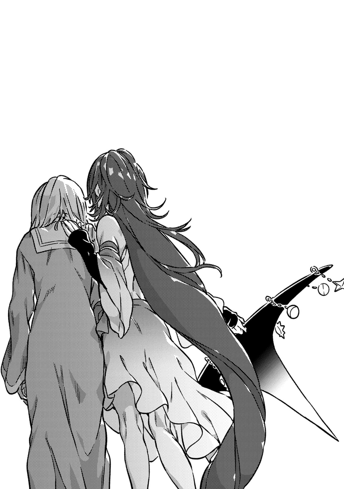

# 后记之后

「……」

那个「人类」，一时之间没能动弹。

只是呆呆地站在那里，无能为力。

『嘻嘻，噫嘻嘻，哈哈哈。啊哈啊哈哈。』

耳中满是嘲笑的声音。

其来自一位因为柔顺的金发被随意剪短而被夺走了大半领域的大恶魔。

『好爽，好舒畅，啊啊太畅快了！！好久没见过了，你的这副表情！！』

站在一旁的永久遗体，轻轻地叹了口气。

安娜·金斯福德问道。

「刚刚只要向我下达命令，×(不)〼(就)能◎(全)部解决了吗？」

「我怎么能……」

与之相对。

低着头的身影发出了蚊子般的声音。

「我怎么能做那种事。」

至少对于这次来说，亚雷斯塔并没有别的想法。安娜·施普伦格尔和「桥架结社」的超绝者们试图扰乱上条当麻的生活。因此，亚雷斯塔「只是」为了阻止这一点而来到学园都市的。确无他意。

「人类」继续嘟哝起来。

其实这样做并不太好。真正卓越的人不会长篇大论。身为先达的安娜·金斯福德已经用自己的生存之道证明了这一点。

&#x20;

「一直以来，我都是在做正确的事情。」

&#x20;

更多的词汇从「人类」的嘴角滴落、溢出。

一个接一个，一条接一条。

&#x20;

「要是我没有在洛杉矶之战中击溃那些干部的话，R\&C超自然公司就不会瓦解。梅尔莎白和赫尔卡莉娅会为了无聊的复仇而失去性命与人生。」

&#x20;

一旦决堤，「人类」就会变成这样。

蕴藏于心中的一切，都从一个小小的蚁穴喷射而出。

&#x20;

「学园都市的『暗部』也是，我都说了『接下来可以交给我』了！结果擅自拒绝了我，还一个劲地冲进黑暗深处的不就是他吗！！开什么玩笑？爱丽丝说的他没记住吗？她都清清楚楚地说了他会死！！」

&#x20;

呕心沥血般的埋怨。

虽然早已习惯了事不如意，不如说事态进展能如自己意才罕见。这件事那个人明明早就知道了。

&#x20;

「在涩谷的骚动中，他知道自己死了几次吗？！而且在好不容易取胜后，他竟然连安娜·施普伦格尔的接近都没注意到！！要不是我把金斯福德唤醒去对付施普伦格尔小姐的话，他早就失去包含阿拉蒂娅在内的一切了！！」

&#x20;

木原脑干一言不发。

他只是将视线移开了自己的老友，并点燃了一根新的雪茄。

&#x20;

「我想帮助上条当麻……我也想助人为乐一次！真的是，混账，真的就是仅此而已！！为什么我每次每次都会这样啊啊啊啊啊！！！！！！」

&#x20;

首先自己要有一颗善良的心，同时还要伴随着行动。

但即便如此对方也可能没有领会到。

让人心痛的是，竭尽全力想要帮助的对象却对自己展露了敌意。

就算把施普伦格尔小姐扔进监牢里也管不住她。

如果想要把她抓起来并且不杀死她，那最少也得夺走她的四肢。

但是，那个一本正经的少年听不懂这些。

他已经，离开了这里。

「呵呵呵。」

安娜·金斯福德从一旁轻轻地靠在了「人类」的身上。就好像是一位年长的大姐姐在对她害羞的弟弟撒娇。

这或许是亚雷斯塔一直未能获得的某种东西。

「……干什么？」

「××(没什么)。」

一直以来，对于安娜·金斯福德而言，亚雷斯塔不过是个同行者。为了奉献给周围的人。能够让自己沿着目的前进的话就听从于那个人，要是妨碍自己的话就立刻将其除掉，获得自由之身。他们的关系不过如此。

实际上。

如果那时亚雷斯塔在惊慌失措之下发出了「去攻击那位外行高中生」之类的命令，金斯福德就会轻松打倒亚雷斯塔，然后转而跟着刺猬头少年前进。她就是这种对邪恶魔法师毫不留情的宗师。

但是，亚雷斯塔没有那么做。

即使内心如此痛苦，也明言绝对不能那样。

这让她感受到了那个人的魅力。

不论「人类」多么笨拙，即便对于早在这条路上登峰造极的金斯福德而言，其拼命挥舞的魔法不过是些拙劣的游戏。

这也让她想要从更早的阶段而言，将那个人认定成**麻烦的孩子之一**。

所以安娜·金斯福德笑了。

智慧的大女神边笑边说。

&#x20;

「现在就请尽情哭出来吧，亚雷斯塔。」

