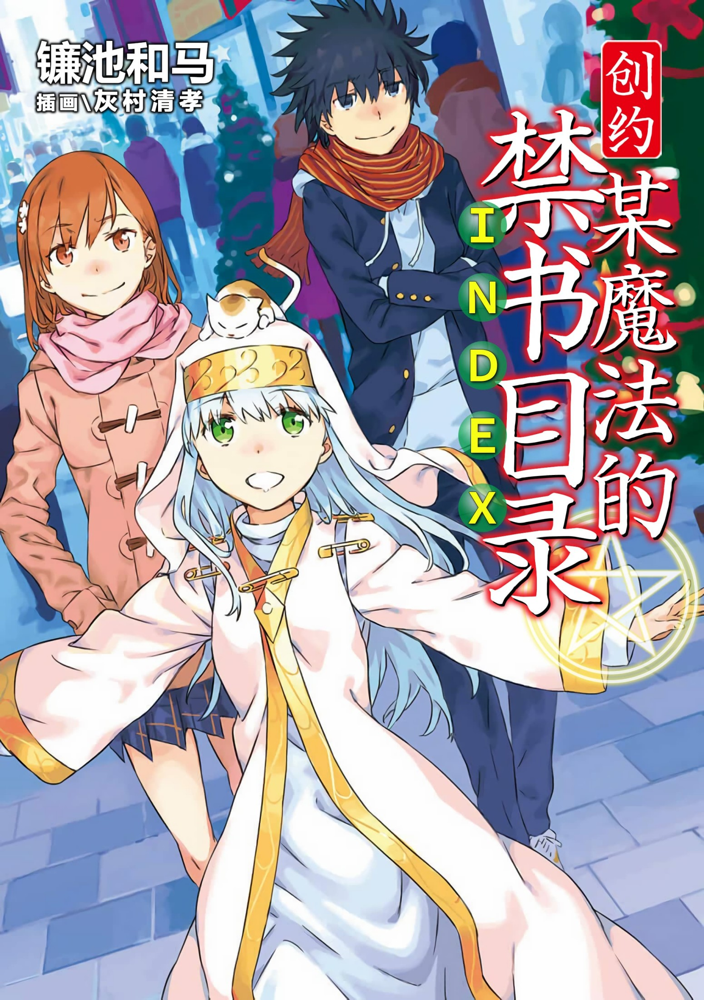

# 简介

**创约·魔法禁书目录1**

作者：镰池和马

## 内容简介

**超越新约，开创新的时代！「创约」篇，开幕！！**

科学与魔法交错的世界。

这里是进行超能力课程教学的学园都市。这座总人口里有八成为学生的城市，终于迎来了所有人都心跳不已的季节！

圣诞平安夜。

在城市欢快的喧闹声中，平凡的掉队少年上条当麻为了赶上这个节日，不得不忙于完成补习授课……

但是受到不幸体质的眷顾，寄住于宿舍的银发修女茵蒂克丝在与往常日子不同的节日氛围影响下，开启了全新的贪吃鬼技能？！

在拼死阻止她的上条面前，出现了同样被气氛影响的御坂美琴？！

「创约」篇在此华丽开幕！！

## 制作信息

* 网翻：学园都市圣诞夜活动小组
* 组织：总统
* 图源：小诚
* 修图：知一一、总统、水果释迦喵
* 日语翻译：万象之金、ICERUSH、4a、cd、总统、绿酒、圆圆、朝菌、胖头鱼
* 日语校对：ICERUSH、cd、4a
* 中文校对润色与最终审核：等时圆
* EPUB：知一一、等时圆
* 友情协助：魔法禁书目录中文维基
* 整合：知一一（禁书目录X系列，[index-X](https://github.com/1204244136/index-X)）

> 转载时请保留录入信息
>
> 仅供试看学习交流，禁作商业用途，下载后请在24小时内删除

## 封面与封底

