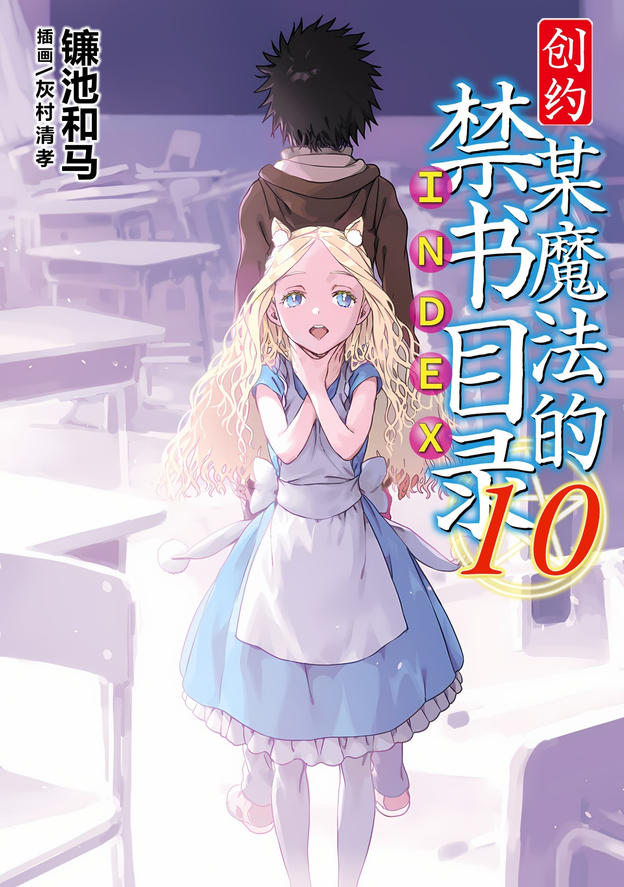
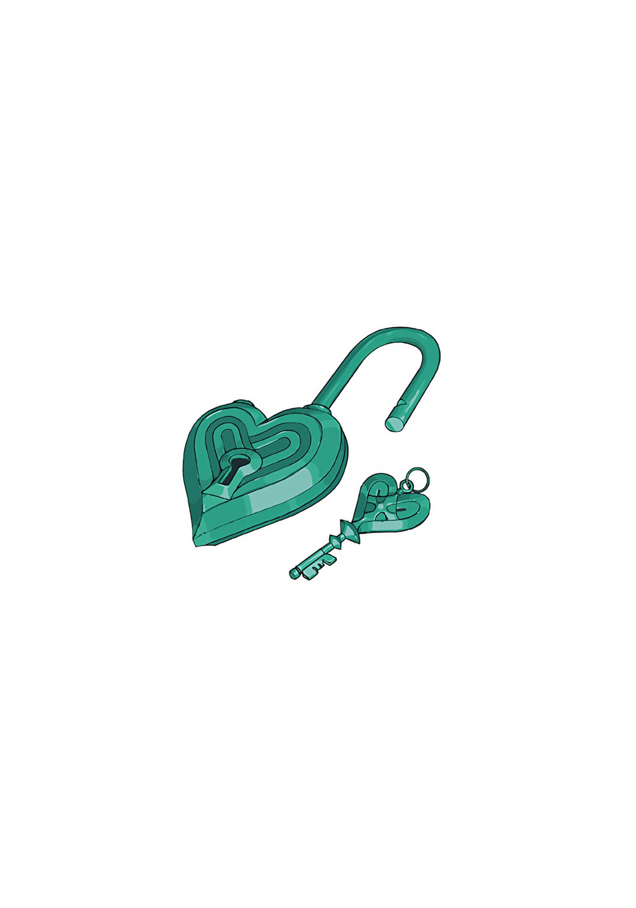

# 简介

**创约·魔法禁书目录10**

作者：镰池和马

## 内容简介

**镰池和马《某魔法的禁书目录》20周年！「超绝者」篇，波澜动荡！**

爱丽丝·异典。

本已死去的少女，以意外的姿态再次复活。

目击一切的茵蒂克丝陷入绝境。但只有与她一起的欧提努斯成功逃了出来，向住院的上条当麻告知了危机。

上条听完欧提努斯的话，再次握紧拳头。

一定会救出茵蒂克丝。

……但难道这样就满足了吗？

你不是好不容易复活了嘛，爱丽丝。

和你打一架也好。就由不幸的我来将这个将要终结的世界改写成「所有人一定会得救」的Happy End！

## 制作信息

* 网翻：某树状图的汉化组
* 翻译：Edster、cd、万象之金、卡帕、朝菌、りゅう、绿酒、刹那、莲也
* 校对：白河修、IceRush、cd
* 美工：知一一、侠之大者
* 整合：知一一（禁书目录X系列，[index-X](https://github.com/1204244136/index-X)）

> 转载时请保留录入信息
>
> 仅供试看学习交流，禁作商业用途，下载后请在24小时内删除

## 封面与封底

