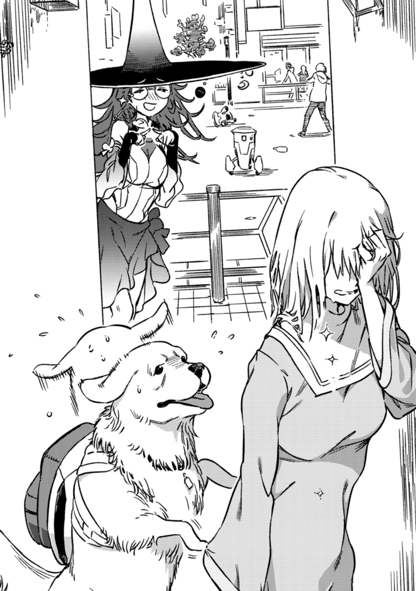

# 第一章 世界没那么强韧

> the_End_of_Real.

## 1

一月六日，第七学区的医院。

顺便一提，时值清晨。

「啊……」

上条当麻躺在满是消毒水味道的床铺上，一脸茫然。他身上穿着的这身住院服俨然成为了第二套睡衣，那副生无可恋的模样，仿佛整张脸都写着「至少不是运动服，随它去吧」。

明明宝贵的寒假即将迎来尾声，上午他却在无所事事。

「寒假要结束了。哎，第三学期终于要开始了吗……真的假的？我本来还以为这次怎么着也活不下来了呢！！」

「……蠢货，别靠捏造记忆假装自己零失误。你不过是受『古老善良的玛利亚』的『复活』庇佑而已，死过就是死过，而且还不止一次。」

「呃」上条在床上呻吟了一声。

有人坐在病床边的简易钢管椅上。

从外表上看，是个十岁左右的小女孩。一头草莓金色的长发梳成了好几束扁平炸虾的形状，比起她那纤细娇小的身躯，显得格外蓬松。她硬扯着不合身又松垮垮的红色连衣裙拢在胸前，白皙的肌肤却几乎遮掩不住。

是安娜·施普伦格尔。

如同一脸无奈的安娜所说。上条能安然无恙地在这里，并不是靠自己的努力或选择争取到的未来。进行不自量力的莽撞挑战会发生什么？与「超绝者」、爱丽丝·异典、以及罗森克鲁兹的激烈冲突，让他切身体会到了这一点。

上条暂时陷入了沉思。

但是，安娜就在眼前。她并非幻影，不会突然消失。

说起来，刚刚也提到过，这里是单人房。

……为什么安娜·施普伦格尔会出现在这间病房？在这个充斥着汗水、泪水与欲求不满，宛如梅雨时节棒球部一般闷热的男病房里。

「你身体还没康复吧？从自己的病房跑出来到这里干什么？」

「来照顾病人。」

干脆利落的回答。

上条当麻眨了两下眼睛，然后：

「哈哈哈，没有人陪着说话寂寞了是吧安娜小姐，哎呀没想到那位坏女人会变成这样，人生真是琢磨不t——」

「臭死了蠢货，这间病房满是落败而寂寞的雄性气息。」

「你到底是来干什么的？」

他连哭都忘记了。

对于干涸到已达虚无之心的男高中生，安娜却不动声色地立即回答道：

「蠢货，你的脑袋迟钝到连三分钟前听到的话都记不住的程度吗？我是来照顾你的。」

安娜将干净的毛巾浸入装满热水的洗脸盆里，用她的小手紧紧地拧干湿毛巾。

「我会把你全身上下擦得干干净净的，所以快把衣服全部脱光蠢货。」

「噗？！」

这来得太突然了。

而且在安娜看来，这似乎已经是板上钉钉的事了。她拿着湿毛巾，像悄无声息的小猫一样，正要爬上床。

「你、你个小丫头片子，知道自己在说什么吗？」

「哎呀你这蠢货，害羞了？」

「你这矮冬瓜在胡说八道什么啊！小黄毛丫头等个十年，不，十五年零四个月再来吧，别小看憧憬着未曾谋面的管理员大姐姐的上条先生啊！！」

外表只有十岁左右的安娜默默地眨了眨眼，过了一会儿，她低头看了看自己纤细娇小的身体。

随后，

「哎呀。娇小的身体不合你口味吗？」

她露出一抹坏女人的微笑。

随后，她的身体猛然变为成熟的大姐姐。

「**那么**，**也可以变成这样哟**。」

「哇？！」

「选个你喜欢的吧。我是没什么所谓。」

安娜如猫科动物般在床上爬行着，那甜美的香气前所未有地展示自己的存在。尽管很像猫咪，但绝非同类。

某个硕大的东西沉甸甸地晃动着。

拿着湿毛巾的安娜轻声笑着。

「话说回来，一旦我变成这种魅力十足的形态，蠢货你要是再改口说还是喜欢小的那种，本身也是个需要相当勇气的选择吧？」

比起笨拙地讲道理，是不是闭嘴的话能更快灭火呢。

这么想就错了。

那是逃避。

如果不明确制止如今的发展，局势基本上就会一发不可收拾。哪怕已经在全力脱轨。

「嗯，暂且就保持大的形态吧。这样方便移动或翻动身体。如果腻了就说一声，蠢货，我再给你换个口味，反正随时都能切换模式。」

「……大一点更方便？你难道打算把别人的身体抓着翻过来吗？」

「高贵的我要给你擦身子了，赶紧脱吧蠢货。」

「不是，这太离谱了吧？你知道自己在说什么吗？这就跟辣妹做了土豆炖肉一样倒反天罡，你真的觉得没问题吗安娜小姐！！」

安娜反而坏笑了起来。

看来，施普伦格尔小姐很乐于欣赏上条手足无措的样子。

坏女人那奇怪的生态真令人不可思议。

「哎呀呀，这就是愚蠢的青春叛逆期吧，才住院一天就迎来了禁欲生活的极限，你是不是太缺乏自制力了？呵呵，啊啊，都怪罪孽深重的我，简直都能听到蠢货身体某处传来硬邦邦的声音了呢。」

上条当麻的内心从虚无飞越到了更深一层的另一侧。

这是新境界。

他移开视线小声说道：

「那个。」

「怎么了蠢货？」

「这件事非常难以启齿……虽然艺人们老是在夜间娱乐节目里说这种话，但叮叮是用来形容硬度的词语，男性身体里实际上是发不出这种金属音的。」

「什么？！……你说什么……？」

安娜·施普伦格尔就像纸币上的人像一般，脸上的阴影浓重得诡异，浑身瑟瑟发抖。

这家伙。

虽然之前一直在装模做样地强化自己坏女人的形象……难道她其实是？

「哎呀，这不是什么丢人的事哈哈哈，不如说成熟的上条先生我反而想回到那种纯真的年代呢，真是服了，没想到你竟然是那种对这方面毫无经验的温室大小姐哈哈哈哈。」

安娜沉默不语。

过了一会，她叹口气说道：

「……蠢货。我觉得这种棒读台词都可以收进搞笑段子库了，女孩子这种生物在动情至极的时候，可不会喊什么『我要去了——』啊。」

「欸？等等，不要啊，我不想听，女孩子的反击要开始了m——」

「简直愚蠢透顶。现在就连电视剧里的床戏都越来越少了，编剧大概也不习惯写自然的台词了吧。」

「不会吧！！不会这样吧？！呜哇啊啊啊！……这宇宙的法则到底是怎么回事啊。那、那我们要相信什么来活下去啊？！」

「话说回来，像你这种自告奋勇比圣女贞德更顽固地守护童贞的清白正直的蠢货，怎么可能有机会参与男女间的勾心斗角啊？」

「……」

这种情况下，低头沉默显然是个错误。

他还是不擅长应对坏女人。

安娜似乎察觉到了什么，正不怀好意地窃笑着——那分明是找到捉弄目标时露出的表情。

「那位存在于异次元尽头的管理员大姐姐，她要是能够老老实实亲口把爆发的情感宣泄出来就好了呢？」

「你这家伙倒是把自己的事情撇得一干二净，活像个处理不好家务的主妇啊喂。」

「啊？你找茬是吧，蠢货！！」

「唔！！」

「？！」

## 2

疲惫至极。

「呼……」

仅有十五厘米的欧提努斯默默叹了口气。

哪怕猫咪的腿脚再敏捷，也没有足以横穿庞大学园都市的体力。乘坐在三色猫身上的欧提努斯用两只小手拉扯项圈，下达指示，让它跳上不分昼夜在城市中穿行的卡车车斗，才好不容易来到了这里。

即便如此，总算是平安抵达了。

如果能明确认识到H.T.特利斯墨吉斯忒斯与爱丽丝·异典等怪物的威胁，就会立刻明白那是何等的奇迹。

这不是单纯的运气。

而是确实存在着为了确保抽中奇迹，不惜牺牲自己的人。

必须传达到。

为了将仅有一次的机会给予欧提努斯，魔道书图书馆茵蒂克丝做好觉悟，自愿出现在爱丽丝他们眼前而被抓。她很清楚留在「那个」不知道脑子里掉了多少齿轮的，甚至无法预测何时会因善恶喜厌之外的**故障**而夺去人命的爱丽丝身边意味着什么，可即便如此。

不能浪费这个机会。

一定要做出回报。

对被称为战争之神的欧提努斯而言，这是近乎生存状态和本能的东西。

所以欧提努斯来到了第七学区。

终于到了那家医院。

『所以快……脱啊……蠢货。』

「都说了很……羞耻……啦！！」

？尽管欧提努斯一头雾水，但她还是指挥着三色猫。

如今的猫，要是顺滑的滑动门，恶作剧推开还是办得到的。

开门之后，声音就清晰多了。

&nbsp;

「为什么我会变成推倒你的那一方啊！！」

「大概是因为你没有好好保养比维生素C和辅酶Q10更容易缺乏的常识值吧！！」

&nbsp;

病床之上。

上条当麻的睡衣敞开着。

安娜·施普伦格尔变大了。

不知道混乱之中刺猬头和她如何交换了体位，勉强举例的话，成人模式的安娜以八字形跪坐的姿势让刺猬头枕在大腿上，上半身前倾做出类似土下座的动作，强行把身体压了上去。

也就是说，用大腿和胸部固定住他人的头部。

作为人形捕鼠器的安娜·施普伦格尔似乎想把双手空出来做别的事情。她把脸按在少年的肚脐附近蹭来蹭去说道：

「总之你给我闭嘴，让我给你擦干净！性感完美的我已经骑虎难下了蠢货！！」

「噗啊胸好大，大腿咕噜咕噜？！」

一言以蔽之，这是日本的珍奇盛典——色色抱抱祭。

疲惫至极的神明步履蹒跚。

那只独眼中燃起了憎恨之火。

骑在三色猫上的魔神欧提努斯断言道。

她像骑上战马一样，用小小的脚轻踢着猫的腹部，让长着尖牙利爪的猛兽发起进攻。

「我直接杀了你算了！！！！！！」

「呜哇，什么？至少告诉我理由啊欧提努斯？！」

## 3

他们正在办理出院手续。

一楼大厅里人声鼎沸。医院生意兴隆，真不知是喜是忧。除了来来往往的病人和大夫，只见有人搭了个金属脚手架在干活，原来是过完年了，似乎是为了配合第三学期的开学典礼，正忙着布置什么装饰。

寒假就要结束了。

看样子，御坂美琴和阿拉蒂娅等人也在这所医院里住院，但由于男女病房是分开的，上条没有机会见到她们。总之只要平安无事就好。

而在颇为拥挤的大厅里等待时，上条他们的交谈也仍在继续。

这时，上条喃喃自语道：

「罗森克鲁兹，死了……？」

「你还惊讶这个，看来日子过得够太平的。问题的中心明明已经转移到别处去了。」

虽然他看不到，但他肩上的欧提努斯似乎环抱双臂叹了口气。

「……爱丽丝·异典本就是个难以预测行动的人，现在甚至有可能与原本的状态大相径庭。与其对付她，说不定还不如对付满心恶意只想着破坏的CRC呢。」

爱丽丝·异典。

也就是说，她还活着吗？明明那娇小的身体被罗森克鲁兹捏碎脑袋，随意丢弃的情景还深深烙印在眼底。

「等等，这可不是什么催泪戏码。」

欧提努斯的语气很是尖锐。

「你忘了那家伙捕获魔道书图书馆的事了吗？」

「……」

气氛一下子冷了下来。

听到了本以为死去的熟人仍存活的消息，但眼下的局面却让人无法由衷地高兴起来。

到底发生了什么？

「……面对那个怪物，事情哪有那么简单？克里斯蒂安·罗森克鲁兹不过是个插曲，他是『桥架结社』的目标，和我们没关系。也就是说，我们终于回到了正轨，要面对真正的敌人了。」

「爱丽丝她……在生气吗？」

「谁知道呢。」

小小的欧提努斯轻轻叹了口气。

「要是她凭单纯的喜怒哀乐行动，那后续的发展无论如何都能料想得到，但显然不是这么回事。正因为爱丽丝站在那里，世界才会毁灭——反倒是这种说法还更让人信服。」

「……」

「实际上，魔道书图书馆消失了，为了让本神逃跑而成了诱饵。如今，那个女人究竟怎样了还是个谜。如果是个正常的魔法师，应该不会杀掉她而是带在身边，但换成爱丽丝就真的无法预测了。」

茵蒂克丝不见了。

和之前，爱丽丝仅仅是想玩耍，就带他去自己的秘密基地这种情况不同。不对，就算是那样，将熟人托付给现在的爱丽丝也过于危险。

没有头的少女。

即使如此也无所谓的少女。

被杀掉的CRC。

即便是那样的怪物，只要触怒爱丽丝·异典、惹得她稍稍认真起来，也会一命呜呼。而如今，锋利的爪子又抵在了另一个人的咽喉上。

「但是，爱丽丝她……她会威胁到茵蒂克丝的性命吗？」

「到现在为止，魔道书图书馆还没有被杀吧。这是唯一值得庆幸的？」

「？你这口气好像知道情况一样。这自然是再好不过，但是。」

「爱丽丝仍滞留在学园都市。既然没有彻底幻灭而隐藏行踪，很明显，她还执着于你这个人类。也就是说，她大概率不会轻易杀死和你有关系的人。反过来说，当爱丽丝对你失去兴趣的时候，就是那个魔道书图书馆的死期。」

这是战神的预测。

无论是基于准确数据的分析，还是基于丰富且严酷的经验带来的直觉，都不是区区高中生的头脑能抗衡的。

即便如此，上条还是不甘心，大概是因为关系到无可替代的人的性命吧。

「我还没有她还活着的实感呢？爱丽丝真的还在这座城市里吗？」

「本神一句话就能解决的事，还非得一一加上客观证明，实在是太麻烦了，不过间接证明倒是能做。看外面就知道了。」

「？」

肩上的欧提努斯一脸无奈地说道：

「那学园都市不是有种特有的社会现象，与爱丽丝·异典的存在相关联吗。」

「？是叫——被炉综合征……？」

他忘得一干二净。

这是上条当麻的真实感受。他以为在新统括理事长一方通行(Accelerator)发布戒严令的时候，那种松懈的氛围就已经烟消云散了。

好像是，消极地厌恶考试和第三学期，想要无所事事的奇怪集体心理。

是一种完全不考虑前因后果，只求当下安逸的心理活动。

「去外面看看。」

欧提努斯只说了这么多。

「在这里你可能看不到，但还是能感觉到的。」

尽管一头雾水，但办完手续的上条当麻还是走向了医院出口。

貌似是考虑到病人住院生活的舒适度，那里的玻璃进行了某种程度的隔音处理。

&nbsp;

外面发生了爆炸。

&nbsp;

最开始，上条并不知道那是什么声音。

他还以为真的是远方某处发生了爆炸。

再仔细一听，才听出其中混杂的类似人声的声音。

『**我受够了**！**管他什么戒严令**。**我再也不听任何人的命令了**！』

『**上面又来人了**！！』

『**掀了它**！！**大家一起把这辆装甲车掀翻啊啊**！！』

那是，人潮吗？是人们发出的怪声和响声吗？？？

「……来此之前，我就看到了。」

也许，医院那么多人的原因，可能就是有人借口感冒，想要躲到安全区域。

欧提努斯小声说道：

「寒假的结束，第三学期的开始，这些事原本就令人心生郁闷吧。再加上新统括理事长的戒严令明令禁止外出，被迫在假期受到限制更加剧了这种不满。此时爱丽丝·异典回归，不愿面对现实问题的心理状态(被炉综合征)死灰复燃，一下子将居民们的心朝反方向猛烈摇撼……这与之前逃避现实的松懈社会现象完全不同。不管对自己有利还是不利，只要再有谁从上面发号施令，就一律怒吼着扑上去**咬人**，现在就是这种氛围。」

足以淹没整座城市的暴动，此前也曾见过几次。

比如，在安娜·施普伦格尔的暗中活动下，R&C超自然公司崭露头角的圣诞季的学园都市。

比如，挤满了受「超绝者」阿拉蒂娅和博洛尼魅魔蛊惑的年轻人的十二月三十一日的涩谷。

但眼下这种情况，类型截然不同。

爱丽丝·异典。如果将原因归结于这个小女孩，性质就完全不同了。

「开始了。」

「……」

「暴发型被炉综合征。与作为无比强大『个体』的CRC时期完全不同的威胁，因『群体』而走向毁灭的倒计时，新的趋势正在形成。不想办法解决爱丽丝的话，学园都市只会在内部暴力中崩溃。或许可以用武力阻止，但那样的话，恐怕免不了要让警备员(Anti-Skill)等人把实弹对准城里的居民了吧。」

## 4

『天一黑就得强制离校回家？寒假还有清校时间，这不是有病吗！！』

『开什么玩笑！！还提第三学期！就因为你们那破戒严令，老子连个安稳觉都没睡成，赶紧把假期给我延长啊啊啊啊啊！！』

『我们要自由！！谁也别想束缚我们，干翻他们！！』

&nbsp;

前来制止的装甲车不仅不敢贸然开火，反倒被汹涌的人潮吞没，动弹不得。大群少男少女怪叫着，手脚并用地爬满了车身。

这便是所谓的暴发型被炉综合征吗？

「人类」亚雷斯塔和黄金猎犬木原脑干，也正眺望着这座天真无邪地走向崩坏的学园都市。

『那、那个，吹寄同学？我知道你在玩角色扮演，可你这身打扮……原型究竟是哪位啊？光着身子只缠一圈彩虹LED灯带，这么生猛的造型到底是哪个作品里的角色？！呃，那个，作为学校巡视值班的人来说呢——』

『欸？！什么！老师，这儿有点吵，我听不清您说什么！！』

『这是今日份的忠告，——老师我觉得你还是把胸前再多遮掩些为好！！！！！！』

他们本人，想必只是觉得自己正在行使天经地义的权利。

他们掀翻车辆，又或者点燃写真杂志，抛向夜空。聚啸成群之后，个体的责任感与罪恶感，或许也随之烟消云散了。

最关键的是，这场骚乱自始至终，不过是人们在无意识间，受了爱丽丝·异典那异常强大的魅力影响，而产生的「失控」罢了。

这是一个无论做了多么离经叛道之事都不会被质疑，无论多么出格之举都能一笑置之的时代。一个特殊空间。一个被远比「喝醉了没办法」这种借口更为恶劣的谬论彻底支配的场所。

这就是你想展现的世界吗？

身旁伴着黄金猎犬的亚雷斯塔，眉头紧锁，陷入沉思。

几乎砍断的头颅。

劈成两半的身体。

安娜·金斯福德。

又一个人离去了。自身的不成熟究竟招致了何等恶果，绝不容他以一句「不知道」搪塞过去。

「……死了……」

她，咬紧牙关。

随后亚雷斯塔用颤抖的声音，低语出声。

「因我而死……」

一旦开了口，之后就快了。

如同堤坝决口。

「人类」近乎咆哮般地诅咒着自己。

「是我！分明是我用错了方法！要是我能更可靠一点，就算实力不济，只要能与她并肩作战，金斯福德或许就不会死！！就算必须有人牺牲，也未必非得是她！要是我能踏出那一步的话，要是她对我见死不救的话，仅仅只要这样，安娜·金斯福德现在也本该还在这里啊！！！！！！」

但。

大型犬木原脑干，此刻却看见了。

在亚雷斯塔视线的死角。

就在她的正背后。

&nbsp;

安娜·金斯福德，正一脸尴尬地笑着。

并非幽灵。

如此不科学的存在，木原脑干是断然不会承认的。

她毫发无伤，安然无恙。

抛开那些稀奇古怪的不科学用语，按逻辑整理现状的话，就是如此。

（那、那、那个娘们，居然活得好好的……？！）

糟了。

木原脑干那犬类特有的溜圆眼珠转了转，望向极其遥远的所在。脑海中，复杂至极的演算正以怒涛之势展开。一边是哭得稀哩哗啦、放声咆哮的亚雷斯塔，另一边是在他背后脸红傻笑、坐立不安、两根食指对戳戳的金斯福德——此时此刻，这二位的位置关系简直糟透了。该怎么说呢，就好比，正值叛逆巅峰的不良少年，被老妈发现他居然还在衣柜深处，小心翼翼地珍藏着儿时母亲手织的毛线围巾。总之，这种位置关系简直与浪漫背道而驰。情势若再恶化，亚雷斯塔这个存在本身，甚至可能无视物理法则，当场原地爆炸！！

……这局面，真的能糊弄过去吗？

绝不能让朋友察觉。

不能放弃。毁灭正从「人类」后方五米处逼近，要粉碎这股浪漫。

「你在听吗，木原脑干！！听着我在诉说我的罪孽吗？？？！！！」

『啊，对，嗯。可、可是人终有一死，人与人的分别，从某种意义上说，不也是一种必然吗？』

「话虽如此！但我说的重点是，根本没必要非得是那一天、那一刻啊！！」

『作为朋友，给你个忠告。不如先深呼吸平复下情绪如何？虽然得知真相后你可能会震惊到想诅咒整个世界，但说到底这世道似乎也没糟糕到无可救药——如果其中还有值得感激的部分，不如暂且放下攥紧的拳头，坦然接受现状吧！！』

「你在说什……！！等等，你从刚才起，眼神到底在往哪儿瞟？」

『快停下！别回头，老朋友，不要啊！！！！！！』

亚雷斯塔没有听从他的劝告。

「人类」这种生物，总是这样不断地犯错。

随后，四目相对。

目睹这一切的亚雷斯塔，当场石化。

「啊」

直到这一个音节从她口中漏出，想必足足花了五秒以上。

浑身如坐针毡的木原脑干，摸出一根新雪茄想叼在嘴里，却罕见地失了手。那价值一小块菲力牛排的高级货色，连火星都未曾沾染，便径直落在了地上。但他却连看都没空看一眼。

答案出来了。

&nbsp;

「安娜·金斯福德……？」

&nbsp;

回应，是一声苦笑。戴眼镜的美女甚至还小小地挥了挥手。

其中夹杂着几分羞涩。

看来刚才的话被她全部听到了。

随后亚雷斯塔闭上眼睛，深深地吸了一口气。

这不是让心情平静下来的仪式。

金斯福德是行家。正因如此，她立时便察觉到，那是为了从生命力中精炼魔力而做的准备动作。

「呜～现在还是老老实实逃跑比较◎(好)呢。」

&nbsp;

果然，她总是正确的。

所有被称为禁忌的术式，自那著成《法之书》的魔法师双手中涌现，向她袭来。

## 5

不在这里的某处。

然而，若要称这里为异界，却**还**不够扭曲。

「……」

茵蒂克丝没有死去。

至少，眼下还没有。

这仅仅是爱丽丝·异典的心血来潮，偶然向好的方向发展的结果。谁也无法预料下一秒会发生什么。

H.T.特利斯墨吉斯忒斯神情淡然地说道：

「『桥架结社』的目标自始至终未曾改变。拯救世界，一般而言，除此以外别无可能。」

「……你难道打算毫不反省地重蹈覆辙吗？罗森克鲁兹可不是传说中那样的圣人君子。这一点，你们自己明明也该深有体会！！」

茵蒂克丝拥有一颗不会被印象或记录的篡改所左右的心。

完全记忆能力。

无论她是否情愿，这与生俱来的特质都让她逐渐养成了这般心性。

「**当麻他们能取胜**，**不过是某种偶然**。既然重生仪式是一种魔法，就有再现的可能。也就是说，『失败了再来一次就好』的逻辑是成立的。可如果CRC再度降临于世，那这一次，就真的万劫不复了！」

「……克里斯蒂安·罗森克鲁兹的真实面貌，不过是其自身私欲和执念的集合体而已。」

对此，青年管家轻声说道。

冷静点。

不，不对。

「是的，是啊。一般而言，那种事是不可能的。克里斯蒂安·罗森克鲁兹实际上带来的是暴力和毁灭，没人会接受这种真相。至于他的真面目或者真名叫什么都无所谓。他是因为某种理由才那样做的。世界之所以未被拯救，是因为接受那份拯救的人们，尚未做好理解其真意的准备。这么想才更合理，不是吗？！」

「……」

茵蒂克丝一时语塞。

H.T.特利斯墨吉斯忒斯看似在任何状况下都能保持冷静，贯彻毫不动摇的方针，但这并非没有问题。

一般而言。

换言之，青年管家无法处理毫无先例的未知且异常的事态。即使眼前明摆着错误和失败，他也只会一味地重复那极其平常且泛用的「既有」解决办法。

这世间广为接受的常识，并非都是正确的答案。

明明已经投身阴影，明明是即使如此也要学习魔法的人，这一点本该早就明白才对。

「……你这种做法会失败的。」

「我明白。」

尽管被指出问题，青年管家却嘲讽般地低下了头。

「我自然明白。我是『超绝者』H.T.特利斯墨吉斯忒斯，一个止步于此的、普通规格的存在而已。正因如此，一般而言，我才明白。将世界的走向托付给某种更强大的事物，才是最优解。」

## 6

上条当麻出了医院，走在街道上。

身旁跟着蓝发耳环。

这家伙好像没住宿舍，而是寄宿在别处（实际上这应该是违反校规的），但中途的路程和当麻是一致的。

「话说回来，虽然时间上是挺悬的，不过总算在寒假结束前出院了，真是太好了。」

「怎么，你还觉得能出院挺好？明明待在病房里，一日三餐加打扫卫生都有人伺候着呢。」

「那不然呢？虽说见不到知性的医生大姐姐和护士小姐姐是挺可惜，可毕竟八号就得开学了啊。收假是痛苦，但开学第一天，总得去学校露个脸才像话嘛。」

「……」

「再说，要是因为一个能让全班同学都接受的理由在开学第一天就请假，搞不好会养成坏习惯，再也没心思去上学了啊，哈哈哈！！」

蓝发耳环笑着打哈哈。

明明没人能确保第三学期照常开始。

这就是暴发型被炉综合征吗。

情况大概比欧提努斯说她看到时，还要恶化了几分。

宽阔的大街完全被如同万圣节游行般的cosplay人群堵得水泄不通。甚至连抛锚的装甲车顶上都爬满了少男少女，还有一群人，竟爬上了风力发电螺旋桨。那样胡闹下去，只怕会像「大霸星祭」的扳木棒比赛一样，从根部折断倒塌。

「我去，又是满员电车模式啊。」

「那我们就一头挤进这满是丰乳肥臀、女性魅力尽显的区域吧？现在可是不可抗力！我们没有任何错，是那帮家伙自己堵在路上碍事，我们才是受害者好不好！！」

「你这家伙，想变成那种在烟花大会或万圣节时被抓捕的猥琐大叔吗？」

而且这摩肩接踵的程度，简直和墙壁一样。他实在没有勇气一头扎进去，在人潮中劈风斩浪。

于是，上条和蓝发耳环一边抱怨着，一边绕向了别处。

那是一个充斥着廉价人造大理石和绿化带，感觉像是便当组圣地的方形空间，但实际上从区域划分来说，这里并非公园，而是位于一栋时髦写字楼的用地范围内。一条小路紧贴着巨大的建筑外墙延伸，奇怪的是，这边几乎没什么人。

「果然算作私家路的地方，就没有成群结队的派对分子啊。」

「手机GPS地图对私有地的标注都比较模糊嘛？那帮只顾低头看手机、涌向派对会场的现充军团，压根就不知道还有这么条路。不会检索信息的弱者就是这样的嘛（哈哈）。」

毕竟外面的主干道上，动弹不得的出租车都被人像抬神轿一样扛起来了。

没有这点小知识傍身，恐怕寸步难行。

「嘿嘿，无能力者(Level 0)的生活知识偶尔也能派上用场嘛。」

「……毕竟被闲得蛋疼的不良少年追赶的时候，逃跑路线可是多多益善啊。」

一旦远离了骚乱，也就有了从远处重新观察的余裕。

大概是为了避开天然气管道和高压电线，上条他们站在一处不自然地呈阶梯状隆起的地方，向远处眺望。

就连高架轨道上都人满为患。

『露脐超短裙，配上大腿装甲。帆风同学，您这身莫非是武装女子啦啦队长？』

『口囃子同学，您这身想必是手持长枪、飞天遁地的传说中的飞翔骑士吧。就是那个，在便利店和呱太联动的那个啦。呵呵呵，没想到纵卷发偶尔也能派上用场呢☆』

『这到底是什么最强装备啊？倒不如说是那种每解开并卸下一道沉重的封印就会变强的成长模式？！』

『虽然只是个在裸体上贴着黑色胶带就充当恶魔的角色，可只要胸前系上围裙就被强行说成有居家感，这种人凭什么对我指手画脚啊……虽然大概是为了不让大家在密室死亡游戏那麻烦的基本规则说明结束前就失去兴趣，但即便如此，这种角色商品的推销方式也太低俗了吧。』

『真伤脑筋啊，明明升学考试就在眼前了。』

『人家要窝在被炉里打滚啦——！哦——！』

说实话，这对心脏不太好。

距离是近是远，老实说关系不大。

这里是手机GPS地图上不存在的地方。话虽如此，上条他们所在之处也并非由厚墙守护的圣域，终究只是「尚未」被发现而已。谁也说不准什么时候，会因为什么契机，导致大量人群如雪崩般涌入。

「真狠啊，你看那个铁轨上，乱成一锅粥了。那样的话电车也得停了吧。」

「确实厉害，一大群活力四射的初中女生露着肚脐和大腿。只要能尽情展现粉嫩又秀色可餐的视觉效果，怎样都行吧？」

上条和蓝发耳环走下拱形楼梯，沿着狭窄的私家小道前进。

然而安全地带并不是很长。穿过办公大楼的地界，他们再次来到另一条主干道上。

或许是被当作了烟花，点着火的汽车发烟罐在空中滴溜溜地飞舞着。

这可不是低温烟花，理所当然地引发了阵阵怒吼。

「话说回来，我还真一点都不知道啊。行李居然可以从医院的接待台委托快递公司的人全部送到学生宿舍啊。」

「本来我还挺担心戒严令的，不过看来物流系统还在运转呢。真得感谢不受地面骚乱影响的配送无人机。」

然而，这种性命攸关的话题，对于为萌而生的人来说似乎无关紧要。

「比起这个，你看到刚刚选择超稀有的毕莉塔小姐的那个coser了吗？我都要哭出来了，cos成那种只用黑色胶带遮住重要部位的小恶魔，准备起来可太费劲儿了。不对，不如说麻烦的是结束后剥下来的那一刻，太浪漫了……」

「毕莉塔小姐？是什么？？？」

「就是密室死亡游戏开始五分钟后就死掉的那个角色。因为在这一季的冬季新番里死得太过华丽，都快成网络梗了。毕竟第一集制作经费充足，作画班卯足了劲儿倾注心血，拜其所赐，她的惨死场面毫无必要地动得极其丝滑。哔哩叭哩波哩可真是严禁搜索啊，大家都留下心理阴影了呢～」

哦，就是主办方为了表明「我们杀起人来是动真格的」而必定安排的「开局祭天」名额么。上条露出了生无可恋的眼神。太浪费了。明明可以先把所有人弄到心跳停止再好好地进行复苏，或者把和人同等大小的生肉扔给笼子里的老虎吃掉之类的，总觉得还有很多不用减少人数也能达到恐吓效果的改进空间啊。

『来，我开始拍啰～我手机是最新型号的，拍完分享给大家吧？』

『佐天同学你等等嘛。婚后同学，我说要拍照了啦，往前弯腰的时候把胸口那个遮一下啦，都看到了啊啊啊！』

『这不是乳晕，是长在胸上的疙瘩啦。可能是材质的问题吧，难道说胸部奇怪地变粉了是金属过敏？？？』

『呃就算你跟我说生鲜的话题也——』

『开拍啦开拍啦，耶！纪念我们把如惊弓之鸟般逃跑的VIP专用防弹车给掀了个底朝天！！这就是我们的实力！就算没什么能力，凑二十个人掀翻一吨重的车也不在话下☆』

『呜哇哇怎么办啊怎么说我也是风纪委员(Judgment)呢？！』

他看到一群细皮嫩肉的女孩子们挤在一起，用一部手机拍着纪念照。

用运动毛巾擦着脸，喝着瓶装茶，开心地相视而笑。

平常的时候，她们也就是些和睦融洽、谈笑风生的女孩子罢了。虽然其中穿着清凉、肌肤裸露面积堪比比基尼的人也不少见，到处都肉感十足，猛盯着看的话感觉会被骂。

但另一方面，旁人也确实看到她们尖叫着把警备员(Anti-Skill)特种车辆翻了个底朝天。

她们尽情享受着寒假的自由，但对于任何胆敢妨碍这份自由的存在，则会予以猛烈的攻击。

平稳，不代表无害。

意象上来说，大概接近于守护巨大巢穴安宁的马蜂群吧。

「世界要完蛋了哦。」

只有十五厘米的战争之神藏在上衣衣襟里，在上条耳边轻声说道。

闹事的是一群胡闹的，管事的也是一群乱来的。

『哔哔哔哔哔——！！你们这群舍弃文明的战斗军团在干什么！还有那边擅自无视学园都市条例的初春？？？！！！』

『不过白井同学啊，你看那辆车扭曲的后备箱里，是不是掉出来好多看起来就很可疑的金块啊？说不定这反而是立功了呢？』

无论是穿着比基尼铠甲的眼镜巨乳，还是身挂粗重锁链、围着裸体斗篷、化身死灵法师的双马尾等人，都和正常风纪委员(Judgment)的打扮大相径庭。这和万圣节时才会出现在涩谷大十字路口的警察博士又不一样。界限模糊不清，或者说，被气氛吞噬的感觉更强烈。

白井黑子似乎还在凭借自身的正义感进行抵抗，但那位明明是眼镜大姐姐、力量值却偏强的人，则带着无奈的表情，半是认命地接受了这场足以令都市机能瘫痪的骚乱。

欧提努斯的表情仿佛在眺望远方。

那神情与其说是在担忧直接的破坏行为，不如说是在忧虑道德的崩坏。

「就因为这种如同秘密基地过家家般的大骚乱，学园都市就会连同由科学技术支撑的世界经济一起沉没。这可不像武力镇压示威那么简单，毕竟这是在爱丽丝的领袖魅力推动下、源自外部的失控。无论怎么用枪威胁，学生们的行动都不会停止，就算真的开枪了也一样。你看，结局只会变成——为了阻止骚乱，只能用学园都市的枪，屠杀学园都市的全体居民。无论胜负，这座城市都完蛋了。」

正义和道德的偏差。扭曲。

如果是现在，就算被掳走的茵蒂克丝不幸丧命，是否也会被这异样的景象所掩盖，最后的最后，也会被强行合理化成**这样就好**的情况吧？

所以，必须在那之前做个了断。

必须动员一切力量，对抗爱丽丝。

前提我明白。

「但是……」

御坂美琴死了。〇〇〇〇也死了（……？好像确实有谁在来着？？？）

无论是阿拉蒂娅，还是博洛尼魅魔，都在眼前被杀了。

就连姆特·底比斯估计也是被秒杀了。

好在有「古老善良的玛利亚」的「复活」平上了账，大家都聚集在青蛙脸医生的医院里，但即使如此，这个结果也深深地刻在上条心中。

才能和素质、实力和装备、排名和序列，全都不能作为保证。

人，该死的时候就会死。

这是理所当然，却又无法撼动的法则。

而且，这次要面对的，是爱丽丝·异典，是轻而易举就杀掉了拥有那般伟力的克里斯蒂安·罗森克鲁兹的爱丽丝。单论火力自不必说，还有一个更根本的、必须留意的条件。

「古老善良的玛利亚」作为常规的「超绝者」，是无法战胜非常规的爱丽丝的。就连被**仅仅**封入了部分爱丽丝力量的「矮小液体」所击败的安娜，都无法通过「复活」来拯救——这一点，从事后结果来看已经是不争的事实。

证明已然结束。

也就是说，被爱丽丝杀死的人，「复活」是无效的。

&nbsp;

**换个更直接易懂的说法吧**。

**这次要是死了**，**就真的彻底结束了**。

&nbsp;

「……」

上条当麻再度思索。

即便如此，还能拜托他们吗？

在这场连预测都无法做到的死亡游戏中，谁会是淘汰者？

就算美琴她们是自愿如此，就算「超绝者」们声称要履行自己的责任，唯独这场战斗，将他们卷进来，真的就是正确的吗？不，这无关正确与否。而是上条自身能否容许这样做。现在讨论的是这个问题。

不是自己会变得不幸。

而是他熟知的许多人，会比自己更加不幸。要对这种事坐视不管吗？

这不是将棋，而是国际象棋。

无论理由多么微不足道或冠冕堂皇，失去的棋子，都再也回不来了。

## 7

德国，巴伐利亚州，纽伦堡。

更准确地说，现在是闭馆后的晚上，某些人正擅自潜入图书馆，翻找古籍。

米娜·马瑟斯和迪翁·福春原本正在调查有关Licht Liebe Leben第一圣堂的资料，然而情况瞬息万变。

克里斯蒂安·罗森克鲁兹已死。

伴随着咯咯的嬉闹声，婴儿莉莉丝正摆弄着桌子上的塔罗牌。与常见的塔罗牌在部分象征上有所差异，那是一套克劳利系的托特塔罗。

摆好的卡牌有些不对劲。很明显遗漏了巨大的象征。

代表破灭的「塔」。

以及表示事象达成的「术」。

而尽管如此，传达危机的卡牌仍残留在此。也就是说，一切都未结束。

象征败北的「倒吊男」，和最后的选择「永恒」。

卡牌都集中在了不妙的位置上。

甚至到了索性直接翻出「死」还更让人省心的地步。

黑猫魔女米娜·马瑟斯面无表情地叹了口气说道：

「也就是说，CRC被爱丽丝·异典击败后退场了。要是这样，这趟纽伦堡之行就白费力气了。」

「好想死……这堆积如山的资料也太可怕了吧……偶尔认真工作一下就这样啊——」

迪翁·福春像烂泥一般趴在同一张桌子上。

如果那个克里斯蒂安·罗森克鲁兹是传说中的存在，那实在难以想象他会如此轻易地被杀退场。但从仔细调查的情况来看，银发青年的真实身份似乎是名叫约翰·瓦伦汀·安德烈的另一个人。

传说终究只是传说吗？

就因为自己也一只脚踏入了传说领域，反而容易忘记这一点。总觉得，既然世界最大的魔法结社「黄金」都确实存在，那其他传说，也理应同样真实吧。

现处此地的米娜·马瑟斯及迪翁·福春，跟亚雷斯塔的情况不一样。她们并非活跃在十九世纪至二十世纪初的魔法师「本人」，但拥有与本人几乎完全相同的思考方式和术式。

所以，不管他是通过何种机制而生，既然暂且自称CRC，大家便毫无根据地相信他拥有与本人完全相同的配置。

米娜·马瑟斯轻轻叹了口气。

「那么，下一步就是英国了。在核心事态已经转向了《爱丽丝梦游仙境》相关故事的当下，再滞留德国，似乎也于事无补。」

「欸——？！工作都结束了，我们就在这纽伦堡找家酒店住下不好吗，姐姐大人！！虽然我对德国的温泉(Hot SPA)文化不抱什么期待，但这可是本地啤酒、香肠和土豆的国度哦？饱餐一顿，再跳上大床，那该是多么完美又奢侈的享受啊！！」

「现在这时间飞机还没到最后一班吧？而且，没有成果的忙碌可不叫工作，你这傻徒弟。」

「……这种时候，明显更明智的是我才对吧！那个被日本的黑心学园都市彻底污染，完全堕落成社畜笨蛋的超级无敌大笨蛋师父才是真笨蛋……啊疼疼疼？！你终于，终于忍不住用爪子挠我了是吧？？？！！！」

## 8

「太慢了，蠢货。」

好不容易回到学生宿舍，结果当麻一进门就看见安娜·施普伦格尔理所当然地盘踞在里面。这个既没护照也没居民票的神秘幼女正坐在不属于她的床上，用小手拍了拍身旁的位置。

看来最好还是别问她是怎么进来的。

「反正放着你不管，你也打算跟爱丽丝起冲突吧？不管是为了终止世界的扭曲，还是夺回那个白衣修女。与其让你像无头苍蝇一样乱撞，有个了解『桥架结社』和爱丽丝情况的人在旁边，总归要稳妥些。」

「喂，我可还没说要带上你。」

「你是说，仅仅是被借予了部分爱丽丝力量的『矮小液体』就能差点杀死我这区区弱女子，要面对拥有百分之百力量的爱丽丝本人，根本派不上用场，是吗？」

「我是担心你啊。」

上条的这句话，让安娜短暂沉默了一会。

即使如此，也没法完全阻止她。

安娜如此说道：

「既然要救人质，最好算准时机。」

「欸？不是，你等下？做决定前先让我商量一下啊！茵蒂克丝还在对方手上，根本不知道爱丽丝什么时候会怎么行动……」

「蠢货，就算你将爱丽丝的一时兴起算进去也毫无意义。魔道书图书馆下一秒就可能被杀，也可能一年后还安然无恙。你唯一能确定的，就是你为了救她出来，只有一次行动的机会。一旦失败，就连『或许能成功』的可能性都将不复存在。禁书目录百分之百会死。而且就连『古老善良的玛利亚』的『复活』也无济于事。」

「……」

「作为一个能够抛开人之常情、进行冷酷思考的坏女人，我建议你权衡时间和行动成本，选择追求最高品质。盲目追求最短最快，只会让品质跌至底线。这绝无仅有的机会，就这么白白浪费掉真的好吗？」

「哼，亏你自诩是个欺诈师，倒是把基本原则抓得挺牢嘛？」

玻璃桌上的欧提努斯双手抱胸，轻轻叹了口气。

「喂，人类。别一脸迷茫的样子。消耗时间不等同于恶化局势。倒不如说，只有在电影里，才会出现被正义的怒火驱使，正面一脚踹开门救出人质的鲁莽行动。生命只有一条，不能白白挥霍。现实中的特种部队，可是会完全重建一套现场模型，花费大量时间进行反复演练，才会付诸行动的。」

情报是正确的。

即使如此，无论堆积多少如山的数据，也看不见光明。

越是往前走，就越是向下沉沦。

玻璃桌上的欧提努斯打量着安娜。

「假设要动手，你有什么具体的构想吗？」

「要袭击，自然得选在半夜。」

施普伦格尔小姐像个十足的坏女人般嗤笑一声。

「最好是午夜十二点左右，日期更替之时。反过来说，我想在那之前完成情报收集。」

「……反过来说，那不也正是对方最警惕夜袭的时间段吗？」

「若是H.T.特利斯墨吉斯忒斯的话，确实如此。但爱丽丝·异典，本质上就是个小姑娘。单纯来讲，我不认为她能撑到那么晚还不犯困。」

「唔。」

「当然，若能在爱丽丝醒来之前控制住场面，自然是最好。即便做不到，也要预先模拟一下，起床气极差的爱丽丝，会将怒火撒向何方。如今的爱丽丝极不稳定，难以预测。若以此作为营救魔道书图书馆的行动许可信号，那也未免太脆弱了。」

「喂，你面前的可是欺诈之神，不用客气，说出你那更卑鄙的真心话吧，坏女人。」

「哎呀呀。那还用说吗？我希望能全程完美掌控局面，直到让烦躁模式下的爱丽丝出手打倒H.T.特利斯墨吉斯忒斯为止。你以为我这个坏女人，会老老实实地跟人硬碰硬？如果有多个难以轻易撼动的强敌，自然是让他们自相残杀，互相消耗，这才是上策。」

「总之，第一、第二方案大概就是这样吧。为防万一，最好再准备个第三方案。」

听着两人带着某种坏笑的对话，上条再次思索起来。

一个正常情况下，晚上会困得撑不住睡着的小女孩，正用她顽皮的手，随意摆弄着能将世界完全毁灭的开关。

仅仅如此，人类就会灭亡。

上条眉头紧蹙。

「那么时间就算定好了，地点呢？」

「对蠢货来说很熟悉的地方。」

安娜断言道。

虽然上条吃了一惊，但这似乎不是随便说说的。

「毕竟爱丽丝执着于学园都市的理由仅此一个。如果爱丽丝去往别处，暴发型被炉综合征就会慢慢毁灭学园都市以外的城市和国家。说实话，这间学生宿舍原本相当可疑，还有你这蠢货休养过的那家医院也是。但这两个地方，爱丽丝都没露过面。那么，其他候选地点会在哪儿呢……？」

「……」

「一个能让爱丽丝觉得『现在就想待在这里』的地方。或者说，一个她曾经梦想着『未来想去看看』的地方。她就在那里等着你这蠢货呢。如果听到这里，你觉得心里已经有数了，那估计就是正确答案了。」

## 9

夜幕笼罩了世界。

这里是即便挤满大街的盛装游行人群也无法企及的高层建筑屋顶。

更准确地说，在为维护巨大广告牌而设置的、位于其正面下方的狭窄检修通道。

一脸微笑的安娜·金斯福德，极其少见地遍体鳞伤。

具体来说，她那复古风眼镜的镜片已裂纹遍布。

「……哎呀呀，△(一段)时间×(不)见你水平提升〼(了)呢，亚雷斯塔。×(不过)将愤怒和憎恨转化为创作活动，这种方法会把自己的指向性缩小到唯一方向〼(的)。虽然有一定建设性，〼×(不过)稍×(不)注意就会变成自以为是的术式，从而陷入削弱与世界的连接〼(的)窘境，这一点你要注意。」

「亏你还有脸说这种话，混账笨蛋眼镜女！自己故意送死，把人煽动到那种地步……说到底，被人称作老师的生物，是不是全都一个德性，全是一群根本不值得信任的垃圾啊？」

『这话可不像是创造了居住着二百三十万人的学园都市的人该说的啊。』

黄金猎犬从细长的金属臂中取出一根粗雪茄，却又被金斯福德伸指取走没收了。看到这种不经意的动作和习惯，亚雷斯塔才真切地感受到，这并非什么恶劣的玩笑，她，真的活生生地站在眼前。

安娜·金斯福德还活着。

「现在可×(不是)哭的时候〼(啊)。」

「你说谁眼眶湿了？」

「现在～(起)才是重头戏。」

宗师掷出锋利的话语。

周遭的氛围，陡然一变。

对真正的魔法师而言，人类的内在与外部广阔的世界是一样的吗？

安娜一边将那副四分五裂的眼镜换成备用的一副重新戴好，

「我本来就只是永久遗体。若是遍布世界的巨大危机消散，我×(没有)必要再做出奉献，也就×(没有)〼(了)留在此处的必要。尸体只会回归尸体罢了。而如今我却连接被切断的头颅和身躯，以有违天和的姿态留在〼(了)这学园都市之中。是～(因为)×(仍)有需要这么做的理由。还望理解〼(就好)。」

「……安娜·施普伦格尔，以及克里斯蒂安·罗森克鲁兹。你是说，事情还未结束？」

「『蔷薇十字(Rosenkreutz)』×(不)〼(过)是支线。只是因被『桥架结社』这个组织作为救世之主横插一杠而被拖到了台前〼(罢了)，×(但是)真正的威胁却在别处。『桥架结社』的核心～(从)一开始应该就在眼前。爱丽丝·异典。她～(从)一开始就连隐藏的打算都×(没有)。」

「接下来，到底会发生什么？」

「他会×(死)〼(掉)。」

差一点听漏了。

安娜·金斯福德，极其自然地，宣告了这件事。

眼中流露着悲哀。

尽管如此，这位宗师在过去一次也没有说错过。

「你认为若是上条当麻就能跨过去〼(吗)？这次你也毫×(无)根据地相信不管怎样总会有办法〼(吗)？×(然而)，只有今天情况不同。～(毕竟)凑齐条件的是那个少年自己。」

「……」

「因此，虽然很遗憾，但这次真的会×(死)……而且至少，唯独身处火中的他，绝对〼×(无法)扭转这个局势。」

## 10

突袭身处学园都市某处的爱丽丝·异典。

行动时刻定为日期更替的午夜十二点。

地点是与上条当麻有渊源的地方。关于这一点，比起拙劣的魔法知识，还是依靠刺猬头自身的经验和知识更为可靠。

面对爱丽丝这样的怪物，现有的魔法能起到多少效果，就连安娜·施普伦格尔也不清楚。说实话，既然身为开山鼻祖的克里斯蒂安·罗森克鲁兹都被轻易杀死，那么仅凭「蔷薇十字(Rosenkreutz)」的术式基本不可能压制她。

然而，要是不在这里阻止爱丽丝，学园都市将在暴乱的人群中走向毁灭。

无论爱丽丝本人是否有此意愿。

换作一天前的施普伦格尔小姐，或许会嗤笑着将一切搅得天翻地覆吧。通过亲手抹消道德与良知，采取敌我双方都无法预测的行动，从而确实地获得超出自身实力的战果。这正是坏女人的看家本领。

但如今，不一样了。

「……」

一月六日，晚上十点。

本就是规格之外的对爱丽丝之战，再加上还要营救人质，事情就变得极其微妙。将收集情报和制定袭击计划完全考虑进来的话，她们差不多该行动了。安娜在狭小的房间里踱步，随后敲响了刺猬头当作临时床铺的浴室门。

无人回应。

她感到诧异，喊了一声，然后仅用一只小手就把门连着锁头一起扯了下来。

里面空无一人。

「蠢货……？」

## 11

上条当麻身处夜晚的街头。

刚从学生宿舍出来还没走一百米，就已经寸步难行。

『那是cosplay的什么角色？』

『僵尸危机的S.T.A.R.C.H.S.哟！砰砰，轰！！』（*译注：原文为「ゾンビハザードのスターチス」，可能致敬了电子游戏《生化危机》（バイオハザード）中的S.T.A.R.S.（スタース）小队。*）

『那是什么，电影版的cos吗，好难懂啊？！』

一群穿着像是黑衣特种部队服装的扮装者笑着举起武器，但他们手上的大口径左轮手枪和榴弹发射器恐怕是从警备员(Anti-Skill)那里抢来的真家伙。

大家都笑着。

没有任何恶意。

就凭这种事，学园都市的机能就会停止运转，进而连全大陆的经济也同样会走向崩溃。

这是毁灭世界的一方甚至连自己在做什么都意识不到的结局。

无论走到哪里，道路上都人满为患。人口密度比满员列车有过之而无不及，要是老老实实拨开人群往前走，估计天亮了都走不出五十米。但有时，人群中会奇怪地出现一些空隙。那种地方，大概都是些把几十吨重的坦克和装甲车当观光车一样开着兜风的初高中生吧。当然他们没有驾照，所以会到处撞倒护栏和行道树。

另一边，有架军用无人机大概是因为如同背包大小的通信设备被抢走了，同步设定也被夺走，正被人用横过来的手机像玩游戏一样操控着。

不知是从哪所学校搬来的，校长先生的铜像居然一路被抬到了这种马路正中央，如同祭典上的神轿一般，被人群一次次高高抛起。

「（就算这一切全都是**针对**爱丽丝的，也不能再让她继续做错事了啊……）」

盲目地横冲直撞，只会被铁壁般的人墙弹开。

如果群众发生骚乱或是车辆冲撞过来，光是这些就足以丧命。

人呐，未必会迎来戏剧性的死亡。

「（也不能放任被抓捕的茵蒂克丝不管。可恶，这两人都是天真烂漫的大胃王吧。她们俩就真的没有和睦地手牵手这个选项吗！）」

由于像闹着玩一样四处兜风的装甲车开到了前面，人群被迫向两旁散开。

借此机会，上条再度从阴影中跑了出去。

随后。

「（尽管对不起安娜和欧提努斯，但这次死亡的气息实在太过浓厚。将棋还好说，这次可是国际象棋，不能拜托任何人……就连『古老善良的玛利亚』的『复活』也对爱丽丝造成的致命伤毫无办法。果然还是不能把她们卷进l——」

&nbsp;

「你傻吗人类？」

「呜哇哇？！」

&nbsp;

着实吓到的上条被自己绊了一跤，差点摔在冰冷的地面上。

十五厘米的神明稳稳地落在他肩膀的固定位置上，用无奈的表情说道：

「……都到了这一步，我还能不摸透你的行动模式吗？不如说，那个拥有完全记忆能力的修女，居然好几次都被你蒙混过关，这才让人觉得不可思议。」

「你、你是来阻止我的吗？」

「阻止什么？」

「拯救爱丽丝。」

一阵沉默。

这种时候，欧提努斯不会立刻反驳。

她只是沉默着，催促对方继续说下去。

「因为，爱丽丝可能是这一切的元凶。茵蒂克丝危在旦夕。要是这么放着不管的话，这满城的暴徒们可能会将城市破坏殆尽，爱丽丝的一次心血来潮甚至可能毁灭世界……」

「……」

「但，要说坏人是谁，也不该是那孩子吧？」

上条看向自己的右手。

仍残留着嘎吱嘎吱的沉闷冲击。那是用巨大的龙王之颚击飞克里斯蒂安·罗森克鲁兹时的触感，清晰无比。

这和一般的打架还不一样。这显然是剥夺他人的生命、人生与可能性，逼人彻底放弃的「力量」。

他不愿用这东西对付爱丽丝。

即使世界将在今晚终结，也绝对不愿。

当目睹爱丽丝死去时，上条当麻感觉自己仿佛变成了一个空壳。

无法思考任何事情。

而在与CRC的战斗中拼尽全力救出安娜·施普伦格尔，某种意义上，或许也包含着一种类似放弃的情感，认为那决定性的死亡是无法颠覆的。

但是。

如果那个孩子还活着的话。

如果伸出手就能触及的话。

爱丽丝·异典的故事就仍未结束。如果现在还能纠正错误，连同茵蒂克丝一起救出来的话。

他想起，茵蒂克丝和爱丽丝一起在学生宿舍吃早饭的场景。

如果大家能再一次，一起做那件事的话。

（至少能成为我赌上性命的理由……）

「利用爱丽丝的『桥架结社』，杀害爱丽丝的罗森克鲁兹，还有放弃爱丽丝的我自己……元凶要多少有多少。或许我不得不和爱丽丝做个了断。但绝不是杀掉她就完事了。无论以何种形式，我都要达成救出茵蒂克丝，让爱丽丝能笑着迎接的结局。那孩子就算对世界绝望乃至崩溃，至少也该有权利去期望些什么！而我当然也有义务去为此做点什么！毕竟把爱丽丝逼入绝境的人就是我啊！！」

「那这样不就好了？」

欧提努斯的话语出乎意料地干脆。

反而让上条不知所措。

「怎么了？我可是你的『理解者』啊。爱丽丝·异典确实是去年圣诞节开始的一连串混乱的中心点。而这样下去魔道书图书馆迟早会在某时某地丧命。对如今的混乱置之不理的话，不管它多么荒谬，也无法阻止学园都市的毁灭和世界经济的崩坏吧……但是，因此杀掉爱丽丝就对了吗？作为战争之神的我会毫不犹豫地说yes，但，人类，你不会这么做的吧？」

「……这样，可以吗？」

「光是救不救坏女人安娜，你就已经给大家添了那么多麻烦，事到如今还说什么？早就过了争论是好是坏的阶段了吧。」

「……」

「这毫无疑问是决定世界命运的一战。一旦行差踏错，你将再也见不到禁书目录，甚至不会见到明天到来……即使如此，这件事也是人类你和爱丽丝二人之间的问题，而且还牵扯到那个修女对吧？那就凭你的好恶来决定好了。除了当事人的决定外，没有任何因素能改变事情的走向。」

上条淡淡一笑。

然后再次，用力向前跑去。

而肩上的欧提努斯再次问道。

「地点？」

「学校。」

对上条而言，那是熟悉的地方。

虽然安娜说过学生宿舍也很可疑，但并非如此。

因为爱丽丝曾经到过学生宿舍。

那么，她应该更渴望去从未踏足过的地方。

「爱丽丝她，肯定会想去那里看一次的，哪怕只有一次！！」

随着上条的断言，不知为何肩上的欧提努斯一脸无奈地叹了口气。

曾一度将世界完全毁灭的战神说道：

&nbsp;

「……那个混蛋还敢装模作样，用的套路不跟我一模一样吗？」

&nbsp;

果然还是不能就这样放任不管。

一定会拯救茵蒂克丝，制止爱丽丝的错误。

绝不会让那孩子变成怪物。

唯独重要的人去伤害另一个重要的人这种场面，绝对必须阻止。

不管以什么方式，和爱丽丝·异典做个了断的时刻已经到来。
