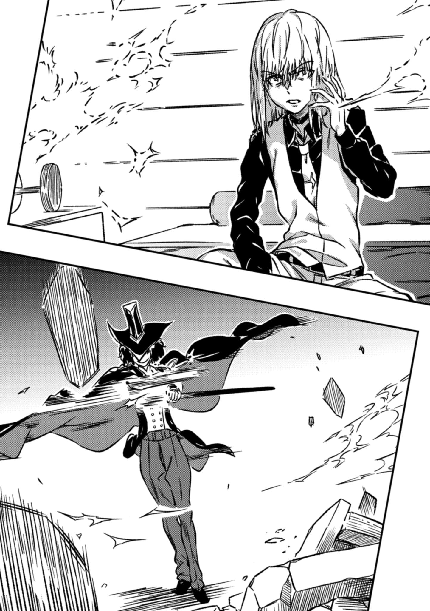
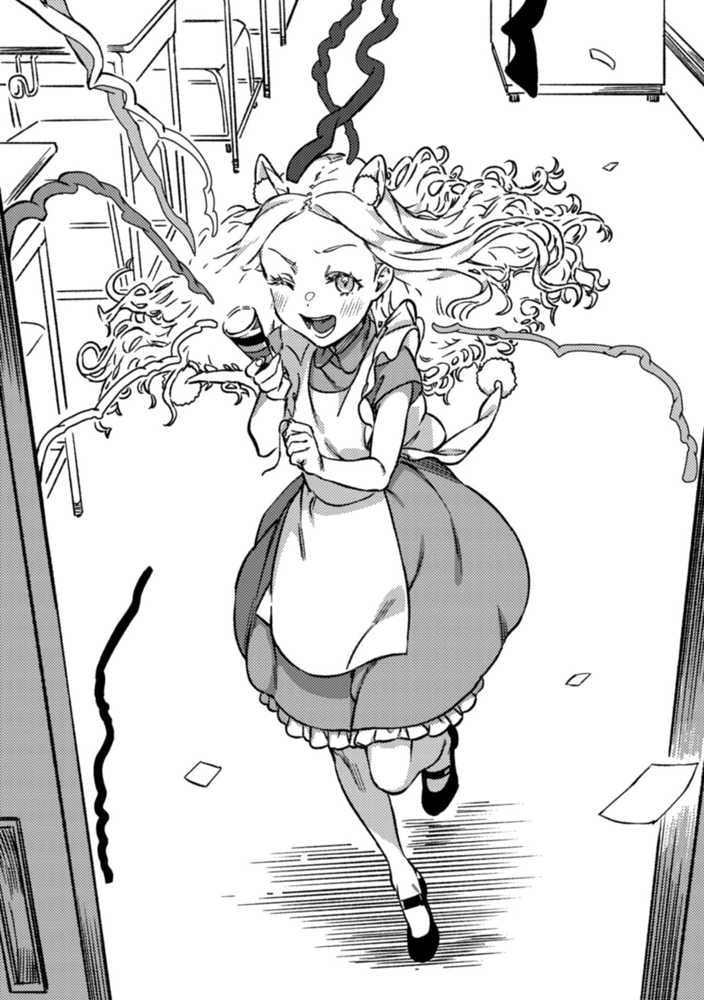

# 第二章 欢迎来到五彩境

> Little_Queen_Wonderland.

## 1

这里是第十学区的监狱。

新任统括理事长·一方通行(Accelerator)的大本营就在其最深处，一间戒备森严的单人牢房。

「你有关于爱丽丝·异典的情报？」

『是的。』

牢房墙壁上嵌入的巨型屏幕亮起，映照出米娜·马瑟斯的面容——或者说，看起来像是她。

一方通行(Accelerator)记得，那是先前在学园都市的夜里碰到过的，自称黑猫的魔女。

『就现状来说，您既然已是学园都市的新王，想必对墙「外」那片广阔世界，多少也该有所察觉。就算不提那些从生命力中精炼魔力、再构筑术式的细节，至少也该意识到，世上还存在着与学园都市的超能力开发体系截然不同的神秘领域。』

「你们那侧的事？」

『有些东西，就算您动用全部权限检索也无法触及，它们覆盖了世界近半的疆域。道理很简单：如果查遍整个科学阵营都找不到答案，那就该干脆承认，那是魔法阵营的造物。』

一方通行(Accelerator)不耐烦地咂了咂嘴。

这种关头，能辅助他做出判断的只有人工恶魔逆源质拼图545。这本身或许就是个问题。

无论多么有用，只靠一条情报源总归太过危险，随时可能变成致命的阿喀琉斯之踵。

至少得有两条，稳妥的话得要三条。

虽然他不认为逆源质拼图545会轻易因为得意忘形而堕落，但如果她的重要性上升，遭到敌人袭击的风险也会随之增加。不论增加多少情报源，都不可能将风险彻底清零。但为了将风险稳定控制在一定程度以下，这恐怕是接下来必须解决的课题。

总之——

「说说你的情报。采纳与否，由我来判断。」

『我可没说过要无条件向您提供情报。』

「……都这种时候了，你还想讨价还价？」

空气凝固了。

就在他们通话的这短短时间里，暴徒仍在街头巷尾横行无忌，学园都市正一寸寸地被蚕食破坏。

尽管已经给警备员(Anti-Skill)和风纪委员(Judgment)配发了实弹，虽说其中甚至混杂着高位能力者，但城市居民向城市居民开火，损害也只会从学园都市内部扩散开来。

最终得利的，只会是那些从外部介入、引发动乱的爱丽丝和「超绝者」之流。这帮家伙花上0日元就能让这座城市走向毁灭，甚至将整个世界拖入深渊。

现在必须尽快攻下这里，关上那不断涌出死亡的水龙头。

立刻。

如果对方明明心里清楚，还故意拖延时间来抬高价码，那这胆子可真不小。

他现在，是新任统括理事长。

学园都市将来会成长为怎样的城市，明明都担在自己这副肩膀上。

『说到底，我并不隶属于学园都市。而现在，我甚至算不上纯粹的科学阵营居民。因此，我之所以愿意公开掌握的情报，是为了寻求自身的利益。如果条件谈不拢，那这份情报自然也就没有公开的必要了。』

「……」

『我的诉求与亚雷斯塔·克劳利有关。至于我，您尽管把我列入黑名单好了，但那位「人类」是不同的。亚雷斯塔已经在英国死过一次，又迎来了第二次死亡，他已经清偿了罪孽。没有比死亡更重的惩罚，那位「人类」是凭自身意志接受了这一切。我知道您直接继承了代码列表，但也没必要苛待前任吧？危急关头，向前任请教一下，也没什么不好，不是吗？』

&nbsp;

『哎呀。』

&nbsp;

非常突然。

未经一方通行(Accelerator)允许，某个不明身份者，竟强行切入了这条通讯里。

在这座戒备最森严的监狱里，出现了来自完全未知路径的访问。

某种意义上，这恐怕是比一方通行(Accelerator)更熟悉学园都市底层构造的「人类」的手笔。

不过，她的模样和之前收到代码列表时相比，似乎已经大相径庭。

『看来，我构建的那套演算结构，给各位添了些不必要的麻烦。那东西本质上会遵循这一种思维模式——无论怎么伪装坏人，也无法真正为恶。放心，她最终总会交出爱丽丝·异典的情报。和你我都不一样，放心好了。』

『亚雷斯塔。现在我正在利用手头的情报，通过学园都市的官方渠道进行公对公的交易！我不会亏待你的，所以不要多管闲事，安安静静待着。』

『何必这么急着逞强？一点都不像你。无论我遭遇如何，你的本事都是有目共睹的。只要先证明你作为米娜·马瑟斯的实力，再重新与学园都市建立联系，对方至少也愿意听你谈谈吧。』

『（……你难道还不明白，光靠我的名义是没有意义的？你这个不通人情世故的孤僻蠢货。）』

别把我扯进来，两个蠢货。一方通行(Accelerator)低声抱怨。

真是个麻烦的人外傲娇。

「所以，你到底交不交出手里的情报？」

『咳。好吧。不过请明确一点，这份人情并不是欠我的，而是欠了某个「人类」。新任统括理事长的交涉牌，我就收下一张了。』

『米娜。很抱歉在你用低沉又严肃的腔调放狠话的时候打断你，不过……屏幕外传来了婴儿的哭声。你可以先退出线上会议去哄哄孩子，没关系的。』

『……你以为我是在给谁带孩子？！以为把孩子一股脑丢给保姆就算尽责了？！你这个完全搞错状况、逃避育儿责任的混蛋！』

米娜·马瑟斯嘴上虽然这么说，却似乎还是在屏幕外老老实实地忙活着什么。夹杂在婴儿咯咯欢闹的笑声中，她这样开了口。

语气也郑重起来。

『根据最早的记录，「异典」这个词最早出现于二十世纪初的英国伦敦郊外。亚雷斯塔，你当时应该已经带着妻子萝丝踏上了环球旅行，所以并不在同一个地方。』

『……我离开之后，英国发生了什么？』

『那是当时的一种新思潮。有一种学说认为，《爱丽丝梦游仙境》是一本真正的魔道书，只要完全解开书中隐藏的含义，就能掌握世界的构造，甚至操控世界。当然，这**不仅仅**是停留在字面上猜测十九世纪的刘易斯·卡罗尔当年是看到了什么才写出这本书，更包含了类似将内容替换为数字，调换语序之类的「密码解读」手段。』

『原来如此，所以才叫异典。』[^1]

『对。强行用自己那套规则解读《圣经》的魔法结社向来不少，而这帮人，不过是想用《爱丽丝梦游仙境》玩同样的把戏罢了。』

总之，当时那群连长相都没留下的魔法师，他们的目标倒是很明确。

一个忠实再现《爱丽丝梦游仙境》的媒介。

一种以人的形态呈现的魔法。

『如果要追求极致的细节还原，那实际使用的「素体」，自然必须是世间独一无二的。』

道理很明显，《爱丽丝梦游仙境》本就是虚构的故事。

无论是仙境还是爱丽丝，现实中都不存在。

基于这一点，米娜·马瑟斯斩钉截铁地说道。

&nbsp;

『爱丽丝·普莱曾丝·利德尔。』

&nbsp;

陷入了短暂的沉默。

随后，米娜·马瑟斯用一种近乎机械的平板语调，继续说道。

『说到底，《爱丽丝梦游仙境》这本书，最初并不是为了出版给大众看的。它的原型是一八六二年七月四日，当时身为数学老师的刘易斯·卡罗尔即兴讲给爱丽丝等几个孩子听的故事——《爱丽丝地下历险记》。换句话说，书里的故事纯属虚构，但故事的主人公，那个叫爱丽丝的女孩，是真实存在原型的。』

『你的意思是……如今这个爱丽丝·异典，是某个魔法师绑架了那个原型小女孩，然后把她彻底改造成现在这样子的？』

『如果真是这样，那现在这群常规的「超绝者」把爱丽丝当作原型或者说「雏形」来顶礼膜拜，也就解释得通了。他们看重的，并非爱丽丝的骨骼、器官结构，而是别的层面。很可能，他们就是从异典这个最终成品里，逆向解析并还原出了当初那个将爱丽丝这个小女孩彻底改造的术式本身，然后把这套术式用在自己身上，最终发展出了可以随意披上神明外壳和权能的**神装术**。』

这就是爱丽丝·异典的真身。

是某个曾经随处可见的平凡女孩，被异化后的形态。

将绘本的原型，一个活生生的人，彻底改造成童话女主角的，某种东西。

从现实映照入绘本，又从绘本扭曲回现实。虚实纠缠，就像一条莫比乌斯环，无始无终。

以及，让这一切成为可能的一个术式。

『真是……童话，或者绘本，作为工具用来辅助集中精神、构建意象进入冥想状态，确实很有效。但谁能想到，竟然有人会误以为童话本身就指向了世界的真相？更麻烦的是，这帮人胡搞乱搞，居然还真让他们搞出了一些名堂。』

『这可不是别人的事，亚雷斯塔。』

『？』

『我想，你大概已经隐约感觉到了吧？在魔法的对应关系这部分里，对《爱丽丝梦游仙境》格外推崇备至的，不就是你自己吗？亚雷斯塔·克劳利。如果你愿意，我甚至可以具体指出，在你亲笔写的那本魔道书的第几页里，提到过相关的内容。』

『……』

『你以前不是说过类似「若是卡巴拉的专家就能明白这本书中的奥秘」这样的话来吊那些半懂不懂的人的胃口吗？但实际上，你根本没想那么深吧？你在同一页列出的书单里，不还放了《德古拉》那种当时的热门小说？甚至连毛姆那本明显是影射攻击你个人的《魔法师》，你都故意推荐给身边人当必读书，不就是图个乐子吗？虽然写进魔道书的角落让这一件事更出名了些，但在更久之前，你嘴上就在这么吹嘘了吧。』

……一方通行(Accelerator)叹了口气。

被自己早已抛弃的过去反咬一口，这种事也算不上多稀奇。

不过，强如他这个第一位，倒还没干过因为一个玩笑或恶作剧，就把整个世界推向毁灭的事情。

『照你这么说，幕后黑手难道是我的哪个弟子？』

『那年代可就太久远了。有迹象显示，在你出道的同一时期，对方就已经在活动。这么算起来，更像是你的老师，不是吗？』

传来了嗤嗤的轻笑声。

亚雷斯塔似乎在笑，带着一丝嘲弄。

『我的老师，对吧？』

「那是谁？」

『谁知道呢？』

「你难道一辈子都没见过他？开什么玩笑，那不是教你魔法的身边人吗？」

『能号称是「克劳利的老师」的人，那数量也太多了。没办法，谁让我太有名了呢？父母、亲戚、学校老师、各路「魔法结社」的大人物……只要跟我稍微有点交集的人，对我的评价基本就两极分化。要么是「离那种危险人物远点，别把我扯进去」，要么就是反过来，「那个大名人？我一手带出来的！」不用说，后一种占了绝大多数。被身边认识的人讨厌得要死，却被八竿子打不着的陌生人疯狂崇拜——这就是我。』

「……」

『毕竟，就算在我被**公开宣告死亡**的一九四七年之后，全世界打着克劳利老师旗号招摇撞骗的魔法师不是照样层出不穷吗？甚至到现在这个时间点还有，完全无视时间逻辑。他接触的不是永久遗体，而是出生于十九世纪、当时还活着的爱丽斯·普莱曾丝·利德尔本人，说明这家伙的活跃年代应该离我不远。但说实话，我一点头绪都没有。只知道他充其量也就是个随处可见、藏在世界某个角落、手艺还过得去的魔法师而已。』

所谓历史的积淀，也是有利有弊。

新任统括理事长，学园都市排名第一的超能力者(Level 5)。此时产生的，正是与这样的一方通行(Accelerator)截然不同的扭曲。

『顺带一提，自从一九〇四年，我从爱华斯那里获授《法之书》之后，冒出来的魔法师，或多或少都受到了我的影响——这在魔法阵营算是公认的看法。如今这个时代，超自然这个词的定义，早就被我彻底**改写**了。呵，虽然那些藏在世界犄角旮旯里的老家伙们（笑），大概会嘴硬不承认吧。但至少在现代，想要完全不受我半点影响就学会魔法，基本是不可能的了。』

『科学这个词，不也是被你随心所欲地重新定义了吗？符合所谓的科学，并不代表就更高级或更接近真实。说到底，在你出生之前，科学和魔法根本没有明确的界限，都只是探索世界本质的「学问」而已。比如在十九世纪当时，名为「黄金」的魔法结社，被视为学者、诗人、女演员等各界知识分子聚集的秘密沙龙。魔法不是什么不切实际的疯子行径，而是为了正确认知世界的学问。亚雷斯塔。憎恨结社的你扭曲了定义，把科学与现实信仰画上等号并广为传播，构筑起今天这种以科学为中心的常识基石。反过来，正是为了将魔法与超自然贬低为不可理喻的变态们的玩物。』

对世界影响力过大，终究是把双刃剑。这恰好证明了，所谓的领袖魅力，同样可能导向灾难。

亚雷斯塔·克劳利。

难道说非要躲到月球背面才能逃脱这家伙的影响范围不成？

「喂，具体用了什么技术我是不清楚，但说白了，不就是克劳利的老师？那个不知道到底有没有真本事的家伙失控搞砸了而已吧。善后你们那边搞不定吗？别跟我扯什么了解彼此手段却束手无策这种蠢话，我可不答应。」

『失败嘛，也分很多种。』

亚雷斯塔用一种近乎无可奈何的语气说道。

大概，当年看着所谓「黄金」走向末路时，也是这种眼神吧。

『只是哑火的话，大家都不会困扰。但失败可不止这一种。打个比方，有人凭着半吊子的知识造了个实验反应堆，结果没控制住，导致核裂变失控了……如果是这种情况呢？』

「……」

『爱丽丝确实存在。**明显太过成功了**。但创造她的那个魔法师，却消失得无影无踪。能完成那种等级作品的设计者，无论好坏，都该相当惹眼才对，可现在连一丝线索都找不到。还不明白吗？这个所谓的克劳利的老师，也许是我以前在哪见过的「黄金」里的某个成员，也许是哪个不相干的肉铺老板或者酒鬼，但不管他是谁，都早就死了。恐怕，他刚完成爱丽丝·异典这个杰作，就立刻成为了自己亲手创造出的巅峰作品手下的第一滴血。所以，就算把整个世界翻个底朝天，别说尸体，连他存在过的一点点痕迹都找不到。』

亚雷斯塔嗤之以鼻。

那眼神里带着讥诮，仿佛看着一个工匠沦为他自己发明的刑具的牺牲品。

而她，也是个能乐于见到这种景象的「人类」。

亚雷斯塔在学园都市里开发了这么多凶暴的超能力者(Level 5)，却总能巧妙地避开被自己造物反噬的下场。比如说，那七个人要是联手，足以把一座城市夷为平地。但他们几乎个个都对学园都市憋着火，却又不可思议地从未真正联手闹翻天。超能力者(Level 5)们就算偶尔会短暂地并肩作战，也绝不可能长久合作。这到底对谁最有利？和那个造出爱丽丝就被反杀的倒霉蛋不同，难道是因为亚雷斯塔**管理有方**吗。

总之，爱丽丝·异典的根基，与克劳利式魔法magick密切相关。

既然那个拐走爱丽丝·普莱曾丝·利德尔的魔法师不是亚雷斯塔认识的人，那他大概也无法直接搞懂对方的术式。但对于一手构建了近代西洋魔法框架本身的亚雷斯塔来说，从现有的碎片信息里进行类推，应该绝非不可能。

看到了希望的曙光。

虽然把抛弃了学园都市的「人类」放在左右存亡的核心位置上让人极不情愿，不过涉及魔法方面的事，也只能交给人造恶魔逆源质拼图545之流去监视了吧。

正当新任统括理事长一方通行(Accelerator)这么想着的时候。

他猛地抬起头。

「是谁？」

嗞——！！！！！！

监狱厚重的防爆墙壁，瞬间迸裂出数道笔直的切口。墙体像是被精准切割过一般，在重力作用下轰然垮塌，瓦砾哗啦啦地滚落一地！

按理说，这面墙壁的材质与「没有窗户的大楼」相同，足以抵挡住学园都市第一位的矢量攻击才对。就算是来自**相当于它背面的**外侧，也不该被如此轻易地突破。

「……喂。」

一方通行(Accelerator)一动不动。

他坐在床上低声说道：

「我问你是谁。不回答，是听不懂人话，还是没教养？我没打算自己走出这笼子，但也没打算保证随便闯进来的蠢货能活命。」

锵，一声细微的金属声。那是将细剑收入伪装成手杖的剑鞘时发出的声音。

然后，在散落的瓦砾对面，黑发青年管家恭敬地鞠了一躬，

随即宣告道：

「在下H.T.特利斯墨吉斯忒斯。」

「……」

「无论您怎么调动学园都市的力量，我们都无所谓。但是，如果因此惹恼了我主爱丽丝，让她动怒，那事情就会变得非常麻烦……一般而言，我推荐您选择外场对阵外场，这种程度的难度，应该比较合适吧？」

## 2

小安娜·施普伦格尔气鼓鼓的。

她被丢下了。

让人更不愉快的是，上条当麻**并不是独自消失的**。

难道她的待遇和蜷缩在房间角落里的那只三色猫一样吗？

她匆忙地推开学生宿舍的大门，脚下踱着步，最终意识到这样做毫无意义。说到底，她根本不知道上条当麻和爱丽丝会在哪里。

（……爱丽丝·异典的反常行径也未必是那个蠢货一个人的责任，他明明可以指责我，是我故意让她脱离了「正常超绝者」的轨道。）

爱丽丝·异典确实是超凡的。

即使穷尽「蔷薇十字(Rosenkreutz)」系的秘术，也不可能正面击败她吧。

但认识到这一点，就有办法解决。

倒不如说做一些暗中周旋的肮脏勾当，将不可能的事扭转为可能才是坏女人的拿手好戏。别忘了，她曾成功接触到受「桥架结社」保护的爱丽丝，并让她像看待绘本主人公那样对上条当麻产生了兴趣。

（蠢货，你该不会打算说什么「因为不想让我做那种脏活才一声不吭地跑出去」这种蠢话吧。）

「算了！！只能先用占卜缩小范围了。犯规就犯规。况且这次，除了上条当麻和爱丽丝·异典，我实在是想不到还有谁可以通过思考得出正确结果……」

当然，她还没有单纯到认为用塔罗牌或者水晶球就能占卜出答案。

爱丽丝·异典不会如此毫无防备。

安娜贵为秘密首领的巫女。然而，如果在这缺乏魔法知识的学园都市里，出现能够强烈抵抗她的「检索」的存在，那意味着什么呢？

那毫无疑问便是那两个人的所在之处。

实际的占卜不需要水晶球。安娜拿起一旁的放大镜，用粗头的黑色油性笔将镜片涂得漆黑，念叨着。

「真是的，在我赶到之前可不准擅自死了啊蠢货！！」

## 3

自己就读的高中。

话虽如此，其实情况挺复杂的。一所是被「魔神」僧正所摧毁的原来的学校，另一所是后来借用的学校。

没有所谓的正确答案，没有人能够仅凭逻辑得出答案。

这其实只取决于上条自己的看法。

正如绘本里的少女随心所欲地漫游仙境一般。

最后，他选择的是原本就有的那所高中。

学园都市的各项科学技术领先「外界」二三十年。即使街区遭到「魔神」僧正、元素、还有其他种种袭击者的破坏，也能在极短的时间内修复如初，或者被重新开发。

上条的高中也一样。

如果不说明的话，恐怕谁也无法察觉这里曾经被重建过。巨大的教学楼，泥土地面的操场，以及游泳池、体育馆等附属设施。尽管建筑的轮廓仍被施工用的脚手架与厚重的隔音幕布遮挡，但整体已然竣工。就像是一个等待拆开的礼物，一所随处可见的学校理所当然地伫立在这里。

「真厉害啊……」

肩膀上十五厘米的欧提努斯小声嘟囔着。

上条皱起了眉头。

虽说确实厉害，但这只是科学手段罢了。尽管已经失去了明显的力量，但再怎么说，「魔神」这等存在居然会对区区学园都市的建造技术惊叹不已？

「完全不对，不是那个意思。不过我也没指望你能察觉地脉的紊乱和扭曲，等你踏入其中就知道了。反正如果你想见到爱丽丝的话，这也是绕不开的。」

「？」

那是学校的校门。

明明已近深夜，推拉式铁门却不知为何开着。

那是上条刚迈步踏入其中的瞬间。

世界发生了巨变。

倒不是颜色和光线特别明显地发生了变化。

只是在踏入的一瞬间，上条就皱起了眉头。

说是沼泽，倒也不像。

比沼泽更加危险。以至于如果想用名字去认知它，恐怕脑袋会因此坏掉。

必须特别注意体力和消耗。

不能有一丁点浪费。

从这里开始，只是普通的走路也有可能危及到生命。

即使是一个普通高中生也能明白这一点。

肩膀上的军神欧提努斯开口了。

「……只要爱丽丝愿意，她随时能将眼前的景色替换成任何世界。第十二学区的领事馆就是很好的例子。」

「那不是周围的『超绝者』干的？」

「你要设想普通的『超绝者』能做到的事情，爱丽丝全都能做到。倒不如说她才是原型。」

「原型……？」

「你真当『桥架结社』的人是在没有任何提示的情况下，凭借自己的力量创造出『披上神的外衣』这种夸张的术式的吗？因为自己做不到就舍弃了魔法名，转而依赖其他人，这群乌合之众的实力真有这么强？……换句话说，普通的『超绝者』其实就是基于爱丽丝·**异典**这一开源代码，根据个人喜好对细节进行修改，所打造出的客制化产品。至于爱丽丝本身的真实身份，我可就不得而知了。」

欧提努斯的语气虽然尖锐，但她大概对地球上任何一个人都是这样的。

倒不如说……

「？……话是这么说，但听起来不像是看不起对方啊，神明大人。」

「因为我没有看不起他们的理由。」

**真正的神明**轻描淡写地回答。

无关对错，只是做法不同。她的口吻就好像是国家级舞蹈家看着智能手机视频里随心舞动的年轻人们，脸上露出了叹服的神情。

那位独自积累信仰、自我磨砺到能被称为神的存在的独眼少女，似乎如此评价那些能够轻松选择并打扮成古今中外各种神祇形象的「超绝者」。

「本质上来说，魔法的定义就是邪门歪道。在疯狂的魔法世界里，正直的人如果正道走到头了就老老实实地停下脚步，只会被嘲笑是个死脑筋的傻瓜。在认识到自己力量不足之后，也不因为现实碰壁而放弃，即使不断地做无谓的挣扎，依然想要抵达目标。这种做法对魔法师而言并不奇怪……更何况北欧的最高神可是『欺诈之神』啊。难不成你忘记了吗？我可是打倒了欧雷尔斯，夺走了他的可能性与未来才成为『魔神』的。」

「……」

「无论如何，我为了得到『理解者』就抛弃了自己诞生的世界，是个**任性**之人。将自己的内在与外在全部抛弃去扮演另一个神，我可不打算把这种方法套用在自己身上。」

规模差得太过离谱，上条只能哑口无言。

没想到神明这个词会成为这个脚踏实地的世界中，理所当然的普通话题。

作为可靠的同伴。

或是作为现实的威胁。

「从根本上来说，无论是正确的答案还是矛盾的论点，凡是曾出现过的理论或逻辑，爱丽丝都可以在它们之间架起一座桥梁，并完全按照自己的意愿操控。她就是这样超乎常理的存在。地心说、燃素说、人类登月其实是谎言、千年虫将使全世界的计算机失控进而毁灭世界、中微子能超越光速，也就是说没有任何限制。异典的自由度轻而易举地超越了魔法本身的框架。说得更直白些，不存在她做不到的事情。」

理所当然存在于此的十五厘米眼罩少女无奈地叹了口气，重新将目光投向夜晚的教学楼。

「即便如此，爱丽丝还是认为，这片景色保持原状就是最好的。你不觉得这反而透露出一股偏执吗？言外之意便是，如果使用她那无所不能的工匠能力，改变哪怕一条小路的宽窄，或是削掉建筑的一个小角，都会让她丧失对这个地方的所有兴趣。」

「……」

「但无论外形如何，这里已是爱丽丝的城堡之中了。人类，这不会是一个对你温柔的世界。」

死亡的密度正在上升。

原本上条就是不幸的，但今晚的不幸不同往常。

这是有人故意为之的。

这里是顺从于某人心意的世界。

完全由那一点涂抹固化的场所。当包括看不见的概率在内的这一切向侵入者露出獠牙时，上条当麻又能做什么？

「做好准备吧，人类。」

「魔神」欧提努斯小声说道。

她是凭借战争之神的嗅觉探查出来的，抑或是借助了魔法或诈术？

「要来了。」

## 4

第七学区的铁桥上。

变装的暴徒们占领了大部分的大马路，只有这座桥上连一辆车都没有。或者更确切地说，是**这里无法通车**。

有的，只是几个身影。

「超绝者」对战「超绝者」。

考虑到他们使用的术式，他们根本没有必要步行过桥，而且前往作为世界扭曲中心点的「某高中」的路线也「不止」这一条。

即使如此大家还是选择了这里作为集合点。

明明没有任何人决定，却像事先商议过一样。

河流。这或许是他们凭自己的意志跨过边界的一种仪式。

「哎，想一想就能知道事情会变成这样，正因如此我们也决定帮助他。」

「……从『桥架结社』整体来看，母亲大人一方是对抗爱丽丝的反叛者吗？」

「爱丽丝一死就作鸟兽散，一复活就趋之若鹜。这帮乌合之众的话语完全不足以阻止支配夜与月的魔女们的女神。」

看着嗤笑的阿拉蒂娅，带着宽大帽子的「古老善良的玛利亚」摇了摇头。

「你还真是迷上他了啊。」

「我你不懂你胡说什么话。」

「虽然你依旧一脸冷静，但整个人都已经坏掉了。」

「不过，按常理来说即使我们这些常规的『超绝者』再多，也不可能比得过位于顶点的怪物，爱丽丝·异典**本尊**吧。」

博洛尼魅魔双手放在脑后，苦笑了一下。

这一前提是正确的。

但她们的行动却与之相悖。

「即使如此，大家还是不管不顾地聚集在了一起。这就已经是答案了吧。」

「CRC之战某种意义上起了积极作用呢，阿拉蒂娅。因为作为个体的『超绝者』该以何种立场面对那位少年，已经没有逐一讨论的必要了。」

「既然如此为什么你倒是干吗要征求我的意见说你的根据？」

「太露骨了，你这色鬼。」

「就是，就像住在附近的那种骨子里明明挺知性、却又欲求不满的放荡大姐姐。」

「阿拉蒂娅是色鬼？」

就连面无表情的褐色少女也这么说，阿拉蒂娅阴沉着脸低下了头。

「……太失败了。居然会有这么一天，连这个带着『啾～☆』特效对那个少年莫名一见钟情的超恋爱脑神明都能嘲笑我……」

「不过就连那个专职处罚的姆特·底比斯都无动于衷的话，可以认为我等还没到被定罪那个地步吧。」

「嗯？」

阿拉蒂娅、博洛尼魅魔、「古老善良的玛利亚」，以及歪着头的姆特·底比斯。

不约而同地集合，准备前往某高中的「超绝者」们停止了吵闹，视线看向同一方向。

尽管她们聚集了这么多人，但还是不够。

「也就是说，该被揍飞的是那边。」

花束之布洛代韦德。

吠达特里。

第二萨迦。

此外还有几个黑影集结在铁桥的另一侧。他们也都是「超绝者」。是放弃了等同于自己人生支柱的魔法名，换来自由使用自己所选的神明外观和能力，施展强大的术式，能以一己之力与全体魔法阵营正面作战的怪物。

世界的平衡倾斜了。

即使将魔道书图书馆——禁书目录安置在科学阵营中心，也只能勉强维持的整个世界的平衡，这一次明确地动摇了。

但要这么说的话，爱丽丝·异典这一个体盘踞在这座城市的时候，场的扭曲原本就已经是致命的了。

博洛尼魅魔瞪着敌对阵营中的某人，眉头紧蹙。

有个特别棘手的家伙。

「花束之布洛代韦德……」

「哎呀☆感谢指名。」

作为回应，对面一头蓬松金发（说到底**仅**从外表上看大约十六岁）的少女露出谄媚般的微笑，显得十分不自然。

「还扎着俩丸子头(Chignon)，你这离谱的双马尾老太婆。」

「你先数数自己生日蛋糕上的蜡烛有多少再说我吧。」

她貌美如花。

但仅此而已。

她这身衣服像晴天娃娃，又像游泳课上那种带松紧带、从脖子往下裹得严严实实的浴巾。这是一身像大衣一样的特殊防爆服，在结实布料上贴满了厚实铜板，连少女特有的身形轮廓都被完全遮盖住。

又或者是铁处女。

本来布洛代韦德指代的是凯尔特神话中登场的鲜花女神或妖精。有一位受女神阿丽安萝德诅咒、不被允许与任何人结婚的男神，布洛代韦德是用数种花卉植物为原料制作出来为他准备的妻子。她有着无法想象的美貌，是人造的美女。造出的女人虽然有倾国倾城的美貌，但在内心设定上却出了问题，变成了放荡的背叛者，和情人勾结想要取走丈夫的性命。近年的科幻作品常以诞生于过激技术的人造怪物为题材来展示叛逆和失控的恐怖，实际上这是在公元前就已存在的充满历史和传统的古典题材。

这位「超绝者」，特意选择并演绎这尊神。

她的「救济条件」是——

「……**拯救所有不被任何人爱着的孤独的存在**，是吧。」

「那又如何——？」

「你这彻头彻尾的野兽，只会居高临下、毫无反转余地地一味倾注致死量的爱意。什么比我还像个魅魔的『超绝者』，我早就看你不爽了。」

等待着的，是一张笑脸。

或者说，对方的想法也是一样的。

「哈哈哈☆感情这东西本就是外界注入的。让我把我的感情给你一口气灌满吧，像浓厚的炼乳一样化都化不开。反正怎样都要杀掉你，比起一边涕泗横流地互相劝说一边互殴，还是这样更好吧？」

「确实如此。」

但这只是花束之布洛代韦德和博洛尼魅魔之间的孽缘。

这不能成为其他「超绝者」们集体追随她的理由。

重申一遍。

「爱丽丝坏掉了。」

一位看上去二十五岁左右，黑发褐色皮肤，身高约一百八十厘米的模特身形的美女，扭曲着赤色的双瞳开口说道。

她是吠达特里。

在印度神话中，她是居住于地底，以织布形式操纵命运的女神。她一直与创造女神一起行动，自由自在地操纵全世界的走向，因至高无上的权能，她和与她成对的另一位女神一起被吸收为最高神梵天和毗湿奴的别名。是被人为干预而重组的象征。

这位表演者，自己选择了如此角色并演绎。

她的声音冰冷到仿佛仅凭话语就能撕裂空气。

「第一次是因为安娜·施普伦格尔的暗中活动。但起决定性作用的是上条当麻。爱丽丝的四分五裂完全由他的无知导致。不能再次让他接近爱丽丝。爱丽丝再次苏醒本就是奇迹，怎能让她再堕泥潭之中。」

「也就是说。」

阿拉蒂娅轻叹了一口气。

她手上拿着的不是扫帚，而是不知从哪条铁路道口上扯断的，黑黄相间的升降杆。

她将其扛在肩上，投向对面的眼神中带着不止几分的轻蔑。

「你们站在爱丽丝那边吗？」

「没错。」

「骗子。你们只是害怕自己作为『超绝者』的力量根基被动摇、最后可能消失罢了。」

一阵沉默。

这即是默认了。

开源的缺点就是，谁都能自由浏览与利用其内部构造，这一点可能被怀有恶意的第三方利用，分析其内部代码，从而开发出针对性的病毒或恶意软件。

也就是说作为原型的爱丽丝本人如果被其他第三方回收的话，对「超绝者」群体而言十分危险。尤其是千万不能落入安娜·施普伦格尔或亚雷斯塔·克劳利这种**卑鄙的胜利者**手中。尸毒也好符咒也罢，不管是什么形式，只要能发明出一个源自爱丽丝的对抗策略，整个系统都会有被连根拔起的风险。

所以，他们在上条当麻无意识「引起」这种发展之前开始行动。

差不多就是这么回事吧？

结果，真心实意担心爱丽丝·异典而追随她的「超绝者」就只有H.T.特利斯墨吉斯忒斯。那个阴暗又不起眼的一般论者，根本是个毁灭世界的萝〇控，他自己才是最不一般的吧。

花束之布洛代韦德没有否定自己的弱点。

「我有必须由我亲手拯救的『救济条件』。哼哼☆就算是为了他们，也不能在这里失去作为『超绝者』的力量，为了他们。」

「……终于拿来当**借口**了吗，你这淫妇。」

「那又如何？」

「即便要踩碎地缝中顽强生长的蒲公英，我也一定要见到爱丽丝。」

一阵机械声响起。

花束之布洛代韦德。伴随着咔嚓咔嚓的开锁声，她身前纵向排列的重锁依次打开，从脖子到脚踝完全覆盖的厚实铜板大衣像双开门一样敞开。

光芒炫目。

甜腻的香味近乎凝结成厚实的墙壁。

外套的内侧是万紫千红眼花缭乱的植物栽培所。那是被合适的水分、营养、电热器和紫外线LED灯所支撑的，被封在透明玻璃容器中的常春花园。

而「本体」不过是在白得耀眼的肌肤上套了一件满是褶边的围裙而已。

从金属大衣中伸出的左右两只袖子，似乎不过是远程操纵的机械臂罢了。

「这装扮真是花里胡哨。」

「或许她自己以为已经解放了真正的力量了吧。虽说为了诱导自身，需要将易懂的怪异魔性特征极致外显，但超越人类的美貌就这？暴露即为正义，多么低俗的人设。」

阿拉蒂娅有些冷淡地说道。

魔女大姐姐要求用高尚的道德匹配睿智和奇迹，（实际上）不习惯被（青春少年）非分的目光盯着看，但她好像忘了自己的装扮。

少女过于苗条的身材比起妖艳更让人感到心疼。她露出惹人生厌的笑容。

至少「从外表看」，她装备齐全，散发着甘甜的香气。

「哎呀呀，难道你们忘了我的特征了吗～？」

「……」

传来波浪般的声音。

哗哗哗哗哗哗哗哗。

「啊哈哈☆不只是爱丽丝，即使只是常规『超绝者』的我们，或多或少都有着只是存在就能扭曲人类社会使其向某个方向发展的影响力(领袖魅力)。这也是扮演神明的弊端之一吧。但是啊，我的性质尤其出类拔萃。在这一点上，我的力量可是比爱丽丝还明显呢。」

不只是因为这里是横跨大河的铁桥。

这阵怪声很不对劲。

一月之夜，无视水流和风向，漆黑的水面正哗哗作响。

波涛汹涌。

&nbsp;

「我集世间万千宠爱于一身。不仅人类，鸟、兽、虫、鱼都在内。」

&nbsp;

轰隆。

有东西压住了巨大的铁桥。但那不过是黑鲈鱼和蓝鳃鱼等河流中的环境破坏者。仅此而已。这些既不神秘也随处可见的小生物，聚集了数万乃至数十万，形成了一股巨型波浪。

**悬丝傀儡般的生命**。

赤色与银色。

其威力和重量甚至能将万吨重的铁桥一击折断。

「如何呢，我的『全面求爱』☆」

叫声、信息素、舞蹈、色彩，她全面运用这些手段，随心所欲地诱惑包括人类在内的所有生物。也就是求爱专家。

她早已沉醉于胜利的感觉之中了吗？

兴奋的花束之布洛代韦德大喊道：

「哈哈☆放开来爱吧夜之恶魔，让我们不分彼此。仅仅因为诞生、繁衍就毫无理由地彻底遭人厌恶的环境破坏生物们，也给我拼命去爱啊！！！！！！」

「『冰冷女郎』。」

「啊嘎？！」

太好了，看来那将一切快乐转变为痛苦的术式效果显著。

## 5

场面瞬间变化。

如同水和油在极热的平底锅表面四散飞溅一般。

数名「超绝者」急速后撤重新测算距离，但另一集团丝毫不让，立刻如箭矢般逼近，而即便是集团与集团之间的战斗，也分化出数个战团，催生出一个个小型战场。

## 6

轰隆隆。

伴随着地震般的震动，夜晚漆黑的河流瞬间骚动起来。

花束之布洛代韦德将包含害兽、害鱼、害虫、害鸟在内的巨型城市本身化为自己的武器。但这里不止有她。

如巨浪般从侧面袭来、企图将铁桥吞没的大量鱼群，被足有圆顶球场大小的巨型三脚物体挡住了。

「『特里比科斯』。」

实验器具的管理者，「古老善良的玛利亚」静静地低语道。

与她对阵的是印度神话中的命运女神吠达特里。没有原因。偶然对上了眼神，呼吸之间，她们被留在了这混乱至极的战场上的同一时间与空间中。尤其在乱战中，节奏和时机决定了一切。对方也同样束缚着「古老善良的玛利亚」。

激战无法避免。

面对身着鲜红色纱丽，黑发褐色皮肤的八头身模特，「古老善良的玛利亚」如此说道：

「吠达特里，母亲大人要动真格击溃你了。你又如何呢？」

「这样好吗？哪怕是我动起真格来？」

「请便。毕竟母亲大人慈悲为怀。这可是你不惜沾染污秽，忘却『救济条件』为何物，丑态毕露也不舍得放弃的『超绝者』的力量。虽然在母亲大人面前的是个令人不齿的婊■，但要是你连死死攥着不放的底牌都还没用过一次就被瞬秒，未免也太残忍了吧？」

哐当！！褐色美女突然多出了一条手臂。

不对，准确地说，是近两米高的人偶背对背和她紧贴着。这具等身大小的球形关节人偶比模特体型的吠达特里还要高，浑身坚硬光滑，与妖艳到令人无法呼吸、性感十足的褐色美女形成鲜明对比。

更准确来说，人偶被她用结实的肩带背着。

原本貌似全都收纳在方形背包里。

白丝与黑发，缠绕在造物的指尖。

印度神话中，命运女神吠达特里并非单独的存在。确切地说，她始终与创造女神达特里相伴，二者是成对的两位女神。

她们拥有着极其强大的权能，能通过纺出黑白丝线来织布，甚至决定整个大世界的命运。

线。

织布。

以及人偶。

「古老善良的玛利亚」一边逐个分析、快速预测其能力，一边有些无奈地叹了口气。

「……作为褐色皮肤八头身的绝世模特却背着红色小学生书包，你不觉得怎么看都太离谱了吗？」

「不过是面向全年龄普及已久的皮包罢了。」

「古老善良的玛利亚」的视野倾斜了。

尝到了血腥味。

自己的胸口被黏稠的红色染脏了。

「……？」

那是蓝鳃鱼。

超过一定速度的铅粒会明显具备杀伤力，花束之布洛代韦德开玩笑般召唤出的数万只害鱼也是如此，这些东西也能撕裂空气，活生生地嵌入胸口，钻进人体之中。

「古老善良的玛利亚」单手抓住突然钻进胸部、在伤口中狂暴挣扎的异物，将其拽了出来。其触感和锋利的刀刃又有所不同。伤口被张开的鳃和无数鱼鳞剐蹭进一步扩大，带着致命病菌的污秽也蹭了上去。

但她还有更在意的事情。

为什么，黑鲈鱼和蓝鳃鱼这些害鱼会冲进来？

她才发现，巨大的墙壁消失了。

「特里比科斯」。

在持有者稍稍转移视线之时，「古老善良的玛利亚」那圆顶球场般大小的王牌就轻描淡写地消失了。

如同噩梦般的神隐。

「你该明白的。」

咔嚓咔嚓！！随着弹簧声不断传来，像书包一样被背着的球形关节人偶达特里双手自动裂开，大量的滑轮和金属零件从中飞出。那便是织布机。

极细的白与黑漫天乱舞。

那是细线。

不对，貌似还包括了她自身的黑发。

「吠达特里是掌控命运的女神，达特里是创造万物的女神。以织就的黑布白布为基准，万事万物都由两位神明决定。『古老善良的玛利亚』啊，你或许能合成世间万物。但这世间万物具体是什么、有哪些类别，是由我决定的。」

「原来如此。」

「我名为吠达特里。与对应的女神一同，司掌命运与创造。是将世界以善恶好坏进行区分，**彻底拯救自己认为正确且喜爱之物**的『超绝者』。」

命运之线。

世界，便是这纵横交错的命运之网。

也就是说，与操纵一切之人对峙，就意味着这种事吗？

「……果然你和母亲大人一样啊。不过是从爱丽丝那里借用了一部分神秘力量，将其融入自己的身体中，最后却无法完美使用的半吊子的扮演者罢了。」

「胡言乱语。仅限这一领域，『古老善良的玛利亚』，你的存在也能轻易被抹去，只要在记载中故意遗漏即可。」

她甚至没有时间听到最后。

轰隆！！随着防波堤的消失，大量害鱼再次如银色巨浪一般，向着铁桥袭来。

## 7

振翅的声音在夜晚的校园中回响。

有什么东西闪过上条视线的右侧。那是拥有猛禽头部和狮子身躯的带翼怪物。

那是若无其事地混在《爱丽丝梦游仙境》之中的杀伤力具象。

是狮鹫。

「唔？！」

那是只有爱丽丝·异典在对世界感到无趣时才会放出的，高速破坏和善后的专家。人生的倍速模式。实际上在第十二学区领事馆，上条的右臂也曾被咬断过。

他根本来不及做出反应。

它巨大的双翼向左右大幅展开之时，上条内心的创伤迅速浮现。他下意识用双手摆出防御态势，这显然是错误的做法。狮鹫扇动翅膀，将空气的力量全部转化为前进的能量，足有小型卡车大小的庞然巨物猛然冲撞而来。

轰鸣声震耳欲聋。

但上条没有感到疼痛。

一抹粉色锐利地划破夜晚的空气。

不知何时已然出现。

火烈鸟球棒压制住了狮鹫的巨喙，不仅如此，还将敌方的一击卸向一旁，反而狠狠给了对方一记重击。

随着巨大的声音，狮鹫被扫倒在地上。

上条一脸不可思议地嘟囔道：

「……你是？」

他下意识伸出手，但如同想要抓住水中的落叶一般，空中的粉色球棒很快躲开。

或许它厌恶幻想杀手。

但即使如此，它还是如嬉闹般在上条周围慢悠悠地盘旋飞舞，随后与再度袭来的狮鹫钩爪正面交锋，夜空中炸裂出橙色的火花。

不仅有粉红色火烈鸟球棒。上条脚边蹦出几只比真正的刺猬大得多的刺猬球，随后它们爆散开来。爆炸，或者更正确地说，是将无数根针组合成长剑，破空而去，一起斩向新出现的多臂枯瘦人影。敌人是骨头，如水晶般通透的人体骨骼。

去年十二月二十九日。

他曾在和「暗部」的冲突中见识过。

那是奉红心皇后之命斩落万人首级的「处刑人」吧。

即使双方还有距离也不能掉以轻心。那东西不是靠臂力用物理方式进行斩杀，而应该是利用看不见的类似诅咒一样的攻击斩落首级。

互相激战的双方，都是《爱丽丝梦游仙境》中的怪物。它们和「矮小液体」不一样，是还未被外界的魔法师工具化，纯粹到令人无法掌握的天真玩具。实际上恐怕，区区一个只拥有特殊右手的高中生，连其中一只都对付不了。如果发生正面冲突，在触及爱丽丝本人之前，肯定就会被当场秒杀。

然而上条仍存活着。

受爱丽丝操控的存在，正在互相战斗。

也许这是她心中的矛盾。

他并非没有同伴。

哪怕身为当事人的爱丽丝本人对入侵者毫不留情地露出獠牙，可即便如此。

肩上的欧提努斯无奈地说道。

「……爱丽丝在等你。」

「是啊。」

「不知道魔道书图书馆现在怎么样了？不过，那家伙也是作为应对魔法战斗的专家而开发出来的特殊成员。既然刻意削弱了直接战斗能力，我倒希望她在其他生存策略上能更有所长吧。」

「其他？」

「利用交涉能力取悦敌对集团，或刺激保护欲从而使他们自发阻止暴力行为。」

「……」

「别一脸奇怪的表情不说话。也别嘟囔着不可能。这是为了你的精神健康所提出的乐观看法。」

无法想象。

在他认知中，茵蒂克丝是与这种计谋手段最无缘的存在。

就算用完全记忆能力准确掌握扑克牌和麻将的位置，要是动真格的赌博，她也会输给普通人吧……

反过来说，正因毫无算计才可能引发奇迹，这一点和爱丽丝如出一辙。

无法判断敌我双方的行动，这实在是令人头疼，何况他们还要救出人质。

肩上的欧提努斯也一脸苦涩地说道：

「『小孩子是拥有无限可能性的存在』么。那家伙，甚至在物理层面上拒绝做出选择、收束至单一方向。照这样下去，就连敌我这种一目了然的分界线都要消失了。爱丽丝将会催生出一百万个组织和图谋，一百万支军队毫无章法地互相冲突的时代即将到来。而只是被无端卷入其中的人类，就只能被彻底排斥在局外，一步步走向灭亡。」

「我会在变成那样之前解决问题。」

他的声音很轻。

但确实是斩钉截铁的断言。

「……爱丽丝之所以变得如此有攻击性，或者说变得无法相信身边人，是因为有人告诉她未来是可怕的。也许我也是其中之一。我伤害了她。所以我要去见爱丽丝，当面告诉她，人生并没有那么糟糕。」

「谁知道能不能传达得到呢。人类，你忘了那家伙实际上掳走了魔道书图书馆吗？说到底你是因为这右手而一直背负如此不讲道理的『不幸』，你的人生也没好到哪里去吧，有资格谈论世间的善良吗？」

「换个说法呢？运气好坏是由应对方式决定的。尽管我是个不幸的人类，但也不会因为你或爱丽丝这种天选之人感到自卑。就算在起跑线上落后，也不是说就到不了终点。」

这句话，是确实一路与「不幸」打交道过来的少年才能说出的，带有分量和感触的一句话。

正因他是曾经与「魔神」正面交锋时，跨越数亿数十亿次死亡、一步步逼近欧提努斯身前的少年。

咻的一声，破空飞来的粉红色火烈鸟球棒停在上条眼前。刺猬球趴在他脚边，鼻子里呼着气。还有未曾见过的大毛虫和小猪。这些家伙又是出自哪里做什么的呢？早知道就多读点童话了。

这些家伙的意思，是要守护上条的背后。

但，这大概也只是爱丽丝的其中一个想法。

轰隆轰隆轰隆轰隆！！随着爆响声，体育馆从内侧被撕裂，从中出现一只巨大又毛茸茸的猫。伴随着不悦的低沉鸣叫，它带着敌意盯向这边。外形虽是圆滚滚的宠物，体型却堪比怪兽电影。爬上上条脊背的寒意，与单纯的恐惧截然不同。要是被那种东西用半开玩笑的猫猫拳长时间折磨致死，作为人的尊严与矜持可就荡然无存了。

死亡与搞笑(幽默)的结合，引发强烈的不适感。

这只猫与众不同，即使和其他造物相比，也明显鹤立鸡群。

上条屏住气：

「这什么玩意？跟爱丽丝有关的猫，额，是什么来着？！」

「别变成不用手机搜索就什么都做不了的人啊。」

肩上的欧提努斯无语了。

「那大概是黛娜，爱丽丝的宠物猫。它在蝴蝶和小鸟也能正常说话的《爱丽丝梦游仙境》中，是近乎无敌、接近最强的存在。虽然在作品中由于身处现实世界一侧而只出现过名字，但反过来说，它拥有只要听到名字就会让所有登场人物吓得瑟瑟发抖、四散奔逃的高阶杀伤力。」

这也是一种想法。

如假包换的真心话。

爱丽丝也确实想要立刻杀掉上条。

但现在不是害怕的时候。

上条当麻不是被不讲理地卷入「仙境」之中，而是凭自己的意志踏入了代表死亡的异界。

「……话说回来，居然是只黑白相间的猫啊。」

「这点有那么重要吗？」

「作中黛娜只出现在爱丽丝的炫耀中，并没有明确描写猫的种类。《爱丽丝镜中奇遇记》里有它照顾小黑猫和小白猫的情节，所以世人推测它是黑色或者白色的母猫，不过在这里，看来是采纳了黛娜无需依靠公猫、独自将特性分别赋予两只小猫的假说啊。」

「不是，我可能下一秒就要被杀了，你的重点却在这儿吗？！」

茵蒂克丝也在这里，而且她待在这个异界的时间远超上条。

更重要的是，爱丽丝自己真的想要制作并散播这种东西吗？

「这些东西不过是缠在小指上的丝线，只是受她的一缕杂念所摆布的人偶和玩具而已。真正的爱丽丝·异典可不是这种存在，人类！」

「是啊，我知道。爱丽丝在等我。我早知道会这样，还是来到这里，现在又怎么能回头逃避呢！！」

## 8

这里是学校的校舍。

尽管这所高中曾经崩塌，但学园都市曾短期内建好宇宙电梯，这座城市的建筑技术无人能出其右。只要拆掉厚实的隔音材料，这里随时都能恢复教学。

这是刺猬头少年的高中。

特意选择这里，究竟会有什么理由呢？

爱丽丝·异典的内心想法，就连长年侍奉她的青年管家都无法读懂。她作为个体实在太过宏伟。或许从一开始就超出了精于一般论的H.T.特利斯墨吉斯忒斯可以预测的领域。

「这里很快就会改变，变成配得上爱丽丝的地方。」

H.T.特利斯墨吉斯忒斯狐疑地打量着方形蛋白棒的包装，而后将其随手扔了出去。

魔道书图书馆茵蒂克丝。

看来即便是在这种情况下，他姑且还是希望人质能够存活。

「爱丽丝是否期望如此，已经不是什么大问题了。她即是『桥架结社』的全部。如今，这座城市的人们都被爱丽丝的气场所影响，情绪高涨。这种流向终将扩散至学园都市的『外部』。随着人与人之间的共鸣，爱丽丝的庭院将不断扩大——」

突然，青年管家的身体踉跄了一下。

红色的液体从他燕尾服的袖口流淌到指尖。

才这么一会儿没见，他到底去了哪里，又在和什么战斗？

H.T.特利斯墨吉斯忒斯毫不在意地笑着说道：

「不久之后，全世界应该就会染上她的颜色。」

「……你是指，之前见过的狮鹫和处刑人将遍布全世界吗？」

「即使如此，也无关紧要。」

他斩钉截铁地回答。

「只要CRC能够『重生』。」

青年管家说道。

他的语气中带着陶醉。

「只要克里斯蒂安·罗森克鲁兹以正确的形态加入我们，一般而言世界就能得救。尽管乍看很难接受，但不管那家伙的真身为谁、真名为何，只要做好准备接受他的真实想法即可。」

「只靠你应该办不成让CRC『重生』的大游行才对。」

「只要作为全员原型的爱丽丝存在，常规的『超绝者』要多少有多少。不过在此之前，只要听到爱丽丝存活的消息，原本散伙的『超绝者』们就会再次集结吧。是启用他们，还是从零开始培养新的表演者呢，这就留到选拔会上来决定吧。」

「……」

说到底，「桥架结社」是以爱丽丝为中心的组织。「超绝者」们因她的死亡作鸟兽散，也正因如此当异典复活之时，她们就会像被磁铁吸附的铁砂一样再次聚集。

她们完全不考虑这会造成什么后果。

说到底，「超绝者」就是不敢老老实实地担责，无法自己做出选择，所以连魔法名都不设定，扮演着各种神明，就连拯救世界都依附他人的这么一群人。是缺失主体性的群体。偏偏每个人都只有「力量」十分强大，因此更难掌控。

「但这种想法行不通。」

茵蒂克丝断言道。

她满不在乎地用目光回敬恶狠狠瞪向自己的青年管家。

「你其实也应该知道的。」

「知道什么？」

「若是只想让CRC『重生』，靠你自己的知识就够了。你没有理由独独为我脑海中的魔道书知识感到渴望或可惜。」

「……」

「你在害怕爱丽丝。」

纯白的修女直言。

将人们需要解决的烦恼从内心深处凸显出来，也是她的使命之一吗？

「她是否与你至今为止侍奉的爱丽丝·异典**相同**，你没有这个自信。屡次死死抓住过去的成功经验不放，也是出于这个原因。因为至少在CRC重生『之前』，『桥架结社』是占了上风的，曾拥有决定世界一切的资格。所以你才想让状况回退到那时，重新让你们踏上成功的轨道。明明那样的分歧点根本不存在。」

「你不知道，在图书馆要保持安静吗？」

「你抓住我，是想要获得能从外部解析爱丽丝是否真的还是爱丽丝的术式。或者说，你早知道她已崩坏，为了修补她想要利用魔道书的知识吗？尽管我对你**真正的目的**一无所知……」

「我说了闭嘴。」

## 9

沉闷的冲击炸出一记接一记的钝响，火烈鸟球棒被硬生生砸进了人行道边缘的花坛中。

这短短几分钟的喘息，已是它为上条争取的全部时间，但已经足够了。

上条怀着一丝感激，侧肩猛地撞向入口的玻璃门。

玻璃门出人意料地脆弱，瞬间碎裂成片。

因为冲势过猛，他整个人顺势滚了进去，而就在那一刹那，世界再次骤然改变。

这变化肉眼不可察。

但外界的一切声响皆被彻底隔绝。

昏暗的教学楼里，一片寂静，寂静到耳膜生疼。明明入口的玻璃已被撞得粉碎，但他有种预感，即使从原路折返，也绝无可能回到方才自己眼中的校园。**是会被弹回**？**还是被抛往他处**？上条丝毫不想亲身验证答案。

幻想杀手(Imagine Breaker)这一前提正在削弱存在感。

它是世界的基准点。

因此，是某种能打消所有幻想的事物。

反过来说，对扭曲基准点本身的存在是无效的。

比方说，欧提努斯所创造的无限世界，即使以右手触摸也不会一碰就坏。

爱丽丝能以同等的规模吞噬世界。

她现在只是没有这么做罢了。

「这里……究竟是怎么回事……？」

明明是熟悉的景象，却让人无法安心。

仿佛揭开日常这层薄纸，背面密密麻麻地黏附着什么。

这些东西肉眼无法捕捉，一旦看清便会万劫不复。

恐惧如实质般盘踞于此。

想来，那些本该追猎他的狮鹫和处刑人已无法踏足此地了。

帮助上条的火烈鸟球棒和刺猬们也一样。

**是会被弹开**，**还是会被震飞**？

再强调一遍，上条丝毫不打算以身试险。

刺猬头的少年叹了一口气，直起身来，目光投向前方。

肩上的欧提努斯说道：

「好了，这迷宫恐怕比克里特岛关着牛头怪的那座还要难破解，你打算从哪里入手？」[^2]

「茵蒂克丝被关在学校的哪个地方……这完全无从推测。这并非茵蒂克丝自己能决定的事，这地点也与爱丽丝本人的好恶无关。这样的话……那就解读爱丽丝的心思，猜测她可能选择的地点，或许还有几分希望。」

「所以具体是哪里啊？」

「我的教室。」

上条毫不犹豫地回答。

这不是逻辑推导，而是全凭主观直觉。能去揣测年幼的爱丽丝在这座陌生的学校中，最想一探究竟的地方，并如此简单地给出答案，是世间唯有上条当麻才能做到的事。

天花板的管道中传来许多女性的窃窃私语；消防水管箱的金属门缝隙里，有什么投来欲言又止的目光；角落的清洁工具柜与墙壁之间，一团小小的黑影窸窸窣窣地逃向深处。

它们明明在宣告自己的存在，却又恰到好处地毫无存在感。

上条必须强迫自己相信这些确实存在，不然精神将崩溃瓦解。要如实接受，不容置疑。在这种地方，逻辑反成了桎梏。如果开始怀疑这些不过是幻觉，便会永远在原地打转。哪怕直径只有一米，也照样会彻底遇难。

欧提努斯有些无奈地叹道：

「那些事物，跟那些火烈鸟球棒和狮鹫没什么两样。不仅是显而易见的东西，连周围的气息、景色，都只是爱丽丝矛盾心理下的傀儡罢了。」

「……」

「人类，要是爱丽丝真想邀请你入内，大可亲自现身。若要拒绝，把门窗变作怪物筑起高墙便是。她既藏又露，做出这么多可疑的地方让你迷惑，可路线本身不还是存在的吗？这证明她自己也拿不准主意。……不过，能蛮不讲理地将所有条件同时满足，正是这种蛮力笨蛋最可怕的地方。」

一声清脆的响动。

黑暗深处。

那是脚步声。上条的心脏本能地发出强烈的警告。现身的是黑发的青年管家。「超绝者」H.T.特利斯墨吉斯忒斯。

「喂……」

欧提努斯出声抱怨。

「你能不能多表现点存在感？在爱丽丝面前就这么随意？你是之前在『领事馆』和我们见过的那个特利斯墨吉斯忒斯吗？还是预备好由其他演员扮演的第二第三个？」

「一般而言，您可以随意想象。」

嘎吱、嘎吱，响起了仿佛挤压摩擦般的声响。

墙纸翘了起来。

跑出来的是老鼠。

每一只都有运动包大小，它们正蜂拥而至。

上条根本来不及思考它们在《爱丽丝梦游仙境》中的象征意义。

唰！！的一声，干脆利落。

上条甚至没能看清。

青年管家手中刚闪过一道寒芒，那团肉块便宛如玩笑般被切成两段。没有血，只是变成了失去色彩的黑影，随即在虚空中消融无踪。

虽因「超绝者」出手而显得不那么惊人，但这毕竟是数十个与火烈鸟球棒和狮鹫同等级存在的群体攻击。恐怕，刚才那些东西如果真想取上条性命，本是轻而易举的事。

「……」

「这边请。」

黑发管家转过身。

他似乎打算带他们去某个地方。

「与对战罗森克鲁兹时不同，这次您最好别指望科学之城高层的支援了。因为看着可能会碍到爱丽丝的耳目，所以我这边已经先把最顶上那位敲打了一顿。」

「你这家伙……既然是指现任统括理事长，难道你把那家伙给……？！」

「我没有必要战胜他。」

H.T.特利斯墨吉斯忒斯淡然地说道。

他还活着站在这里，这件事本身仿佛就在昭示着某种结果。

「只需暂时妨碍他的行动即可。幸而，那位似乎要通过颈部项圈来接受电子辅助。只要破坏周边通讯设施和电子设备，制造大量的电波干扰，再从上方盖些瓦砾，就足够封住他的行动了。」

上条不禁咽了口唾沫。

不愧是「超绝者」。

**那个家伙**，**绝非只要知晓其能力就能应付的易与之辈**。

在那个第一位面前，还能按照自己的剧本来推进，这本身就已经超出了常人的范畴。

这就是H.T.特利斯墨吉斯忒斯的真正实力？

还是说，是爱丽丝·异典把「什么东西」连接起来，扭曲了世界的结果？

四周缝隙中嘶嘶作响、沙沙低语，如在招手邀请。H.T.特利斯墨吉斯忒斯熟门熟路地穿行在走廊中，手中不时闪过冷光，伪装成手杖的细剑轻松地斩断了自墙壁和海报缝隙中涌出的怪物。上条小心翼翼地尾随其后。

话说回来，这些东西真的可以随便斩杀吗？

毕竟，无论敌友，似乎都是爱丽丝无意识操纵下的产物。如同那瓶写着「Drink_me」的药水一样，在被具有理性的魔法师修整为「矮小液体」这样的工具之前，都是些原始而难以驾驭的玩具。上条想起教科书一角的栏目里提到过，孩童强烈的精神压力有时会在自家宅邸内引发各种灵异现象。如果第三方介入，强行切断并排除了爱丽丝内心的矛盾冲突，这究竟意味着什么？

H.T.特利斯墨吉斯忒斯事不关己地说：

「一般来说，谁都能明白，我并不是您的同伴。一开始我的立场就是杀害派，这一点从未动摇。您不符合我的『救济条件』，只会胡乱刺激爱丽丝，扰乱这个世界。」

「那你为什么帮我们？」

「各位就不能稍微站在常人的视角去看吗？」

带着一种无奈的语气。

青年管家嘴角微微上扬：

「一般而言，能够迅速确凿地取您性命的最合理方法，就是尽快让上条当麻和爱丽丝·异典相见。」

「……」

「这一点，不容您否认。」

语调虽礼貌，但字字如刃。

对管家而言，爱丽丝这个女孩究竟处在什么位置？

「一般而言，这都是您自己一手造成的。是您导致爱丽丝陷入失魂落魄的境地，毫无防备地暴露在敌人眼前，最终被罗森克鲁兹杀害。一切都是环环相扣的。……如果现在的爱丽丝看到您，会发生什么？这显而易见。」

他们沿楼梯而上，

避开天花板滴落的透明黏液向前走，来到一字排开的其中一个出入口前。

那是上条的教室。

一扇普普通通的横拉门。

但此刻，它给人的感觉却比国王等候觐见的谒见厅还要庄重。

H.T.特利斯墨吉斯忒斯只说了一句话。

「请进吧。」

这一切如梦似幻。

就连从刚才起就怀疑一切的欧提努斯，此刻也陷入了沉默。

有一股奇妙的强制力在产生作用。

亲手制造出自己最不想看到的东西，如此矛盾。那是一条宛如噩梦般的单行道。

眼前铺设着无形的轨道，无法逃脱既定的轨迹。

而他甚至没有机会察觉到违和。

理智上，上条明白贸然打开门是危险之举。不开门本是选择之一，即使要开，也理应做好万全准备再挑战这道难关。

然而，他已站在推拉门前。

紧握门把，猛地拉开。

干脆利落。

## 10

拉开拉门的瞬间。

一声尖锐的爆裂声迎面袭来。

上条本能地欲蹲身躲避，却在半途僵住——有什么缠住了他刺猬般的头发。

他胆战心惊地拿下来一看，是彩色的纸带。

火药味来自年幼少女手中圆锥形的拉炮。

「噼里啪啦砰砰——！！」

爱丽丝·异典。

她满面笑容，一如往常得令人难以置信。

笑容。

是的，爱丽丝是有面容的。

这本是理所当然，却与先前的认知相悖。

教室也十分平常。课桌排列有序，黑板干净如新。她是不是一直在这里乖乖等待？或许在猜测哪张桌子是上条的座位？

「老师，太好了，你终于来啦！！」

啪！！

随着这一声，灯光骤然亮起。

恐怕不只是这间教室。所有教学楼的每一扇窗户都亮起了光，因巨大无比的猫咪黛娜登场而本该坍塌的体育馆也笼罩在光芒之中，连操场和游泳池的户外照明也亮了起来。

学校取回了活力。

不，既然还没开学，应该说是新生更加准确。

可恶的安娜，还说爱丽丝会熬不住呢。看她现在这副如同过圣诞节或者新年庆典般亢奋的状态，清醒得很嘛。

还是说「那个」施普伦格尔小姐不自然的预测失误，也是受爱丽丝的「力量」影响？

对啊。

「爱丽、丝？」

「在！」

年幼的少女回答。她的脸部中央有一个排球大小的空洞。

透过那个洞甚至能看到后方的景色。尽管看不清眼睛和嘴巴在哪里，但爱丽丝依然像平时那样开口说了话，完全一如往常。

「啊哈哈——有哪里不对劲吗，老师？」

「……」

对啊。

仔细想来，究竟是谁断定，那个被砸烂头部而死的爱丽丝已经疯掉了？

她杀了克里斯蒂安·罗森克鲁兹？

因为当时无头少女在狂笑？

人们是否忘了，先下杀手的是罗森克鲁兹？当杀害了自己的凶手逍遥法外，在众目睽睽下自由阔步，难道不会生出亲手复仇的念头吗？这并非什么高尚之举。在报仇雪恨的瞬间，所有压力得到释放，情不自禁地放声大笑出来，难道不是人之常情？

爱丽丝其实一直很普通。

只不过是被砸烂、被杀害、再复活、手撕敌人，她采取的手段从物理上看不那么寻常罢了。但在这些极端行为背后的心理活动，却普通得不能再普通。

但有个疑问。

（那为什么，爱丽丝在这种地方……？）

「我本来想就这样生闷气回去的，但是不能放着老师不管。所以来给老师一个建议！」

「建、议？」

「没错。」

猎奇的少女点头的时候，已经变回了可爱的样貌。

到底哪个才是真实的她，上条并不知道。

说到底，也许上条至今为止从未看见过爱丽丝·异典的**真实面貌**。

「老师，时间到了哦。」

「？」

「一开始定下的期限就要到了。老师不记得和少女的对话了吗？少女应该已经告诉过你了呀。」

「……等等。」

他搞错了。

他的认识完全错了。

爱丽丝·异典完全和往常一样。不如说，就算她的言行举止充满异样、异于常人，那又如何？上条当麻，又有哪一次真正看透过爱丽丝那变化无常的任性。

**她的不可预测本就是常态**。

如果爱丽丝确实表现出与平日不同的言行，那判断标准不在她身上，而是外界因素正影响着她。

这让她焦躁不安。

这很罕见。

那么究竟为何？爱丽丝慌乱得有些「不像她自己」，这说明她对原因心知肚明。也就是说，这并非即将发生的未知现象，答案早已存在于过去。

上条当麻正踩在一颗地雷上。

但那是什么时候？

&nbsp;

「真要说发生过什么的话，那就是和罗森克鲁兹对上的时候。」

「答错了——」

&nbsp;

没错。起码不会是和克里斯蒂安·罗森克鲁兹战斗的时候。那时爱丽丝·异典已经被打碎头颅死亡了，无论好坏，上条和爱丽丝之间都不可能发生任何交流。

因为没能赶上。

因为没有救我。

既然爱丽丝并未在这点上特别责怪上条，看来也不是因为这个。

&nbsp;

「那就是抢走『嗜血章鱼』——」

「不对哦。那是什么呀？」

&nbsp;

同理，也不是与安娜·施普伦格尔和阿拉蒂娅一起在学园都市里四处逃窜的时候。借用了爱丽丝部分力量的「矮小液体」和处刑专家「超绝者」姆特·底比斯确实极具威胁，但那时爱丽丝已近乎失魂。恐怕她正在远离现场的地方和H.T.特利斯墨吉斯忒斯以及「古老善良的玛利亚」他们一起忙于「桥架结社」的集大成——CRC「重生」的仪式。

爱丽丝往投枪「矮小液体」里注入力量的时间其实在更早之前。

那么——

&nbsp;

「？……再之前，是领事馆什么的来着？」

「完全不对。」

&nbsp;

是「桥架结社」在第十二学区建立领事馆的时候吗？确实，那是个重大的转折点。

爱丽丝在那里流下了眼泪。

因为上条和爱丽丝已经彻底分道扬镳了。

但是，当时受伤的应该不是上条，而是爱丽丝。既然爱丽丝如今这么干脆地原谅并接纳了上条，那么问题的核心就不在于此。

当前爆发的这个问题的根源，另有所在。

&nbsp;

「那这么说来，难道要追溯到涩谷一带？」

「错啦——少女也想去日本的涩谷看看呢。」

&nbsp;

更早之前。难道是年末十二月三十一日的涩谷？不，那才是毫无意义。当时在场的只有常规「超绝者」博洛尼魅魔、阿拉蒂娅和「古老善良的玛利亚」。围绕如何处置（似乎是）唯一能左右爱丽丝的上条，拯救派和杀害派展开了激烈的冲突，但爱丽丝·异典本人并没有出现在涩谷。

&nbsp;

&nbsp;

&nbsp;

那么。

更早之前？

&nbsp;

&nbsp;

&nbsp;

「等一下，难道是……」

「**是初遇的时候啦**。」

去年，十二月二十九日。

以运送多名「暗部」犯罪者的囚犯护送列车「超量猎捕」号发生事故为开端的一连串事件。

爱丽丝·异典首次在学园都市展现惊人威力的那个瞬间。

当时上条和爱丽丝之间发生了什么？

「少女确认过的哦？从来没有无视老师的意愿，擅自行动过。老师确实是那么说的。少女也说过最好别那样做。但最终做出决定的是老师。所以少女来确认一下。真的，这样就好吗？」

那一天，那个时候。

爱丽丝正试图强行扭曲事件本身的结构。在「暗部」这一怪物团伙多人逃走的致命骚乱中，为了能不出现牺牲者而化解事件，她打算把「弗里桑德尔#G是一切的元凶兼犯人」……这一**伪造的真相强行插入世界之中**。

『来吧。』

『老师，请给我带路吧。少女想去你的内心探险。』

而上条当麻，拒绝了。

他说，无论多么残酷，都要回到真正的现实中去。

『那就把一切都复原吧，爱丽丝。要是像这样借助你的力量，就永远没法做出真正意义上的了结了。』

『啊——这样就好了吗？』

那时。

他，亲口说了。

「想起来了吗？」

并不是接下来的选项会决定什么。

最后的分歧点早就已经过去了。

没错。

&nbsp;

『**可是会死的**。』

『**即便如此**。』

&nbsp;

他说了。

他确实说了。

和爱丽丝·异典初次见面的那一天，上条当麻确实亲口这么说了。爱丽丝明明警告过他有危险了，但少年不当回事，无视了建议，强行选择了分歧。

当时那起残酷的事件了结后，他以为自己平安度过了。

然而并非如此。

爱丽丝从未说过上条「何时」会死。

预言。

无论是诺斯特拉达穆斯，还是占星术，抑或是预知梦；不管是通过降灵给出的答案，还是水族馆里预测足球比赛胜负的章鱼。[^3]

什么都行。

但爱丽丝·异典不同。她能够将历史上那些曾昙花一现、散落各处的理论学说，用她那蛮不讲理的方式强行连接起来，全然不顾实现的可能性。她不仅无视科学与否，甚至允许**魔法层面上的自我矛盾**。那些单独看来荒谬绝伦的空谈理论，会被她彻底地扭曲、拼凑，直至其开始运作，然后化为她自身力量的一部分。

如果被告知这个结论无需深究原理，他反而还会更安心一些。因为所谓「直觉」，无论准确度多高，终归也会有对有错。

他甚至无法找这样的借口。

即使是异类，也自有其逻辑。

如果爱丽丝说「会发生」，那就是百分之百确定的事实。

为什么会感到安心呢？

爱丽丝明明一句话都没有说过。

她从没具体提到过，那既定的死亡会在几点几分几秒，地球转动第几次时到来。

这里仍处于选择范围之内。

爱丽丝的预言根本没有结束，只是在等待兑现。而那既定的结局，将要到来……

「……」

那么，之后就什么都没有了。

在走错了分岔路之后，再怎么苦战奋斗也无法挽回。

和爱丽丝相遇的那一天，上条当麻的一切就已经彻底结束了。

双方的实力差距，竟然已经到了如此决定性的地步。

一开始爱丽丝就不打算加害少年。

是上条自己选择的。尽管爱丽丝一再警告他最好不要那样做，他却不以为然，轻视了那份宣告的绝对性。是他没有认真掂量自己的性命与人生，**轻率地认为这次也总能靠某种办法应付过去**。这是不可能的。只要他了解爱丽丝·异典有多超乎常规，就绝不会抱有那样的幻想。

但是，选择就是选择。

此时，行动券早已全部消耗完毕。

既然他亲自跨过了那个决定性的分岔路口，那么，想要改变既定的死亡结局，已不可能。

## 11

你以为那句话无足轻重吗？

那句话压过了一切的前提。

爱丽丝·异典的力量是绝对的。不仅仅局限于直接的暴力。

[^1]: 译注：异典（アナザーバイブル，Anotherbible），字面意思为「另一本《圣经》」。

[^2]: 译注：即希腊神话中代达罗斯设计建造用于囚禁弥诺陶洛斯的迷宫。

[^3]: 译注：章鱼，指预测足球比赛胜负、命中率超八成的章鱼保罗。本段所列举的事物皆和预言有关，其中诺斯特拉达穆斯（拉丁语：Nostradamus），是著名法国籍犹太裔预言家。
