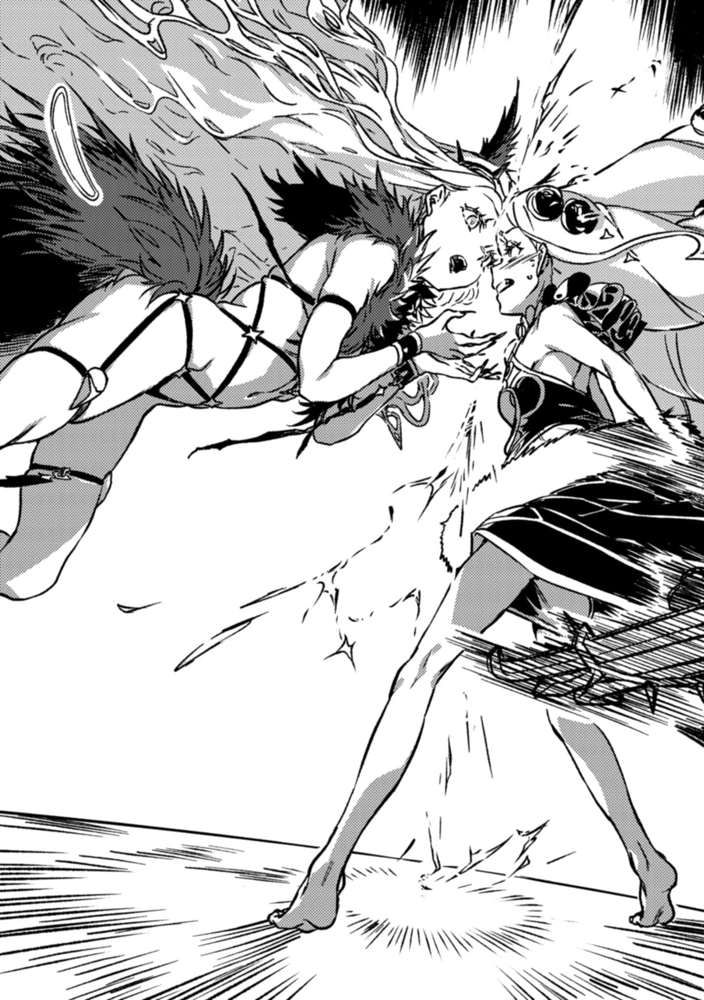
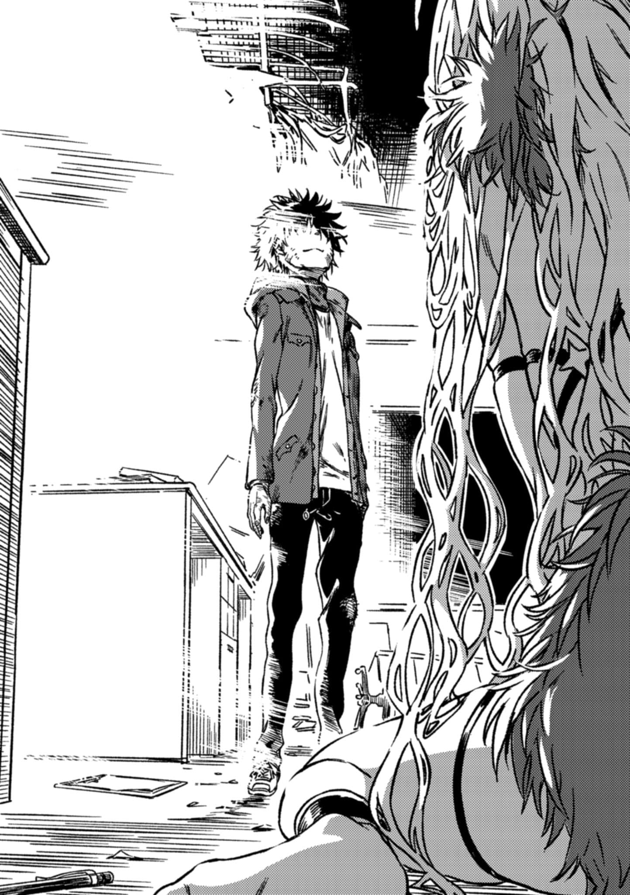

# 第四章 不幸的少年仍要看着的是

> Over_the_River.

## 1

H.T.特利斯墨吉斯忒斯始终看着眼前的一切。

他知道原因是什么。

所以他才觉得只要杀了上条当麻，爱丽丝就会恢复正常。

所以他才觉得，对扭曲了爱丽丝的安娜也必须加以制裁。

他一直侍奉着那位娇小的少女。

因为**一般而言**，将那么小的女孩孤身一人扔到外面的世界实在是有些过于残酷了。在那种情况下，她那庞大的力量并不是优点，反而只会成为危难的前兆。她就像是个继承了大笔遗产的小孩子，对于那些在暗影中蠢蠢欲动的渣滓而言可算是绝妙的饵食。他判断，应该有人去守护少女，照顾她。这并非出于逻辑，而是因为任何人碰上这种情况应该都会这样想，也就是说一般而言理应如此。他相信这个庞大世界的善意。

既然如此……

&nbsp;

『呜哦哦哦哦哦哦啊啊啊啊啊啊啊啊啊啊啊啊啊啊啊啊啊啊啊啊啊啊啊啊啊啊啊啊啊啊啊啊啊啊啊啊啊啊啊啊啊啊啊啊！！！』

&nbsp;

但这又是怎么回事？

这就是他想看到的吗？

暴风席卷了整个图书馆，但这并不是某种气象现象。一股非物理的庞大力量奔流——**顺风**与**逆风**的连番冲击。

身为以爱丽丝为范本造就的普通「超绝者」，他无法拯救作为自身起点的少女。

那种无用功就好比一边将爱丽丝踩在脚下，一边又想将她扶起一般。在这种状况下拉她的手，只会把她的胳膊扯断。

因此。

CRC。克里斯蒂安·罗森克鲁兹。

他本以为拯救那名孤独少女的唯一正解，就是托付给并非源自爱丽丝·异典、一般而言力量明显超越她的存在。

那是唯一的方法。

他想不到第二条路了。

但是「重生」后的圣者与一般的传说相去甚远，也并不是会拯救**包括**爱丽丝在内的这个世界的人。

尽管在脑袋被捏碎后，爱丽丝还是像平时一样保持着笑容，但总感觉哪里不对。

她已经到极限了。

不只是爱丽丝·异典。

还有想要拯救世界却无法亲力达成的「桥架结社」。

包括那些抹除了自身的意见，抛却了自我的「超绝者」们。

所有的一切。

之前的选择是错误的。H.T.特利斯墨吉斯忒斯已经越过了致命的分叉点，走上了通往地狱的道路。他终于意识到了。自己的所作所为已经无法挽回，那么在这样的情况下，青年管家又将如何顽抗？

最优解并不存在。

那该去哪里寻找落脚点？

「……」

虽然已经作出了致命的错误选择，但H.T.特利斯墨吉斯忒斯仍然是一位「超绝者」。他身着他所选取的神明的外貌与能力，设定了「救济条件」，并为一切符合该条件的人带去救赎。因此哪怕是在这种情况下，青年管家的发问对象也不是自身，而是那个被他奉为自身一切行动的基准之物。

换言之，是当下的整个世界。

&nbsp;

一般而言。

对一名正在哭泣的少女不管不问，真的是正确的行为吗？

## 2

这里是一间充满光芒的图书室。

并不是什么宏伟的神殿或城堡。那是爱丽丝·异典想要看上一眼的、某个少年就读的高中。分明毫无合理性可言，她却特意亲自将这里选作最后的场所，来到了这里。

仅此而已。

现实中，爱丽丝于此抛出了自身的一切，包括生命。

其实……

娇小的少女究竟期望着什么？

学园都市的存亡也好，世界的扭曲也罢，根本没人谈论过这种话题。

必须要感知到爱丽丝内心最深处的想法。

上条默默地咬紧后槽牙。

紧紧咬住了牙关。

是时候正视这位被自己逼入绝境的少女的感情了。

「当麻……」

「你没必要用十万三千〇一册分析出一切。」

正面直视爱丽丝的上条大声喊道。

自觉地。

为了点燃自己的心。

「无论如何，我很清楚自己要做什么。那就是打倒爱丽丝让她恢复正常！！身为最强并不意味着她要孤身承受一切。我不会再让她孤单下去，哪怕一秒钟！！」

上条当麻。

安娜·施普伦格尔。H.T.特利斯墨吉斯忒斯。

三人一同直面孤身一人的少女，毫无逃避地瞪着她。他们无论是立场、想法和能力都大相径庭，如今却都朝着同一个目标奋斗着。

不要忘记。

如果忘记了，那就让你见识一下。

「不要退缩……」

爱丽丝·异典。

你并不是一个人。

你的孤单不过是幻想。

这世上还有很多人想要救你！！

「我们上啊啊啊啊啊啊啊啊啊啊啊啊啊啊啊啊啊啊啊啊啊啊啊啊啊啊啊啊啊啊啊啊啊啊啊啊啊啊啊啊啊啊啊啊啊啊啊啊啊啊啊啊啊啊啊啊啊啊啊啊啊啊啊啊啊啊啊啊啊啊啊啊啊啊啊啊啊啊啊啊啊啊啊啊啊啊啊啊啊啊啊啊啊啊啊啊啊啊啊啊啊啊啊啊啊啊啊啊啊啊啊啊啊啊啊啊啊啊！！！！！！」

高喊着甩开恐惧，上条当麻攥紧右拳往前冲去。

那还是远在进入攻击距离之前的事。

传来了一声硬质的嘎吱声。

那声音来自爱丽丝附近。

来自她的脚下。

现在不是正儿八经思考为什么，或者她想做什么的时候了。

爱丽丝已经行动了起来。

无论那是什么，那个异常的「超绝者」都已经用自己的身体选择了行动。

唯有攻击。

「蠢货！！」

小小的安娜从一旁踢向了少年的腘窝。

他的视野猛地往正下方一落，紧接着，空气自下而上、斜斜地被猛烈撕裂。

所有声音都消失了。

五条爪痕倾斜着撕开了上条正后方的图书馆的墙壁，连带着二者之间的大量书架。他这才回过神来，要不是刚刚自己的脑袋往下偏移了几十公分，自己也会落得同样的下场。

爪子。

抓挠。

那种原始的攻击方式被增幅到了极致。

「**要是你死了就全完了**。虽然是废话，但别忘了那条绝对的规则！！就算是『古老善良的玛利亚』的『复活』也无法修复爱丽丝本人造成的致命伤。你要真的想救她，就不要指望这个世界会施舍于你。你必须伸出自己的手去帮她！！」

如果名为安娜·金斯福德的达人在场，她一眼就能看穿。

在场唯一能够达到那种理解程度的人，应该就是正确使用超过十万三千〇一册「原典(Origin)」的魔道书图书馆。

「……这也是魔法吗？」

茵蒂克丝半信半疑地喃喃自语着。

茵蒂克丝一边向摔倒的上条伸出手，一边说道：

「既然人的内在与广阔的物理世界全部相连，那么凡是仅凭身体就能做出的行为，就全都连接着足以彻底改变整个外部世界的神秘。这我也明白，可是……」

「那些花哨的举止和仪式，都不过是为了提升自身意志的纯度所做的修禊与净化工作而已。」

欧提努斯低语道。

上条趁这个机会轻轻将那位小小的神明送到了茵蒂克丝的手中。

爱丽丝彻头彻尾就是个究极谜团，因此必须优先保证有分析能力的人存活。毕竟上条总是一再被敌人盯上，就算把她留在身边，也无法保护她免受攻击波及。

「……对于纯度从一开始就被**强行提升**得极高的爱丽丝·异典来说，比起照搬那些蹩脚的步骤，一举一动都保持纯粹的形态才更为重要吧。」

「我们应该庆幸。」

是H.T.特利斯墨吉斯忒斯。

在这种情况下，阴郁的青年管家仍如此评价道。

因为……

「事态没有发展成『**爱丽丝仅凭一个念头就能杀死敌人**』，或者『**就算不用爱丽丝的意识**，**世界也能自动杀死敌人**』，这对我们来说已经走了大运。这意味着她有着限制，必须采取物理层面的批准(行动)才能发起各种攻击。一般而言，这是一件幸事。」

但这也意味着她的行为不限于爪击。

变成了八头身美女的某人斜身注视着上条。

她前进了一步。

仅此而已。

「当麻，要来了！！」

「？？？！！！」

虽然明白情况，但上条无法抑制作为生物的本能。他将双手交叉护在脸前，但这明显是个错误的行为。

突然。

一股红茶般的甘甜香味支配了少年的鼻腔，甚至压过了图书馆里那些陈旧纸张的气味。

爱丽丝·异典已经站在了上条的背后。

&nbsp;

『**行走**』。

**即是移动至心目中的地点**。

&nbsp;

她既没有用手指摆出特殊的形态，也没有按部就班地踩出什么复杂的步法。

那不过是任何人都能采取的行动而已。

哪怕未曾意识到，爱丽丝也享受着那个动作所带来的恩惠。

从她的普通行动中析出的意义，纯度也太高了吧？？？！！！

「爱丽——？！」

她已经近身了。

上条猛地旋转身体将右手往后挥去，想要用手背反手打出一拳。

但是他打空了。

身材完美的八头身美女宛如野兽般将四肢用力压在地板上，把头压低到了极限。

&nbsp;

『爬行』。

&nbsp;

不仅被对方掌握了死角，连勉强挥出的反击也打空了。这其中的含义令他心脏一紧。面对「那个」爱丽丝，少年却仿佛在邀请她随意发动攻击一般。

青年管家毫不犹豫地行动起来。

闪光从他的右手迸出，他手杖里隐藏的白刃化为光线切开了地面。那道奇怪的斩击能产生远超过刀身长度的效果，而它正中伏在地上的爱丽丝那垂下的脖颈。确实命中了没错，然而那金属的刀刃却直接从少女的身体中穿了过去。

从那任何人都能做到的动作中析出的意义。

也就是回避行为。

欧提努斯恨恨地啐道。

「难道打没打中都已经无关紧要了吗！！」

也就是说，只要那个八头身美女摆出回避架势，她就不会受到外界的任何伤害，哪怕被核导弹直击也毫不在乎。爱丽丝似乎对正面斩过自己脖颈的H.T.特利斯墨吉斯忒斯连半点兴趣都没有。仍趴在地上的她抬起头，慢吞吞而漫不经心地朝上条伸出五指。

「**如我所料**。」

对青年管家来说，这似乎不过是确认工作罢了。

轰！！

并非爱丽丝，而是她脚下的地面因为被大面积切开而崩落。

他从一开始斩的就是那边。

为了活下去并积累情报，H.T.特利斯墨吉斯忒斯才故意瞄准了那里。

上条今天会死。

**但他已经不在乎这点了**。

「喂，你这人类！」

「（把欧提努斯给我按住，茵蒂克丝！）」

刚想着能否靠一个眼神传达，整片地板就崩塌了。

双脚脱离引力，视线径直下坠——连同那些用防震螺钉固定的沉重书架一起，轻而易举地坠落。

「噶啊？！」

上条、安娜和特利斯墨吉斯忒斯本人也被卷入其中，并成功和爱丽丝的手拉开了距离。

算是在千钧一发之际捡回一条命。

他们落到的地方并不是普通的教室，而是一个排列着金属办公桌……残骸的庞大空间。新学校还没有开学，但桌子上已经散落着一些私人用品。这里是教员办公室吗？

只有爱丽丝。

八头身美女摇曳着长长的金发，从上层俯视着他们。唯有房间角落还留有地板，爱丽丝孤身一人伫立在那里。

就像一头负伤的野兽，被无情之人丢弃的鱼钩和塑料带死死缠住而遍体鳞伤，不住地渗着血，整颗心的表面也全都生满了倒刺。

形单影只。

就连威吓和嚎叫声中都夹杂着忧郁。

还没有结束，抱着这个念头的上条强行拖着疼痛的身体站了起来。无论身体受了多少伤，哪怕如今他的惨状可怖到足以让医生发出惊叫，他也还活着。至少，这个瞬间还活着。「超绝者」什么的力量平衡已经无所谓了。做个普通人就足够了。要知道只要还活着，即使是最渺小的人类，也拥有凭借自己的意志做出抉择、改变战局流向的资格。

而那超出常规最强存在的眼中只有他一人。

不如说，这反而更让人安心。

（茵蒂克丝和欧提努斯应该在上面。和爱丽丝不同，她们俩就在门的边上，随时都能逃走。她们不需要待在最危险的前线。只要我还能用手机联系上，她们就能提供情报支援！）

「她的所作所为应该算是这东西的变种吧？」

咚！！只听一声沉闷的钝响，上条转头望去，发现安娜身边出现了一个直径两米的金属球。「没有普纽玛的外壳」。那是一种能够取出古今中外一切文明利器，并从中析出世界最古老死因的灵装。

「但爱丽丝甚至不需要道具。她从自身采取的行动当中析出其中的意义并将其化为凶猛的攻击。这算是一种魔法，甚至都可以称得上是一种奇迹。那些圣人空手产生奇迹这种天方夜谭般的传说，她却能只靠感觉就将其逻辑化。」

「……」

「虽说是克劳利那位所谓的师父失控，擅自改造了爱丽丝·普莱曾丝·利德尔，但难道意思是说，只要顺次追溯Magick、『黄金』再到『蔷薇十字(Rosenkreutz)』，我的术式精髓就会显露出来吗？」

无视留在上层的爱丽丝，采取了行动。

脚后跟。

产生了振动。

即使双方处于不同的楼层也无所谓。

抬头仰望的上条等人瞬间僵住了，他们被定在了原地。

&nbsp;

『跺脚』。

那是发起抵抗与威吓的幼稚行为。对显而易见的上位者发起旨在逆转的挑战。是用小孩子的本能压倒大人的逻辑的恫吓行为，也是所有人类都会进行的原始赌博。

&nbsp;

奏效了。

就在整个世界都僵住的那一秒内，八头身的爱丽丝毫不犹豫地往下一跳。

预估落地点位于上条当麻的头顶。

就在这时，突然一声钝响。

爱丽丝也猛地将「某物」砸在了地上。

此举打破了定身，上条慌忙扑向安娜，顺势在地板上翻滚开来。

爱丽丝的脚后跟就像流星一般深深凿入了地板。

被上条护在怀中，揉得乱七八糟的小安娜嗤笑着。

她仿佛在挑衅爱丽丝，无论爱丽丝的力量有多么强大，都无法从某个少年那里得到这种待遇。

「好了，不知那个小丫头是否觉得刚才只是无聊的解说片段，所以就加快到1.5倍速跳过了呢？『没有普纽玛的外壳』可不是仅仅用来展览的道具。这可是能够随机调取一切死因，连我自己都无法完全控制的灵装啊！！」

她手持一根法杖。

那是一根奇怪的法杖，巨大的黄金十字架上还缀着用鲜红的红宝石制成的蔷薇。

「好好膜拜我的强运吧，蠢货。黄金十字与红玉蔷薇，也就是世上最古老、**出自人手**的蔷薇奇迹所致的毁灭。幻灭致死。号称起源于太古，实际上却是在中世纪被描绘、又在近代被重新发掘。将成长与烂熟推向极致的魔法所带来的一切暴力，全都凝聚于此！！」

施普伦格尔小姐的小手举起了法杖。

仅此而已。

没有花哨的咏唱或是复杂的魔法阵。火焰就这么凭空出现，从法杖上释放而出。它如液体般流动着，笔直朝爱丽丝袭去。那并不是寻常的火焰。而是犹如从背面烘烤老照片一般，不论何种材质，都将空间本身侵蚀染黑后抹消的魔性火焰。

爱丽丝将长长金发的发梢整束攥住。

她顺势将脑袋转了一大圈。

伴随着那歌舞伎演员一般的动作，粗粗的发束在空中画出一个大圈，在赤焰通过其中后立刻收缩。

橙色的火焰在空中停下了动作。

&nbsp;

『束缚』。

即是让对象完全停止移动，同时隔离目标令其无法受到任何干涉。

&nbsp;

「啧！！」

对安娜而言，「没有普纽玛的外壳」虽说是属于自己的灵装，却也是凭偶然的概率才到手的武器。就算做同样的事，也无法再获得同样的武器。

但哪怕只有一丝不舍，也是失策。

爱丽丝单手将束缚住了火焰的发束往身前一拽，使得小小的安娜失去了身体平衡向前栽去。

与此同时，

八头身美女往前踏出了一步。这招的效果之前也展示过。无视距离，爱丽丝已经抵达了她的目的地。

也就是直到上条当麻的怀中深处。

在那一瞬间，少年失去了平时的距离感。爱丽丝成熟的胸部宛如一堵墙挡在眼前，导致他的瞳孔无法对焦。

从正面。

那动作宛如行云流水。

等到眼睛终于追上事态的发展，爱丽丝的手指，那些尖锐的爪子已经轻柔地伸向他的喉头。

时间停止了。上条拼命想摇头，但身体跟不上。

还不能死。

就算要死，也不是现在。

那个念头深深烙入了他的脑海中。毕竟，那个忘记了何为哭泣，只能像野兽一样嚎叫的少女就站在他的眼前，绝不能在救下她之前就死掉。

一道锐利的光芒从旁边刺入。

时间恢复了流动。

身体弯折的爱丽丝结结实实地在地板上翻滚。

第一次直击并非来自上条、安娜或是H.T.特利斯墨吉斯忒斯。

有人在说话。

「怎么回事？我真的打中爱丽丝了……？更何况先前咱们不是被那个迷宫隔绝了时空，所以根本靠近不了中心吗？！」

是支配黑夜与月亮的魔女们的女神，阿拉蒂娅。

不远处的博洛尼魅魔正和一只两脚行走的兔子缠斗在一起，滚作一团。吸收了众多次世代兵器的影子、体型巨大化到足以将校舍踩得粉碎的姆特·底比斯，正与膨胀到同等大小的超规格巨猫正面展开互殴。

安娜之前好像说过，「超绝者」们也进了校舍来着？

上条等人似乎掉落到了正与狮鹫和处刑人陷入混战的地方。

和上条不同，她们并没有受到爱丽丝的邀请。

而她们也无法像安娜那样穿过去。

阿拉蒂娅和博洛尼魅魔她们强行踏入了这座绝对不存在出口的迷宫。她们在其中与爱丽丝那些残暴的玩具——那些无论外表看起来多么滑稽，每一个都曾彻底压倒学园都市「暗部」的怪物们——反复展开永无止境的战斗，即便如此依然能够若无其事地活下来，光凭这点就足以证明「超绝者」果然不正常。

那一瞬间，上条心中宛如黑暗般的死亡重压倏然消散，力量从身体中心膨胀开来。

果然，爱丽丝并不是一个人。

世界并不是那样无情。

毕竟「古老善良的玛利亚」和阿拉蒂娅等人即使赢了这场战斗也没有任何好处，但她们仍豁出性命来到了这里。哪怕这里是被「死去就意味着至今为止的努力全部白费」这样寻常又无可违逆的法则主宰的战场也罢。

是什么驱动着她们如此拼死战斗？

除了善意以外要是还有别的，你倒是说说看。

「蠢货，这下不妙了。撞上本用来争取时间的诱饵就意味着要应对更多敌人，也就是狮鹫、处刑人之类的爱丽丝系列产物。」

「居然敢一个人偷偷跑去调情，你这个混蛋坏女人。顺便说下，只要你不是符合我『救济条件』的魔女之一，即便在这个时代，作为『超绝者』的我对打屁股这种刑罚也是乐意至极。」

「哎呀呀，浑身透着岁月感还硬要装嫩的女神，光听你这番话，你那**素体**的真实年龄怕是就要暴露了呢。」

「不知活了几百年的标本幼女没资格说这句话。」

爱丽丝·异典把半埋在倒塌柜子里的身子拔了出来。

爱丽丝的眼球猛地一转。

即使是现在，那个妖媚又苗条的美女仍然只看着上条一人，她甚至没有看一眼打中了自己的阿拉蒂娅。

「啧。总之先撤退吧。要和她拉开距离！！」

破损的教员办公室里响起了尖锐的声音。为了进行牵制，阿拉蒂娅举起手掌，如同霰弹一般射出道道光线飞沫。不，那些飞沫全都以宛如海蛇般的动作撕裂空气，从各个角度袭向了八头身的爱丽丝。

绘本中的少女一言不发。

甚至都没有看阿拉蒂娅一眼。

她只是伸出食指指着，然后顺时针转了一小圈。

简直像开玩笑一样，所有的光弹都从那位八头身美女的左右两侧偏开，接连击穿了毫不相干的墙壁与柱子。

&nbsp;

『咒语』。

那幼稚的动作轻而易举地蒙蔽了所有的关注者，令他们陷入到了法术之中。

&nbsp;

「咕。」

阿拉蒂娅这边甚至连吃惊得倒吸一口凉气的时间都没有。

爱丽丝是真的全程没有看她，只是单纯改变了漫不经心地伸出的手指的摆列。她将中指弯曲抵住拇指的指腹，摆出了仿佛是要弹飞什么的手势。

没有光也没有声音。

就像是在回礼一般。

阿拉蒂娅的身体撞穿了附近的墙壁，不知被打飞到了何处。

上条脸色发白。

刚刚那下直接命中了。

&nbsp;

『弹指』。

&nbsp;

刚刚那到底是什么？

究竟从那个任何人都能做出的简单动作中析出了什么意义？！

上条的脑海中，前提正发出强烈的警告。

**死了就全完了**。

**实在是太过猝然**，**真真正正地生死永隔**。

**毕竟唯有爱丽丝本人的攻击是**「**古老善良的玛利亚**」**的**「**复活**」**也无力回天的事情**。

「阿拉蒂娅——！！」

「没事的，蠢货。看来她们两人共同分摊了伤害。不过若不是在场有两个一模一样的阿拉蒂娅，刚才那一下她的心脏恐怕早就破裂了吧。」

如今可不是去一一理清那招为何会让阿拉蒂娅的心脏爆裂、将伤害平分又意味着什么的时候。

沉闷的冲击传来，火花四溅。

隔了一拍后，这片扭曲的风景中传来了叩击空间的轰鸣与冲击波。

安娜和爱丽丝之间，有什么东西再次交错了。

总之，在与爱丽丝展开的死斗中，每一秒的价值都远超平常。死亡就是终结，是真正的结局。时间始终在实时向前推进，所有人都在同时行动。

至少已经弄清楚的规则，千万别忘了。

「话虽如此，但这可算不上什么让人放心的理由。伤害只有二分之一，也就是说只要挨上两次同样的攻击，两个阿拉蒂娅就都完蛋了。」

「……」

阿拉蒂娅办不到。

无论是可以吸收各种兵器的影子从而无限膨胀的姆特·底比斯，还是只要有需要、哪怕是拥有毁灭性力量之物也能合成各类器具与药物的「古老善良的玛利亚」，都让人难以想象她们能够阻止爱丽丝·异典的行动。

博洛尼魅魔的「冰冷女郎」术式可以无视目标的物理韧性和耐力，将一切快感替换为同等的痛苦。那一招甚至让破格的克里斯蒂安·罗森克鲁兹面露苦色，但会对爱丽丝奏效吗？如今的爱丽丝的精神状态真的能简单地用人类的喜怒哀乐来形容吗？

那要放弃吗？

问问自己的内心，稍微认可一下能当即回一句「别开玩笑了」的自己吧。

根据就在自己心中。

他该好好感谢过往的经历，那给了他极大的锻炼。

「仔细分析她的每一个小动作是没有意义的。」

安娜·施普伦格尔说道。

她举起了黄金十字法杖，似乎是在重新测量自己与爱丽丝之间的距离。

「首先得破除『爱丽丝是不可能被击败的』这个观念。而能做到这一点的并不是拥有明确战力的最强的『超绝者』们，必须得是你我这种更不寻常的战力才能打出破绽，蠢货！！」

倏地。

八头身的美女消失了。

黄金十字法杖与原始且凶暴至极的手掌，

正面硬碰硬地交锋了。

安娜做出了应对。

她做到了。

眼看着侧面的处刑人打算发起攻击，安娜瞪了一眼就将其从头到脚一分为二。紧接着，她法杖上那形似蔷薇的红宝石饰物发出了闪光。完成了使命的它从凝聚状态化为一团炸裂的压缩空气，如同烈风一般刮动了上条的头发和脸颊。

即便是《爱丽丝梦游仙境》中的怪物，该死的时候照样会死。

世事无绝对。

现在想来，上条察觉到其实从一开始就是这样的。虽然爱丽丝通常都是那个绝对的至高存在，但是只有当安娜·施普伦格尔出现时，那个小小的坏女人才会搅乱局势、布下陷阱、占据主导权——也就是说，爱丽丝的存在感也随之越发淡薄。

虽然安娜并未结结实实地击中对方，但能和爱丽丝短兵相接本身就已经绝非寻常了。

安娜与爱丽丝。

两位异常的「超绝者」。

正如爱丽丝·异典会拉拢包括几率与创想在内的一切，安娜·施普伦格尔也会实时操纵某些无形的因子。

「接受我吧，H.T.特利斯墨吉斯忒斯！！你们这些以爱丽丝为起点的常规『超绝者』，根本无法伤到身为顶点之一的爱丽丝。但只要转换了基准轴，以爱丽丝为上限的优先顺位就全都能绕开。就如同拿巴别塔和世界树尤克特拉希尔比高矮那样！！」

「感激不尽。」

「只要那个蠢货能笑出来，怎样都无所谓。你也一样，想让爱丽丝露出微笑吧？那就赶快！！」

空气中发生了无形的变化，一股重压消失了。

那是一种可能性。无论是阿拉蒂娅还是博洛尼魅魔，哪怕是其他的「超绝者」，只要改变连接的对象，或许就能颠覆爱丽丝的绝对性。

青年管家再次将右手搭在如居合佩刀般佩于腰间的法杖上。

他这一刀的意义改变了。

但是他慢了一拍。

随着沉闷的一声，平衡被打破了。安娜的小小身体受到了强力的一击。

可她们明明是对等的存在。

只凭单手。爱丽丝漫不经心地用右手抓起残破不堪的狮鹫，将其视作一件武器。

仿佛就是那种形状的棍棒。

&nbsp;

『抓取』。

否定一切物体的自我与意志，纯粹从功能层面单方面强行提取其攻击力和防御力，叠加到自身威力之上。

&nbsp;

虽然爱丽丝在常态下可以和安娜分庭抗礼，但如果借助外物增幅自身，那情况就不一样了。

即是**将他者化为兵器**。

无论是刀剑还是烧卖还是女神，那种不合理的最强魔法可以令爱丽丝强行装备任何外物来增幅自身的数值。

（那是吸收各种兵器之影的姆特·底比斯的上阶版吗？！）

「噶啊？！」

「安娜！！」

爱丽丝发起了又一次攻击。狮鹫增长了她的打击范围，因此小小的坏女人没能躲过去。沉重的一击令她的身体往后一仰。

安娜·施普伦格尔呻吟着，想要举起黄金法杖。

然而爱丽丝还是抢先一步。

爱丽丝总是只领先一步，甚至到了不自然的地步。

H.T.特利斯墨吉斯忒斯从侧面砍来，却被她抓住手腕，化为兵器并装备。她随手将「那个」横向一挥。

直接命中。

一声闷响炸裂开来。

唯独在这种情况下，贸然站到安娜那边反倒成了失策。

又或者他败给了爱丽丝那股**顺风**。

那种魔法会从外部夺取目标的力量。如果H.T.特利斯墨吉斯忒斯仍然仅不过是爱丽丝的玩具之一，那他就提供不了能让全力爱丽丝更上一层楼的力量了。

小小的坏女人呼吸一窒，红色的球从她的嘴角向虚空飞散。

平衡被打破了。

尽管黄金十字法杖已经掉到了地上，安娜仍咬紧牙关往前踏步。

又是一声冲击炸开。

但它并非来自爱丽丝·异典那蛮不讲理的暴力。

事情还没有结束。

不如说是来自安娜·施普伦格尔。

安娜与爱丽丝的额头猛地撞到一起。

「……你想得到认可对吧？」

千钧一发。

额头抵在一起后，安娜从零距离说道：

「你想要被原谅对吧！还想要被爱！！和我一样！！！！！！既然如此，那可不是能由你擅自放弃的东西。就算我是个坏女人，他也毫不在乎。正是因为他当时毫不犹豫地带着我逃跑，我如今才能站在这里。只要那个蠢货还在伸出手，就别轻易认为这个世界上的光芒已经消失殆尽了啊！！！！！！」

爱丽丝一言不发。

只是，她那如野兽般狰狞的面庞上，脸颊微微颤动了一下。

那应该不是她自身的激情所造成的，上条想道。

紧接着，爱丽丝行动了。

&nbsp;

『嗅闻』。

闻取、分辨、准确锁定猎物的位置。**即是让她的下一击无论多么粗犷**，**都会百分之百命中**。

&nbsp;

再一次。

她单手挥动H.T.特利斯墨吉斯忒斯，那增幅过的一击结结实实地砸中了安娜娇小的身体。在那股冲击下，阴郁青年管家的身体从爱丽丝手中脱手甩出。不，是他右手从手腕处如同瓷器一样碎裂了。八头身美女手中仅剩H.T.特利斯墨吉斯忒斯的一只手掌。

这和棒球的全垒打或保龄球的全倒不同。

伴随着莫名其妙的清脆声响，两人被一并扫倒。

甚至连惨叫都没有。

安娜·施普伦格尔的伤势，让人连想都不愿去想。

而倒在地上意识朦胧的H.T.特利斯墨吉斯忒斯，只能眼睁睁地望着爱丽丝满不在乎地将剩下的一截断腕扔到一边。几乎没有像样的流血，反倒显得更加异常。

&nbsp;

「我……」

&nbsp;

青年管家在念叨着什么。

那是话语。

他曾相信，一般而言，只要看到那个被强加了并不想要的力量的女孩，任何人都会抱有同样的想法。而那个魔法师如今这样说道：

&nbsp;

「为那孩子遮风避雨，从世界的威胁中守护到底……我没能成为这样的保护者。」

&nbsp;

她并没有在听。

爱丽丝·异典。

妖艳的八头身金发美女歪起脑袋转过身来。

『**老师**。』

她朝着上条当麻。

仿佛她眼中只有他一人。

上条明白。

爱丽丝·异典的状态本就不正常。

从一开始被魔法师改造了身体时便是如此，被「桥架结社」簇拥着保护时也是如此，被安娜撩起了对上条当麻的深厚兴趣时也是如此，然后当上条的拒绝令她完全失神时也是如此。

她很久以来都不正常。

上条虽然明白这点。

但唯独刚才那句话，绝不该被置之一旁、听过就算。

爱丽丝虽然化作野兽、失去了理性，但并非不能说话。事实上，她就像这样主动和上条搭话。不仅如此，对于青年管家，也是她自己做出了将其舍弃的选择。

提不起兴趣。

所以就不跟他说话。

仅因为如此，爱丽丝·异典就毫无反应吗？

（还不够……）

不要失望。

不要放弃爱丽丝。

坚定信念，不能让她变得更加疯狂。

要是开始觉得个人的不幸可以拿来当借口，那做人就彻底完了。在某种意义上，上条当麻比任何人都明白这个道理。

世界是残酷的，他见识过很多人因此遭遇了不公的、蛮不讲理的打击。

但上条在面对他们时并没有气馁。

而是选择了挺身而战。

真倒霉。虽然这句话很是万能，但是毫无道理被迫与不幸相伴的上条自然明白，一旦开始依赖它，整天挂在嘴上的话，就永远也无法在黑暗之中找到出路。不负责任地纵容不幸的人，只会让他们在那个肮脏的死胡同里永远腐朽下去，少年比任何人都深知这点。

所以。

爱丽丝·异典。

现在我就要教你如何带着这份蛮不讲理的不幸生活下去。

『……老师也，还要打吗？』

「没错。」

上条当麻攥紧了唯一的武器，也就是自己的拳头。

坚定有力。

『但那都无所谓少女会颠覆自己的预言少女一定会想办法救老师跟你和好和老师打架然后获得幸福少女不相信那个半吊子的图书馆一定有办法能救你的少女绝不会失败因为少女是异典所以要和好。』

「好啊！！但可不要以为说这种话就能阻止我，爱丽丝！！」

## 3

安娜·施普伦格尔和H.T.特利斯墨吉斯忒斯都已经靠不上了。

其他的「超绝者」也离得很远。

这间普通的教员办公室就是一切。

外面的世界想必早就被隔绝在外了。

一对一。

上条当麻与爱丽丝·异典。

或者说是爱丽丝·普莱曾丝·利德尔沦落的末路。

一开始就是他们俩的事，因此由他们来作出了断才是绝对的正论。

所以。

「『呜哦哦哦哦哦啊啊啊啊啊啊啊啊啊啊啊啊啊啊啊啊啊！！！』」

正面相撞。

发出野兽般咆哮的爱丽丝大幅张开了双臂。

&nbsp;

「拥抱」。

依赖于他人，借由全身从外界获取满足感的行为。

&nbsp;

当然，要是真被她抱住的话，上条的身体将会轻易被撕裂。

一阵闷响传来。

正面结结实实地击中了。

出手的是上条这一边。右拳切实传来了打在人身上的冲击感。

唯有拳头命中的触感，才让他的意识恢复了清醒。

一味进攻。从某种意义上来说这也是理所当然的，毕竟爱丽丝完全没有考虑防御，而是张开双臂笔直冲了过来。

『呃。』

汗珠从八头身美女身上飞散，她向后仰去，脱离了「拥抱」的姿势。在躯干失去平衡的状态下，爱丽丝弯曲成钩爪状的五指正面横扫了空气。

少年弯下身。

在千钧一发之际闪过了切开墙壁和柱子的致命攻击后，上条再次打出一拳，被爱丽丝用另一只手挡下。但和之前的「行走」或「束缚」不同，这里面并没有特殊效果。

爱丽丝一方没有时间抽取并精炼奇迹。

两人又交锋了两三个回合。

但上条还没有死。

唰！两人各退一步。

『而且很奇怪。』

爱丽丝歪起脑袋。

那个八头身拘束装美女的举止彷若十岁孩童。

奇特又怪异。

那一团。

『现在明明只有老师还能站着，但是老师的动作却不是自己一个人能做出来的。』

「那是当然……」

&nbsp;

在「爬行」回避动作期间，所有的攻击都会穿过她。

H.T.特利斯墨吉斯忒斯毫不犹豫地对那个他敬爱的，身为自己起点的女孩发动了一刀两断的斩击，从而用实际证明了这个结果。

&nbsp;

虽说并不依赖道具，但这与「没有普纽玛的外壳」相似。抽取奇迹。

是安娜·施普伦格尔点出了这件事。

&nbsp;

但是——

「那你岂不是只要一直保持『爬行』动作发起攻击就行了？那样你就可以一直维持无敌状态不被解除，同时还能单方面对我们持续发动犯规攻击了。」

『……』

「然而你并没有那样做，就说明你每次只能使用一种奇迹。比如说，『爬行』可以让任何攻击穿过你，但同时你也无法碰到我们，所以一直维持那种状态是无法结束战斗的对吧？『行走』和『咒语』也是一样的。**你的奇迹都是独立的**，**无法组合或并行使用**！我已经看穿你的弱点了，爱丽丝·异典。虽然不知道你有多结实，但你攻击的时候不是无敌的。那样就能打出伤害！！」

以交叉反击为目标。

虽然渺茫，但这正是对抗爱丽丝·异典的战斗中唯一的活路。

爱丽丝仅通过自己的身体就能使出任何奇迹，但她的举止和孩童无异。虽然威力十分强大，但她的攻击都是凭借「心血来潮」或是「反射性」使出的，因此要把握时机并不算难。

这当然不是上条一个人察觉到的。

那是不可能的。

绝不允许有人说，那些倒下的人们的思念不如别人强烈。

如果说爱丽丝可以「抓取」一切物体、现象或人物并化为兵器，那上条的助力则是那些层层累积的深厚思念。

他绝不容许以泪水作为结局，他不会将任何人丢弃在黑暗之中，他要抓住爱丽丝·异典的手把她拉上来。

那便是。

哪怕幻想杀手(Imagine Breaker)也绝对无法消除的，现实的力量。

「……就算他们现在没有站在这里，那又如何？是安娜和特利斯墨吉斯忒斯他们告诉了我。如果不是那些家伙豁出性命去验证、把它们一个个逼出来，我根本走不到这一步。你还不懂吗？我们现在也依然在并肩作战啊！」

『那就把他们治好。』

直截了当。

她强大到根本没有体会过落败的机会，因此她并不在意单场战斗的胜败。她压根就不害怕自己会被打倒，甚至丧命。

只要最终能够葬送妨碍自身行动的敌人，死个一两次并不算什么。

因为……

『难道老师忘了吗？少女之前就被某个自称罗森克鲁兹的家伙捏碎了脑袋。从那样的状态都能毫发无损地复活过来。所以就算老师搞得遍体鳞伤，以此为代价好不容易杀掉少女一次，对少女来说也根本无所谓。**无论是一亿次还是一兆次**，**少女都会若无其事地复活**，**只要等着老师自己一个人耗尽体力倒下就行了**。』

「**但是你专心治疗自己的时候做不了第二件事吧**，**爱丽丝**？」

上条也当即答道。

他还不至于因为这点事就被击倒。

被他人托付的愿望和思念最终无法结果，自己拼死的努力被瞬间消灭，上条当麻并不害怕这些。

恢复。

一切都是白费工夫。

那又如何？

出乎意料的是，停下话头的竟然是爱丽丝那边。

八头身美女说道，嗓音宛如濒临暴沸的锅一般，异样地沉静且毫无波澜。

『……你打算做什么？』

「怎么，你的宝贝奇迹都用光了？也到我脑子里探探看啊，爱丽丝。」

正如爱丽丝·异典所宣告的那样。

上条当麻会死。

他已经接受了这点。

而他也凭借自己的意志作出了决定，要用以此为代价所获得的力量来拯救这位少女。

所以少年先踏出了第一步。

二人激烈交锋。

## 4

在无情的正面冲突中，

爱丽丝的拳头压缩空气，撕裂了他们所在的教员办公室，顺着五指利爪的轨迹，将校舍连同空间一并横切成数片。

闪避没有意义。

毕竟她光是使出一记回旋踢，都能化为横扫周遭一切的范围攻击。她的攻击宛如一道巨大暴风从右到左席卷而过，不管怎么扭动身体都是躲不过的。

实际上她也确实命中了。

（呃……）

不仅仅是挤压那么简单。

上条的身体发出了至今都没有听过的沉闷开裂和爆响。

不会去一一纠结到底是哪里折断了。

在这种情况下，痛感变得迟钝反而成了助力。

没错。

幸运与不幸的差别，到头来全看个人的价值观和用法。

为了不让血味溢出，上条咬住嘴唇，也挥起了拳头。

交叉反击。

如果只是为了打倒爱丽丝，阻止她，那上条并不需要巧妙地躲过那个八头身野兽的每一次攻击。

只要能挨一击还一击，就已经是求之不得了。

「啊啊！！！」

上条大喊着，将拳头挥到底。

他将全身的体重融入其中。

换作如今的爱丽丝，无论是被称为神与恶魔的存在，还是历经千锤百炼被世人奉若鬼神的人类，恐怕都只会被她毫无察觉地踩死。

但那又何妨。

上条没有停下。

无论他有着多强的意志力都无法回避这些攻击。而每当爱丽丝命中他，少年的身体就会传来致命的破坏声响。红色的血珠在空中游弋，连理所当然的疼痛都被灼热感掩盖住了。

即使情况如此恶劣，但在咬紧牙关攥紧拳头的上条看来，这些都不足以成为退缩的理由。

对方有着极大的杀伤力。

但反正都要死了，那又怎样？

预言是很早以前就确定了的。反正就算什么都不做，上条也无法改变自己会死这件事。由于根本没有时间去思考什么对策，少年只能一分一秒接近死亡。换言之无论是谁赢了，上条的结局都不会改变。

早在那时就该察觉到的。

对上条当麻来说，自己的命都只是次要的。

**还有更重要的事**。

那就是眼前的女孩。那个被很多人畏惧，从另一层意义上受人尊敬的少女。所有人都只是追求着她怪物一面的力量，她忘记了什么是正确的落败方式，觉得只要行使自己的庞大力量，就能让自己和其他人获得幸福。最终，孤独的少女即将失去本应还握在自己手中的一切。

这才是最重要的。

这并不是只限于上条当麻一个人的事。

本应清楚脱离「桥架结社」，与爱丽丝为敌意味着什么的阿拉蒂娅和博洛尼魅魔等人。留在爱丽丝身边准备侍奉她到最后一刻，但在必要的时候也拿出了对她拔刀相向的决心的H.T.特利斯墨吉斯忒斯。还有仿佛从爱丽丝身上看到了过去的自己的安娜·施普伦格尔。

所有人，无一例外。

他们都不是因为自己能赢才去战斗的。

不如说，只有那些做出了与生存最背道而驰的选择的人，才站到了这一边。比起无知的上条，正确认识到爱丽丝有多么危险的「超绝者」们，做出决断想必更加艰难。

即便如此。

&nbsp;

又是一声钝响。

&nbsp;

换言之，上条又未能躲过攻击。

每挨上一击，他的动作就愈发缓慢。身体好沉重。但这总比整个身体炸开，变成地上的一摊污渍要强多了。

上条当麻并不认为自己的运气好。

是爱丽丝那边有所犹豫吗？

他微微一笑。

如果真是那样就好了。

&nbsp;

两人的拳头对碰。

&nbsp;

一瞬间，声音消失了。

空白。

也许是因为少年体内的某些重要的线断开了。

拳头好热。也许都已经碎了。

视野倾斜着。

即便如此，上条当麻的腿脚仍在发力，勉强撑住没有倒下。

爱丽丝的脚也在颤抖。她的双肩随着杂乱的呼吸而起伏着，其中一只眼睛不自然地闭上了。也许是眼睑割破了吧。

但她还站着。

这与对错无关，甚至和喜厌也无关。

双方只是不肯退让。无论如何。

所以不会结束的，上条绝不会半途死去。他仍手握着改变命运的车票。

要是在用上之前就倒下那也太可惜了。

一定要阻止她。

拯救她。

活动着已经失去了痛感的身体，上条当麻再次握紧拳头。

&nbsp;

又是一击。

&nbsp;

察觉到爱丽丝的瞄准后，上条立刻缩起身体护住了自己。

准确来说，是自己的右臂。

要是右手被扯断，**那东西**会跑出来。自己切断手臂就能把它唤出来，在对罗森克鲁兹的战斗中就已经证明了这点。

如果「只是」为了击败对方，确实能行。

**那东西**或许是唯一能够匹敌爱丽丝这一极端超凡存在的世界之谜。

但是上条当麻那时应该已经作出了选择。

是他自己决定的。

再也不会使用**那东西**了，再也不会把它用在任何人身上。更何况，爱丽丝·异典可不是杀掉就能了事的廉价存在！！

&nbsp;

作为代价，少年又承受了完整的一击。

&nbsp;

虽然看不见，但他的后背想必已经裂开了。

上条的身体里终于传来了破裂的声音。

感觉就像一颗水气球。

他吐血了，而且量多得像是一大团血块。

没关系。

他绝不倒下。

爱丽丝还没有得救。为了达成这个目的，他会不断战斗下去。无论其他人说什么，无论那个聪明到足以让亚雷斯塔依赖、让安娜畏惧的魔法师是怎么分析的也罢，站到最后的人才是胜利者。

所以。

上条当麻不顾从紧闭的唇间溢出的赤红，将已经坏掉的拳头紧紧握住。也许自己的力气会进一步捏碎自身的骨头，但他全然不在意。

一边感受着爱丽丝的温暖，他一边用膝盖稍微将她顶开。

从贴身状态拉开至最佳距离。

爱丽丝的脸上充满了惊讶。

那是小孩子在发现对方拒绝了自己的拥抱时露出的表情。

上条浅浅一笑。

他又怎会那么做。

&nbsp;

少年用尽全力挥出了拳头。

&nbsp;

只有一道声响。

爱丽丝的拳头终于打了个空，而上条当麻的拳头准确地命中了对方的颧骨。

传来一声闷响。

反而是少年的手肘和肩膀一并毁掉。

明知如此，他直到最后一刻都将全身的重量压在那只破烂不堪的拳头上。

并将爱丽丝打倒在地。

## 5

「……」

上条当麻站立着。

他站到了最后。

似乎有什么东西削到了他的手臂，但他感觉不到像样的疼痛。

白色的骨头显露了出来。

皮肉比带骨鸡肉还要轻易地剥落了下来。

也许这只是幻觉。

那该多好啊。

上条当麻并没有去纠结。痛感已经随着愈发强烈的灼热感消散，他已经完全不在乎自己的伤势了。实话说，根本无所谓。

他往前走了一步。

『老……师？』

摔了个屁墩的爱丽丝·异典还坐在原地。

她颤抖着。

也许是多少意识到了自己的所作所为吧，她的眼神聚焦了起来。虽然不知道她什么时候又会变得「朦胧」，但至少在这一刻，她的双眼是明亮的。

那声音大半透着发怔般的茫然。声音是从那位八头身美女口中传出的。宛如刀尖游移不定般，透着困惑。

仿佛她终于回过神来了。

好不容易。

「没事了。」

上条笑了。

他笑得很是自然。

「我也对你做过那么过分的事……所以这下咱俩扯平了吧，爱丽丝？」

『怎么会……』

八头身美女摇晃着脑袋。

就像个小孩子一样。

有什么东西在空中飘浮着。那些原本脱离重力四处纷飞的红茶杯和茶碟，如今就像消散的火花一样慢慢化为乌有。少女心中的幻想渐渐崩溃，四周的一切也随之扭曲。

爱丽丝做的梦要结束了。

上条自己也隐约感觉到，「现实」正在逼近。

那一刻已经临近。

面对绝对存在的宣告，他并没有采取任何对策。

但他达成了更为重要的任务。

他成功救出了爱丽丝。

所以。

是时候支付代价了。

「……」

到底算是过了很长，还是没过多久呢？

毕竟，现实这种东西轻易就举起了白旗。

或许这并不是可以用时间去测量的道路。

在如此浓缩的时间段内，发生了那么多的事情。

&nbsp;

&nbsp;

&nbsp;

十二月二十四日。

圣诞季正当中。突然出现在公众视野中的巨型IT企业——R&C超自然公司，在网络上广泛公开了此前一直隐匿的魔法的存在。

作为其CEO的安娜·施普伦格尔也在学园都市现身。

她通过嘴对嘴的方式将夺取人身的杀人微生物圣日耳曼传给了上条，将他感染。

&nbsp;

十二月二十五日。

安娜·施普伦格尔正式走上舞台。

上条尝试与侵蚀自己身体的杀人微生物圣日耳曼展开对话，在将自身肉体会因副作用逐渐遭到破坏一事纳入考量后，终于动用魔法与安娜展开了正面交锋。

上条险胜安娜，但圣日耳曼为了保住上条的性命，决意让自己被幻想杀手(Imagine Breaker)的力量逐渐抹消。这对上条来说成了一起苦涩的事件。

&nbsp;

同一天。

学园都市内，另一起事件正在进行。

落败的安娜被警备员(Anti-Skill)拘留，但问题并没有就此结束。四处散播的是操纵概率的灵装「尼古拉斯金币」。新任统括理事长那本应平稳修正学园都市黑暗的计划遭到劫持，安娜悠然走出了牢房。

上条几乎和此事没有干系。

但那起充满了死亡和落败的事件，对于他之后邂逅爱丽丝·异典有着非同凡响的意义。

&nbsp;

十二月二十六日。

R&C超自然公司的危害并不局限于学园都市。洛杉矶突然被黄沙吞噬，上千万居民全部消失。追查此事时，发现安娜搞出如此大动静只是为了获取一名优秀的技术人员。

乍一看，那就是毫无成本和风险概念的傲慢之举。

但现在想来，安娜当时就已经开始时不时地念叨着什么「王」了。

&nbsp;

十二月二十九日。

然而世界的问题的真正核心并不是安娜·施普伦格尔。

为了加入「桥架结社」，安娜不假思索地抛弃了她那遍及全球的巨型IT企业——R&C超自然公司。

在学园都市的黑暗中，上条将被位居其顶点的神秘少女爱丽丝·异典耍得团团转。

这里才是真正的起点。

爱丽丝本应再三警告过他。

她说，如果将扭曲的分支恢复原样，上条当麻就会死。

&nbsp;

十二月三十一日。

地点是涩谷。上条为了摆脱极度缺钱的窘境出门打工，等待着他的却是博洛尼魅魔和阿拉蒂娅。她们是被称为「超绝者」、拥有异次元力量的魔法师。尽管她们仅仅两人且彼此冲突，但受其四溢的领袖魅力影响，正掀起暴动吞没整个涩谷。

&nbsp;

一月一日。

一座自称为「桥架结社」领事馆的建筑突然出现在了以神话和宗教为重心的第十二学区。在这里进一步了解到「超绝者」这一概念后，更加突出了爱丽丝的独特性。

爱丽丝本要对威胁到上条性命的同伴——H.T.特利斯墨吉斯忒斯等「超绝者」施以死亡制裁，但上条本人却出面阻拦，两人彻底决裂。

&nbsp;

一月三日。

上条意外救下了被亚雷斯塔囚禁的安娜·施普伦格尔，不得不与碰巧在场的阿拉蒂娅一同在学园都市内四处逃窜。追踪他们的是专攻刑罚的「超绝者」——姆特·底比斯。

上条当麻此时从安娜口中明确听到了「王」这个词。

安娜说想要一个能够抑制她的恶行并保护她的人。

但实际上她根本没有机会遇上。她被赋予了爱丽丝一部分力量的特殊投枪——「矮小液体」正面命中，就此确定死亡。

只有爱丽丝能够救得了安娜。但与此同时，「桥架结社」全员出动，试图复活一名死去的魔法师。CRC，克里斯蒂安·罗森克鲁兹。然而重生后的他却与传说中的形象判若两人。仅仅为了解闷，他就摧毁了「桥架结社」，并杀死了爱丽丝·异典。

&nbsp;

一月五日。

「重生」的罗森克鲁兹开始打发时间。

为了保护在医院中徘徊在生死边境的安娜，上条对上了那个究极的威胁。防御者的人数不断增加，最终整个学园都市都行动了起来，阻止CRC夺取那条生命。

事情结束后，爱丽丝就像个没事人一样站了起来。

CRC并不是最大的怪物。

&nbsp;

然后，到了今天。

&nbsp;

&nbsp;

&nbsp;

过了好久。

果然，理应过了很久才对。

太长了。

这并不是在说实际度过了多少时间。

这个寒假从开始到结束，所有的一切都蕴含着深沉厚重的意义。上条一次次经受前所未有的狂暴冲击，被狠狠打垮，但也正因如此，内心与灵魂这类看不见的事物得到了锤炼，他才得以一路坚持走到今天。

然后。

上条当麻拖着沉重的身体，可即便如此，他依然站到了爱丽丝·异典面前。

他直面了爱丽丝。

他可以断言。

过去发生的一切都是为了这一刻所铺就的道路。

而他到达了。

至今为止的风暴如今看来就像是假的一样。

虽然过程不好看，时间上或许也已经迟了许多，即便如此……

他还是靠自己的双脚到达了。

「我来了，爱丽丝。」

少年低语着。

不过，他其实也说不准，自己到底有没有从沾满黏稠鲜血的喉咙里真正吐出话来。

「……我走到这一步了。」

『老师是不可能赢过少女的。要是一切都按计划进行，若是能发挥出少女的全力，明明老师说不定还能免于**从外部逼近**的死亡呢……』

爱丽丝想说什么都行，但只有胜利者说了算。

这就是他战斗的理由。

为了说出一句「没事的」。

少女或许无法如愿了。

如果上条当麻死在这里，爱丽丝想要和他和好的祈愿就会化为泡影吧。她不惜化作毁灭世界的风暴也想要实现的愿望，将由上条本人亲手踏碎。

但是。

他就是看不下去她孤零零哀号的样子。

「……」

极限到了。

他今天会死。

但爱丽丝还有自己的人生。她还有很多条幸福的道路可以选择，她可以邂逅很多人，让自己的身边充满笑容，好让她完全忘记今天发生的事情。

这样的愿望总是可以容许的吧。

少女曾被绑走、被改造、被膜拜、被拒绝，乱丢乱砸，肆意胡闹。

虽然看上去似乎很自由，但她身上一直都有着无形的束缚。她的人生一直、一直都在被人践踏。无论拥有多么强大的力量，最终却依然无法为自己改变任何事。

既然如此，差不多也该到了可以提取存款的时候。理应连同巨额利息一起让自己获得幸福。在濒死之际，即便抱有如此任性的妄想，这点程度也总该被容许吧。

被谁容许？

才不是被神这种混蛋。

上条当麻，是他自己，容许了这份美好的乐观猜想。

他将祝福这个终局。

八头身的爱丽丝再次慢吞吞地站了起来。

仿佛要攀附着什么一般，试图站起身来。

『你会死的，老师。要是再动的话，你就会死去，什么都做不到，什么都不会留下。』

「那又……怎样？」

刺猬头少年拖着身体，踉跄着稳住身形。

正面。

他面向着爱丽丝。

不知为何颤抖不已的少女似乎完全动不了。她明明是最强规格外的存在，哪怕普通「超绝者」成群结队也绝非其敌手，甚至能瞬间秒杀「重生」的罗森克鲁兹——可这样的一位存在，仅仅在看到随处可见的平凡高中生后，就僵在了原地。

这不是物理层面的事情。

大概只有一次，上条当麻击败了爱丽丝·异典。

&nbsp;

他。

是个不幸的人。

&nbsp;

失去了记忆，陷入过不计其数的生死危机，中途甚至还真的死过。哪怕被杀过一次，也并未就此结束。其中或许并没有什么理由。他只是刚好在那里，刚好被卷了进去。少年的整个人生，正是由这般一次次的累积塑造而成的。

不只是现在。

想必在他自己想不起来的记忆中也是如此。

但是。

即便如此。

「我……」

胸口正中，传来了死亡的触感。

即便不把手放到胸前也能知道，自己的心脏想要安息了。

唯独爱丽丝·异典造成的伤口，即使是「古老善良的玛利亚」的「复活」也无法治愈。

撕裂声此刻仍在持续。

那是只有他才能听见的异响。实际撕裂的究竟是血管，还是肌肉？

无所谓了。

估计好几根大动脉，甚至连内脏都已经破裂了。

但是当下，他还是有些话必须要说出来。

「我……」

也许是失血的影响，少年额头的汗水异常冰冷。连舌头和脸颊都麻木了。

自己已经变得口齿不清。

他强烈祈祷着自己能够赶上，要是最终说不出来那就太残酷了。

但自己究竟在向什么祈祷呢？

反正肯定不是神。那家伙什么都不会为我做。

因此，上条当麻依旧选择向自己祈祷。向身为人类的自己。只有他自己能通过自身的意志去改变世界。坚忍到最后一刻吧。回想一下至今走过的道路，与那些苦难和痛楚比比看。

不就是死亡吗？

多大点事。

只要咬紧牙关，应该就还能多活动几分。

他要为少女上一课。

只要明白了这个道理，她就会好起来的。

爱丽丝·异典或许无所不能。

但是任何人类都不存在绝对。

所以必须要告诉她。

无论她多么的超乎寻常，要是一直不经思考随心所欲地行事，迟早会付出惨重的代价。

要是越过了红线，代价说不定还会是她心中珍视之人的生命。

爱丽丝可以让自己不受一切侵害，哪怕死掉了也能立刻复活。在这份力量面前，想要击败她这个念头从根本上就是错误的。但她能保护他人吗？

暴力会从自身和他人身上剥夺重要的东西。

她确实打赢了，但赢了又如何？

上条从断裂的右臂释放出那条神秘的巨龙，并用它击败了罗森克鲁兹，但他有获得什么吗？

暴力并不能作为解决问题的手段。

他永远失去了可以和CRC并肩欢笑的未来。

这是上条自己做的。

他选择了放弃。

这种事根本算不上解决。

少年察觉到了这一点。

为了不重蹈覆辙，他克制住了自己。

「……我啊……」

所以。

如果爱丽丝比罗森克鲁兹更强，如果她真的是货真价实的最强规格外，那就更该深入思考何为力量与强大。

上条只是个随处可见的平凡高中生。他并没有傲慢到认为自己有资格去教导他人。但只要爱丽丝自己察觉到这一点，他就能借机打入楔子。她理应能学会一种不仅顾及自己的任性、更能与外部广阔世界**达成妥协**的思考方式。

这就是上条当麻的战斗。

对于无法回避死亡的少年来说，这就是唯一的胜利条件。

所以，把话说到底。

一定要完成。

他用布满鲜血的双手夹住八头身美女的脸庞。

牢牢盯住爱丽丝·异典的双眼。

然后，随处可见的平凡高中生确实开口说道。

**赶上了**。

&nbsp;

「我就是不想看见有人比我还要不幸！！你有意见吗？？？！！！」

&nbsp;

结局从一开始就可以预见。

没有改变。

爱丽丝跌坐在地。仿佛是为了从难以接受的事实中哪怕稍作逃避，往后退缩一般。

她的脸颊上沾了血。

那是少年的指尖所留下的些许赤红。

就连血迹中仅残存的一丝温暖，也正在冰冷地消散。

「老……师？」

她的声音十分沙哑。

那确实是人声。

原本的少女。

但已经没有人能够回应那瑟瑟发抖的声音了。

少年绝未倒下。

站到最后的人就是胜利者。因此直到拯救爱丽丝之前，他拒绝倒下。他的身姿完美地诠释了那份觉悟。

## 6

保持着站立的姿态。

上条当麻已经不动了。

他的大脑和心脏，一切维持生命的机能都完全停摆了。

