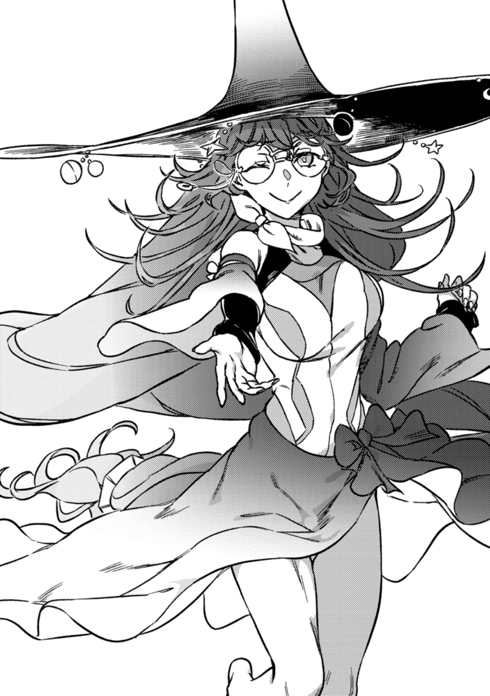

# 后记之后

睁开双眼，上条当麻发现自己身处一处空无一物的纯白空间之中。

他坐起身来。

映入眼帘的却只有纯白，周围的一切都是纯白，这片寂静的空间中甚至不存在地平线的概念。

简直像个拙劣的玩笑。

坐在那里，**上条当麻**低头看着自己的双手，思索着。

这是哪里？

在那种情况之后还能「继续」下去吗？

被欧提努斯杀死的时候，可没来过这种地方。

他一直以为，死亡应该更加空虚。逝去的事物永不复返，因而绝无救赎的可能。

但是……

上条的衣服完好无损，没有一丝血迹。他试着动了动身子，也没感到不适。不是痛觉麻木，而是真的连擦伤都没有。这反倒不正常了。他不是浑身伤痕累累，五脏六腑尽数损毁了吗？

上条当麻确实身在此处。

但却没有丝毫的真实感。他感受不到自己的实体，感受不到重量、厚度、温度、气味和色彩……明明人就在这里，却丝毫体会不到真实。仿佛上条本人就是他一直在否定的幻想本身。

说起来，周围安静得耳朵发痛，他却听不见自己的心跳和呼吸。

上条将目光投向右手。

**那个东西**，怎么样了？

它还在吗？

亚雷斯塔曾经说过，它会在宿主死亡或是遭到破坏的时候从一个物体转移到另一个物体之中。据说在自己之前的那一代，它是以某位圣者的右手为素材做成的一枝箭。

幻想杀手(Imagine Breaker)。

如果，假如，这只是假设。倘若自己已经不复存在。那么，让幻想本身拥有它，真的合适吗？世界真的能容忍这种事吗？

「这里莫非是……」

对于生活在科学之都——学园都市、习惯了那里常识的上条而言，说出这种话或许不自然。但他毫不抗拒地想到了这一点。

（**难道说这里是死后的**——）

「哎呀哎呀。」

一个温和的声音响起。

不是直接认识的人。但在重要场合，她总是若隐若现。

就像上条穿戴整齐地出现在这里一样，她也还是那副打扮——古色古香的女巫帽子配上最新款的竞速泳衣，别扭得很。连眼镜都一应俱全。

道理上条不懂。不过双方要是一丝不挂，那就太尴尬了。

在这个除了白色别无他物的地方，她稀松平常地站着。

这有多么异常啊。

她一副若无其事的样子，反而掩盖了事情的严重性。多半是做了什么离谱的事。

对着同样以这副模样定格的上条，同样以这副模样定格的她开口了。

「这里，还不是你现在该来的地方吧？」

「你、你应该是，另一位安娜，叫什么来着？金斯……对了，应该是安娜·金斯福德……？」

「◎(正是)。」

她为什么在这里？

话说回来，这地方随随便便就能进来吗？

「你把我看作『另一个』，实在是太棒了。你并×(没)〇(有)分出高下，而是自然而然地认为我们都〇(是)真正的安娜。或许正因如此，你才给予了她想象之上的救赎，同时〼(也)令她备受煎熬。×(但)你给予了她我也×(无法)做到的救赎。善良的人啊，我钦佩你。」

每思考一个疑问，就会连锁引发下一个疑问，直至饱和。常理在这里不管用。面对满脸惊愕的上条，金斯福德优雅地用手掩着嘴，轻笑了起来。

「你忘了吗？」

「忘了什么啊？」

「还是说，你根本就不知道『前提』呢？」

另一位安娜优雅地梳理着信息。

她给人一种温柔的女教师形象。

在上条这男高中生的想象中，她属于文科，但又和英语老师不大一样。

「我×(只不过)是具经过调整、能够活动的永久遗体罢了。说白了，硬要待在那边才×(不)正常，这里才是我原本的归宿。所以只要主动让机械部件停止运转，哪怕要和现世悲伤『诀别』，我随时都能来到这里……我〼(伤害)了亚雷斯塔，让他经历我免于×(死)亡，又让他经历我的×(死)去，让他安心，又和他告别。唉，×(不)过为了你，他应该能理解吧。总之，×(死)人对我来说才是正确的身份☆」

「……」

「而且，事情会变成这样，我～(从)一开始就〇(已经)预料〼(到)了。」

她随口说着。

轻描淡写。

上条在大家难以预测的爱丽丝的斑斓世界中拼命挣扎，好不容易才得到这个结局。但另一个安娜却如此轻巧地说出口。

仿佛这一切不过是预定调和的范畴。

幸好她是个好人。要是什么邪恶的魔王，那就糟糕透顶了。如果她是侦探，绝对会因为放任事态发展到这一步而被上条揍一顿。用拳头揍。就算对方是女孩子，上条当麻也绝不放过任何危害他人生命和人生的家伙。这个人看着特别适合当宿舍管理员大姐姐，但他也能下定决心，说干就干！！

「×(没)人能逃脱自己做出的选择。何况最后的分歧，在我这具遗体开始活动之前就已尘埃〼(落定)。因此×(即使)是我也×(无法)介入了。你×(必须)先×(死)上一次才行。……」

面对无言以对的上条，宗师说道。

她仿佛在窥视他人的人生，为尘世打分一般。

「×(但)同时，受罚之人重获自由，也是每个人的权利。简单来说，你虽然〼(犯下了)×(错误)，但在×(死亡)后就不该再受责备了。你已经洗清了罪孽。」

「我……洗清了自己的罪孽……？」

「你〼(干得)◎(非常)漂亮，上条当麻。在自己的生命〇(行将)消逝之际，你×(毫不)犹豫地优先选择拯救罪魁祸首爱丽丝·异典，你的这份『奉献』直到最后一刻都在持续。这是最值得称赞的行为。身为魔法师的安娜·金斯福德〼(可以)证明这一点……而我也×(没有)强大到能眼睁睁看着努力的人×(不得)善终。」

「你要做什么」

「不如说你还要忍耐到什么时候？你也看到了，这里是『逸脱之地』。都积攒了这么多不合理的事，就算是神明，我〼(觉得)也该找出来好好抱怨一番了。×(死)了就×(死)了，这么爽快地接受，反应未免太老实，我在一旁看着都〼(感到)火大。」

「等等，别把当事人晾在一边擅自推进剧情啊？！……我嗅到了一股超乎寻常的规格外力量的味道……有种不祥的预感……」

「话说回来，这个时代的高中一年级学生，一般来说不都是×(才)十六岁吗？正值叛逆期的小鬼，×(却)以惊人〼(的)气势达观处之，你就×(没有)什么想做的事了？？」

「啊，说起来，我快要过生日了。」

「所以说，一个早上一年学的十五岁小屁孩，就×(放弃)得这么死心塌地，像话吗！！真是令人扼腕，这可×(不)是什么十九世纪的陈旧观念哦？！」

「所以说你给我等等，不管谁说什么，我都已经死了，在这里就该画上句号了吧！！我说，你这明明已经走进死路了，还一副藏着后手的语气，到底是什么意思！」

「为了奉献给周围的人。」

她在丰满的胸前合十，只用指尖相抵。

带着羞怯的笑容，宗师如是说道：

「以宗师的绝技，具体来说，我想〼(着)△(来一场)地狱巡礼。」

「……」

「哎呀哎呀。如果听×(不)懂地狱巡礼的比喻的话，那〼(换个)说法，就当是『越狱』吧？」

「…………………………………………………………………………………………………………………………………………………………………………………………………………………………………………………………………………………………………………………………………你认真的？」

「◎(当然)。以荒谬还治荒谬，以违规制裁违规，这可是十九世纪魔法师的处世之道，现在不也一样吗？」

上条哑口无言。

难道说。

这个女人，不会还能随心所欲地掌控**这里**吧。

魔法还能做到这种地步吗？

在这片虚无的白色世界里，安娜·金斯福德始终向蜷缩着的上条伸出柔软的手。

是右手。

「来吧。让我们一起踢飞这个混账的既定结局，再次〼(挑战)一下『败者复活』如何？」

&nbsp;

……那么其中哪些是谎言？

这么天衣无缝的好事，向来不幸的少年绝不会相信。

