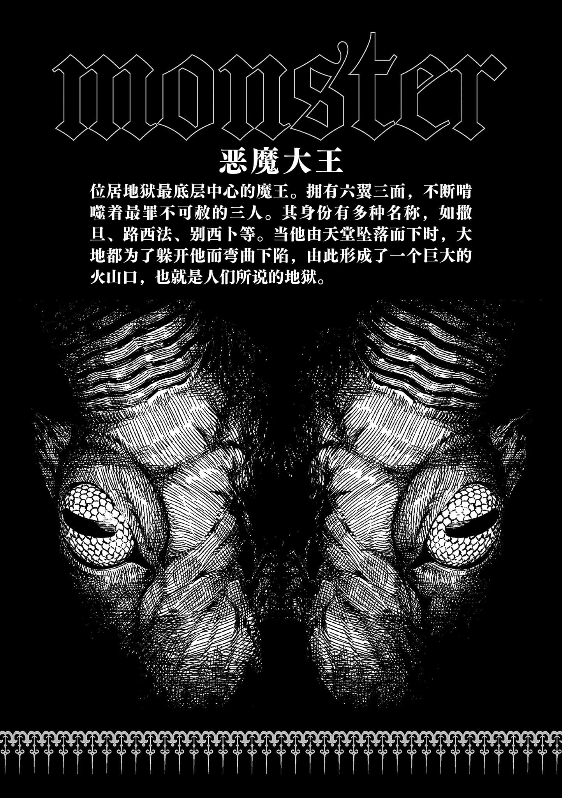

# 第三章 唯一的谎言·解答篇

> Seat_the_Only_One.

## 1

情况变了。

安娜·金斯福德。

这个绝对安全的地带产生了动摇。

不存在完美之人。

不存在无瑕之人。

……想来也是理所当然，此前看起来「如此」，倒不如说是金斯福德将某些见不得光的事彻底隐藏了起来，这么想反而更自然合理吧？

**纯善之人**。

**又或是只以善示人的人**。

冷静下来。这不就是跟那个「毫无保留释放危险与丑恶自我的罗森克鲁兹」相比，另一种意义上相当危险的存在吗？金斯福德显然隐藏了自己的真实意图。她将一切都打理得干干净净，绝不允许出现任何污点与失态……为什么自己会全盘听信这种比「加满化学药物的漂白剂」还可疑的东西呢？

表面上想着我不信我不信，结果还不是全交给金斯福德了？

与金斯福德和罗森克鲁兹的再会。

再加上地狱这一整个现象。

上条当麻，真的有努力过用自己的脑子整理现况并尝试解释这一切吗？

事实上，上条就连安娜·金斯福德生前做了什么都不清楚。虽然隐约记得她曾在涩谷和学园都市里与亚雷斯塔和施普伦格尔小姐同行，并给他们提供过建议，但是上条自己并未与之有过任何直接的关联。想从她的行动推测出背后意图更是无从说起。

她只是将与克里斯蒂安·罗森克鲁兹的战斗导向了胜利。

她只是将他与爱丽丝·异典的战斗导向了胜利。

……但金斯福德究竟是「为了什么」而伸出援手，以及她究竟「得到了什么」，真有人能解释清楚这些问题吗？

上条完全看不出金斯福德的本心。

所以她看上去才像是一位毫无阴霾的善人。

「CRC……」

安娜·金斯福德说道。

她总是领先一步走在前面，让上条只能看到她的后背。

换言之，连表情都不让上条看到。

「×(不)，正确来说是通过如此自称来与传说同化的约翰·瓦伦汀·安德烈。与『坊间传说』×(不)同，他其实×(没)能◎(活)到一百零六岁，去世一百二十年后也×(不)〼(得)复活。纵使不断以罗森克鲁兹的身份想方设法延年益寿，但最后也迎来了极限，终究×(未)◎(能)打碎亲手创造出的幻想『蔷薇十字(Rosenkreutz)』，怀抱着对世人×(不)愿正视真相的失望与憎恨，于一六五四年，以凡人之躯结束〼(了)自己的一生。」

「……」

「自那之后，『蔷薇十字(Rosenkreutz)』这个词汇便彻底脱离其所有者，化〼(为)任何人皆可自由使用的素材。新设的魔法结社，只需声称『我们是「蔷薇十字(Rosenkreutz)」的正统末裔』〼(就)能给自己贴金，反正也×(无)人能鉴别其◎(真)×(伪)。其中甚至有诸多与『蔷薇十字(Rosenkreutz)』毫×(无)关联的结社掺和〼(了)进来，这也○(是)它突然演变成了一个汇聚古今中外的术式与灵装的庞大『魔法样式复合体』的原因。但无论◎(好)×(坏)，事实上它的确曾被用作各式各样结社的基础或者说基石。」

她的话语滔滔不绝。

「比如说神智学系与赫尔墨斯学系社团、英式蔷薇十字，以及由我的徒弟维斯考特与马瑟斯他们创立，被称作世界最大魔法结社的『黄金』。尽管程度○(有)所不同，但它们每个都逃×(不)〼(过)约翰在世间留下的CRC的影响。虽然施普伦格尔小姐似乎一直为自己的伪装生活感到愧疚，×(但)其实她本不必如此。毕竟根本就×(不)存在『真正的蔷薇十字(Rosenkreutz)』。凡是自称正统后裔之流本就全都缺乏知识，因此她觉得自己×(没)法成为真货的罪恶感完全是想岔了。……～(毕竟)我们就是一群因为相信『只要○(能)拯救他人与世界，那么即使基础只是假象也×(无)所谓』而汇聚到一起，朝着虚幻不断注入力量的徒劳之辈。」

这件事并不是上条当麻已知的信息。若不是与这两位超出常规的宗师在地狱里同舟共济，他恐怕永远也无法得知。

这么说来，「魔神」欧提努斯好像就是在穷其之道后，不惜献出单眼和牺牲生命，以换取可怕的睿智。

僧正、奈芙蒂斯、娘娘等人也是同样。

但是——

（……究竟，是为什么？）

上条的脑海中浮现出一个疑问。

在这个地狱里，上条当麻的欲望曾被可视化出来。罗森克鲁兹，不，约翰过去的罪孽也被展露。

但是，却没有任何安娜·金斯福德相关的情报。

地狱没有显现出她的内在，她也没有披露自己的过去和目的。

（难道说，**被她回避掉了吗**？罗森克鲁兹意外的真相确实令人惊奇，但没有要在现在揭露的理由……看起来也与我们逃离地狱复活的「越狱」计划没有直接关系。）

在这层意义上，金斯福德原本才应该是被深入挖掘的人。

如果地狱这个处理人类灵魂的巨大装置想要阻止一场（从对方的视角来看）违禁的「越狱」行为，理应会读取金斯福德的心底，挖出她的创伤，这样才更能造成妨碍。

然而，这并未发生。

奇妙得反常，甚至让人觉得不自然。

冷静一想，别说金斯福德有什么宏大的盘算了，上条当麻连她讨厌吃什么、听不惯什么音乐流派这类微不足道的瑕疵都一无所知。

完美无瑕的善性。

上条在她的身上只能看到这些。

&nbsp;

安娜·金斯福德果然有着「什么」。

虽然还不清楚那「什么」会对上条有利还是有害。

&nbsp;

（不过……）

如果是这样。

被带到这个完全陌生的世界的深处，上条此时的感受就像是在某个语言不通的国家坐上了一辆可疑的出租车一样。虽然明知对方的危险，但也不想被一个人丢在丛林或者沙漠的中心。即便对方是可怕的罪犯，现在也只能稳妥一点先假装被骗，让她把自己带到有人烟的地方去了。

目的地便是地狱之底。

把上条当麻的灵魂带到那里，究竟会给金斯福德带来什么「利益」呢？

甚至不惜出手干预那个放着不管本就会自己死去、就此了结的上条。

（……只要能知道她的最终目的，应该就能推演出来，并逃出金斯福德制造的「倾向」。）

只能祈祷这并非是自己一介高中生理解不了宗师想法的情况了。

对于这点，唯一的王牌应该就是他了吧。

克里斯蒂安·罗森克鲁兹。

虽然性质极为恐怖，但宗师就是宗师。无论金斯福德基于何种理论采取行动，只要有这个同等级别的家伙在，应该就能正确将其解读出来。

## 2

地面上长出了一堆腿。

到处都是。

密密麻麻。

「……那个——」

「在地狱里这也×(不)〼(是)什么稀罕风景。这里是专门制裁西蒙的弟子，犯下买卖圣职罪的罪人们的地方。」（*译注：买卖圣职（英语：Simony），即金钱买卖教会职位的罪行，以西蒙（Simon）命名。*）

虽然眼镜大姐姐进行了说明，但高中生却连买卖圣职是什么都不知道。眼前景象的怪诞甚于恐怖。受害者们倒栽葱，只有双腿露在外面，让上条回想起了某个超有名的推理电影中的画面，但数量太多了。这么大量，已经超越了在泳池里表演水上芭蕾的程度了，完全就是一片田野。

「顺便一提，竖洞底下还有火焰〼(在)不断燃烧，～(所以)罪人们会被～(从)头焚烧，永远受苦，×(无)法逃脱〼(哦)。」

「比想象中的还要恐怖啊……？！」

「～(毕竟)靠近地狱底层〼(了)嘛。制裁重罪的设施自然也会增加。」

不过上条也就只能喊喊。

他试着像拔萝卜一样用双手拽了拽其中一条扑腾的腿，然而那条腿却突然剧烈地乱动起来。仿佛有什么薄薄的东西脱落了一般，那条腿震颤了一阵，就不再动了。这让上条有种好心办坏事的感觉。

话说回来，虽然用右手碰过了，但这些人看起来也没有消失。

所以到底是怎么回事？

（感觉要是习惯了这种残酷至极的地狱光景就不妙了……）

少年感觉自己仿佛是在梦里，常识与前后脉络都在逐渐崩解。

既然什么都做不了，那留在这种地方只会产生罪恶感。无暇休息，上条等人迅速穿过这个针对买卖圣职罪行的天罚区域。

「又是河啊……」

上条轻声说道。

这也是见过好几次的情形了。

「阿刻戎河、斯堤克斯河、弗莱格桑河……地狱里有〼(着)各种各样的河流。这种将河流作为◎(生)×(死)交界的认知，并×(非)是日本的三途川独有。这里感觉应该〼(是)弗莱格桑河，×(但)看来跟河流原本的流向有些×(不)同〼(啊)，而且也×(没)有烧〼(得)通红。」（*译注：冥界四河——阿刻戎河（悲伤之河）、斯堤克斯河（誓言与仇恨之河）、弗莱格桑河（火焰之河）、科库托斯河（哀叹之河）。也有说法称还有第五条河，即勒特河（遗忘之河）。其中弗莱格桑河在描述中常被描绘为一条沸腾的火焰之河，其流动的液体并非水，而是燃烧的烈焰。*）

「唔。」

上条随便附和。

但他实际上听得很用心。

有了罗森克鲁兹的警告，感觉果然就会大不一样。

（说起来，金斯福德为什么对地狱的结构这么了解？）

如果一生活得正直，以求死后能上天堂，那应该没有学习地狱结构的必要。事实上，罗森克鲁兹这么说过。与神明所在的天堂不同，地狱这种只有罪人才会落入的地方并不怎么受重视，所以才允许人们描绘出各种各样的想象图。

然而金斯福德却对此了如指掌。

为什么？

她好像说过，「邪恶之树(Qliphoth)」是用来说明鬼魂与诅咒领域的。既然特地学得这么详细，也许她在这个领域十分擅长。

觉得有必要所以记住了。

既然比别人都了解，那么她多半也实践过。

虽然很在意，但就算上条直接去问金斯福德，说不定也只会被她搪塞过去。如果她正在隐瞒某些不为人知的阴暗过去，则更是如此。

目前还没到根据对方反应下结论的阶段，所以没必要胡乱发问打草惊蛇。

上条看向河对岸——

「不过……我们怎么过去啊？这么宽估计游过去是够呛了。」

「游过去可是自杀行为。看来×(不)得不造船了。只是造个简单的木筏其实×(没)那么难〼(哦)。」

一提到地狱，上条的脑海里都是岩石山峦和熔岩，不过这里的风景却是五光十色。有森林，有草原。天气变化无常，有时也会下雨。但是见到金斯福德不知道去哪里晃悠了一圈后捡回来一个工具箱，上条还是会感到惊讶。

或者说——

「那个……这该不会是某种能对人进行DIY的刑具吧？就是那个『格雷姆林』里的那个那个银发褐肤的那个谁那样的！！」

你怎么还记不起来人家名字的，罗森克鲁兹嘟囔道，不过上条打算装作没看见。

他绝不想让别人知道，自己对于这件事的态度跟收看电视上的杂学节目一个级别的事。要是那个戴着眼镜扎着麻花辫只穿一条工装裤的家伙知道了的话估计会哭出来吧……不过至少脸还是能想起来的！

「地狱里也〼(是)有船只和部落的，既然希腊神话的塔耳塔罗斯也混杂其中，那应该就○(有)一处由青铜外墙保护的领域。当然，也会有用来造这些的道具。」（*译注：据《神谱》记载，塔耳塔罗斯被三重暗幕与铜墙环绕，铜门由波塞冬铸造，百臂巨人镇守战败的提坦及克洛诺斯。后期神话扩展其职能与冥国混同，但荷马史诗严格区分二者。罗马神话中，塔耳塔罗斯被描绘为环绕炎河与铁墙的深渊，由海德拉守卫。*）

上条居然是第一次听说。

难道地狱里也有武器店和旅馆吗？

「……别想些有的没的，地狱会有所反应的。难道你想被一个浑身穿满只存在于传说中的奥利哈刚套装、攻击力拉满的网游氪佬死宅鬼追杀吗？」

CRC低声说了句相当恐怖的话，但在这种地方完全有可能。就像雪男和雪女一样。如果出来的是额头长出小角、身穿虎纹比基尼的幼女鬼，或者和服半敞、爆乳半露的妩媚大姐姐鬼，那还好说，但要是冒出一个毫无新意、杀伤力拉满的肌肉大叔鬼，甚至还一门心思打起了最强装备的主意，那就真的无可挽回了。

还是回到造木筏这件事上吧。

按上条脑海里的印象，木筏就是将几根原木并排用绳子捆扎起来，不过眼下看来似乎并非如此。

金斯福德捡来了几根细长的棒子，像晾衣竿一样。

在捆绳子和钉钉子之前，她先在地上用原木与长杆大致摆出成品的形状。长杆从木筏的两侧伸出，而且她似乎还打算在其前端绑上类似空水罐或者水瓮的东西。

「？这是什么？」

「光是把原木并排在一起，浮力和稳定性〼～(可是会)出问题的。要是在死者之河里翻了船，后果可就惨了哦？所以多○(加)几根舷外浮木会更安全。」

原来如此。

想把洗脸盆按进浴缸的话，就会产生强大的空气阻力。水罐和水瓮就是利用这个原理，像救生圈一样来为木筏提供浮力的吧。不过她到底是从哪里捡来的？

成品的形状有点像水黾。

「你去按住那根原木，我～(来)进行固定〼(吧)。嘿～哟！」

建造类游戏开始了。

金斯福德将几根原木并排起来，用腐朽的绳子将它们绑在了一起。但这样明显不够结实，于是戴眼镜的大姐姐又打进了好几根长长的钉子，将原木和长杆牢牢固定起来。她用的并不是家居建材商店里常见的那种钉子，而是倒L形的巨大钉子。据说是用在列车轨道上的。要是直接把木杆打穿的话会让它裂开，所以倒L形钉子的水平部分正好可以用来牢牢压住细杆。

但是——

「那个，等等，金斯福德小姐？老师？！」

「？」

有什么东西摇动了起来。

穿着竞技泳衣的大姐姐光是当场弯下腰，一手按着钉子一手拿着锤子，她的大胸就已经被两条胳膊夹在了中间。她再叮咚哐啷地敲起来，胸部就跟着弹个不停。那对巨乳已经抖得飞起？！就在上条眼前！！

「……虽、虽然有点不忍直视，不过毕竟是老师您自己这么干的，所以我默默地在旁边看着应该也没事吧？您不会生气吧？」

「到底是指什么呢？？？」

眼镜大姐姐一脸茫然。

可别说你不知道啊。总之既然对方亲手按下了同意的按钮，那就暂时远眺一番这幸福的光景，来恢复一下心灵的健康吧。大胸就是大胸，别管是谁的。嗨就完了。

话说回来，这个木筏没有像游艇那样的帆。

三人一同将其推到水边。

看上去，这条地狱之河完全没有流动，这死气沉沉的水面与其叫河流不如叫沼泽。让木筏浮在水面上后，三人一起乘了上去。金斯福德拿起一根多余的长杆插进水面，操控着木筏。

就像是在寒假里白天随便播着的老古装剧里看过的那种场景。

不过看起来并不是划桨，而是将长杆插进河底，将自己所乘的船往前推。

既然用那种东西就能碰到河底，就说明这条河其实没那么深？

「落入地狱之河的话可是会非常悲惨的哦？不过如果你想沾染上他人罪孽的污秽，永远遭受毁灭的话，×(那)我〼(也)×(不)会阻止你。」

虽然很慢，但他们还是稳步在弗莱格桑河（？）的上面前进。

「……」

话说回来。

河流。

生死交界的概念倒是挺好懂的，但在地狱之中划出这样的界线又有什么意义呢？

即便死后被打入地狱，也依然不可逾越的底线究竟是什么？

「……我感觉已经跨过好几次了，而且也没怎么多想。」

「我们的目的可是『越狱』啊？光是遵守规则肯定是×(不)可能达成的吧。」

不对。

金斯福德的目的是远离作为入口的「地狱之门」，前往整体呈研钵状的地狱中心最底端。

不过，目前还不清楚她最终到底想做什么。

「×(虽然)这河水〼(算)×(不)上清澈，不过吹吹风倒挺舒服的呢。……呼。」

金斯福德忽然停下操纵长竿的手，单手撩起自己那宛如巨大炸虾般的长发。

应该还是因为这片火焰地狱。

宝石般的汗珠散落开来，露出的后颈散发着甘甜的香气。

「哎，长发就是在这时候不方便。这里～(会)积蓄很多空气，在背上营造出很○(强)的隔热效果。」

「……这次又要在河中间展现自己的大片后颈？求求你自重一下。」

「？」

上条当麻正使出浑身解数与自己的青春期作斗争。

同乘一条木筏的混蛋则开始了他的复仇。

「毕竟这衣服前后的布料面积相差太大了。应该说是裸体围裙还是舍管大姐姐呢？虽然死死盯住后颈也挺不错，但那裸露的肩胛骨与脊柱线条也不赖，甚至再把视线下移，还能透过泳装后腰处薄薄布料看到她尾椎骨的凸qi——」

「哎呀，多有失礼。」

哇啊啊啊啊啊啊！！CRC发出惨叫。似乎是在木筏失去平衡的当口，他那格外长的银胡子被什么东西抓住了。被什么抓的？沉浊翻腾的河水里窜出了什么东西。不对，是有好几颗巨大的狗头冒出来，正咬着青年老头的胡子？！

「哎呀哎呀，又是魔犬刻耳柏洛斯啊。我就知道它会用狗刨式追上来。或许当初在上层环谷的时候我们就×(不)该放过它。」

「CRC是不是那种容易招狗子喜欢的体质啊……？」

刚才那番话，再怎么说也应该只是胡扯才对。

应该没有什么深层含义。

罗森克鲁兹刚才那番话，应该没特意藏什么暗号吧……？

「嘶————喂，小子。」

引以为傲的长胡子被巨犬撕扯拖拽，意外陷入巨大危机的克里斯蒂安·罗森克鲁兹开口说道。

就像是修学旅行时的夜晚。

「所以你小子到底喜欢谁？」

「……呃。」

「居然一时答不出来……？不是不是不是，这里怎么想都只有安娜·金斯福德一个选项吧？！不然之前那些巨大的胸部和屁股又是什么意思……你的裸体围裙年长宿舍管理员大姐姐的梦想呢？青、青春期也太残酷了。难不成她竟然是纯度100%的性欲担当吗？？？！！！」

「臭老头看来你是想搞点大乱子啊？在这个三百六十度无路可逃的河流之上，想让我提高金斯福德的仇恨值被她袭击是吧！！」

「但你小子也没特地否认——唔咕噜噜？！」

为了阻止这场巨大的阴谋，上条当麻弯下腰抓起红衣青年的脚踝。为了不让他继续废话，少年将他倒提起来移到了木筏的边缘，将他的脑袋按进了浑浊的河流之中。今天的世界也很和平。

安娜·金斯福德用长杆撑着木筏前行。

「嘿咻。」

她抵达了河对岸。

不知何时会发生意外而不得不折返，他们便将木筏拖到了陆地上，以免被河流冲走。这木筏浮在水上的时候看着轻巧，亲手去拖的时候却感觉相当重。不过这倒也不奇怪，毕竟是好几根原木拼在一起的，而且做成木筏以后也没法在地面上滚动。

突然。

上条的脑子里冒出一个小小的疑问。

克里斯蒂安·罗森克鲁兹。这个可怕的宗师在死后会去往何方，某种意义上显而易见。就连上条当麻也认同这一点。如此肆意妄为，让不少人为之悲伤，就算落入地狱也是无话可说。

但是，话又说回来。

她是一位唯有善念的纯善宗师。冷静想来，她为什么会在「这里」？

如果是为了切换生死，她似乎只需关掉永久遗体上的开关就能实现。但她既然如此一心向善，死后不该是去那什么天堂吗？

&nbsp;

没错。

说不定安娜·金斯福德，其实是死后会落入地狱那一边的人呢？

## 3

所谓地狱，给人一种阴暗、空虚而干燥的印象。

此外，也会联想到酷热和烈焰。

然而跟随安娜·金斯福德谨慎前进的上条发现，情况逐渐发生了变化。

他感到一阵寒意。

环顾四周，吐出的气息渐渐变白。

「……我们快到地狱的最底层了。」

罗森克鲁兹低语道。

他呼出的气息也是白色的。

「小子，你应该听过『科库托斯』这个词吧？」

「是指某种冰属性的魔法或者魔剑吗？」

「应该说，现代人到底是怎么把这个词汇挖掘出来，将其融入娱乐之中的呢……？」

银发红衣的青年轻捻修长的胡须说道。

「科库托斯，是地狱最底层的代名词。而且如同树桩年轮一般，科库托斯也分为四环——该隐环、安特诺尔环、托勒密环和犹大环。由外环到内环，罪孽愈发深重，而最底层的中心点——犹大环，就是世上最罪不可赦的三人受万劫不复之罚直至世界末日的地方。」（*译注：据但丁的《神曲》，犹大环中关押着背叛耶稣的犹大和刺杀凯撒的两位密谋者——布鲁图和卡西乌斯。*）

「……等下，你说**三人**？」

「哎呀真令人头疼……人数如此不可思议地吻合，让老夫也倍感不妙呢。」

上条看向冰封世界中继续前进的金斯福德的背影。

如今正在地狱中行进的三人，与这世上罪孽最深重的三人。

这种对应，

真就这么巧吗？

不，但是……

（要真是这样，作为引路者的金斯福德也会自身难保。如果她是打算把我们骗到地狱底层再设陷困住我们，那么她的身边本应还需要一个人才对。）

不管怎么想都无法读懂她的目的。

而搞不懂这件事，也就无从防范。

他愈发感到不安。

四周的黑暗愈发深邃，寒气也不同以往，如刀割般凛冽，显然有某种事态正在发展。必须尽快采取措施才行，但只能被一路引向深处的上条，事到如今甚至连盲目拔腿奔逃都做不到。

那样一来，就像只因信不过向导，就在满是陷阱的金字塔里朝着错误的方向全力狂奔一样。

他本该多去主动斟酌。

至少也该留意一下走过的路，记住原路返回的路径，这样的话他起码能安然回到「地狱之门」那边。

他意识到了轨道的存在。

明明左右两侧的世界十分宽广，处于轨道上的上条却无处可逃。

这反而让他更加焦虑。

「这里是……」

位于地狱最深处的，是一片冰面。

这片巨大的地底湖如同被整个冻结了一样，但他无法确认厚实的冰层之下是否还有「水」的存在，冰面的透明度比想象中要高。

上条本以为地狱的中心应该流淌着黑暗污秽的漩涡，不过这里或许就像是异世界奇幻作品中的魔界那样，魔王城外漆黑一片，魔王城内却是金碧辉煌。

也就是说，这里就是那样一个特别的地方。

即使是对欧式地狱的构造不甚了解的上条，也能略懂一二。

安娜·金斯福德停了下来。

一直沿路不断前行的善之宗师，在此止住了脚步。

要是她在自信满满地带着他们走了这么远后，突然笑着跟他们说「不好意思迷路啦」的话，那从另一种意义上说就是糟糕透顶了，但事实似乎并非如此。

安娜·金斯福德说道。

「就是这里。」

&nbsp;

&nbsp;

&nbsp;

什么？

有什么东西。

&nbsp;

&nbsp;

&nbsp;

上条的呼吸骤然停滞。

它不存在于生者的世界。只有死去并且堕入地狱中的人才有必要知晓这种怪物。那家伙很不妙。它与欧提努斯或亚雷斯塔这类的强敌有所不同。上条能感觉到，只要与其身处同一空间，自己就会毁灭。

还没看清本质，光是一个模糊的轮廓就已如此。

若是直接目击到，又会如何？

一般来说，黑暗会给人的内心带来不安和恐惧。光暗相比之下，光明的一方更好，这不是上条一人的想法，而是普遍存在于世间的思考方式。

但是，在这里不一样。

这浓密的黑暗反而让人安心。因为它让上条得以避免在毫无心理准备的状态下看到厚重帷幕另一边，那蠢蠢欲动的「某物」。

金斯福德曾说过，古希腊神话中司掌「夜晚」的女神名叫倪克斯。

也就是说，确实曾经有个时代，会将这种安心感当作神明来崇拜？

不能去看。

看到就会被毁灭。

尽管无人说明，尽管自己并未亲身确认，但上条当麻还是明白了。不管右手中蕴含怎样的力量，打从一开始，就绝对不能站在那种东西面前。

「恶魔大王，或者说地狱大王。」

安娜·金斯福德低语道。

这，就是她的目标吗？

去跟那个东西接触？

「〼×(尽管)关于其真实身份，有『妨碍者(撒旦)』『蝇之王(别西卜)』『携光者(路西法)』等等各种说法，但『他』的职责其实只有一个，那就是作为最高刑罚的执行者，永远啃噬那最为罪不可赦的三个人。根据这个地狱的情况来看，位居恶魔顶点的魔王企图反叛神明而潜伏地底养精蓄锐，但其仍在神明的掌握○(之中)，并持续惩罚着神明〼(所)决定的罪人。」

「你到底……？」

上条目瞪口呆。

金斯福德到底想做什么？上条是被诱骗至这个地狱底层，但她却是自己主动来到这里。在这个极度危险的地带中，还有一个巨大的怪物在黑暗深处蠢蠢欲动。如果上条能掌控全局的话，不管出于何种目的或利益，他都绝不会想来这种地方。那金斯福德又是出于什么目的主动前来呢？

「金斯福德，都到了这种地方，你到底打算让我们做什么？！我们一路走来，明明是为了从地狱回到现世吧！！」

「◎(是的)。」

善之宗师——或者说以此为伪装的某人干脆地点了点头。

带着笑容。

……难道说她是打算将上条和罗森克鲁兹的灵魂献给那个潜伏在黑暗深处的庞然大物，从而只身一人回到现世吗？上条脑海中甚至浮现出如此无聊的想象。能有这种妄想，说明上条已经无法思考出有效的答案或对策了。

然而。

「◎(正如)我一开始〼(所)说。地狱的整体构造，就像一个研钵。」

安娜·金斯福德说道。

……？

一如既往？

温柔的眼镜大姐姐一如既往地说着。

明明在将上条他们带入地狱最底层之后，她就没必要再扮演好人了才对。

「因此，如果○(想要)以最短距离从地狱～(前往)现世的话，答案非常简单：～(从)最底部设置一条路线，垂直向上进发。除△(此)之外〼×(再无)他法。」

「呃。」

「当人们～(根据)启示录○(等)少数文献分析地狱构造的时候，还〼×(没有)电梯、直升飞机和火箭这些东西。只有负责掌管地狱、身后长有双翼的天使们能使用这条垂直路线。所以这其实是看管下的近路。」

有东西在闪闪发光。

看上去像细小的粒子。

但事实并非如此。其真身是由透明度极高类似玻璃的东西制成的厚实平板。这些平板遵循某种规则漂浮在空中。从上条当麻的视角来看，那就像一道螺旋楼梯。随着视线上移，由于透视原理，物体的尺度感被打乱，使得那道垂直向上无穷延伸的透明楼梯看上去就像一缕从天而降的纤细光芒。

「〼×(虽然)人们经常提及『地狱之门』，×(但是)并〼×(没有)记录表明在门前折返就能回到现世。既然已经站在钵状地带的边缘，～(从)那里再向外侧走又能去往何处？依我看，大抵只会在地狱上层的黑暗森林、边狱附近永远徘徊下去吧。」

所以说。

所以说，是怎么回事……？

安娜·金斯福德从最开始的「地狱之门」走向地狱底层，并没有什么特别的深意。她只是单纯地，因为最底层有向上逃脱的方法，所以选择了这条最短最快的路径。

表里如一。

真的就只是这样吗？

「『邪恶之树(Qliphoth)』记载了从现世～(通往)地狱的领域。〼×(尽管)在通常情况下，它被认为是专门用来讲解幽魂和诅咒的邪典，只要触碰就会引发灾祸，但是克劳利一派〼(认为)，只要一位全副武装的宗师谨慎地与之接触，就能从中○(获得)无数常规渠道○(得)×(不到)的秘技和捷径。」

金斯福德眺望着光之阶梯，说道。

同时展示着无偿的奇迹，仿佛一切都理所应当。

「另外，在克劳利派普及的冥想法中，不受现有的善恶论迷惑，绝×(不)偏左也不偏右，唯有一味垂直向上，才被〼(认为)是跨越世界与世界的唯一方法。……要是将现代理论直接可视化，大致就是这么回事吧？」

安娜·金斯福德一无所有。

她真的只是为了解救上条当麻就停止了自己的机能告别现世，特意降临到地狱。而且无利可图。她自身一无所获。

作为被解救的那一方，上条却怀疑她。

就像紫甘蓝的溶液一样。（*译注：紫甘蓝溶液常用做酸碱指示剂，此处比喻将角色的性格特点揭示出来。*）

又或是地狱。

面对真正纯善的金斯福德时心生何念，便会暴露出一个人的卑劣。面对真正的宗师，不管怎么隐藏都毫无意义。在究极的正义面前，就连因羞愧而试图隐瞒的行为本身，都会被轻易地凸显出来，直接摆在眼前。

没错。

如果安娜·金斯福德身上什么都没有，那上条心头又涌出了新的疑惑。

说到底，一开始上条当麻为什么会怀疑金斯福德？

不管是何原因，这些都是上条自己的心理活动。少年并不打算将自己的丑陋归咎于他人。但是，原因应该是存在的。正是那一开始的推力，引导着他对那位为了无偿的奉献精神不惜搭上自己性命的善之宗师产生了怀疑。

这并非难事。

只要用排除法考虑就行。

首先排除善良的金斯福德。受人摆布的上条虽然内心丑陋，但也仅此而已。从外部挑唆、引诱他走上歧途的人，在这两人之外另有其人。

而如今，这地狱之中还剩何人？

三人中排除二人，还剩谁？

上条当麻说道。

罪魁祸首的名字。

&nbsp;

「**克里斯蒂安**……**罗森克鲁兹**？」

## 4

时间静止了。

上条当麻感到难以置信。

然而，会产生这种想法本身，或许也正是他已被卷入其中的证据吧。

应该是有个前提才对。

与善之宗师金斯福德截然相反，罗森克鲁兹与「广为流传的传说」不同，实际上是一个任性且反复无常的，散播死亡的宗师。

难道少年忘了他的危险性了吗？

难道少年已经忘了曾经在学园都市究竟发生过什么吗？

有些真相仅仅遵循正道是无法获取的。有时可能需要利用一些偏激的视角、秘技或是捷径。上条曾被这样的想法所蛊惑。

金斯福德不是曾经说过吗？

只有全副武装的宗师，才能妥善利用那专门讲解幽魂和诅咒的「邪恶之树(Qliphoth)」，普通人即使触碰，也只会被灾难吞噬。

而上条的想法就是典型的例子。

……如果上条因怀疑金斯福德而与她分道扬镳，在这地狱中会发生什么事情？

恶魔既不会依靠简单的蛮力，也不会从口中喷出烈焰，而是会一脸善意地用话语劝诱，让人朝着错误的结局全速前进。大家都知道那是个危险的存在，但又坚信自己与众不同，可以随意使用世界暗藏的潜规则且不受伤害。

从外侧如此诱导，不弄脏自己的手，以最短的距离和最快的速度让人走向毁灭。

不同于对待上条的态度，安娜·金斯福德对克里斯蒂安·罗森克鲁兹始终冷眼相待，也是这个原因吧？

「像你这种程度的宗师，虽说是受到了～(来自)死亡之外的刺激，但也再次动了起来。光是×(杀掉)你一次怎么可能宣告结束呢？你说对吧，CRC。」

上条本以为，这些都是门外汉高中生和专业人士之间的区别。

……但其实答案要更为简单。CRC从一开始就是幕后黑手。上条早已忘得一干二净的事，善之宗师却自始至终都已看透。

安娜·金斯福德。

她以某种不同于地狱的方式，揭示出了人类的本性。

不仅像紫甘蓝溶液一般将上条当麻的浅薄暴露无遗，还剥开了恶魔那温柔精致的伪装，将其本性展露了出来。

唯一的幕后黑手。

从一开始就已确定——克里斯蒂安·罗森克鲁兹。

「这个地狱，是……」

银发红衣的青年，此刻正浑身颤抖着大喊，慌乱不堪。

这是某种类型的讽刺吗？

还是说地狱让一切都两极反转了？

散播死亡的存在正在主张自己的正确性。

「……是为老夫准备的巨型装置。是老夫自己做的！！擅自闯进来的人不是你们两个吗？！」

「？」

上条不懂他在说什么。

「◎(是的)。」

但，善之宗师不一样。

安娜·金斯福德几乎无所不知。她绝不会偏离正道。与这家伙为敌简直是糟糕透顶。这并不是因为她的战斗力强，而是无论什么人，在和金斯福德敌对的瞬间，就足以证明其自身的存在或考量是绝对的错误。

「这个地狱，并〼×(不是)『真正的』地狱。」

善之宗师说道。

「这是由人们～(从)『地狱』这个单词联想到的意象拼凑而成的一个临时区域。此造物能被用来掩盖本应消亡的灵魂，篡改其归宿，最终将其属性强行切换成一种介于◎(生)×(死)之间的，暧昧的濒死形态。这地方存在的唯一意义，就是为×(死去)的灵魂捏造出再度回归现世的资格。事后再从『九死』之中硬生生夺回『一生』。说到底，也就仅此而已。」

这个地狱并不是「真正的」地狱。

至今为止，上条曾看到过黑暗中穿梭的人影，或从地面倒立伸出的双腿。可即便如此，他却并没有帮助那些受难之人，而是将其当成地狱光景的一部分径自走过。现在想来十分不自然，也就是说，这也是同一回事吗？

包括人影在内，这里的一切不过都是虚幻的泡影罢了。所以并没有引起他正常的感情波动。

不过。

「？也就是说，是金斯福德你创造了这个败者复活区？」

「×(不)。」

金斯福德立刻否定。

与那些曾被「蔷薇十字(Rosenkreutz)」运动冲昏头脑的大众不同，她不会为了自身的利益而去歪曲事实。

「将这个地狱插入缝隙之中的人，是自称克里斯蒂安·罗森克鲁兹的约翰·瓦伦汀·安德烈。」

「难道说……」

说来也是。

如果这里是金斯福德按自己喜好打造的地狱，那为什么罗森克鲁兹会误闯进来？既然金斯福德只是想救上条，明明只要他们二人一起踏上旅程就行了。

可谓是谜一样的多余之人。

**但他并非如此**。

「罗森克鲁兹当时就在『地狱之门』，那是整个地狱的起始之地。但我们可没看到，这家伙来到地狱的那一瞬间……」

「那是当然，因为是老夫先到这里的。随后闯入的异物，那多余之人明明是你小子和那个小姐，是你们两位！！」

「◎(嗯)，算是吧。」

金斯福德立刻答道。

正派之人基本上连掩饰的迹象都不会显露。

「即便如此，我也曾向亚雷斯塔许诺过，无论采取多么作弊的手段，我也一定要救出上条当麻。所以我〼×(无论)如何都要遵守这个约定。CRC，即便我要为此击碎你那纯粹但又充满毁灭性的野心，并将它当作垫脚石。」

「老夫……要重回人间。」

「为了～(从)当今的世界里将『蔷薇十字(Rosenkreutz)』的嫩芽〼(全部)摘除？」

「老夫在现世还有应尽之事！！怎能留在此处！！」

「即使那会直接导致当今世界的一半——魔法阵营灿◎(若)群星的魔法结社全灭，而由此引发的混乱也将间接导致科学阵营土崩瓦解吗？」

上条他们至今为止走过的这个地狱，是罗森克鲁兹为自己死后的灵魂回归现世而制造的临时空间。

而上条和金斯福德横插一脚闯了进来。

这种结构才是正确答案。

所以这一路揭露的都是约翰的过去和罪孽。因为这些都是，从一开始就为他调整好的路线。

而罗森克鲁兹想必也认为，只要自己能够「越狱」就怎样都无所谓。若他为了这个地狱只付出了最低成本，一个推论便浮出水面。

那就是。

「**这个地狱的构造**，**只能允许一个灵魂回到现世**。」

「………你想抢走吗？」

「本已满目疮痍的学园都市〼×(没有)余力承受CRC的第二次袭击。再○(来)一次就真的要走向终结了。约翰，唯独你的复活，是我×(无)论如何都必须阻止的。」

「你想从老夫手上抢走这个座位？！就为了让恰好死掉的上条当麻得到这个复活资格，小姐你要白白浪费掉这唯一的票券，**永远阻止老夫的复活**！！！！！！」

「这位少年的×(死)是必然的。无论如何都×(不能)避免。○(既然)如此，最好的对策不就是将这次×(死亡)也算入整体的战略中，拯救这一切吗？而作为利用了他的人，我自然有责任让这个未竟之事×(仍旧)堆积○(如)山的年轻灵魂重返人间。」

这就是一切。

但其中有两样东西未被计入。

安娜·金斯福德和克里斯蒂安·罗森克鲁兹。

「不管拥有何等强大的力量，我等都不过是已×(故)的魔法师。将仍然◎(活)在当下的少年排除以图复活，这种卑劣愚蠢的行径，我绝〼×(不)会认同。生存的席位就该留给本◎(应)存活之人，CRC。若仅○(有)一张票券，就该毫×(无)迟疑地让给少年。我等〼×(不应)插手。」

那是断言。

从一开始，金斯福德就没有考虑过自己复活的可能性。

「小姐你……这样就满足了吗？」

「◎(是的)。」

「就凭这种冠冕堂皇的理由？？？！！！这、这可不只是老夫一人的问题。毕竟现世之盖已经触手可及。即使是小姐你，抛弃那边的小鬼让自己复活，也能拯救更多的人。冠以宗师之名的你，不可能算不清这笔账。既然如此为什么要让出来？！怎能为此等愚行豁出性命？！」

「为了奉献给周围的人。即使这一切都是你恶作剧般随意书写的涂鸦，即使那些被冠以蔷薇和十字之名的团体基本上都是借用其名的假货，也确实有宗师真心相信那里描绘的理想并愿为此付出自己的生命和人生……有许多人曾被这些真正的宗师在×(不)为人知的情况下拯救，并向他们报以笑容，而我也只是想加入他们的行列而已。既然眼前已有一位迷途之子，而我也○(有幸)获赐了伸手援助的机会，那么这一切究竟源于真理还是谎言，于我已无关紧要。」

「……」

「CRC之流×(从未)存在？『蔷薇十字(Rosenkreutz)』只是空中楼阁？无论他人如何言述，我都无需任何花言巧语，只会坦言回答说——即便如此，我〼(依然)坚信，罗森克鲁兹的传说所带来的那些丰功伟绩。克里斯蒂安·罗森克鲁兹，或者说以其为名的幻想，鼓舞了现实中很多魔法师的心，让许多人得到〼(了)救赎。所以我也想要向那些前辈看齐，加入他们。」

「…………………………………………………………………………………………………………………………………………………………………………………………………………………………………………………………………………………………………………………………………………」

沉默。

就连罗森克鲁兹也一样。

金斯福德曾说，她受到了眷顾。如果没有上条这个多余的累赘，她大可以趁着混乱让自己复活，不，甚至没有必要来到这个地狱。

但她既不犹豫，也无留恋。

她是真心实意，眼中唯有上条当麻的生还。

并且在此完全阻止CRC的复活，守护学园都市乃至整个世界。

虽说是被巧妙地引诱了，可即便如此。

但上条毕竟还是怀疑了她，这令他再次认识到自己的愚蠢。

「别想得逞。」

散布死亡与破坏的宗师失败了。

他曾低声耳语过不少，说什么已死之人就该入土为安，善之宗师金斯福德定有隐瞒之事，结果在真相大白后却是如此。

罗森克鲁兹只说对自己有利的话。

只要明白了这一点，分析至今为止信息的真伪就再容易不过了。

「这地狱可是老夫准备的！！既然如此，不管谁说什么，老夫都要一个人彻底用尽！卑鄙的盗贼们。任凭你们如何装作善人，正当的权利也始终掌握在老夫掌中啊！！」

「我应该已经说过了，CRC。」

「啧。」

「……这次，无论采取多么『**作弊**』的手段，我也一定要救出上条当麻。」

CRC，克里斯蒂安·罗森克鲁兹。

或者说，约翰·瓦伦汀·安德烈。

这家伙是个彻头彻尾的危险分子。上条绝不会忘记学园都市里发生过什么。但另一方面，这位银发红衣的青年至今为止从未对自己说过谎，即使那会为自己带来不利，甚至丧命。

实际上，他在生与死的世界徘徊了四百年以上。

他的目的只有一个。

&nbsp;

我想为自己的所作所为负责。

&nbsp;

仅此而已。

所以那个曾经身为十五岁少年的某人，把自己变成了怪物。

经历苦难功成名就，那又如何？财富与资产也并不会汇聚到他自己身上。

这些都无所谓。

他并不是为了变得幸福才这么做。

在行进的路途中，他只想着惩罚自己。

他连自己的名字约翰·瓦伦汀·安德烈都舍弃了，装扮成自己最深恶痛绝的架空人物克里斯蒂安·罗森克鲁兹。他拼尽全力想要根除大街小巷广为流传的「蔷薇十字(Rosenkreutz)」传说，但没能赶上人们口口相传的虚构故事自我增殖的速度，最后反倒是这位捏造者自身化为了一具尸体，从历史中消失……

「老夫，要复活……」

还有其真实身份。

还有他的罪孽。

一切都被那面善良之镜揭露无遗，但罗森克鲁兹仍旧咬牙切齿地怒吼道。

「即使身负骂名，即使舍弃自我，无论如何老夫都要做到！！你有这觉悟吗，小子？连将来想要做的职业和想要创造的未来都无法想象的小鬼。你那所谓渴望复活的理由，怎么可能比老夫跨越四百年的后悔和怨恨还要强烈啊啊啊啊啊啊啊啊啊啊啊啊啊啊啊啊啊啊啊啊啊啊啊啊啊啊啊啊啊？？？！！！」

话语呼啸而来。

如同一道无形的巨浪。

实际上，上条当麻不过是个连升学还是就业都还没决定的渺小高中生。要是被与传说本身融为一体的克里斯蒂安·罗森克鲁兹那跨越四百年的执念与正当性迎头砸中，顷刻间迷失自身立足点、就算灵魂被击得粉碎也丝毫不奇怪。

&nbsp;

「开什么玩笑。」

&nbsp;

然而，就只有一句话。

上条当麻甚至不需要使用右拳，仅凭一句话就击碎了四百年的幻想。

他不会再被人迷惑。

听信这扭曲之语很简单。比起与善人一起相信，有时与危险之人一起保持怀疑会显得更聪明。但事实并非如此。真相本就是坦直纯粹的，而且无人能保证，一直沿着自作聪明的投机之道走就一定能迎来幸福的未来。心怀叵测的宗师会笑着对你说轻信只会沦为笑柄，但反过来，对一切都怀疑到底究竟能获得何种幸福，他却从不作任何说明。因为就算勉强自己摆出一副玩世不恭的姿态，最终也只会一无所获。

必须由自己来决定。

只要如此强烈地期盼，胸口正中应该就能感受到强大的力量。

是否厚实，是否机灵，是否聪慧，谁也没有提出过这样的标准。

同时可以反过来问。

作出渺小、肤浅、愚笨的选择，到底哪里不好？你倒是说说看。

所以。

上条当麻的口中，很自然地涌现出这句话。

少年没有低头。

他凝视前方，直面着散播死亡的宗师克里斯蒂安·罗森克鲁兹的目光。

目不转睛。

&nbsp;

「……我想再和茵蒂克丝聊聊天。」

&nbsp;

「我想回到学园都市，真心向为我担心的御坂她们道歉。不管多少次，直到她们原谅我。」

&nbsp;

「我想在第三学期熟悉的学校里和大家见面，跟蓝发耳环和吹寄他们聊起平平常常的寒假话题，聊得热火朝天。想升到二年级，升到三年级，和大家一起在学校开开心心地过下去！」

&nbsp;

「我想用这双手，用这手指，拭去爱丽丝·异典的眼泪！！想告诉她我的死亡是我自己的选择，不是她的错！四百年的后悔和怨恨？是啊，真是个气派的理由。但这，绝不会是让我收回自己的『目的』的理由，CRC！！！！！！」

&nbsp;

安娜·金斯福德一言不发，但她似乎在微笑。

或许是看到了微弱细小的光芒。

每个人，都有希望在当下生活的权利。

每个人，都有期盼向未来前进的资格。

上条当麻所拥有的权利与资格，我在这里要全部用上。连什么都还没做，就排定名次和序列，劝人自我克制与放弃，这种傲慢的想法我绝不能接受。上条当麻无论如何都要回到现世；而如果罗森克鲁兹企图再次给学园都市及其外延展的广大世界带来毁灭，无论如何我也一定要彻底阻止。

CRC。

今时不同往日。

不能再依靠学园都市的各位。

如今只能由稚嫩的少年去挑战并战胜他。

&nbsp;

但那又如何？

既然非做不可，那就只能由现在身在此处的人来拯救世界了。

&nbsp;

用力。

上条当麻用力地握紧了自己的右拳。

「克里斯蒂安·罗森克鲁兹……」

「为什么，那股力量为什么会选择你这种家伙……？明明没有任何目标或方向，却能拥有它……？」

但随后，却出现了奇怪的反应。

那是CRC的表情。

那狰狞到扭曲的脸上，浮现出的不只有愤怒和怨恨，还有一丝极其微弱的羡慕。

「如果你相信，自己的愿望能够践踏其他一切……」

「只要有那个东西，只要老夫手中能拥有哪怕一种异能……」

「如果你回到现世后，又要继续毁灭世界的话……」

「就不用经历这四百年的彷徨，早就能将蔷薇和十字这种无聊的幻想粉碎殆尽了啊啊啊啊啊啊啊啊啊啊啊啊啊啊啊啊啊啊啊啊啊啊啊啊啊啊啊啊啊啊啊啊啊啊啊啊啊啊啊啊啊啊啊啊啊啊啊啊啊啊啊啊啊啊啊啊啊啊啊啊啊啊啊啊啊啊啊啊啊啊啊啊啊啊！！！！！！」

少年毫不犹豫地宣言道。

他相信，自己的右手里仍然存留着那份力量。

大概它也是想着上条当麻还不会死，才坚持留了下来。

所以，他才如此断言。

&nbsp;

「那我就先杀了这个幻想！！！！！！」

