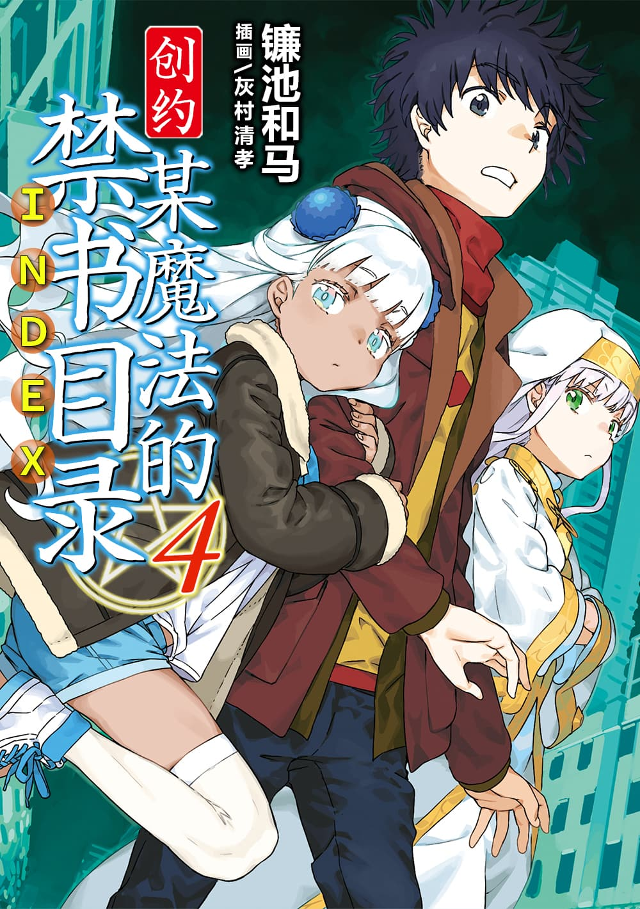

# 简介

**创约·魔法禁书目录4**

作者：镰池和马

## 内容简介

**为了夺回母女之间的牵绊，在洛杉矶极寒之中的上条当麻，奔跑吧！！**

啊咯咯咯……真是冷死了、混蛋！

好不容易从医院病床上挣扎出来的上条当麻，面前竟然是本应温暖但却异常寒冷的洛杉矶？！……而且是全部人口消失的异常状况下的洛杉矶……？！

上条当麻和茵蒂克丝将去共同对抗由安娜率领的R&C超自然公司引起的异常事态。

躲开了敌方魔法师的猛攻后，遇到的唯一的幸存者是位银发褐色的幼小少女，以及她母亲的「踪迹」——

上条当麻继承母女意志之时，就是那个「黑暗」被打破之时！

## 制作信息

* 网翻：镰池和马复仇者
* 组织：等时圆
* 图源：Baka-Tsuki
* EPUB：等时圆
* 友情协助：魔法禁书目录中文维基
* 特别鸣谢：魔禁观察者、托洛不刺激
* 日语翻译：4A、CD、ICERUSH、万象、亚麻、内米、りゅう、绿酒、Lily、胖头鱼、Edster、朝菌、玖月、青、亓官、Star
* 日语校对：ICERUSH、Edster、CD、亚麻
* 修图：龟龟、Skykey、水果释迦喵、侠之大者
* 中文校对润色与最终审核：等时圆
* 整合：知一一（禁书目录X系列，[index-X](https://github.com/1204244136/index-X)）

> 转载时请保留录入信息
>
> 仅供试看学习交流，禁作商业用途，下载后请在24小时内删除

## 封面与封底

