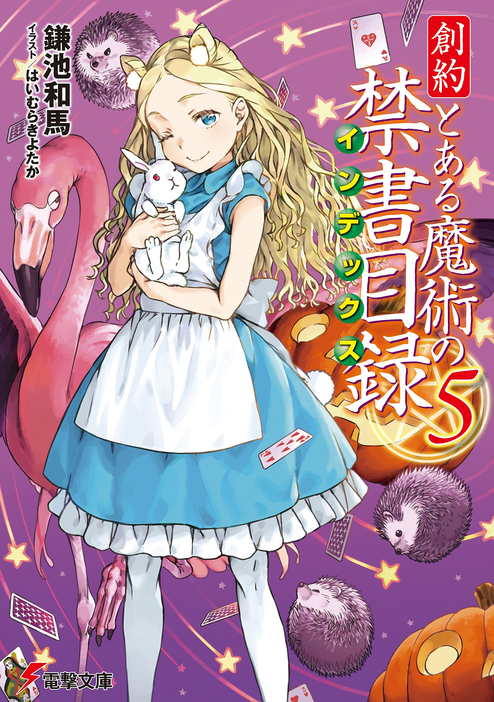

# 简介

**创约·魔法禁书目录5**

作者：镰池和马

## 内容简介

**「你是谁……？」「少女名叫爱丽丝。她最喜欢老师了。」**

寒假，年末的学园都市。

某个早晨，当上条当麻醒来时，不知为何发现自己和一位名叫爱丽丝的神秘金发少女睡在同一条毛毯里！然而，他已经无暇被眼前的状况左右。

在「手铐行动」中毁灭的「暗部」，其幸存者乘坐的装甲列车发生了碰撞事故，凶恶的囚犯们逃了出来。战斗日趋激烈，「暗部」的恐怖也逐渐显露。

可是什么都不知道的上条一行人，情急之下伸出援手的对象，偏偏是无比凶恶的花露妖宴？与上条并肩作战的「暗部」似乎又与过去有些不同。

当善良过头的上条当麻——还带着神秘少女爱丽丝——与极致的黑暗相互交汇时，故事就此开始！

## 制作信息

* 网翻：某树状图的汉化组


**版权声明**

转载时请保留录入信息。本站内容仅供试看、学习与交流使用，禁止用于商业用途；下载后请在24小时内删除。请支持官方正版。


## 封面

