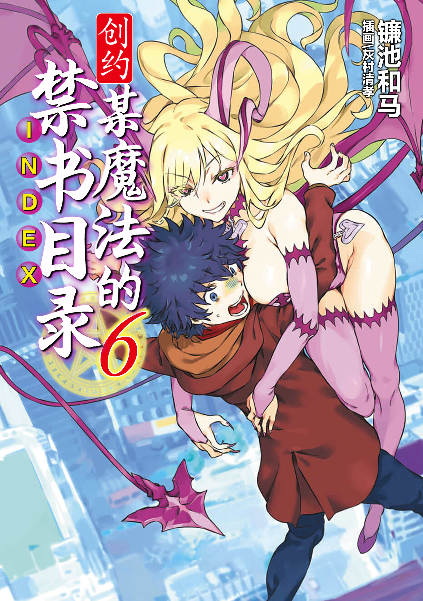

# 简介

**创约·魔法禁书目录6**

作者：镰池和马

## 内容简介

**在学园都市外的涩谷，拥有超规格力量的大姐姐们开始争夺上条？！**

十二月三十一日。

身无分文的不幸少年上条当麻受到可靠前辈云川芹亚的邀请，前去打工的地点竟然是涩谷！而且在这座堪称客场中的客场的城市里，疑似与「那个」爱丽丝同属一方的超绝魔女阿拉蒂娅向他发动了袭击。

她的目标正是上条的性命——！

在涩谷的喧嚣与刹那间的破绽中，阿拉蒂娅的右手破坏了少年的身体。就在所有人都以为上条当麻已经被杀死时，向他伸出援手、将他从绝境中救出的，竟是一位自称博洛尼魅魔、衣着极为大胆的神秘女性？

被这位大姐姐牵着手，一场地狱般的逃亡就此开始！

## 制作信息

* 网翻：某树状图的汉化组

## 封面

