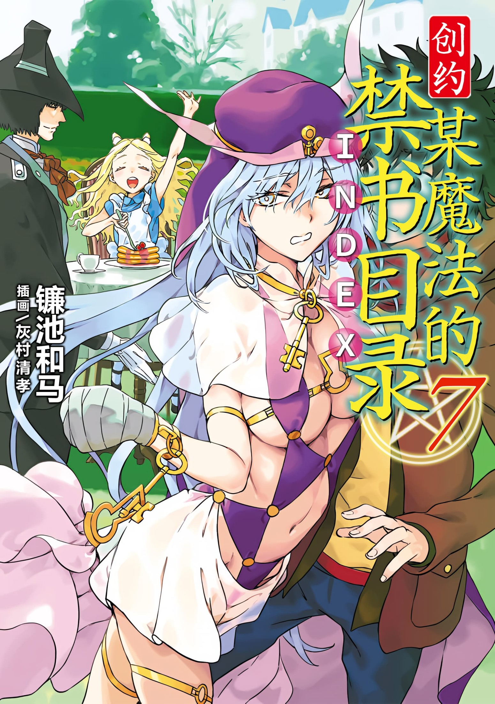

# 简介

**创约·魔法禁书目录7**

作者：镰池和马

## 内容简介

**新年伊始，日月换天。随一月一日而来的竟是不可思议的国度？！**

Happy·New·Year! 为改变气运、振作精神，在大晦日也十分「不幸」的上条当麻决定来个新年参拜！可同行人竟然还有上条「杀手」阿拉迪娅小姐（被击败&手脚被捆绑）！

在神话与宗教融为一体的第十二学区中，上条与穿上了和服盛装，正尽情逛着各种摊位的御坂美琴、食蜂操祈等十分会惹事的常盘台大小姐会合，然后一起去神社祈祷。

此时，上条下定决心，要查明把学园都市一点点逼上绝路的「桥架结社」的大本营到底在何处。而这只需要通过云川芹亚装在博洛尼魅魔身上的信号发射器就能做到。

当上条准备激活信号发射器时……爱丽丝竟然已经来到了学园都市！

## 制作信息

* 网翻：某树状图的汉化组
* 翻译：万象之金、IceRush、绿酒、Cd、朝菌、りゅう、Star
* 校对：IceRush、Edster、白河修
* 美工：知一一
* 整合：知一一（禁书目录X系列，[index-X](https://github.com/1204244136/index-X)）

> 转载时请保留录入信息
>
> 仅供试看学习交流，禁作商业用途，下载后请在24小时内删除

## 封面与封底

