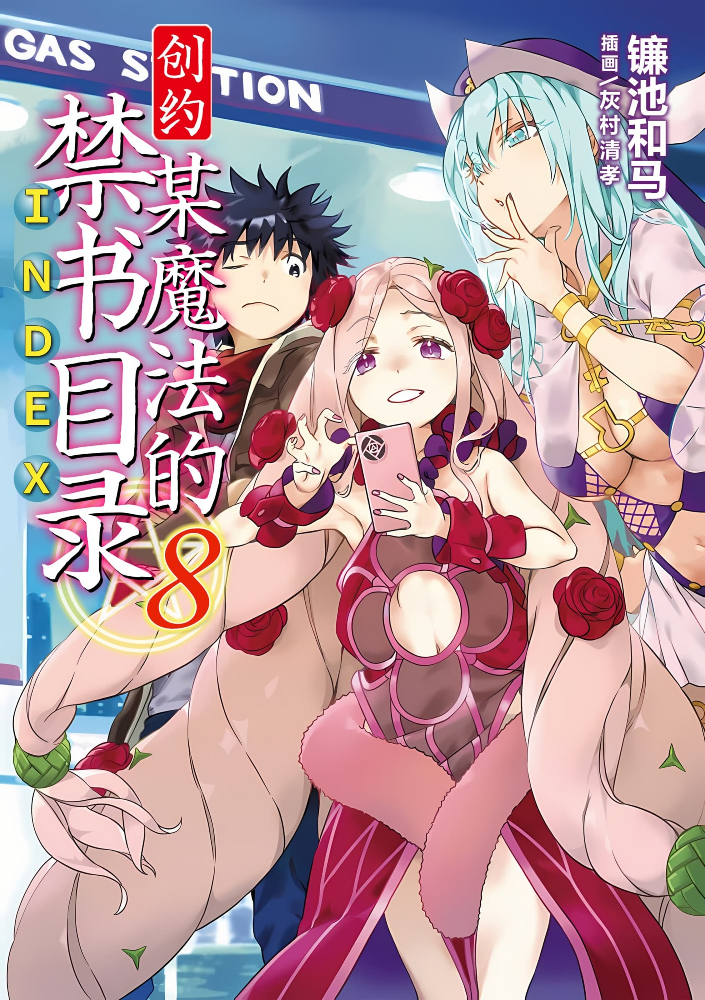
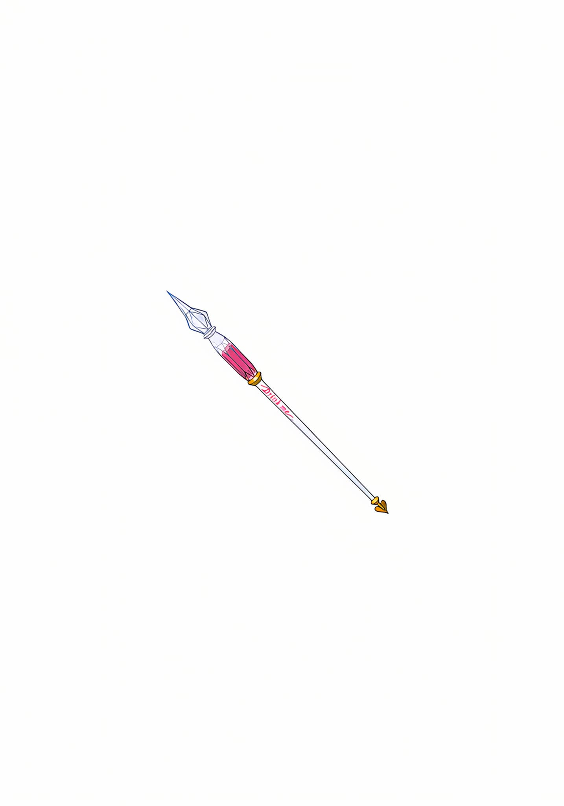

# 简介

**创约·魔法禁书目录8**

作者：镰池和马

## 内容简介

**学园都市、「桥架结社」、亚雷斯塔。在众多超常的敌人面前，上条将如何行动？！**

由于稀里糊涂地包庇起了「恶意的化身」——原本身为敌人的安娜，上条不出所料地陷入了前所未有的危机之中。拦在他面前的，是三个极为强大的「威胁」。

「桥架结社」的对超绝者专攻刺客——姆特·底比斯。新任统括理事长——一方通行Accelerator管理下的学园都市。亚雷斯塔·克劳利以及安娜的天敌——金斯福德。不过当事人安娜却表现得泰然自若。并不是单纯在逃，她似乎有什么能够一下实现逆转的秘计。那是只有「坏女人」才想得出的手段——！！

「桥架结社」的真正目的终于揭晓！别忘了还有娇羞的女神阿拉蒂娅的「禁书目录」最新卷！

## 制作信息

* 网翻：某树状图的汉化组
* 翻译：朝菌、cd、万象、ice、りゅう、绿酒
* 校对：Edster、白河、亚麻
* 美工：知一一、侠之大者
* 整合：知一一（禁书目录X系列，[index-X](https://github.com/1204244136/index-X)）


**版权声明**

转载时请保留录入信息。本站内容仅供试看、学习与交流使用，禁止用于商业用途；下载后请在24小时内删除。请支持官方正版。


## 封面与封底

