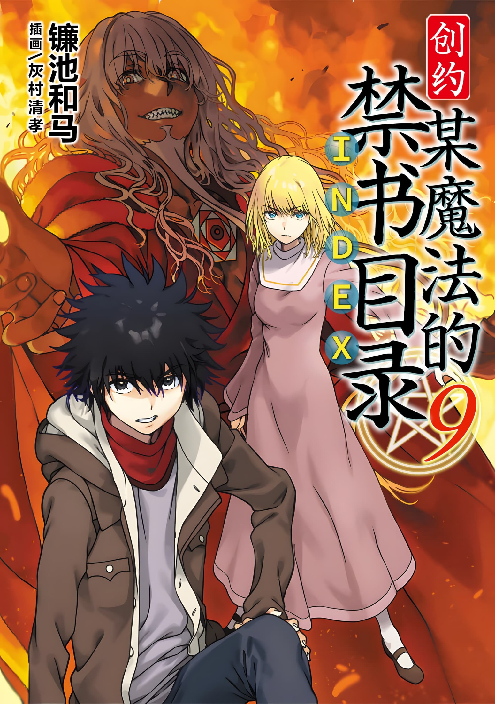
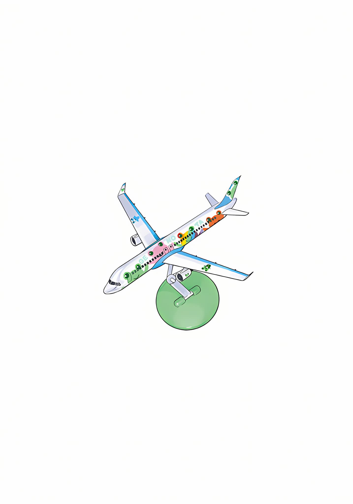

# 简介

**创约·魔法禁书目录9**

作者：镰池和马

## 内容简介

**上条他们，将要挑战阔步蹂躏着学园都市的「复活的罗森克鲁兹」！**

魔神、超绝者、超能力者、魔法师。超越一切的存在，CRC（克里斯蒂安·罗森克鲁兹）。

能够秒杀拥有恐怖力量的爱丽丝的银发青年，为了「打发无趣」而在学园都市阔步，蹂躏着众人。

那天灾化身的前进，是要抹杀沉睡在青蛙脸医生的医院里的安娜·施普伦格尔——

上条绝对无法对曾是敌人的那个少女弃之不顾。

绝望版的状况中，上条站在了CRC面前。究竟是否会有回应他叫喊的「同伴」呢……！！

## 制作信息

* 网翻：某树状图的汉化组
* 翻译：万象之金、朝菌、cd、绿酒、卡帕、刹那
* 校对：白河修、桐坂亚麻、cd、Edster
* 美工：知一一、侠之大者
* 整合：知一一（禁书目录X系列，[index-X](https://github.com/1204244136/index-X)）

> 转载时请保留录入信息
>
> 仅供试看学习交流，禁作商业用途，下载后请在24小时内删除

## 封面与封底

