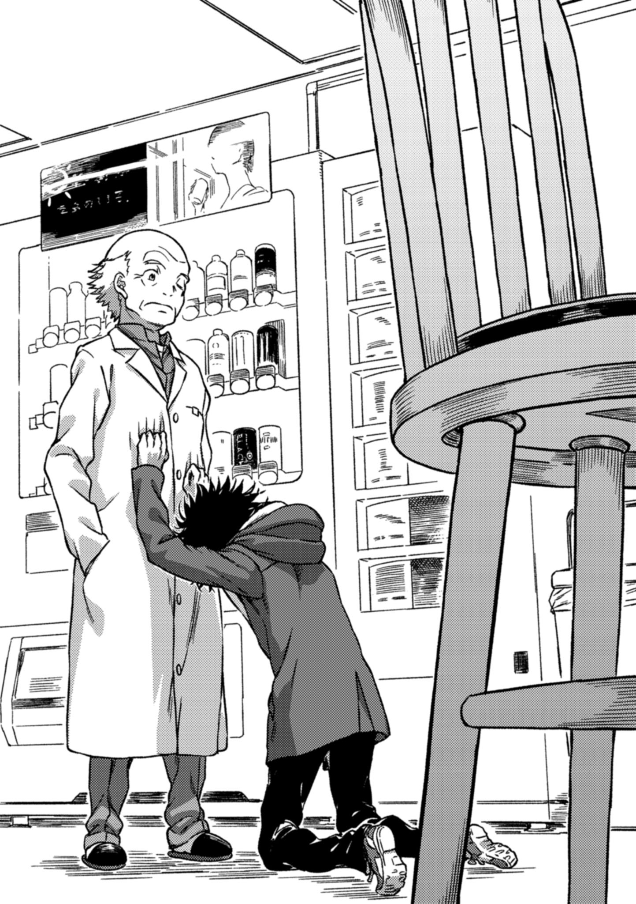

# 第一章 决定立场

> Right_or_Wicked.

## 1

虽然有意识，但眼前什么都看不见。

就像是漂浮在温水中一样。

又过了一会，才发现自己甚至感受不到疼痛。

最先刺激到**上条当麻**意识的是听觉。

&nbsp;

『……不够？……上腺素……追加……毫升……』

&nbsp;

上条听到这些却像事不关己一样。

明明有什么东西正在被注入自己体内。

又或许，对理所应当的危机感缺乏切身体会，反倒意味着情况更为紧迫。

自己现在到底怎么样了？

正是在一个模糊而微小的疑问萌生之时。

发生了某件事。

那是名为疼痛的感觉。散乱的杂音一齐涌向胸口正中。

感觉迎来爆发。

也就是说现实袭来了。

&nbsp;

『除颤！！这可是第三次了，快醒过来吧！！』

&nbsp;

砰的一声。

上条当麻的胸口正中感受到强烈的疼痛，整个脊背大幅度弯成了弓形。

（咳……哈……）

尽管嘴巴大幅开合，但无法吸入足够的氧气。

上条翻着白眼，眼中各种颜色的光线四处飞舞，终于形成了图像。天花板那洁净到不自然的白色，和消毒水独特的气味一下子涌了上来。庞大的信息量让上条的胃里翻江倒海，差点吐了出来。

坚硬的塑料制口罩紧紧覆盖着口鼻。

要是吐在口罩里就会全部还给自己。所以哪怕上条当麻陷入呼吸困难的境地，也用尽浑身力气抑制住想要吐的冲动。

眼角泛起泪水，但就在这时，上条察觉到了。

……也就是说，总算有余力去在意面子了吗？

「……呜……」

耳边传来单调的机械声音。

而且不止一个，他被四面八方的声音包围着。

上条当麻的意识瞬间觉醒。

「！！**安娜呢**？！**安娜**·**施普伦格尔怎么样了**？？？！！！」

他从床上跳下，试图抓住身边随便某个人，随即全身受到了剧烈拉扯。并非是被某人制止住，而是输液、输血管和心电图的电线，这各式各样的线被缠在上条身上。从他再度躺回床上时此起彼伏的警告声来看，应该是有几根针头和电极脱落了。

而那终于追上来的全身疼痛，根本无所谓了。

年轻的护士慌忙赶了过来，却猛地一惊停下动作。她原本大概是想把脱落的点滴针头插回原位……吧，但她就这么面色铁青地看着这边，双手手指在半空中不知所措地游移。虽然不知道这具身体现在情况如何，但真希望医疗专家看着患者时，别露出那么一副看着都疼的表情啊。这不是要把人吓个半死吗！

想到这里，上条眉头紧蹙。

护士？医疗专家？？？

『嗨，我还以为你会一个劲地问：这里是哪里？我怎么了？』

那是很熟悉的声音。

青蛙脸的医生。但他本人并未出现在眼前。声音是从固定在台灯般支臂上的平板电脑里传出来的。

等下。

也就是说这生死攸关的超精密心肺复苏处理，也是远程操作的吗？！

『难得你人在我的医院，我本想至少当面跟你聊聊的，但很不巧现在腾不开手啊。明明是新年这么喜庆的日子，急诊病人却那么多。还是说正因为是新年才如此？所以只能远程问诊了，你不介意吧？』

「……原来这里是医院啊。」

熟悉的医院。

那么自己可能是从东侧尽头的第十二学区，被运送到了靠近中央的第七学区。

上条小声嘀咕着，环顾周围。这里貌似并非「熟悉的」病房，而是被透明墙壁隔开的集中治疗室。也就是说，直到刚才那一刻，情况都严重到了如此不容乐观的地步吧。

违和感已经出现了。

无法预测？在这种半吊子的状态下被搁置在这里的理由是什么？？？

为什么，会从那种情况下挣扎到医院里？克里斯蒂安·罗森克鲁兹。爱丽丝和神秘女魔法师等人，此前已有两人在眼前被杀害。而且或是脑袋被砸碎，或是身体被切断，死状凄惨无比。

上条的脑海中，再次响起恶毒的声音。

『接下来，要不先把过于深入**神装术**的家伙们，也就是「超绝者」那群人全都杀掉吧。』

克里斯蒂安·罗森克鲁兹为了自己的游戏要杀死「超绝者」。他是真的在散播「死亡」，而且还是冲着上条以外的人们。

『**解闷需要理由吗**？……这是把老夫招至这个景色污浊、无聊透顶的世界的惩罚。就用你们那低贱的命来排遣老夫的无聊吧。难道还有比这更好的挽回之法吗，各位「超绝者」？』

上条明明当时在场，没有理由唯独放过他一个人。

一瞬间，脑海中浮现出魔女们的女神阿拉蒂娅。

「不对。」

背靠墙壁的她本人出言否认。

CRC的游戏，「超绝者」狩猎。沦为其明确目标的一人。

「我当时，并没有功夫帮你。」

那么，能想到的其他人是。

上条能猜到的只有一个人。那个人当时确实应该在场才对。

「是**亚雷斯塔**吗？」

但看来看去，米色修道服的女性不在这里。青蛙脸的医生只是耸了耸肩。也许这世上没有人知道详细情况。摆脱罗森克鲁兹并把上条他们送到第七学区的医院后，那家伙又独自行动了吗？

『不相信人的善性，却又无法对眼前的悲剧置之不理，那个「人类」就是这种性格让人头疼的孩子吧？虽然不知道发生了什么，但总不能对眼前倒下的人们放任不管吧？』

们。

「——果然安娜在这座医院吗？！她在哪里！！」

『不就在那里吗？』

隔着超薄液晶显示屏，青蛙脸医生真的指向了近在咫尺的地方。

他以近乎扭断脖子的速度猛地回头。

&nbsp;

瞠目结舌。

说不出话来。

&nbsp;

「……………………………………………………………………………………………………………………………………………………………………………………………………………………」

ICU，也就是集中治疗室，是即便在住院患者中也处于极度危险状态、需要医生寸步不离的重症患者才会被分配到的特殊空间。如果只是因为感冒引起的发热，或是蛀牙引起的疼痛而去医院，那是绝没机会踏入半步的。

作为平凡高中生，进到这里本就是特殊的经验了，而更进一步，他如今才知道，即使在同一ICU之中，也是要根据检伤分类法来决定患者优先顺序的。

隔着厚实的玻璃——不对，是透明树脂墙壁的对面。

在那里的是一台机器。扣在嘴上的透明硬质氧气面罩，闪烁着的发光二极管群，大小不一围在一起的液晶显示器，大量红色和黄色液体流通的管子，加上如同湿头发一般蜿蜒曲折的电线。而这之中最让人在意的是机械般来回伸缩的像泵一样的东西。并非一个，而是有很多。

那是，什么东西？

有那么小吗？

这就是那个不论科学还是魔法，嘲弄并搅乱了整个世界的安娜·施普伦格尔吗？没有气息、没有存在感、没有温度，感受不到半点属于人的生气。埋在大量机械之中的那个东西，若是被人说成是一具美丽的标本，恐怕真会让人就这么信以为真。

『从法医学的角度来看，她尚未处于脑死亡状态。所以现在倒确实还给她连着各种医疗设备就是了？』

隔着显示屏，青蛙脸医生看着与上条所见相同的事物，说道。

也许，他比稚嫩的少年更准确地掌握更多事实。

『……实际上，不使用医疗器械的话，她连呼吸和心跳都无法维持。一旦用上生命维持装置，除非本人或亲属同意否则不能撤下，这项制度反倒成了一桩幸事也说不定呢？』

「……」

『肉体上她应当是已经死亡的状态才对，她到底经历了什么？没有明显的外伤，也没有电击或中毒的反应啊？』

「矮小液体」。

封入一部分爱丽丝·异典的力量，只为夺取「超绝者」的力量并将其真正杀死而制成的扭曲灵装。

到这种地步了吗？

已经做到这么完美了吗？

（而那个爱丽丝……也已经不在了……）

他想起那具被某种可怕的力量压碎、失去整个头部躺在冰冷路面上的娇小尸体。

一瞬间五味杂陈，他无法整理自己的感情。

那个爱丽丝竟然会败北，即使看到了结果，他心中也仍有些难以置信。

（但是，即使爱丽丝不在了，也不是说那股力量就会消失……）

安娜·施普伦格尔失去了心跳和呼吸。既然原本借出力量的爱丽丝·异典即便死去，安娜也仍未苏醒，那么「力量」莫非是能够与本人分离并储存的那类东西？就好比从插座给蓄电池充电那样。

爱丽丝已经不在了。

但能帮助安娜的只有爱丽丝。

这样下去，只会陷入恶性循环。没有不幸中的万幸，没有任何的抵抗，从一处毁灭开始一环接一环地失去一切。

已经无法阻止了吗？这世界已经迎来终结了吗？

「……抱歉，现在可不是感伤的时候。」

背靠冰冷的墙壁，主宰夜与月的魔女们的女神阿拉蒂娅如此说道。

「克里斯蒂安·罗森克鲁兹仍肆无忌惮。照这样无论你做何选择，那家伙都会来到这家医院的。」

「……」

屠尽所有「超绝者」，克里斯蒂安·罗森克鲁兹随口说过这句话。

阿拉蒂娅也好，博洛尼魅魔也好，以及现在甚至无法自主呼吸的安娜·施普伦格尔也好，无一例外。

但话说回来，他也没说过不杀并非「超绝者」的上条。

那不是会好好听话的怪物。克里斯蒂安·罗森克鲁兹。他无止尽吞噬着目之所及的一切，沉溺愉悦，是究极的畜生。

## 2

亚雷斯塔·克劳利既不会飞上天空，也不会穿墙而过。

那个「人类」只办妥了托付某位少年一事，便离开了身为旧识的青蛙脸医生。

但他实在撑不到离开这座医院。

更不走运的是，这条走廊刚好空无一人。

「啊啊啊……」

已经到极限了。

踉踉跄跄地侧身靠在了墙上，亚雷斯塔随后叫喊起来。

失去了要做的事后慢慢瘫在地板上。

「啊啊啊啊啊啊啊啊啊啊啊啊啊啊啊啊啊啊啊啊啊啊啊啊啊啊啊啊啊啊啊啊啊啊啊啊啊啊啊啊啊啊啊啊啊啊啊啊啊啊啊啊啊啊啊啊啊啊啊啊啊啊啊啊啊啊啊啊啊啊啊啊啊啊啊啊啊啊啊啊啊啊啊啊啊啊啊啊啊啊啊啊啊啊啊啊啊啊啊啊啊啊啊啊啊啊啊啊啊啊啊啊啊啊！！！！！！」

为什么，总是从正派的人开始接二连三地死去呢？

为什么只有像自己这样的人一直活了下来？

安娜·金斯福德。好不容易，他本以为自己终于找到了一位连他这种别扭的人都能由衷佩服的仁慈宗师。尽管对她的永久遗体进行改造、令她能够说话本身或许就是一种不自然的状态，但即便如此，也没有减轻他失去她的痛苦。

对「人类」亚雷斯塔而言，有些东西是绝对无法获得的。

财富、学识与名声，将这一切如强取豪夺般搜罗到手的世间最大恶人，却无论如何，唯独未能得到聪慧温柔女性的眷顾。

&nbsp;

布莱斯路之战，说到底是亚雷斯塔以妻子萝丝和女儿莉莉丝那被扭曲的命运为契机发起的战争。

&nbsp;

深居在「没有窗户的大楼」里担任学园都市统括理事长的那段时期，他把米娜·马瑟斯安排为自己「计划(Plan)」的领航员。仇敌马瑟斯的妻子。特意挑选了距离感微妙至极的人，归根结底或许也是这么回事。

&nbsp;

现在，也成了这样。

&nbsp;

为什么？

为什么？

为什么？

无论如何悲叹，已经发生的结果都无法挽回。CRC，克里斯蒂安·罗森克鲁兹。围绕在他身边的死亡气息，是货真价实的。正因为亚雷斯塔独自平定了被称为近代西方魔法史上最大战争的「布莱斯路之战」，才深知这一点。

对方能像马瑟斯和维斯考特一样操纵死亡。

而且水平高出更多。

是战斗，还是逃跑。自己甚至无法做出决定。不对，过往的亚雷斯塔只会死死咬住血淋淋的战斗道路。在萌生迟疑的那一刻就等于已经承认了自己内心的软弱。毫无自由，承认吧丧家之犬，自己已被他的恐怖所束缚。

别说战斗了。

就连逃跑的勇气都没有，只是站在那里。

不是自己的死。

对CRC之战。如果前后左右上下任何一个行动都必然伴随着对生命的消耗，那自己每做出一次选择，到底要把多少性命送进墓地呢。

『……』

黄金猎犬一言未发。

只是看着。

亚雷斯塔并非完美的存在，这一点木原脑干十分理解。所以就算惨不忍睹，就算不忍直视，就算丢尽脸面，也无所谓。

他也非常清楚，这个「人类」一定会在最后的最后，得出正确的答案。

「……你不对我失望吗？对见到那种场面，却连复仇的誓言都做不出的我……」

『蠢货，我可是理解浪漫的男人啊。』

所以，不管多久我都会等候。

木原脑干倒也没有不知分寸到会把这句话说出口。

## 3

双腿叉开摆出魄力十足的站姿。

要说是谁的话，那是茵蒂克丝和御坂美琴。

「什么叫解释啊？」

「…………………………………………………………………………………………………………………………………………………………………………………………………………………………………………………………………………是。」

上条心想，当着美琴的面聊魔法阵营的事是不是不太合适，但自从R&C超自然公司崛起之后，感觉对魔法的认知也稍稍变了些。与其说是不可能，不如说是变得更贴近生活了。不过，**美琴会不会真真正正就这么相信魔法的存在**又是另一回事了。

为了杀掉「超绝者」而特化的灵装「矮小液体」。

「桥架结社」的目的。

穷凶极恶的克里斯蒂安·罗森克鲁兹。

爱丽丝·异典的死亡。

以及身上连着医疗器械、动弹不得的安娜·施普伦格尔。

「……正因如此，罗森克鲁兹简直恶劣透顶。他字面意义上秒杀了那个把学园都市的『暗部』当成游乐场横冲直撞、根本不把魔法阵营放在眼里的爱丽丝，是个不折不扣的怪物。就连我也没赢。输得极其干脆，甚至连为什么输都无法分析。虽然记不清了，但要不是亚雷斯塔插手，我恐怕早就没命了。他就是这样一个根本没有任何理由留我活命的对手。」

「……」

说话途中，他感到茵蒂克丝的眼神越来越严峻，而美琴则反过来，瞳孔中的情感像是被漂白抹去了一样。

可怕。

虽然可怕，但上条理解，如果他没有被允许就沉默的话马上就会炸锅了。

「要是只有我一个人的话，也可以赶紧离开医院藏起来，但安娜正如大家看到的那样根本无法挪动。罗森克鲁兹那家伙要是攻过来的话，必须趁CRC到达医院前由我们主动出击拦下他才行……呃，请问两位，怎、怎么了吗？干嘛一脸阴沉地低着头，还在发d——」

&nbsp;

「为、什、么！！一切的前提是当麻要拼命去战斗啊！！！！！！」

「在说什么我连一半都没听懂，但我可以肯定的是，在ICU里还说这种话的家伙，先好好揍一顿才是为了这个笨蛋好。」

&nbsp;

被结结实实痛扁了一顿，动真格的。

话说，都变红了。半边视野都变成黏糊糊的红色了？！

「噢噢噢噢噢！！本来血都快干了还要咬头就真是行凶了啊茵蒂克丝！还有御坂也是别在医院里噼里啪啦放电啊医院全是精密医疗器械会给别人造成麻烦的啊啊啊啊啊啊啊啊啊啊啊啊啊啊啊啊啊啊啊啊啊啊啊啊啊啊啊？？？！！！」

顺便一提，魔女们的女神阿拉蒂娅也没有特别帮忙。

她依旧一脸无奈，将视线移向别处。

遍体鳞伤、四处飙血的上条勉强说道。

「总、总之罗森克鲁兹那家伙是个怪物。要是那家伙盯上安娜冲着医院来，就必须想办法在他赶到之前拦下他。毕竟安娜根本经不起挪动，要是没法把她藏到别处，就必须由我们主动对罗森克鲁兹先发制人了吧？」

「？」

明明觉得自己说的是理所当然的事，却不知为何没人同意。

不仅美琴，连茵蒂克丝也是。

随后——

「……我说啊，也许这种残酷的话只能由旁观者来说。」

话语里透露着胆怯。

御坂美琴说道。

&nbsp;

「有人盯上了你的命。甚至不能排除这间医院里的患者和医生全都会遭遇危险的可能。难道真有什么理由，值得你不惜把这么多无辜的人卷进来，非要拼上性命去保护那个坏女人吗？」

## 4

不止那个少年。

魔女们的女神阿拉蒂娅，也需要时间来整理自己的思绪。

爱丽丝·异典已经不在了。

她不像自己一样可以预备出第二个或第三个。

「桥架结社」也已经分崩离析，再也不可能恢复原样了。失去爱丽丝这位核心人物的影响实在太大，而且「超绝者」齐聚一堂拼死一搏的结果就是那样。

克里斯蒂安·罗森克鲁兹。

要跨越如此惨痛的失败经历、重新团结起来，恐怕他们已经没有这份力量了。

但即使如此，时间不会停留。

不顾阿拉蒂娅等人的后悔与犹豫。

（……我也，必须决定如何行动了吗？）

咣铛一声。

是某种东西倒下的声音。

阿拉蒂娅看向一旁的病房，那里只有一张床，好像是个单人间。里面有个穿睡衣的五六岁小女孩，消瘦的手臂无力地垂着。说不定，在学园都市开始能力开发之前，她就住在这间医院里了。

以及散落在地板上的斑斑血红。

大概是自己拔掉了输血的针头。

「不要，请不要按呼唤铃。」

在她想询问发生了什么之前，眼前的女孩冷冷地说道。

床边虽然放着一些私人物品，但玩偶和画册都有些褪色了。也许最初常有人来探望，如今来得少了。

阿拉蒂娅看向画册的封面。

（……灰姑娘啊。）

「才没有什么魔女呢。」

女孩没有看向书那边。

只剩下褪色的画册。

「……不会出现什么奇迹，再怎么努力身体也一点不见好，这我清楚得很。R&C超自然公司出现时我还吓了一跳，但到头来，网站也很快就被关掉了。果然那种东西谁也用不了——」

说着，女孩的声音停住了。

甚至不需要打响指。

阿拉蒂娅的手中出现一根漩涡状的棒棒糖，在手中转了一圈忽然变为一只乌鸦，扇扇翅膀又变成兔子，最后变成小猫趴在阿拉蒂娅的肩膀上。

床上的女孩向前倾身。

「那，那是什么？是什么能力？」

「不需要任何才能，这是谁都可以自由使用的魔法。」

阿拉蒂娅把棒子旋转一小圈，随后肩上的小猫就像丝带一样散开再度变回漩涡状的棒棒糖。

「这世间，没有不可能的事情。」

一言断定。

这也是她的使命。

「我是不会允许那种『障壁』存在的。我会留下活下去的希望。如果真对魔女的世界感兴趣的话，在战胜病魔之后试着来找我吧。」

「……大姐姐是魔女吗？」

「不是哦。」

阿拉蒂娅摇了摇头。

她看向床边放着的褪色画册，轻轻眯起眼睛。

随后重新把手伸向呼唤铃的按钮——

&nbsp;

「我是主宰夜与月的魔女们的女神。守护指引所有憧憬魔女之人的存在哦。」

&nbsp;

走出病房。

与慌张赶来的护士们擦肩而过。

空无一人的走廊中只留下静静叹气的「超绝者」。

……她知道自己没有资格说那种话。既然CRC明确以这里为目标，不如说威胁到这所医院里所有人生命的原因，也出在阿拉蒂娅她们身上。

不过。

那又如何？

根本没人讨论过她合不合适。她一开始就知道「自己」没有拯救世界的力量。所以她不以自己的魔法名自称，而是选择了借用别的神的名讳，披上其外表和性质的「超绝者」这条路。

说到底是怎么开始的呢？

即便自不量力，不也正是因为她有着无论如何都无法原谅的事吗？

即使让败仗以败仗收场。

最后究竟轮到谁咽下苦果呢？

「……哼。」

## 5

上条当麻一个人，无精打采地走在医院走廊里。

无法理清思绪。

御坂美琴的那番话，就像是一块重物砸在他头上。

但是，恐怕那就是上条绝对说不出的「正确答案」。从另一视角看那才是正确的说法。毕竟对美琴而言，安娜·施普伦格尔只是圣诞节前后严重扰乱学园都市，并让上条感染杀人微生物的极恶之人。

跨年之后，进入一月。

将她从被亚雷斯塔改造成胶卷罐囚禁（？）起来的状态下救出，被姆特·底比斯追杀时开着机动战车四处逃亡时的表情，少女们并不知道。还有在折扣店里的嬉闹，被看见裸体的害羞和生气，其实已经开始喜欢上日本的粗点心等这些她的另一面。她们都不知道。

对世间任何一个人而言都一样吧。

毕竟安娜自己一直藏着那样的表情，某种意义上来说也是没办法的事吧。

但是，上条已经知道了。

她绝不是超人。金斯福德现身时被吓到颤抖着快要哭出来，快被姆特·底比斯杀死时也不顾自身利益驾驶着机动战车帮助上条他们。她是抱着理所应当的感情，克服恐惧向前迈进的人。

而就在这时。

他发现了什么东西。

「嗨阿上，你又来看超短裙护士了吗？还是说睡衣少女呢？」

蓝发耳环。

为什么他会在这间医院。

上条当麻不寒而栗。

「说起来你这货……之前不是大冬天为了追求人体的温度，把欧〇鼠标垫放到微波炉里加热后猛抓一顿才被送到医院吗？开玩笑吧，从那之后就一直是那样吗？新年伊始这世界的法则都变过了啊！！」

「不是不是。是这边清汤寡水的住院餐给我吃得够够的，等出院想犒劳自己我就直奔二浪拉面结果根本吃不消搞得又住院了。」（*译注：二浪拉面，指油脂浓度极高、名字可能来源于二郎系拉面的一种拉面。*）

「诶——！正值饭量最大的年纪、一听说定食免费大碗就会经不住诱惑选大份的男高中生，居然被油和盐搞崩了血压，甚至还叫了救护车？！疯狂加料系的背脂拉面，才一阵子没见到底胡闹到什么地步了啊！！」

「呵，阿上，那可不是在胡闹，正因为认真到了极致才会变成那样，才叫人害怕啊……就和名垂青史的传说级粪作不是想做就能做出来的一样，那是只有认真到极致才能召唤出来的奇迹般的平衡所织就的神之伟业啊。」

「别说什么『屎』啊，聊吃的时候说什么『屎』啊。」

「……声音别这么暗淡嘛。一月五日，就算正月结束了，我们的寒假不还没结束吗？怎么啦，因为错过大厅里的巨大镜饼在伤心？」（*译注：镜饼，是日本过新年元旦时用来供奉神明的圆饼形年糕，也会装饰在家中祈求和平顺利。*）

这怎么可能呢，

上条想马上回答，但他口中却无法像平常那样说话。

在经历死斗反复出入医院后就会明白，医院办起这类活动甚至会略显夸张。对上条他们而言再平常不过的应季活动，却也有患者会想着今年可能是最后一次、说不定就再无下次，因而拼尽全力投入其中。

克里斯蒂安·罗森克鲁兹正逼近这样的地方。

毫无秩序地在现实中播散死亡的存在。

哪怕在此时此刻，他也只是为了好玩而散播死亡。他和上条，到底是谁把人们置于危险之中？

「如果啊。」

一句低语。

虽然觉得不合适，但上条对同班同学这样抱怨道。

或者说，正因为是好友也说不定。

「假设一下，如果你无论做正确的事还是错误的事，最终都一定会有人受伤。那么蓝发耳环，你会如何决定该往哪里走？是依然选择站在正确的一方，还是选择能帮助许多人的道路？我知道选择的标准当然能有很多就是了。」

「那答案就一个，能让可爱女生欢笑的那个。」

毫无犹豫。

蓝发耳环似乎并没有开玩笑糊弄。

而是极其认真看着上条的眼睛回答。

「善恶这种复杂的话题我搞不懂，就连**衡量善恶的标尺到底准不准**，我也没办法去查。那我能做的，就是看眼前的家伙能不能触动自己那颗萌动的心。要是不想看到她在这里被腰斩完结，就算拼上性命我也要去支持。不管是排行榜第几、评了多少颗星，还是旁人怎么说都无所谓，我自己觉得最棒的，那就是世界上最棒的。这不就是阿宅的生态兼唯一信条吗？」

「……」

上条当麻屏住了呼吸。

对啊。

要救眼前的人，究竟有什么理由非得先向正义的英雄大人请示？

本来上条当麻就不是有立场或责任的人。

**不就是随处可见的高中生吗**？

「怎么啦阿上？」

「没事，只是我重新明白了一点。御坂她的话也是，旁观视角果然很重要啊。」

上条有些难为情地说道，挠了挠头。

就在这时。

从上条上衣的口袋里掉出某件东西。

薄薄的树脂包装。游戏软件的盒子。那上面明确写着。

&nbsp;

丰满的☆魔女审判。

&nbsp;

蓝发耳环被雷劈了。

上条也明白这是相当不妙的状况。

「……阿上，那是……别说是网上拍卖，就算去二手店里，连OLED屏主机上的复刻版都差不多要摆进玻璃展柜的传说级神作……」

「不不不！！啊，安娜·施普伦格尔那家伙……竟然把在折扣店淘到的宝贝偷偷塞进购物篮里了吗？！那家伙真是的，明明自己都倒下不省人事了，还不管不顾地把别人的人生搅得一团糟啊啊啊！！」

「呼。那我就把这些交给你这个有共同爱好的朋友吧。传说中的旧硬件版丰满魔女2和丰满魔女Plus！！」

「哈？都穷途末路了还能有这样的展开……？啊啊啊啊，而且阿拉蒂娅正从走廊拐角看着这边。那位可怕的魔女们的女神大人，双眼正久违地放着光啊啊啊啊啊啊啊啊啊啊啊啊啊啊啊啊啊啊啊？？？！！！」

## 6

茵蒂克丝仍站在ICU室前。

上条当麻已经出去了。

现在只剩下被巨型机械围起来的安娜·施普伦格尔。

茵蒂克丝正透过厚实的透明树脂，注视着生死不明的娇小少女。

「真是的……」

茵蒂克丝的头帽边角出现一阵晃动，随后有什么从她肩头冒出来。

身高十五厘米的「魔神」欧提努斯。

「不过是放任了几天而已，就成这样了吗？……那个人类身边的事态发展依旧迅速。」

「指的就是曾是虚伪记号的『超绝者』群体，以及被他们复活的真正的克里斯蒂安·罗森克鲁兹啊。」

「那就很复杂了。假如那个人类和罗森克鲁兹针锋相对，先不论谁输谁赢，就算学园都市被毁掉也不奇怪。」

「如果放任罗森克鲁兹的话会怎样？」

「……嗯，我不认为地球这种小小的星球容得下他那种怪物。」

此时，在茵蒂克丝心中，答案已经算是定下了。

她是从属于即使在英国清教中也堪称特殊的「必要之恶教会(Necessarius)」的魔道书图书馆。若是本不应存于现世的魔法师复苏，随意破坏一无所知之人生存的世界，那她没有理由不去阻止这些。

随后的问题就在这里。

「结果，安娜·施普伦格尔得救这件事，你怎么想？」

「说实话很头疼……不过还是一件件来吧。反正放着罗森克鲁兹不管，绝不可能有什么好结果。」

「当麻又要多出麻烦的人脉了……」

「你有立场说这个吗，魔道书图书馆。」

环抱双手出口不逊的「魔神」大概也是同路人吧。

## 7

这里是医院的院子。

御坂美琴望着地面，试图让大脑冷静一下。

「话说御坂同学的观点，有时显得格外严厉冷酷呢。」

「为什么你会在这里？」

第五位的少女并不会一一回答一脸诧异的美琴。

食蜂操祈。

原本就是神出鬼没，能操纵任何人的记忆与面部识别，从而出现在任何地方的常盘台女王。

尽管「心理掌握(Mental Out)」唯独对美琴无效，她却还是冷不丁找了过来。

「明明是你自己说的，怎么，后悔力发作了？」

「……好烦啊你。」

她不由得压低了声音。

无法忘掉少年饱受打击的表情。

安娜·施普伦格尔。即使所用的词汇储备相同，美琴也多少明白，自己和那个高中生之间所掌握的信息与经历的时间都截然不同。不如说最糟糕的是，那个笨蛋不管有没有理由，都会去帮助眼前受苦的人。没有帮助坏女人安娜的必要，这固然是正论，但仅凭一句正确的话就能让那家伙立刻停下行动，光是想象一下也同样让人觉得违和。

才不想看到那种表情。

但美琴觉得，这也是一个必须有人提出的问题。

安娜·施普伦格尔是极恶之徒，这一点不言而喻。

基于这个前提——

「那你准备怎么办呢？」

「无论如何，我基本都会站在他那边帮助他。就算他要一条路走到黑，我也选择为他贡献应援力哟。」

「之前我就很在意了，为什么你会对那个笨蛋如此执着？」

「就像御坂同学有自己的理由一样，我也有自己的理由☆」

但由此得出的结论似乎大相径庭。

如果美琴看到他一条道走到黑，哪怕狠狠揍他一拳，也要让他回到正道上。因为她认为只是一味纵容、在背后推他一把，并不算是同伴。

「所以我觉得，御坂同学现在真正想做的，可不是问我接下来会如何行动这种无聊的问题力哟。」

伴随轻轻的笑声。

食蜂操祈如此追问。

&nbsp;

「你自己接下来会如何行动，你想知道的不正是这个吗？」

## 8

那是被夕阳染红的医院屋顶。

在给予了用极度好色目光看待魔女的无礼之徒上条当麻一记旋转锁头（甜蜜口味）之后，主宰夜与月的魔女们的女神阿拉蒂娅置身于寒冷的屋外。

她是将「救助所有受欺凌的魔女」定为自身「救济条件」的「超绝者」。而为了与安娜战斗、抱着自毁觉悟使用魔法的上条当麻，对魔女们的女神而言是符合「救济条件」的特别个体。要是他去战斗，阿拉蒂娅一同参战也无妨。

但仅靠这些是赢不了的。

克里斯蒂安·罗森克鲁兹。他可是秒杀了所有参与仪式的「超绝者」。就连破格的爱丽丝·异典都被他打碎脑袋惨死。作为「桥架结社」的一员，常规的「超绝者」只身挑战罗森克鲁兹毫无取胜机会。

那怎么做才好呢。

既然上条当麻是拯救对象，就不能因为做不到而放弃。

**不管发生什么都要帮助他**。

「……」

传来啪嗒一声。

伴随着宛如床单拍打空气般的声响，降落在金属栅栏上的，是妖艳的恶魔。那是一名拥有金色波浪长发与雪白肌肤，头上长着动物之角、腰后伸出箭头状尾巴，背上还长着蝙蝠般巨大翅膀的「超绝者」。

阿拉蒂娅仰头看着身着连体束身衣，也就是说只穿一片内衣飞在空中的某人。

「博洛尼魅魔。」

「吉吉·比尔比，你们那边也总算活下来了吗？」

还是和以往一样，**共通语调**有些奇怪的博洛尼魅魔随口说道。

阿拉蒂娅轻轻叹了口气。

「爱丽丝好像死了。」

「好像是。」

「安娜也被你们干掉了。还有几个常规的『超绝者』活着呢？」

「嗯？除了我还有『古老善良的玛利亚』和姆特·底比斯。此外应该还有几个人。和不在仪式现场所以存活下来的你们不同，处在现场依然活蹦乱跳的我可是相当罕见的特例。稍微夸我两句也行啊。」

「……H.T.特利斯墨吉斯忒斯呢？」

「**消失了**。」

很微妙的说法。

没有在和克里斯蒂安·罗森克鲁兹的战斗中丧命吗？

CRC仍在这座学园都市之中。

屠尽所有「超绝者」。

那倒也没什么了不起的理由。无关对错，更谈不上喜恶。上条当麻确实这么说过，自己还一脸歉疚。

栅栏上的博洛尼魅魔长叹一口气。

「……他居然说，因为无聊，所以打发时间吗？」

「……」

「即使不露风声，罗森克鲁兹也必定以这座医院为目标。安娜·施普伦格尔迟早会被锁定为猎物。那么反过来说，知道目标的话，也就有机会事先**设下埋伏**。」

那些充满嘲讽和恶意的话语仍在脑子里回响。

被CRC这样的怪物追杀玩弄，要是普通人早就失去冷静了，但在此之前，作为「超绝者」的她仍有不能接受的部分。

「你会相信吗？」

「相信什么？」

「救世主。关于他的真面目。」

「目前看到的就是全部了。若他不是为拯救蒙冤的受害人而行动的话，我只能摸索别的办法了……那家伙单纯明了地**偏离了期望**。明明应当消逝在时间的长河中悄然死去，我们却特意让那样的家伙复活了。」

对罗森克鲁兹而言，并不存在救赎这个方向。

那他又是为了什么挥动庞大的力量？

不管是什么，都根本抽不出「救赎」这一张牌。不会是什么正经的事情。

魔女们的女神阿拉蒂娅，顾名思义就是为了拯救「受欺凌的魔女」而存在的。

不管之前如何，她都把自己改造成了现在这样。

要是CRC不仅无助于救济，甚至还会加害符合她「救济条件」的人。

不，这并不是假设。

开什么玩笑。

他已经付诸行动了。对阿拉蒂娅而言，为了守护学园都市而在懵懂无知的情况下使用魔法的上条当麻，已被算作拥有善心的魔女之一。

而对他下手。

克里斯蒂安·罗森克鲁兹已然触碰到了女神的圣域。

「幸存后的你们打算怎么办？」

「又来问我这么麻烦的问题啊。」

嘿咻一声，博洛尼魅魔坐在高高的栅栏上，俯视着她。

「**说实话我不在意自己的性命被盯上**。」

「嗯。」

阿拉蒂娅也没有很惊讶。

确定并帮助除自己之外的救赎对象，说到底「超绝者」就是这种存在。也可以说，只有将自己彻底改造到如此地步，才能冠以此名。也就爱丽丝和安娜是例外吧。

「不过就算克里斯蒂安·罗森克鲁兹四处大闹，由此造成的损害也与冤案无关。我不打算帮助纯粹的加害者，但也无意把救赎范围扩大到纯粹的受害者。毕竟我很清楚，背负过多最后只会落得自取灭亡的下场。」

「……」

「别瞪我。你不也把范围缩小到了『想帮助受欺凌的魔女』吗？要是无限制地扩大定义就会彻底破裂，这点你自己应该很清楚。」

她多少也明白这点。

但若是顺着这条道，就无法取得协助了。阿拉蒂娅一个人无法匹敌罗森克鲁兹，那就无法帮助作为「救赎对象」的上条当麻，为此她有必要想尽办法将其他「超绝者」**卷入自己的事情中**。

「哼哼♪」

对方貌似也察觉到了。

她双腿来回摇摆了几下，一口气从高高的栅栏上跳了下来。

博洛尼魅魔将手掌放在自己胸口正中央，闭起一只眼睛如此开口道。

用如同恶魔的诱惑一般，温柔又恶毒的声音。

「『古老善良的玛利亚』、姆特·底比斯，还有我。姑且就先这么多条件吧。你脑海中能浮现出把这些串在一起的线索吗，阿拉蒂娅？」

&nbsp;

＊想把奇迹带给那些被排除在特别框架之外的人们。

＊想用严刑来守护自己选定的集团。现在的设定是「桥架结社」。

＊另外，想帮助所有冤案受害者。

&nbsp;

「不用说也知道，我等『桥架结社』的『超绝者』，都是各自定义了『救济条件』并依此行动的。也就是说，若是想让我们行动起来，就必须符合『救济条件』。而且必须毫无矛盾地符合如今在此处全员的条件。」

「……」

这有多难，阿拉蒂娅应该也明白。

毕竟正因不可兼得，无论如何都无法实现，「超绝者」们才笼统地选择让克里斯蒂安·罗森克鲁兹复活来拯救全世界。

「那么，怎么办呢，阿拉蒂娅。」

博洛尼魅魔双手背在身后，猛地把脸凑近。

恶魔甜美地微笑着。

「**为了那个小弟弟**，**你有决心挑战这道无解的谜题吗**？」

## 9

既非刚过正午，也非黄昏，而是下午时分。

正当低谷的时间点，或许就是最不受人待见的时刻。上条独自一人坐在多个自动售货机并排的休息区。

蓝发耳环所说的话很简单，是上条未曾注意到的视角。

只保护自己喜欢的东西。

那也算是一种「正确答案」吧。

或者说对高中生上条而言，这是容易依赖的选项。

「……但是。」

仅凭这一点，就将他们牵扯进来真的好吗？

安娜·施普伦格尔，到底是什么样的存在呢。

&nbsp;

『圣诞快乐，我那失去了记忆的敌人，今天你的样子很帅哟？』

&nbsp;

一开始毫无疑问是敌人。

嘴对嘴袭击而来的，是致死的微生物圣日耳曼。而且，由于会与上条右手的幻想杀手(Imagine Breaker)产生冲突，甚至还被布下了无论胜负都会令「蔷薇十字(Rosenkreuzer)」的古怪同胞丧命的最恶劣死局。

&nbsp;

『**你在使用魔法**？！**还把我植入你体内的圣日耳曼拉拢成了盟友**！！』

&nbsp;

即使被二人拼尽全力联手击溃，安娜·施普伦格尔也轻松摆脱警备员(Anti-Skill)的束缚逃掉，又在洛杉矶制造大事件。

与「超绝者」集结的「桥架结社」会合，也成功干涉爱丽丝·异典，让重重谜团的魔法结社陷入暴走状态。

但这样的安娜也有天敌。

亚雷斯塔·克劳利，以及受他驱使的安娜·金斯福德。

当看到被制成没有四肢和躯体的人形胶卷罐的安娜·施普伦格尔时，上条不知为何伸出援手。他无法说明为什么会那么做，只是，这么想到。

安娜·施普伦格尔确实可恨。

但这种结局没人会高兴。

&nbsp;

『好吧好吧，我知道了。仅限这次，我也会老老实实搬出王牌的啦。』

&nbsp;

那么，自己到底在期待什么。

无法用言语表明，但，只有一件事可以断言，打算用「矮小液体」对安娜行刑的「桥架结社」的姆特·底比斯，或是打算派金斯福德来解决安娜的亚雷斯塔都与自己无法相容。

或许是不对的。

或许不能说是合理的。

但是，挺起胸膛。

&nbsp;

『虽然不知道到底存不存在，如果真的存在的话，我就能与这个世界达成和解。』

&nbsp;

啊。

对啊。

&nbsp;

『……要是哪里有这样的「王」就好了，蠢货。』

&nbsp;

对啊。

是坏女人又如何，是强敌又怎么样。

不管这场争斗如何结束，怎样尘埃落定。

我绝对不想看到，以安娜·施普伦格尔死亡来收场的结局。

这一结论哪里奇怪了？

「……」

**但是**。**可是**。

即使上条一人擅自决定下来，作为平凡的高中生也无法在现实中帮助正在ICU里连上机器的安娜。

更不能战胜正逼近此处的罗森克鲁兹。

这座医院里有很多病人，还有支撑他们的医生和护士等医疗相关人员。在医院的人们被夺去了日常，每个人都拼命战斗，想要将日常找回。濒临死亡的不只是安娜·施普伦格尔。她并非特例。那么凭什么把大家都牵扯进来？

想要得到帮助。

可是该由谁用何种方式来帮助呢……？

有人向沉浸在烦恼中的上条靠了过来。

「哦？你在这里啊。」

青蛙脸的医生。

上条不由自主地低声说道。

「安娜她……？」

「爱丽丝·异典还有『矮小液体』我都不太了解啊。」

他不说谎。青蛙脸的医生所说的话，十分简单。

简单到直击上条当麻的内心。

「你打算怎么做？」

「……」

咬紧牙关。

拼命思考，但是，不行。

「安娜她，是坏人，这件事毫无狡辩余地……」

已经，无法停住了。

声音。

与其说是从口中，倒不如说是从自己的胸口溢出来的。

「但是，我不希望她就这么死掉。」

于是，决定了。

不对，自己决定了。

定下自己应在的地方，应朝的方向，应有的立场。

随后，上条当麻把一切倾吐了出来。

将自己的丑态，全部展现了出来。

&nbsp;

「因为，即使大家都说安娜是坏人，但她也曾救过我啊。那天晚上要不是安娜的话我就搞不到机动战车，也许当晚一开始我就栽了跟头丧命了。被从人形胶卷罐中解放后，要是安娜只想让自己活下去，有必要把我和阿拉蒂娅卷进来吗？那家伙不是本来也能理所当然地骗过我们、自己擅自逃跑吗？安娜确实会捉弄别人，肆意嘲笑，但也确实有过不求任何回报就伸出援手的瞬间啊！不对不是这样，不是因为被救了才想去救她，才不是这种等价交换式的报恩！！根本不是那样。在折扣店里她捉弄我、缠着我。在加油站里看见阿拉蒂娅脚踝上缠着的胶带偷偷发笑，吃了日本的点心就高兴得不得了。那就是个普通的女孩子啊。安娜和大家都一样，只不过碰巧是拥有过于特殊力量的非常规『超绝者』罢了。不能抛弃她，我不能抛弃她！！怎么可能简单地一刀切来划定同伴和敌人啊！不要，我不要她死掉！！我连想都不愿去想这种事！我才不管克里斯蒂安·罗森克鲁兹到底是个多可怕的怪物，跟那种家伙战斗有多可笑也根本无所谓。怎么能任由那种家伙夺走她，明明知道她会被肆意蹂躏，我怎么可能坐视不管！那家伙由我来收拾。无论如何，不管用什么手段，我都绝对要赢下来保护好安娜！但是，光凭这样还不够。打败克里斯蒂安·罗森克鲁兹不过是一场胜负，就算我赢了，也不代表单凭这样就能挽回谁的性命。真正的终点根本不在那里。如果安娜不能重新站起来，那就没有任何意义了啊！！有些事情就是单凭挥舞拳头做不到的啊！安娜被『矮小液体』打倒了，就算用我的右手也帮不了她。爱丽丝已经死了，在无法借助那孩子力量的现在，我就只能依靠你了。只能依靠平凡、合乎科学、随处可见，却绝对能做到我办不到之事的医生的力量了啊！！不要啊，我不想放弃，我绝不会放弃安娜·施普伦格尔！！在这里放弃那家伙的性命，我无论如何都忍受不了！！！！！！……根本不是相处时间长短的问题。我已经见识过安娜展露出的笑容了。我才不管什么来路不明的『王』。我们一定要亲手把安娜从黑暗中拉出来。想让她笑出来，仅此而已，我只想再次看到安娜的笑容！！为了这个，哪怕要我献出性命也无所谓！！所以，拜托了。结束后我会去警备员(Anti-Skill)那里自首，假如帮助坏人是坏事的话我愿意接受任何惩罚……上电视曝光也好，在网上被人痛骂也好，我也会挺起胸膛昂首向前走向少年院的！！呜呃呜啊啊，所以求求你，求你千万不要对安娜见死不救啊！！呜呃哇啊啊啊啊啊啊啊啊啊啊啊啊啊啊啊啊啊啊啊啊啊啊啊啊啊啊啊啊啊啊啊啊啊啊啊啊啊啊啊啊啊啊啊啊啊啊啊啊啊啊啊啊啊啊啊啊啊啊啊啊啊啊啊啊啊啊啊啊啊啊啊啊啊啊啊啊啊啊啊啊啊啊啊啊啊啊啊啊啊啊啊！！！！！！」

&nbsp;

已经，不成样子了。

完全虚脱了，上条紧紧抓着眼前的医生，膝盖一软，瘫倒在地上。

与之相对的。

青蛙脸的医生只是轻轻叹了口气。

他开口说道。

**一如往常**。

「你呀，果然还是想太多了吧？」

「……」

「不管你想得多深，为本就没有必要的事情一直烦恼没意义吧？我不是医生吗？这种情况下不用找那么长的理由，说一句话不就好了吗？……『救救她』。」

只凭那一句话。

用那样一句对医生来说理所当然、自然又平常的话。

「但是……」

「嗯？」

「……安娜是坏人——」

「所以呢？想要挽救一位危在旦夕的坏人究竟哪里有问题？」

「喊了救命，也没有人回应……」

「要是医生也行的话，我会尽我所能。那么你能做的事又是什么呢？」

**得到了帮助**。

**对上条那不想让世界级坏女人死去的自私而丑陋的任性**，**对为此导致事态恶化**、**卷入更多无关之人的彻头彻尾的愚行**，**有着唯一的一份协助**。

守护生命之人的「理所应当」未曾动摇。无论何时。哪怕在紧急情况下所有人都惊慌失措，也绝不动摇。抑或耍些小聪明察言观色、有意识地随波逐流，说不定反而更轻松。这就是从事与人命打交道之人的职业尊严吗。

亲眼目睹到这些。

在稚嫩得无可救药的上条当麻体内，有什么东西再次被点燃了。

那是渺小，却坚定存在于自己内心的东西。

那就是核心。上条当麻得到了自己内心的支柱。

**这位医生不会说谎**。

**只要他说会救**，**那病人就一定能得救**。

之所以毫无根据地相信他，是因为上条自己实际上数次面临过死亡。他不清楚青蛙脸医生的底细。但他绝不会背叛别人的性命，这一点可以确定。

真正的答案并没有什么特别，依据恰恰就在自己的过往和经验之中。

在此之后。

医生即使明知对自己不利也会为安娜拼尽全力，而他只需要杜绝会妨碍医生的存在接近医院的情况发生就好。

只要这样，一切就能圆满结束。

安娜·施普伦格尔。能再一次见到那个小坏女人嘲笑谩骂、大发脾气、给人添尽麻烦，然后露出笑容的模样。

若是如此。

这绝对会成为，稚嫩少年握紧右拳的理由。

「医生。」

「嗯？」

&nbsp;

「**全拜托你了**。」

&nbsp;

上条当麻深深地鞠躬，随后转身。

走向医院正门的玄关，外面是危险丛生的学园都市。

心中定下了目标，随后就只需要握紧右拳冲向前方。

克里斯蒂安·罗森克鲁兹。

不管用什么方法都好。

打败这最强的敌人。
