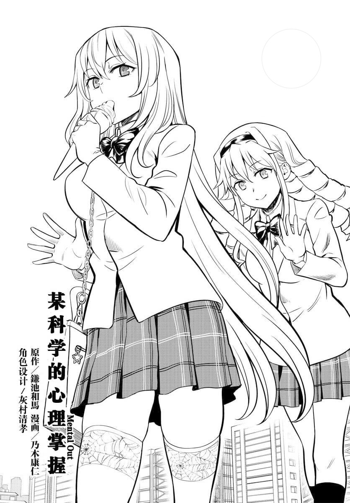
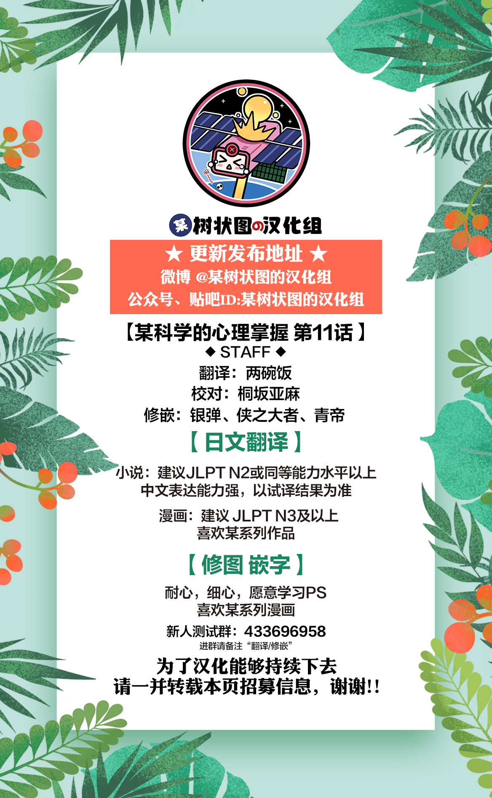

# 某科学的心理掌握


**汉化组信息**

本作由某树状图的汉化组汉化并发布，欢迎有兴趣的读者加入汉化组。



**更新说明**

目前已收录至第三十七话。章节较长时会拆分为前、中、后篇，以改善图片加载速度。



**版权声明**

本站内容仅供试看、学习与交流使用，禁止用于商业用途。请支持官方正版。


## 章节目录

<table data-view="cards">
  <thead>
    <tr>
      <th></th>
      <th></th>
      <th data-hidden data-card-target data-type="content-ref"></th>
    </tr>
  </thead>
  <tbody>
    <tr><td><strong>第一话</strong></td><td>共四篇</td><td><a href="post/01-1.md">post/01-1.md</a></td></tr>
    <tr><td><strong>第二话</strong></td><td>上、下篇</td><td><a href="post/02-1.md">post/02-1.md</a></td></tr>
    <tr><td><strong>第三话</strong></td><td>上、下篇</td><td><a href="post/03-1.md">post/03-1.md</a></td></tr>
    <tr><td><strong>第四话</strong></td><td>上、下篇</td><td><a href="post/04-1.md">post/04-1.md</a></td></tr>
    <tr><td><strong>第五话</strong></td><td>上、下篇</td><td><a href="post/05-1.md">post/05-1.md</a></td></tr>
    <tr><td><strong>第六话</strong></td><td>上、下篇</td><td><a href="post/06-1.md">post/06-1.md</a></td></tr>
    <tr><td><strong>第七话</strong></td><td>上、下篇</td><td><a href="post/07-1.md">post/07-1.md</a></td></tr>
    <tr><td><strong>第八话</strong></td><td>上、下篇</td><td><a href="post/08-1.md">post/08-1.md</a></td></tr>
    <tr><td><strong>第九话</strong></td><td>上、下篇</td><td><a href="post/09-1.md">post/09-1.md</a></td></tr>
    <tr><td><strong>第十话</strong></td><td>上、下篇</td><td><a href="post/10-1.md">post/10-1.md</a></td></tr>
    <tr><td><strong>第十一话</strong></td><td>上、下篇</td><td><a href="post/11-1.md">post/11-1.md</a></td></tr>
    <tr><td><strong>第十二话</strong></td><td>上、下篇</td><td><a href="post/12-1.md">post/12-1.md</a></td></tr>
    <tr><td><strong>第十三话</strong></td><td>上、下篇</td><td><a href="post/13-1.md">post/13-1.md</a></td></tr>
    <tr><td><strong>第十四话</strong></td><td>上、下篇</td><td><a href="post/14-1.md">post/14-1.md</a></td></tr>
    <tr><td><strong>第十五话</strong></td><td>上、下篇</td><td><a href="post/15-1.md">post/15-1.md</a></td></tr>
    <tr><td><strong>第十六点五话</strong></td><td>特别篇</td><td><a href="post/16.5.md">post/16.5.md</a></td></tr>
    <tr><td><strong>第十七话</strong></td><td>上、下篇</td><td><a href="post/17-1.md">post/17-1.md</a></td></tr>
    <tr><td><strong>第十八话</strong></td><td>上、下篇</td><td><a href="post/18-1.md">post/18-1.md</a></td></tr>
    <tr><td><strong>第十九话</strong></td><td>上、下篇</td><td><a href="post/19-1.md">post/19-1.md</a></td></tr>
    <tr><td><strong>第二十话</strong></td><td>上、下篇</td><td><a href="post/20-1.md">post/20-1.md</a></td></tr>
    <tr><td><strong>第二十一话</strong></td><td>上、下篇</td><td><a href="post/21-1.md">post/21-1.md</a></td></tr>
    <tr><td><strong>第二十二话</strong></td><td>上、下篇</td><td><a href="post/22-1.md">post/22-1.md</a></td></tr>
    <tr><td><strong>第二十三话</strong></td><td>前、后篇</td><td><a href="post/23-1.md">post/23-1.md</a></td></tr>
    <tr><td><strong>第二十四话</strong></td><td>前、后篇</td><td><a href="post/24-1.md">post/24-1.md</a></td></tr>
    <tr><td><strong>第二十五话</strong></td><td>完整篇</td><td><a href="post/25.md">post/25.md</a></td></tr>
    <tr><td><strong>第二十六话</strong></td><td>前、中、后篇</td><td><a href="post/26-1.md">post/26-1.md</a></td></tr>
    <tr><td><strong>第二十七话</strong></td><td>前、后篇</td><td><a href="post/27-1.md">post/27-1.md</a></td></tr>
    <tr><td><strong>第二十八话</strong></td><td>前、后篇</td><td><a href="post/28-1.md">post/28-1.md</a></td></tr>
    <tr><td><strong>第二十九话</strong></td><td>前、后篇</td><td><a href="post/29-1.md">post/29-1.md</a></td></tr>
    <tr><td><strong>第二十九点五话</strong></td><td>前、后篇</td><td><a href="post/29.5-1.md">post/29.5-1.md</a></td></tr>
    <tr><td><strong>第三十话</strong></td><td>前、后篇</td><td><a href="post/30-1.md">post/30-1.md</a></td></tr>
    <tr><td><strong>第三十一话</strong></td><td>前、后篇</td><td><a href="post/31-1.md">post/31-1.md</a></td></tr>
    <tr><td><strong>第三十二话</strong></td><td>前、中、后篇</td><td><a href="post/32-1.md">post/32-1.md</a></td></tr>
    <tr><td><strong>第三十二点五话</strong></td><td>前、后篇</td><td><a href="post/32.5-1.md">post/32.5-1.md</a></td></tr>
    <tr><td><strong>第三十三话</strong></td><td>前、后篇</td><td><a href="post/33-1.md">post/33-1.md</a></td></tr>
    <tr><td><strong>第三十四话</strong></td><td>前、中、后篇</td><td><a href="post/34-1.md">post/34-1.md</a></td></tr>
    <tr><td><strong>第三十四点五话</strong></td><td>前、后篇</td><td><a href="post/34.5-1.md">post/34.5-1.md</a></td></tr>
    <tr><td><strong>第三十五话</strong></td><td>前、后篇</td><td><a href="post/35-1.md">post/35-1.md</a></td></tr>
    <tr><td><strong>第三十六话</strong></td><td>前、后篇</td><td><a href="post/36-1.md">post/36-1.md</a></td></tr>
    <tr><td><strong>第三十六点五话</strong></td><td>前、后篇</td><td><a href="post/36.5-1.md">post/36.5-1.md</a></td></tr>
    <tr><td><strong>第三十七话</strong></td><td>前、后篇</td><td><a href="post/37-1.md">post/37-1.md</a></td></tr>
  </tbody>
</table>
