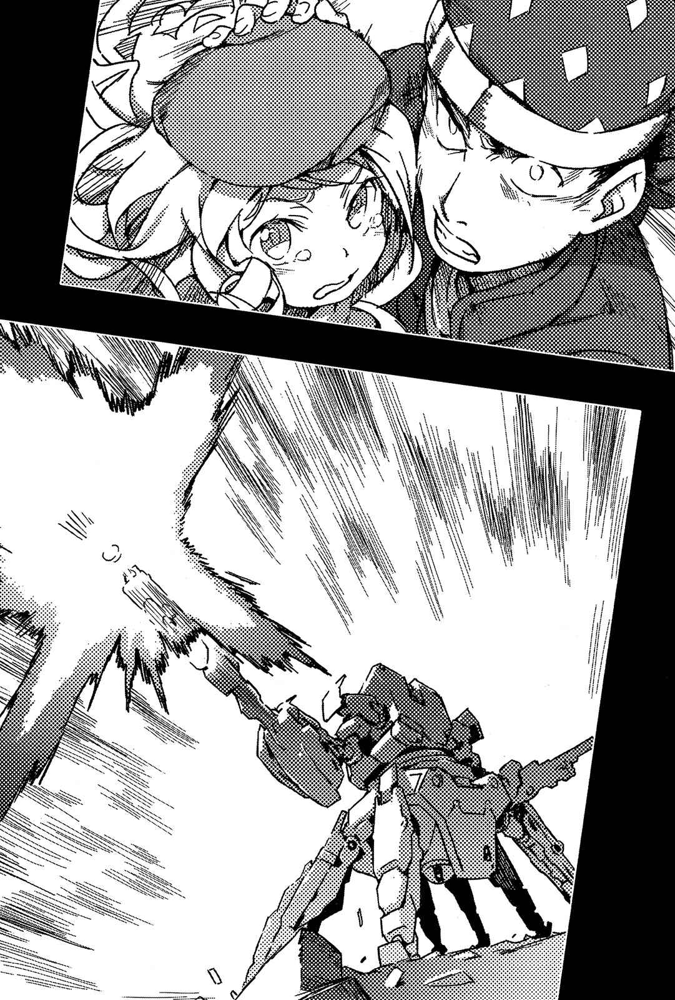

# 第三章 短暂空白及连接未来的预兆

> Girl.

## 1

「往这边！」

半藏招手，后头跟着一名十岁左右的小女孩。

他们前进的方向是地下街的入口。

不良少年和洋娃娃般的少女。这两个人的组合，格格不入的程度差不多就像是点寿司配咖啡。

芙蕾梅亚·塞维伦。

她的特征就是那身特别的打扮。以白色和粉红为基调，上头缀满蓬蓬的荷叶边和蕾丝，相对地下半身倒是简洁利落。下半身只穿着迷你裙，以及酒红色的厚裤袜。就像偶像……不是现实中的演艺人员，而是好像会出现在游戏中的偶像造型。

这套服装给人的印象，像是周围那些见过她容貌的人，自作主张挑选并强迫她穿上，而非以她自己的喜好所选择。

也就是说，她具备如此迷人的容貌。

纤细的四肢、柔软飘逸的金发、白皙的肌肤、加上澄澈透亮的碧眼，非常适合「好像洋娃娃」这种比喻的外貌，是她给人的整体印象。说得更明白点，只要是她身上穿的衣服，不管什么样式都会蔚为流行的感觉。

如果在平时，她的容貌毫无疑问会为她带来不少益处。

但是现在却正好相反。

遭人追杀的人，不论好坏，只要是「醒目」的相貌都只会带来坏处。

半藏也很清楚。

即使在不良集团Skill-Out之中，他也是拥有能混进人群中，而不会被发觉的这等天生绝技。

他带着极为醒目的芙蕾梅亚前往地下街，理由非常单纯。

&nbsp;

因为「追兵」已经知道芙蕾梅亚的所在位置。

&nbsp;

……半藏原本有很多藏身处。不，甚至可以说是他的兴趣。只要他有时间，就会准备新的藏身处。从纸箱屋到高级公寓，他在这座城市中，到处准备了可供他住宿过夜的地方；他也四处寻找收集情报时可用的「随时有空位网吧」；甚至偷偷拥有许多便宜的摩托或汽车，也准备了很多假身份，数量越多越好。有些东西会因为太少而感到困扰，但不会有人因为太多而伤神。他一直是这么想的，然而……

（失败了……）

半藏诚实地归纳出结论。

（他们盯上我定期去维护各个藏身处，然后跟踪我？可恶！这样一来为了隐蔽行踪而准备那么多藏身处，不就没意义了？）

无论高级公寓或纸箱屋，凡长期闲置，建筑会损伤老朽。他为了避免这种情况，会定期出入维护各藏身处，然而就在某次被「追兵」盯上了。

半藏不知道对方调查到多少关于他的事，但还是先认定那些藏身处已完全无法运用为宜。

因此，半藏并不是为了去其他藏身处，才在地下街奔跑。

更何况芙蕾梅亚自己，也没有一个明确的目的地。

半藏手中拿着一部手机，但手机内部动了很多手脚，因此也可以接收到电话之外的电波。

例如，

在街上四处巡逻、受过维持治安训练的那群教师……「警备员(Anti-Skill)」的无线电。

（他们现在正为了以防万一，在移送重罪犯之前先检查「地下」。如果他们冲进地下街(这里)，后面那群「黑暗」的追兵，也就必须暂时撤退了！）

如此设想的半藏，或许有点太过天真。

如果只是街上的不良少年这种程度，目前的处理方式，就足以使「追兵」感到害怕。

然后，如果能切断对方的移动路线，甩开他们跟踪的胜算应该就会变得相当高。

然而——

&nbsp;

轰！

地下街的天花板突然崩塌，「追兵」迅速跃下。

对方根本没将警备员(Anti-Skill)放在眼里。

&nbsp;

大量粉尘漫天飞舞。在离半藏约三百米外的地方落地的「追兵」，并不是人类的形状。

（那、那是……什么东西……？）

出现在粉尘另一端的身影，形状就像将人类的上半身装在巨虫上方，而且相当庞大。光是高度就几乎快碰到地下街的天花板。

它流畅的动作，让半藏不禁产生一种生物般的印象，但他随即改变了想法。

驱动铠(Powered Suit)。

而且有八只脚。头的部分不存在，芯片和传感器就直接安装的躯体上。腰部看起来可以360度旋转。不知道它到底是通过什么样的操纵系统，让它能像人类的四肢一样行动，但考虑到它全长超过五米，就能想象出躯体部分，应该有足够空间供驾驶员使用。

但是，最大的特征是它的手臂。

它的左右手的尺寸比例并不协调。左臂相当于大概人类手臂的两倍大，而右臂则超过四倍。而且双臂手肘以下的部分呈圆筒状。顶端附近还装上像枪剑一样的其他手臂。

左臂是机枪。

右臂是……

「滑膛炮？」

用于坦克主炮等处之用的大炮。

在半藏大喊同时，炮口中迸出闪光。

他连撞开芙蕾梅亚的时间都没有。

不远处的墙壁遭到炮弹直接轰击，冲击波炸传来。「轰！」的发射声响随后跟到，撼动半藏的听觉。因为冲击波使听觉受到强烈震撼，更糟的是又有一阵震耳欲聋的巨响，穿过冲击波向半藏袭来。

但他现在根本没有余力抱怨这种痛苦。

因为半藏的身体被直接震出数米后，重重摔落地面。

其实他在一瞬间昏了过去。

三秒之后，他恢复了意识。

理由很简单。

（……会配合脑波自动向胸部放出电流的防护AED，没想到在这时发挥作用……）[^1]

（咳、咳呼……咳！芙、芙蕾……芙蕾梅亚……！）

半藏因为脑震荡，连站都站不起来，只能以模糊的双眼环顾四周。周围有大量学生发出惨叫，并且开始奔向各出口。尖锐的喊叫声和脚步声，带给半藏阵阵头痛。

警备员(Anti-Skill)虽然被吓呆了几秒，但随即展开行动。他们用手枪朝着八脚驱动铠(Powered Suit)开了两三枪，但发现子弹会被装甲弹开后，立刻改变作战方针。他们似乎决定迅速带领学生们避难，以减少伤亡人员。

虽然他们没有被平白干掉这点值得称赞，但在那种状态下，实在无法期待他们能保护半藏和芙蕾梅亚。万一八脚怪认真发动攻击，只能做到「加快引导避难」工作的警备员(Anti-Skill)，势必会被打得落花流水。

（芙蕾梅亚在哪里？可恶！）

半藏趴在地上匍匐前进，寻找他熟悉的那名少女。

墙壁遭到大肆破坏，冲击波震碎周围的柱子及玻璃，半藏在瓦砾中看见一个小小的身影倒卧在地上。

是她。

他们距离将近十米。

从这里无法判断她是否平安无事，不过，至少四肢还健在。被滑膛炮瞄准击中还能有这种结果，这状况几乎可以说是奇迹了。

轰隆！轰隆！接二连三的炮击声震撼半藏的耳朵。

八脚怪像是要牵制警备员(Anti-Skill)似的不停射击炮弹。

半藏发现它每击发出一发炮弹，就会从手肘附近排出无用的炮弹底部圆盘，再使用较短的左臂装填新炮弹。看来它是从背后的像背包之处取出炮弹的。

不直接瞄准警备员(Anti-Skill)，而将炮弹发射至他们前方的地板上，应该是出于「追兵」小小的良心使然？或者只是因为用反装甲武器一一瞄准人类射击很麻烦，所以想用瓦砾之雨来攻击他们？

防弹背心和盾牌可以保护他们免于瓦砾之雨伤害，但是却无法抵抗爆炸的冲击。就像被人泼了一桶盐水之后又被电击枪击中，身强力壮的警备员(Anti-Skill)陆续被撂倒晕厥。

金属圆盘和燃烧煤气，一起从八脚怪的右臂手肘附近排放出来。那是炮击后失去用途的炮弹底部。

「呜……」

因为受到炮声产生的冲击波震撼，芙蕾梅亚发出呻吟。她醒过来了……但其实该说有一半是被摇醒的。

半藏的手脚也终于恢复了力量。

（在命中目标之前，有好几块碎片先击中了墙壁和天花板……它所用的炮弹是APFS……是什么来着？反正就是由这几个英文字母排列组成名字的炮弹。不是通过火药炸碎目标，而是利用强大压力打穿装甲的类型，并且还是多层构造式。构造上在击穿装甲后，会在装甲内部释放出大量碎片和冲击波。）

这种炮弹原本并不是设计来直接攻击人类的武器，而是用来射击坦克和装甲车之类的车辆，借以杀伤内部人员的炮弹。碎片之雨和冲击波只有在「密闭的坚固箱子」中才能发挥最大破坏力，或许这正是半藏他们没有因此丧命的缘故。

「……芙蕾……梅亚！你站得起来吗？芙蕾梅亚？」

「……」

半藏压低身体，跑向可以移动身体，但还无法出声回答的少女身边。

驱动铠(Powered Suit)产生反应。

它以八只脚移动接近两人，并无情地以右臂主炮瞄准他们。

半藏划过满地的建材瓦砾来到芙蕾梅亚身旁，将她抱起，接着消失在走廊的转角。

炮击来袭。

比声音还要迅速飞奔而来的死亡铁块，撞上半藏和驱动铠(Powered Suit)之间的墙壁。

但事情还没结束。

击中墙壁另一面的炮弹，巨大的冲击波穿透墙壁，以放射状撒向墙壁另一面。冲击力强烈震撼了建材本身，仿佛巨大的喇叭般震动。

轰！爆炸声震撼着半藏和芙蕾梅亚的耳朵。

「唔——呕……咳？」

半藏被横扫在地。墙壁耐不住振动，几毫米长的细小随片从墙土剥落，刺进半藏的皮肤。半藏心想：能在千钧一发之际抱住芙蕾梅亚，用身体护住她，可以算是自己人生中精彩表现的前五名了。

（黏着式的……非杀伤性空气炮……？）

与自己还活着这件事相比，半藏率先思考起眼前的疑问。

（炮弹种类改变了？那东西可以交替使用好几种不同的炮弹？）

最近的滑膛炮，似乎以同一座炮身即可同时处理普通炮弹和对空导弹，说不定那具驱动铠(Powered Suit)也能使用诱导武器。

（不对，说到最近的……）

半藏缓缓站起身来确认怀中的芙蕾梅亚是否安全，并思考着。

（如果是学园都市制造的滑膛炮，即使是距离五千米远的目标，也能以超过百分之九十五的准确率命中目标。就算对方是个再怎么「微小的目标」，这么近的距离也不可能打不死……）

当然，「追兵」没有理由手下留情。

那具驱动铠(Powered Suit)的规格并不逊于一般坦克。

既然如此，一定有某种内情。

在这种环境中，在这地下街之内，短短三百米的距离却失手两次，而没有杀死眼前血肉之躯的某种内情。

（……地下街……）

「原来如此！」

半藏抬起头。

（它是用电波来瞄准目标！如果是开放性战场就另当别论，但如果是动线复杂，会导致电波胡乱反射的环境，就无法照操纵者的心意瞄准目标。）

从这点来看，此种类型看来对街头巷战并不擅长。

恐怕是将第三次世界大战中，考虑到要在遮蔽物稀少的俄罗斯原野上使用，而经过调整的机型直接挪用到这次作战上，所以才会产生这样的缺点。

如此一来——

（如果有什么可以故意造成电波胡乱反射的东西，或者用强力电磁波照射用来精密瞄准的接收部位，或许就能让它的炮击失去作用……）

这是逆转的机会？或者说人在起贪念的时刻，正是最大的危机？

半藏听着八脚怪行动时的铿锵声响，他决定无论如何，都得先离开这地方再说。虽然不知道一般汽车能否甩开军用机种，但只要善加利用对方庞大的身躯，说不定能反败为胜。

（不过重要的是，有可能被左臂那座能旋转的机枪扫到。那座机枪应该已经调整为「对人」模式了。）

不管怎样，一旦它靠​​近，绝对没有好事。

穿越狭窄的路径逃跑是逃生准则，但既然那座滑膛炮有可能强行炸出一条通道来，还是不能说出「绝对安全」这句话。

（解决之道……）

半藏抱着芙蕾梅亚，慢慢起身。

（如果有什么不寻常的解决之道，可以将计就计，让那东西困住自己就好了……）

就算知道这点，也不可能马上想出解决方法。结果半藏脑中，只想到了地下街原本就有的好几个出口。他选择了「总之必须采取行动」这个最容易被敌人解读出来的选项。

更糟的是——

半藏的膝盖突然一软，气力散尽。

他甚至无法支撑芙蕾梅亚年仅十岁左右的小小身躯，而跪在地上。虽然没有倒下，但是这样子别说要逃离驱动铠(Powered Suit)的攻击，就连笔直前进也办不到。

原因很简单。

虽然两度炮击还不至于杀死半藏他们，但是却也并非毫发无伤。冲击波从内部夺走半藏的体力，同时也彻底扰乱他的平衡感。

（糟……了！）

半藏倒吸一口气，此时才第一次注意到自己的下巴僵硬到无法动弹。

（连自己都没发现自己受了多少伤害。身体的黄灯闪到多严重的程度啦？）

仅仅几十米外的出口楼梯，却显得遥不可及。

再这样下去，是逃不了的。

光凭如蛆虫蠕动般缓慢的速度，不可能甩掉驱动铠(Powered Suit)的追杀。从它毫不在乎地攻击警备员(Anti-Skill)来看，就算逃到人群之中，也不可能让它放弃。

「追兵」的确想杀掉芙蕾梅亚。

那八脚怪走动时发出的声响传入半藏耳里。

某个巨大的身影踏过遭到破坏的建材瓦砾，出现在转角另一边。很适合「探出头来」这个形容词的动作，莫名地类似人类的行为，反而让半藏感受到一股寒意。

理所当然地，它并没有说话。

驱动铠(Powered Suit)只是精准地将左臂对准半藏他们。

不是右臂的滑膛炮，而是左臂那挺经过改造的对人用机枪。

（可恶……！）

老实说，实在没必要陪她走到这个地步。

驹场利德生前，亟欲保护的这名少女。

但那只不过是出于感伤，并不具有强制力。如果照他平常的逻辑，为了让自己能活下来，他一定会舍弃所有不利条件。

然而，

就算知道面对超过18毫米口径的机关枪，这么做毫无意义，但半藏却还是用身子护住芙蕾梅亚。为什么要这么做？这么做会有什么结果？他连思考这些问题的时间都没有。

紧接着，驱动铠(Powered Suit)的机关枪喷出了火焰。

准确。

且冷酷无情。

但是，

它的目标并不是半藏和芙蕾梅亚。

&nbsp;

轰！

目标是滑下地下街出口楼梯而来的四门轿车。

&nbsp;

18毫米的口径，是超过反装甲车辆用大型步枪子弹的尺寸。加上能在十秒内发射五十发弹药，因此家用的四门轿车会有什么下场，连想都不用想。

在轿车滑下楼梯，前轮碰上地下街地板的瞬间，轿车前面的引擎盖就被轰得稀巴烂了。引擎粉碎，汽油开始燃烧。

车身一口气产生爆炸。

别说是驱动铠(Powered Suit)，轿车连半藏那里都到不了。

爆炸的热气、烟雾以及强风，全都吹向他的肌肤。

（可恶，哪来的笨蛋？居然多管闲事跑来自杀……！）

但即使如此，只剩金属骨架的轿车还在向前行进。靠着原有的加速度，驱动着只剩钢圈的车轮旋转前进。

八脚怪默不作声地举起右臂的滑膛炮。

即使轿车以那种速度撞上驱动铠(Powered Suit)，也不可能伤害到里面的操纵者。驱动铠(Powered Suit)之所以警戒，是因为车内可能会有爆裂物。

它毫不犹豫地开炮。

与闪光一同释放出来的炮弹，飞越半藏和芙蕾梅亚头顶，击中两人后面的轿车残骸，引起更大的爆炸。这次绝不容许它再前进一步，因此卷起了一阵几乎要让残存的金属残骸四散的爆炸。

爆炸产生一道爆风，几乎卷起俯身在地的半藏身体。

惨不忍睹的破坏。

光是想象驾驶轿车的人会有什么下场，都让他感到害怕。

然而——

（……怎么……回事……）

喷出熊熊烈焰的轿车残骸，驾驶座上却看不到人影。原以为是被炮击炸得粉身碎骨，但并非如此。那是——

（难道……是……无人驾驶……？）

燃烧的烈焰发出更耀眼的光芒，热风吹拂着半藏的脸颊。他倒卧在地，忍不住转过身去。

正因为如此，他或许发现了。

半藏碰巧将头转向驱动铠(Powered Suit)的方向，而不是出口。

接着，

他看见另一个身影，​​直逼驱动铠(Powered Suit)后方而来。

&nbsp;

滨面仕上。

身上带着警备员(Anti-Skill)装备的少年，悄悄地接近驱动铠(Powered Suit)。

&nbsp;

在一般情况下——

无论怎么压低声音，八脚怪能取得四面八方的所有情报，应该早已正确掌握接近者的人数和位置，无论是车辆还是人类。更何况现在甚至已经实际使用，在长度仅有数十厘米的遥控车上装载火箭炮，从草丛阴影中开火的武器了。被设计为能正确感应「尺寸像稍大的便当盒、可以自由移动的地雷」的八脚怪，不可能没看到这个正在接近的外行高中生。

不过，有一点例外。

就在那些完美传感器失灵的瞬间。

那是——

（借着轰炸……之后的……反作用力……和冲击波……？）

无人轿车正是为了让感应器失效而准备的。

是为了让驱动铠(Powered Suit)分心设下的机关。

另一方面，滨面双手抱着一把恐怕是从地下街里，陷入无法战斗状态的警备员(Anti-Skill)那里拿来的装备，装备名称是——

&nbsp;

HsLH-02。

用来破坏钢铁之门的电磁式榔头。

&nbsp;

外观乍看之下像是火箭筒，但其实是两端平坦的巨大木桩。滨面像钟摆一样向后挥动榔头，以炮口前端碰向驱动铠(Powered Suit)。

根本不需要扣下扳机。

因为炮口附近受到冲击，重达二十千克的巨大木桩，以亚音速的速度击中目标。

轰隆！

金属碰撞的巨响迸出。

滨面的目标是八只脚其中一只……那只脚现在正为了移动，承受着全身重量往地面踏下脚步。横向而来的一击扫动了驱动铠(Powered Suit)的脚，明显失衡。

八脚怪的右半身瞬间下沉，但却没有跌倒。

接着是第二波攻击。

滨面的电磁力榔头，在滑膛炮的手肘旁边……毫不犹豫地击中了通常会因为高度关系而无法触及之处。机械内侧响起某种东西扭曲的讨厌声响，导致巨大的滑膛炮像钓竿似的不停晃动。

但也仅止于此。

炮管并没有折断，也没有弯曲。

（行不通？）

半藏咬紧牙关。电磁力榔头并不是用来「贯穿」，而是用来「破坏」的装备。两端平坦的设计，是用来给予整扇门冲击，以撞开门扉。

如果是用来破门而入，光靠它就足够了，但它不适合用来击穿装甲。

驱动铠(Powered Suit)用超过震​​撼右臂的力量，猛然将滑膛炮转向滨面的方向。

但是此时八脚怪却像是发觉到什么似的，停下了动作。

右手肘。

是滨面以电磁力榔头攻击的地方。

那里原本应该有装填炮弹用的补给口。平常是以滑动式的防护门来保护，但是那个防护门现在却被打得稍有歪斜。

而仅有一点点也好，只要能让歪斜的防护门无法滑动，就会打不开。如果无法装填炮弹，就无法发射滑膛炮。假设炮身之中还有炮弹，一旦气密性发生问题，炮身就会遭到破坏。

驱动铠(Powered Suit)的肩膀不规则地上下移动。

它的动作里明显带着愤怒。

但是，滨面并没有因此选择沉默。

八脚怪以左臂的机关枪瞄准滨面，和滨面单手抓住电磁力榔头，击中抛向空中的盒型烟灰缸这两件事，几乎是同时发生的。

为了防止被窃，而故意做得很重的烟灰缸被打得变形，并以极快速度发射出去。且直接命中驱动铠(Powered Suit)的左手手腕，导致机枪射偏了。

轰隆！短暂的连续射击，打碎了与滨面无关的一面墙。

在这段时间，滨面操作电磁力榔头，将重达二十千克的木桩打进炮身。这次他以由下往上举起的圆形轨道，强行以电磁力榔头前端向上突刺。

电磁力榔头的上勾拳，不偏不倚地击中八脚怪躯体下方的传感器。特别是对精密瞄准相当重要的雷达接收部，整个都被打烂。

那样差不多就是极限了。

八只脚的其中一只，由下往上击中滨面的电磁力榔头，使得电磁力榔头从滨面手里弹开，刺入天花板。通过电子操控以准确控制姿势的驱动铠(Powered Suit)，动起已经派不上用场的右臂。虽然它已经无法发射滑膛炮，但毕竟仍是以机械力量挥动的复合装甲铁块。

滨面的身体折成く字形。

遭到与其说是拳头，更接近扭曲的锁喉般攻击，滨面身体被打落地面，弹起了好几次。

「呜啊啊啊啊啊啊啊啊啊啊啊啊啊啊啊啊啊啊啊啊啊啊啊啊啊啊啊啊啊啊啊啊！」

「滨面！」

「唔，噗……快……跑！半藏，趁现在一定可以成功脱逃……！」

滚到半藏身旁的滨面，还是奋力起身，抓起无法动弹的半藏手臂开始移动。半藏发现怀里的芙蕾梅亚，身体快要滑落了，于是说道：

「滨……面。芙蕾梅亚……这孩子拜托你了。」

「混蛋！你也要一起逃！」

滨面等人无惧热风，穿过被破坏殆尽的轿车旁边，跑向出口的楼梯。

八脚怪移动左臂。

十八毫米的机枪随即喷出烈焰。

但是，利用电波的精密瞄准无法使用，而辅助用的红外设备也因为熊熊燃烧的废车热风，而完全无法发挥作用。依赖操纵者肉眼的光学瞄准，也碍于黑烟而无法发挥修正的功能。

最后几乎是被运气救了一命。

滨面、半藏和芙蕾梅亚三人，爬上楼梯冲出地面。

## 2

八脚怪驱动铠(Powered Suit)确认了右臂情况后，迈开脚步朝出口的楼梯而去，以追捕逃亡者。

就在此时，突然传来通信。

『行动结束，银色十字。』

「这样就够了？」

『作战目的已经达成。』

「喂喂，我记得需要的只有那两个人吧？」

八脚怪听到通信对手所说的话后，惊讶地说道：

「也就是说，目标只有芙蕾梅亚·塞维伦和滨面仕上，不需要第三个人。如果让那名多余的护卫留下活口，说不定会误入歧途哦？」

『做到那种地步应该就够了吧？我不认为接下来会再出现岔路。』

通信对象用嗤之以鼻的语气说道：

『**负责当挨打的角色还真辛苦啊**。』

「是啊。要是用榴霰弹，一发就能了结他们啦。」

『话说回来，那款机型不是不适合？设定用于俄罗斯平原野战的广域电波瞄准，在巷弄交错的城市中精准度会下降，更何​​况就算拥有那么强大的火力，却要想办法不能杀死对方，也很辛苦吧？』

「最重要的是那武器带给他们的冲击。关于这点，这款机型……『破敌式』是最适合的。别看我这样，我也是知道该如何根据TPO搭配服装的人哦。」[^2]

驱动铠(Powered Suit)放弃修复右臂。

「我等会儿就回去，但**另外**那架怎么办？它不能动，事情不就没搞头了？」

『不用担心。』

驱动铠(Powered Suit)听着通信内容，并与在地面待命的后援人员联系。再怎样也不能用如此醒目的样子招摇地走在大街上。所以他们利用伪装成游览车的特殊车辆移动，试图和城镇街道的风景融为一体。

然而，

「回答我，变色龙，你怎么了，快回答……可恶，出事了。」

『所以我不是说过了？你不用担心。**那边**也开始行动了啦。』

对方像是在嘲笑般补充道：

『**负责当挨打的角色还真辛苦啊**。』

&nbsp;

&nbsp;

「你觉得呢？」

低声发问的是番外个体(Misaka Worst)。

距离约两百米外的地下街入口，像烟囱般冒出黑烟。但是她目光的前端并非那个显然是事件现场的地方，而是眼前的大型公交车。

更准确地说，是「暗部」的工作车辆。

瞬间压制。

一方通行(Accelerator)和番外个体(Misaka Worst)两人，观察着已经无法使用的工作车辆。

乍看之下像是窗户上贴着黑色隔热纸的观光公交车。但实际上里面几乎是空的，具有连坦克都能容纳的空间，以及足以支撑坦克重量的引擎和吊具等。

几名穿着工作服的男人倒地，内部保管的东西除了特殊工具，还有好几种炮弹、装甲板、巨大电池组等。这辆工作车辆，怎么看都像是用来容纳「某种庞然大物」的车辆，为了避免在行动「内容物」倒塌，地板、墙壁和天花板上都准备了好几个固定用扣环。

从那些工具和固定扣环来看——

「大概是驱动铠(Powered Suit)吧。」

一方通行(Accelerator)说道。

当然不可能是警备员(Anti-Skill)的东西。如果是他们，就没必要特地隐藏。

他交互看着被自己打倒的这群男人，和远处喷出的黑烟，最后咂嘴说道：

「……事情又变麻烦啦。」

「呜……」

他听见呻吟声。

声音来自工作车辆中，其中一名倒卧在地的男人口中。并非男子的体力较好，而只是因为一方通行(Accelerator)在动手时手下留情。

「我记得『黑暗』应该已经解体了吧？」

一方通行(Accelerator)提问。

「绑架人员当作人质或谈判筹码，这些事应该已经随着之前的世界大战终结而解放了。是我促使事态变成那样的，你们是什么东西？」

「……『新生』。」

「啊？」

「你很快就会知道了。」

说完这句话，男人的手脚便失去力气。虽然还睁着眼睛，但明显已经昏了过去。

番外个体(Misaka Worst)咯咯笑道：

「他头上有伤痕。似乎是以芯片阻断了意识。看起来像是专门对付拷问用的。如果硬把他『摇醒』似乎可以让他醒来，你说呢？」

「不用管他。」

「现在该轮到油性奇异笔出场喽？」

番外个体(Misaka Worst)似乎打算将昏迷的男人，变成电检禁语中的「无耳芳一」一样，但一方通行(Accelerator)并没理会她。[^3]

他看着工作车辆的车壁。

上面贴着几张地图，地图上用荧光笔涂上颜色区分建筑物和街道。看来似乎正在调查某人的行踪。

一方通行(Accelerator)撕下和地图贴在一起的照片。

特地以价格昂贵的照片打印纸打印出来的，是一名金发碧眼，十岁左右的少女。

在少女照片上的脸边，也用记号笔写着名字。

芙蕾梅亚·塞维伦。

## 3

滨面等人在狭窄的巷子里绕来绕去，转了好几个弯。

这是用来应付驱动铠(Powered Suit)的对策，但是他们中途停下脚步，并没什么特别的根据，纯粹只是因为他们体力不支。

三个人都喘着气。

「滨面……」

半藏低声叫着友人的名字。

滨面虽然一脸疲惫，但依然强颜欢笑，半藏抓住他的衣领，将他压在墙上。

「开什么玩笑！滨面，你为什么会出现在那里？为什么偏偏是你自己跳进来蹚这摊浑水！」

半藏咬牙切齿。

他并不是对滨面感到愤怒。

而是因为将滨面牵扯进来，因此对自己感到愤怒。

半藏的语气听起来，仿佛连今天在街上向他搭话，以及一起去快餐店吃饭的事都算失败。

「……你不是正在努力，想争取我们(Skill-Out)之中没人能得到的东西？」

原本努力压低情绪和声音的半藏，中途却爆发了。

「你不是交了女朋友，正在考虑『未来的事』？你不是想走上正路？学习道路服务救援的事怎么办！为什么事到如今你还要再次接触『黑暗』啊？你、你这样说不定会亲手毁灭掉你所描绘的梦想！你知不知道啊，滨面！」

「……不知道啦……」

滨面的双眼中，并没有明确的意思。

他只是轻轻地摇头。

「我自己也不想跟这些事情扯上关系啊。」

他并没有故作姿态耍帅。

断断续续的言辞，反而显示出那正是滨面的真心话。

「但是，我不能丢下你们不管。」

「……」

「半藏，你扯上了危险的事情，而且还跟芙蕾梅亚·塞维伦有关，我想起了驹场老大的脸，除此之外……除此之外，塞维伦这个姓氏也有很多……」

大概是他自己的思绪也没整理好，滨面说话断断续续的。

他最后终于放弃整理自己的意见，只重复了这句话一次。

那件最重要的事。

「……我不能丢下你们不管……」

「可恶！」半藏咒骂道，接着放开滨面的衣领。

滨面背靠着墙，滑坐到地上。他抬头看着半藏问道：

「接下来该怎么办？」

「我想我所有的藏身处应该都不能用了。跟小郭联络，应该还能想想办法，但还是需要一个安全地点等她来……滨面，只要短时间就好，你知道什么可以藏身的地方吗？」

「……藏身处这种事，怎么能问一个不良少年……？」

话说到一半，滨面似乎突然想起什么。

「不，我想到了。」

「哪里？」

半藏询问。

滨面仕上除了不良少年之外，还跟另一个组织有关系。

「ITEM」。

虽然现在已经不是学园都市的手下，但依然留下了一些当时的门路。

那个「ITEM」当时拿来当作藏身之处，所使用的地方正是……

「位于第三学区的沙龙包厢。虽然得花点钱，但是那里应该可以用。」

## 4

一方通行(Accelerator)和番外个体(Misaka Worst)，将工作车辆从头到尾搜索了一遍，但是却没得到更多情报。包括驱动铠(Powered Suit)的拥有人，以及这些装备隶属于哪里的组织都不知道。

两人离开已经失去作用的工作车辆，开始讨论。

番外个体(Misaka Worst)甩了甩从公交车中取得的照片说道：

「再怎么看，他们都像是打算袭击这小鬼。不过这些事情和御坂们无关。」

「……」

（……这家伙是……）

他看过照片上的少女。

说得更准确一点，是过去被认定为「威胁学园都市安全之敌」，而遭到肃清的驹场利德这名男子手机里的照片。

为了保护许多无能力者(Level 0)远离暴力，而不惜和学园都市对抗的那名男子。这是他直到最后一刻，都还想保护的其中一个人。

「但是，有人会为了杀一个小鬼，特地派出军用的驱动铠(Powered Suit)？这座城市的人由于在搞能力开发，的确无法从外表判断那个人的危险程度，既然如此，工作车辆里面就算有能力应对方法的报告也不奇怪。但这看来还是比较像在小心谨慎对付无能力者(Level 0)……的感觉……嗯？第一位，你怎么了？」

「你先回去。」

一方通行(Accelerator)将购物袋交给番外个体(Misaka Worst)后，目光转向被荧光笔以颜色标记出的地图。这也是工作车辆里的东西。

「我要去追这家伙。」

「喂喂。」

番外个体(Misaka Worst)目瞪口呆地叹了口气，接着摇了摇头。

她将芙蕾梅亚·塞维伦的照片放在第一位面前，说道：

「这是位无能力者(Level 0)，并不是最终信号(Last Order)哦？」

「那又怎样？」

一方通行(Accelerator)犹如咒骂般说道：

「虽然我的确没有什么需要保护她的理由。但这没有见死不救的道理。」

「你的眼神突然变得好奇怪，你这变态！因为她年纪小，所以你才想保护她吧！你之前明明曾面不改色地折断御坂的手呢！」

「……这座城市的『黑暗』构造，在我所不知道的情况下改变了，我也看不见它的全貌。而且刚刚那混账口中提到的『新生』也很令人在意。那些人视我们为敌的可能性也不是零，所以有必要调查；难道你是那种必须从头到尾一五一十说明，否则就弄不懂的笨蛋？」

「就算是这样好了，出动了驱动铠(Powered Suit)，也就表示这『黑暗』具有相当的程度哦。这个叫芙蕾梅亚的小鬼，到底是为什么会被盯上？」

「我哪知道？调查一下自然就会明白了。」

一方通行(Accelerator)拄着现代化设计的拐杖，准备转身离开。

番外个体(Misaka Worst)整理了一下几个购物袋里的东西，腾出一个空袋子，像是要阻止一方通行(Accelerator)似的从背后接近他，并用袋子盖住他的头。

「叫你等一下啦。」

「唔唔！」

「不好意思，害你变成像昭和时代头上套丝袜的强盗。」

「——」

一方通行(Accelerator)打开了脖子上那个项圈式电极开关。

平时的他，在日常生活中只有拄着拐杖的力量，但是一旦打开电极开关，他就能使用学园都市最强的超能力。

使用了可以「操控一切矢量」这种极其邪恶的能力，一方通行(Accelerator)从内侧撕开了覆盖在自己脸上的塑料袋。

「……你也想落得跟这袋子一样的下场……？」

「没想到一旦超越善恶，你的笑话也变得好笑多了？」

「有话快说。」

「你有理由做到那种地步吗？」

番外个体(Misaka Worst)带着不怀好意的笑容说道：

「正如我刚才所说的，芙蕾梅亚·塞维伦并不是最终信号(Last Order)。」

「你是白痴吗？」

一方通行(Accelerator)如咒骂般说道：

「我的目的是要去确认威胁的程度和方向性，那小鬼会怎样不关我的事。不过，如果排除威胁时需要她，我会利用一下。」

「哈哈，你人真好。」

「你想怎么办？」

「咦？御坂喜欢恶意增加十倍的情况。如果御坂说自己要故意去帮助敌人，你会怎么办？」

「大概会打你屁股一百下。」

语毕，不知为何她用手捂住嘴，忸怩作态地抬起臀部说道：

「……如果御坂说在大庭广众之下也OK，你怎么办？」

一方通行(Accelerator)对她视而不见，转身离开。

一方通行(Accelerator)寻找可以寄放食物、有保冷机能的投币式寄物柜，番外个体(Misaka Worst)连忙追上他。

## 5

所谓的沙龙包厢，是学园都市特有的服务行业之一。真要说起来，很接近豪华的KTV。客人可以分别依照自己的时间租用包厢，在里面自由玩耍开趴。

学园都市的居民中有八成都是学生，大半都住在受到管理的学生宿舍。因此不管是上课或放学后，都受到「大人的视线」监视，对他们而言也是一种压力。因此沙龙包厢可说是「用钱买得到的秘密基地」。

但由于沙龙包厢也有走错一步，就会成为性犯罪温床的危险性，因此并不值得一味称赞。但「自由空间」可以成为一种买卖，这件事情本身可说是像征了学园都市的社会心理也不为过。

这座建筑物是栋高楼，编上号码的房间则成为买卖道具。

滨面他们逃进高楼的其中一间房间里。

「……」

滨面的目光落在手机屏幕上。

通信簿里面储存了泷壶、绢旗、麦野她们的电话号码。

如果是她们，至少能比无能力者(Level 0)滨面更确实地成为战力，以对付「不明的敌人」。

当然，她们完全不知这里的情况，但「ITEM」的成员还在玩着游戏，要从这座城市里找出滨面。虽然打电话给她们，游戏就玩不下去了，但是如果告诉她们「答案」，她们应该会全部聚集到这里。

不过。

（……还是不能把她们牵扯进来。）

仔细思量一阵之后，滨面切断手机的电源。

假设芙蕾梅亚·塞维伦真是过世的芙兰达她妹妹，那么对「ITEM」而言，这就不再是他人的事。虽说如此，如果会扯上「黑暗」那就另当别论了。滨面不想为了自保而将她们卷入。

此时，不知事情缘由的半藏向他搭话：

「滨面，如果你想打电话给谁，用这张改造过的SIM卡吧。我有很多，分你一张吧？」

「不用，没关系。」

滨面摇头。

他凝视拿着遥控器操作巨大电视的芙蕾梅亚背影，低声与半藏交谈：

「先别管那个，到底是怎么回事？我知道芙蕾梅亚被『暗部』盯上，但是，为什么那孩子会被那群危险的家伙袭击？」

「其实我也不知道真正的原因。」

半藏以僵硬的声音回答道：

「并不是因为那孩子身上有什么东西。因为在学校的身体检查(System Scan)中，被分类为无能力者(Level 0)，所以她的DNA图谱有重大的相关价值……似乎也不是这样。她应该也没有机会跟真正的『黑暗』接触过。充其量也就是跟我和驹场老大有交集。」

「……」

「这么说来，能想到的就只有和Skill-Out，或是和前任领导人驹场利德有关。」

「虽然由我来说很奇怪，不过那是不良集团啊。」

坐在稍远处的芙蕾梅亚不停转台，但似乎找不到自己有兴趣的节目。新闻性节目上正在播放着严肃的新闻，内容述说积极应战的学园都市，虽然是引起第三次世界大战的原因之一，但是在战后的混乱中提供庞大资金以复兴战争造成的灾害，因此世界各国都表现出接受学园都市的态度。

「学园都市的『高层』……掌握政府机能的那群人，有不惜夺走他人性命也想得到的东西？」

「我想你也知道，驹场老大曾经计划过要率领Skill-Out，推翻学园都市的大规模『计划』。这个计划的立案，我也有很深的关联。当然最后还是失败了。」

是否想通过调整复兴后重新建立的平衡，以更新「势力图」？说着这种阴谋论的名嘴，似乎无法激起芙蕾梅亚的兴趣。她不断地换台，阴谋论也随之消失。

「当时，驹场老大或许准备了备用的『计划』。和当时我们想利用的弱点不同，而是这个城市的脆弱性。」

「那么，那是……」

「对『高层』那些人来说，他们一定很想除掉我们。加上芙蕾梅亚是驹场保护的对象，或许他们认为，他怕自己有什么万一，已经先将提示托付给她了。」

「但是就连主要『计划』都轻易遭到毁灭。如果备用计划真那么优秀，你们不就会用？」

「他们想毁灭的不是我们的计划，而是消灭这座城市的脆弱性。」

那就是与驹场利德相关之处吧。

但是滨面还知道芙蕾梅亚·塞维伦和这件事的另一个交集。

芙兰达。

说得更清楚一点，是她所属的单位「ITEM」。

实战型的大能力者(Level 4)、仅有七名的超能力者(Level 5)，以及有潜力成为「第八人」的少女。聚集了这些稀有人才，为了抹杀学园都市内部的不稳分子，而成立的「暗部」少数精锐组织。

芙蕾梅亚既然是芙兰达的妹妹，就有可能通过芙兰达得到什么与「ITEM」有关的东西。

或者——

（过世的芙兰达是「ITEM」的一员……但是，我不可能二十四小时都掌握住她的行动。搞不好，她以前曾经「兼差」参加过其他计划……？）

现有的情报实在太少了。

为何被盯上？被多大规模的组织追杀？他们对于这次的事情又有多认真？如果能知道对方的目的，多少会对组织行动步骤借以求生有所帮助，但是……

「……芙蕾梅亚自己也想不到什么线索。但是，『黑暗』的确出动了驱动铠(Powered Suit)来追杀她。看来在逃亡时，也得调查一下那方面的事。」

「等确保安全之后再反击吧。」

半藏说完之后，走向房间出口的门。

「你要去哪里？」

「我去跟小郭联络一下。这里也很难说是安全之处，只是个中继站。还是利用小郭的人脉，移动到安全的藏身处比较好。」

「没问题吗？」

「我不是说过了？我的手机已经换上改造过的SIM卡了。就算他们设下陷阱想窃听我的号码，也听不到我的对话或逆向找出基站。」

半藏说着抓住门把。

打开门之后，他转过头来。

「滨面。」

「什么事？」

「你出现真的是帮了我一个大忙。虽然让人很不开心，但我得承认这点。」

在滨面回答之前，半藏就走出了房间。

滨面突然觉得在包厢里无所适从，尴尬地移动视线，但却和芙蕾梅亚·塞维伦四目相对。

驹场利德赌上性命也想保护的少女。

也是过去「ITEM」正式成员芙兰达的妹妹。

「好久不见。」

驹场还在世时，滨面和半藏都跟她交谈过。虽说如此，但当时处于不知对方姓名的状态。

「你还记得我的脸吗？」

「嗯。说起来，你是和驹场哥哥在一起的人。」

那样的记忆方法，让滨面会心一笑。

与驹场的回忆已经是过去式了。

但是，伴随着时间流逝而来的痛苦，绝不能让她知道。

「没错没错，我叫滨面仕上。请多指教。」

「我叫芙蕾梅亚。芙蕾梅亚·塞维伦。」

「说不定我该早点知道这个姓氏的。」滨面如此心想，但并没说出口。

「事情好像变得有点严重，不过你不要紧吧？有没有受伤？」

「不要紧。虽然刚才耳朵还很痛，但是现在说起来已经不要紧了，喵。」

（……她到底是在日本的哪里记住这个「喵」的？）

以前跟她说话时，她应该没有这种口癖。

虽然产生了疑问，但是就算再追究也没用。

原本对方会说日文就已经很侥幸了。

「说起来，接下来要怎么办？」

「现在半藏去找朋友了，所以你不用担心，不要紧。」

「驹场哥哥呢？」

芙蕾梅亚用蓝色的眼睛仰望着滨面。

「我好久没和驹场哥哥见面。他都不接电话，走平常的路也看不到他。说起来，你知道他会去哪里吗？」

滨面试着让自己不要停止呼吸。

不知道是否成功了。

「他呢……你知道的嘛。」

他硬挤出笑容。

但是，她的蓝色眼眸比一般测谎器，更能完全看透他的心思。

「就像你所看到的一样，那家伙很笨的。虽然我也没立场说他就是了。但实际上他真的很笨，所以现在一直在学校补课。不这么做，那家伙可能会被留级。所以，你可以先别去管他吗？」

「……嗯。」

芙蕾梅亚点了点头说道。

她声音里听起来有点沮丧，但大概就像无法遵守约定，在假日出游那样的程度。

「我基本上知道了。」

芙蕾梅亚在那张对她而言太大的沙发上坐了下来。

「唔？」

「？」

「肚子好像在叫了。」

她将背靠着沙发，不知为何将小小的掌心放在肚子上。

滨面微皱起眉头。

「……你想吃点什么吗？」

他问道。芙蕾梅亚点了点头。

沙龙包厢和KTV一样，可以通过内线电话点餐。除此之外，宽广的房间里面也准备了冰箱。

因为不知道芙蕾梅亚喜欢吃什么，所以滨面用内线电话随便点了几道菜。他对着挂在墙上的电话说话时，半藏回到了房间。

「小郭马上就会过来……你在干什么，滨面？」

「在点餐。」

「刚刚不是才吃过？」

「芙蕾梅亚想吃。」

「这样啊。那顺便帮我点一份甜不辣吧。」

过了十分钟左右，他们点的菜送来了。

排在桌上的基本上都不是主食，而是像薯条和蔬菜棒之类的轻食类。

「……甜不辣果然有点格格不入啊。」

「真啰嗦，我全部都吃掉就好了。」

滨面和半藏将放在大盘子里的食物夹到自己的小盘子上，但芙蕾梅亚的样子似乎有点奇怪。

她将芙蓉蟹装到小盘中，但是发现其中有绿色的豆子，于是将小盘子推到滨面那边。

芙蕾梅亚说道：

「豌豆。」

「怎、怎样啦！为什么大量投下这些豆子给我啊？」

唰唰唰唰唰！芙蕾梅亚迅速确实地排除所有豌豆。

滨面对她说道：

「我知道了。你讨厌豌豆？」

「喵呜——」

「但是小小年纪就靠装可爱来达成目的，实在令人介意。这世界上可没这么简单，你还是趁现在记住比较好，豌豆还你。」

「呜呀啊啊啊啊啊啊啊啊啊啊啊？」

看见盘子里对着比她夹给滨面那些还多出一倍的豌豆，芙蕾梅亚不禁惨叫。

之后，半藏直接往装薯条的大盘子里撒盐却被滨面阻止，两人拉扯不下，以及为了蔬菜棒到底要蘸美乃滋还是沙拉酱而起争论等等，发生了不少事情，但整体上阴暗的气氛都消散了。虽然不久前才刚遭到八脚驱动铠(Powered Suit)袭击，但芙蕾梅亚看起来精神上并没有受到打击。

或许是因为事情虽然已经发生，但感觉还跟不上事情发展的节奏。

## 6

另一方面，还有其他人发觉了滨面他们的动向有异。

是麦野沉利她们几名「ITEM」的成员。

为了找出位于城市某个角落的滨面，她们分散开来各自行动，但是她们在很多地方都闻到了硝烟的味道……某种让人怀念的「黑暗」气息。

好比说麦野。

她为了收集情报，靠在大楼的墙壁上。

更准确一点的说法是，和眼罩一体成型的义眼部分，伸出了细长的缆线，接上大楼的监视器。

当然她对大楼一点兴趣都没有，监视器不过是个入口。她入侵了安保公司的网络，正在浏览压缩的视频文件，看看是否有滨面的身影。

她的大脑和机械眼睛直接通连，这样还有其他的意义。

也就是说，她可以直接从机械里取得情报。当然，那需要翻译成「人类能察觉的情报」，加上因为利用了「义眼」系统，所以很依赖视觉影像，虽然不是万能，但是能做到通过十根手指操作接口所做不到的事情。

麦野在额头内侧两边继续检视影像，并以空着的手按着手机。

那并不是一般手机，而是具有可以同时跟好几支电话通话的「聊天模式」手机。

「在第七学区的地下街，有驱动铠(Powered Suit)失控。再过几小时之后，『高层』可能就会对影像或传闻做修正，将这件事情『当作没发生过』。」

『关于那个，直接监听警备员(Anti-Skill)的无线电可以更超快弄到情报。一开始超被追杀的是一对男女，之后又超追加一个男的。他们三人超甩掉驱动铠(Powered Suit)逃到地面，监视器有拍到他们的「脸」吗？』

「一开始那两个人不是。追加的那个……看不出来呢。因为黑烟都聚集到天花板上，所以只看见像人影一样的东西。」

「但是，」麦野补了一句：

「……一开始的那两人组，男的不是老跟滨面混在一起的那个人？而且那个小丫头好像在哪里看过……？」

『哎呀。说了那么多，结果你好像超调查过滨面的交友关系嘛？有病的女人超可怕的。』

「……绢旗，我知道你其实就在附近。小心我拿根粗玩意塞进你那里喽。」

『我对太粗的东西超没兴趣，所以不用了，没关系。不管怎样，就超继续搜索滨面吧。嘻嘻嘻，监视器和无线情报，来看看哪边会超先得到正确答案吧。』

「啊？要是那样，不就决定由泷壶来当惩罚游戏的兔女郎了？」

麦野诚实地提出疑问，直到现在未发一语的兔子系少女泷壶理后，以慌张颤抖的声音说道：

『……东北偏北方向传来信号……这是，滨面和其他女生正打得火热的预感……！』

『麦野，这种超暧昧的连接是最恐怖的。为了不要在笨蛋面前穿上那种丢脸的兔女郎装，我们一起全力出击吧。』

## 7

「小郭那家伙，动作真慢啊。」

半藏靠在沙龙包厢的沙发上说道。

滨面和芙蕾梅亚正在查看宽阔包厢内的物品。架上有很多卡片游戏和桌上游戏，大型电视的旁边也有备有一整套的台式游戏机。电视也可以当成计算机屏幕浏览网页。

而且似乎还有卫星台可看，准备了超过三百个可以选择的频道。这么一来，光是想查看是否有自己想看的节目，反而得费尽千辛万苦。他们中途就放弃搜索节目，固定不动的电视画面，正在播放和第三次世界大战结束相关的新闻。比如：战争结束了，派不上用场的武器被送往第二学区和第二十三学区之类的内容。

滨面早早就放弃看电视，坐在沙发上看着公路救援服务的参考书，但突然有人抓住他的衣服一角。他转头看去，是看来无所事事的芙蕾梅亚。

滨面响应她的要求，开始寻找可供很多人一起玩的游戏。

这里有很多供很多人一起玩的派对商品，大概是沿袭了这种设施的特色。

这种时候将注意力转向这种趣味性或打发时间用的商品，可能有欠谨慎，但这说不定是内心的防御机制。如果只想着安静待在原地，导致头脑胡思乱想而陷入混乱，反而是赔了夫人又折兵。他们的胜利条件，是平安无事回到原本的日常生活，而不是跟那种来历不明的八脚怪共同承担命运。

「滨面，说起来我想玩这个。」

芙蕾梅亚伸出双手，但由于目标物放在比她高的架子上，她够不到。

那里是排放这电玩游戏软件的架子。

「这个？」

「不是。说起来不是这种不痛不痒的游戏。」

「那是这个吗？」

「右边右边。再右边一点的那个，啊，不是，左边。大概是那边。」

站在架子前听着芙蕾梅亚的指示，移动手指的滨面，突然感到背上有个很重的东西。娇小的芙蕾梅亚，用滨面代替梯子爬了上去。

「这个！」

她从架子上拿出来的游戏软件是——

「……不行，这个是那种……」

「人家想玩『鲜血与毁灭』。」

「这什么东西啊，看标题只让人联想到危险啊！你看，包装背后的画面照片，有超过半数几乎都是血红色的！」

这似乎是一群面色凝重，脸上仿佛写着「THE海外专用！」的人，和僵尸之间进行枪战的射击游戏。接着看过说明书后，才发现主角似乎是大口吞噬人类的僵尸。广告文案则是「将正义的一方逼到尽头！」

滨面慎重地选择想说的话。

「你、你看，这边的软绵绵宠物游戏，不是更好玩吗？」

「鲜血与毁灭。」

「『和人鱼公主散步』怎么样？」

「鲜血与毁灭。」

「草原的……」

「人家想玩嘛！」

芙蕾梅亚双手抓住了血红色的游戏包装，用软件盖住嘴巴，抬起头来直盯着滨面。

滨面暂时停顿下来，但是他接着说道：

「……不能让你玩，不过很有趣，所以让你用手机拍照吧？」

「呀哦！」

两人就这样吵闹了一阵子，此时半藏从沙发上站起。

「……小郭那家伙实在太慢啦。我再跟她联络一次。」

芙蕾梅亚正努力看着手机屏幕时，滨面用指尖对半藏做了个手势。

意思是：我这里大概也撑不久了。

「我知道。」

半藏用微微叹气般的语气低声答道：

「我早就知道了。」

## 8

在驾驶座离地面将近两层楼的巨大卸货卡车之中。

大小相当于一个小泳池的货物箱中，堆满了如小山般的黑色石头，但实际上这是伪装，只是在圆顶型的空间外侧，贴满了看似黑色石头的东西。

内部其实是座维修厂。

驱动铠(Powered Suit)的维修厂。

内部不断传来化学性弹簧摩擦的声响。

因为驱动铠(Powered Suit)就在其中，所以无论如何一定会被这种声音所包围。虽然近似于衣服摩擦声，但甚至曾有让听不惯的人持续听下去，可能会导致精神失常的传闻。

『银色十字。』

「已经准备好了。不过这样会不会太费事？」

『目前，还有很多路线。再稍微切掉一些多余的枝叶比较好。』

「这样的话，黑夜……」

『我也一起去。』

「如果要限定路线，你先去击溃所有『ITEM』的相关方面不就行了？」

『从我们有办法击溃的东西开始，一一按照顺序各个击破，能更快解决他们。更何况你之前不是才刚失败过？如果枝叶延伸的方向改变，我会很困扰的。』

「那是因为你叫我撤退啊。」

『就算我没叫你撤退，你原本的表现也算不上满分。』

「你可别忘了修剪枝叶的意义啊。」

『我知道。修剪枝叶的基本，就是选择最粗壮的树枝。就这层意义来说，那根树枝最粗，也最容易处理。』

「流血和危机感，将会成为培养树枝茁壮的水源？」

『确认预定行程。我去处理滨面仕上。你就用「蜂」支援我。一方通行(Accelerator)那边还可以不用管，风险越少越好。对方也开始采取行动了，只要去除障碍，接着所有事情就会像磁铁一样自然地联系起来。』

「可是没问题吗？先偷袭『ITEM』击溃她们不是更安全？为了袭击芙蕾梅亚·塞维伦而和滨面扯上边，对方会出面的可能性也不低哦。」

『如果她们出面那也好，没关系，省得我们麻烦。』

「黑夜。」

『银色十字，你是在担心麦野沉利？还是绢旗最爱？』

「是『黑暗的五月计划』。」

『哦，是绢旗？既然如此就不用担心了，你的不安不过是杞人忧天。』

这大概是通信对象的习惯。

和平常一样，答案中混杂着轻​​蔑的语气。

『因为如果单纯从攻击性来看，那项计划从一开始就是我比较强。』

少女以轻快干脆的声音说道：

『更何况，我现在已经超出普通能力者的范畴了。』

「是吗？」

『你才是，跟之前比起来，你是不是变得更不起眼啦？虽然你只是后援，但以两只脚出动，还真罕见。』

「我之前不是说过了？我是很会配合TPO来打扮的人。」

驱动铠(Powered Suit)让化学性弹簧吱嘎作响，并回答道：

「我不是拿出成果了？这次也一样，重点不在于哪种机型最好。破敌式与射蜂式，分别有各自不同的用处。」

『那就照计划进行。』

「就这么办。」

『芙蕾梅亚·塞维伦？』

通信对象以嘲弄般的语句赞赏道：

『那小鬼，还真是个了不起的人才啊。』

[^1]: 译注：AED，即自动体外除颤器（Automated External Defibrillator）。

[^2]: 译注：指时间（Time）、场所（Place）、场合（Occasion）。

[^3]: 译注：无耳芳一（ミミナシホウイチ），是日本的怪谈故事。讲述一名和尚为了不让自己被鬼怪抓走，而在身上写满了经文，但唯独漏掉了耳朵，于是耳朵被鬼怪扯下。
