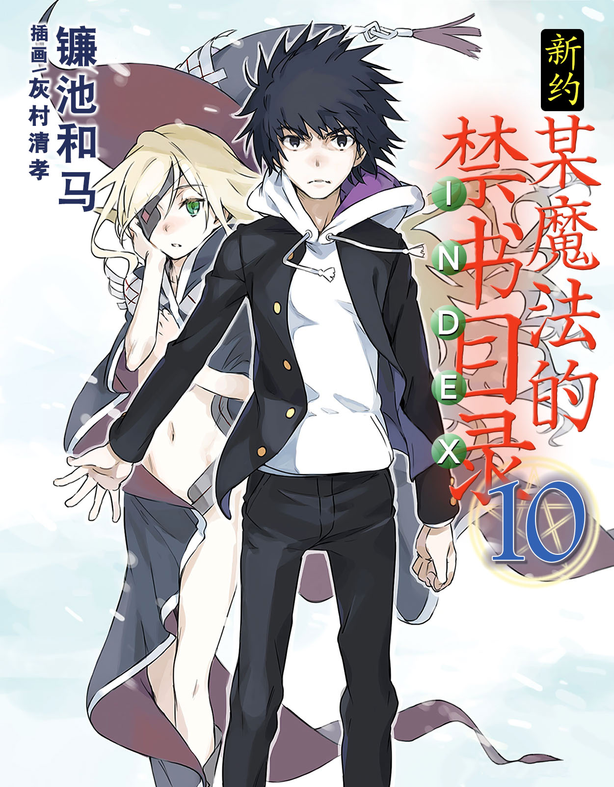
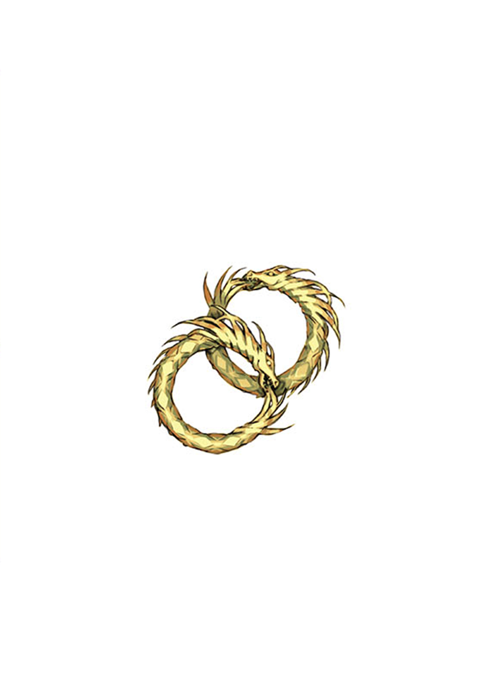

# 简介

**新约·魔法禁书目录10**

作者：镰池和马

## 内容简介

**史上最恶的敌人，变成了最应守护的存在，而史上最强的伙伴，则成为了最大的障壁。**

为了拯救魔神欧提努斯，上条当麻与全世界为敌。

曾经可靠的盟友，顶尖的掌权者、超能力者和魔法师们，全部作为「强敌」向上条袭来。

这是上条人生中生存概率最低、最绝望的一次战斗。

……也就是说，上条回到的世界，仿佛与「那个地狱」一模一样。

但他不会屈服。因为这一次他不是一个人。

拯救欧提努斯的方法，就是「魔神欧提努斯的无力化」。

要将魔神变回人类，需要从丹麦古城中的「密米尔之泉」取出魔神的另一只眼睛。

好了，目标已经确定。

上条开始战斗。仅仅是为了守护那个少女的生命和笑容。

## 制作信息

* 翻译：Seeker
* 台版：天使动漫
* 扫图：真妹控
* 图源：真妹控
* 录入：Shiki88
* EPUB制作：鹘鹰⚡
* 网翻：贴吧汉化组
* 图源：佐々原三月 月の姬 Edster792
* 组织：星之翔
* 翻译：月の姬 神笑琉璃 系色恨 keiketsu Joyfulxp_new 花菱笛卡尔 绿坝哥哥 JOJO扬 无间忧郁
* 英译参考：Edster792
* 名词注释：WiDe_Courage
* 日文校对：月の姬
* 中文润色：琦幻吉他
* 最终校对：黄昏的鸡蛋黄，月の姬
* 渣EPUB：只爱挖宝
* 整合：知一一（禁书目录X系列，[index-X](https://github.com/1204244136/index-X)）


**版权声明**

转载时请保留录入信息。

本站内容仅供试看、学习与交流使用，禁止用于商业用途；下载后请在24小时内删除。请支持官方正版。


## 封面与封底

