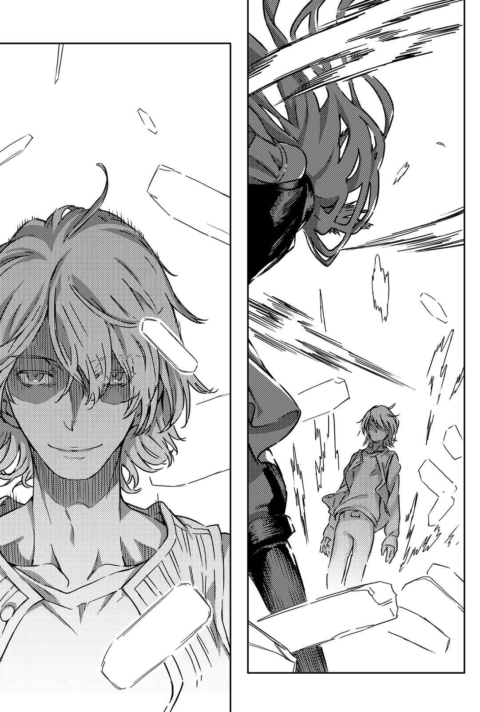

# 第十八章 V.S.「对抗魔神之人」

> Round_10.

## 1

渡过大桥就是菲英岛。

话虽如此，问起这里跟之前的半岛究竟有什么具体的差别，上条并无实感——还是老样子整片的雪景。就连这里是「岛屿」的感觉也没有。

按照欧提努斯的说法：

「虽说它是岛屿，但从一端到另一端也有五十千米。除非走海岸线，否则感觉跟先前没什么差别。」

「……接下来要往哪边走才好啊？」

「快到了。沉有『眼睛』的伊埃斯科城堡在同一座岛上。只要通过途中的欧登塞，就差不多抵达目的地了。」

或许是因为不像半岛那边有爆发战斗吧，这里似乎没产生什么混乱。银色世界的积雪道路上，也看得见往来的车辆。

两人久违地招手拦便车后，轻而易举地就上了车。要去参观铁路博物馆的观光客，让他们一同乘坐自己租来的车前往欧登塞。

后座的男孩子似乎不时向欧提努斯搭话。感到疑惑的上条试着询问后——

「他问这是什么故事里的魔女，似乎是以为我在扮演安徒生童话中的角色。」

不知道真相可能比较好。

欧登塞虽然还是充满石造建筑和砖瓦建筑，但比先前见过的每一个城镇都来得大，市内也充满活力。这里还有很多教堂等尖塔建筑，看起来就像用石材砌成的针叶林。

下车后，上条立刻开口：

「差、差不多该买件大衣了吧。我可不想在最后的最后变成冰柱。」

「都已经到这里了，不是干脆保持这样就好吗？」

「整个嘴唇都发青的人不该说这种话。」

总之两人开始在购物街上逛，却没有引起他们注目的东西。严格说来大衣有是有，但每一件都贵得买不下手。

「欧登塞是丹麦名列前茅的观光城市，到处都在打观光客的主意，根本没办法好好买东西哦。」

「……骗人的吧，我差不多连头上都要积雪了。」

既然如此，看来还是赶快找到能搭的便车比较好。

「还剩二十千米。就算运气差到必须徒步，这也算是走得到的距离。」

「连最后的最后会有谁在等都不知道呢！我可不想在关键时刻被肌肉酸痛拖后腿而倒下哦。」

车辆往来最频繁的地点，想必还是站前吧。为了前往在剧院北侧的车站，两人徒步走在街上。

剧院和车站之间有个广阔的公园。

照欧提努斯所说，这里似乎叫国王公园。上条一踏进公园，眉头就皱了起来。

就算正在下雪，就算周遭一带都成了银色世界，但在这么大的观光城市看不见一个人显然不对劲。丹麦似乎不常下雪。但也因为如此，孩子们更应该兴奋地在雪中玩耍不是吗？既然是在下雪区，应该会有许多能在雪中玩的游戏流传吧？尽管如此，白色风景中却看不见任何两人以外的足迹。

「……糟糕。」

「『闲人驱散』吗？要说守规矩倒也算是守规矩，但我还真没想到，会有人光天化日之下就在大街上动手呢。」

两人才说完，白色公园里就出现了新身影。

两道身影堵在上条他们前后，完全不知道怎么接近的。老样子，足迹并未增加。没有上条他们以外的足迹。

「认得我吗？我们应该在学园都市见过就是了。」

一人是金色短发的女性。她穿着厚厚的长裤和运动衫，搭配了作业用围裙与额前的护目镜，整体外形令人联想到女仆。

另一名女性则穿着短摆连身裙配长裤，此外胸部套了防弹背心，手肘与膝盖戴有护具，外形神似电玩中出现的女武神。

上条也不清楚她们是谁。

然而，他知道这两人站在欧雷尔斯那一边。

「我是席薇亚，这位是布伦希尔德。顺带一提，我们都是『圣人』。不过呢，这想必不怎么稀奇吧。毕竟你应该已经见过英国那边的了。」

听她随口这么一说，令上条有股寒意。

两名「圣人」。能以超音速行动的怪物同时从两侧发动攻击。而且，这回也没有神裂火织那种「看不见的死角」。除了正面迎战别无他法，而正面迎战无疑只有死路一条。

不仅如此——

「……意思是那家伙也来了吗……？」

上条一边东张西望地打量周围，一边询问。

「接下来，不会连欧雷尔斯那家伙也冒出来吧。」

听到这句话，席薇亚的眉毛有些抽动。

上条当麻不知道欧雷尔斯的下场。虽然有听欧提努斯说过他使用了名为「妖精化」的法术，却不知道他被完全一样的法术反击而弱化，更遭受魔神全力猛攻而倒下。

所以。

触怒了对方。

「……他也来喽。」

席薇亚这么回答。

「之所以没露脸，则是因为有无法露脸的理由。欧提努斯，你应该知道才对。**而你应该也知道**，**目睹那种惨状的我打算怎么对付你**。」

「……」

欧提努斯只是眯起仅剩的眼睛。

似乎不打算多说。

上条回头看去，似乎名叫布伦希尔德的女性耸耸肩。

「话说在前头，我跟这家伙的私怨无关。」

不仅如此，还传来「铿！」的沉重声响。

那是她踢起脚边巨剑并用单手握住剑柄的声音。

「……不过，既然那个魔神会危害『那孩子』，也就没办法了。即使要将她变成路上的污渍，我也要守护『那孩子』的安稳。」

（糟糕……）

毫无胜算。连第一步该怎么做都毫无头绪。不管往前后左右哪里动，脑中都只浮现惨遭瞬杀的景象。

而他所想的也没错。

&nbsp;

「轰——！」的一声。

席薇亚身影消失的瞬间，上条遭受惊人冲击，犹如炮弹一般飞出至少十米远。

## 2

认知跟不上。

「嘎啊…………！」

回过神时，上条距离欧提努斯她们已经十分遥远。肺部抖得让人连正常呼吸都做不到，手脚则是无力地晃动，背上还迸出「喀喀喀喀——！」的可怕声响。

感受不到重力。

察觉自己离地花了数秒。

注意到那是背部撞上粗壮针叶树并滑落地面，所需的时间又花了数秒。

「咳、咳咳！咕恶！嘎啊——！」

上条滑落在地，将铺在草地上的白雪染得鲜红。每当呼吸时，他都会吐出血来。

「人类！该死……！」

就在欧提努斯正要呐喊什么时，声音突然断绝了。取而代之的，则是听似用上了火药的响亮打击声。

尽管视野模糊，意识几乎落入黑暗深处，上条的脑袋依然为之沸腾。在四肢动弹不得的状态下，他张口露出沾满鲜血的牙齿，放声大喊：

「欧提努斯！住手……别对她出手！」

光是拼了命地想要起身，体内就有诡异的声音接连传出。或许是某处的骨头在冲击下错位了也说不定。上条无视连番来袭的不明痛楚，随着一声咆哮再度站起。

声音消失。

席薇亚的身影已经逼近眼前。

瞬间四目交错，女子的眼神宛如昆虫般毫无感情。

&nbsp;

「————咚！」一声，冲击再临。

&nbsp;

那纤细的手臂，娇小的拳头，打在上条胸口正中央，刺向心脏。这一击就像木锤一样，把上条的身体打在背后的粗壮针叶树上。以冲击与惯性将少年钉住的席薇亚，贴近他耳边轻声说道：

「你的事根本无关紧要。」

————咚！

「不管你是事前就和『格雷姆林』勾结，或是受到欧提努斯暗示，还是真的理解了欧提努斯这个少女而成为她的同伴。」

————咚！

「只要你站在欧提努斯那边就够了。只要你站在夺走那个大笨蛋所有力量，还将他打得千疮百孔的欧提努斯那边！你就已经是我这股杀意的目标了！」

————咚！

胸部、腹部、脸部。连续挥下的超重量铁拳，在一击夺走上条的意识后，偏偏不允许他气绝而再度摇醒他。不知不觉间，上条背后的坚硬触感消失了。

因为粗壮的树干已在冲击的传导下折断。

失去支撑物的少年再度向后飞去。浑身是血的他在雪地上弹了数次，逐渐将银色世界染成暗红色。

（……嘎……啊……哈……）

上条已经连话都说不出来。眼前所见有一半以上是一片黑暗。宛如幽暗隧道远方出口般的狭窄视野里，能看见名为「圣人」的怪物缓缓接近。

如果只是这样，上条大概会连起身的力气都留不住吧。

但他想起一件事。

还有一个「圣人」。那个叫做布伦希尔德的怪物，为什么没杀来。如果目标不是上条，那个「圣人」又会袭击谁呢……？

「……」

一想到这里，上条的双脚再度恢复了力气。

上条当麻已头晕目眩，连上下都分不清。即使如此，他仍然拼命站起身。

……而他这么做，则让「圣人」席薇亚无比焦躁。

「好吧。」

犹如纤维束绷断般的声音迸发。

那是席薇亚扬起嘴角勾出笑容的声音。

「那我就空手扯出你的五脏六腑，一件件摊在那个魔神面前。毕竟你可是让她不惜抛下『格雷姆林』也要同行的爱将嘛。就算是那个魔神，一旦看见你在自己面前被分尸，应该也会有点感觉吧。」

威胁。

逼近。

## 3

「他」看在眼里。

&nbsp;

布伦希尔德眯起聪慧的眼睛。

她将巨剑刺在雪地上，无比冷酷地观察。眼前是毁得七零八落的木制长椅，眼罩少女则倒在残骸的中央。

她并未手下留情。

反倒因为小心，出手比平常更重。

（……抵抗比预期中还要少呢。）

感想毫不虚假。

是某些原因让「魔神」的机能出了障碍？还是引诱自己大意？尽管这让人犹疑，但如果欧提努斯发挥百分之百的魔神力量，应该没必要故意露出破绽才对。

布伦希尔德·爱克特贝尔曾亲手打造高纯度的「冈格尼尔」。她本人虽未达到魔神的境界，但从「枪」的性能，她可以大致推测魔神是什么，又能做到些什么。

……实际上那也只是布伦希尔德能够想象的范围，魔神欧提努斯远远超乎她的想象，但现在要讨论的不是这点。

（应该当成她处于无法使用原来力量的状态吧。）

布伦希尔德单手拔起重量足以压垮客车的巨剑。她将剑扛在肩上，走向埋在长椅残骸中的欧提努斯。

（究竟是暂时失去力量还是永久失去力量，这点很难判断……不过趁杀得掉时下手应该是最佳解。）

想到这里，她眉头微皱。

布伦希尔德本身也是力量会犹如月相般，依照一定循环极端增减的魔法师。过去这个弱点也曾被邪魔歪道的魔法结社逮到，导致她的同伴们全灭。

她现在要做一样的事。

为了确保当下的安全，而将自己的疑心正当化并发动猛攻。

尽管心里有些难受，脚步依旧没停下。

目前躺在病床上的那名少年就是一切。

为此，就算自我矛盾也得容许。

「祈祷吧。」

「……身为神的我，究竟要向什么对象祈祷……？」

「这种时候的正确答案，就是回想起自己心爱的人。」

布伦希尔德随口说完，另一只手便握住了剑柄。她双手抓好武器，准备全力砸烂魔神欧提努斯的身体。

&nbsp;

「他」看在眼里。

&nbsp;

就在前一刻。

「轰！」的一声，有东西以炮弹般的速度从旁飞来。那是个暗红色物体。精准捕捉到来者的布伦希尔德，以剑柄往正下方敲去。

令人不快声音带着黏稠感响起。

那东西直到不久前还是个东洋少年。

「……慢着，布伦希尔德。」

恶鬼的声音传来。

走向这里的身影，也已染成了暗红色。

「别干脆地杀掉。这样不划算。我要在欧提努斯这该死的魔神眼前，尽可能将她看重的东西一个个杀掉。**这样才有趣**……」

席薇亚的模样让布伦希尔德为之皱眉，低头看见脚边状似少年的物体后，她的眉头又皱得更深了。

「赶快杀掉魔神这点没异议，但我可没道义奉陪你的烂嗜好。」

「那就再增加一个这种东西吧，我倒是没意见哟。」

&nbsp;

「他」看在眼里。

&nbsp;

暗红色物体的末梢部分有些微颤抖。

他还有呼吸。

得知这个单纯的事实后，彻底毁坏的长椅处也有了些许动静。尽管连站都站不起来，眼罩少女依旧动了，她在冰冷的雪地上爬行。动作很小，十分缓慢。即使如此，她依旧为了朝雪地上的染血物体移动而努力。

「……人类……」

眼罩少女挪动沾满鲜血的嘴唇，说出断断续续的话语。

她的眼里满是哀求。

宛如卖火柴少女在最后的火中描绘出梦里情景。

「所以……我就说了。就算陪着我……也不会有什么好事……」

不能让火消失。不能失去希望。

魔神以伤痕累累的双手挪动身体，从她身上能感受到这样的意思。

但是，布伦希尔德仍旧冷酷。

女性面不改色，用力踩住少女的右肩。光是这样，缓慢的爬行就已停下。

「要怎样你才能接受？」

「那还用说。在这家伙眼前把小鬼的五脏六腑活生生地扯出来。就像活鱼料理那样，让他就算没了内脏也能不断张口。如果不这么做，我没办法消气。」

「……住……手。」

尽管来自上方的重压将欧提努斯钉在雪中，她依旧伸出满是鲜血的手。

探向前方的暗红色物体……却怎么也碰不着。

「你们的目标应该是我吧？只要除掉我这个威胁，就能平息世界的混乱了吧？既然如此，表示跟这家伙无关。只要杀了我，你的混乱应该也会消失才对……所以……」

「无关。」

席薇亚答道。

满是执着的声音无止尽地说下去。

「只要能杀掉你，怎样都行。只要能替欧雷尔斯那个混蛋复仇，就算疯掉也无所谓。你不懂。是啊，你真的什么也不懂。我啊，根本不想恢复正常。因为呢，一旦恢复就会停在那里。因为一恢复，我可能就会不知怎地原谅你。但我不想这样。明白吗？不是做不做得到。我是基于自己的意志而不想这么做。」

听到这句话，布伦希尔德暗想：

（……别等席薇亚的指示，直接杀掉魔神吧。）

布伦希尔德·爱克特贝尔来到这里后，依旧没小看过欧提努斯的力量。正因为如此，她并未掉以轻心。「当杀则杀」是布伦希尔德的基本原则。她不想在这个局面里放入「玩乐」却在之后遗憾。

「那就快点开始吧。」

布伦希尔德冷冷地这么说道。

说归说，她却悄悄地以惊人力量重新握住剑柄。

要在席薇亚分心到少年身上的瞬间，让欧提努斯毙命——她如此决定。自己已经有了心理准备，接下来得和愤慨的席薇亚交战。即使如此，依旧要确实而迅速地收拾掉欧提努斯。她将这点当成最优先目标。

「……住手……」

欧提努斯的声音已然模糊，却坚持说出口。

她宛如将手伸向再次被夺走的布娃娃一般，拼了命地试图制止。

「住手！那家伙与我的罪过无关……！他根本没必要背负我的罪。所以……！」

拼命的恳求，没有得到响应。

两名「圣人」采取决定性的行动。

狂风呼啸。

「他」看在眼里。

&nbsp;

所以。

&nbsp;

轰唰唰唰唰唰唰唰唰唰唰唰唰唰唰唰唰唰唰唰唰唰唰唰唰唰唰唰唰唰！黏稠的巨响炸裂。

这是男子——欧雷尔斯闯入两名「圣人」之间所产生的巨响。

但是，此刻的他由于中了「妖精化」，所以没有任何接近「魔神」的特殊力量。不管是身体的强度还是能施展的魔法，都比随处可见的魔法师来得弱小。

欠缺的部分，就用意志力补足。

他实际采取的行动很单纯——用双手夹住布伦希尔德挥下的巨剑。但音速行动的布伦希尔德这一击，欧雷尔斯不可能支撑得住。在庞大摩擦力影响下，欧雷尔斯的双手毁得乱七八糟。

男子面不改色。

为了让持续滑动的巨剑偏离轨道，欧雷尔斯在遭受破坏的同时，双手大幅度甩动。

就这么一拉。

布伦希尔德的身体，连同巨剑一起被往前带。讲得更精确一点，这一带使得席薇亚的赤手空拳碰上了布伦希尔德的剑。

「什么……！」

「欧雷尔斯！你这个笨蛋……！」

惊讶的喊声传来，但已经太迟了。

一声巨响。从旁人的角度看，或许会见到两名圣人以惊人的速度正面冲突，接着各自倒在厚厚的雪上。

击破两名圣人。

代价是欧雷尔斯的双臂。

这对手臂遭逢的破坏已超越了骨折的程度，变得犹如在风中飘扬的塑料绳。

「……你……」

连站也站不起来的欧提努斯，口吐鲜血地咕哝。

「你也是……来杀我的吗……？」

「我之前应该也说过了。」

欧雷尔斯垂下染成暗红色的手臂，若无其事地回答。

「……我已经不再执着『魔神』这个束缚。只要能打倒你，怎样都行。」

「……」

「看样子，做到这一点的似乎不是我。」

欧雷尔斯轻笑。

「至于他呢，我起先只期望能成为吸引你的诱饵。做到这种程度倒是出乎意料。」

「你有杀我的理由吧……」

「确实没错。」

关于这点，他回答得十分冷酷。

接着——

「但如果上条当麻死在这里，你势必会蜕变成比过去所见任何一个欧提努斯都要可怕的怪物吧。同样地，如果欧提努斯死在这里，上条当麻的性质也可能有重大改变。不管是哪一种情况都不有趣。之前说过了吧？我已经不再执着。既然最能让你弱化的关联性在这里，为了维持它而行动也不坏。」

「……你还是老样子『天真』得惹人厌呢。」

「算是天性吧。虽然我也知道自己因此吃了很多亏。」

「这种『天真』，让你不惜放倒自己的同伴？」

「就跟你身旁的人一样喽。尤其是席薇亚，用说的没办法让她停手。不过嘛，等脑袋随着时间冷静下来后，她应该会恢复原先的理智吧。」

欧雷尔斯瞄了倒在雪地上的两人一眼。

「这两人我会负责开导。我会『好好地』开导，直到她们明白为止。所以不会再让你担心了。」

好不容易，欧提努斯才边咳嗽边摇摇晃晃地起身。

上条虽已满身是血，但还在呼吸。少女轻抚他的背，接着撑住他的身体勉强将他扶起。

「……我可……不会道谢哦……」

「即使是现在，我依然有攻击你的冲动呢。」

欧雷尔斯毫不在意摇晃的双臂，耸耸肩回答。

欧提努斯万分提防地后退，确认拉开一定的距离后才转过身去。最后，欧雷尔斯朝搀扶着几乎失去意识的上条当麻行走的眼罩少女这么问道。

「找到『要找的东西』了吗？」

「『理解者』不是你。他比你坚强多了。」

&nbsp;

说完，因缘深厚的两人，拉开了无限遥远的距离。
