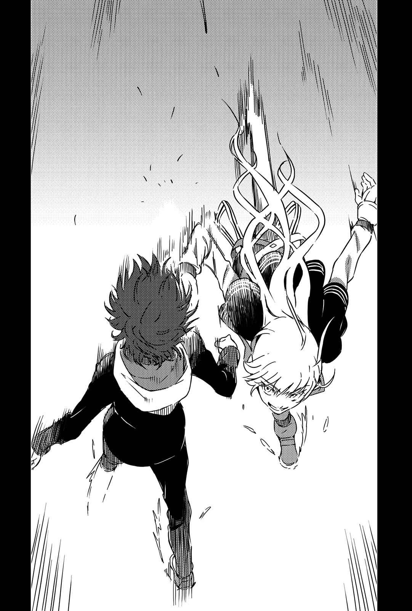

# 第十九章 V.S.「挥舞重锤的全能之神」

> Round_11.

## 1

伊埃斯科城堡。

由一万根栎木在广大湖面组成基底，再建筑于其上的砖瓦之城。

这座动用劳力难以估量的城郭，即使历时五百年仍旧以观光资源的身份，滋养欧登塞等邻近都市的财政。

不过，对于聚集在此的众人而言，重要的并非城。

原初之湖。

早在这里筑起巨大城堡前，欧提努斯就利用这座湖做了「某件事」。由于在人们不知情的状况下建起这座城，所以魔法师们直到今日依旧摸不着庞大仪式的痕迹，纵使是顶尖人才也一样。

然而——

「唉，到头来还是这样喽。」

同伴称她为赫尔的女性，在湖畔的白色地狱中咕哝。

「就算多国联军那些家伙没发现好了，但我们毕竟同样是『格雷姆林』。即使无法抵达魔神的境界，她在想什么大致上还是推测得到。」

接着是少年。名叫耶梦加得。

「幸好没为了整她而泄密。看样子那些家伙还没发现呢，这下子我们就是第一了。」

再来是青年，名叫芬里尔。

他们是「格雷姆林」的实战人员，而且个个都是能够孤身对付军队的魔法师。而且不止他们三个，强风吹起的积雪帘幕彼方，隐约可见数十数百道身影。

「洛基那家伙也来了吗？」

「就算在场也会躲到人家背后吧。他就是这种人。」

「话又说回来，就连伊登、希芙这些后卫也到了，实在好笑。看来他们真的很火大。」

「格雷姆林」的成员们其实不清楚这座湖里有什么。

他们也不知道欧提努斯打算主动放弃力量。他们顶多只有「连我们这些正规成员也不知道的『真正计划』关键，就藏在这座湖里」的想法。

而且，单单这样就已经称得上是背叛。

在场的人全都为了让欧提努斯成为魔神而持续奋战，相对地则希望她替自己实现心愿。不管多令人不齿的事，大家都肯做。然而欧提努斯让这些人看见梦却又夺走，所以他们来算这笔账——就算要将少女的身体物理性大卸八块也一样。

就在这时。

有个新的人影踩着雪到来。

因风而起的积雪帘幕另一头，能看见许多身影往两侧退开让路。这个光明正大走在中央的人影，即使是芬里尔、耶梦加得、赫尔也不能无视其存在。

「托尔……」

「嗯，这回可是真货哦。」

雷神笑着扬起一只手。

「话说回来，这里还真不简单。全都是气得要把欧提努斯那家伙宰掉的人吗？居然没有半个人要站在她那边，还是真悲哀呢。」

「你也是来杀她的吧。」

「是啊，但我并不是因为怀恨哦。只要能开心打一架就好。要说我对打倒她能获得的经验值完全没兴趣，可就是骗人的喽。」

说着，托尔张开双手提议。

「……只是啊，要抱怨也行，但大家不先整合一下意见吗？咱们来决定个代表吧。如果四面八方你一言我一语的讲，那根本就听不清楚，只会变成噪音洪流啦。不管再怎么喊，欧提努斯都听不到，这样很无聊吧？」

代表。

听到这个词，全员都有了反应。

在这之前，「格雷姆林」一直由欧提努斯这个绝对的领袖统治，这点有好也有坏。但领袖已经离去。这么一来，往后该由谁整合组织？照规矩让雷神来吗？还是该为他准备别的位子呢？

赫尔这么质疑：

「具体来说该怎么决定？」

「你以为我会说传统啦权力啦人脉啦资金啦这些无聊的东西吗？」

另一位神祇闭上一只眼睛。

这么说道。

&nbsp;

「**就来场实力决胜的肉搏战决定吧**。**不管怎么说**，**还是这样最有意思**。」

## 2

上条当麻与欧提努斯都满身是血。

这么一来就没办法拦便车了。两人只是在风雪下的纯白世界一步一步地走。

「……决定了吗，欧提努斯？」

「决定什么？」

「一切结束之后，你要走怎样的路。」

在两人互相扶持前进的状态下，上条小声地这么说道。

「我之前也说了吧，不管卖面包还是卖花什么都行……找到什么想做的事了吗……？」

「哈哈，这么可爱的工作不适合我啦。」

「之后可不知道要忍耐多久哦。所以说，什么都行。适不适合，气氛不对之类的无关紧要吧？找到你真的想做的事吧。这样我替你加油打气才有意义嘛。」

「想做的事啊……」

欧提努斯沉默片刻。

接着她说道：

「真的什么都行吗？」

「为什么要问我啊？」

「不，我就是想问你。我真的……不管什么梦都可以去追逐吗……？」

欧提努斯在极近距离盯着上条的侧脸。

或许是大量失血与眼皮肿胀让视野变得狭窄吧，上条没注意到身旁欧提努斯的表情。就这样，他很快地这么回答道：

「当然可以喽。」

「……这样啊。」

听到这句话，欧提努斯嘴角微微一扬。

「怎样，找到什么梦想了吗？」

「不过没理由告诉你就是了。」

「……？」

上条将伤痕累累的脸转过去时，欧提努斯的表情已恢复严肃。

总而言之，在这时追问也没用。上条抱着「她迟早会说」的期待，继续向前走。

究竟过了多久呢？

埋在雪中的双脚已渐渐失去感觉。

不知不觉间，雪花帘幕的彼方出现一个巨大的影子。

「……伊埃斯科城堡……」

欧提努斯动着颤抖的嘴唇说道。

上条缓缓转头。

「到了吗……不会变成在满是陷阱的城堡中玩脱逃游戏吧？」

「实际上，城根本不重要。毕竟『眼睛』早在那玩意儿盖起来之前就丢下去了。重要的是它周围的湖，不过幸好大家都只盯着后来的城堡，一直没人注意到『眼睛』……」

气喘吁吁的两人，好不容易抵达了湖畔。

他们注意到一件事。

被迫注意到一件事。

「嗨。」

声音传来。

白色雪花帘幕的彼方，有个巨大的阶梯与王座。不，那个男人所坐的地方，并非阶梯上头的王座。

人类。

他坐在上百人所堆成的人山之巅。

「……雷神托尔……？」

「哦，这些全都是『格雷姆林』的正规成员。你问欧提努斯的话，她会一个一个替你解说哦，她虽然傲慢，却喜欢高高在上地解说。大家似乎打着『围殴』这种无聊的主意，所以我就快手把他们收拾掉了。嗯，拿不到什么经验值呢。」

「说是这么说，但你看起来没打算让路呢。」

欧提努斯说完，托尔立刻回以空洞的掌声。

「那当然喽，我又不是你们的同伴。说起来啊，反倒是当你们的敌人还比较有趣。就是这样喽，没错没错。小上条啊，你果然还是该这样才有意思。在学园都市见面时你完全让人提不起劲，但现在似乎能让我好好享受。而且还有魔神欧提努斯这种怪物在，简直完美。真是的，这样经验值到底会有多丰富啊？不开玩笑，这下子我可能会撑破肚子喽。」

「……小心。」

欧提努斯轻声说道。

「事前解决了『投掷之锤(妙尔尼尔)』，代表现在托尔没有锤辅助。这意味着他失去为雷神的力量。」

「……？慢着，这跟弱化不一样吗？」

「如果托尔依然是『雷神』，或许你还有打倒他的希望。」

欧提努斯说道。

「但换成身为『全能之神』的托尔又另当别论，眼前的惨状也是这么来的吧。讲单纯点，区区『雷神』没办法造成这种破坏。」

「哈哈哈，解说辛苦啦。没错吧？她很爱说明。」

托尔随口说着，同时缓缓从人山上起立。

「所以说，要怎么办？两个一起上？还是先让我和上条一对一？要怎样都行，快点决定一下。」

「……为什么你会判断我无法施展完整的力量，认为我缺乏战力？」

「很简单。如果你状态万全，根本就不会依靠上条吧？」

只有这句显得特别冰冷。

托尔这名魔法师，在学园都市时不惜背叛欧提努斯也要救出芙罗兰·克洛伊杜尼。尽管他应该也有他的盘算，但愿意无偿救出受困于凄惨环境中的女性，这种个性让人无法否定。而且，若是以这样的托尔角度看来，认为「过去的」欧提努斯言行值得轻蔑也是理所当然。

欧提努斯还想说话，但上条平举手臂制止了她。

他做出回答：

「一对一。」

「哈哈！果然就该这样！我就想你一定会这么说啊，小上条！」

托尔离开「格雷姆林」的王座，一边笑一边走下人体构成的阶梯。

「既然如此，我也不会手下留情。这么做不合礼仪，毕竟是难得的大舞台。就让你见识一下……所谓的全能之神托尔。」

托尔张开双臂，自夸似的宣言。

紧接着。

惊人的声音响彻周遭一带。

**某人的拳头陷入体内**。

**上条垂下视线**，**从拳头移向手臂**，**再由手臂移往肩膀**，**眼睛慢慢地追过去后**，**在终点见到托尔的脸**。

「让我享受一下吧，宝贝。」

他无法理解发生了什么事。

拳头的冲击随即传遍全身，上条当麻的身体往侧面飞了出去。

## 3

倒在雪上。

暗红色血块取代了吐息。

「……嘎……啊……！」

上条倒在自己的血泊中，发出黏稠的呼吸声。尽管知道自己的意识已经在闪烁，但他脑中同时也这么想。

拳头的威力还是人类程度。至少不像凿岩机那么残暴。现在之所以吐血，多半也是因为肋骨累积的创伤所致。

即使如此，也不代表没有威胁性。

刚刚那是什么？

到底发生什么事……？

「空间移动(Teleport)……？」

「多用点想象力啦。」

托尔笑着晃了晃沾满血的右手。

「再怎么说，现在的我也叫做全能之神哦。如果欧提努斯那家伙不挖掉一只眼睛，我会就这么被推举为『格雷姆林』领袖。若要谈论我，可得把视野放得宽广一点才行。」

那时，欧提努斯确实应该站在五米外才对。

**但上条注意到的时候**，**头发已经被一把抓住**。

**原本要起身的少年**，**再度被打进雪中**。

托尔的脚跟踢，接连落在胸部与腹部上。他就像要踢烂空罐似的，一下一下地压迫上条的内脏。

「嘎……呜！」

尽管将肺里的氧气全都吐了出来，上条依然勉强伸出手，试着抓住托尔的脚踝。

**托尔的身体再度消失**。

**他的身体出现在一米高处**。**就这么双脚齐下**，**以全身体重踩向上条腹部**。

诡异的声音在体内回荡。

「啊……哇……啊！」

（不止碰不到……同时还会出手还击。这是一定会百分之一百精准发动交叉反击一般的异能之力……？）

仰天躺着的上条，摇摇晃晃地朝托尔的脚伸手。

**痛楚窜过侧腹**。

**全能之神托尔踢足球似的将鞋尖刺进上条侧腹**，**以脚力将他踢得翻了好几圈**。

霎时间，上条有种白色天空扭曲了的错觉。

虽然他也怀疑是意识模糊的关系，不过——

「嗯，如果现在是晚上，或许会有更简单易懂的提示呢。」

「什么……？刚刚的……不是幻觉……」

「我可没移动。」

听到托尔这句话，上条将手伸进雪中。他握住了积雪底下几颗粗糙的石头。

一起丢出去。

「「「只是杀敌而已，我根本没必要亲自移动。」」」

「嗡！」声音产生了先后之分。

眼前分出数个托尔，避开了所有丢出去的石头。不，不对。这全都是号称全能之神的男人所留下的残像.

「我说过了吧，视野要放得宽广一点。」

下一句话来自正后方。

托尔的拳头已经打在上条身上，看似陷进了少年的背骨。

上条挥肘撞向正后方。

没有命中的触感，此时托尔已经站到了上条正面。全能之神的膝盖用力顶进了上条的腹部正中央。

呼吸停滞。

上条正摇摇晃晃地要后退，托尔便单手揪住他的领口，用力将他拉向前。同时，托尔更狠狠以额头撞下去。随着沉重的撞击声，上条再度摔倒在雪地上。

扭曲的天空。让人瞬间移动的方法。和在学园都市见到的空间移动(Teleport)不一样。「格雷姆林」中的技术。上条见过的东西。他应该也体验过才对。欧提努斯是怎么带着他来到丹麦的？

「移动的不是你……」

气若游丝的上条，挪动满是鲜血的嘴唇说道。

就连他自己，对于这个假设也露出了一脸难以置信的表情。

「……移动的是『世界』。难道为了将沉默不动的你运送到希望的位置，整个世界像输送带那样扭曲了吗……？」

「太慢啦。没有提示也就算了，但你已经在学园都市的货运码头见过了吧。而且和欧提努斯一起消失，就代表你见识过她深藏不露的『骨船』了嘛……既然如此，我是不是该稍微手下留情，表演得更神秘一点？大喊『哼哈哈我可以停止时间』之类的话。」

将名为全能之神托尔的棋子放好，然后移动铺在底下的世界地图。

要说异想天开确实也是异想天开。

但上条心里对于将这种事化为可能的技术也有底。

「……在巴格吉城的战斗中，也有确认整体论超能力是否存在的实验……为了让手掌喷出火焰，将好几个远方银河全部折叠在一起的愚蠢方法。你已经到那种境界了吗……？」

「那可就猜错了。知道理由吗？」

托尔嘻嬉笑着，单手叉腰提问。

显然在等上条调匀呼吸。

这是为了得到更多的经验值。为了追求更刺激的战斗。

「……若是这样，『格雷姆林』就没理由找上芙罗兰·克洛伊杜尼了。直接将一开始就在手边的你纳入计划即可。」

「算得上『似是而非』喽。应该很接近欧雷尔斯和第七位的关系吧？也就是说我呢，就是科学阵营某人的近似值。能引发很相似的现象，却不是同一种东西。毕竟实际上我是魔法师，超能力什么的完全不懂。」

「……」

托尔甘冒危险也要救出芙罗兰·克洛伊杜尼的理由，上条似乎有了些头绪。

似是而非的某人。

说不定自己会是那个样子的某人。

或许就因为没办法将对方当成陌生人，托尔在那时才会宁可与所有势力为敌，也要解救芙罗兰·克洛伊杜尼。

或许也是因此，才会对犹豫着不敢向她伸出援手的上条表示愤怒。

只不过……

「……规模太大。『让整个世界偏移』这种夸张行为，或许符合『全能』这点。不过，实际产生的等效现象应该和空间移动(Teleport)没两样。光是移动世界，没办法做到这种精确度……」

「别啦，我可不值得那么大的赞美。你见识过完成后的欧提努斯了吧？支配这个世界大概就是我的极限了，但如果我计算的规格无误，那家伙的威能应该远非我所能比较才对。走到这一步之前，世界毁灭几次了？话说回来，你为什么赢得了手里有『枪』的她啊……不，『只』是互殴得胜没办法将这个世界恢复原状就是了。」

……确实，如果百分之百的全能之神托尔和魔神欧提努斯正面冲突，恐怕不到一秒托尔就会被干掉吧。支配区区一个世界的托尔，对上能无限创造世界的欧提努斯，两者之间有极为明显且无可动摇的高墙。

然而，目前问题不在这里。

全能之神托尔是眼前的威胁。欧提努斯已无法使用力量。如果要通过这一关，非得靠渺小人类上条当麻的拳头击倒敌人不可。

「话先说在前头，我可没指定什么坐标哦。真要说起来，对于随时在膨胀的宇宙而言，纸上的坐标根本没什么意义。」

「……？」

「也不是『随时都会待在你的死角』这种条件哦。那种东西在学园都市应该相当于强能力(Level 3)吧？不好意思，我可是号称全能之神。多用点想象力嘛。」

「……………………………………………………………………………………………………………………………………………………………………………………………………………………………………………………………………………………………………………………难道说……」

上条忘了覆盖全身的剧痛，咕哝。

方便。

犯规。

不负「神祇所为」这种形容词的绝望级效果。

「『**移动到必定胜利的位置**』……这就是你的法术……？」

「答得好。不过严格说来是你们『世界』在移动就是了。」

托尔已然消失。

沉重的冲击窜过上条胸口正中央。

## 4

这个拳头打烂人类血肉的触感，体验多少次了？

&nbsp;

少年瘫倒在深厚雪地上的模样，看过多少次了？

&nbsp;

列车驶过铁轨的声音，从远处传来。

回过神时，似乎已经离伊埃斯科城堡有段距离了，托尔心想。可能有数十米，甚至数百米吧。即使回头望去，朦胧的白色风景也看不见伊埃斯科城堡。上条当麻想拉开距离，却每次都惨遭揍飞并倒在雪上。当前的状况，显示这个循环一再重复。

尽管欧提努斯也失去了踪影，但这对全能之神而言不成问题。

他没有远近和间距的概念。

如果需要，世界会自行调整。只要是在地球上——**在控制于股掌间的行星上**，即使逃到球体的另外一边，他依旧能立刻闪入怀里。严格说来，是对方主动张开怀抱。

「……」

光是挥手摆脚，就必能将位置和距离自动调整到让他能漂亮一击的魔法。将条件营造成对手攻击完全无效，自己却可以单方面攻击的法术。

不是胜利，就是平手。

无论如何「绝对能避免败北」的全能之神托尔，即使是学园都市第一位的超能力者(Level 5)也杀不了他吧。如果没有魔神欧提努斯那种瞬间将世界彻底毁灭又整个重塑的技术，就杀不了这个男人。

神死亡的时候，就是世界终结的时候。

上条摇摇晃晃地从雪中起身，并试图为了拉开距离而蹒跚后退。托尔见状轻轻叹气。

这种行为毫无意义。毕竟距离与方向会自动地重新调整。

「怎么，已经结束啦？」

托尔随口说道，向前踏出一步。

解放全能之神之力的现在，他感到无比空虚寂寥。这就像在跑步用健身器材上原地踏步，只有风景影像朝后流逝一样，看起来是种非常不现实的努力。

光是局限在这个世界的托尔就已经「这样」了，得到完全力量的欧提努斯眼中，世界究竟长什么样子呢？他心想。

「我可是只有这招哦，从头到尾只有这一招。如果有『投掷之锤(妙尔尼尔)』的辅助，就能使用熔断刀做些更像特技表演的事了。总之现在只能这样。说明白点，这是个机会哦，几乎没有更好的机会了。」

单单以这种不完全的力量，托尔就能一次对付一百名以上的「格雷姆林」正规成员，而且毫发无伤地将他们全部击破。虽说「格雷姆林」喜欢用奇招，他们终究还是把世界搞得天翻地覆，但托尔居然解决了将近全部的人。

「……有了这种程度的力量，你对欧提努斯还有什么期待？」

上条又往后退了一步并说道。

「我完全无法想象你渴求任何东西的画面。追根究底，你就连和『格雷姆林』会合的必要都没有吧……？」

「我之前也说过了吧。站到了高处就会往更高处看，力量的追求永无止境。我和其他的『格雷姆林』没什么差别，都是为了实现自己的愿望而会合。仅此而已。」

托尔将拳头轻轻打在张开的手掌上，笑了。

「不能容忍第三次世界大战的胜利者是科学阵营……也只是表面上的主题，到头来它只是众多『愿望』里的一个。所谓的『格雷姆林』啊，是让魔神欧提努斯完成，相对地要以这股力量实现愿望的组织。所以呢，大家都气疯——气欧提努斯不支付工作报酬就消失得无影无踪。」

若是那时在无限地狱中的魔神欧提努斯，想必能做到吧。

不，在那个「大家都幸福的完美世界」里，愿望应该已经实现了吧。

……破坏成真梦想的人是上条当麻。让世界还原的则是欧提努斯。

「每个人都怀抱着类似的不满，却个个争先恐后地哇哇大叫，这也未免太难看了吧？所以呢，我就像这样试着统一了。话先说在前头，我可是会杀掉欧提努斯的。我对于在这里和上条像运动一样健康地互殴没意见，但之后等着的可是确实的惨剧。」

与世界为敌的人，不止欧提努斯一个。

被全世界否定，冀求「魔神」这个唯一可能性而齐聚一堂的「格雷姆林」全员，纵使要背负着脱离巨大齿轮的风险，依旧听从她的命令战斗至今。

所以，他们或许有资格憎恨擅自走下舞台的欧提努斯。

想到这里，上条愤愤地说道：

「……你在开玩笑吗？」

「嘿，眼神还没死啊？虽然那个女人的罪过不会因此抵消就是了。」

「你们站在能制止她的立场吧？你们早在『格雷姆林』实际肇事之前，早在与整个世界为敌之前，就已经认识欧提努斯这个人了吧！」

确实，魔神欧提努斯是个可怕的人。

亲手制造「枪」。为了不让这个目的穿帮，她特地准备了假的制造计划，在世界上引发大骚动，最后还破坏又重建世界数万数亿次。在至今见过的邪恶里，她无疑是最大的那一个。

「我阻止欧提努斯喽。虽然那不是能自豪地说『赢了！』的状况，但我还是阻止了她。这并不是专属于我的特权。只要想了解她，只要认真地这么想，这种事谁都做得到！但是你们没人这么做！」

可是，不仅如此。

她不惜舍弃自己的梦想也要守护上条的梦，让一切恢复成「原来的世界」。她明知自己会被全世界的人攻击，依旧帮助了上条。在茵蒂克丝和美琴等人猛攻时，她同样没考虑防御或回避，只是正面让对方打飞。

「你们从一开始就选择放弃！放弃理解欧提努斯！因为这么做比较简单，而且只要保持畏惧就能让自己当受害者！所以你们没有认真地面对，放弃与她交谈！然后你们要用这招把责任全推给欧提努斯？放弃自己实现梦想，却把自己的梦想强压在别人身上，还无视这份重担，只是责备人家的失败，你跟我说这叫正确？开什么玩笑！站在她身边的人，原先根本不该是我。你们才该这么做！集结了五十人，一百人，结果做到这种程度的连一个人都没有！你还高高在上地讲什么鬼话！」

明明早在上条当麻面对欧提努斯前就已经接触她，为什么不明白？

把人家当成记号之类的，归纳在「恐怖魔神形象」里头就满意了？

为什么。

连她身上的一点良善都找不到。

甚至没对找不到良善这点感到疑问。

「魔神欧提努斯是个无药可救的坏蛋。」

上条这么说道。

「但是，没能阻止她是你们的责任！不要逃避自己的罪过，全能之神托尔。这不是什么梦话，我实际做到了！谁都做得到，但是过去谁都没有做的事，我确实做到了！之前你们一直没做，不是因为它绝对不可能。单纯是因为你们舍弃了她！」

或许吧，托尔心想。

认为那个欧提努斯会听人类说话的正规成员，恐怕包含托尔在内连一个也没有。就算她能理解语言，大概也没人想过她能理解人类藏在话语中的思念吧。

就这方面来说，上条当麻做到了前无古人的丰功伟业。

大概是因为少年比任何人都「坚强」吧。

可是。

&nbsp;

「『那件事』跟『这件事』可是两码事哦，小上条。」

&nbsp;

全能之神托尔的身体消失了。

他已经确保了能战胜上条当麻的位置。

## 5

不管怎么样，全能之神托尔总是能回避各种攻击。在「与上条当麻的战斗」中，整个世界会自行挪动位置，让他能回避所有攻击，并从最有效率的方位和距离出手。这就像连打按钮就能完美取胜的低能格斗游戏一样，只要等时间过去就能确实赢得胜利。对手怎么动根本没有关系，只要连按就能全部打下来。

……让对手无可奈何的无敌，同时却也空虚至极。

即使赢得成千上万次的胜利，也不会有任何收获。

明明背负着「如果全能之神之力使用过度，地球的自转与公转情报会像一再翻拷的录像带那样失准，变得无法修复」这种严重的风险，胜利却连少如一粒沙的知识也无法带来。

名为托尔的男人之所以发疯似的追求「战斗经验值」，理由就在此。如果知道上条当麻在无限地狱中，借由重复「死亡学习」对抗魔神欧提努斯，他说不定会鼓掌大笑。

（如果是对上你，应该能脱离「那种」程度。）

沉重的触感透过托尔的拳头传来。

在换位结束(换句话说，在第三者看来是消失不见)的瞬间，攻击已经结束。看见消失才回避则太慢，消失前行动则毫无意义。

（对上完整的欧提努斯毫无用武之地，其他正规成员却又太弱而什么也得不到。不过你倒是在**适合的区间**里啊，该死的家伙！）

列车行使的声音传来。

虽然不知道还要「连按」几次，但上条应该逃不掉了。发现自己胜券在握，让托尔感到失望。不管做什么都毫无收获，让他的眼神失去了生气。

列车的声音响起。

「……？」

这时，托尔终于发现了。

发现得太迟了。

托尔脚下踩的并非银色世界的雪原，而是坚硬的枕木——他站在列车的轨道上。至于遭他从后殴打，而身体应该已弯成弓形的上条，则回过头看向他。上条的眼睛依然炯炯有神。

「你的魔法是『移动世界好让你能取得战胜我的位置』吧。」

少年露出战士的眼神说道：

「……那么，**与这一战无关的东西**不就没办法应付了吗？」

「……………………………………………………………………………………………………………………………………………………………………………………………………………………………………………………」

托尔转头看着逼近眼前的钢铁巨块，整个人完全僵住了。

紧接着。

&nbsp;

十二节车厢的货运列车高速穿越。

列车从几乎要勾到上条当麻衣服的位置猛然驶过。

## 6

叽叽叽叽叽！惊人的金属摩擦声迸出。将人碾过的货运列车迟了一步才紧急刹车。轨道与金属车轮之间散发橘色火花。

「……」

上条当麻当场坐倒在地。

他已遍体鳞伤，连分辨痛楚来自哪个伤口都办不到。整个身躯都在膨胀，仿佛名为痛楚的高热已覆盖了全身。他也不知道体内究竟情况如何，不敢做精密检查，甚至连骨头与内脏是否齐全都没信心。

即使如此，事情依旧没完。

因为目的不是击败全能之神托尔。必须让欧提努斯从湖中拾回「眼睛」放弃力量才行。

就在这时。

货运列车下方——车厢底盘与地面之间的些微空间，传来男子的声音。

「……喂。」

「托尔…………！」

上条全身汗毛都竖了起来。没有杀气。可是，如果做到这一步对方还站得起来，自己就无能为力了。就算是刚刚那样的奇袭，多半也没办法奏效第二次。

夹在列车与地面之间的托尔虽然浑身是血，但看起来四肢健全。

除了能扭曲世界自由移动之外，托尔应该没别的力量才对。肉体强度也和普通人无异。既然如此，难道那班货运列车没有直接撞上他？

难道他在千钧一发之际，切换「目标」避开了正面冲突「逃」往正下方？

「……哦，没啦，我可没有继续打下去的意思。刚刚是个不错的经验，包括**言语的互殴**在内。以我来说呢，已经很久没有这么爽快的感觉了。」

托尔慢动作挥了挥沾满血的手，同时说道。

「追根究底，你们来这里是要做什么啊……？虽然猜得到欧提努斯将『某种东西』藏在这里，但那到底是什么我却毫无头绪呢。」

「她似乎是将『眼睛』投入泉水中，借此获得魔神的特殊力量。只要收回眼睛就能放弃力量。我们的目的就是让她放弃后再投降。」

「……原来如此，哎，真有你的风格呢，小上条……不过，如果是这样，那你还是动作快一点比较好吧……」

「还有谁在吗？」

上条厌烦地说道，但他似乎没料到托尔会这么回答。

「怎么，你还没发现啊……？」

「？」

「最后的敌人不是我。无论是谁，只要稍微想一下都会知道吧？」

## 7

这时。

魔神欧提努斯正孤身待在湖边。她双膝陷在雪中，以跪拜姿让双手接触冻结的湖面。

口中喃喃自语。

突然间，整座湖放出惊人的青光。光芒迅速凝聚，缩至欧提努斯双手捧起的冷水上头。在她手里有个乒乓球大小的球体。球体与人类的眼球差异很大，呈青色且硬如宝石。不管用什么方法保存人类的身体组织都不可能成为这种颜色。看上去既不属于人类也不属于魔神，或许构造本身就有所不同。

这就是她的「眼睛。」

先前欧提努斯特地将身体的一部分献祭泉水，借此升华为魔法之神的特别肉体。这次则要将它纳入眼罩下的眼窝，取回成为魔神之前的肉体。

这么一来，就能解救畏惧「绝大力量」的世界于混乱中。

接着再投降，由「格雷姆林」，由欧提努斯引起的骚动就会落幕。

&nbsp;

**可是**。

&nbsp;

她有了个念头。

魔神欧提努斯脑中，这时突然闪过否定的话语。

（……这样好吗？）

一切的关键就在手中。

这对于欧提努斯而言无比沉重。

（我真的有资格得救吗……？）

她看见了满身是血的少年。

少年成了欧提努斯自身罪孽的挡箭牌，如字面所述边吐着血边持续奋战。

他与曾是同伴的人们战斗，伤痕一道道增加，不知不觉已经变得要找没受伤的地方还比较困难。

一路看下来，让魔神有了这种念头。

&nbsp;

这样的我，也有资格得救吗？

&nbsp;

因为，欧提努斯做出那么多事，替很多人添了麻烦。

因为，欧提努斯还没赎任何罪，也还没向任何人乞求原谅。

因为，欧提努斯成功的牺牲者是那名少年，欧提努斯什么也没做。

话虽如此……

如果提问，想必会得到答案吧。上条当麻这个「理解者」，一定会说没问题吧。不过，巴着他这句话不放好吗？就这样仰赖他，依靠他，单方面施加压力……强行拖出这种听似理所当然的话语，然后用「所以自己得救了」画下句号，这样好吗？

只是将一切交给不容分说就赐予自己救赎的那名少年，真的好吗？

换个角度来看，这不就等于欧提努斯将自己得救的事实，随波逐流的原因，犹如无底沼泽般的依赖，全都归咎那名少年吗？

若说不想得救，那是骗人的。

正因为一路逃到这种地方来，所以与其什么都没留下就结束，她宁可拿出成果再收场。这是她没有半点虚假的真心话。

可是。

因为如此，就将那名少年丢进憎恨的漩涡里，这样行吗？

可是。

明知今后也得持续扛起罪孽，却只有自哉地得救，这样行吗？

可是。

用跳关秘技直接通过非常非常辛苦的路途，只将不公平推给那名少年，这样行吗？

&nbsp;

**所以**。

&nbsp;

「啊……」

清脆的声音响起。

以双手捞起的蓝色宝石，落在少女脚边。

「**我还是做不到**。」

欧提努斯用她因零度以下湖水而冷透的双掌，捂住自己的脸。

她听似呻吟却明确地宣言。

「**我没办法拯救我自己**。」

## 8

惊人的震动平均地袭击周遭一带。

「……」

上条当麻战战兢兢地看向爆炸中心。

曾见过的绝望就在那里。

宛如要遮尽世界的十道羽翼——看起来很像，但并非如此。那个无限延伸的复杂图案，其实是魔神欧提努斯当成最后王牌的「弩」。即使是在那个无限地狱中勉强克服「枪」的上条，也不明白该如何应对的终极兵器。

但是，现在的欧提努斯应该无力好好使用魔法才对。

强行施展应该会影响她的性命才对。

「这是……怎么回事……？我们应该是为了抛弃那股力量才来到这里！是为了舍弃魔神的力量才来到这里！既然如此，你为什么要……」

「你还不懂吗……」

某人从列车下方爬了出来。

是身上血迹之多不输上条的托尔。

「……你是她的『理解者』吧。虽然我不知道你们来这里之前有过怎样的旅程，但你应该也和她同样看在眼里才对。魔神欧提努斯不是孤单一人，她也有可靠的同伴，可是，欧提努斯越是依赖，就越是伤害自己珍视的人……」

「……」

「如果欧提努斯握着『枪』一个人获得幸福，或许她会面不改色吧。不过，现在的她已经不一样了吧。你认识『格雷姆林』所不认识的欧提努斯吧？既然这样，你应该明白才对。她……现在的欧提努斯……」

这番话令人难以置信。

决定性的一语，刺进上条的耳里。

「……不想得救。欧提努斯出于自身意志，拒绝让你拯救。已经看多了『拯救魔神欧提努斯之罪』的她，拒绝让你继续背负罪孽。她大概认为，如果欧提努斯死在上条当麻手中，就能让你功过相抵。」

欧提努斯早已知道，继续使用魔法会导致身体崩毁。

就算知道，她还是决定使用魔法。

为了惩罚自己。

为了百分之百确实地拦阻势必会出面制止的上条当麻。

她无言地这么表示。

果然。

像自己这样的怪物，根本不该追求什么救赎。

「……避。」

上条当麻明白欧提努斯的真心话。

他看着最后的敌人。

接着，用力握紧右拳。

&nbsp;

「不要逃避——！欧提努斯！！！」

&nbsp;

少年使出浑身的力气大喊。上条当麻摇摇晃晃地从雪地起身，握起拳头与十发威力强大的「弩」对峙，并且再度咆哮。

「你是个无药可救的坏蛋！全世界都恨你！而你有特别的力量，要弹回一切的怨恨根本轻而易举！你从出生时就特别，又将『眼睛』投入泉水而变得无法回头，不管从哪个角度看，你都既不『普通』也不『平凡』！在这种世界里，你到哪边都显得格格不入，没有容身之处！可是！」

他口中喊着，同时双脚一步步在雪原上前进。

一点一点地接近。

站在十发「弩」源头的少女，胸部中央有道闪闪发光的伤痕——某种形似木桩的物体贯穿了那里。想必那就是「妖精化」法术吧。裂痕以胸口为中心，朝全身各个部位扩散。令人难受的破裂声不绝于耳，少女的身体此刻依然像泡过液态氮一般逐渐粉碎。

「即使如此，你依然决定要面对这样的世界了吧，欧提努斯！你已经决定变得『普通』和『平凡』了吧！所以不要逃避。不要逃避赎罪，欧提努斯！不要放弃获得幸福！你这么做……这么做既不是谦虚也不是正义。什么救赎嘛，你只是逃避辛苦的路途而已吧！」

先前，直到最后的最后依然没赢过的必杀一击。

让上条当麻毙命的武器。

少年再一次地，与不折不扣的绝望对峙。他正对目标，握紧拳头。

「……你打算怎样？」

托尔说道。这招以死亡换来的强大攻击，想必连全能之神也躲不掉吧。他已经不成战力。不，无论是谁都不能指望。

「那还用说。」

这是上条当麻与魔神欧提努斯的战斗。

这是上条的作业，因为他当时没能以期望的形式做个了断。

「如果，她真的认为自己死了比较好。如果她因为那种无聊的念头而逃避困难，却误以为这样能拯救上条当麻。」

他伸出拳头。

再次挑战真神。

渺小的人类少年这么宣告：

&nbsp;

「那我就先杀了这个幻想！！！！！！」
