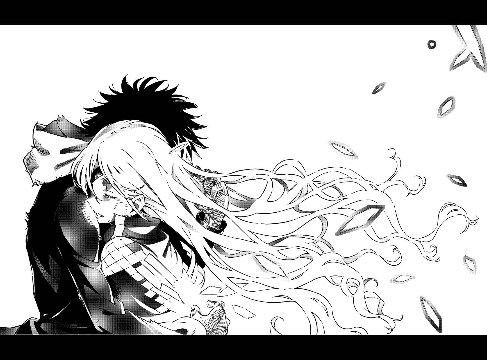

# 第二十章 V.S.「？？？」

> Round_12 (secret).

## 1

……实际上，看见这个景象的不止上条当麻与全能之神托尔。

&nbsp;

好比说，连一声都没叫过的黑猫在雪中盯着。

好比说，三万米高处，美国的无人侦察机以摄像头对着。

好比说，天野郭夜在更上方的卫星轨道上头轻轻地笑着。

&nbsp;

从头到脚套着全白伪装服趴在雪地上的英格丽·马汀中士，专注在碗状收音麦克风所接收到的情报上。

听着「他们」的对话。

在这个状况下，英格丽中士通过无线电请示。

「……您认为如何？」

『我也听到啦。混账，居然在最后的最后演变成这样啊。』

想必无线电另一边的总统对当前状况没有正确认知。这点英格丽中士也一样。那个眼罩少女背后冒出来的东西是什么？有人能回答这个单纯疑问吗？

『今后能继续接收他们对话的内容吗？』

「虽然杂音从刚才起变得越来越强，但还是可以。」

『这要求对于负责境外作战的你们来说，或许很过分……』

总统先稍作停顿，这才接着说下去。

『……我想解除影像的机密。我想将身在那里的他们就这样传播给全世界，问世界能否原谅他们。能帮忙吗？』

听到这句话，英格丽中士不由得做出无谓的动作——将手抵在额头上。以总统的说法看来，这可不是要她外行地将影像传到视频网站。而是总统本人要以演说形式向世界提问，就某种意味来说，他会站得比当事者们更前面——他是这个意思。

「请容我冒犯，这样必定会影响您的支持率哦。更何况，那两人根本没有美国籍。」

知道这是白费工夫的英格丽中士说道。

回答一如预期，而且是立刻传来。

『**那又怎么样**？』

尽管中士眼前一黑，但再怎么无谋的命令依旧是命令。打从他成为总统以来，让人心存芥蒂的工作就变少了。中士判断，就当成回报这份恩情也好。

就在这时。

「啊——！美国人好像马上就决定了，身为俄罗斯代表的少爷到底什么时候才要表现一下啊？姐姐我已经差不多要受不了喽！」

英格丽中士后方三米处突然有某处隆起并传出喊声。她吃惊地拔出手枪，随即看见穿着鲜红修道服的修女——身上装扮让人怀疑她究竟是怎么躲在一片白的雪原上的。

修女身旁有个衣着至不是修道服而像拘束衣的少女，口中在嘀咕些什么。

「……问个问题，你有宗教信仰吗？」

「你在说什么啊莎夏。出现在宗教图画里的人基本上都是俊男美女对吧？所谓的正义总是存在于美丽的事物中哦。」

这时，附近又有另一处的雪隆起。

服装近似袋棍球衣，迷你裙里还伸出尾巴状物体的少女，一边单手拨掉头上积雪一边开口说道：

「嗯、嗯，好好好，我是大家最可爱的蕾莎哟！话说回来啊！刚刚有人放出黑猫了吧！既然这样就用不着我了吧？我也想窝在暖桌里吃柑橘吃奶酪锅！当然要穿少一点！」

脑袋终于一团混乱的英格丽中士放弃任务大喊：

「怎、怎么回事？你们什么时候接近的？」

「哦，这个看起来像失败在地吉祥物布偶装的玩意儿是什么啊？只不过是因为这里最适合监视而已啦。真要说起来，你才是后到的人呢。」

「……？？？？」

小恶魔与鲜红修道服都摆出一副理所当然的表情。英格丽中士虽然因为职业而遇过许多国家的特务部队，但她们和先前遇过的全都不一样。

小恶魔无动于衷地和某处联络。

「是是是。所以呢？英国呢？哎呀那当然喽，法国似乎也倾向撤退了，这时候单一国家坚持战斗也不好看嘛。那就麻烦跟女王讲一声喽。像我这样的法外分子直接说会引起不少问题嘛。」

## 2

纽约，联合国总部大厦。

美国总统罗伯特·卡崔从会议室的椅子上站起身，这么说道：

「所以说呢，我接下来要开紧急记者会。你们打算怎样？」

听到他这么说，英国女王(Queen Regnant)伊莉莎一脸嫌烦的表情摆摆手。

「一般大众就交给爱抛头露面的人啦。我会通知内部……特别是这回，我那个冲动的军武狂女儿去现场了嘛。而且听说移动要塞被打下来，最累的大概就是安抚她了。」

「奇怪？不继续坚持『杀掉杀掉』了吗？」

「……请别再调侃人家了。」

担任俄罗斯成教总大主教的少年重重叹了口气。

「我这边会重点性地通知『美国声音难以传到的地方』。」

「既然如此，我也略尽绵薄之力吧。」

罗马教皇跟着说道。

剩下法国。脸色依然不健康的「倾国之女」，在众人的注目下耸了耸肩。

脸上略带得意神色的她说道：

「……我们法国从一开始就没派出任何人，所以没有慌张的必要。」

「聪明的家伙变得爱躲起来，也是这个世界的问题之一吧。」

伊莉莎轻蔑地说完，随即发生了些拉扯。

## 3

……在远离世界战争的温暖客厅里，电视中的某人朝观众喊话。

『今天是个试炼的日子。为了尽快安心，我想应该有很多人盯着电视或网络。在这里，我想问你们一些问题。』

&nbsp;

……出现在车站前巨大屏幕上的总统，平静地这么说道：

『率领「格雷姆林」的欧提努斯邪恶吗？应该没人对这个问题的答案存疑吧。她是个无药可救的坏蛋。东京都心、东欧巴格吉城，以及我国的夏威夷群岛。想必光是看见这些伤痕，就会立刻明白她是个怎样的人。』

&nbsp;

……家电量贩店的大量电视机前，往来人群暂时驻足。

『那么，欧提努斯真的无药可救吗？』

&nbsp;

……在佛罗里达州的空军基地，年轻士兵们排成一列聆听这场演说。

『牵扯进这些事件，目睹了这些伤痕的人们，或许会强烈要求惩罚她。我认为这种情感也没有错。但是，一个人若已经真正悔改，并且想用这条生命帮助他人，却还坚持要她坐上电椅，这样对吗？我不懂困难的善恶论。虽然我就任总统时曾将手放在圣经上宣誓，但我毕竟既不是神职人员，也不是专攻神学的知识分子。所以，今天我想请教各位。』

&nbsp;

……在某个远方的国家，伪装身份行动的情报员装出一无所知的表情，聆听从电视机另一边传来的声音。

『借着成就严苛复仇而得救的心灵，想必存在；借着在众多苦难尽头再给她一次机会而得救的心灵，想必也存在。』

&nbsp;

……通过卫星电视或视频共享网站，许多人专注地盯着液晶屏幕。

『好啦，你怎么想？』

&nbsp;

&nbsp;

……担任俄罗斯成教最大主教的少年，在众多摄像头前这么开口：

『欧提努斯确实犯下了重罪。然而，只用一句「无可挽回」评断，真的合乎我们的信仰吗？希望大家再次思考一下这点。』

&nbsp;

……有上班族以客机座位上的小型电视收看这一幕。

『使徒里头，也有些人曾咒骂神之子。对于忏悔自己过错的人，神之子给予宽恕。神在考验我们。看我们是委身于软弱的憎恨，还是具备宽恕的坚强。』

&nbsp;

……有年轻人停下车，看着导航系统的画面。

『希望大家抛开先入为主的观念，用毫无遮蔽的眼睛再看一次。看看画面另一边流泪的少女。她主动放弃沉默也能得救的可能性，不惜粉身碎骨也要接受更重的惩罚，想要以自己罪过拯救一名少年。』

&nbsp;

……有老人在豪华邮轮上，无视窗口外美景而盯着电视。

『如果这样有罪，那么轻易选择自杀的罪不是更重吗？我们的教诲，并没有宽容到去肯定自杀。该让她活着赎罪。我希望她能赎罪而后得救。我想让众多误入歧途的人，借由看见连欧提努斯都还有得救的机会而重获光明。』

&nbsp;

&nbsp;

……在东京市中心，一名挥着双手向往来直升机求助的年轻人，听到手机单频广播中罗马教皇的声音。

『我认为解决的方法很多。既然如此，从里头选一个就好。』

&nbsp;

……在东欧巴格吉城遗迹用重型机械清除瓦砾的中年作业员，听到收音机传来的声音。

『是要守望由欧提努斯这个恶心中萌生的善心呢？还是将它连同恶心一并碾平呢？应该只要摸摸自己的胸口，倾听真实的声音就会明白。真正能让人毫无芥蒂的做法，究竟是哪一种？』

&nbsp;

……丹麦雪原上，以头和肩膀夹住狙击枪，并以热咖啡温暖双手的士兵们，在倾听广播的同时仰望白色天空。

『我认为，名为欧提努斯的存在，也是一面反映我等内心的镜子。委身于能够正当化的愤怒很简单，甚至可以因此感到开心。但是沉溺于愤怒者啊，了解自己的真相吧。这么做与暴力无异，镜中所映正是我等的真面目。』

&nbsp;

&nbsp;

……持续以一敌三拦住英国怪物们的神裂火织，一边吐着带血唾沫一边聆听英国女王(Queen Regnant)伊莉莎的声音。

『在此之前，我们只考虑过杀掉欧提努斯这个选项。某位少年指出了截然不同的道路。我想以国家元首的身份，向这个结果致敬。这绝对不是什么康庄大道。因为他克服了苦恼、疑心、恐惧、憎恨等种种情绪，才得出我们从未想过的解答。』

&nbsp;

……只差一步就能突破天草式「圣人」的第二公主凯莉莎，在听到这个声音后咂了咂嘴。

『我们输了。既不是输给魔神的力量，也不是输给那位少年的勇气。请大家承认吧，我们是输给自己产生的恐惧。在这个混乱而火热的世界中，我们遭到「杀为上策」这个念头附身。而既然承认了，就该负起输家的责任。』

&nbsp;

……因为快跟不上表情杀气腾腾的两位女性而难过的「骑士团长(Knight Leader)」，总算放下心来。

『屠龙者很伟大。但英雄救不了恶龙。那位少年所成就的正是这种事。事到如今才急忙带刀赶到的英雄，在这个局面从旁抢走恶龙，这样真的是善行吗？我不这么认为。大家觉得呢？』

&nbsp;

……即使在这种时候，威廉·奥威尔依然眉头也不动一下。

『若已得出答案，就请祈祷。祈祷那位少年在得出连英雄也做不到的答案后，让大家见识我们所无法想象的光景。』

&nbsp;

&nbsp;

……云川鞠亚通过病房的电视机聆听总统演说。

名为木原加群的修罗已然离去。当在东京二十三区逞凶的「格雷姆林」如鸟兽散一般结束骚动的同时，他也停止了动作。

『对于名为欧提努斯的恶，是杀？还是宽恕？』

&nbsp;

……一名孕妇在床上安稳地沉睡。

丰饶神芙蕾雅。「他」直到最后的最后依然试图守护的人类之一。男子的遗志，则由鞠亚继承。

『今天，我想在这里……』

&nbsp;

……接着，最后。

美国总统罗伯特·卡崔在电视中这么下结语。

『……和你们一起考验人类的坚强。』

## 4

叽叽叽叽叽叽叽叽叽叽叽叽叽叽叽叽叽叽叽叽叽叽叽叽叽叽叽叽叽叽叽叽叽叽叽叽叽叽叽叽叽叽叽叽叽叽叽叽叽叽叽叽叽叽叽叽叽叽叽叽叽叽叽叽叽叽叽叽叽叽叽。

世界发出声响。

十发「弩」正在蓄积庞大的力量。

名为魔神欧提努斯的少女，选择拒绝上条当麻(救赎)。

不惜以死交换。

「托尔，趴下。」

上条已不再胆怯。

他将拳头紧握，如岩般坚硬，头也不回地说道：

「如果中了连行星都会炸烂。想必连你也活不下来。」

少年往前一步，踏在雪中。

只要有这一步就行了。双脚不会停下。他行走，他奔跑，他全力在雪上狂奔。

奔向欧提努斯。

奔向那名给予自己超出极限的负荷，随时都会粉身碎骨的少女。

「欧提努斯！」

眼罩少女用仅剩的眼睛盯着上条。

那只「眼睛」并未回到她的眼窝中。此时此刻，侵蚀少女的裂痕仍在扩大。就算要处理「眼睛」的问题，也得先阻止那个「弩」。失去「枪」后，欧提努斯的魔神之力是以胸口的伤——「妖精化」为起点。

欧雷尔斯开发的反魔神王牌。

但只要是魔法，应该就能用上条的右手破坏！

「……」

相对地，少女则是轻轻将她纤细的手往前伸。

食指指向少年。

瞄准完毕。

于是现象产生。

&nbsp;

十发破坏同时来袭。

&nbsp;

对于上条当麻这名少年来说，这是一堵绝对的高墙。这是死亡本身。这是不折不扣曾经完美地杀害过他的东西。正如各种生物都无法对抗自己的寿命一样，涌向上条当麻的重火力就是他的终点。

（怎么能输……）

但他并未别开眼睛。而是正面冲向前去。

这次务必闯过难关。

他已下定决心。

（都到了这个地步，哪还有任何放弃的理由啊！）

轰————！声音迟了一步响起。

凝聚了各种破坏的闪光，从上条身边划过。他的运动能力无法回避。这是为了限制路径所放出的弃子。即使在无限地狱的尽头，杀害上条的也是最后一发。

他明白。

明白，依旧奔跑。

接着又是数发「箭矢」划过。它们全都是为了缩减上条当麻的行动幅度。自由缩小。死亡接近。即使如此，上条依然全力奔跑。每当一发发「箭矢」射出，欧提努斯肌肤上的裂痕就会爆炸性地扩张。无论如何都不能容许事情发生。所以奔跑。就算得强行压下恐惧，也要尽快冲进欧提努斯怀里。

在紧邻死亡的地狱中，上条当麻和少女对上了眼。

她脸上有着微微笑意。

就跟在「船之墓场(Sargasso)」默默承受茵蒂克丝与美琴等人的攻击时一样。仿佛在说事物已经回到该回去的地方一样。

（……不是这样。）

欧提努斯的破损持续扩展。

她的身体正无法挽回地毁坏。

「开什么玩笑！让我复活，将一切恢复原状并确实拯救了我的你！如今已经明白渺小幸福的你！不可能以为这种错误的自我牺牲真的是正确答案吧！」

抗拒神的回答。

成为抗拒代价而造访的死亡，以明确形式正面来袭。

（……啊……）

事到如今已无法回避。

在事前洒出的「箭矢」引导下，上条的自由度已降到极限。这里虽然是无比辽阔的大地，体感上却和笔直的细长隧道没两样。而在隧道前方，淹没一切的一击来势汹汹。

无法回避的死亡。

面对它时，上条突然想到之前自己死亡的瞬间。

（这么说来，「那个时候」没用这一招呢。）

他握紧右拳。

无法躲避，那么能做的事只有一件。

&nbsp;

上条的拳头与魔神的「箭矢」，正面冲突。

&nbsp;

在冲击的瞬间，上条就明白自己失败了。

诡异的声响透过手臂传来。就连幻想杀手(Imagine Breaker)也无法让死亡完全消灭。他知道自己正逐渐遭到压制。

（骨折也好，碎裂也罢，烂掉也一样！只要没被扯下来，让这只手能够打消刺在她胸口的光桩！）

他将化为剧痛漩涡的右臂往上一甩。

随着犹如绷到极限的橡胶断裂似的声音，「箭矢」的轨道往上偏了一些。上条当麻则从它的下方通过。

少女惊讶的面容出现在眼前。

「是我赢了！欧提努斯！！！」

他冲进怀里，但没有握拳。少年移动染成暗红色的手臂。他并未正面挥拳殴打，而是就这样用双手搂住娇躯。

那只手在背后摸索。

然后用手掌触碰贯穿胸口正中央的光桩。

将最后的力量凝聚在五根手指上。

「啊啊啊啊啊啊啊啊啊啊啊啊啊啊啊啊啊啊啊啊啊啊啊啊啊啊啊啊啊啊啊啊啊啊啊啊啊啊啊啊啊啊啊啊啊啊啊啊啊啊啊啊啊啊啊啊啊啊啊啊啊啊啊啊啊啊啊啊啊啊啊啊啊啊啊啊啊啊啊！」

就这样，从背后将光桩拔了出来。

「我不会……再让你逃了。」

上条当麻在她耳边呢喃。

尽管已经遍体鳞伤，少年依旧用力收拢五指。

于是，光桩就此粉碎。

「我承诺过了吧……就算要和世上的一切战斗，我也会帮助你……」

「是啊……」

少年怀里，让他搂着的欧提努斯眯起眼睛。

看起来十分幸福。

真的，看起来十分幸福。

「不过，没关系……」

「啪」一声响起。

声音很小。

「我啊……」

但没有消失。没有中断。金发眼带少女听着体内响个不停的破冰般细声，笑着这么说道：

&nbsp;

「早在听到你这句话时，就已经得救喽。」

&nbsp;

有光。

是光的粒子。

当上条终于发现不对劲时，怀里的少女触感已经消失。少女娇弱的身躯崩毁了。而少年无法理解。少女崩毁的身躯比雪更虚幻，在落地前就已哗啦啦地化为光的粒子，随风而逝。

还差一步。

就那么一步。

错过时机的上条当麻，觉得自己似乎听到了应该已经消失的少女的声音。

&nbsp;

谢谢。

&nbsp;

这究竟确实存在？还是单纯幻听？他无暇确认。

到达极限的上条当麻绷断了某根细线，就这么倒在雪中。
