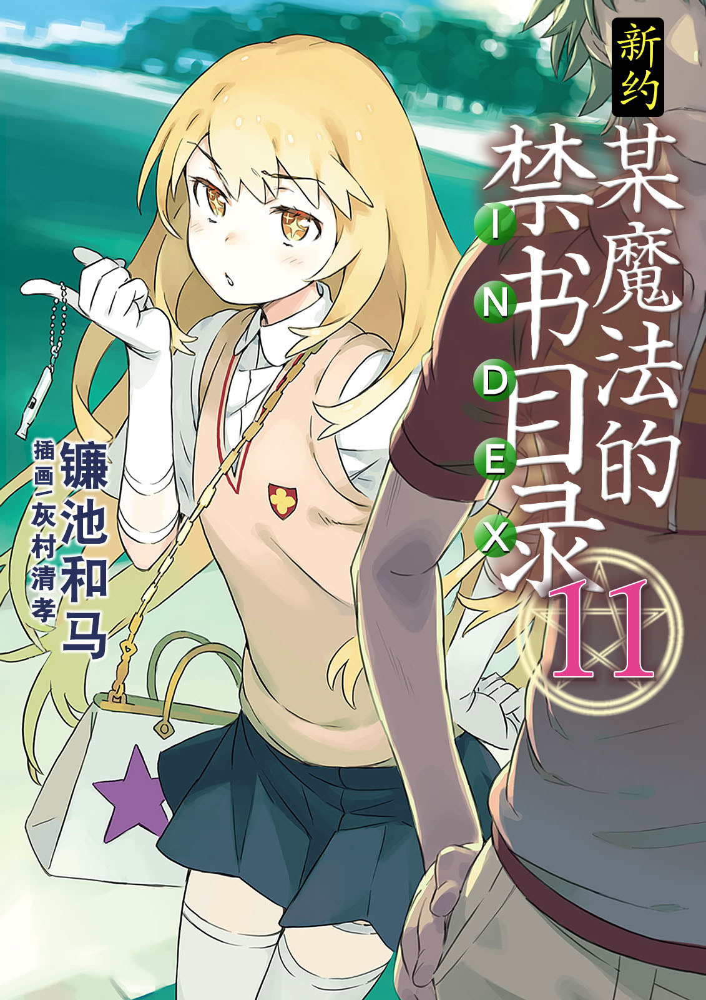
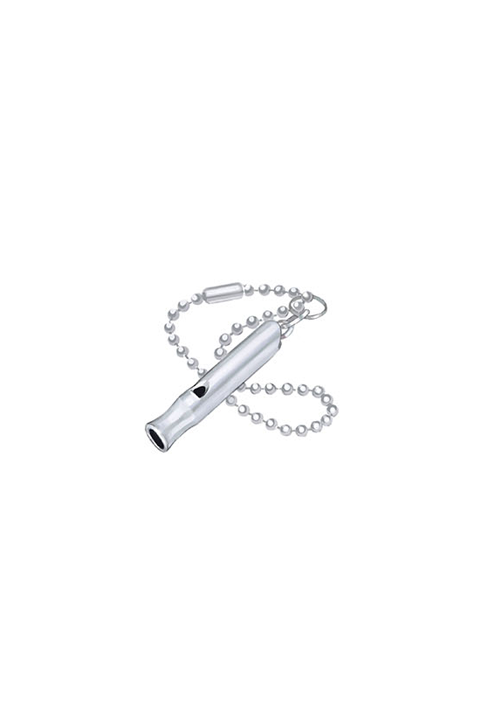

# 简介

**新约·魔法禁书目录11**

作者：镰池和马

## 内容简介

**期待已久的最新刊中，新女主角食蜂操祈登场！**

「说起来，我第一次遇到『那个人』也是在那个交叉口吧。」

食蜂操祈第一次与上条当麻相遇，是在掌握许多魔道书的白色修女从魔法世界逃出，从天而降之前的，很久以前的故事。

至今，食蜂操祈仍然记得与那个刺猬头少年之间的回忆。

最开始，她以为是新人搭讪。

期间，被看到了泳装。

期间，用挎包打了他的头。

期间，体验了间接接吻。

最后——

被拯救了生命。

那是她人生中数一数二的「幸福时光」。精神系最强能力者「心理掌握(Mental Out)」的重要「记忆」。

揭开食蜂操祈过去的故事，现在开始。

## 制作信息

* 翻译：Seeker
* 台版：天使动漫
* 扫图：真妹控
* 图源：真妹控
* 录入：污驴
* 校对：暗灭
* EPUB制作：鹘鹰⚡
* 网翻：贴吧汉化组
* 组织：星之翔
* 图源：ALUCARD、月の姬、Edster792
* 友情协助：フムロ
* 翻译：月の姬 神笑琉璃 JOJO扬 不漆黑的子弹 Edster792 Tom930601 Joyfulxp
* 日文校对：绯月 月の姬
* 中文润色：琦幻吉他
* 中文校对润色与最终审核：黄昏的鸡蛋黄 月の姬
* EPUB制作：只爱挖宝
* 整合：知一一（禁书目录X系列，[index-X](https://github.com/1204244136/index-X)）


**版权声明**

转载时请保留录入信息。

本站内容仅供试看、学习与交流使用，禁止用于商业用途；下载后请在24小时内删除。请支持官方正版。


## 封面与封底

