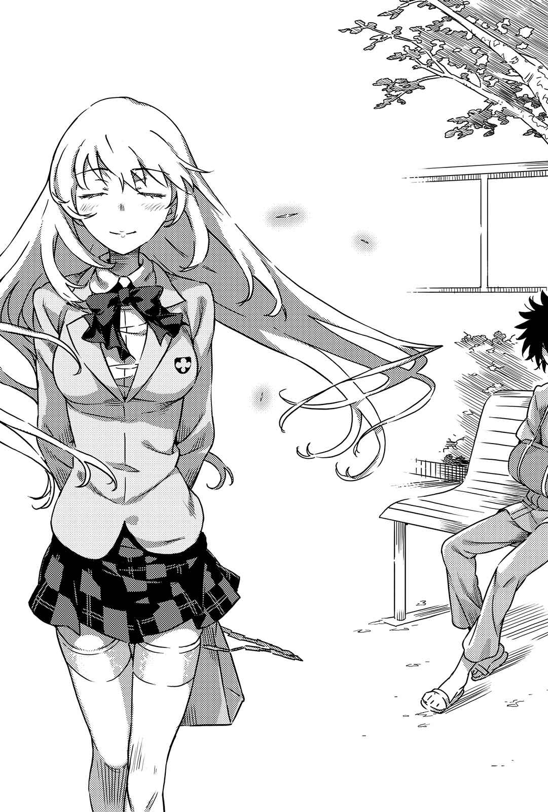

# 终章 某个出口

> No.05_Closed（and_Next_Door）.

「唉。所以说，当麻明明既不是医生也不是相关人员，却擅自拆掉石膏这么乱来，现在才会这么痛苦对吧。除了自作自受以外，我看不出还有什么能形容的词。」

「你这人怎么这么冷淡啊！」

「……喂，不要随便搭理他。这家伙是个感冒时周围对他温柔一点就会食髓知味的人，必须在养成不良习惯前进行矫正。说简单一点就是别管他。」

「欧提努斯怎么更冷酷——！」

「我已经忍不住了，咬下去没问题吧？」

「你该不会是因为我变成十五厘米高就瞧不起我吧？要不要我告诉你把这对手脚伸到眼睛或耳朵里会有多惨？」

「住手慢着尤其是欧提努斯先等一下你变成拷问风格了啦！」

&nbsp;

&nbsp;

风暴般的骚动过后，像个疲惫老人般不停颤抖的上条当麻，逃到医院中庭避难。即使沐浴在阳光下，十一月底的中庭依旧相当寒冷，不过这里似乎并未失去休憩场所的功能，到处都看得见人影。

上条挑了张长椅歇息，重重地叹了口气。

某人缓缓在他身旁坐下。

「好久不见☆」

「……？」

听到蜂蜜色长发及腰的少女这么说，上条皱起眉头。应该说，太近了。压倒性地近。他不由得畏畏缩缩地保持距离，并且这么问道：

「**话说回来**，**你是谁啊**？」

「啊哈哈，没事没事，毕竟这是正常力。你注定总是会马上把我忘掉哦。」

「嗯？这件制服和御坂一样是常盘台的吧……欸，你真的是初中生……？」

「哼哼，你要仔细验证也没关系哟～？毕竟那里已经成长为让我自豪的优点了嘛。」

面对少年没礼貌的目光，少女不知为何伸手拨了拨肩上的发丝并无意义地挺胸。这么做究竟有何意图，上条完全猜不出来。

不过——

「……嗯～我们是不是在哪里见过啊？」

「——」

「不，该怎么说呢，或许你讨厌这种话题，不过……该怎么说呢，头发的气味……？那种很像蜂蜜的气味，我总觉得有点印象就是了……」

「啊哈哈……唉。怎么说呢，实在太奸诈了。因为可能性明明是零，却还像这样让人有所期待。」

「啊？」

「没什么。会不会有熟人用同个牌子的香水或洗发水呀？」

是吗……？少女没执着于上条的疑惑反应，径自把话题往下带。

「关于蜜蚁爱愉，你有没有什么想问的呀？」

「……蜜蚁……啊，昨天那家伙吗？可是为什么你会知道这种事……？」

「唉。记得自己的敌人，却忘记自己救了谁，还真是不可思议的认知力呢。」

少女无语般地嘀咕。

「关于FIVE_Over与Out_Sider呢，实验机已经彻底破坏完毕。设计数据则是接下来才要**善后**。换句话说，总之已经避开了『心理掌握(Mental Out)』量产后散布到全世界的危险。放心吧☆」

「Mental、Out……对对对，就是这个。跟那个家伙有关！不过……欸，那家伙具体来说是个怎样的人啊……？」

「所以说，既然不知道就别在意啦。至于关键的蜜蚁爱愉呢，她表面上是被少年法庭判处『关禁闭』而送往少年院，实际上天知道。然而，她又是无视组织意向擅自大闹，又是**偷吃**了好几个单位储备战力，所以可能会有不少地方派刺客报复。和她重新成为暗部相比，这方面反而更令人担心，可能有必要观察经过吧？不过嘛，这些事就交给我处理。你不必担心。」

是这样吗？上条轻声咕哝。

看见他的反应淡薄后，不知为何拉近距离的少女显得不太高兴。

「这么说来～」

「怎样？」

「昨天晚上，你为什么突然出现在人工湖那里？」

「哦。」

上条抬起头，仰望顶上的蓝天。

「因为**学姐**这么说……『今天是那家伙的生日，偶尔也带朵花去吊唁一下如何』。到头来，我还是不知道她在讲什么。只觉得走到山顶或许会看见什么东西就是了。」

「这样啊。」

不知为何，少女的眼神变得十分温柔。

就像揭穿了戏法机关后，观众依旧向舞台鼓掌那般，相当不可思议。

「……所以，你到底是谁啊？」

「每次都被忘记，让我已经连报上姓名的力气都没有了呢。」

反正……她轻声嘀咕。

上条才刚听到这几个字，少女的脸就突然贴了上来。

就这样，少年额前感受到了嘴唇的柔软触感。

「这……你、你在做什……！」

「啊哈哈。没关系没关系，你还是会立刻忘记的。」

蜂蜜色头发的少女，露出淘气却又带了些寂寞的笑容，同时站起身来。

她没有回头，背对着上条这么表示：

「以前你拯救过的女孩子之一。只要这么想就可以喽☆」

&nbsp;

&nbsp;

食蜂操祈与上条当麻共度的那段过去，其实后面还有一点。

少年集团「死结」，祭出动用无数车轮与喷射引擎产生压倒性速度的「篡夺之枪(Queen Diver)」袭击而来。在他们说出「抛下食蜂就放过你」这个提案后，当然，被迫一边保护少女一边战斗的上条当麻，不可能毫发无伤地结束一切。

食蜂也使用遥控器应战。

她又是营造让对方自相残杀的状况，又是扭曲认知让人朝错误方向突击。尽管「死结」同时从四面八方冲来，她依旧确实地减少了敌人数量。

但是，这样还不够。

而她无法迎击的部分，就由上条当麻以身体强行挡下。

想忘也难。

讨厌的铁锈味始终挥之不去，当时的情景食蜂至今还记忆犹新。

当一切结束，救护车警铃大作的时候，早就见惯的少年手脚，却以前所未有的诡异状态不停痉挛。

「退后！该死，出现休克症状了。总之交给我们处理！」

听救护队员急切的声音便能猜到，这个状况连见惯流血的他们看来都很危急。

『燃料槽破裂时的尖锐碎片刺进了腹部。光是这个伤就必须尽快处理才行……！』

『我知道！但现在根本没办法。他的身体因为休克而痉挛，在这种状态下处理反而会让伤害扩大！』

『没办法等到送医院！不能靠麻醉力之类的解决吗？』

『休克症状来自血压过低，要是麻醉会让血压继续下降，有可能为了应付休克症状反而送掉他的命！不能用这种危险的方法！』

『……』

救护队员以无线电联络能运送伤员过去的医院，但状况好像不太乐观。看样子上条成了踢皮球的对象。

这样下去会来不及。

他会死。

食蜂咬紧牙关，这么提议：

『如果有不用麻醉就可以止痛的方法，能够现场急救吗？』

『你在说什……』

『我是「心理掌握(Mental Out)」，拥有判定为超能力(Level 5)的精神系能力。如果使用这种能力，要阻断痛觉应该还做得到。这么一来可以避免血压继续降低，却能和麻醉过后一样处理伤口。』

救护队员稍微犹豫了一下。

这种守则上没有的「急救」等于拿伤员的命赌博。为此或许会拖累民间人士，而且这个民间人士还是个孩子。各式各样的问题大概在他脑中转个不停吧。

但是，最后这名队员把一直等不到回应的无线电对讲机挂上，这么说道：

『动手吧。既然有可能就该试一试。』

……这个时候，食蜂操祈其实有件事没告诉救护队员。

她的能力是借由操纵脑部水分控制人心。在血压极低，也就是水分平衡崩溃的状况下，不见得能完全发挥效果。

事后，某位医生这么表示：

『这与其说是记忆破损，不如说比较接近「唤醒记忆的路径破损」吧？即使和这名少年聊起你的事，他也想不起来。就像收纳长相与名字的部分只有你那一格遭到物理性破坏。想来就算以你的能力也束手无策吧？』

但在这个时候，食蜂操祈根本没想过会这样。

他究竟救不救得活。

少女认为没有别的东西能放上天秤比较，所以采取了行动。

『如果。』

不知在何时何处，少女这么说道。

在每一次每一次都会被忘记的状况下，详细的顺序或许毫无意义。

『如果，就算是这样，你还是能颠覆大人的预期，在某一天变得能想起我的事，回忆起我这个人——』

所以，时序根本无关紧要。

那或许是过去，或许是未来。

总而言之，食蜂操祈这么告诉他：

&nbsp;

『到时候，我们再聊些珍贵的话题吧？聊一些非常非常甜蜜又温柔的珍贵话题。』

&nbsp;

她很清楚，这种愿望根本无法实现。

只是牢牢抱着早已结束的故事不肯放手而已。

不过。

即使如此。

直到现在，少女依旧一个人待在最近的世界尽头，等待微小的奇迹。

这头黄金猎犬不怎么喜欢在夜晚散步。

黑暗的颜色，会产生杂念。一个用来放松身心的环境，实在不该离工作地点太近。他和其他「木原」不一样，不是那种无法将兴趣和工作区隔开来的工作狂。

他要前往的地方，是有名的不夜城——第十五学区。

在旁人眼中，或许像是穿着套装配白袍的女性带着一条没有狗链的狗散步，但实际的关系可以说正好相反。

「老师，已经准备好了。」

『嗯。』

他们停下脚步。

眼前是为数众多的玻璃高楼之一。人称「天体水球(Celestaquarium)」的巨大水族馆。话虽如此，但是和「出于学术兴趣观察水生动物」相较，这里更常被年轻男女当成炒热气氛用的地点。

这里是黄金猎犬的工作场所。

当然，是在冠上「木原」名号的情况下。

「脑干老师。」

听到声音后，猎犬回过头去。木原唯一就像个教导有方的女仆一般，态度恭敬地并拢双脚，双手在肚脐下轻轻叠合，以正确的角度低下头。她仿佛要目送大狗上战场似的，毅然说道：

「请多小心。」

『嗯……你在稍远一点的地方待命。这回似乎会有点激烈。』

黄金猎犬和年轻女子分别，孤身潜入大厦之中。途中的电子锁与警报装置等等，并未对他发挥任何效果。

他漫步向前。馆内的照明都已关闭，气氛比夜晚的医院还要诡谲。

猎犬在一般来客绝对找不到的位置搭上电梯，接着两脚直立，用前脚按下按钮。

面对「预期会在屋内爆发战斗的状况」，一般来说绝对不会使用电梯。毕竟有可能被关在里头，或是连人带电梯往下掉。之所以无视这种可能性，想必也是因为黄金猎犬对这栋高楼大厦动了「某种手脚」吧。

电梯门随着柔和的电子音朝左右开启。

顶楼。

眼前是一片蓝色世界。不止甜甜圈状的巨大水槽，就连头上都是透明玻璃与大量海水。城市的夜景和月亮的光芒，与晃荡的水面相碰，形成绝妙的光影艺术。这里是个质量保证的优良约会地点，甚至被某些三流时尚杂志揶揄为「比春药更有效果」。

『这么晚来打扰，实在是非常抱歉。』

黄金猎犬走向楼层中央。

尽管他的体型以狗来说算得上相当大，相较于水生动物依然显得渺小。和他隔着厚重强化玻璃对峙的，则是一条全长超过五米的巨大虎鲸。

没有天敌的海之王。

黄金猎犬面对以黑白巨躯在水中戏耍的「他」，郑重其事地这么开口。

『以为佯装成动物就能敷衍过去？自称木原者之一出现在阁下面前，光是这样还不够让阁下明白事态有多严重吗？』

沉默持续了数秒。

终于，「他」明确看向黄金猎犬。

馆内的扩音器仿佛与凶猛海王的嘴巴相呼应，发出了壮年男子的低沉声音。

&nbsp;

『哎呀呀，本来还以为这招行得通，没想到已经被逮到啦？』

&nbsp;

大狗与虎鲸的对话。

光听这样，或许会以为场面和图画书差不多，但两者之间的气氛显然和童书相差甚远。

这个城市的暗部。

两名暗部的代表对峙，让现场弥漫一股不祥的气息。

冠上木原之名的黄金猎犬这么问道：

『到达现在的脑之前，你牺牲了多少生命？』

『这个嘛，很多很多。象和鲸鱼不行。虽然脑的容积、容量远远超越人类，但实在很难让「我」稳定下来。但猩猩和狒狒又太无趣了。它们虽说有智慧，但真要说起来比较接近构造劣化的版本。不过，会抵达虎鲸这个结果，除了单纯的解剖学以外，也是出于「我」的兴趣。果然不在乎外表就算不上人类了呢。』

……人类与其他动物之间最大的差距，就是脑部构造。

就算不熟悉解剖学与动物学，甚至只是个小孩，应该还是能体会这种感觉。或许，也可以说想不到别的能胜过其他动物的部位。

但是，你不觉得奇妙吗？

人类的脑，和其他物种相比究竟优秀在哪里？如果单以解剖的结果比较，象脑和人脑比起来可说是压倒性地大。毕竟它们的身体就比较大，这也是理所当然。即使将人脑的皱折全部摊开大幅增加体积，依旧远远比不上象脑。

尽管如此，人类的头脑仍然远远凌驾在象之上。

不管是其他哪一种动物，都没有人类这样的智商与情绪。为什么？因为其他动物少了人类所具备的「某种东西」。

那么，如果将不足处补齐了呢？

具体来说，如果将人脑分解，把「人类之所以是人类的最低限部位」接上动物的脑，并且让电子信号成功往来呢？

如前所述，如果单论容积、容量，那么凌驾人类的动物比比皆是。

如果将这些脑和「让人类变得特别的东西」接在一起，那么会不会突变产生超越人类的怪物呢？

换言之，这正是——

『蠢动俊三。你代表那群一方面追捕「死结」，一方面又从其他窗口提供「篡夺之枪(Queen Diver)」，不惜牺牲食蜂操祈也要抢夺「心理掌握(Mental Out)」的大人们。你是无视「我等」意向者之一……本来应该和其他人一样，早就被炸死了才对。居然在这种地方集结脑的碎片化为怪物，这倒是让人有点吃惊呢。』

『哈哈，和以人脑为基底的「我」相比，纯粹靠扩张狗脑而获得高度智慧的你，应该更像怪物吧。我可不记得有什么狗的预期寿命长达八十年哦，狗大人。』

『这次的案件，光靠那只武士蚁实在不可能做到。你背底里动手脚，在连蚁本人都没注意到的情况下提供了协助对吧？』

『所以说！我问你知道这些事又能怎么样，小狗狗。』

『……看样子，你似乎不知道我在「木原」里头担任什么角色呢。』

『专门向饲主摇尾巴的杀手也敢放肆。』

惊人的「咻咻！」声音炸裂。

类似气流喷射的巨响来源，从位置呈现十字形的四个出入口滚了进来——是直径约有两米的巨大球体群。围绕顶楼的三十二个深孔喷出强烈的气体，让一吨以上的超重量得以轻飘飘地浮在空中。

这些大质量物体，转眼间就已围住了大狗。

『这叫「钢之臼齿(Molar Tooth)」。不过呢，想成随意挥舞拆房子用的铁球就好。它们能当单纯的质量兵器，也能当抵挡枪弹的盾，更重要的是有心理压迫的效果。我把它们用在很多地方，相当看重它们啦。』

『……』

『全部共有三十颗。好啦，来杀「我」的小狗狗能做什么？嗯？不然要自暴自弃地撞破水槽也无妨哦。如果这么做，「我」就展现身为海之王的力量给你看。』

『……』

『怎么，吓得连话都说不出来啦？还是说你在期待援军？虽然被你害得非抛弃这个身体不可，但只要换个脑乘载就好。只要杀了你，学园都市应该就没人能抓到「我」了。所以，你就为了「我」去死吧。』

『……这下子可要大赤字了吧。选择武装时还多少怀着些期待，结果弄巧成拙了吗？』

黄金猎犬稍微眯起眼睛。

仅此而已。

&nbsp;

轰————！

紧接着，覆盖整个楼层的巨大水槽碎裂四散。

&nbsp;

『什么……？』

海之王会惊讶并非单纯因为玻璃破裂。从设施储存的水量看来，就算打破玻璃，整个楼层也只会变成巨大泳池。只要挪动虎鲸的身体扑向狗的身体，应该就能一击杀掉对方。

但是不够。

海水不够。

蠢动俊三就像被浪打上陆地的鱼一样，转眼间变得无法动弹。

『外墙上有洞……？』

当场傻住的他，通过扩音器泄出这句话。

海水之所以少得可怜，是因为流向外面。

『难道你……从外头朝这栋大楼的外墙开炮……！』

虎鲸的大喊戛然而止。

咚！磅！多股冲击跟着来袭。回过神时，黄金猎犬周边已经出现了好几个巨大集装箱。这些集装箱就像要画展开图一般，啪嗒啪嗒地开启。转眼之间，大量的机械、手臂、兵器、弹药、装甲围住了大狗。

与其说装备这些武器，不如说化为了一座要塞。

随着吹风机般的声音响起，兵器山从地板上浮起数厘米。

这座东西多过了头的武装山，根本连能称之为机器人的轮廓都没有。只为了开火，只为了杀敌。这个实在太过凶恶的概念，威风凛凛地直指虎鲸。

除此之外，那些叫做「钢之臼齿(Molar Tooth)」的刺客，全都在集装箱飞来时被压烂了——连坦克炮都能弹开、格挡的厚重球状盾，全数完蛋。

搁浅的海之王喘息似的说道：

『这到底怎么回事……！』

『合体是男人的浪漫。学学何谓感性吧，年轻人。』

枪、炮、剑、长枪，就连导弹、激光、火焰喷射器、液态氮喷雾器、分子高振动电磁波照射器都有。黄金猎犬操纵这些兵器之外的小机械臂，叼着雪茄说道。

没错。

在这么庞大的水流中，他成功替烟草点上了火。

『不是那个！为什么只有在你的周围，水流就像切出了一块圆形区域似的避开！』

『哦，这个啊？』

大狗从口中吐出犹如香草般甘甜的烟，口气平淡地告诉对方：

『超能力改造人恋查的制造目的，是在学园都市七名超能力者(Level 5)一起反抗时将他们全部压制。我肩负的职责和她很接近，不过很遗憾，我要解决的可不是自家产的能力者们哦。』

『……那么，你是负责……？』

『雷蒂丽·坦格洛德，芙罗兰·克洛伊杜尼，以及代号「DRAGON」……』

『……？』

『哎呀，稍微难了点吗？总而言之，碰上那些你们这种人**无法理解的领域**时，就由我负责担任安全阀。本来呢，我不必管这种杂事的。』

「轰！」一声巨响炸裂。

原先只在大型机械切出圆形的黄金猎犬领域，一齐开始扩张。海水消失。借用虎鲸这个海之王身躯的蠢动俊三，落在什么也没有的地板上。

『虽然讲这种话可能会让那家伙不高兴就是了。』

那块地板显得犹如砧板。

至于准备了强大火力的厨师，则是抽着雪茄冷酷地宣告：

&nbsp;

『我问你。你听过「对魔法式驱动铠(Anti-Art Attachment)」这种东西吗？』

&nbsp;

数分钟后。

离开巨型高楼层大厦的黄金猎犬，在明明已是深夜却为数众多的好事者中，找到了撑着伞待机的套装白袍女子。

『所以啊，我说过要你在远处待命了吧？』

「嘿嘿嘿，是这样没错啦。」

他们并未特别注意路人的视线，光明正大地离开了犯罪现场。就算被人看见，就算顶楼留下了狗毛和肉垫的痕迹，大概也没人会认为他是犯人吧。毕竟，这只动物活在所有**只能制裁人类**的国家的所有法律之外。

『时间呢？ 』

『已经过四点了。老师，让我替您准备些简单的宵夜吧。』

『这样会胃下垂，还是算了吧。别看我这样，我差不多已经算是条老狗啦。』

「呀～绅士～！这声音实在令人难以抵抗啊～！」

『……有些时候，我实在不知道你是在抬举别人还是在藐视别人呢。无论如何，不要无意义地搂住人家的脖子好吗？』

黄金猎犬在嘀咕这些话的同时，也在脑中发送通信要求。

很快地，热线就通了。

和「没有窗户的大楼」的热线。

「噗嗤～老师这么伟大的存在，根本没必要讨好那种家伙嘛。」

『很感激你给我这么高的评价，但你搞错了。更何况，我们「木原」可赢不了这座城市的王者哦。』

「啊，是指『原型制御(Archetype Controller)』吗？那～种东西根本犯规嘛！」

Archetype，也就是原型。心理学用语之一，指一个民族或集团中各人由于应付相同问题而形成的共识或价值观。除了「天上有诸神的宫殿，地下有罪人们的监狱」这种宗教观念之外，像是「日本人就该喜欢米饭，美国人则会喜欢汉堡」这种概念，就非常广泛的定义来说，也算是一种原型。

控制这些原型。

创造原型，发送原型，或是破坏原型。

『打造了学园都市、超能力，甚至是科学阵营这个词，将全人类放进应该称之为科学信仰的「框架」之中，也是那家伙干的好事。进一步来说，「木原」这个框架也是……所以，我们赢不了那一位王。因为只要有那个意思，他就能用叫做异端科学的原型，让和周围有所隔阂的「木原」这个框架，也就是我们的存在定义烟消云散。我们或许能活下来，但就算这样大概也会变成没了牙的弱者。没了爪牙又被丢到荒野的野兽会怎样，就不必多说了。』

（……到最后，他多半会驱使在「黄金」时代盛极一时，至今仍留有强大影响力的近代西洋魔法这个「原型」，将当今魔法阵营的根基也处理掉。）

大狗将这些话留在心里，向热线另一头的某人搭话。

这个城市的王。

学园都市统括理事长，亚雷斯塔。

『反正你应该用「滞空回线(Underline)」目睹了吧？蠢动俊三收拾掉了。这是第七十二件，你要求的全解决了。那些**趁着你不在时**增长并拒绝重新会合的家伙，一个不剩地全消灭了。对我的处理还满意吗？』

『这些小事不过是个开始。』

『话说回来，找到适合的对象了吗？』

带着木原唯一移动的黄金猎犬这么问道。

『那时和「魔神」的邂逅显然失败了。既然烤焦了三分之一个身体而且还在修复中，应该差不多学乖了吧？』

『……即使如此，还是非做不可。』

『你的坏习惯就是乍看之下很理性，实际上却总是想用感情解决问题。』

『所谓的科学家，理所当然该是浪漫主义者，还必须是为了带给人们梦想而向前迈进的存在。这番话应该是你说的才对？』

被对方这么一说，黄金猎犬轻轻叹了口气。

如果能将表情换成人类版本，或许会看见他在笑。

『说得也是。确实，浪漫很重要。重要得足以区分人和兽。』

『……我弄错了吗？』

『这种问题拿去问你的**主治医生**吧。算了，如果真要我以「木原」的角度发言，纯论善恶的话，它毫无疑问是恶吧。最重要的是，这种东西实在既老套又无趣。』

黄金猎犬一边仰望夜空的群星一边说道。

群星以人类的科学无法触及；在不明所以的神秘学中，它们则是占星术等东西的象征，连街上处处可见的没营养杂志都会刊载的神秘存在。

『但是，如果论好恶，我会说喜欢。看样子，我似乎也是个有心灵的存在。』

在他们眼前，出现了熊熊燃烧的旭日。

身为神秘象征的整片星空，逐渐融入由紫到橘的渐层之中。

『这么一来，就如你所愿取回了你的「体制」。』

当着金黄色的闪耀阳光，科学家们宣告。

他们要以人类的智慧，挑战这世界上的一切不合理。

&nbsp;

『那么，为了消灭所有的魔法(Irregular)，就让我正确地使用亲手取回的力量吧。』
