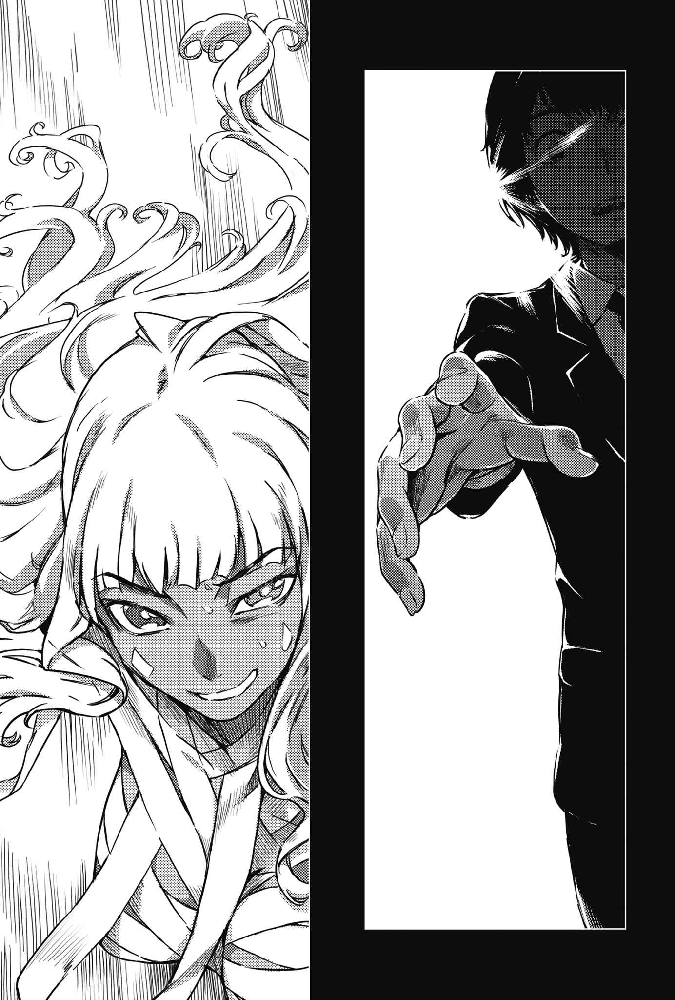

# 终章 或许也有这种开场

> The_End_is_Named……

那颗彗星飞来时，原先到室外避难的人们争先恐后地冲进屋内。如果真的掉下来，或许这么做也毫无意义；不过这样的行动，到头来应该还是解救了包括秋川未绘在内的众人性命。

但是，「魔神」们并未逃窜。

暴雨般从天而降的尖锐玻璃片也好，扫倒周围行道树逼来的强大冲击波也好，她们都无暇注意。

娘娘仰头看着一切，轻声咕哝。

「僧正被干掉了……」

继僵尸之后，连僧正也死了。

对于活了漫长时光的「魔神」而言，可以说是无法置信的事接踵而来。即使在僵尸那时就已明白「魔神」杀得掉，依旧难以接受眼前的现象。

这已经是定义上的问题了。

真要说起来，所谓的「神」，是容许死亡的存在吗？

「僧正被干掉了！被干掉了啦！怎么办奈芙蒂斯！」

她们主动找上条当麻谈话，明明是为了不让事情变成「这样」的预防手段。

这项工作，明明该属于让无形安心拥有形体的计分者。

明明娘娘与奈芙蒂斯已经预想到，要是她们使出全力压制僧正，要是演变成「魔神」与「魔神」的战争，或许真的会出现牺牲者，这才采取了安全措施。

所有的安排都没用。

而且，解决掉僧正的不是「魔神」，也不是上条。是其他人。

「……」

沙沙沙沙沙沙沙沙沙沙！一阵惊人的噪音洪流。大量的玻璃碎片洒落在地。但「魔神」们毫发无伤。陷入沉思的奈芙蒂斯连眉头也没动一下。

这样才对。

这才是「魔神」应有的形象。

既然如此，发生在眼前的景象又是什么？到底要从哪个方向思考些什么，才能得出那样的结局？这种事能发生吗？

在感受到深刻的悲伤之前，她先有了疑问。

就连让感情齿轮正确转动的零件都不够。

「……开什么玩笑。」

而且。

娘娘与深思的奈芙蒂斯不同，行动时不会去寻求每一件事的答案。

「开什么玩笑开什么玩笑开什么玩笑！啊啊受够了，我已经受够啦！简单来说就是学园都市的某个地方，有专杀我们用的『某种东西』对吧，只要把他毁了就能恢复正常对吧。那么事情不就很～简单了吗～？」

「娘娘？」

「**把学园都市整个毁掉**。」

诡异的金属声响起。

娘娘那件旗袍的宽松衣袖中，有些东西在蠢动。它们飞了出来。拥有各种奇特效果的仙人武器。这些奇形怪状的武器多达数十件以上，犹如塞得乱七八糟的笔筒一般先后飞出来。

「**管他藏在什么地方**，**只要把整个城市夷平不就会跟着消失了吗**？**那我们这么做不就好了吗**？」

奈芙蒂斯重重地叹了口气。

话虽如此，但「魔神」可不会因为「无差别大量杀戮可不好哦」这种理所当然的事感到愧疚。

「我们的鞘——计分者的事怎么办？」

「另外找就好啦，等个一两百年。反正没什么非上条当麻不可的理由。」

「说得也是。那就没办法喽。」

轻描淡写。

奈芙蒂斯就这么简单放开了娘娘的缰绳。换句话说，一个住有两百三十万人的城市，就这样被她放弃了。

不过，这也是规模的问题。

如果知道在古中国与古埃及，一个君王的选择会夺走多少人命，那么在连这些君王都会畏惧的神明眼中，区区一两座城市或许没必要在意。

奈芙蒂斯慵懒地说：

「要动手就快点。毕竟我不怎么讨厌这个学园都市，如果拖太久，我可能会舍不得。」

「OK，OK～顺带一问其他人怎么办，像是小奇美拉。」

「同为『魔神』的攻击，就算正面吃上一记应该还是撑得住吧。」

「ALLOK——————————————————————————————！」

娘娘朝天大吼一声。

从两袖飞出的数十……不，超过一百把仙人武器，仿佛在呼应她似的闪闪发光，迸出近似铁琴的尖锐声音。

究竟，她们真有「因为同伴遇害而哀伤」这种理所当然的感情吗？或许有，或许没有。

如今已无法确定。

毕竟她们一旦心血来潮解放力量，就能炸飞一座城市。

然而。

尽管如此。

&nbsp;

咚。

一声玩笑般的轻响，轻而易举地拦住了眼前的毁灭。

&nbsp;

声音的真面目，是手指。

**某人右手的食指与中指**。

这两根指头，戳进了娘娘单薄胸部的正中央，深至第二指节。

「啊……咦？」

娘娘一脸完全搞不清楚状况的表情。

没有痛楚。弄不清手指为何会刺进来。真要说起来，对方到底是用了什么手法，才能在自己没注意到的情况下从正面接近？最重要的是这家伙到底是谁——！

她连将这些疑问一一说出口的时间都没有。

真正的毁灭就在后头等着。

噗通——！

起先，奈芙蒂斯还在想是不是娘娘的心跳传到了外头。

但并非如此。

（……吸收……？）

奈芙蒂斯露出难以置信的眼神，全身紧绷。

然后，称为「魔神」的存在居然表现得像只害怕的小动物，这个事实更让她战栗不安。

（难道是把娘娘……把「魔神」……收为己有……？）

「不是哦。」

一个柔和的声音，打断了她可怕的思绪。

声音平凡而温柔，似乎在随处都听得到。对方是个茶色头发，中等身材的少年。由于现象与引发现象的人物落差实在太大，让奈芙蒂斯的脑袋几乎为之短路。

「不是吸收，不是夺取。我不过是给她救赎而已。不过仅限于相信这样会成为救赎的人就是了。」

「救……赎……？」

这难以置信的词汇，让奈芙蒂斯怀疑起自己的耳朵。

但是，看见娘娘的表情后，让奈芙蒂斯更加混乱了。

总是在自己身旁，同为「魔神」的少女。

她的表情里，没有恐惧，没有疑问，也没有困惑。

充满安详。

面带笑容。

「呵、呵呵。总算结束了，这下子就解脱了……我……我！奈芙蒂斯，这好棒哦！我……啊，我一直在等待这种超棒的安心感啊！啊哈哈哈哈！」

娘娘明显体内有某种东西被吸走，让她的体积一点一滴地消失，渐渐只剩下外侧的皮。然而，正因为如此才显得异常。就像某种蜂会让猎物的神经麻痹再加以捕食一样。在现象与脑中幸福抵触的情况下，少女发出了欢喜之声。

「新天地。」

茶色头发的少年，在将娘娘当成牛奶盒那类物体压扁的同时，简单而平淡地说道。

「我的右手，就是这种梦想的集合体。我记得……没错，应该是叫『理想放逐(World Rejecter)』吧。」

「……办不到。不可能办到。因为，所谓的平行世界——」

「没错，就像在打了钉子的钢珠台里头套上橡皮筋一样，到头来还是单线。平行世界并非无限存在。但在这同时，世界就是那条橡皮筋，会像时间和空间那样伸缩。我们所知的世界，意外地有许多浪费之处，就像六十格的胶卷只用十格一样。即使像潜意识广告那样借用两三格插入别的影像，也不会有人发现。因为你们许愿了吧？即使知道绝对无法实现，你们依旧许愿了吧，『魔神』们。你们查遍宇宙的尽头，查遍重叠的相位，知道再也没有什么新的东西了。但如果能做到这种事，就能将尘世烦扰的一切全部抛开——也就是说，**你们想在无人知晓的新天地展翅**。」

回过神时，娘娘的声音已经消失。

不，连她单薄的皮肤，身上的旗袍也是，全都不见了。

被吸收，被吞噬，消失在某个遥远的地方。

「哦，我还以为她把武器藏在袖子里，原来不是啊。是让手指化成武器吗？算了，反正仙人八成是人体超越化的代表。」

这人很危险，奈芙蒂斯心想。

问题不在于那不知所以的攻击力。而是因为她尽管看见那样的景象，涌起强烈的戒心，同时却也这么想——有点羡慕，有点想尝试，有点有趣。当这股吸引力超过极限时，自己也会和娘娘落得同样的下场。不管有多么强大的力量能够摆脱，一旦失去抵抗的意志，就只能束手无策地遭到「放逐」。就像受到捕蚊灯诱惑的飞虫，像受到食虫植物芳香诱惑而滑落酸液中的昆虫。

操纵「幸福」的右手。

这是另一种「魔法用户的愿望集合体」，跟观察至今的幻想杀手(Imagine Breaker)——世界的基准点与修复点带有截然不同的吸引力。

修复、重铸、攀附现今世界的理想。

舍弃、离开、抛下现今世界的幻想。

但是奈芙蒂斯不知道。

理想放逐(World Rejecter)。这种希望究竟是什么时候凝固在世界上的？

「奇美拉……他怎么了？」

「不知道。」

「特斯卡特利波卡、努亚达，还有普洛塞庇娜！」

「我哪知道名字和长相。」

「其他……其他人呢！」

「记住数字有什么用？」

这名「平凡的少年」，将抹消娘娘的右手握住又张开。

「咚」的一声。

某样沉重的东西，就像变魔术失败一样掉了下来。

那是一只用银打造的左臂。

（银臂……）

奈芙蒂斯震惊得说不出话。

她知道那位凯尔特神祇的名号。她知道那位由于失去手臂而不得不暂时离开主神宝座的存在，带着人造手臂重返王座的传说。

还有。

她知道银臂真正的用法，以及能自由行使权能的神祇容颜。

「不过嘛，像是『魔神』的家伙，我应该一看到就会一个不留地全吞掉才对。漏掉的是谁啊？僵尸和僧正……还有欧提努斯是吗？我没去记所以不知道啦。」

让人束手无策的一番话。

全部都是，包括「已经没把奈芙蒂斯的名字算进去」这一点。

「好啦，你要怎么办呢？」

这句话讲得非常随性。

光是对方顺势将右手掌心朝向自己，奈芙蒂斯的巧克力色肌肤就冷汗直冒。一股融合了恐惧与欢喜的疯狂汗水。

「**渴望新天地吗**？」

「——！」

等不下去了。

因为奈芙蒂斯明白，她屈服的对象并非恐惧而是欢喜，更会在少年的引诱下献上自己。

她解放了「魔神」的力量。

奈芙蒂斯的周围，传出犹如数千只飞虫同时振翅的惊人声响。转眼之间，褐色女子的轮廓已然模糊。她是奈芙蒂斯，以收取金钱列席葬礼的哭丧女为中心所创造的神格。尤其是在此处，这个词是指那成千上万因为替君王陪葬而遭到活埋的仆役集合。

所以。

奈芙蒂斯与其他「魔神」不一样。她和「个体」之力遭到彻底削减的同伴们不一样，原本就善于将自己的力量分离、分割、抛下、切换运用。

换言之，她保留了实力。

虽然中了亚雷斯塔的弱化法术，但她依旧保有还能更换一次「相位」的力量。

（插进去。）

奈芙蒂斯紧咬嘴唇。

她知道身为神的自己处在劣势。

（插入「相位」，改变世界，用这股力量打垮——）

就连内心的自言自语，都没能持续到最后。

&nbsp;

砰！

惊人的巨响炸裂——奈芙蒂斯的「相位」被捏烂了。

&nbsp;

「什——」

被紧握。

捏烂了。

「……啊……？」

在旁观者眼中，或许会觉得整片景色都像海市蜃楼一样晃动，但是基底现象截然不同。虽然完全搞不懂怎么回事，却也没有其他的词汇能形容。对于目睹这种现象后停下动作的奈芙蒂斯而言，少年就只是握住右手再张开。简直像在打招呼一样。

换句话说……即使是施展全力的「魔神」，他也能否定，杀掉。

然后。

「平凡的少年」晃了晃脖子想弄出声音……但没弄出来，于是他皱着眉头平举右手。

仅此而已。

这一次，与力量、距离都无关。

&nbsp;

轰——！

奈芙蒂斯丰满的胸部，被挖出一个手掌形状的大洞。

&nbsp;

「啊。」

「魔神」低下头去。

试图确认自己的肉体。

「嘎……呜。你……到底——」

没什么特别之处的少年，没让她这么做。

接着，第二次，第三次。少年宛如在废屋中一边清除眼前的蜘蛛网一边前进，轻松写意地挥动手臂。每当他这么做，就会夺走奈芙蒂斯的体积。不，让这些部分前往「新天地」。没有痛楚，没有恐惧，脑中只有满满对于未知可能性的希望与欢喜。没错，安心。面对就像打开头盖骨倒入特浓糖浆一般硬来的「幸福」，奈芙蒂斯直到最后的最后都还试图抵抗。

右手吞噬了那张脸。

少年连让数根银发乘风离去都不允许，挥动右手消灭了它们。

「我是上里翔流。」

相当普通，

随处可见的少年，轻声说道。

「**随处可见的平凡高中生**。」

一时之间，寂静支配了一切。

那里已经有了某方面的完整。

就连「魔神」的威胁也不容入侵。

「哎呀。」

接下来。

他仿佛想起了什么似的，抓抓自己的头。

「糟糕糟糕，埃及式木乃伊是不是会把心脏以外的内脏拿出来保存在其他容器里？光是那样还算不上吃完啊。」

&nbsp;

&nbsp;

「哼哼。」

于是，在圣乔治大教堂里，最高主教(Archbishop)萝拉·斯图亚特静静地笑了。

妖艳。

以这个形容词来说，她的唇形也未免太过邪恶。

「跨越百年的『计划』也好，庞大的设备投资也好，其中蕴含的心意也好。到头来，现实总会因为一丁点异物而轻易地扭曲轨道。」

关于这方面的情报，被禁止记录在任何媒体上。

只留在萝拉的脑中。

「好啦，理想放逐(World Rejecter)出动喽。由于幻想杀手(Imagine Breaker)变得不上不下，无法承受诸多魔法师的梦想，于是外流凝聚成了其他梦想。怎么办啊，『人类』？到头来，你或许是降生在一颗永远无法得到最想要事物的星球上呢。」

但她早在之前。

就已知晓这种存在的到来。

知晓「毫无特别之处的平凡高中生」会出现。

「你不适合当什么黑暗的顶点啊。」

萝拉笑了。

轻笑，灿笑，嘲笑。

并且说道。

「你比较适合『食人鬼』或『二十世纪最大的怪人』这类角色哦，克劳利？」

下一波灾难，随着门铃声造访。

遍体鳞伤又筋疲力尽的上条当麻，原本以为好不容易能够回到窗户被冲击波打破的学生宿舍休息，快递大叔却送来了那玩意儿。

他挤出最后的力气盖下印章后，就跟着能让他抱满怀的箱子一起倒在地板上。

到底是谁送来的啊？

上条很快就放弃用指甲挑战相当坚固的胶带，考虑就这样把箱子卖掉。不过——

&nbsp;

「啪哩！」的一声。

突然箱子的侧面破了，从里头伸出一条褐色的腿。

&nbsp;

「什——」

这现象显然不正常。这个纸箱一边有三十厘米长就不错了，不管怎么想，它都狭窄得连个小孩子也躲不进去才对。更别说妙龄美女的腿到底要怎么塞进去了。

话虽如此，但奇怪的现象还没完。

接着是手臂、另一条腿，到最后整个箱子都拆得七零八落，从中蹦出了完全体——一名巧克力色肌肤的银发美女。她两眼异色，眼角有个泪状刺青，凹凸有致的肉感身躯只缠了白色绷带。

上条有印象。

「奈芙蒂斯……？」

「……呜……呜。事先留下主要脏器……看来是……正解呢。」

那位「魔神」十分勉强地在地板上爬行，声音听起来极为痛苦。

她试图和上条对上眼。

「帮我。这提议对你而言应该也不坏才对。」

「如果是什么道啊鞘啊计分者的话题我不干。我既不许愿也不求神，什么安心什么防护软件的也一样，我才不要当你们『魔神』的护身符！」

「已经……不是谈这种话题的时候了……」

说着说着，上条不禁感到疑惑。

这个全身冷汗直冒的「魔神」……奈芙蒂斯正在消耗？她明明和僧正是同类，是那种就算又弱化又被丢上宇宙也会坐着彗星说「我回来了」的怪物啊……？

「理想放逐(World Rejecter)出现了……」

疑问的答案，极为片段。

然而，这句话确实刺进了上条心里。

&nbsp;

「既然上里翔流打算『放逐』所有的『魔神』，那么你身边的欧提努斯，是不是也会有危险呢……？」

「呼、呼。」

喘息声。

来自一名少女。

御坂美琴。

天色早已从黄昏转为深夜。好不容易回到常盘台中学宿舍的美琴，随便应付了一下担心被玻璃雨弄伤的室友白井黑子后，随即进入浴室，背靠着门，然后为了克制混乱的脑袋而反复深呼吸。

但是，没有用。

连一丁点效果都感受不到。

说穿了，她根本无法深呼吸。让野狗般的急促气音从口中逸出已经很勉强了。

这不是因为那个「魔神」僧正超乎常轨的强大。也不是因为对方利用阿洛海德彗星躲过宇宙放逐的临机应变，或是该行为的规模大小。更不是因为什么自地面出发的飞行物体一击拦住那个怪物，对整座学园都市散布闪光与冲击波。

而是更靠近身边。

却又比什么都遥远的「那个」。

（那是什么……？）

事件的最后阶段。

从自己搀扶的少年身上，传出的那个声音。

（那到底是什么……？）

在那个状况下，应该已经束手无策了才对。

当规模达一百米的彗星以最高速度逼近时，不管御坂美琴如何使用第三位的超能力都无法迎击。那个少年身上似乎沉睡着足以凌驾美琴力量的「某种东西」，但就算动用它应该也无济于事才对。

照理说应该是这样。

在最后一刻，少年就像要抵抗上天一样，将那只手掌朝向彗星。

那只手臂响起塑料裂开般的声音。

假如说。

只是假设性的问题。

要是学园都市没准备任何迎击手段，只是等待时间流逝……那么究竟会发生什么事？

那个少年的右手会带来怎样的变化，引起怎样的现象？

「……好远。」

美琴背靠着门，低头看向自己的双手。

曾经有过蛛丝马迹。

好比说，大霸星祭中的一幕。好比说，他孤身面对第三次世界大战元凶的原动力。好比说，好比说，好比说，好比说。

可是。

话虽如此。

她那股一度遭僧正完全否定，之后又得到上条当麻重新肯定的力量。她的价值。她的存在。

少女想着这一切。

她的心一再地受创。她要是单独一人，可能会无法振作。之所以能勉强回到学生宿舍，之所以还能当常盘台的王牌，当学园都市第三位，想必是多亏了那个少年吧。

但在这同时。

最用力撕裂她的心，在上头留下深刻伤痕的……

最终，少女以双手捂住自己的脸。在双手的遮掩下，她咬住自己的嘴唇，压抑但明确地挤出这句话。

「他离我……好远……！」
