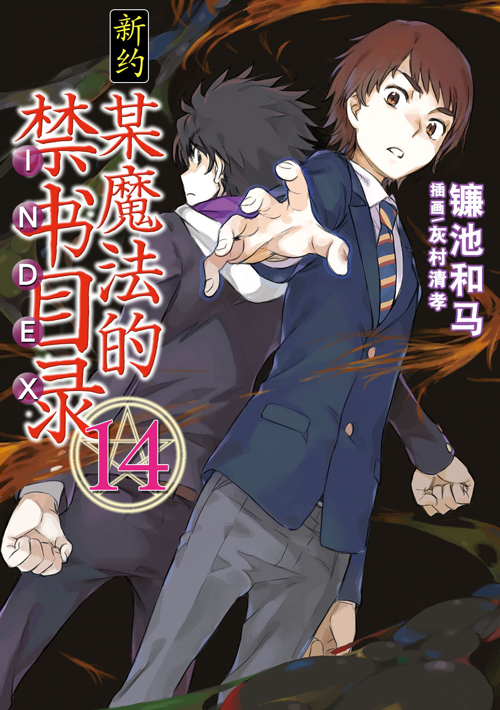
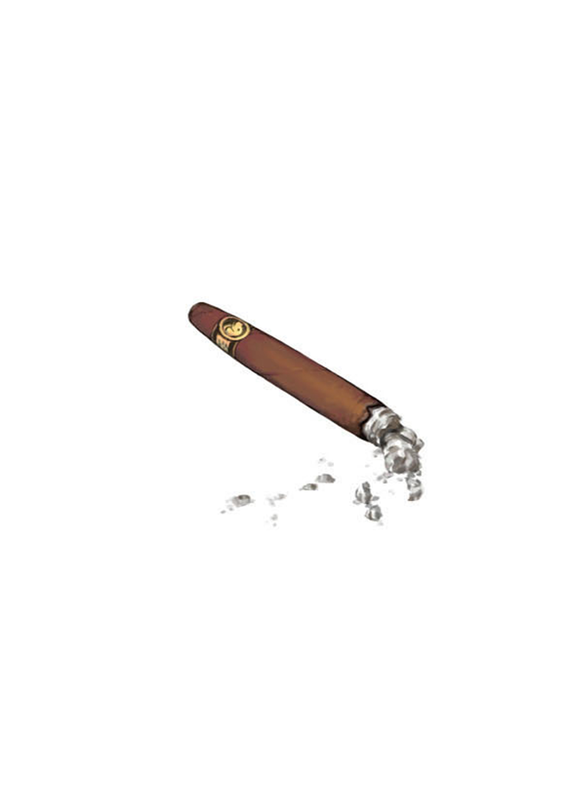

# 简介

**新约·魔法禁书目录14**

作者：镰池和马

## 内容简介

**消除一切异能之力的右手「幻想杀手(Imagine Breaker)」VS消除一切负面想法的「理想放逐(World Rejecter)」！**

「呦，幻想杀手(Imagine Breaker)」

「也就是说，你是理想放逐(World Rejecter)吗？」

无论多少次能够随心所欲地将世界化为尘埃的真正「魔神」们。这样无敌的存在中，有一个少年能在瞬间消除他们。

这个少年是「随处可见的普通高中生」，但同时也是寄宿有最大最恶的「理想放逐(World Rejecter)」的存在。这是一种可以消除所有「渴望新天地者」的事物的可怕力量。同时，他与另一位「随处可见的普通男高中生」上条当麻右手中的「幻想杀手(Imagine Breaker)」也有着表里一体的关系。

「幻想杀手(Imagine Breaker)。我找『魔神』有事。找那群把我变成这样的『魔神』们有事。」

「那是你的事情吧。我们不关心。」

两个少年在学园都市的黑暗中对峙。

为了彼此无法妥协之物。

这场胜负关键掌握在蕾薇妮雅和派翠西亚，两位柏德蔚姐妹手中……？！

极大的异常者之间终于激烈碰撞……！

## 制作信息

* 翻译：Seeker
* 台版：天使动漫 轻之国度
* 图源：真妹控
* 录入：kid
* EPUB制作：鹘鹰⚡
* 网翻：贴吧汉化组
* 组织：星之翔
* 图源：D.N.Alucard 天使轻小说论坛
* 友情协助：フムロ
* 翻译：神笑琉璃 Edster792 JOJO扬 吐槽星123 limninjkmk 为毛取ID这么难
* 日文校对：月の姬 Edster792
* 中文润色：霜月 WiDe_Courage
* EPUB制作：kurama8
* 整合：知一一（禁书目录X系列，[index-X](https://github.com/1204244136/index-X)）


**版权声明**

转载时请保留录入信息。

本站内容仅供试看、学习与交流使用，禁止用于商业用途；下载后请在24小时内删除。请支持官方正版。


## 封面与封底

