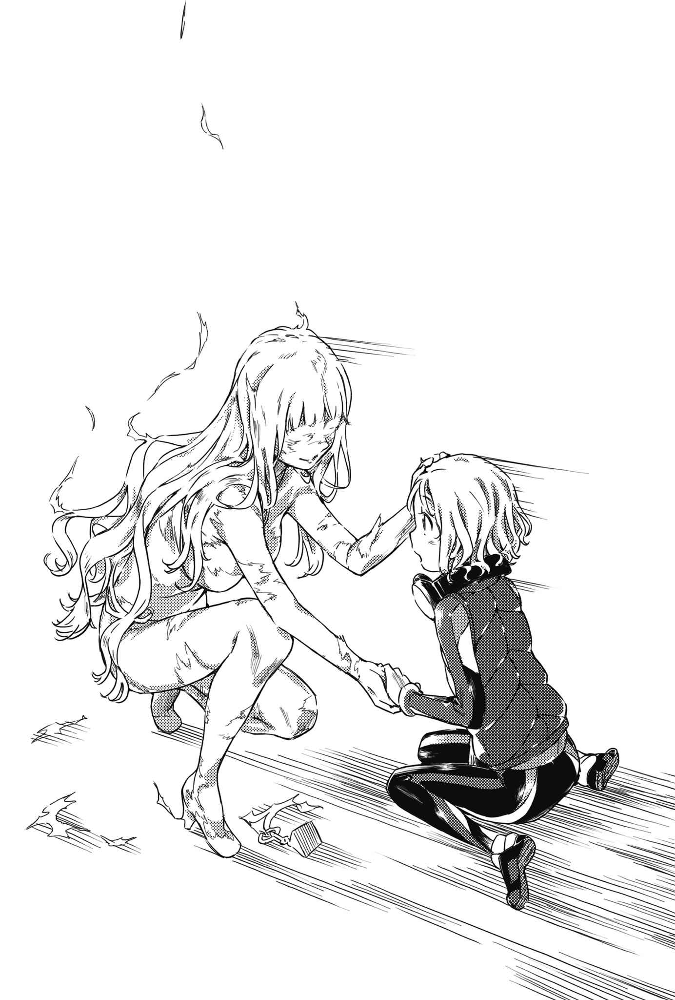
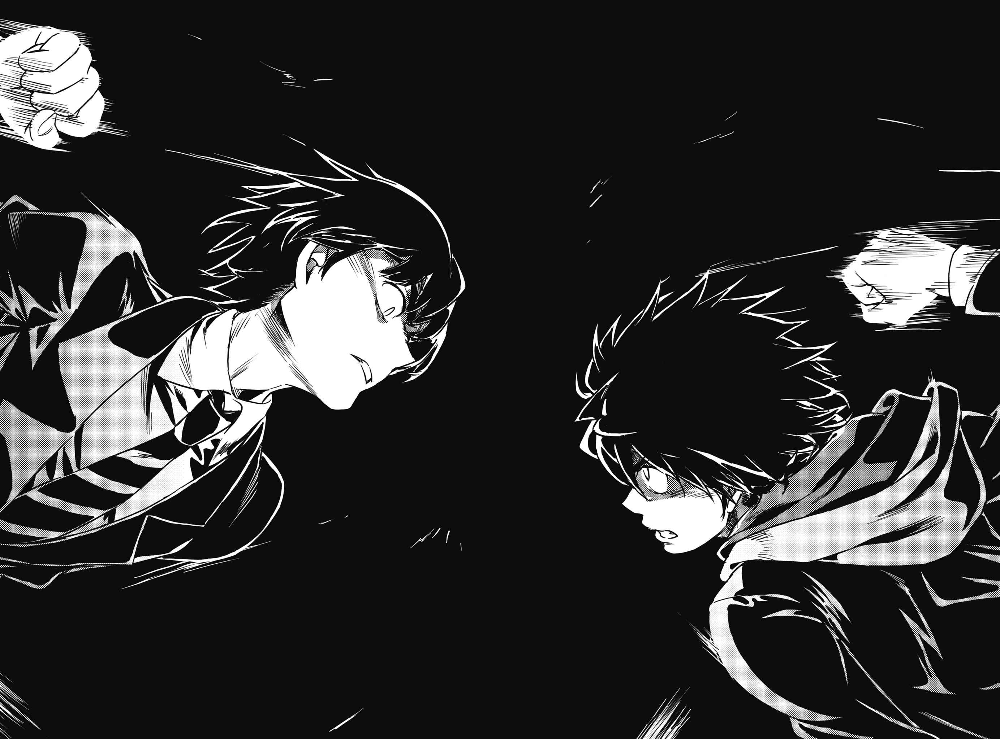

# 第四章 上条当麻与上里翔流

> Attack_the_Fist.

## 1

事情很简单。

「上里翔流很快就会过来。」

一回到学生宿舍，上条当麻就这么开口。

不是在意房间寒冷这种小事的时候。极限的紧绷已将温度感踢到远方。

「他们已经知道这里。第一目标是欧提努斯与奈芙蒂斯你们两个『魔神』，不过感觉上柏德蔚是第二个对立轴。我和茵蒂克丝会被当成碍事的吧。换句话说没人能安心。」

不仅如此——

「柏德蔚，你是不是有隐瞒什么？」

「有根据吗？」

「上里那家伙说的。」

「喂喂喂！敌人的每一句话你都相信啊？」

「……」

他并未多费唇舌。

上条既没瞪着对方也没大声怒吼，而是蹲下来配合柏德蔚的视线高度，无言地盯着她的眼睛。一会儿后，少女尴尬地别开目光。

结社的领袖嘟起嘴说明。

她以不会让部下和妹妹看见的表情这么回答。

「……在体内培育同类相食的『果实』，完成后把它喂妹妹吃下去，就能漂亮地解决寄生生命体修格斯样本的问题。这点毋庸置疑。没有什么奇怪的副作用或其他意图。」

「那你为什么想敷衍我，说实话。」

柏德蔚轻轻叹口气。

她露出一副认命的样子，一口气把话说完。

「『果实』太大了。完成时我的身体或许会被它从内撑破。不，我订正一下，绝对会。这点在设计时就是如此。」

「你说什么！」

「所以我才不想说，也没动用部下和组织的力量。以我这个结社领袖百分之百会死亡为前提的计划，要是让周围的人知道，他们铁定会逼我放弃派翠西亚继续主持组织。这话说起来虽然像是在吹捧自己，但我的死亡不管从哪个角度看影响力都实在太大，恐怕会让整个欧洲陷入混乱吧。听好，人类的身体是神秘的宝库。没有任何多余的东西，而且塞得满满的。你试着把一整个照理说不该存在的脏器塞进去试试看，会从内侧压迫人体很合理吧？」

柏德蔚先前展示的「果实」，记得应该是位在胸部正中央。有心脏和主要血管交错通过的地方。虽然不知道具体来说是在肋骨内还外，但不管怎么样压迫身体这点毫无疑问。即使没发生撑破肉体这么严重的状况，但光是像踩住水管那样压迫到一根血管就足以危及性命，照理说那边就是这么敏感的位置。

「……说到底，完成的『果实』你打算怎么拿出来？」

「这部分我会用信仰疗法，所以不用担心。即使不像外科手术那样切开身体，还是有办法将它拿出来。说是『草药师』的话，魔道书图书馆应该会帮忙解说吧。不过嘛，这就和造雨人一样，只是西洋人对所有非洲系巫医的统称罢了。」

问题的本质——肉体破裂问题并未解决。

不知道妹妹派翠西亚究竟对这点知道多少。不过，会不会她抗拒「果实」并不是因为无法接受恶心的人工内脏，而是想阻止「果实」完成呢？

会不会她尽管不知道魔法这种东西，却还是能掌握姐姐的身体状况呢？

「照这样看来，也不能太勉强现在的你呢……」

「喂，人类。真要说的话，还有奈芙蒂斯的问题哦。生了一副笨重的身体却没办法动，要是让别人扛又会降低人家的行动力。我变成这样所以就体格来说办不到，你要负责直接战斗，结社的女人先除外。这么一来就剩禁书目录了吧？」

纯看人数还算充足，却没有账面上那么宽裕。

能正常行动的只有上条和茵蒂克丝两人，其中一个还得照顾柏德蔚和奈芙蒂斯。一旦上里方成群攻来，很可能无法应付。

最重要的是。

&nbsp;

「啪——！」的一声。

突然，屋内的灯光全熄灭了。

&nbsp;

「……已经来了。」

上条在黑暗中低语。

如果是整栋学生宿舍停电，附近应该也会有骚动才对，但是完全没有这种气息。搞不好「上里势力」用上了「闲人驱散」之类的把戏。

换句话说。

对方没给上条他们思考时间。已经完全将心态切换为「趁能够解决时解决」。

「总之只能迎接他们了，不能坐以待毙！」

## 2

照明消失的瞬间，上条等人陷入被动。

己方遭受奇袭，落为后手，这点再清楚也不过。

即使坚守阵地也不会有什么好下场。

那个叫暮亚的植物少女已经袭击过上条一次。就算是七楼阳台，她大概也能靠着藤蔓或别的东西简单入侵吧。而事到如今就算锁上玄关的门又用家具堵住，也不可能撑下来。

更何况，还有上里翔流的理想放逐(World Rejecter)。

目前还不清楚确切的效果与使用条件、射程，只知道连「魔神」都能瞬杀。最糟的情况下，也有可能让他们所在的学生宿舍整栋倒塌。

（……该不顾一切往地面移动吗。）

「茵蒂克丝！抱歉，麻烦你去扶奈芙蒂——」

说到一半就停了。

让人不舒服的黏稠液体滴落声响起。

不是来自门窗。也不是来自墙壁另一头。声音意外地来自房间里。

柏德蔚惊觉地抬起头。

「通风管吗！」

巨大物体自厨房空间的燃气灶台上方落下。黑暗中，由外头射进来的些许光线，照出一团形状不定的异形。整个表面覆盖不知是眼珠还是吸盘的东西，那些东西还放出荧光漆般的光亮。越是想看清轮廓而凝视，则会发现它又像深海章鱼，又像用菜刀切下的脂肪块，又像内部被烤过的橡胶膜，让人清楚知道自己离本质越来越远。一直盯着一面国旗，会见到各个颜色自我主张而盖过整体含义，或许就像是那样吧。

它多处蠕动、变尖、朝四面八方射出锐利的长枪状物体。

接下攻击的，并非上条的幻想杀手(Imagine Breaker)。

在这之前，柏德蔚已经有所行动。啪沙！犹如大块布料拍打空气般的声音响起，仔细一看，少女全身都盖上了犹如发霉红色毛毯的物体。

「柏德蔚！」

『现在管得了这么多吗！讽刺的是，最脆弱的是欧提努斯和奈芙蒂斯这两个「魔神」。你们把她们带走，你的精神没强韧到能承受人的死亡吧！不管怎么说，现在这样正好，这个摆出一副要离家出走的样子却搞到迷路，好死不死还跑去男人家里的蠢妹妹，我非得好好跟她谈谈不可！』

修格斯样本。

整团漆黑的东西，加上放出荧光漆般光亮的泡状物。这个来袭的怪物，真面目应该就是遭到南极寄生生命体侵袭的柏德蔚之妹。而她照理说已经在上里翔流的庇护下才对……

（那个混蛋……！）

上条拼命克制，不让沸腾的脑袋爆炸。

「一定要来会合！地点就选在我们初次见面那里！」

『哦，一阵子不见，你居然变得能说出这种浪漫的台词了呢。』

上条将摇摇晃晃还不时吐出热气的奈芙蒂斯交给茵蒂克丝，自己肩上则是欧提努斯。把苦力活丢给别人让他有点犹豫，但考虑到接下来的激战后，他也明白负责直接战斗的自己有必要减轻负担。

他几乎是用撞的冲出玄关门。

奔上七楼的走道。

突然间「喀喀！」的声音响起，数道疑似手电筒与手机屏幕的光照在他身上。

光是他能分辨出来的部分——

（三、四、五……不，隔壁的建筑、地面，连其他栋的屋顶也有吗！光是看得到的就这么多，这还真麻烦呢，到底躲了多少人啊！）

而且每个人的特征都不一样。为了支持上里，应该每一个人都身怀特化到极致的「异能之力」才对。

如果这些人同时杀来，什么分析防御都赶不及。

上条环顾周围，接着大声喊道：

「那个狐狸女！茵蒂克丝，总之能确定她是魔法师！」

「了解，当麻。狐雨避我(TRIATO)，反沾其身(TTDYB)！」

强制咏唱(Spell Intercept)。

茵蒂克丝无法动用魔力。换句话说她不能使用魔法。但她空洞无意义的咏唱，却已达到能够干扰他人行使魔法，刻意让对方失误，借此夺取魔法控制权的地步。

而上里本人这么介绍过。茶色头发参差不齐带有狐耳般翘起的获冴，会创造「类似」狐狗狸的东西，让它附身在各式各样的人、物，算是魔法阵营的人。还说能像将棋那样夺取敌方战力，也能让硬币动起来。

巨乳不良少女惨叫出声。

「呜啊啊啊啊！什、什么跟什么啊！」

砰！犹如安抚婴儿般抱在怀里的塑料瓶破裂。

里头洒出的大量十元硬币在空中静止后，重新锁定目标并以惊人的速度射出。虽然没到御坂美琴的超电磁炮(Railgun)那种程度，但带来的痛楚应该足以弹开手脚并让手中武器掉落吧。

打不倒也无妨。

只要能让她稍微缩一下就行。

「……」

上条趁机重新看向黑暗深处，盯紧最重要的敌人。

那是对方最强的战力，同时也是最大的弱点。

「上里啊啊啊啊啊啊啊啊啊啊啊啊啊啊啊啊啊啊啊啊啊啊啊啊啊啊啊啊啊啊啊啊啊啊啊啊啊啊啊啊啊啊啊啊啊啊啊啊啊啊啊啊啊啊啊啊啊啊啊啊啊啊啊啊啊啊啊啊啊啊啊啊啊啊啊啊啊啊啊啊啊啊啊啊啊啊啊啊啊啊啊啊啊啊啊啊啊啊啊啊啊啊啊啊啊啊啊啊啊啊啊啊啊啊啊啊啊啊！」

肩膀坐着欧提努斯的上条，全力冲向前去。

不知道有多少战力躲在何处。对方布下几重包围网，预先封杀了多少手段，也没办法立刻分析出来。

但在这同时，她们终究是「上里势力」。

中心暨顶点。

一旦上里本人陷入危机，先前预定的计划铁定会告吹。即使上里本人大喊别离开岗位，她们也会「想都不想地」前来搭救。

因为她们不是军队，也不是宗教团体。

而是常见那种以善意与好感相系的友好集团。

（不必打倒所有人。也没必要一直勉强保护茵蒂克丝她们。只要盯准唯一的王将就行了。因为只要让在场所有战力都往这边集中，就能让确保茵蒂克丝她们的安全！）

「**渴望新天地吗**？」

黑暗中，绝对算不上粗的手臂随意挥动。

理想放逐(World Rejecter)。

一旦正面承受这股不知其真面目的力量，就连使出全力的「魔神」都会惨遭瞬杀。

但在威胁当前的情况下。

&nbsp;

「啵——！」的一声。

在奔跑中压低身子的上条当麻，在千钧一发之际躲开必杀一击。

&nbsp;

「啧。」

到了这时候。

总算，上里翔流第一次显得有些许焦躁。

不能让他恢复。

上条就像要从低处撞上去一样，带着全身体重朝上里的腰际突击。沉重的声响炸裂。两人一同摔往扶手另一边，些许悬浮感包围全身。

（理想放逐(World Rejecter)的范围与射程都不明。不过这么一来，他又是怎么锁定目标？）

在体感上仿佛静止的这段时间内，上条反刍起自己的预测。

（他和我不一样，不需要用手碰。如果需要触碰就无法应付远程攻击。那是用眼睛盯着的对象吗，用手指指出的目标吗？不，这些也不对。若是这样，他在奇袭时根本不会去断电遮蔽视野，反倒该主动确保视野开阔才对。）

所以说。

换言之。

「影子。」

轻声。

却来势汹汹，满怀信心地宣告。

「你是以自己手臂形成的影子为起点，决定理想放逐(World Rejecter)的范围！所以袭击时才会刻意断电！因为这么一来光源就只剩你准备好的照明，可以自由调整影子的方向和大小！」

时间感恢复。

正式开始坠落。

重力的丝线抓住两人的身躯。上条挥舞双手，拼命地抓住下面一层楼——六楼部分的通道扶手。他无视肩膀的刺痛，戒备周围。上里翔流那家伙怎样了？

「在那种状况下，亏你有办法做到这样。」

意外地近。

有个同样抓住六楼扶手吊在半空中的身影。

「没想到你光是对付我和获冴两人，就能让动员上百人的盘面濒临崩溃呢。」

接着用一只手撑住身体的上里翔流，笑着在右手蓄积力量。

挥动。

「！」

上条仓促间再次放手。

他抓住下方五楼部分的扶手，这一次则是爬回走道。

「你打算怎么办，人类？」

「一旦混乱结束，做出最佳安排的包围网就会找上茵蒂克丝和奈芙蒂斯，和派翠西亚纠缠的柏德蔚也让人担心。无论如何都不能让他冷静下来。要黏着上里那家伙，尽量骚扰他！」

这么一来，目标只有一个。

在走道上全力奔跑，冲向通往楼上的逃生梯。

对方或许也有同样的念头吧。

他正好在中间点——楼梯的平台与上里翔流打照面。

「你这混蛋！」

上里准备冲下最后一阶，上条则对准上里的脚踝一记侧踢，让他摔下来。果然和本人说的一样，除了理想放逐(World Rejecter)以外是个「随处可见的平凡高中生」。上里倒在平台上，上条则骑到他身上。

途中上里数次乱挥那只右手。

但上条总是随之后仰，避开那最大最恶的一击。

他抓住对方手腕，将自己的头往后一拉——

「给我……稍微安分一点——！」

咚！上条的额头重重和上里的额头相撞。因为痛楚，或者该说是因为脑袋遭受重击吧，上里的眼珠诡异地晃动。

「……呜……啊……咕啊……！」

在呻吟同时，上里也为了把骑在自己身上的上条甩下来而用力晃动身体。上条敌不过这股力道而倒向侧面，上里则展开反击。双方一再攻守交换。

但这种情况没有持续多久。

就在两人翻滚多次，上里又要扑上去时。上条弯起一条腿，用脚抵住上里的腹部。

就像压缩到极点的弹簧尽情伸展一样。

上里纤细的身躯飞上半空中。这里是楼梯中间的平台，他被踢往朝下的楼梯。

「啊。」

就在上里发出呆滞的声音后。

沉重的声音接连响起。气喘吁吁站起身的上条往楼下一看，随即望见有个像损坏人偶般倒下的身影。

看到那只右手还在蠢动，上条心中的顾虑消失无踪。

他跳下楼梯，用力踩住那只右手，将那只手钉在地板上。

「为什么把派翠西亚带来这里……？」

上条愤愤地说道。

「你干的事只能说『糟糕透顶』！居然特地安排让姐妹相残的状况！难道你认为这是最合理的手段吗！为了削弱我们的战力，你居然做出这种践踏别人感情的事！」

「……嗦。」

尽管得意的右手遭到封锁，倒地的上里依旧出声回应。

「现在的状况！是她希望的啊！」

沉重的「唰！」声响起。他另一只手握住的圆珠笔，贯穿上条的鞋子并刺中脚背。

上里再怎么说都是「平凡高中生」。但这绝对不代表他软弱无力。

「呜！」

突如其来的痛楚令上条失去平衡，右手挣脱束缚的上里则往旁边一滚。脱困后，他跟着一脚狠狠踢向还刺在上条脚上的圆珠笔。

「嘎啊啊！」

这回上条终于倒地。

少年们再度扭打起来。

其他不重要。总之上条专心对付上里的右手腕。上里的理想放逐(World Rejecter)是以影子为起点发动，换言之就算抓住那只手，贴在一起的部分还是会形成影子，有可能中招。

就跟对付刀子一样。

不能去抓刀刃。上条抓住对方的手腕让轨道偏移，只要封住那只手就能避免致命伤。

上里在极近距离说道。

「你也差不多该搞清楚状况了吧。那对姐妹只要帮助其中一个人，另一个就会死。没有犹豫的时间，也不能保留选择权。」

「既然如此，你要帮谁？你看起来是站在派翠西亚那边，但帮助她打倒柏德蔚，只等于主动把用来解救派翠西亚的『果实』毁掉！」

「没错，这就是救赎。」

极限的规格外战斗。鬼牌右手之间的往来。

在战斗进行的同时，上里翔流做出了让人搞不懂什么意思的回答。

不对——

「姐姐蕾薇妮雅究竟想做什么，光听派翠西亚的证词依旧不清楚。不过，可以明白确实有时限存在。相对地，盘踞派翠西亚体内的修格斯样本虽然是明确的祸害，但它的时限尚未确定。」

「你在说什……不，难道你……」

「只要不取出修格斯样本，派翠西亚就会**立刻**死亡……这是谁决定的，你是不是搞错前提了？」

上里翔流用难以判断情绪的眼神这么指出。

「而只要派翠西亚之死不存在，姐姐蕾薇妮雅挺身而出的理由也会变得薄弱。姐姐没必要舍命相救，妹妹只需要以和寄生生命体共生为目标就好。至少这样能从『夺走谁的性命』这种疯狂的天秤上解放。所以，我们来破坏藏在蕾薇妮雅胸部的『某种东西』。这么一来姐妹便能同时得救。」

「你真的明白吗？那可是会溶解全身脂肪钻进空隙的超夸张寄生生命体啊！你知道一辈子和那种东西作伴代表什么吗！」

「寄生生物杀害宿主的理由很多，但大半是因为杀掉对方才容易寻找下一个宿主。关于修格斯样本，我让绘恋和……还有不知道几分为真，但据说是靠着外星人植入的东西强化了『原石』效果的府兰为中心进行调查，很快就会明白详情。之后只要控制它的行动就好。强行压抑或许会让它在体内大闹，但如果能给它想要的甜头又另当别论，就跟养猫一样。虽然没办法训练，但可以遮住电线不让它乱碰，表现出你不希望它做的动作时也可以用饵吸引注意力。有希望靠这种方法控制。」

吸食自己血肉筑巢的生命体。

深海章鱼、切开的脂肪、内侧被烤过的橡胶膜。这辈子都要和这种东西为伴，连发脾气都不行，只能安抚、讨好它。

稍微想象一下后，上条摇摇头。

「……不可能。姐姐蕾薇妮雅姑且不谈，妹妹派翠西亚即使什么都不做也会失控。如果修格斯样本真的是为了追求新宿主而杀掉旧宿主那一类，派翠西亚只会遭到摆布！就算隔离到遥远的深山里，也可能操纵她的身体下山进入人类聚落！这么一来她就会因为更换宿主而死啊！」

「嗯。实际上，寄生虫之中会掌握宿主肉体与思考的类性也不算罕见。所以这只是第一阶段。就目前来说，只要先排除派翠西亚立即死亡的可能性，之后再慢慢实行剥离修格斯样本的方法就好。好比说，寄生生命体之所以能杀害派翠西亚，是因为夺走了储存营养的脂肪层并盘踞在那里。如果没有修格斯样本，就会因为无法储存导致她衰弱而死。那么，只要去掉这项前提就好。」

「什么……？」

「好比说，就算无法储存，也能用点滴持续给予她大量营养；或是以肾脏用的透析技术将血液移往外部装置循环，在这时将营养素送进血液之中。方法不是没有。派翠西亚本人已经提出数个方案，绘恋则画出了具体的图样。」

失去全身脂肪，连接机械与管线的人生。

换句话说，这等于失去了人类的轮廓。

稍微想了一下后，上条摇摇头。

「她会再也没办法自己起身哦。不开玩笑，她真的会变得像枯枝一样只剩皮包骨，头发和皮肤都会变得干枯易剥落。而且那和躺在床上的病人又不一样。全身的关节会干燥僵硬无法动弹，不仅如此，从外面一压还会挤出浑浊的液体，那不就变得跟蛹一样吗！这样只是还活着，只是医学上还没死亡而已。没有别条路了吗！」

「嗯，若是普通人就会放弃。如果是不得不接受的天命也就罢了，出于自身意志放弃还能动的肉体根本不可能。即使嘴巴上这么说，也会有什么地方偏掉。但是派翠西亚没有。她既不想让姐姐死，也不想把置亲人于不顾的事实强加在姐姐身上。所以不是选择蕾薇妮雅或柏德蔚，而是创造能同时保住两边性命的选项！至少也要保住性命！这是底线，其他的全都放弃！」

「……」

「我尊重她的勇气。尊敬她不逃避而面对痛苦，不放弃而承担恐惧的小小正义。所以，那种高高在上的善恶论我已经受够了。被谁轻蔑被哪里非难我才不管。我呢，不会让派翠西亚孤单一人。直到最后的最后，我都会支持心灵坚强得足以弹开『理想放逐(World Rejecter)』的她。」

正因为认同。

正因为承接了她的意念。

那些不知变通的教科书去吃屎吧。

彻头彻尾地主观，当事者以外无人期望，没人能理解。他要协助少女完成这样的结局。

「可是，这么做一定不对。你们在某个地方走偏了。我不知道你和派翠西亚之间发生过什么事，但确实有过什么对吧。泪如雨下，出声求救，抓住你那只手的派翠西亚，真的是从一开始就期望『那样』吗！在某些地方做出妥协才是最好的选择——**难道不是你们把事情单一化成这样的吗**！」

「我啊。」

上里的声音中，没有简单易懂的激情。

但是有某种从内心深处渗出的东西，藏在他平静的声音里。

「一直觉得非常非常不可思议，我自己为什么没有先被『理想放逐(World Rejecter)』消灭呢？因为我总是在迷茫，连整理自己的愿望都做不到。可是我在想，自己之所以能像这样站在这里，会不会是因为和取回失去时光的愿望相比，和舍弃受赐之力的渴求相比，对于『魔神』们的憎恨更为优先，因此让我变得一致呢？帮助别人，和绘恋她们好好相处，都是为了气那些疯狂的『魔神』，换句话说就是复仇。对抗重复的负面意念，是靠单一化的负面意念。所以我尊重面对不讲理仍然不会渴望新天地，没有憎恨现在的世界，而是怀着残破希望迈步向前的派翠西亚。我尊重站在更高处的她所做的选择。我不会让任何人碍事。**因为她是我的英雄**。」

因为做不到。

正因为他没办法做到。

经过重重取舍后，只剩污浊的暴力。派翠西亚和这样的上里不同，直到最后都挂心姐姐。绝不动摇，绝不重复。

他尊敬少女这点。

可是。

「像这样把流泪女孩逼成英雄，你就满意了吗。你那种做法，只是在赞美被逼到崖边的人有勇气往下跳而已！这样铁定不对，美好的道路不是只有成为英雄一条！对抗这种轻易抛弃性命，让生命单价下跌的趋势，也是了不起的坚强！某方面来说，这么做远比像我们这样只会挥舞右手战斗的无能，来得更加！更加更加！更加值得尊敬！必须是这样！」

每次激战过后，上条总是会被茵蒂克丝和御坂美琴她们斥责。

即使拥有特别的右手，这世界也不是只会一再逼迫自己战斗。

想必这就是真正的温柔。

一旦失去这种温柔，这个世界就真的完蛋了。会变成只看参数决定死活，残忍冷酷的机械性制度将盖过一切。

超越上里口中善恶论的漂亮话，也就是这么回事。

拥有力量的人，处于特殊状况的人，只因为这样就非得赌命战斗不可吗？他们非得忘记之前走过的路，抛下原先珍惜的事物，像机械装置一样朝死亡的高墙突击不可吗？

如果看见一个像这样烦恼的女孩子，必须无条件地这么说。

绝对不是。

这是另一种正义。

因此，无法轻易接触的对象嘲讽似的指责。

「那又怎么样。姐姐和妹妹两边都救，谁都不能抛下？到头来你只是个什么都不选而全都失去的蠢蛋。你和我不一样，是个执着的零。要等到失去一切，才会哭丧着脸说这也是不得已，光是保护自身人性就很勉强的伪善者。别笑死人了上条当麻，什么都不选，什么都抛不下，连重量也背负不了。这种货色别谈什么救赎。只要还支持蕾薇妮雅的计划，你就是站在夺人性命的那一边，你只是**想漂亮地让事情结束**，但实际上没什么两样。」

「就算是这样……」

少年咬紧了牙关。

瞪着自己的敌人。

上条当麻，朝另一名少年放声喊了回去。

&nbsp;

「就算是这样，还是不能不说啊！站在求救的女孩子面前，要是什么漂亮话都不说就完蛋了！一个人也不能漏掉，不能让任何人留在痛苦与恐惧的世界，一定要让所有人笑着一起回去！这种话非说不可！」

&nbsp;

听到这不顾一切的呐喊，上里似乎一时说不出话来。

但紧接着他眼中便出现了愤怒与憎恨。

理想放逐(World Rejecter)复活。

「你擅长的拖延战术吗，只是不想自己选择吧。你根本没有什么具体的方法。到头来只会就这样两边都失去而已。」

「是啊！我又不是IQ两百的天才！既不是能背下十万三千册魔道书的禁书目录，也不是能重新创造一整个世界的『魔神』！就算是这样，要我听人家说几句话就放弃，我也绝对办不到。笨蛋就要有笨蛋的作风，如果没发现提示就要挣扎到发现为止。我会和茵蒂克丝与欧提努斯商量，也会听柏德蔚和奈芙蒂斯的意见，能用的手段全都用！自尊什么的无所谓，因为没人规定本大爷非得一个人收拾全部的问题不可！」

「哈，到头来还是丢给别人啊，这也是打预防针对吧。为了就算有什么地方失败，为了就算失去一切，也能推说自己只是照妈妈说的做而已。」

「我说过了吧，只要是能用的手段我什么都用。这件事关系到人命！哪有闲工夫装模作样啊！所以我什么都会用！因为如果照你那种方法做，就只能认为派翠西亚躺在床上像干蛹一样露出阴暗笑容是最佳解！难看也好，丢脸也好，本末倒置也好，随别人怎么说！轻易放弃后摆出一副事不关己的冷静态度，然后说本大爷做出谁都选不了的痛苦选择实在好帅，这种自我陶醉我才不干！救赎的定义可不是为了自己而设，上里！」

因为，上条知道。

恶为什么会诞生？不是因为人家说了才叫正义，不是因为写在某个地方才叫恶。在某人放弃，抛下另一个人时，被抛弃的人就成了恶。是在被单方面剥夺得救的可能性，无法和任何人相系，被人指着说「那家伙已经不行了」的时候，才成为恶。

僧正就是这样。

上条让他变成这样。

或许本来有机会像欧提努斯那样与他和解也说不定。或许本来能像奈芙蒂斯那样沟通也说不定。自己受到僧正的容貌、背景，以及凶暴性影响，完全忘了有这种路，**单方面将僧正定义为该打倒的对象**！

那种事上条不想重演。

他不认为僧正一定是个好人，也希望那就是最好的结局。可是，话虽如此，两件事依旧不能混为一谈。他不想再次承受那种痛苦，也不想带给别人那种痛苦。因为他再也不想见证将某人认定为恶的瞬间了。

所以。

「我会救她们，上里……」

「？」

「我会同时拯救蕾薇妮雅和派翠西亚给你看。就算她们两个都充满了自我牺牲的念头也一样！即使提前接受身体变得像干木柴还必须连接机械的痛苦与恐怖也一样！我会将那些全部毁掉，把她们一个不漏地救出来给你看！因为我啊！不管怎么样！都不会说什么『柏德蔚姐妹已经没救了』之类的话**抛弃她们**！」

「……底……在说什么？」

「这就叫做英雄。或者说『随处可见的平凡高中生』！在这种场面，就该这么说。什么具体的方法和几率都不重要。有些时候，就算没有目标，就算迷失方向，你还是非得解决所有的麻烦不可！这是理所当然的吧。想帮助大家，不想让任何人死，不想漏掉任何人，不想把人留在痛苦与恐惧的世界，都不是什么需要特别问理由的事吧！」

「我再问你一次，要怎么做？」

上里一边喘气，一边嘲讽对方。

「姐姐柏德蔚会因为培育『果实』导致肉体被撑破。妹妹派翠西亚要是强行把修格斯样本剥离则会变得剩下一张皮而死亡。不管怎么样都救不了。没有都救下来的希望。唯一同时保住两人的路，只有让派翠西亚自己摸索不靠全身脂肪而仰赖外部注入营养，不论在过程中肉体遇上怎样的变化。还是说，你的同伴之中有人具备特别优秀的『异能之力』？」

「……我说过了吧。不管再怎么难看、丢脸、本末倒置都无所谓。」

上条微微一笑。

「听柏德蔚说，寄生生命体似乎是溶解派翠西亚全身的脂肪，躲进腾出来的空间。由于营养的储存与分配也变成由它扛，所以强行拿掉会让派翠西亚营养失调而死。要安全地赶走它不让事情变成这样，就需要『果实』。」

「那又怎么样。特地确认死局有什么用。」

「这很重要。确认前提非常重要哦，**菜鸟**。既然如此事情就简单了，只要将替代的脂肪灌进派翠西亚体内就好。这不是什么点滴还是透析，而是更单纯的手段，只要补充失去的脂肪就能恢复原状，像大风吹那样用脂肪赶走寄生生命体就好。这么一来，就算怪物离开，派翠西亚也不会只剩一张皮！只要由新纳入体内的脂肪补给营养，就不会营养失调！或许即使没有『果实』也能解救她！当然这样也不会变成床上的蛹！」

「多谢你的高见。但是哪里有那种方便的道具？你该不会以为用整形手术的抽脂减肥法把脂肪从自己肚子里抽出来灌给派翠西亚，就等于全搞定了吧？」

「你应该已经看到答案喽。」

这下子。

上里翔流真的停下了动作。

霎时间，他连和宿敌战斗这件事都忘了。

「你说……什么？」

「不是有个性质接近植物而不是动物的人吗，不是有个能应用『接合』还是什么的吸收各种物质特征的人吗？」

然后。

然后。

然后。

&nbsp;

「你该不会忘了吧。所谓的脂肪又不见得一定是动物性！像是菜籽油和人造奶油这种植物性的也很常见啊！」

&nbsp;

前提、认知、思考。

问题、苦难。

消失无踪。

上里翔流连呼吸都忘了。

在这段时间，上条的话语依旧没停下。

「一般来说，在人类体内涂人造奶油也没办法补给营养。事情没那么简单。」

柏德蔚胸部培育的「果实」，似乎也是以玉米淀粉为基础。

这原本是医疗技术，主要用在止血的缝线与贴片上。固定在患处上后，淀粉会自然分解并与组织融合，不用拆线也能让伤口平滑愈合——据说是应用了这方面的技术。换句话说只要条件吻合，就不会产生排斥反应。

「但是你的同伴就不一样了吧。我记得园艺社那个叫暮亚是『原石』，而且是身体性质接近植物的稀少种对吧。既然如此，借用她的技术就好。就像暮亚本身的肉体那样，让她制造人体能适应的植物性脂肪，灌进派翠西亚体内就行了！这样子照理来说就全搞定了，不用牺牲任何人！」

「……」

「所以我告诉你，我会厚颜无耻地把人家的东西拿来用，而且讲得像自己的专利一样。只要你讲一声！照理说就能让柏德蔚姐妹两个都活下来！也不需要当个病床上的蛹，不必体会那种痛苦和恐惧！而你却装酷耍帅，把悲剧代换成美德，连丢脸地苦恼一番都没有就干脆地抛弃她们！这算什么英雄，你刚刚的言行哪有什么救赎？你这个大笨蛋——！」

这一下让上里措手不及。

原本相信的正义遭到否定，存在本身受到嘲笑。

「这没有什么根据。」

上条撂下这么一句。

他并未闭眼不看自己的缺点。

「无论是我还是你，都没办法保证必定能解救她们。我们都是基于自己喜好而想把柏德蔚姐妹的人生托付给那些没把握的方法，两边都差劲透顶！不过如果问我要选哪一个，我会选我这边。你的方法就算成功也没人能欢笑。如果几率是五五开，那当然该选能让大家欢笑的那一边吧！」

上里无法反驳。他已不再挥舞那只右手。他已经发现，在此时此地，自己无法举出胜过上条当麻的「答案」。

就在这时。

某种黏稠的声音响起。

他朝声音来处一看，发现红色与黑色的不定形生物附着在隔壁建筑物的墙上。一边是状似发霉毛毯的毛皮集合体，另一边则是溶解人类脂肪躲进空隙的南极寄生生命体。如果知道「答案」就没必要自相残杀的亲密姐妹。

「两个笨蛋，居然都受到气氛影响……！」

上条拖着还在隐隐作痛的身体，缓缓站起身来。

依然坐着的上里，仰头望向起身的他。

「你打算怎么办？她们攀在高处的墙上。就算你想用那只右手，她们也不在你碰得到的范围内吧。」

「那我反过来问你。你想怎么做？」

上条出言质疑。

「之前你说过吧，你不是自愿拥有这种力量，不是因为想做才去做这些事。现在，你人在这里看着那对姐妹，如果你还能这么说，那就丢脸地窝着吧。剩下的我会全部解决。」

「……」

「不过，如果说。」

他停顿了一下。

就像要来一记回马枪似的。

「看着她们俩！看着受到不必要的牺牲摆布，打算朝向无聊的悲剧之路迈进的女孩们！如果你还有些许为别人着想的心，就跟我来。听好，菜鸟。**所谓**『**随处可见的平凡高中生**』**呢**，**就是指单单看见别人真的遇上困扰**，**便能随时化身为英雄的那种人啊**——！」

这是理所当然。

谁都会自然而然地有助人的念头。

如果没这种念头，不想做这种事，这已经连平凡都算不上。

只是丧家犬。

没种的家伙。

如果不想被别人这么称呼，只能挺身而出。

即使内心害怕，即使双脚发抖，即使牙齿打战，即使脑中一片空白。

身为「普通」。

身为「平凡」。

没有那么简单。这并不轻松。什么都没做的状态不叫「平凡」。光是维持它，就需要做出平常自己没有意识到的努力。只要稍有懈怠，人就会走上歧路，轻易偏离「平凡」的每一天。

所以。

「让我看看你口中的『普通』是什么样子吧。」

上条当麻说道。

「随处可见的平凡高中生」丢出这么一句话。

「你期望的『普通』世界到底有多漂亮，就让我见识一下吧！」

## 3

有位姐姐这么心想。

（……总算赶上了。在体内的「果实」熟过头之前追到她了，之后只要等结果就好。就算过程中我的心脏和肺被压烂，还是能开出一条确实拯救妹妹的路……！）

有位妹妹这么希望。

（……解救姐姐的路还没断。被修格斯样本寄生是我的疏忽，不该由姐姐负责。要把还没完成的「果实」毁掉、摘除。只要我放弃回程的票，姐姐便能得救！）

双方同样发出黏稠的声音攀附在墙上。不惜化为发霉红色毛毯和越凝视越看不清全貌的漆黑怪物，也要拯救重视的亲人。这份心意绝对纯真无暇。

但是。

正因为如此。

这对姐妹绝对不会罢休。根源的善意光辉越强，她们离「妥协」这个词就越远。大多数的人无法坚持做恶到底，他们会疲惫，磨耗，停止动作。但是大多数的人在行善时根本感受不到痛觉。

善比恶强。

也可以说「偏往善的方向比较简单」。

因此——

『……唔！』

『——呜！』

巨响接连不断。

红色怪物与黑色怪物，攀附在墙上啃食彼此。

尽管这是血亲之间的冲突，但她们已不再有所顾虑。虽然没办法为了打击对方，让对方哭泣，伤害对方而动用暴力，但为了「拯救」要下手多重都行。她们做得到。

残酷到了极点。

甚至让人觉得可笑。

&nbsp;

这场让人无法忍受的悲剧，上条当麻的幻想杀手(Imagine Breaker)会全力破坏它。

&nbsp;

到底要怎么接触攀在高处墙上的柏德蔚姐妹呢？

方法说起来非常简单。

**先移动到屋顶**，**再从那里垂直往下跳就好**。

「哦、哦哦、哦哦哦哦哦哦哦哦哦哦哦哦哦哦哦哦哦哦哦哦哦哦哦哦哦哦哦哦哦哦哦哦哦哦哦哦哦哦哦哦哦哦哦哦哦哦哦哦哦哦哦哦哦哦哦哦哦哦哦哦哦哦哦哦哦哦哦哦哦哦哦哦哦哦哦哦哦哦哦哦哦哦哦哦哦哦哦哦哦哦哦哦哦哦哦哦哦哦哦哦哦哦哦哦哦哦哦哦哦哦哦哦哦！」

没有什么救生索。

完全的自由落体。

基本上，学生宿舍这一带建筑密集。就算柏德蔚她们攀在其他建筑的墙上，从这栋学生宿舍的屋顶跳过去依旧碰得到。

目标不是姐姐蕾薇妮雅，而是妹妹派翠西亚。上条尽管在紧握的右拳上凝聚了超出极限的力量，却无法改变自己肉体的行进方向。

轰！

红色与黑色，双方都一副「别碍事！」的反应，射出无数长枪。

简直像受到方向错误的正义驱使般，嚷嚷着别来妨碍她们迈向悲剧。

不过这场闹剧没有持续多久。

从屋顶上，传来另一个「随处可见的平凡高中生」的声音。

「……——……——……——？」

一点也不留。

利用手电筒光线产生的巨大阴影——手臂的影子，将原本要袭击上条的一切全数清除。

防空火网钻了一个洞。

少年顺势从那里滑进去。

上条当麻与发霉红毛毯擦身而过，他的目标在更下方——攀在墙上那团又像章鱼又像脂肪又像火烤橡胶的黑色物体。

接触。

终于，碰到了！

『唔！』

砰！漆黑物体瞬间弹开。可能是失去了攀在墙上的力量，被丢下的娇小少女派翠西亚也开始自由坠落。

原本准备追上去的红色毛毯，不自然地停下动作。从这个反应，能隐约看出其中带有人类的意志。所谓的信赖就是这么回事，少年心想。

上条伸出右手，抓住少女的手臂，将她拉近自己。

在无止尽的坠落中，紧紧抱着她。

「放心吧。」

声音轻得犹如耳语，可是，他说话的对象想必不止派翠西亚。

上条当麻向着两个灵魂宣告。

管他伪善独善还是什么都行。什么资格立场的不用考虑也无妨。有些台词，一旦遇上这种场面就非说不可。有些话语，光是眼前有个遍体鳞伤，连哭泣都忘记，认为牺牲自己才是最佳解的女孩子，就非得说出来不可。

「无聊的幻想已经结束了。我这就把它彻底毁掉！」

他们的身体并未撞上柏油路。

地面附近飞出数道纵横交错的藤蔓。它们构成一张大网，接住掉下来的两人。

上条急着脱离，用右手的幻想杀手(Imagine Breaker)扯开植物网。

那名植物少女——穿着纯白露肩连身裙的暮亚就在底下等着。

「拜托了！」

「啊，真是的，我这个笨蛋，烂好人！为什么非得为了保住上里以外的人命而使出全力不可啊！」

戴着大圆眼镜的少女，打量起仰躺在路上的派翠西亚。没什么时间了。无法预测侵蚀少女身体的「修格斯样本」会如何行动。

首先，暮亚用比丝线还细的根状物，从派翠西亚全身的毛孔钻进去。

眼镜少女闭上双眼喃喃自语，似乎是在搜索什么东西。

「一个、两个、三个、四个、五个、六个、七个、八个。对应部位确认。植物性脂肪产生、形成，注入口准备完毕。」

她睁开眼睛。

轰！机械般的声音响起。

暮亚十根手指的指甲以米为单位伸长。奶油色利刃一口气刺向派翠西亚全身多处。犹如铁签刺进面团般的悦耳声音接连响起。脸、手、脚、下腹部……利刃分别刺进不同部位，在它们遭到某种东西挡下后，随即出现令人不舒服的动静。即使隔着厚羽绒夹克也能一清二楚的明确变化。「某种东西」仿佛顺着八只脚转移似的流动，朝派翠西亚单薄胸部的中心集结。拳头大小的物体，在皮肤底下蠢动。

娇小的身躯抖动。看不见出血的迹象。

「麻烦从冒出来的地方依序消灭它！在它重新寻求宿主之前，彻底解决掉它！」

就像把脓挤出来一样。

首先是还没到胸口的八条流动路线途中。派翠西亚娇嫩的皮肤裂开，冒泡的诡异漆黑物体从各个地方渗出。在它们做出奇怪的举动前，上条便像用手指拭去液体一般，将幻想杀手(Imagine Breaker)按上去。

他每按一次，胸口中央那团物体的体积就跟着缩小。不具备正确知识的上条，靠着直觉隐约明白一件事。

一帆风顺。

派翠西亚的身体，没有像勉强用吸管一直吸空纸盒那样扁掉。暮亚的植物性脂肪在那之前就已填满空隙，同时避免少女营养失调。

只不过。

这时候。

暮亚是动用十根手指一口气干涉派翠西亚的身体。修格斯样本看似在皮肤底下自在地游泳，但本质上似乎是溶解人类的脂肪躲进腾出来的空间。所以它说不定会分开寄生在好几个「房间」。要将它赶出这些地方，填满空隙，夺走它的居所。胸部中心的物体尽管大而诡异，却不见得处于优势。反过来说，他走投无路后落入的死胡同，就是胸部的「房间」。

这么一来，不是就得预测它的下一步才行吗？

&nbsp;

沉重的闷响。声音来自躺着的派翠西亚。

羽绒夹克内侧出现不自然的起伏。

暮亚的长指甲反过来被状似黑牙的东西咬住，强行固定在原地。

&nbsp;

「这家伙是怎样，难道把我伸进她体内的指甲也误认为宿主的一部分了……？」

穿着白色连身裙的暮亚双手受制，感觉自己反过来被拖往派翠西亚的她轻声嘀咕。

她左顾右盼，似乎想打破这种状况，头却突然停住了。

上条也知道原因。

就在他们正后方。黑色的触手状物体冲破地面，正大举朝上条等人涌来。

想来是从派翠西亚背后冒出，然后钻破地面奇袭而来，途中的泥土花草全都不管。

「不，不止身为植物的我。它打算什么都塞进嘴里，把能试的手段全部试过一遍，就像身陷绝境时虫会跳进河里，鱼会跳出水面那样！」

上条仓促间举起右手，打算替毫无防备的暮亚挡下攻击。

「不——？」

不行。

植物少女的叫喊结束前，上条已经注意到自己的粗心。

她刚刚说了——把作业过程中渗出来的东西消灭。事前并未预测到这次的意外，也没考虑过这会带来怎样的危险。

那家伙也是拿这点当挡箭牌。

在这之前，上条已经也数次用幻想杀手(Imagine Breaker)击溃黑色物体。但这次情况不同，说穿了就是会影响到手术。如果就这样打乱暮亚的步调，难以预测毫无防备的派翠西亚会变成什么样子。可能会提前破坏派翠西亚体内的修格斯样本导致她急遽衰弱，也可能会让暮亚的十根指甲在派翠西亚体内乱搅一通。

换句话说。

一旦用右手迎击，派翠西亚会急速休克而死。但是放着不管他们又会被大举涌来的物体吞掉。在宿主更换的情况下，修格斯样本实在不太可能去管前宿主的死活。

行动，还是不动？

不管选哪一边，派翠西亚都注定要死。

而且已经太迟了。

因为这都是思考转为行动之后的事。

「该……死……」

事到如今，就算上条想叫自己的肌肉紧急刹车也做不到。他的右手，就这样挥向大举涌来的黑色物体。

「……啊啊啊啊啊啊啊啊啊啊啊啊啊啊啊啊啊啊啊啊啊啊啊啊啊啊啊啊啊啊啊啊啊啊啊啊啊啊啊啊啊啊啊啊啊啊啊啊啊啊啊啊啊啊啊啊啊啊啊啊啊啊啊啊啊啊啊啊啊啊啊啊啊啊啊啊啊啊啊啊啊啊啊啊啊啊啊啊啊啊啊啊啊啊啊啊啊啊啊啊啊啊啊啊啊啊啊啊啊啊啊啊啊啊啊啊啊啊啊！」

破坏开始。

## 4

就在这时。

原先从楼上通道观察状况的茵蒂克丝，突然感觉肩上的重量逐渐消失。原先断断续续吐在脸颊上的热气也是。

「？」

一脸纳闷的她，看向自己搀扶的对象。

奈芙蒂斯。

「魔神」之一。存在本身就让人难以置信，且据说百分之九十九以上的肉体已遭上里翔流的理想放逐(World Rejecter)放逐到其他世界的女性。

「……**该是这里吧**。」

额前浮出汗珠的褐肤美女笑着说。

或许没人知道吧。过去名为僧正的「魔神」，看见欧提努斯在丹麦消散时，也曾说过同样的台词。

如果以善恶区分，僧正无疑是恶。

但他同样曾以神祇的身份，拯救过某些对象。

「虽然我也想过或许会发生奇迹也说不定，但果然还是逃不过毁灭啊。话说回来，神明渴望奇迹也很奇怪……」

「你在说什……」

「详情就请你转告上条当麻。毕竟他似乎是个难以容忍身边人死亡的人物。『魔神』奈芙蒂斯早已死去，只是借着类似余温的东西驱动身体而已。告诉他，我不过是因为时间已到才停止活动，你们没有犯任何错。」

奈芙蒂斯主动远离茵蒂克丝。

起初，茵蒂克丝有这样的错觉。但并非如此。奈芙蒂斯连挪动自己双脚的力气都不剩。重量之所以消失，则是因为她的存在渐渐稀薄。

唰。

褐肤美女的轮廓，宛如砂像般消散。

最后只留下妖艳的声音。

『也对。毕竟我是神嘛。神不该盼望奇迹，直到最后都该待在引发奇迹的那一边。』

「奈芙蒂斯！」

少女大喊，但没有作用。

即使力量衰退，对方依旧是真正的神。她所施展的魔法，不是十万三千册人类知识就能妨碍的。

声音与气息消失了。一阵沙暴越过扶手，以惊人之势冲向地面。前往因为过快杀害寄生生命体而步上衰弱死亡之路，即将形成悲剧的派翠西亚·柏德蔚身边。

她是奈芙蒂斯。

埃及神话中的女神。除了在伟大神祇的葬礼上流泪以外，没有任何像是传说的传说，也是人说她是以哭丧女为核心创造出来的神格。

奈芙蒂斯没有个人的背景与经历。她是由成千上万名因为陪葬人类之王而埋葬于金字塔的仆役集合而成。正因为如此，原本奈芙蒂斯对于外面的世界与住在那里的人们都没兴趣。她本身没有「个人」的概念，所以无法寻找与自己关系密切的个人。而以集合体的共同认知来说，她大概也没打算和那些无言逼人陪葬者的后裔友好相处。

只不过。

（可能该思考一下「为什么」吧？）

遭到上里翔流的理想放逐(World Rejecter)袭击时。

百分之九十九以上的肉体被削掉时。

奈芙蒂斯诚实地觉得——不想死。不想和落得未知下场的娘娘走上同样一条路。不过，既然如此，又是为什么。是因为恐惧吗，如果是恐惧，那源头在哪里？是因为存在消失吗，还是单纯的痛苦呢？可是方才也提过，奈芙蒂斯是因为陪葬君王而被关在金字塔中那些仆役的集合。真要说起来，既然打从一开始就已经扭曲到极点，也就不会害怕单纯的暴力。

既然这样。

这股恐惧的真面目就是——

（是啊，我……）

若以善恶区分，奈芙蒂斯该算是恶神吧。

至少，以人类社会的眼光来看是这样。

僧正遭到击破后，娘娘宣告要破坏学园都市时，她并未阻止。这个事实无法改变。

然而，即使如此。

尽管和之前的行动矛盾，尽管和一切都抵触。

她在遭到上里翔流袭击时，心里想的是——

&nbsp;

（我还想多做一些像个神的事呢。）

&nbsp;

啪叽啪叽啪叽啪叽！奈芙蒂斯原先宛如砂暴的结构，正以微米为单位进行转换。她的肉体是木乃伊随着时间风化为粉末状后的集合体。虽然没有能用来找出个人身份的残渣，但至少是「构成人体的零件」。

她利用这些部分，凑齐需要的东西。

由于修格斯样本急速消灭导致即将丧命的派翠西亚需要这些东西——换言之就是替代用的脂肪。但是和植物少女制造的那些不同，身为动物质集合体的奈芙蒂斯如果就这样钻进派翠西亚体内，多半会引发排斥反应。

所以，她将这些全部重组。

化为派翠西亚·柏德蔚的一部分。

在改写的过程中，「奈芙蒂斯」这个存在逐渐消失。说起来就等于在删除数据的硬盘上写进满满的新数据，让硬盘变得连修复数据都办不到。

就这方面来说，或许身在此处的奈芙蒂斯会死。

但不可思议的是，她并不害怕。

遭遇上里翔流袭击时那种感觉没有浮现。这和「肉体百分之九十九以上已被放逐到别的世界，即使在这里的不到百分之一消灭，『本体』的意识应该还是会留在某处」这种理性的话题无关。

自己的推测想必无误。

这次并非在成就什么之前就消失。

所以单方面遭上里放逐时的恐惧没有来袭。

她这么认为。

奈芙蒂斯心想，如果自己还有表情，应该会是笑容吧。

&nbsp;

紧接着，一切结束。

埃及女神抵达濒临死亡深渊的少女身旁。

&nbsp;

「嘎……！」

派翠西亚全身颤抖。

她那副因体积迅速减少而逐渐变得像干燥木乃伊的身体，仿佛有东西从内撑起似的恢复原貌，肌肤与秀发也泛起光泽。少女逐渐恢复为纯粹的少女。

奈芙蒂斯的残渣消失，只剩下普通的派翠西亚。

有好一会儿。

原本在生与死的夹缝之间徘徊，受困于梦境之中的派翠西亚，眼神迷茫地望着某处。

她驻足于幻想艺术世界的意识，将浮现的疑问直接说出口。

「……你……是……？」

想来，上条当麻与暮亚看不见这个景象吧。

想来，那声音并非让让空气振动以摇撼鼓膜造成的吧。

可是，派翠西亚·柏德蔚确实听到了。

她的声音。

&nbsp;

硬要说的话，应该是神吧。

## 5

一切都结束了。

只要收拾掉侵蚀派翠西亚·柏德蔚身体的南极寄生生命体「修格斯样本」，攸关姐姐蕾薇妮雅·柏德蔚性命的「果实」问题也会跟着解决。柏德蔚一时之间似乎还无法相信降临的奇迹，但在确认过失去意识的妹妹身体状况后，好像也不得不承认。虽然没听到简单易懂的感谢话语，不过她从胸口取出神秘人造脏器并扔掉就是最好的证据。

虽然似乎有个叫「上里势力」的诡异集团，不过上里翔流本人并未坚持留下派翠西亚。也不知道是一开始就这样，还是尊重上条的介入。虽然从他的口气听来，他反而不希望势力扩张……

还有，「魔神」奈芙蒂斯消失了。

尽管先前大放厥词，到头来上条还是容许了牺牲。

「……」

他无能为力。

尽管心中满是苦涩，但现在不能停下脚步。

「所以呢？」

上条当麻重新望向周围。

「随处可见的平凡高中生」上里翔流，在众多少女的簇拥下等待他。

「你打算怎样，这事还不算完吧？」

「是啊。」

追根究底，从上里的角度来说，派翠西亚这件事应该只是条岔路。「魔神」和幻想杀手(Imagine Breaker)的事在先，这不过是途中遇上的状况。只不过有上里本人的方向性问题，因此以眼前的人命为优先罢了。

一旦从枷锁中解放，就要回归正题。

奈芙蒂斯消失了。可是，现场还剩下最后的「魔神」。

欧提努斯。

「我就再问你一次吧。」

上里这么开口。

「我的理想放逐(World Rejecter)和你的幻想杀手(Imagine Breaker)，从产生阶段起就和众多『魔神』有密切关系。我们周围的异样环境也好，遭受牵连的诸多事件也罢，说穿了，罪魁祸首都是让我们**不再平凡**的『魔神』……你不觉得我们有复仇的权利吗？」

「如果啊。」

上条同样没犹豫。

欧提努斯那时，他痛苦挣扎到脑袋都要烧掉了。僧正那时，他受恐惧影响迷失了本质。可是，他因为奈芙蒂斯而有些不一样。已经不再需要犹豫。

「如果说，你看见奈芙蒂斯最后的所作所为，依然坚持她是个『只有』恶的存在，那么你终究还是我的敌人，上里。在我眼中，你才是恶。甚至会让我火大到想抛弃你的程度。」

「……」

上里翔流将手放在颈侧，就这么眯起眼睛。

关于这部分，他或许也有所感。少年脸上写着「要是没看见那一幕就好了」。

一步。

上里一往前，周围的少女们便慢慢退开，保持距离。

就像要回应他似的。

上条也将十五厘米高的欧提努斯交给茵蒂克丝。银发修女和抱着虚脱妹妹的柏德蔚，则是心领神会地后退。

随着两名少年缓缓接近彼此，周围一切逐渐消失。

不知不觉间，夜晚的黑暗里只剩他们。

幻想杀手(Imagine Breaker)与理想放逐(World Rejecter)。犹如磁铁双极的规格外存在，仿佛互相吸引般自然地步向前去。

距离剩下数米后，他们停下脚步。

只要再踏出一步，挥出拳头，就能击中彼此脸部的范围。上里让手掌离开颈侧。这只缓缓握起又张开的手，同时也是连「魔神」都能抹除的终极兵器。

上条当麻与上里翔流的眼神激烈碰撞。

「你我是种奇妙的关系，但除此之外我还有个单纯的疑问。」

「……」

「我的理想放逐(World Rejecter)和你的幻想杀手(Imagine Breaker)，说起来就像矛和盾。对世界来说都是极限异常的两者一旦相碰，究竟会是哪一方优先呢？」

「说不定，会意外地没什么大不了。」

「是吗，我倒是有一点担心会不会像反物质反应那样就是了。」

紧握。

两个拳头上，各自施加了强大的力量。

「别再耍小花招了。」

「好。」

不可靠的路灯光亮，突然消失。

彻底的黑暗。

在这之中。

有什么……

震耳欲聋的巨响迸发。
