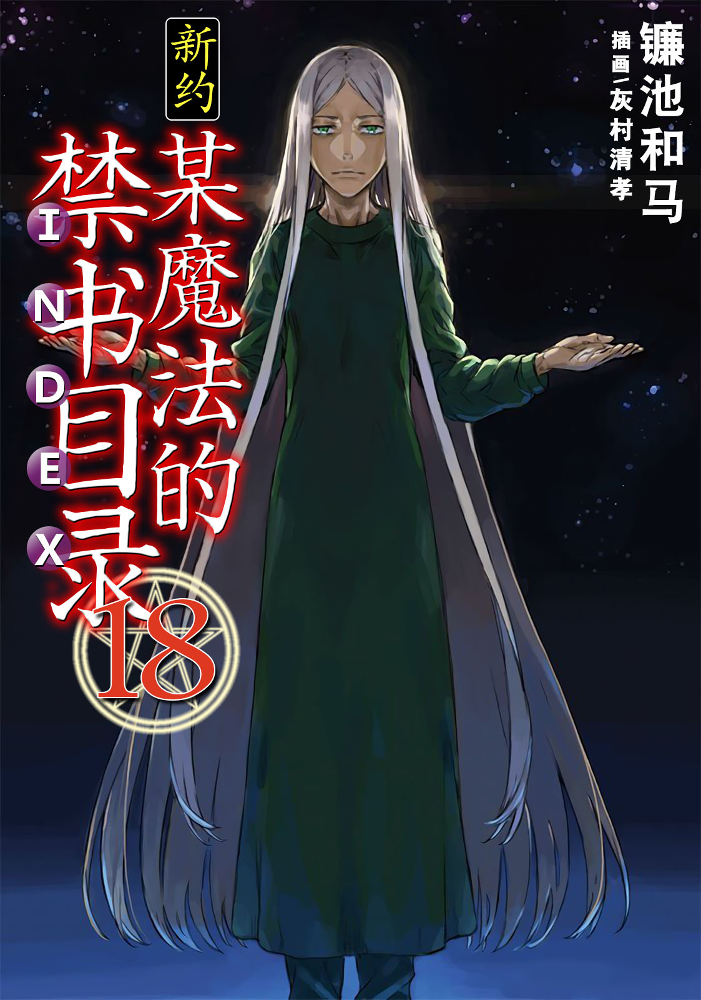
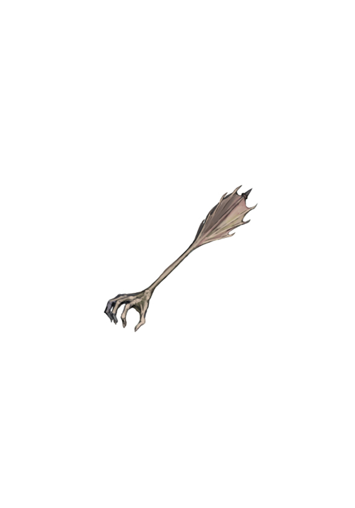

# 简介

**新约·魔法禁书目录18**

作者：镰池和马

## 内容简介

**上条当麻挑战「没有窗户的大楼」，终于与「那个」对决了——！！**

「计划」。

科学的大本营中，坐镇着不死的魔法师，历经百年的夙愿。

变化多端，毫不留情——

被学园都市的支配者盯上的土御门元春和府兰。两人闯入上条当麻的房间，作为最后手段尝试从学园都市逃脱。

然而，穿着绿色手术服的男人绝不会放过他们。他那毒牙般的攻击，以及魔法所带来的「业」，正在侵蚀土御门的妹妹舞夏。

为了打破这一局面，上条与土御门决心突入学园都市统括理事长的根据地「没有窗户的大楼」。

等待他们的是象征支配者精神般的巨大的虚无空间。

上条朝着最高层奋力前进，但突然出现自称米娜·马瑟斯的奇妙猫耳丧服美女引导他体验了不死魔法师走过的「黄金轨迹」，以及「幻想杀手(Imagine Breaker)」的诞生之谜——。

最终，帷幕拉开了。

接下来开始的是，毫无保留的人类亚雷斯塔·克劳利的故事。

## 制作信息

* 翻译：Seeker
* 台版：天使动漫 轻之国度
* 图源：音无
* 扫图：真妹控
* 录入：kid
* 网翻：贴吧汉化组
* 组织：星之翔
* 图源：佚名
* 友情协助：フムロ
* 翻译：limninjkmk 吐槽星1234 为毛取ID这么难 Acdolet Edster792 以汝眼眸为镜
* 校对：JOJO扬 吐槽星1234 Edster792 limninjkmk
* 润色：银某人 无敌王者大怪兽 Edster792
* 修图：Earth终极
* EPUB制作：当麻10032号
* 特典：Edster792
* 整合：知一一（禁书目录X系列，[index-X](https://github.com/1204244136/index-X)）


**版权声明**

转载时请保留录入信息。

本站内容仅供试看、学习与交流使用，禁止用于商业用途；下载后请在24小时内删除。请支持官方正版。


## 封面与封底

