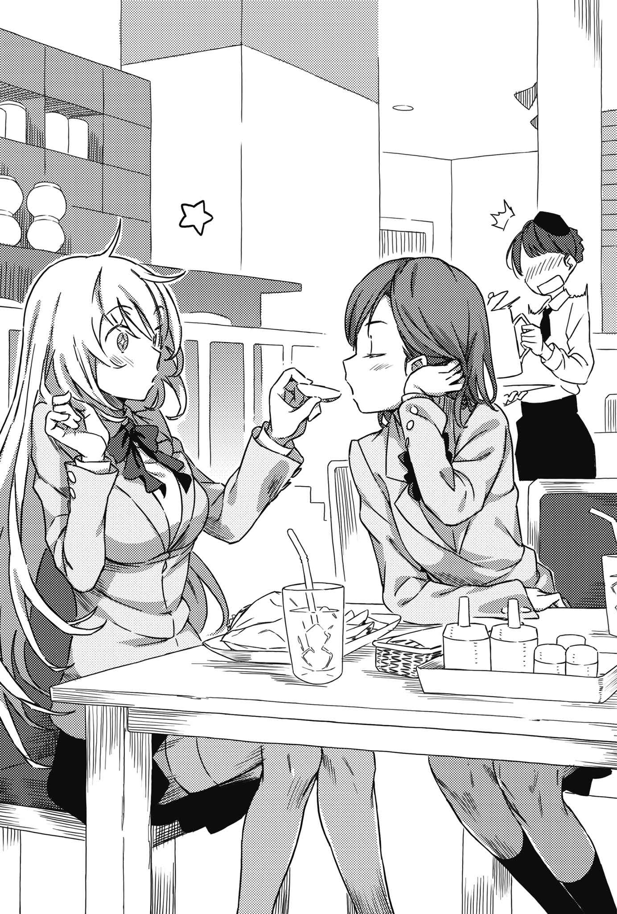

# 第二章 逃跑的方向

> Escape_to_Central.

## 1

向犹如迷茫旅人的御坂美琴搭话的人，是个少女也很熟悉的人物。

「食蜂？我才想问呢，你在这种地方做什么？」

「我看起来像在做什么～？」

「……像个明明台风放假却没接到通知而傻乎乎地去上课的可怜人。」

「咳咳！你在妄想力全开什么啊，怎、怎么可能嘛～！」

「别抓着我讲，距离太近了啦。」

在几乎只差一点就会让鼻尖相碰的距离，第三位一副嫌对方烦的模样别开目光。

御坂美琴与食蜂操祈。

同样让名门常盘台中学引以为傲的两位王牌。在学园都市仅有七人的超能力者(Level 5)里各占一席的怪物。

然而这里没有任何人以羡慕的眼神看着她们。

美琴以手掌轻轻推向食蜂丰满的胸部，让那具充满压力的身躯远离。

「……没人来呢。」

美琴轻声嘀咕。

身穿常盘台中学制服的只有她们俩。没有其他人。既然学园都市已经恢复正常，照理说今天应该要上课才对。尽管校舍变成那样，不过可能还是有商借其他场地，然而没有其他人出现。学校的架构已经崩溃了。

第五位像个孩子般嘟起嘴。

「唉，毕竟发生了那种事嘛。如果一两个人不上学，那么舍监和心理辅导员还能应付；但是这么多人一起来，似乎连大人也没辙喽。」

反倒是顺着「一如往常的」思维来到这里的少女，才真的是与众不同——孤单的女王言下之意似乎是这样。

「我也不是不明白这种心情。」

「御坂同学会这么说，还真是意外力大集合呢～」

「是吗？」

美琴吐出白色气息。

「并不是见惯的校舍被破坏让人受到打击。即使暴徒涌上来，我也没在害怕……我怕的是只知道追求力量的自己。而在已经确保赖以生存的力量后，就算要我们像切换开关一样恢复原来的生活，我们也不敢保证自己能习惯。所以齿轮才会卡住吧。」

常盘台中学是能力开发的名门。

就读该校的千金小姐至少也有强能力(Level 3)，最高更是达到超能力(Level 5)。

所怀「力量」视情况可能凌驾于刀枪之上的学生，绝对不在少数，但这里有个扭曲之处。

没错——

「毕竟还想不到『为什么要锻炼能力』的学生也很多嘛～」

吐出白色气息的食蜂抱住自己并摩擦大腿，同时这么说道。

你是为了什么用功读书？

要是被这么质疑，能好好回答的人究竟有多少呢？因为父母的要求，因为老师这么教，因为社会的结构。恐怕大多都是这样吧。即使有未来的愿景，但如果重新思考这么做是为了考试还是为了将来，会感到迷茫的学生依然不在少数。

具体来说，抱有「设计火箭时要在这里运用这道方程，所以非记住不可」之类的明确认知，以「将七巧板一片片拼上去」的感觉般用功——这种人恐怕少之又少。

常盘台中学的千金小姐也一样。

「像白井同学那样的人，会为了照顾周遭人们而奔走，但她应该算是稀少力的结晶吧。真是的，这种人才交给御坂同学实在可惜。」

「还『交给我』呢，讲得好像她原本属于你一样。」

「但也不属于你呀？」

她们在接受开发的过程中，对于将强大的能力「用在何处」，至今一直没有明确的概念。

「能力……可以用。」

美琴将双手放在嘴边吹出白色气息，不知为何食蜂也靠了过来。可能是因为别无选择，两人一起「呼呼」地保护手指，不让它们因为寒冷而麻痹。

散发甜香的食蜂以肩膀靠着美琴的肩膀，这么接下去。

「……虽然这是理所当然。不过，这种理所当然非常可怕。带来高温的大热浪，加上四处逞凶的元素——毕竟大家已经反复实践到能在那种环境下自然生存嘛。一旦知道可以将**这种能力带进什么事件都没有的平稳日常里**，会感到害怕也就很正常喽～」

力量和快感有些相似之处。

一旦尝过滋味，就会难以自拔。

有的是毒品，有的是耍诈，有的是赌博，有的是作弊。

正因为知道做了会变轻松，才无法动弹。在那种严苛环境依旧能悠然生活的能力，常伴她们身边。若问用或不用，当然是「用」会比较方便。然而就如同从走楼梯改搭电梯会让下盘虚弱，依赖智能型手机的汉字变换功能会让读写产生障碍那样，一旦知道轻松的路就会让人无法自拔，没办法像过去那样理所当然地约束自我。

不能允许自己丑陋地堕落。

有着能够横行于世的力量，是件很可怕的事情。

「从说出『不是不明白』这句话看来，御坂同学也燃烧力全开后燃烧殆尽啦～？」

「我反而不懂为什么只有你能若无其事到这种地步就是了。居然没因此感到震惊，你平常生活到底多仰赖能力啊？」

「虽然我觉得一年到头都在哔哩哔哩的御坂同学没资格讲我就是了，不过这会不会跟我们身为超能力者(Level 5)有关呢～」

「或许吧。」

「没有懂得慎用自身能力的超能力者(Level 5)。」

食蜂这么说道。

「……这样讲或许会有语病就是了～不过，毕竟到了我们这种程度，身份地位已经和自己的能力强弱有分也分不开的关系喽～」

在奥运拿到金牌的运动选手，私生活恐怕无法不和夺金的那项竞技扯上关系；得到诺贝尔奖的科学家，无论从事什么工作，别人大概都会拿那项专业领域的问题向他求助。留下出色功绩的人，会受到那项功绩束缚。「能力常伴身边」这个事实，她们清楚得不能再清楚，更理所当然地与自身能力一同前进。而且，已经到对此毫无知觉的地步了。

尽管如此，御坂美琴依旧这么说。

那些自我与能力产生疏离的千金小姐，自己不是不明白她们的心情。

「……话说回来，有你的能力在，根本不需要什么心理辅导人员不是吗？心理掌握(Mental Out)对我以外的学生都有用吧。」

「或许是呢。不过，我也不认为她们的心理状态有异常到那种地步哦。」

「？」

「有视情况足以杀人的力量常伴身边。而且它和刀枪不一样，不能主动放弃。这种事，本来应该会让人感到恐怖力哦～？」

「这么说倒也是。」

「像御坂同学这样靠实战学习拿捏分寸的人虽然另当别论～但是我认为，在懂得害怕的情况下找出妥协点很重要哦。如果以能力麻痹『持有凶器的恐惧』让人回归学校生活，反而不知道那人会面带微笑做出什么事呢～」

「你是不是把我当成什么夸张的怪物啦？」

「用三倍音速发射那么多金属炮弹却没出过人命，照理说会比拿日本刀把毛剃干净更困难哦？虽然靠感觉运用能力的御坂同学或许完全不明白就是了～」

御坂美琴叹口气。

她大概也没什么锐气了吧。回过神时，她已经说出平常绝对不会讲的话。

「……有些事想和你商量，行吗？」

「哎呀好可怕，感觉会接下雷击之枪所以我拒绝。」

「跟那个笨蛋也有关就是了。」

「快点说啦不用什么事都征求许可！」

不知为何食蜂一脸认真地探出身子。

从旁观者的角度看来，嘴唇与嘴唇的距离在五厘米以内，散发出浓厚百合气息的两位千金小姐这么对话。

「我刚刚说自己害怕的东西，并不是排名第三的超能力(Level 5)，换句话说，并不是指我所冠有的超电磁炮(Railgun)。」

「这种事找排名第五的我商量有什么用～？」

「这不是在炫耀排名。」

美琴以食指抵住近在眼前的食蜂嘴唇。

「我所说的，是能力之外的『力量』。」

「唔～御坂同学，能不能别玩弄人家的嘴唇～？」

「换句话说就是『该拿A.A.A.怎么办』这件事啦。」

## 2

「嗯～？」

当事者——女仆少女土御门舞夏悠哉地睁开眼睛起身后，微微歪头表示疑惑。尽管形似凝固黑影的短剑贯穿了单薄胸口的正中央，她却没有感到痛楚或不适，甚至没有半分恐惧。

「到头来这究竟是什么？该不会是错视图还是立体影像之类的恶作剧吧～？」

……上条当然不希望认识的女孩子捂住胸口在地上打滚，但眼前景象却也让人相当不舒服。当事人有无感觉，不见得能当成评断安全与否的指标。这让他产生极为不祥的联想——他仿佛看到电视偶尔会播的世界奇闻一类节目里，那些因故让手术刀或手术钳留在体内，却还是正常生活的人。

而现在并非拘泥这种问题的时候。

有个沉重的声音响起。

「……？」

上条皱起眉头，在场所有人一同往声音来源看去。

路边有样东西。某样刚刚应该还不存在的东西。这个明显与周边风景格格不入的异物，起先上条还无法想象它到底是什么。一个连用在什么地方都不知道的银环，上头既没有文字也没有图案。到头来看出其真面目的人并非刺猬头少年，而是他身旁的土御门。

「手铐？」

嗯，没错，就是手铐。没锁链且只有一边，所以让人一时没反应过来，不过仔细一看的确没错——尽管不合时宜，上条依旧松了口气。莫名其妙的东西落在能解释的范围内，让他有种近似安心的感觉。不过他当然没有接触这种不祥道具的机会。

然而，事情当然不会就此结束。

某样东西动了起来。

银环的某一端窜出有手指粗的锁链，仿佛要补足手铐欠缺的部分。明明根本没有任何安置的地方，锁链却像卷尺一般，无止尽地伸长下去。它们持续蠕动，彼此缠绕，回过神时，长串锁链已经构成某种形体。

简直就像人类的骨骼。

接着空间中飘荡的某种物质宛如麦芽糖般缠住骨骼，替它裹上透明血肉。

这个将银环当成头盖骨的物体，额头贴地四肢缩起，看起来就像蹲在地上。

四肢着地并将环状部分扬起的它，明确地盯着上条等人。

比起人类，它更像是一只野兽。

由此联想到的东西，令茵蒂克丝不由得轻声咕哝。

「……Beast666。」

「亚雷斯塔·克劳利的魔法名吗！」

肩上的欧提努斯这一喊成了导火线。

化为透明血肉中心的手铐与锁链发出诡异虹光，有种在黑暗中穿上LED装跳舞的异世界感。这让人联想到以下勾投法沿着地面飞来的棒球。

都到了这一步，实在没办法说对方不带恶意。

也不可能只是偶然碰上街头杀人魔或拦路抢劫。

「呜哦哦！」

上条老实听从自心脏传向全身的恐惧与排斥。他握紧右拳，向前踏出一步。与其说是鼓起勇气，不如说他是抱着类似「为了转台不看恐怖片而抓起遥控器」的消极心态挥拳。

「啧！慢着，人类！！」

肩上的欧提努斯再度大喊。

上条虽然为之一震，但已经收不住动作。他只知道，自己踩到了某个天大的地雷。毕竟连那个用「主神之枪(冈格尼尔)」与「弩」正面击破幻想杀手(Imagine Breaker)的「魔神」，都会慌张地制止。绝对会发生什么天大的坏事。一阵让他不禁想闭上双眼的恐惧与后悔悄悄涌上背脊。

接着拳头撞上锁链骨骼。

紧接着。

&nbsp;

「磅」的一声。

透明血肉与彩虹骨骼，宛如水球一般简简单单地就被弹开。

&nbsp;

「咦……啊……？」

正好相反。

事情太过顺利，让上条的心脏不规律地跳动。就像人家明明已经说过「这支圆珠笔敲下去就会有电流哦」，咬牙尝试却什么也没发生一样……？思索眼前现象究竟该如何处理，让他脑中一片混乱。

但众魔法师并未放下戒心。

「不可以大意。**有种像云气的东西缠上来了**！」

「？」

外套比基尼府兰这么一说，上条才打量起自己。

的确。

和静电、极光、雾全都不一样。带有类似CD表面那样的光泽。看似从空气中渗出却又捉摸不着的云气状存在，开始在上条周围弥漫。缠住自己的色彩与那个奇特手铐相同，就连不懂魔法的上条也有种不祥预感。

「可、可是那又怎么样啊？这些不知道是光还是雾气的东西，就算缠上身也没感觉啊。说起来就连痛楚还是什么的……」

正想说「也都没有」时，上条突然全身僵硬。

愣住的土御门舞夏就在他眼前。

一名虽有异物贯穿胸口正中央，却感受不到痛楚或不适的少女。本身没有感觉，不见得等于没有异常。

「『业』吗？」

土御门不高兴地嘀咕。

上条皱起眉头。

「业？」

「因果报应。或许会有人认为这种招数不像出自英国人克劳利之手，然而，就算是崇尚卡巴拉思想的『黄金』，他们当成根基的赫耳墨斯学派，也是把托特、墨丘利这些埃及与希腊等各个地方的神话大杂烩，克劳利甚至留下了特殊对应表，用来将东方的易经换算成西洋数值。这人经常旅行，到过亚洲，还曾经在看见镰仓的佛阁时当场打算改宗。」

「呃，重点是我不懂那个叫业还是因果报应的是什么东西。」

「业障的业。换句话说，就是『自身行为会替自己招来相应结果』的思维。」

肩上的欧提努斯抱起双臂，哼了一声后开口：

「这些业里面，最简单易懂的就是杀生造成的因果报应。如果某人杀了别人父母，则死者的子女会将他当成仇人追杀。这就叫自作自受……而你刚刚下手了吧？你用右手粉碎彩虹锁链杀掉它，背负了相应的罪业。这个情况可不有趣哦，**那家伙**明显是为了让你背负罪业才派出刺客。」

茵蒂克丝面有难色地补充：

「根据第四之书和777之书，『锁链』这种象征武器(Symbolic Weapon)应该是束缚迷茫思绪的因子才对。然而和『火之杖』与『风之短剑』不同，它并非有形道具，只能限制失去意识的术师。」

「结果被这东西缠上到底会怎么样……？」

「不知道。不过，累积的数量越多效力应该就越强。像是区区一张纸可以用手指贯穿，换成一整叠纸就能挡住枪弹那样。」

上条脑袋里，隐约浮现自己被迫穿上十件百件衣服的画面。接下来会是重量还是痛楚？也有变得无法动弹的可能性。

「可是这么一来，只要用右手把这个……业？把这种彩虹雾气破坏掉……」

「你以为一直饲养幻想杀手(Imagine Breaker)到现在的亚雷斯塔会没考虑到这种事吗，人类？要杀业是办得到，但这么一来只会产生『杀害业的业』而已。好比即使反过来干掉为父母报仇的孩子，也会有他的兄弟姐妹来袭一样。」

考虑到杀越多，那个叫「业」的东西就越会增加，这么一来等于滚雪球。到头来，别理会它们大概才是最佳答案吧。

而且有件事令人在意。

「先等一下……假如是『杀得越多，惩罚就累积得越重』这种规则……」

「是啊。」

土御门丝毫不敢大意地环顾周围。

&nbsp;

「实在不太可能只来那么一次。」

&nbsp;

「咚」一声。有东西掉下来了。

不知道是从哪里出现的。总之在稍远处，有一个和刚才一样的手铐环。

不，不仅如此。

这次和刚才不同，还有个状似自行车齿轮的东西。

嘎啦嘎啦嘎啦嘎啦！激烈的金属声响起，两端各自冒出锁链，形成状似人类的骨骼。

一边是用来束缚物体，封锁动作的锁链。

一边是用来传递力量，加速动作的锁链。

尽管同为锁链，意义(Essence)却不同。

「有不在原有权责范围内的象征武器(Symbolic Weapon)……？将齿轮当成太阳就是男性原理，将手铐当成环则是女性原理。这是借由制造对称去凸显不存在的属性啊！」

「糟糕，这就是叫『业』的惩罚吗？是我叫来的吗？」

闪着诡异光芒的锁链骨骼令上条毛骨悚然，但抱着三色猫的茵蒂克丝摇头。

「不对，如果是这样，或许根本无法说明第一只怎么出现在这里。这么说来，起因应该在当麻破坏彩虹锁链怪物之前！」

「起因……？」

追根究底，最先出现的异常状况是什么？

上条当麻、茵蒂克丝、欧提努斯、乌丸府兰、土御门元春，甚至是三色猫，全员都看向某一处。

「？」

只有当事人——承受众人目光的土御门舞夏不解地歪头。

那柄无痛的黑影短剑，还刺在她胸口正中央。

状似麦芽糖的透明物质裹上那两具锁链骨骼。那是血肉。拥有锐爪与利牙的刺客即将诞生。

即使打倒它们也不代表结束。

会没完没了地增加。

「开、开玩笑的吧……」

业之兽。

打倒一只就会有虹色雾气缠身，没人知道累积到十只百只会如何的神秘攻击手段。

和胜负无关，会确实让人背负「某种东西」的罪业集合。

墙内，无人求助的情况下，明确的威胁持续出现于无人领域里。

「所以是怎样？只要那个还插在舞夏胸口，就会无止尽地涌出什么手铐、齿轮之类的东西吗！这么一来不管到哪里都甩不掉嘛！」

咚！

虹色锁链骨骼与透明血肉，宛如盯上生肉的鬣狗般从多方向逼近。带爪的手、手、手、手！看见接二连三伸过来的这些手，即使知道不该这么做，上条依旧下意识地握紧右拳。

「嗯！」

外套比基尼府兰突然出声。已经不当UFO少女的她，同时也是英国清教的魔法师。

「处女宫。Heh、Heh、Vau、Yod，在因岁差失落的第六宫光芒指引下，神名八字的天使啊，驱除眼前的灾厄！」

她的指尖放出黄绿色光芒。

但在明白这么做具体来说有何意义之前，自行车齿轮的锁链已经跳了出来。当代替头部的齿轮一转——

「不行，等一下！」

就在茵蒂克丝大喊后，兔子天线指尖的光芒变了颜色。

正想怎么会切换成鲜艳的红色时，光芒已在她手中爆开。

「呜呜！」

手铐锁链跟着逼近因为爆炸而呻吟的少女。已经管不了那么多了。上条挥拳打向怪物。

实在太过轻易就出现的破裂声响起，「业」再度缠住上条的手臂。

显得厚重而不祥。

府兰则是捂住自己的手，皱起眉头。

「……为、为什么排在第一的白羊宫会……」

「影响人心，改变脑中浮现的配色！手铐是停滞，齿轮是加速。它是让光色在红到紫这些能用玻璃柱分解出来的颜色里转换啊！」

高中生上条无法评估有多危险，但对方似乎会让魔法失控。

而一旦与魔法有关的东西派不上用场，上条就会显得更为重要。

声音响起，新的虹色锁链从凭空出现的手铐环上冒出。

间隔越来越短。

然而，不得不说这些接连到来的异变令上条分了心。

因此他没注意到。

原本就在身旁的金发太阳眼镜少年——土御门元春，已经在不知不觉间消失无踪。

&nbsp;

轰隆————！惊人的巨响迸发。

巨大的黄色吊车突破包围网冲了进来。

&nbsp;

重量有十吨以上。

不踩刹车直接冲来的钢铁怪物，累积了够多柴油引擎的力量，像打保龄球一样把刺客全部撞飞。

当然，坐在上面的人就是那个家伙。

「上车！」

「你说上车，但它只有驾驶座吧土御门！」

不得已，上条推着舞夏与府兰的屁股让两人爬上侧面，再抓住茵蒂克丝的手拉着她，像救难队员攀着消防车那样紧贴车侧。戴太阳眼镜的粗鲁老哥也没等他说好，就推着大号排挡杆让超重量级的怪物车辆前进。

上条等人攀着的吊车再度碾过路上蠕动的虹色锁链，冲出包围网。

在狂风吹拂下，上条忍不住看向后方。

「该死，它们若无其事地爬起来了呢！」

「除了阿上你的幻想杀手(Imagine Breaker)之外，大概没什么办法能干掉它们吧。虽然部分原因在于这是亚雷斯塔那种等级的大魔法……不过更重要的是，它们完全盯上你啦喵～」

驾驶座传来的声音不带焦躁。

仿佛早已料到会有这种程度的麻烦。

「反正无论如何都得到第七学区的『没有窗户的大楼』。直接这样冲过去就好啦！」

「……」

虽说是超重量级的吊车，速度拉起来后似乎还是相当快。后方追赶的手铐刺客与齿轮刺客显得越来越小。上条等人从会联想到死亡的寂静无人集装箱区冲进充满活力的闹市区。

然而这并不代表危机结束。

「哇！怎么啦怎么啦～？」

明明是最重要当事者却没什么危机感的女仆少女舞夏，在攀着吊车侧面的情况下大吃一惊。

咚！砰！

路上偶尔会不规则迸出橘色火花——因为凭空落下的齿轮与手铐环撞上柏油路面。不过或许是速度没跟上吧，在落地产生明确的形体前，它们就已被远远抛开。

「什么跟什么啊，那些东西会没完没了地生出来吗！」

「不，追根究底，它们并不是物质性的存在。大概是无法继续追踪的旧个体主动消失，让『空缺』增加！『名额』应该还是只有一组两人才对！」

但是不能大意也不能放心。

虽说能靠速度甩开，却不代表它们会就此消失。要是空出来的齿轮或手铐能随时出现在舞夏周围，那么拉开距离也没意义。真要说起来，就等于接力赛跑时明明已经拉开差距，对手的下一棒却提前起跑一样。

不能乖乖地被干掉，但轻易解决它们又会背负惩罚。而且即使减少对方的数量，也只是开出空缺而已。这么一来，也只能全速逃跑了。

「我有点在意……」

坐在肩上的欧提努斯这么咕哝。

「这招确实阴险，但缺少决定性。简直就像为了把我们赶上既定轨道才派出追兵。它们等于是赶野兔的猎狗。」

上条不由得为之一惊。

「……意思是那个叫亚雷斯塔的家伙，是要引诱我们进『没有窗户的大楼』？」

「不，这么做没有意义。你或许没什么实感，不过『没有窗户的大楼』可是科学阵营的中枢哦。那里是绝对不能沦陷的主城。如果能自由决定把敌人引诱到哪里，那么只要把我们引到什么都没有的死巷里围殴不就好了吗？」

「这就是那家伙的作风。」

待在驾驶座的土御门插嘴。

「胜利也好，败北也罢；成功也好，失败也罢；获得也好，丧失也罢；光荣也好，挫折也罢；对于亚雷斯塔·克劳利而言都一样。无论骰子丢出一到六的哪一面都无妨，**只要能把条件整顿成后续发展一致**，就可以达到目的。他是认真地这么想。毕竟一般人若在召唤科隆尊时失败得那么惨烈应该会灰心丧志，但他反而更来劲了呢。」

可以感受到某种强烈的趋势。

尽管上条等人拼了命试着从激流里游上岸，但是不管怎么挣扎，都会有大量的水缠着他们不放。越是努力，水流就越是像嘲讽似的将他们往下游带。

「……」

土御门的吊车在早晨的街头狂奔，无视诸多信号灯闯过十字路口，豪气地突破发出巨响放下栏杆的道口。

占地再怎么广，终究只是一座城市。

从第十一学区进入目的地第七学区，花不了多少时间。

兔子天线少女对曾见过的入口有所反应，出声提醒。

「看到了。」

「阿上，出入口在哪里？」

「啊，嗯，我记得道路会切出方形的洞口，对了，就在那棵枯掉的行道树那边……！」

喵喵太阳眼镜没等人把话说完。他拉下手刹车就地转动巨躯，猛然解放原本位于吊臂底下的东西。

那是个用来拆房子的巨大铁球。

超特大流星锤存饱了离心力甩出，重重打在借由伪装成柏油路面而紧闭的地下出入口上头。这股破坏力再怎么说也足以让超过十吨的吊车单轮翘起。尽管不知道原本有多少的锁头与门栓保护，但是这一击就砸开了方形的出入口。

也不知发生了什么事，土御门操纵的吊车一边回正车身，一边冲进往下的坡道。

有件事不能忘记——此刻齿轮与手铐环仍然先后以攀着吊车的舞夏为中心诞生。无论怎么踩油门拉开距离都不能掉以轻心。

轮胎发出嘎哩嘎哩的摩擦声，一口气飙到最底层。

吊车发出尖锐声响紧急刹车。这里还是一样宽敞。靠着一只右手支配上百名少女的木原唯一就是以这里为据点。

真是奇妙的巧合。

那个破灭与灾厄的空洞，对于现在的他们来说，已经成了希望之路。

（这么说来，唯一她**消失到哪里去啦**？哇！）

差点被甩下车的上条仰头看去，随即见到宛如钟乳洞般吊在天花板的火箭推进器。那些东西都已毁损，露出巨大的伤口。从那里就能闯进固若金汤的「没有窗户的大楼」。

「……」

就连外套比基尼府兰，也犹如仰望太阳般看向头上的大洞。

已经不在此地的上里翔流，替他们带来突破口。恋情已画下句号的少女，心中究竟闪过怎样的念头呢？

「没时间了！」

土御门放下支撑脚让吊车站稳，然后伸长吊臂并这么大喊。没错，一旦停车，就无法逃离随时可能出现在舞夏身边的那两只锁链怪物，还会撞见追赶在后的那些家伙。而且解决掉越多，缠上来的神秘惩罚「业」也会越重。

这么一来，也只能持续移动。

「要从这里过去啊……？」

「你之前又是从学生宿舍往下跳又是从飞机上往下跳的，不可能到现在才说有恐高症吧，阿上！」

所谓现代版的杰克与魔豆，原来是吊车朝斜上方伸出去的吊臂。[^1]上头既没有扶手也没有救生索。只要脚下稍微一滑，就会倒栽葱撞上坚硬的地板。

如果硬是要考虑得积极正面一点，也只能这样。

问题1，从高处坠落和遭到恶心的虹色锁链折磨至死，哪个比较好？

「该死，这也太狠了吧！」

方针已定。

首先由动作灵活的土御门抓着吊臂领头。不用说，这跟登山向导一样，是为了「示范」给后面的人看。接着由茵蒂克丝、舞夏、府兰等女孩子跟上，上条负责殿后。

（虽然在这种状况下，就算有人往后倒我也接不住……）

但他没有不识相到把这种话说出口。

至于在他前面的外套比基尼，先是边爬边摇晃着屁股上的足球状天线，接着突然开始用一只手遮挡自己的小屁股。

诅咒的声音传来。

「……抬什么头啊你这个大变态垃圾虫子低角度偷窥混蛋。」

「泳装不算春光外泄的范围！话说回来冬天还穿短裤的小鬼哪有什么吸引力啊！」

「麻烦不要把人家的穿着品位归类到非常平淡的范围！」

虽然这段时间内，沉重的手铐环与齿轮依旧不停出现在舞夏周围，但一行人终究是在很细的吊臂上。由于没什么地方让那些东西落脚，所以它们纷纷摔往遥远的下方。

但众人无暇喘息。有着虹色锁链骨骼与透明血肉的怪物，同样爬着吊臂追来。

「啧！啊啊真是的！」

上条将来袭怪物之中有齿轮的那一边踹下去。虽然不用幻想杀手(Imagine Breaker)就不需要背负神秘的因果报应，但相对地就无法解决敌人——因为那些家伙不管从多高的地方摔下去都不会死。

然而，也因此他没空在意对于高处的恐惧。

不知不觉间他们已经爬了相当远的距离，顺利从毁损的推进器潜入大楼内部。

可是不能忘记，有入侵管道，也就代表敌人能循着同样的途径追来。

「唔，让开阿上！」

土御门跳向前。

他也不管自己太阳穴附近的血管鼓起，扔出以纸张折成的龙。

「五行之黑，以水龙之浪去除障壁(喂混蛋，别睡了给我去工作)！」

紧接着。

那对怪物中的手铐环「咔嚓咔嚓」地开合。

它们要改变颜色让魔法失控。

不过——

「我早就把失控算进去啦————！」

他毫不在意，硬是继续下去。

凭空出现的洪流在土御门周围缠绕，然后猛然撞向吊臂前端。被甩出去的吊臂，带着超重量级吊车一起翻倒。豌豆藤被人砍倒，甩下那些还攀在上头的亡者。

「呼……」

「哥？你怎么了，老哥！你满身都是血啊！」

「……哈……」

土御门无理回应吃惊的舞夏，弯下腰吐出一大口血。身为魔法师却参加能力开发，这么做带来的弊害侵蚀着他的身体。

实际上，这个副作用没有「还能用几次」这种数值存在。

可能用一百次都撑得住，也可能一次就让人因为心血管破裂而死。他就是遭受这种犹如俄罗斯轮盘的不讲理束缚。

「没有继续追来……那些家伙总不会像天使或恶魔一样长出翅膀吧……」

土御门以手背擦拭嘴角，同时这么说道。

就在这时，他们听到清脆的「喀啷」声。

「可是不解决舞夏的问题，那些什么手铐、齿轮的彩虹锁链会一直冒出来。快点前进，不然会被挟击……！」

## 3

A.A.A.。

Anti-Art Attachment。

原本这应该是个和御坂美琴无缘的词，就连入手原因也近似不劳而获。然而这东西与少女渐渐变得密不可分也是事实。

尽管如此，它依旧充满谜团。

它似乎是木原唯一率领众多元素彻底破坏常盘台中学校舍的原因之一。而「诅咒」这个耳熟的词成为具体威胁，或许也是因为美琴借由A.A.A.「更加深入」。

「换句话说，我跟她们一样。」

美琴再次这么表示。

地点在「学舍之园」外面的汉堡店。不是随处可见那些门户大开的连锁店。进入拥挤的混居大楼，走上狭窄的楼梯之后，才会来到这间不知道到底欢迎谁的小店。而且这家店外头连招牌都没有。如果不知情，看上去大概只像一间怪胎云集的事务所。

食蜂操祈在店门口拨了拨蜂蜜色秀发，一脸逮到机会的得意表情这么说道。

『开在「学舍之园」并不代表一定是名店。会加入防腐剂、色素、人工甜味剂、牛油、猪油等各种东西又假装不知道的店家也不少。一个人的品位就看他能找到多少隐藏的真正好店哦。』

『是是是，知道隐藏名店的我好厉害理论对吧。了不起了不起。』

『……哼。』

『为什么突然变可爱啦？你是被人家轻视就会退化成幼儿的那种人啊？』

于是来到现在。

也就是偶尔会在电视上看见的那种「明明怎么看都是成屋或公寓中的一户，一走进去却是谢绝参观的高级法式餐厅～」。美琴不得已只好摸摸人家的头，女王大人的脸却像麻薯一样鼓了起来，不过这些暂且放到一边。

「啊嗯啊嗯☆」

或许是这个味道和什么幸福的回忆有关吧，坐在斜前方的食蜂操祈露出孩子般的笑脸咬着特大汉堡。美琴让主题继续下去。

「这种莫名其妙取得，而且突然就强迫人有所自觉的『力量』，会让人在很多地方乱了方寸。不过老实说，我现在明显被那种犹如『看不见的世界趋势』的东西远远抛在后头。如果不依靠A.A.A.这种来历不明的『力量』，我根本站不上舞台。」

「我说御坂同学啊～」

第五位将没办法一口气吃完的汉堡暂时放回盘子上，轻轻伸出舌头舔去嘴唇上的油脂，然后用吸管吸了一口以天然水制作的碳酸饮料，并且把手伸向薯条。她以无语的口气说道。

「所以呢，结果问题力的核心在哪里？『哦哦，得到过强力量的自己好可怕』……你只是陶醉在这种话里头吧？」

「……就某方面来说我要感谢你，食蜂。能够讲得这么不客气的人，找遍常盘台大概也只有你一个。」

「因为啊～」

食蜂将一根薯条递向美琴的嘴。

「你试着把条件放到天秤上比一比嘛。是得到力量好呢，还是没得到力量好呢？如果你选择『没得到』会有什么活路可走吗？」

「啊嗯。」

「……居、居然老实地咬住了。老实说我有点意外。」

「看到一肚子坏水的你有那种吃相，就知道这东西吃下肚没问题了。」

不过在稍远处替别人加水的女侍则看得满脸通红，还慌慌张张地让水从杯子里满出来，这点两人似乎没注意到。

「言归正传～假设A.A.A.需要某种类似代价的东西，那么对于已经不知不觉付出那些东西的御坂同学来说，现在才放弃并不代表风险会就此消失吧？不管那是肉体方面的问题，还是……唔，『诅咒』？事件方面的问题都一样。」

「呃，但因为这样就狂用不是太极端了吗？就算吞过一颗来历不明的提神药丸，也不代表明白成分之后就可以猛吞吧。」

「不是这个意思～无论是A.A.A.的副作用还是那个『诅咒』的后遗症都一样，就算找一般的医院也得不到保证吧？既然如此，除了亲手分析A.A.A.之外，不就没有其他让人安心的方法了吗？如果是可疑的药丸或健康食品，把样本送到可靠的机关或许就能搞定，但看起来也没有这种对象能找，除了自己动手以外不是别无选择吗？」

「……话是这么说没错啦。」

看着美琴像个小孩一样嘟起嘴，坐在斜前方的食蜂夸张地叹口气。

她靠着椅背，用修长的腿在桌面下勾住美琴戏弄她，同时说道：

「找人商量的人大多都是这种感觉呢～真是的，明明答案都已经出来一半了，却因为害怕一个人扛责任而想推给别人分散压力。对于好心听烦恼的人来说还真是场灾难，毕竟事情又不是自己做的，却得帮人家扛一部分的责任嘛～」

「……」

「真是浪费时间。如果御坂同学不是**这样**，只需要一只遥控器把真心话拉出来就搞定了。为什么我是第五位而你是第三位呢～」

「那你为什么要陪我扯这么多啊？」

「那还用说，这件事和那个刺猬头有什么关系？」

## 4

「没有窗户的大楼」。

上条等人之所以来到这个不见人影的巨大空间，是为了处理舞夏胸口那柄连茵蒂克丝和欧提努斯都不知道如何解决的黑影短剑。为此要潜入亚雷斯塔·克劳利的城堡，找出与他自创术式有关的资料，借此倒算回去，重新编组用来中和、抹消的魔法。

（不过，科学阵营大本营学园都市的首脑，居然是魔法师啊……）

上条再度为了这个扭曲的世界构造屏息。

而「没有窗户的大楼」内部构造也不怎么正常。

只看前后左右的宽敞程度倒还好。差不多有四间学校体育馆那么大。如果把各种内墙都打掉弄成一整个空间，有这种尺寸或许也没什么好惊讶的。

问题在于高度。

看不见。

无论怎么仰望，都看不见能称之为天花板的东西。一切都在黑暗之中。就算整栋大楼都中空挑高恐怕也营造不出这种景象，看起来甚至像是条通往宇宙空间或异次元的垂直隧道。规模大得犹如登山。

「『没有窗户的大楼』原本是个巨大火箭。」

坐在肩上的欧提努斯这么说道。

「没了推进器，照理说已经失去飞出行星的能力，但它并未就此放弃，而是强行延伸内部空间，试图连接到目的地坐标。所以才会产生这种超出欧几里得范围的奇特空间构造。」

「不是生命之树，也不是邪恶之树……这么一来，简直就像是独自构筑的第三棵树呢……」

虽然上条完全听不懂她们在说什么，不过那些用上齿轮和手铐的虹色锁链怪物，正以舞夏为中心不断地冒出来。想都不想就干掉它们很危险，对于无法停下脚步的上条等人来说，也只能持续往上前进了。

「那边有楼梯！」

上条大喊一声领着众人过去。有道螺旋状物体顺着大楼墙面蜿蜒而上。那是楼梯，是电扶梯，是工地或矿山等处会看见的小型电梯。懒骨头府兰到了这种时候还在按电梯的按钮，上条敲她的头表示没时间等，要她乖乖走楼梯。

内部构造没什么合理性可言。

这里只有一栋让人不断往上爬的建筑。尽管途中踏脚处分成上下，走法各式各样，但还是能看出整体的趋势。仿佛从一开始就是为此而设计的单一路线。

「喂，我说啊！土御门！」

「啥事喵～？」

「『往上逃』，在火灾的时候常听到，但实际上这根本不叫逃跑吧？我总觉得我们是在往死路走啊！」

「不然你要停下来被火烧吗？总之动作快动作快！」

明明逃得很顺利，那种宛如被蛛网逮着的讨厌感觉却没有消失。就像猜拳无论胜败都会抽到下下签那样，有种难以言喻的走投无路感。

因为，一开始的异样感始终挥之不去。

由暗影凝聚而成的短剑刺中舞夏胸口那一刻起……当事者就已陷入危机却不自知。

她似乎不是因为不痛而开心，是因为「感觉不到痛楚」而掉以轻心……

（该死，有种怎么做都没反应的感觉。这么一来，连到底做得对不对都不知道啊！）

虽然只是沿着楼梯和停摆的电扶梯往上跑，但在完全看不见终点的情况之下，疲惫感会十分严重，就像把登山和马拉松合体一样。上条先前都没考虑过保存体力，一直拼命狂奔想甩掉用齿轮和手铐当头的虹色锁链怪物，此时身体自然而然地开始摇晃。

他也没多想，就把手伸向画出巨大螺旋的楼梯扶手。

怪事发生。

毫无前兆。

金属材质的扶手，宛如糖做的工艺品一般碎裂。

「喂————！」

他仓促之下脱口而出的话语，疑问和埋怨似乎还大过恐惧。然而事情已经发生也无可奈何。他下意识地在空中摸索想抓住什么东西，但整个人都已经往扶手压下去，所以无法修正姿势。

少年的身体落向扶手的另一边。

行星产生的凶恶重力化为死亡的发丝，紧紧地缠住了上条当麻的身体。

## 5

这里是雾的世界。

「……欸？」

自己刚刚不是跟崩塌的扶手一起摔下去吗？尽管没道理的事接二连三，但有支撑双脚的地面，让上条觉得十分安心。虽然有种很严重的空虚感，或者说有种戴上VR装置看见面前有顿大餐而产生的虚伪满足感，使得他隐约有些不安……但能够抑制对心脏的压迫依旧非常重要。

上条依序摆动自己的手脚，先确认没有任何地方骨折。

「这里是哪里啊……欧提努斯……咦，欧提努斯？」

仔细一看，原先坐在他肩上的「魔神」已不知去向。

大概是摔下来时飞出去了吧。如果不是这样——他试图思考其余可能性，却发现什么都想不到。真要说起来，他连目前的状况都没弄清楚，当然不可能提出什么假设。

叽叽。

犹如诱虫灯闪烁般的声音响起。

接着，从雾气的彼方传来听似温和女性的嗓音。

&nbsp;

『开始喽……』

&nbsp;

开始什么？

上条还来不及质疑，便感觉到人类的气息。

然而，气息并非来自刚刚在雾气另一边出声的女性。从截然不同的方向，传出数个吵吵闹闹的孩童声音。

虽然热闹，但没有开朗、快乐的情绪。

反倒是股负面的奔流，隐含着孩童特有的那种会将虫子的脚一根根撕碎的残忍。

一开始只感受得到这些，就像有道透明墙壁抵在鼻尖上一样。

到了这个时候，上条才注意到语言的差异。刚才的女性与现在的孩童，说的话听起来都像是英语，上条要听懂却毫无问题。如果允许用老套的方式形容，大概是思绪一类的东西像副声道那样叠上去吧。

『老师，他连在床上睡觉的时候都要把手放进棉被里！』

『他脑袋有问题，都是因为不信神才会变成这样！』

『爱德华，过来这里。为你让大家不安这件事道歉！』

（……？这是怎么回事？）

听起来像在谴责团体中的某人，但就算是这样也让人搞不懂。以借口来说应该编得更像样一点，这么一来连牵强附会都算不上。

然而，雾气彼方那几道身影，对于自己的正义深信不疑。他们的脑袋里只想着要把某人拖上台，让那人低头道歉。

多数决的胜利。

把这种东西当真理的小小世界。

无论它有多么不合逻辑都一样，在这座牢笼里只要不迎合大众就会遭到排斥。

这种抓着人不放的烦闷气氛，就像吸饱了水的毛毯。

『这些家伙实在太愚蠢了……』

有个耳语声。

某人就在上条身旁。那是个纤细的银发少年，年纪远比上条来得小。那张可说是稚嫩的脸上只有苦涩与不满。上条在这里完全只是个观众，少年似乎没注意到他。

雾气流转。

看似成年人身材的男女，在雾的另一边喊着某些话。

『为什么不听我们的话！』

『还以为只要送你进严格的寄宿学校，就能让你理解神的教诲！』

『爱德华，啊，爱德华！你到底要愚蠢到什么地步！』

……不知道为什么。

虽然没有任何根据，不过旁观者上条已经看出了他们的关系。这些大人原本应该是要保护银发少年的人吧。但是他们只在意「正确」而疏忽了努力。他们坚信，只要交给严格的学校照顾，就能让孩子具备循规蹈矩的精神。

少年这么嘀咕。

『就连信仰神，提倡正确的人们，也会展现这么丑恶的一面吗？』

也不知是不是听到了这个声音。

某样东西从雾里丢来。是个装满了水的陶瓷花瓶。

会命中银发少年的脸。

「啧！」

这么想的上条，下意识地将手伸向旁边，挡住那个花瓶。手掌感受到沉重的冲击，痛楚令他屏息。尽管还搞不清楚状况，但是上条重新明白到不能掉以轻心。这表示如果有人在雾里拿菜刀朝上条挥舞，也有可能让他就这样死亡。

而银发少年看都不看他一眼。

这恐怕就类似电影，他们对于上条的存在毫无知觉。

『那么，想必研读圣经不会看到真理。放弃自己思考而盲从前人教诲，只会得到那种丑恶罢了。』

那些人被捧为正人君子，表面上犹如人类模范，少年却总是看到他们的「这一面」。

在少年心中，无疑只剩凝结成黑色的疑问与嘲弄。

银发少年以宛如遭受幽暗怒火烘烤过的声音，这么说道：

&nbsp;

『既然如此，我就要找到真理。取回因为愚蠢盲从而失落的过往道路。』

&nbsp;

啪叽！

上条还以为眼神迸出火花般的东西，一回神才发现雾气与银发都已消失。

应该说，实际上他甚至根本没摔下去——抓住的金属扶手回以可靠的触感，扎扎实实地支撑住刺猬头的体重。

原来的楼梯，就只是楼梯。

「当麻，怎么啦？你突然愣住了。」

「再不快点就要被虹色锁链追上了啦！」

（……？）

尽管看见茵蒂克丝与府兰瞪着自己，上条的脑中却满是疑问。他不由得将手伸向右肩，确认坐在那里的十五厘米妖精是否存在。他用手指轻抚戴着帽子的小巧头顶。

「喂，住手，人类，不要在这么多人面前玩弄。做这种事要考虑一下时间和场合！」

有触感。

欧提努斯果然还在。

也就是说……到底怎么回事？刚刚欧提努斯不在肩上时看见的景象，究竟有何意义？

虽然脑子里满满都是疑问，他却无暇一一整理。

正如刚才少女警告的。舞夏——说得精确一点，是刺在她胸口的无痛短剑——具有产生齿轮怪物和手铐怪物的力量。如果停在一个地方，会遭到一对怪物夹击。

在楼梯、电扶梯、电梯等复杂交缠的踏脚处上，冒出许多染血怪物。由于前后都被堵住，此时只能强行突破。

土御门仓促间掏出许多折纸。

「啧！阿上，舞夏拜托你了！只要不用幻想杀手(Imagine Breaker)，就不必考虑业的问题！」

「慢着土御门！你身上也还带着伤吧。麻烦你去支援茵蒂克丝和府兰。既然那家伙是魔法师，你的知识应该派得上用场才对！」

成群结队来袭虽可怕，单一个体的力量倒不至于无法抵抗。所以上条的判断应该不会有错。

（欸？）

只不过。

关键在于，他们所相信的前提没有错误。

（它们**本来是三只**吗？）

啵！

突然间，锁链怪物之一从内爆开。即使能看到在它另一端的景色，也不能证明其中没有任何东西。让光线折射的深处，有个银发及腰且身穿绿色手术衣的「人类」。既像男性又像女性，既像大人又像小孩，既像圣人也像罪人的某人，于极近处缓缓朝上条伸出右手。32、30、10。不可思议地，他的手边就像摩擦打火机的打火石一般，散发细小的数字。

那五根手指化为任何人都知晓的形状。

在握拳的情况下，伸出拇指与食指。

也就是——

（……枪……？）

就在上条这么想的瞬间。

&nbsp;

惊人的破坏力淹没世界。

&nbsp;

「某种东西」撕裂、撞开了挡在中间的手铐锁链怪物。靠人类的视力追赶不上。就像靠麦穗摇曳辨识无形的气流一样，只能依靠那些遭破坏的怪物，才能勉强认知到「某种东西」的存在。

「呜哦哦哦哦哦哦啊————！」

土御门大吼。

或许这个反应没什么逻辑可言，只是种用来让双脚摆脱恐惧束缚的仪式。

总而言之向前迈步的土御门元春，双手在胸前合拢，举起纸折的凤凰。

看不见的障壁，将看不见的「某种东西」弹飞。

可谓赌上性命的抵抗。

但事情并未结束。土御门本人不是说过吗？亚雷斯塔·克劳利不会拘泥于成功、失败、获得、丧失、光荣、挫折。只要将趋势引导成不管有何发展都会朝同一个方向流动，那么全部都一样。

弹开攻击，让余波散往四面八方。

平均地奔向原本该得到保护的上条等人。

全身遭受重击的刺猬头，脑袋在震荡之下，连前后左右上下的概念都没了。就连身旁的少女怎么样了都弄不清楚。不仅如此，连地面的触感也没有。身陷绝境的他，不可思议地有股似曾相识感。

没错。

和刚才一样。

&nbsp;

坠落。

上条当麻无止尽地坠落。

[^1]: 译注：《杰克与魔豆》（Jack and the Beanstalk）是一则英国童话。其中的魔豆的豆茎延伸到了天上。
