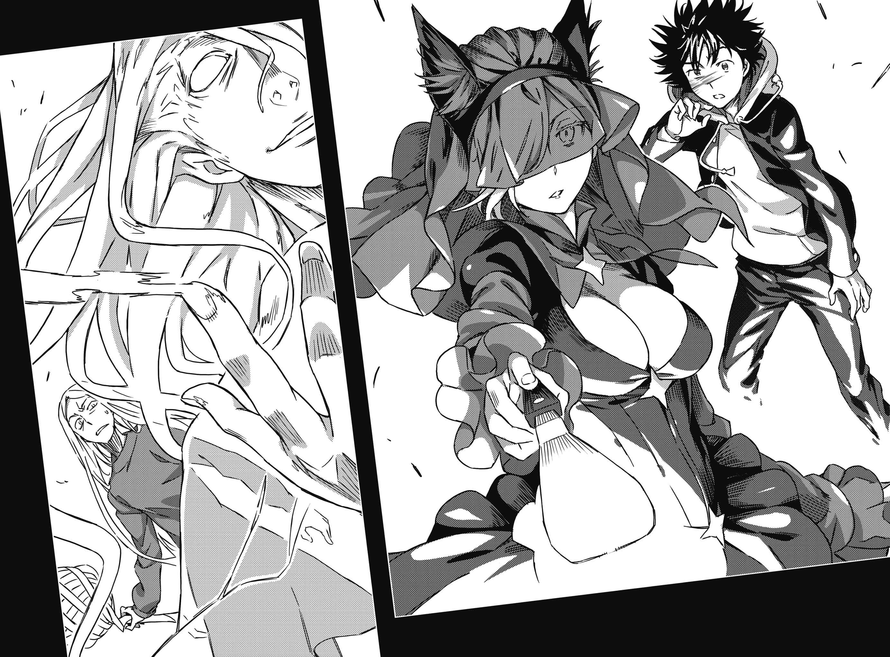

# 第四章 在顶点的宝贵一战

> Light.

## 1

上条当麻踩下透明螺旋阶梯的最后一阶。

抵达山顶的终点。

眼前只有一片极为广大的空间。没有地板与阶梯的概念，完全透明。只不过踏出一步，就连自己方才踩着走上来的阶梯在哪里都弄不清。不，或许在上条抵达的瞬间，出口就真的消失了也说不定。

走完登天的阶梯之后。

此处已是宇宙。

不知道内外的次元到底扭曲成什么模样。无论如何，上条的脚底下是无比辽阔的巨大蓝色星球。

「事情很简单。」

不是充满噪声的虚像，上条第一次听到对方原本的声音。

事到如今，上条已不会对没道理与不讲理感到惊讶。那个「人类」，就站在毫无藏身之处的空间正中央。留到脚踝的银色长发，加上以绿色为基调的手术衣。这名既像男性又像女性，既像大人又像小孩，既像圣人也像罪人的人类，用从一百年前就已如此站着的口气这么说道。

「在地面奔窜的地脉是支配空间的『场』，东南西北等方位则是其他天体所生力量的方向与强度……诞生于地球的魔法，也就是被绑在地球上的魔法。遗憾的是，人类会为了自己的目的，用遭到诸多火花干涉的手削山填海。我认为既然是这样，那么只要脱离地球这个已经结束的地方，就可以执行与目的相符的仪式。虽然某座宇宙电梯抢先一步时，多少让我有些焦虑就是了。」

为此而建立的坚固屏障、完全循环环境、火箭推进器。

即使这些脱离地球的条件受损也无妨。他不惜无视欧式几何也要延伸空间，打造异次元高塔，朝摆脱天体枷锁的方向迈进。

「……你的斗争还没结束吗？」

「或许永远都不会结束。我利用生命维持装置，是为了避免让生命力的痕迹外泄，但也说明了强迫自己犹豫一千七百年是如此困难。换言之，这都在计划里。失败、败北、丧失、挫折，无论多少次我都会去做。」

「我可以用像在践踏你心意的卑鄙说法吗？」

「比方说？」

「……连说话都来不及学就去世的莉莉丝，爱的想必不是你**这种**表情。」

少年没有多说。

上条本来就不认为能够靠言语制止对方。他也明白亚雷斯塔是基于什么理由让自己踏入「没有窗户的大楼」最深处。追根究底，这里是为了用上一切做个了断而整顿的学园都市。在这种时候依旧握紧右拳，只代表他照着统括理事长安排的轨道走，连一毫米都没偏。

但是无妨。

到头来，上条当麻只有这个。

再怎么强求没有的东西，也不会立刻成为棋士或厨师。既然如此，只能将一条路钻研到极致。不要为了些小事踩刹车，要油门全开往前冲，连设计者的企图也甩开，掌握住成果。除此之外没有活路。

「我要上喽。」

「事到如今哪还需要多说。我们都这么熟了不是吗？」

听到对方这么讲，不可思议地让上条嘴边浮现笑意。

货真价实的初次面对面。

尽管如此，亚雷斯塔这句奇妙的话，却让上条觉得非常合宜。

想必在出生前就已有所连接，在出生时就已敌对。

彼此都能解释对方的足迹，成了无法切割的关系。

所以。

&nbsp;

这一次，他们真的不需要什么言语。

咚————！两人同时蹬地冲出。

## 2

上条也目睹了那场魔法战。

正因为如此，他不担心还没搞清楚状况就被杀掉。

&nbsp;

「人类」亚雷斯塔的右手往前伸出。他竖起拇指与食指，比出形似手枪的手势。以虚构枪口指向企图接近的上条。

他手边有好几个数字如火花般迸出。

32、30、10。

「！」

砰砰砰！

幻视枪击接连到来。是不是燧发枪无所谓。假如这些小攻击是真正的子弹，上条大概反而无法应付吧。但它是魔法，既然如此必杀右手就能发挥效力。「非常容易联想」这点很难说是好是坏。

上条弹开攻击，贴近亚雷斯塔。

不，他原本要这么做。

「飞沫。」

「什——」

上条的疑问并未完全出口。

在那之前「叽叽叽叽！」的讨厌声响已经从旁刺来。这股从侧腹捅进肋骨的冲击，让上条的身体弯成ㄑ字。往前进的身体弹向侧面，就连血块都随着呼吸从口中飞出。他既不能哀号也不能惨叫，在看不见的透明地板上滚了好几圈。

「你到底在看谁啊？站在这里的人，可是比世上任何人都憎恨相位冲突，因此决定永远活下去的魔法师哦。」

「嘎……呃！那些火花与飞沫产生的涟漪，就连怎么影响这个广阔世界都无法解读，难道你已经建立起能够调整方向射出它们的方法了吗……！」

「别为了区区避雷针惊讶，再说这只能用在自己施展的魔法上头。话虽如此，但这个术式如果能提早一百年完成，或许就能带给无罪的赤子温暖了。」

不能一直趴在地上。

亚雷斯塔已经改变了架势，用右手缓缓握住空间往前伸。数字如火花般迸出。13、5、32。简直就像摩擦打火机上的打火石一样。明明没什么看见实物的机会，不知为何上条脑中却明确浮现西洋剑的锐利剑锋。

灵式绊足。

强制把影像打进观者脑中的魔法。

能够替手势附上真品价值的术式。

（要被刺中了……！）

上条仓促间打滚试着拉开距离。

但亚雷斯塔依然刺向什么也没有的空间。

不。

不对！

&nbsp;

「冲击之杖(Blasting Rod)。」

&nbsp;

随着简短的宣告。

飕！一个利落的声音刺进上条右肩，开了一个约有小指粗的暗红色洞口。他被看不见的利刃刺中了。即使不特别解说，直觉和剧痛也会清清楚楚地将答案告诉他。

「呜啊啊啊啊啊啊啊啊啊啊啊啊啊啊啊啊啊啊啊啊啊啊啊啊啊啊啊啊啊啊啊啊啊啊啊啊啊啊啊啊啊啊啊啊啊啊啊啊啊啊啊啊啊啊啊啊啊啊啊啊啊啊啊啊啊啊啊啊啊啊啊啊啊啊啊啊啊啊啊啊啊啊啊啊啊啊啊啊啊啊啊啊啊啊啊啊啊啊啊啊啊啊啊啊啊啊啊啊啊啊啊啊啊啊啊啊啊啊啊啊！」

射程显然比脑中的影像来得长。它没有实体，所以才能变幻自如到这种地步吗——上条原本这么想，但事情有些不对劲。

他已经看到那场冲突。

魔法之所以看似有无限可能性，是因为没有完全了解它的机制。回想一下「黄金」全盛期的魔法师就好。他们一定会根据某种规则，以有限的力量打地基，之后才按照自己的想法去装点世界。

因为碰不到所以伸长。

就算只做这件事，也一定有当成地基的规则、理论。

「冲击之、杖！！是那玩意儿吗！」

「**将魔法威力增幅为目标所想的十倍**。我唯一且绝对的老师——术师阿伦·本内特的拿手好戏，无比单纯但确实的力量象征。虽然为了避免愚蠢的维斯考特和马瑟斯嫉妒，他总是只用杖指着目标让对方体内蓄积的魔力失控，假装成不让人受伤就能夺走意识的戏法。」

一开始对上条和土御门等人发动的那一击也经过这种增幅吗——上条无暇对此多想。

13、5、32。换言之又是一剑。

上条改以脑中想象的刺剑长度十倍为基准，但侧腹还是开了个暗红色的洞。

「咕呜！」

「如果把剑刃长度想成十倍，冲击之杖(Blasting Rod)会以此为准再度增幅成十倍。也就是说，现在的剑身是一百倍。」

到了这种地步，就连劈开空间都可以。无法抽身。为了避免被钉住而无法动弹，上条直接以右手抓住逼真的想象利刃。伤口的栓塞物粉碎消失，相对地他重获自由。

要驱逐所有的魔法，也就意味着他打算一个人对抗所有的「魔神」吧。没有上里翔流的「理想放逐(World Rejecter)」那种例外，要怎么做到这件事呢？虽然让人感到疑惑，但此处就有能够做到的机关。

既然人办不到，就从「魔神」身上引出破坏力。

让自己维持人的身份，引出神的力量并打倒祂，这种思维说起来就像召唤师。

不是成为神的一分子，而是操纵、支配祂们。

傲慢到了极点，大概也是因为内心的憎恨有这么深刻吧。

但如果是用这种方法，或许面对施展全力的欧提努斯也有机会。当然，要如何让对实力有绝对自信的「魔神」崩溃，是个非常麻烦的问题，但胜算至少远比胡乱用人类的力量硬拼来得大吧。

而且——

「我可没这么想。」

亚雷斯塔·克劳利将空无一物的手指向天空。

「增长人类罪业的山之魔性、锁链刺客为什么会追赶你？为什么让成为第三棵树的亚空之山升空？为什么要让你追逐我的过去？为什么要展现灵式绊足和冲击之杖(Blasting Rod)？一切事物都有理由。如果你不明白，那是因为你研究不足。」

「……？」

「它们全都属于一个仪式。」

这是个宣言。

接着，术师说出了具有力量的名字。

&nbsp;

「出来吧，爱华斯。反过来以束缚思考的锁链为指引，达成我的目的。」

&nbsp;

紧接着。

比太阳更耀眼的爆炸，淹没了临时宇宙。

## 3

砰咚！

瞬间，一座城市跳了一下。

「唔……？」

来自脚下的诡异振动，让留在第十一学区的食蜂操祈不由得发出呻吟。尽管背后有种仿佛看见地上铺满蛞蝓的生理性排斥，但地面依然是坚硬的柏油。如果有什么变化，想必是少女自己。

肌肉松弛，使不上力，连站也站不稳。

不是痛楚，这股不适感宛如有只隐形的手在肚子里翻搅五脏六腑，令食蜂痛苦地将身子弯成ㄑ字。

她捂着自己的头，维持思考。

（怎么回事……？能力……）

虽然少年院等机构似乎会刻意给予光、声音、气味等各式各样的刺激，妨碍受刑人使用能力，但现在的状况又不一样。如果以非常抽象的方式形容就是——

（……正「被吸走」……？）

其实，食蜂操祈心里有底。

除了统括理事长外仅十二人的理事之一，药味久子。执行「人力资源(Agitate Halation)」计划的她，底下有个网罗了七名超能力者(Level 5)全员能力的超能力改造人恋查。用在她身上的技术，具体来说究竟是什么？

没错，她并非靠自己产生能力。

会不会是借由让身体特征与既有超能力者(Level 5)一致，从远方引出其能力加以使用呢？

（换句话说，统括理事长利用他的权限，在学园都市每个角落铺设人工的神经与血管？目的是强制连接在这里培育的所有能力者，把力量集中在一处……？）

虽然玩得很大，不过实际上对于亚雷斯塔而言，应该算是捏把冷汗的豪赌吧。毕竟不久前袭击学园都市的大热浪，其实是大规模微波攻击。尽管以结果来说似乎是赢了，但如果出些差错，这座城市的神经网应该会被毁得七零八落，无法发挥用途才对。

而且。

除了将两百三十万人其中八成的「力量」整个吞掉之外——

「没有窗户的……大楼。」

一股仿佛被塞进巨大生物腹腔里的严重排斥感，令食蜂不禁嘀咕。

「不过，他的目的是什么……？」

## 4

光临。

实际上，这个存在从头到尾都没有配合其他事物的概念。所以不会是太阳的光芒衰退，而是上条的眼球勉强适应。

爱华斯。

亚雷斯塔·克劳利借用爱妻身体叫出来的圣守护天使。

黄金色长发，加上闪耀动人的肌肤。但是无比冰冷的他，可能该称之为苍白的白金吧。

之所以会觉得美丽，想来是因为太过遥远。

之所以会有「就像宝石一样」这种感想，说穿了就是因为他显得不像生物。

『模仿泰勒玛吗？经验应该告诉过你，就算到英国的偏远地方建立修道院，终究还是会遭到妨碍。』

「会说话……？」

光是这样就值得惊讶。

确实，上条也曾目睹「天使」这种存在。举例来说，称作「神之力(加百列)」的个体就有数次。但他们宣扬自身存在感时不会如此自然。甚至让人感觉越接近完美就越显得像机械……

『原来如此原来如此。这回我的声音精确地传到了，或许意味着世界回想起来的真相已经有这么多了。』

爱华斯轻笑几声，脸上却完全看不见情绪。他肩膀微颤，开口说道：

『话说回来，真是不可思议呢，少年。』

「啊？」

『我的雏形保险丝风斩，最后尽管选择了天使外表，却依然保有自我。』

因为是完全人工。

因为从早期阶段就与普通的天使不一样。

……是因为这样吗？这是正确答案吗？

『还有，现在不是在意这种小事的时候哦。』

不可能的现象产生。

笑容。

天使笑了。

露出一副终于找到乐子能排解烦闷的表情。

&nbsp;

『因为现在的我，是你的天敌。』

&nbsp;

爆开了。

什么爆开了？在上条的认知跟上以前，他已经全力挥出拳头，接着右臂自肩以下扭曲成奇怪的角度。就连剧痛都没跟上。接着爱华斯笑着以单手抓住从上条肩膀窜出的**看不见的某物**。

『哈哈！虽然多少有些成长，不过还是太嫩了，而且纯度不足。你是不是在哪里绕路啦，亚雷斯塔？』

「话太多了。」

『了解。』

啪！

只是一个呼吸。和过去在巴格吉城所见到的「魔神」欧提努斯一样。爱华斯的握力轻而易举地挤爆、解决了「某物」。

「啊……嘎！」

痛觉总算追上。

上条按住摇晃的右肩，脚步蹒跚地后退。

『唉，无知真是可怕。在这个欧几里得概念崩溃的小世界里，居然还把性命交给三次元的距离。』

有什么东西来了。

上条咬紧牙关抓住受创的肩膀，使出浑身力量强行把脱臼的关节接回来。

一挥手，上条就整个人往后翻了一圈。忍着让人头昏眼花的剧痛硬是接回来的肩关节，只过了区区数秒便再度脱臼。

「咿咿咿咿咿、咿咿咿————！咿咿咿咿咿咿咿咿咿咿咿咿！」

（可恶，就算挡住了也不知道发生什么事！）

如果受伤能让他弄清对方的攻击到底是什么，至少还能决定该往前后左右哪个方向躲。毫无成果就只能一直挡下去。

毕竟那是为了压倒包含施展全力的欧提努斯在内等所有「魔神」，才耗费心血弄出来的秘密武器。单就这点来看，会是比当时那一战更艰苦的地狱。

而且在场的不止爱华斯。

亚雷斯塔·克劳利轻声地如此宣告。

「冲击之杖(Blasting Rod)。」

&nbsp;

据说。

这种辅助术式能将魔法威力增幅成目标所想的十倍。

&nbsp;

这已经成了一堵高墙。

圣守护天使爱华斯的十倍。

连把肩关节接回去的时间都没有。上条才刚以左手强行抓住晃来晃去的右手往前，正面冲突随即来袭。

双脚离地。

他飞到空中，背部撞上没有色彩的透明墙壁。

「咕……哦！噗啊啊啊啊啊啊啊啊啊啊啊啊啊啊啊啊啊啊啊啊啊啊啊啊啊啊啊啊啊啊啊啊啊啊啊啊啊啊啊啊啊啊啊啊啊啊啊啊啊啊啊啊啊啊啊啊啊啊啊啊啊啊啊啊啊啊啊啊啊啊啊啊啊啊啊啊啊啊啊啊啊啊啊啊啊啊啊啊啊啊啊啊啊啊啊啊啊啊啊啊啊啊啊啊啊啊啊啊啊啊啊啊啊啊啊！」

体内各个角落迸出没听过的沉重声响。

话先说在前面，他已经用幻想杀手(Imagine Breaker)尽可能抵消了，却还是这样。

虽说是以人类水平的想象力极限当参考再强化成十倍……这破坏力只能用一句「超大」来形容。甚至能让「身为人类却想和『魔神』全面开战」这种傲慢的想法具有说服力。

「……呼、呼……」

也不知是手掌，还是羽翼。

即使巨大过头而无法和整体形象连在一起的「某种东西」离开，上条一时之间仍然无法动弹。他贴在墙上，连倒下都不行。不，或许就像被压扁的青蛙一样，已经粘在上面了——他脑中甚至闪过这种妄想。

『简直就是变形功能嘛，真是幼稚。』

「如果不是这样，就不会持续沉沦一个世纪以上了。」

『这么说也是。如果有那么聪明，你早就已经放弃，灵魂也会萎缩。』

怎么办？

要怎么打倒他？

即使把注意力转向脑中试图逃避眼前的剧痛，答案依旧迟迟不肯现身。

所以，这已经接近反射动作。

以左手抓住右肩的上条，就这么把肩关节嵌回去。

看见继续战斗的信号，回到原先尺寸的爱华斯笑了。

显得十分愉快。

『你的英雄性格还真是强烈呢。**就那么不能原谅亚雷斯塔·克劳利自甘堕落吗**？的确，你有中选的资格。』

「……？」

『幻想杀手(Imagine Breaker)选上了你啊。多亏这个男人，他无论多么焦急，都还是会反复地经历失败与挫折呢。』

上条没空弄清这番话的含义。

太阳再度来袭。

## 5

飕……！

这时，失去既定位置的十五厘米妖精欧提努斯，背上窜过一股无比强烈的恶寒。

「当麻，当麻！你在哪里啊～！」

白衣修女呼喊着**在大型螺旋阶梯上突然像融入空气里一样消失无踪**的少年。听在耳里的欧提努斯，则是朝完全无关的方向看去。

「爱华斯……在这时候冒出这个名字啊……」

「怎么了？」

被府兰以双手捧起以免惨遭踩扁的幸存「魔神」哼了一声。

「啧！」

走上螺旋阶梯让踏脚处变得宽敞后，便没有坠落的危险，相对地出现在舞夏周围的齿轮与手铐环就能发挥效力，也因此害得土御门忙翻天。虹色的锁链骨骼，以及麦芽糖般缠上去的透明血肉。面对没有幻想杀手(Imagine Breaker)就无法确实解决的对手，他必须赤手空拳一个个打倒。乍看悠闲的府兰，身为唯一能主动无风险施展魔法的人，也被迫加入实战阵容。

「亚雷斯塔从一开始就积极使用『科学』这个词。无论是灵异还是物理，只要能漂亮地解释前因后果，就属于科学。」

在这种情况下依然神色自若的欧提努斯，同样不简单。

「这种理论的顶端就是爱华斯。这个名字没有出现在任何地方，也没纳入任何宗教……而且，这个世界是在物理法则上叠了许多重魔法阵营相位才成立。换言之——」

她双手叉腰，看向山之魔性。

「所谓的爱华斯，是处于最底层……**纯粹物理法则世界的天使**。正因为如此，亚雷斯塔才会极为看重他。确立爱华斯的控制法则，再以这股庞大力量破坏爱华斯以外的所有滤镜，大概就会只剩下毫无魔法的世界。」

「？」

外套比基尼少女照理说属于魔法阵营，但她所理解的范围似乎没到这里。

停下动作的是茵蒂克丝。

「爱华斯？可是那种东西如果直接依照理论值显现……」

「嗯，他原本应该是为了对抗我这种『魔神』而构筑的才对。毕竟那个人类就算和我们正面冲突也没胜算。」

某人倒吸一口气。

不过意外的是，这位「理解者」看起来不怎么害怕。

欧提努斯接着说道：

「世间男女，皆为星辰。」

「亚雷斯塔·克劳利？」

「是啊。说穿了就是在讲，这个世界没有无意义的部分，一切事物都设计成彼此交缠。不过嘛，还要追加『实际上不是每个人都已觉醒，所以现在齿轮生锈卡住了』这点就是。」

「嗯嗯～？那又怎么样啊～？」

「不明白吗？」

欧提努斯是魔法、战争之神，也是诈术之神。

只要还有些许胜算，她绝对不会认输。

「那就试着转换思考的方向。也就是『反过来想会怎么样』。」

## 6

身上装备A.A.A.，在「没有窗户的大楼」周围绕着飞的御坂美琴，也因为脉动街景带来的异样感而受到影响。

连接状况不佳。

能力控制也变得不稳，从刚刚开始就边飞边晃。

即使如此美琴依旧大吼一声。

对不在此处的另一名「少女」喊话。

「咬紧牙关撑住！食蜂！」

「呜！我知……道啦～！」

该做的事不变。

「没有窗户的大楼」之主有何盘算，细节尚未明朗。噪声太严重，所以也无法读取理论上通过A.A.A.相连的对方思绪。不过试着想一下就好。若要破坏那家伙的如意算盘，最简单易懂的选择是什么？对方窝在全世界最硬的要塞里。那么答案不就是剥掉那件装甲让他赤身裸体吗？

不需要知道结果。

只要能站上同一个舞台，成为左右情势的原因之一即可。

既然如此——

「『要上喽————！』」

音波奔窜。

液体被覆超电磁炮(Liquid Proof Railgun)。规格外的一击出手，顺势刺上「没有窗户的大楼」侧面。目的是瓦解这个据点，尽可能地让统括理事长在脑中描绘的理想出差错。

这种东西打不倒他。

即使一再努力到流下血泪，也无法扛起最后一击的重责大任。

「那又怎么样。」

『我已经受够等待了。』

「如果会这样便受挫放弃。」

『打从一开始就不会挺身而出！』

## 7

无论做了怎么事，无论发生什么事。

圣守护天使爱华斯那玩耍般的一击，上条当麻不可能躲得掉。周围是毫无遮蔽物的宽敞空间。因为这个底下能看见蓝色行星的场地，不管走到哪里都是亚雷斯塔那一方所准备的终极客场。

但是少年没死。

尽管在极近处爆出的巨响让他不禁闭上双眼，痛楚与冲击却始终没有来袭。

上条缓缓睁开抽搐的眼皮，重新确保视野。

「那个」就在眼前。

&nbsp;

米娜·马瑟斯。

西洋丧服配上猫耳与尾巴。不搭调到像是走错地方的黑猫魔女，挡在中间。

&nbsp;

「什么……？」

最先出声表示惊讶的人，反而是照理说已经准备好一切的亚雷斯塔·克劳利。

魔女手中是一把银制画刀。这东西看似与攻击力无缘，但它在「黄金」里同时也是负责绘制、着色、构筑诸多卡牌与祭具的终极泉源。

米娜·马瑟斯的武器是美术。方向性与带给人类火焰的文化英雄(普罗米修斯)如出一辙。她靠着画技，替众多魔法师怀抱的未定灵感带来具体外貌。

宛如追随画刀一般描绘在空间中的彩虹轨迹，就是她的一切。

『结果有这么出乎意料吗？』

原本平整的画刀渐渐扭曲、弯折、失去原形，但依然拦住了来自爱华斯的那一击。

『你没选在「黄金」时代担任宿主的妻子萝丝，也没选女儿莉莉丝，而是选上我——米娜·马瑟斯，处于「仇敌之妻」这种不安定立场的形象。我这么预测——**你会不会其实也预料到这个失败呢**？**换句话说**，**你是不是在心底的某处期待我站到上条当麻这边呢**？』

「怎么回事？」

混乱终于也传到上条这里。

尽管重新握起右拳，他脑中却尽是无法理解的空白。

「为什么你能在这里出现？你不是别人创造出来的幻影吗？咦，不过在这之前，我用左手摸过一次，胸部很软……咦？」

『不要混乱，把情报一项一项整理清楚。首先，没有生命的幻影不能施展魔法。任何魔法都需要精制出当成动力的魔力，为此需要有当成根基的生命力。』

『原来如此啊……亚雷斯塔，看样子你似乎又失败一次喽。』

爱华斯则是一副在享受意外的口气说出这种话。

那么，这是什么东西？

不是创造出来的幻影。话虽如此，但真正的米娜·马瑟斯也不可能露面。因为她理应早就在与亚雷斯塔斗争时败北，消失在历史的黑暗里。既然如此，又是什么人施展魔法帮助上条呢？

『如果是奉陪亚雷斯塔·克劳利这个人物到现在的你，应该知道答案才对。』

「？」

『我是这座「没有窗户的大楼」配备的问答型思考辅助式人工智能(Reading Thoth 78)。只是管理者亚雷斯塔·克劳利为了确认计划(Plan)的修正是对是错而准备的并列演算机器。』

倒吸一口气的人并非上条当麻。

似乎是制作她的亚雷斯塔终于得出答案。

『思考中枢是管理者自己构筑的七十八张塔罗牌。但是这个牌组，也可以说它通过所有排列形成一本书。』

换句话说——

借用黑猫魔女外表的某人这么宣告。

&nbsp;

『我同时是托特塔罗这部魔道书的「原典(Origin)」。即使不像生命体有自己精制魔力的功能，依旧能借由禁忌记述从周围吸收力量，进而以类似原典(Origin)防卫功能的形式自动施展魔法。』

&nbsp;

巨响接二连三地爆出。

彩虹艺术弹开天之暴虐。

扭曲的画刀与圣守护天使的羽翼爆发激烈冲突，但黑猫魔女仍未倒下。

双方都是亚雷斯塔·克劳利的最优秀杰作。

不。

『在衍生自GD正式模型的变体排列——托特塔罗之中，也包含了圣守护天使爱华斯的意图(精髓)。大秘仪二十号，其名永劫(Aeon)。照理说它本来是象征最后审判的牌，但你应该在一九〇四年与爱华斯接触后，就认为审判已经结束而更改了图像(秘仪)。换句话说——』

『哈哈！和恋查一样呢。这个魔道书里也有从我身上提取力量的记述吗！』

难怪能够反击。

虽说只是借来的东西，但双方运用的都是爱华斯之力。

而且所用到的基础理论，则由试图靠超能力改造人从七名超能力者(Level 5)身上提取力量的亚雷斯塔本人证明了。

『不过借来的终究还是借来的。没办法永远支撑下去哦？』

『无妨。即使什么都不做，亚雷斯塔·克劳利依旧会继续沉沦。我只要争取让结局到来的时间就好。』

还藏了什么招吗？

上条这么想，不过这是个误解。

追根究底，黑猫魔女……不，托特塔罗为什么能够违逆主人亚雷斯塔？

『世间男女，皆为星辰。』

穿着西洋丧服的猫耳淑女，隔着面纱如此呢喃。

『管理者认为，当每一个人都为所应为，世上便没有多余的东西。但是换个角度来说，应该也意味着缺一个齿轮就会让整个八音盒停摆。而且亚雷斯塔，你正在目睹扑克牌金字塔崩塌的瞬间。』

「滋滋……！」一阵低沉的震动传来。

但是爆炸中心很远。这是别处传来的破坏余波。

亚雷斯塔喊出答案。

「来自外界的攻击……篡夺A.A.A.的人吗！」

『这么一来就完全崩塌了。我以扑克牌金字塔形容这一切。一处小小的破坏，成为整体崩盘的远因。你的失败不止一次。崩毁一旦开始，就会产生连锁反应。正如过去的你只因为一次意外就失去整个泰勒玛修道院一样。』

没错——

『这些纯真的少年，为什么来到这里？』

质疑当然有与其成对的解答。

也就是说——

『为了得到安全去除土御门舞夏所中魔法剑的方法。难道你没想过，既然你用**一切**让爱华斯召唤得以稳定，这些措施当然也会成为让计划(Plan)崩盘的重大危险因子吗？』

## 8

换言之，答案从一开始就在眼前。

在府兰双手的包裹下，欧提努斯这么说道：

「扩大认知吧。」

那里是不适用欧氏几何的奇特亚空间。但此刻这个条件也面临局部崩溃。

来自外界的炮击让墙壁裂开，使得应有的密闭出现漏洞。游乐园的镜屋，即使只打破无数镜子中的一面，也会摧毁它的完整性。

「让焦点配合墙外的景色，重新辨识整体环境。对啊，对啊。该死，根本不该管什么虹色锁链，一开始直接这么做就好。我们明明是从破坏火箭推进器后产生的大洞入侵啊！」

府兰重新以正确的焦点眺望世界后，便发现身处的环境一点也不梦幻。原有景色宛如浓雾散去般消失无踪，眼前只见形似营业用冰箱的大型演算机器，以及地板上的无数粗电缆，成了一个充满钢铁与稀有金属的空间。

「这是……」

「神殿的真面目已经揭开，可是当麻没回来啊！」

「他太深入了。想把他拖回来，要从确实打破亚雷斯塔·克劳利构筑的完整性开始。」

该做些什么？

是为了什么才冒着危险来到「没有窗户的大楼」？

「把保存的资料全部翻出来。只要找到安全拔出那个小女孩胸口利刃的术式，它就会成为我们最大的武器。世间男女，皆为星辰。既然利用一切事物，就代表缺一个齿轮等于失去整个世界。即使待在这里，我们依然是和上条当麻并肩作战。」

找资料就靠擅长操弄机械的土御门及府兰。

照理说，东西不是以神秘的暗号保护，就是用到的程序语言根本没见过。然而不可思议的是，出现在他们面前的东西，一眼就能看出是开放式文件。

简直像是**有什么人**从一开始就已经准备要交给他们一样。

「呜咕！」

「府兰，不行！不要看！」

听到外套比基尼的呻吟，土御门也隔着墨镜皱起眉头。

宛如「原典(Origin)」那种剧毒的污染。

能够对抗的只有一个人。

「与其说它是magick的基础理论，不如说它比较接近网罗了记号与数值的辞典或对照表。赫耳墨斯学派、蔷薇十字(Rosenkreuzer)、『黄金』……不对，更后面，777之书问世前的草稿，写得很仓促吧，奥林匹斯的七星结合东方易经与西方四大属性的转换，独特的塔罗牌、埃及诸神、象征武器(Symbolic Weapon)的制法……啊，这样啊，维持处女性的魔法剑！嗯，如果是这样或许可行。」

不过，从这么多知识里把东西找出来的是谁？魔道书图书馆茵蒂克丝在学园都市生活，而且已经入侵「没有窗户的大楼」，这些事「他」应该都知道才对。若是这样——

「不是亚雷斯塔。」

欧提努斯这么嘀咕。

「他的个性是不管成功或失败都会继续前进。换句话说，他掷骰时是认真的。这种一开始就自暴自弃将败因展现给别人看的自灭式作风不像他。」

**那么是谁**？

虽然光靠手边的情报得不到答案，可是无论如何都能确定一件事——这个发展必然出乎亚雷斯塔·克劳利的意料。

于是欧提努斯冷静地对土御门开口。后者正在吸引那些宛如穿上LED装般闪耀的虹色锁链怪物——增长人们罪业的山之魔性。

「喂，浑身是血的阴阳师。轮到你上场喽。」

「……真的假的啊，太狠了吧。那边明明有个施展魔法没有副作用的小姑娘在呢。」

「交换工作。让这个叫府兰的去拦住锁链怪物就好。对了，就算它们会用色彩变更让魔法失控也别撒娇哦。不要忘记，这边只要失败，就会让像拼图一样由多重意义组合而成的短剑粉碎，导致失去一条人命。」

「这个嘛，只要使用意象中不带色彩的术式，应该能正常战斗才对。」

外套比基尼与土御门元春背靠着背，转身换手。

两人就像在旋转门擦身而过般切换目标。

「我没有什么特别的理由去在意『理解者』以外的人类。」

十五厘米的神明哼了一声。

「确实，这么做不合理也没效率……可是把拯救家人的角色让给外人，这样好吗？」

「啧。」

太阳眼镜男垂下肩膀。

然后说道：

「没办法。就让哥哥表现一下吧。」

## 9

叽叽！

原本看起来那么完美的圣守护天使爱华斯，身上明显混入异物。宛如噪声的东西流窜，让他的轮廓产生不规则扭曲。头部中心还能看见小小的三棱柱重叠。

『哼哼。』

当事者依然显得愉快。

这个世界上还留着能伤害自己的东西。他的模样，就像在祝福这种照理说只会对自己不利的事实。

『这回也失败了，是吗？真是的，世界看似简单却意外地辽阔对吧，亚雷斯塔？』

就这样。

呼。理应是最强者的爱华斯，就像靠不住的烛火熄灭一样，干脆地消失。

同时，也代表向他借力的托特塔罗——借用黑猫魔女身躯的某人，失去最大的力量。

『过大的引力，甚至会扭曲生命力的流向。但是那也到此为止。现在的你别说枪弹了，应该连肉身的拳头也碰得到。』

而且，米娜·马瑟斯不是一开始就这么说过吗？只要争取让结局到来的时间就好。

『纯真的少年啊，一路顺风。』

所以。

在最后的最后，随处可见的平凡高中生走向前。

从最初的最初就誓言反抗神，甚至遭到相信、依靠的魔法背叛，「人类」依旧明确地开了口。

「……我要抹去因为满满相位而隔了无数有色眼镜的虚伪风景。」

亚雷斯塔·克劳利已经历多次失败。因此就算已经穷途末路，他依旧坚持不改变立场。

「我会消灭所有相位，纠正这个人们不自觉受到摆布的世界！不止莉莉丝的死，还有那么多的悲剧，都被一句『无可奈何』打发掉，我要把这样的世界彻底重塑！为了这个，我……若是为了这个……！」

「你难道没想过，就连这些无形的东西，有时也会守护人们的幸福吗？」

这种话本来或许不该由上条当麻说出口。

他终究是科学阵营的居民，这种论点，或许和连神话、宗教都会先考虑「以科学解释会怎么样？」的城市不相称。

可是追根究底，什么魔法阵营科学阵营的划分，是什么人决定的？还有，这人把世界一分为二，究竟有什么好处？

那还用说。

亚雷斯塔是为了自己的目的，刻意限缩人们的思考自由度，安排成全世界都在不知不觉间排斥他厌恶的东西。这么一来，乖乖服从学园都市的常识——敌人亚雷斯塔决定的规则，就没有意义。应该试着让想象力的翅膀更自由。

「相位与相位之间的冲突，会带来相遇也会带来别离吧？受到打击时，它也可能成为在背后推一把的助力吧？有时，它也会成为让人重拾力量的契机。你难道不能这么想吗！」

「开什么玩笑……在这个既没有黑幕也没有阴谋，只是无意义偏颇的世界里，鼓励别人抓住连面包屑都不如的幸福——这就是你的回答吗？就连有人遭到践踏也考虑进去！」

「如果是这样！」

到底怎么样才对，上条当麻也不明白。

所以，他想问坚信自己绝对正确的人这个问题。

&nbsp;

「**没有半点罪孽的莉莉丝**，**灵魂已经平安上了天堂**，**在那里展露笑容**——就连怀着这种念头的行为，你也要踩在脚下无条件地否定吗！」

&nbsp;

少年确实听见某人倒吸一口气的声音。

完全正确的立场就此消失。上条当麻接着说下去，进一步逼迫对方。

「告诉我，神秘的否定者。到头来，对你而言莉莉丝『在那之后』究竟怎么样了？你只是单纯套用科学的形式，任由结束生命活动的蛋白质在土里腐烂吗！什么都无法依靠的坠落时刻也好，均等不幸的时代也好，都让人很难受对吧。要奄奄一息的孩子自己爬起来叫平等吗？就算幸与不幸遭到外界操控，只要人们携手合作，让所有人温柔地分摊，这么一来不就能弥补差距了吗！你说啊——！」

想必复仇者就是缺少这部分。

薄情也好。胆小也无妨。若能相信已逝的生命在天堂展露笑容，想来就不需要复仇了。

毁掉「黄金」也是。

杀害曾经的朋友与导师也是。

……或许根本不需要痛下杀手，有放过他们的余地。

「那是假象。」

「或许是。」

「我的思绪没有纤细到会因为这种不确定的东西动摇！」

「但是，**你的女儿已经上天堂了这件事我非相信不可啊**！什么坏事都没做过的人，连死后也得不到回报——这绝对不应该！我不知道灵魂究竟是什么。天堂这种东西到底在哪里，我也无法具体解释。但它就在那里，不会被外界夺走！留下来的我们也不能糟蹋生命！唯独这件事我不会让你否定。亚雷斯塔·克劳利。就算你是那孩子的父亲，我也绝对不会让你否定这点。」

两人的你来我往已经不只言辞。

32、30、10。亚雷斯塔的右手比出手枪的形状，上条当麻的右拳弹开想象的子弹。魔法师的嘴接着编织诅咒。冲击之杖(Blasting Rod)。但在那股力量生效之前，原先旁观的黑猫魔女已经轻轻扔出画刀。画刀在半空中突然刺中某样东西，形状扭曲的银杖随之掉在透明地板上。

『一边为了去世的莉莉丝，将自己的常识全部抛在脑后，只靠拳头要对世界贯彻自我；相对地，父亲却害怕回答而用小把戏逃避，像什么样啊。』

飕！

上条当麻终于贴近亚雷斯塔。

但统括理事长的实弹还没用完。毕竟只要是自己施展的魔法，他就能将类似相位与相位的冲突所生火花与飞沫的力量，送往瞄准的地点。

与逼死爱女的力量系出同源。和憎恨对象同罪，充满矛盾的秘密武器。

只能将这种东西当成最后王牌打出来的男人，内心作何感想？

亚雷斯塔·克劳利总是遭逢失败。

即使清楚这点，依然不得不感受到命运的讽刺。

而上条当麻从一开始就没考虑过躲避。

&nbsp;

没有什么交叉反击拳之类的漂亮技巧。

双方攻击毫不留情地刺中彼此的肉体。

&nbsp;

上条当麻的肋骨发出哀号。捅进侧腹的隐形一击，开始破坏他的肉体。

另一方面，他的拳头确实地打在统括理事长脸上。有种物体粉碎的触感传来。

这究竟是一瞬，抑或是永劫？

一阵沉默过后。

终于有了动静。

「为……什么？」

最先听到的是说话声。

理应通晓整个世界的魔法师，发出单纯的疑问。单纯到让人难以弄清问题的意图。

但是上条当麻这么回答道：

&nbsp;

「……你的败因呢，就是你不知不觉之间已经不再是守护莉莉丝灵魂与尊严的那一边，仅此而已。」

&nbsp;

言尽于此。

亚雷斯塔·克劳利的身躯向下滑落。
