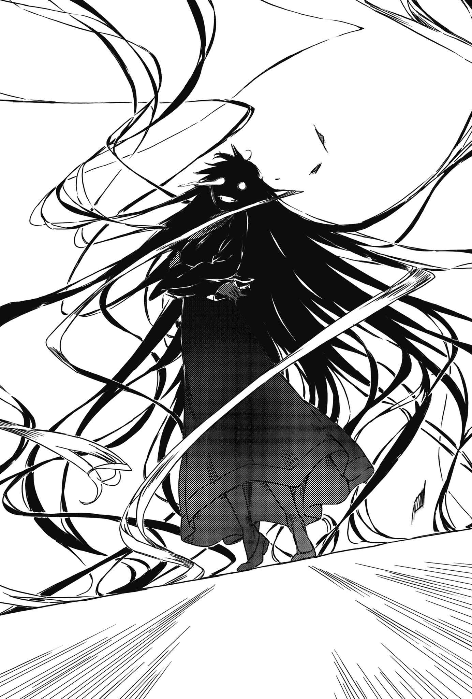

# 终章 破裂的恶意

> Devil_in_Evil.

一切都结束了。

喘着气的上条环顾周围，发现所在之处已不再是宇宙。只是一个摆满机械的人工空间，虽然宽广却充满压迫感。

黑猫魔女则是隔着面纱微微一笑。

她静静地朝少年一鞠躬，也缓缓地消失。

「没有窗户的大楼」遭到破坏，屋主也走下舞台。虽然他大概早已料到会变成这样。

「当麻！」

声音来源意外地近。

上条惊讶地看过去，随即见到茵蒂克丝。

「怎么，你刚刚去哪里啦？」

「这是我要说的啦！真是的，居然这么深入！」

「？」

虽然搞不清楚究竟怎么了，不过总之能会合就是好事。

一旁的土御门也出声了。

「亚雷斯塔那家伙……骗人的吧，居然倒下了。」

「你身上满满都是血呢。」

「拼命救妹妹啊。」

口气平实而认真。顺着他往后比的拇指看去……确实，原本刺在土御门舞夏单薄胸口的黑影短剑已经消失无踪。

上条把目光转回倒地的魔法师身上。

「……如果能让他清醒就好，不过他毕竟是以败北和失败为前提的破格存在。为了保险起见，土御门和府兰或许还是和外面的英国清教会合比较好。这么做也有观察的用意在。」

原先固若金汤的「没有窗户的大楼」也已残破不堪。不时还能看见穿戴着厚重钢铁的中学女生划过蓝天。

总而言之，这样就告一段落了。

上条等人这么想，决定调查是否有比较像样的出口。

&nbsp;

就在他们正要采取行动时。

咚……一个极轻的声音响起。

&nbsp;

声音来自哪里？

上条当麻、茵蒂克丝、欧提努斯、土御门元春、乌丸府兰、土御门舞夏，全员都回头往那个方向看去。

「人类」亚雷斯塔·克劳利。

实在太过突然。那个仰天而倒的身影，左胸遭到厚重刀刃毫不留情地贯穿。

魔道书图书馆轻声说出凶器的名称。

「……达摩克利斯……？」

紧接着伤口爆出闪光，于是上条等人遗忘了重力的存在。

&nbsp;

&nbsp;

「哼哼～哼哼～☆」

等到现场变得空无一人之后，有个人影现身打量起心脏遭到刺穿的魔法师。

实在长得太夸张的金发。

米色修道服。

通过乌丸府兰将专精秘密行动的回收部队部署在城市外围，并且混在其中悄悄潜入城市里的英国清教最高主教(Archbishop)。

萝拉·斯图亚特。

「用来警惕没觉悟掌权者的剑。原本是以理论重现传说，让王侯贵族镀金试胆，不过只要挑选一下赠送的对手，结果就会如眼前所见。不觉得这把掉在你身上的剑很有意思吗？」

不，并非空无一人。

因为理应已失去心脏的男子睁开了双眼。

「你这是什么意思？」

「将军。」

她简洁地说道。

「虽然靠着全身血管里残存的血流勉强维持意识，但是流向脑部的血液不顺，会在数分钟内让你的思绪消散。事到如今你也没办法拿生命力精制魔力了吧？当然，仿效维斯考特利用伟大存在的引力扭曲生命力循环路径以维持半不死性，一样做不到。」

「……」

「没人认识学园都市的统括理事长。在封闭的『没有窗户的大楼』里把人掉包，也不会被发现。你费尽心力培育的东西，就让我有效利用喽。科学阵营、世界的一半。只要得到这些东西，也就能彻底颠覆和罗马正教、俄罗斯成教之间的力量平衡了吧？」

魔法阵营与科学阵营。

其中一方——魔法阵营里的派系斗争。

……人世怎会如此丑陋。亚雷斯塔·克劳利只有这个念头。说穿了，这个女的就连世界为什么一分为二都不明白。一想到这人连某个高中生都不如，就让他笑了出来。

然而，圣职人员对魔法师抛出一句意料之外的话语。

「我说啊，亚雷斯塔，你差不多也该觉得奇怪了吧？」

「你说……什么？」

「名字啊，名，字。」

看见亚雷斯塔一头雾水，女性轻轻摇晃纤指。

「成天喊着女儿女儿是无妨，但你是不是有点无情啊？亚雷斯塔，你可不是那种能说自己一生只娶一位妻子的正派人士，这点你有自觉吧。你结过好几次婚，连情妇都有。换句话说，**你的女儿不止莉莉丝一个**。嗯？怎么啦？还不知道我在说哪个名字吗？」

「难……道……」

「看你一脸『为什么先前一直没想起来？真是太不可思议了』的表情呢。顺便再替你复习一件事。你当成蛇蝎般排斥的马瑟斯。他不仅是个优秀的魔法师，更自称高地人，为了让古代王朝复兴而奔走，甚至因此让结社成员伤透脑筋呢。好啦，这个王朝叫什么呢？」

「……**斯图亚特王朝**……不，难道说，不可能！」

「这个嘛，在选择暂用的名字时，算是给了点反映他愿望的优惠吧。你似乎以为是日后才叫出我，不过实际上召唤早就已经完成喽。」

这时，亚雷斯塔脑中只有一个可能性。

沙漠的记忆复苏。

他发现让塔罗牌建立连接也无法跨越的深渊，于是进行召唤想要克服难关，并且在知道自己失败之后命令叫来的恶魔回去。

就某方面来说，这个名字的意义与圣守护天使爱华斯相当，或者更为重要。

「……科隆……尊……？」

「术师马瑟斯给了一道命令。亚雷斯塔·克劳利，我要假装第一次现世是被你召唤，引导你走上破灭之路。在北非混进莎草纸堆后流落到英国，借由神秘性长年操纵列强历史倒还好，后来却因为一时兴起实现人类愿望而遭到契约束缚。亚雷斯塔，马瑟斯的光芒虽然被你盖过，但也相当有本事哦？」

「那个存在」轻笑了几声。

可是，「那个存在」真的能用来称呼眼前的女子吗？

「尽管当事者亡故，却不代表命令消失，所以我才像这样老实遵从。不过嘛，由于没能占据你本人的身体，所以我选择别的灵媒(Avatar)就是了。」

当成姓氏的斯图亚特，借自真正召唤者所坚持的事物。

那么名字呢？

到底套用自什么地方？

「哎呀哎呀，可怜的萝拉。与狂人因果相连的第二个女儿啊。」

「你这家伙……」

束在脑后，即使在脚踝处折返后又折返，依旧长得及腰的金发。这些一拿掉纯金发夹就宛如发光毛毯般散开的东西，在萝拉背后大肆蠕动。

女人的头发里藏有恶魔。

依循古老魔女的传承。

背后那一整片黄金瀑布，宛如刺青一类的东西，浮现不祥又巨大的恶魔容颜。

女子以双手抱住裹在米色修道服里的娇嫩肢体，带着亵渎的晃动这么嘲笑。

这想来是身为父亲最不愿看见的脸。

同时也是爱女最不愿让人看见的表情。

以揭穿一切的口气说道：

「她平常嘴巴明明那么毒，最后却哭着这么恳求哦——**爸爸**，**爸爸**，**救救我**，**爸爸**！」

「你这家伙哦哦哦哦哦哦哦哦哦哦哦哦哦哦哦哦哦哦哦哦哦哦哦哦哦哦哦哦哦哦哦哦哦哦哦哦哦哦哦哦哦哦哦哦哦哦哦哦哦哦哦哦哦哦哦哦哦哦哦哦哦哦哦哦哦哦哦哦哦哦哦哦哦哦哦哦哦哦哦哦哦哦哦哦哦哦哦哦哦哦哦哦哦哦哦哦哦哦哦哦哦哦哦哦哦哦哦哦哦哦哦哦哦哦哦哦哦！」

&nbsp;

现实毫不留情。

打从一开始，就已注定亚雷斯塔·克劳利无法如愿。

因为是他给了自己这样的判决。

&nbsp;

带有黏稠感的「咕啾咕啾」声响起。

音源钻进遭到贯穿的魔法师体内，名为科隆尊的存在得到了新灵媒(Avatar)。尽管胸口开的洞并未消失，但位置十分巧妙。除非隔着衣服触摸，否则多半不会察觉异样。毕竟此人长年窝在这种要塞里，实在很难有机会碰到他。

啪沙。

原先仰天倒下而散开的银发，自己动了起来。虽然压在背后所以没办法看见，不过头发上应该也浮现了恶魔的脸吧。

「哼哼。」

于是。

真的变得空无一人的冰冷空间里，那个寄身于美丽女性容器里的恶魔笑了。

「哼哈哈！嘻嘻……哈哈哈哈哈哈哈哈哈哈哈哈哈哈哈哈哈哈哈哈哈哈哈哈哈哈哈哈哈哈哈哈哈哈哈哈哈哈哈哈哈哈哈哈哈哈哈哈哈哈哈哈哈哈哈哈哈哈哈哈哈哈哈哈哈哈哈哈哈哈哈哈哈哈哈哈哈哈哈哈哈哈哈哈哈哈哈哈哈哈哈哈哈哈哈哈哈哈哈哈哈哈哈哈哈哈哈哈哈哈哈哈哈！」

科隆尊也有其目的。

但是，有股能够让他连目的都暂时忘记的愉悦感。他的模样就像在说，用爱女的手挖出父亲尊严让他快乐得无法自拔。

（……好啦，这么一来总算能断绝和马瑟斯那个混蛋的**联系**了。不必再维持善行与恶行的均衡。亚雷斯塔也一如预期，帮忙培养了有意思的玩具。等这么久是值得的。）

人们所认识的萝拉·斯图亚特，是一个为了让善行与恶行的分量维持相当，因此两者均等为之的人。

不过，这是因为有「行为与所受命令抵触时，必须设法抵消以平息波动」的制约。既然和马瑟斯的契约已经完成，枷锁便不复存在。所谓的受召唤体，放着不管并不会自行消失，要由术师负起责任驱魔才会离开。

就在这时。

通信术式鸣响。最高主教(Archbishop)萝拉耳边传来远方的声音。

『最高主教(Archbishop)，紧急状况！』

背后浮现的大脸消失在黄金瀑布的彼方，隐藏自身存在。美貌的领袖捡起掉在地板上的黄金发饰，轻快地这么问道：

「具体来说是怎么样？今天就算有人说伦敦沦陷，我都不会感到惊讶哦。」

她顺口开起这种玩笑。

可是紧接着传来这种回答。

『您已经知道了吗！不愧是您，消息真灵通！』

「……啊？」

『在大英国协的势力范围，以加拿大、澳大利亚等地为中心持续发生大规模袭击！英国本岛也遭受打击。现在虽然靠骑士派等人挡着，但是伦敦郊外已经沦陷了！如果让敌人在这里建立据点，有陷入长期战的危险！』

「慢着慢着慢着，什么？先等一下！具体来说那边到底发生什么事？」

『我再说一次，在大英国协的势力范围内，同时发生多起大规模袭啪！』

说话声中断。

不，通信术式的另一端有其他人在。

&nbsp;

『……还不明白吗？』

&nbsp;

有个不可能听到的声音。

不过萝拉·斯图亚特既没理会通信术式的另一端，也没留意地板上那个躯壳已被占据的灵媒(Avatar)，而是往完全不同的方向看去。

某人站在理应无人的空间里。

沙沙。

原先以黄金发饰夹起的长发，又开始邪恶地蠕动。

「……托特塔罗，借用人类外貌的魔道书？」

「这是猜测，还是你的愿望？」

站在那儿的不止一人。

有男性，有女性，有大人，有小孩，有圣人，有罪人。

亚雷斯塔原本因为缺乏特征而带给见者各式各样不同的印象，但这种宛如每一个面相各自独立活动的光景，实在太过异常。

「我的灵魂多彩多姿。」

这是什么？

萝拉·斯图亚特试着预测，接着脸颊诡异地痉挛。

「也就是说，我本来就是将各式各样的可能性封进同一个身体里。话虽如此，但我后来发现，就算世上的我不止一个，彼此之间也只会互相冲突，无法指望有什么合作关系，所以我只能作茧自缚，把所有的我叠合，停留在同一个坐标。换句话说，就是一如往常没想清楚的大后悔。」

集合说道。

「当我做出制裁右方之火这类行为时，应该可以观测到瞬间分化出来的另一个我才对。瞬间出现又瞬间消失。要做到这种事，不见得只能靠空间移动(Teleport)，没错，就连拿现在已经变得罕见的传真机来解释都行，你是不是没想到这点啊？」

「等一下，这也就是说——」

「当我离开生命维持装置，出面解决乌丸府兰与木原唯一的问题，这个趋势就已决定。即使上条当麻与萝拉·斯图亚特不出现，我也会无限地一直分化下去。最后因此产生的，就是『各式各样的我』这个if的集合。」

笑声围住萝拉。

这些笑声，毫无疑问属于「人类」亚雷斯塔·克劳利。

「假如经过『树状图设计者(Tree Diagram)』演算、问答型思考辅助式人工智能(Reading Thoth 78)证明的数值正确，那么我可能做出的选择，以及此后衍生的分歧，总共有十亿八三〇九万二八六七种。换言之有这么多种的亚雷斯塔·克劳利存在。你目击了那个瞬间。没错，事到如今无论做什么，你都『只能』目击。就像看人家放烟火一样。」

「……」

「喂，我说啊。之前已经讲过很多次了吧？亚雷斯塔·克劳利不在乎成功或失败。成功当然很好，失败也会记取教训往前进。这就是我根据『律法(泰勒玛)』所订的『计划(Plan)』。既然如此，你为什么只因为一场胜利就松懈？我确实没找出萝拉与科隆尊的秘密。真要说起来，在重新沾上排斥的魔法时，就等于是我的失败。**但就算因为不知道答案而被人彻底摆了一道好了**，**难道我创造的趋势有什么变化吗**？」

「……………………………………………………………………………………………………………………………………………………………………………………………………………………………………………………………………………………………………………………………唔唔！」

砰！液体泼溅声响起。

但就算他们其中之一惨遭挤爆，群体依旧发表了宣战布告。

「「「『计划(Plan)』又失败了。改变形态的修道院——学园都市就让给你吧。」」」

这句话实在说得太过干脆。

接着一切都遭到颠覆。

「「「那么相对地，我要收下你的玩具。也就是大英国协旗下的所有国家……以及大本营联合王国。」」」

&nbsp;

&nbsp;

&nbsp;

上条当麻被抛到半空中。

弄清楚自己是从「没有窗户的大楼」墙壁破损处飞出来，花了他不少时间。

从开始坠落到撞上地面，不止一眨眼。

裹上A.A.A.的美琴在空中飞舞，似乎捞起了不少身影。但是不管她多卖力，依然碰不到最后的上条。

连惨叫的时间都没有。

人命并未因而消逝。

因为美琴还来不及碰到他，坠落就已突然中断。

「咕哦！」

颈部有股强烈的抵抗。离地数十米的他晚了一步才发现，衣领正挂在不知是棒子尖端还是什么东西上头。

接着铃铛般的话音响起。

「不要乱挥右手哦。如果扫帚被毁，我可没办法保证我俩的性命安全。」

「……什——」

相像却不像。

传来的声音，照理说该属于还在念中学或高中的少女才对。

「虽然城市的机能中枢被抢走，但是接触爱华斯的核心需要你的幻想杀手(Imagine Breaker)与第一位的一方通行(Accelerator)。至于问答型思考辅助式人工智能(Reading Thoth 78)——米娜·马瑟斯，也有刻意掩人耳目降级至民生水平使其普及的安涅莉担任备份。萝拉……不，科隆尊似乎以为自己赢了这盘棋，但他的包围网有许多洞能钻哦。」

然而，上条当麻脑中却浮现一个截然不同的名字。

没错，那个魔法师的名字。

「我就重新自我介绍吧。」

少女露出笑容。

宿敌就像个老朋友似的这么说道：

「亚雷斯塔·克劳利。为数众多的可能性之一哦。」
