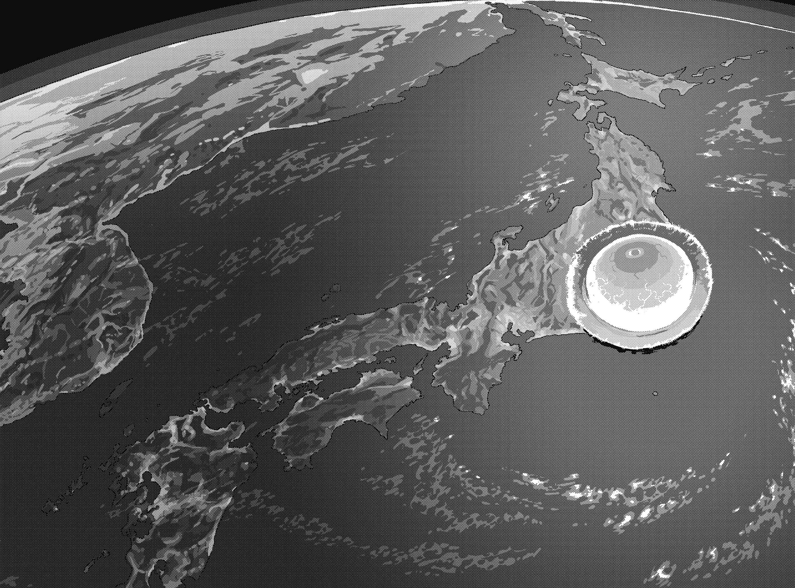

# 行间四

可是。

这次的战斗，本质上来说或许毫无意义。

就算将侵蚀脑与心脏等脆弱部位的病魔一一拔除，只要其他位置病根仍在，照样能重新转移过去。而且特地将最大病灶扔往碰不到之处的人，正是亚雷斯塔·克劳利。

宇宙。

「没有窗户的大楼」。

在永劫孤独中进行的天使与恶魔之战，也即将画下句号。

『……原来如此。这回就到这里为止了吗？』

挤出痛苦呻吟的，是爱华斯这边。

灵媒(Avatar)萝拉·斯图亚特的纤细手臂抓住他的头，在无重力空间里无意义地将他举起。

「之前一直护着莉莉丝的你，应该很清楚肉体的重要性才对。无论本质是什么，要对这个物质界造成影响就需要灵媒(Avatar)。就算你用了诈术试图弥补差距，也比不上独占正规状态最强的我啊。」

『呵。』

在这种状况下，爱华斯依然在笑。

『对于现世的执着，早在我利用学园都市AIM扩散力场让莉莉丝降世的时候，就已消化完毕。我就重回后台观察吧。科隆尊，你要好好表演，让我能安心地看一个愚蠢到极点的邪恶大魔王被打倒的故事啊。』

「把这些话当成遗言行吧？」

『那么我顺便补充一句……你就体会一下浦岛太郎的孤独滋味吧，废物。』

到此为止。

啪叽！萝拉品尝完某种东西在掌中折断的触感后，随手扔掉残骸。没落到地板上而是飘浮在宇宙里的爱华斯，从四肢前端开始逐渐消失。

「好啦。」

萝拉喘口气，重新一一消化需要执行的步骤。

她操纵起被放逐到宇宙的「没有窗户的大楼」，改变行进方向，再次奔往蓝星。名为科隆尊的灾难不会只有这点程度就结束。冲进大气层，撕裂高层大气，维持最高速度瞄准东京西部的一点，犹如标枪般直奔而去。

卫星兵器又如何，弹道兵器对策又怎样，防空火网算什么。

我方可是外宇宙旅行用的完全循环环境。「没有窗户的大楼」的坚固程度，很讽刺地有亚雷斯塔本人担保。管他什么导弹、激光、高射炮、高功率电磁波、其他各式各样的多重防空安全措施都无所谓。只要倚靠暴力硬是坠落地表，就能让一切化为灰烬。

对于现在的科隆尊来说，就连能烧尽一切的大气层也不值得畏惧。

这里有一杯水。

想让这杯平凡无奇的水喝起来尽可能美味，只能改变自己。不能只待在靠空调维持恰当温度的舒适房间里。需要离开房间，横越灼热的沙漠——做到这种程度才差不多。

科隆尊的本质是扩散。他会像撕裂男女感情那般破坏世间法则。那么理所当然地。

就和小心翼翼地搭建扑克牌塔，排出骨牌阵一样。

为了有一场心旷神怡的破坏，必须先创造要破坏的东西。

（……就让那些做点小事就以为自己胜利的家伙，迎接一如往常地的失败与败北吧。）

讥笑。

讪笑。

嘲笑。

「价数为三三三。本质为扩散。我乃妨碍世间一切法则完美结合，带来无止尽混乱与破坏者是也……」

理所当然地，他根本没考虑什么减速。

如此质量，如此速度。

「……吾名科隆尊。将这个名字的含义牢记在心吧！」

&nbsp;

**轰**————！**在命中的同时**，**整座学园都市消灭得一干二净**。

&nbsp;

一点。

恐怖的破坏，从该处朝四面八方散布。高楼大厦群洒下玻璃暴雨还嫌不够，更从根部折断倒向地面。填满地表的柏油路整片隆起外翻，车阵如纸箱般飞上半空，就连学校、公园、音乐厅、电影院等大型避难所也挡不了多少东西，先后崩塌。

无处可逃。

真要说起来，影响范围也不止一座小小的城市。

在这里引发的惊人冲击与震动，导致总量极为庞大的粉尘飞扬，而这些粉尘逐渐遮住了阳光。换言之，让人束手无策的寒冬到来。这种酷寒，过去曾让那些靠强韧肉体支配行星的恐龙灭绝。区区以两脚行走的无毛裸猴不可能撑得住。

但是科隆尊并未就此收手。

扩散原本就是人人具备的天性。人们会将集团切割为多个友善小天地，追求独处时间。以科隆尊的角度而言，不过是将这些延伸为世间的法则罢了。

寒冷、饥饿、看不见未来的恐惧。

连靠自己维生都办不到的脆弱族群，特别容易去冀求廉价的奇迹。

换言之，把东西拿走那一瞬间所感受到的愉悦，也会随之高涨。

如果像聚光灯那样，将光线打在零下五十度行星的某一点，结果会如何？温柔的暖意、充足的水和粮食、安睡的地点。光是这些，大概就会让他们投身以爪牙互相残杀的绝望战争之中。

赢家实际上能否得救根本不重要。

要不然将武器赐予跌落深谷的败者，让他来场复仇战也很有意思。

原型制御(Archetype Controller)。无论胜败生死，都要由恶魔来区分才有意义。

「呵呵。」

「没有窗户的大楼」本身也已经粉碎四散。

依附灵媒(Avatar)的大恶魔，只是待在巨大至极的陨石坑中心享受这一切。

不能扭曲的事实。

无从敷衍的结局。

没错，地球人类的文明，实在是太干脆地……就宣告结束。

「哈哈。也组合得太漂亮了吧，你们是想要让我开心，才特别安排这种大型的连环机关吗！啊啊，以为自己赢了吗？以为是个没出人命的大团圆结局吗？哼～哪有可能啊！我怎么可能让你们得逞啊！如何呀？具体来说到底怎么样啦？靠着一线希望，借由圣守护天使和『原典(Origin)』协助，大家同心协力引发不可能的奇迹？究极的引子啊？被我搞掉了吧！看我用这厕所的拖鞋！一鞋子就打烂你们啊白痴！就是这个啊，好不容易弄起来的金字塔呢。哼哼哼，啊～啊～实在是好漫长的紧绷啊。」

浮现。

在脑中浮现。

遮住整片天空的橘色，加上烧得炽热的特大一击。明知会降临却逃不了也防不了，只能咬紧牙关承受的凄惨模样。明知好不容易救回来的性命将在眼前消逝，身为父亲却无法替女儿做任何事的苦恼与惨叫。

身体因为兴奋而颤抖。

这种痛快的行为，就是让人开心。就像配合房间装潢，而把堆积如山的私人物品爽快地丢光一样。

无法抗拒。

就是这种感觉。自己一直一直渴望这种感觉。

什么因果与罪业都不重要。反而越是不讲理、没道理才越有趣。把那些小心翼翼累积，接着因为抽中出乎意料的偶然，因此不由得欣喜若狂的幸福人类，一个不留地打下去，推下去，嘲笑他们摔烂在地上的惨状。这就是大恶魔，这才叫科隆尊。那些用善恶区分自己所作所为，拖泥带水地找理由和借口将自己正当化的渺小存在，根本不会发现这种乐趣。

不要疏于为**幸福**而努力。蠢蛋爱华斯所说的话闪过脑海。可是把追求衣食住带来的快感信号与努力进行生殖活动等等也算进去，实在庸俗至极。如果只是获取粮食打点居所留下子孙这种程度，行星上其他几百万种动物与昆虫也是天天都在做。

另一方面，能纯粹追求残忍，而非为了进食或自我防卫去欺凌、破坏他者的生物，在自然界之中寥寥无几。

人类也是其中之一。

这些学会用双脚走路的掉毛猴子后裔，原本应该安分当个被选上的末席精英才对。话虽如此，但他们无法完全抛开「想得到幸福」这种既动物性又原始的欲望，误以为行事遵从脑内物质的分泌才是善良与正义，连摘下唾手可得的果实都做不到。真的只能说是愚蠢。与生俱来的残忍不去用而放着枯萎，就等于放弃思考堕落成只会扭动腰部的动物，他们连这种简单易懂到极点的事实都不明白。

科隆尊是个具有智慧的生物。

因此，就算只是解闷，也要选择那堆扭腰动物做不到的方式。

他熟知该怎么挥洒残忍，这是礼仪。

他了解如何与残忍为伴，这是规矩。

他学过装饰残忍的方法，这是品格。

「……这些硬不起来的残忍\*痿，全都自以为了不起。」

边笑边骂的萝拉，突然注意到一件事。

血肉的气味不够。

就算巨大质量坠落把学园都市整个砸烂好了，会清得这么漂亮吗？这里是两百三十万人生活的人口密集区。如果用苍蝇拍把这些人全部打烂，产生一层像透明墙一样的浓厚尸臭应该也不足为奇。

太漂亮了。

实在干净过头。

没错，简直就像……「**这颗地球**」**从一开始就没有任何人类存在一样**。

「什……？」

不由得感到狐疑的萝拉，听到某个声音。

实在不该出现在这种地方的声音。

&nbsp;

「奇怪～？喂，奈芙蒂斯，好像有什么有趣的玩具掉下来了哦？」

「是啊，娘娘。居然有人不经许可就闯进这个封闭时序，还真是稀奇呢。」

&nbsp;

萝拉·斯图亚特没有蠢到不明白是怎么回事。

真要说起来，为了扰乱亚雷斯塔，要乌丸府兰跟在上里翔流身边把他带到学园都市的，正是科隆尊本人。当然，过程中导致众多「魔神」消灭这点，科隆尊也都有接获报告。

「居然是那些被放逐的『魔神』……？等一下，那么『这个地球』是？」

「嗯～」

气色很差的改造迷你旗袍和她说出的话相反，看不出有在思考的模样。

「我记得，这里是上里翔流用『理想放逐(World Rejecter)』产生的电影胶卷多余画格，是把时间偏移的场所当成放逐用的监狱哦。这么一来～你是不是和相对论还是什么的扯上关系啦？就是速度越接近光速时间流动就越慢的那个。」

「比方说，**如果一场预定飞到太阳圈外的超高速太空旅行**，**在出发后直接掉头飞回来**，某些情况下或许会偏离本来该是基准的原点，让时间轴和『这个地球』重叠哦。虽然几率低到和发生奇迹差不多就是了。」

科隆尊总算想到。

那个「人类」亚雷斯塔，究竟是打什么主意才把他发射到宇宙。以及爱华斯为什么要在抵达「这个地球」之前，故意败北早早退场。

那家伙确实这么说过。

&nbsp;

『那么我顺便补充一句……你就体会一下浦岛太郎的孤独滋味吧，废物。』

&nbsp;

接下来有个比理论更重要的问题。

……「这个地球」和有六七十亿人口生活的正史不同，没有任何既存的生命，包含人类在内。在这里的，就只有将「道」钻研透彻而取得神明席位的魔法之神，也就是「魔神」。这些家伙只要能在不影响他人的状态下尽情施展那身超规格力量就心满意足，若是为了「使出全力」，就算要全年无休在永恒再生的牢笼里和同伴互相残杀也无妨。这里只有这种货真价实的怪物。

他们发现了新玩具。

连线对战模式追加了没见过的新规则。

普洛塞庇娜、努亚达、特斯卡特利波卡、奇美拉，甚至是娘娘与奈芙蒂斯……

激动的「魔神」舔着嘴唇，异口同声地这么说道。巧合的是，他们就如科隆尊本身的愿望，毫不保留地将极限的残忍暴露出来。

「「「看样子，暂时不会无聊了。」」」
