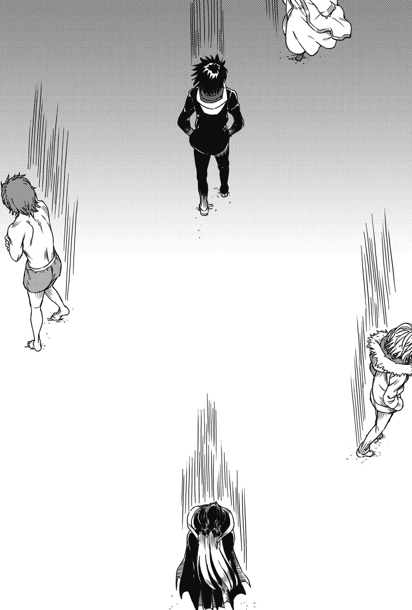

# 后记之后

契约成立。

一方通行(Accelerator)与滨面仕上分别为了自身目的展开行动，上条则看向淋着雨的银发少女。

亚雷斯塔·克劳利。

「怎么啦？」

「没有啦……」

上条对着抱着襁褓中莉莉丝的银发少女说道：

「……我没有要模仿一方通行(Accelerator)。可是，我也希望你能想起一般人的『恐惧』。」

「这样啊。这也难免，毕竟你的人生也是一直遭到我的摆布嘛。」

「不是这个意思。」

「？」

看见上条摇头，亚雷斯塔露出疑惑的表情。

面对抱着婴儿的银发少女，上条当麻接着这么说道：

&nbsp;

「因为啊，如果不这样你就没办法表现出自信满满的样子啦。今后你要教导莉莉丝的不止学识，这些东西也非教不可吧？统括理事长。」

仅此而已。

上条走向茵蒂克丝与欧提努斯她们等候的方向。少年似乎也已经清楚看见自己的目的，脚步里不存在所谓的迷茫。

「……」

抱着莉莉丝的亚雷斯塔，目送背影离去。

没有多说一句话。

于是舞台转往英国。

目标是大恶魔科隆尊的阿喀琉斯之踵。准备铲除一切的少年展开行动。
