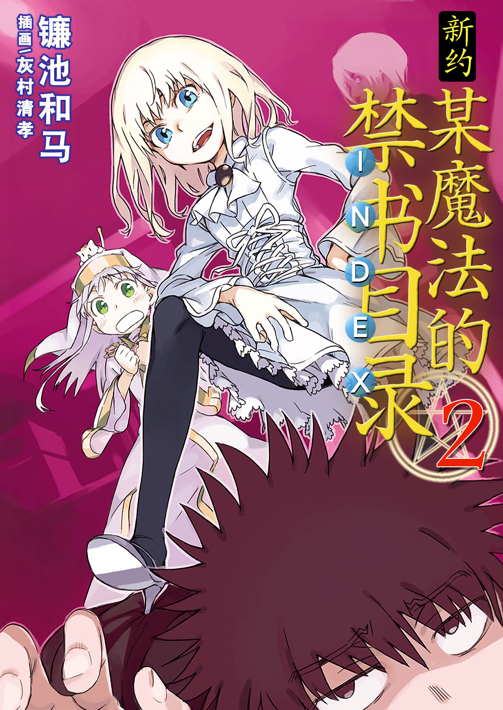

# 简介

**新约·魔法禁书目录2**

作者：镰池和马

## 内容简介

**由于英雄的复活，世界再次发生重大事件——才怪！而是突然进入日常恋爱喜剧篇！！**

11月5日的学园都市。上条当麻、一方通行(Accelerator)，以及滨面仕上三人终于相遇。然而，这意味着三者需要面对各自担心他们的女孩「你们到底在干什么」的问题大爆发……！

上条握紧呱太纪念品挂件，小心翼翼地对意气消沉中的美琴搭话，结果遭遇超电磁炮(Railgun)地狱。而且，他还以同样的语气与茵蒂克丝交谈……

滨面终于被正在进行「输了就要屈辱地扮兔女郎了！」游戏的麦野等人发现。然而，在他身边有一个与已故「道具」前成员芙兰达一模一样的少女……

一方通行(Accelerator)对突然出现的最后之作和番外个体感到厌烦，但总是喜欢捣乱的番外个体在上条面前却变得安静，不知为何让他感到恼火……

当科学与魔法交汇之时，日常故事（喜剧部分）就从此开始——！

## 制作信息

* 翻译：黄瀞瑶
* 台版：SOSG小说组
* 录入：古谷樱子 千木咲音
* 校对：古谷樱子 千木咲音
* 二校：watashi101
* 扫图：watashi101
* 修图：古谷樱子 叶月舞 白夜弦影
* 排版：watashi101
* EPUB制作：鹘鹰⚡
* 网翻：泉川生徒会
* 图源/超·监督/鸣谢：阿三
* 译者：阿三 绯月
* 校对/润色/吐槽/打酱油：ccaaq
* eBook制作：祈者之路
* 整合：知一一（禁书目录X系列，[index-X](https://github.com/1204244136/index-X)）


**版权声明**

转载时请保留录入信息。

本站内容仅供试看、学习与交流使用，禁止用于商业用途；下载后请在24小时内删除。请支持官方正版。


## 封面与封底

