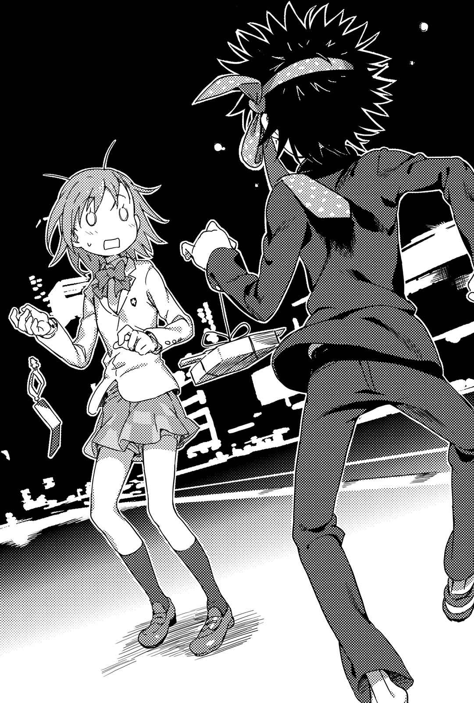
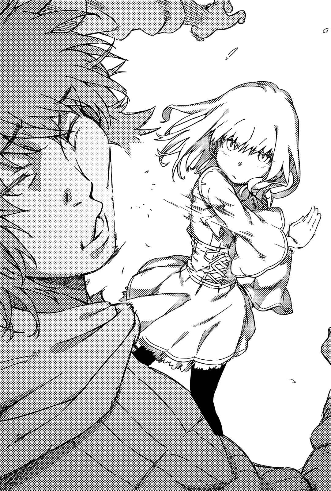

# 第一章 新的领域，魔法到来

> Lecture_One.

## 1

上条当麻、一方通行(Accelerator)、滨面仕上。

击破「新生」，救出芙蕾梅亚·塞维伦的他们，拿出各自的手机向前递出。

「交换电子邮件地址吧。」

「麻烦死了……」

「好，好，完成。」

操作着手机的滨面，早已将纤瘦的驱动铠(Powered Suit)换成了平常穿的衣服。他似乎已经利用驱动铠(Powered Suit)的通信机能和某处取得联络，接着将卸下的驱动铠(Powered Suit)藏在指定地点，打算让其他人来回收。

「……对了，为什么你的手机上，会吊着一条断掉的绳子？」

「呜……手机吊饰断了。我真不幸……」

「你是掉进北冰洋了啊，还能四肢健全地活着就已经是奇迹啦。」

柏德蔚惊讶地说道。

「……如果你们想跟着我，走向接下来的领域，眼里只看着『世界的一侧』是会跟不上的。就算是为了知道『那群人』的消息，你们首先也必须先将目光往『另一侧』去看才行。」

「那群人」似乎是关系着这个世界核心深处的重大问题。

黑夜海鸟和银色十字·阿尔法，想经由芙蕾梅亚消灭一方通行(Accelerator)和滨面仕上，据说目的也是打算整顿和「那群人」作战所需的体制。

还有柏德蔚所说的，世界的另一侧。

如果将学园都市定义为科学阵营，相对的就是——

魔法。

「……如果是要收集必要情报，那无所谓。」

一方通行(Accelerator)如咒骂般说道：

「但我可不打算在这里悠闲地跟你们长篇大论。我已经狠狠地干掉那些实质上指挥『新生』前来的混账，但那并不代表百分之百消除了威胁。」

「没错。」

柏德蔚点了点头：

「听你这么说，那边那两个……叫什么来着？不过，既然是遭到『新生』直接发动攻击的目标，最好还是认定跟他们有关的人事物都存在风险。而我也想找个能坐下来谈话的地方，所以先找其他地点比较好。」

「一下子找得到那么合适的地方吗？」

滨面询问，柏德蔚随手用大拇指指了一下。

她指着上条的脸。

「这家伙的家。……正好也可以让那个笨蛋去向女生低头道歉。」

## 2

因此，上条、一方通行(Accelerator)、滨面、芙蕾梅亚、柏德蔚与黑衣人部下，一行人朝着高中生的学生宿舍前进。

走在傍晚的路上，上条不知为何垂头丧气。

滨面一脸惊讶地问道：

「……到底发生了什么事？」

「没什么啦……」

上条有气无力地答道：

「因为第三次世界大战的骚乱，大家好像都已经以为我死了。这么一来……我在想，我一定害很多人为我担心吧。我现在实在不知道，要用什么样的表情去见他们……」

「我看这次光是被她咬一口，也解决不了事情吧……」上条嘀咕着意义我不明的言辞。

柏德蔚如嘲笑般笑道：

「但既然你还活着，就没理由不回去吧？不管你选择哪个方向，最后你还是得走上这条路，既然如此就趁早解决吧。」

「当作像是去看牙医就好吗……」

看着整个人垂头丧气的上条，滨面提出了一个建议。

「既然是非做不可的事，那就只能先激励一下自己喽？」

「什么意思？」

「先喝点酒，让情绪高涨一点吧。」

&nbsp;

&nbsp;

这几天，御坂美琴的心境一点一滴地发生了变化。

从意志消沉的谷底，涌出了一种焦躁感。

第三次世界大战结束时，和巨大要塞一起消失在北冰洋的上条当麻。

那名少年会出现在那场战争的核心，想必是「来自推动世界的势力，产生的某种力量」发生作用，所造成的结果吧？美琴思考着。即使那不是直接原因，但毫无疑问地，那股势力收集到了比美琴更庞大的情报。

学园都市。

其中的「黑暗」。

虽然美琴并不想接近，但他们的网络里有从全世界搜集而来，绝对无法阅览的情报。

美琴没有和「黑暗」联络的窗口。

但就算没有窗口，还是有入侵的方法。

当然，那么做会伴随风险。对方有可能会注意到美琴入侵，一旦对方发现，几乎可以确定他们将会采取对策迎击。甚至美琴考虑入侵这件事本身如果被对方发现，或许在那时「『黑暗』采取行动」的可能性也不低。

（……即使如此……）

她需要知道上条当麻的生死。

她不希望只能祈祷。

她想知道正确情报。否则，御坂美琴甚至不知道自己今后该朝什么方向前进。

如此烦恼不已，已经开始具体思考「黑入」步骤的美琴……

&nbsp;

「唔咦……在那里的不是小琴琴吗～？」

为什么会出现喝得醉醺醺的少年，跟自己搭话的幻觉？

&nbsp;

那个刺猬头的幻影，额头上系着不知道从哪里弄来的领带，用右手大拇指和食指拎着外带寿司盒的细绳，双腿呈O字体，踩着摇摆不定的步伐朝自己接近。

不对。

这幅景象……

不是第五位的超能力者(Level 5)弄出来的幻觉。

「咦？为什么！你为什么会在这里？第三次世界大战，北冰洋，你、你应该已经死了啊……到、到底是什么情况……！」

「哦，对了，我忘了重要的事。」

「对对，没错没错，就是那样！你快点回答美琴同学！后来到底怎么了？话说回来，你到底为什么要离开学园都市，闯入那场大战啊……！」

「来，小琴琴，这是送你的纪念品～」

「送什么纪念品！这寿司是昭和时代那些令人怀念的搞笑短剧里，常出现的道具吧？」

「汪汪。」

「这家伙不但说话没有逻辑，连人话都说不清楚了！……这种感觉是怎么回事，跟妈发疯胡闹的时候一模一样，但那些经验却完全不适用于现在这种状况……！」

美琴接过寿司盒，苦恼不已，而那名少年却似乎认为这样就已经解决了事情。他离开美琴身边，摇摇晃晃地不知道走往哪里。

要是在这里错过他，事情就不得了啦。

具体来说，就算连三卷都没出场机会也是有可能的。

御坂美琴直觉做出了这种判断，连忙追着少年的脚步。

「等一下，你给我站住！开什么玩笑，你以为这样我就能接受？擅自消失又擅自出现！今天你要给我把事情的来龙去脉交代清楚！」

「十一月有三十五天吗……？」

「你这家伙……别·闹·啦——————————————————！」

美琴忍不住从刘海爆出蓝白色火花。

她是学园都市排名第三的超能力者(Level 5)，也是电气类排名最强的人。身为能实现「超电磁炮(Railgun)」这个别名的人物，她可以操控最高十亿伏特的高压电流。

因此，「不小心爆发」出来的电击之枪，必然也能产生相当的破坏力。但是——

「我闪开了。」

「什、什么？」

看见上条用烂醉如泥的人特有的不自然动作躲开攻击，美琴忍不住脸色发青。

那个刺猬头少年（她也不清楚其中究竟是什么道理，但是他）拥有轻而易举就能抵消美琴超能力的力量。至今美琴的攻击，已经不知道被那种力量阻挡掉多少次了，不过……

他连能力都不需要了。

是这样吗？

自己明明如此千辛万苦地紧追其后，可是对他来说，却是这么简单就能处理掉的程度？

「这还真有意思啊……」

低头的美琴体内，不断涌上一股炽热的感情。

好久没有这种好战的情绪。

由于第三位这个排名的问题，她没什么机会能使出全力。她感觉到现在机会终于来了。

醉醺醺的上条，看着美琴的脸说道：

「怎么啦，小琴琴，你笑得不怀好意哦？是不是发生了什么好事？」

「我、我才没有笑！还有别叫我小琴琴！」

「不过奇怪？你明明用舌头舔嘴唇，还喋喋不休的啊？」

「什么啦！我听不懂你在胡说八道什么，但还是先否认再说比较好！」

美琴用力挥动双臂，说道：

「我能力的价值就在释放电力同时，还能拥有极为广泛的应用性！而究竟能产生出怎样变化多端的攻击方法？我就让你看个清楚吧……人呢？」

美琴正打算用火花四溅的手指指向对方时，却发现刺猬头的少年早已不见人影。

美琴连忙转头确认四周，发现对方正在不远处摇摇晃晃地走着。

但状况无时无刻不在改变。

快到她的思考来不及跟上的程度。

「奇怪？你在这种地方干什么？」

一个留着一头非常适合巫女服的黑发少女，如此说着向刺猬头少年靠了过去。

「咦？上条，你请假没来上学，却在这里散步，实在很大胆哦！」

身高一百三十五厘米的少女（？）大喊，正想伸手抓住他时。

「上条你这王八蛋，在大家为了『一端览祭』的准备，忙得不可开交的时候……你怎么浑身酒臭？我真不敢相信，你这王八蛋为什么要做这种缩短自己寿命的事啊！」

一个高中女生靠过来，她拥有足以让美琴发怒的巨乳。

「哦——上条当麻、上条当麻。我不想理你，但是你的猫借我玩吧！」

转眼之间，人一个接一个的出现。

「哎呀。你不是在『残骸(Remnant)』事件中帮我叫救护车的人？」过去曾是互相对立，胸部还算有料的结标淡希出现了。「呃……那个……既然你要回来，我希望你能先跟我说一声你要回来。」穿着雾丘女学院冬季制服、戴着眼镜的巨乳高中女生出现了。「哎呀，上条。我没想到你居然会在这个时候回来呢。」穿着深蓝色水手服，胸前更加波涛汹涌的高中女生出现了……

「等等！你们给我等一下！现在轮我出场了哦！你们想出来再等晚一点嘛！可恶！人口比例……不对，男女比例的平衡未免太奇怪了。后面那群巨乳组的，是用来对付我的吗？再、再这样下去，我会被埋没在背景里的……！擅自制造出一座森林，就是为了隐藏树叶？」

哔哩哔哩哇哇大叫，但其实上条似乎连自己身边聚集了这么多人的事实都不知道。

## 3

有一名叫做茵蒂克丝的少女。

少女有一头及腰的银色长发，绿色的瞳孔。还有仿佛可以反射光芒的雪白肌肤。和相同年纪的平均身高相较之下，她的个子略显娇小，或许会给人一种较为年幼的印象。她身上穿的衣服是纯白底色，上头有金箔装饰，形状如茶杯般的修道服。但一些重要部位的缝线全都拆开了，像是应急般只用大型安全别针固定。

她伫立在位于学园都市，第七学区的一间学生宿舍内。

那里并不是茵蒂克丝的房间。

更何况她也不是学生。

这里是某个少年的房间。茵蒂克丝原本寄住在这里。但是，如今身为屋主的少年却不在了，也没有人敢保证他会回来。考虑到茵蒂克丝原本「隶属于」的组织，她都不该留在这座城市，也不该继续使用这个房间。是不是应该顺从「隶属组织」的要求，回英国去呢……

可是她却怎么也无法离开日本回英国。

她总觉得留在这里，总有一天他会偷偷出现在她面前。无论如何，不管发生什么事都不能离开。一旦茵蒂克丝放弃，一旦她离开这里，都将彻底断绝那微小的可能性……她甚至忍不住思考起罔顾那些理论的凶兆。

这或许是她的任性吧。

原本的「隶属组织」，容许了她这样的任性。

他们这么做是顾虑到茵蒂克丝本身？还是顾虑到身在第三次世界大战中心，为了阻止纷争而消失的那名少年？

「当麻……」

她轻声呼唤了那个名字。

还有一个人……不，还有一只寄住在房里的三色猫「斯芬克斯」，即使在这种时候依然我行我素，仿佛在说着「虽然听说英国的食物很那个，不过猫食倒是都一样呢。」似的，把头塞进从英国带回来的饲料袋中，大口咀嚼着。

看着那副不变的景像还能微笑的，应该是心有余力的人吧。

一旦跨越那道界线，今后不管失去什么，依旧能一如既往地向前迈进。这让她感到一丝不安。

他会回来吗？

该像这样等到什么时候？

这么做有意义吗？

一定要有意义才行？

她自己都无法控制自己的感情。原本早已归纳整理好的思绪，又四散在脑海之中。如同碎片般的思绪，犹如短路所产生的火花，产生了各种意见。但是那些随机的意见并没有一致性，即使想将它汇总，恐怕也只会产生矛盾。

一旦有了某种契机，就会严重倾斜翻覆。

就像在尖锐的木桩放上一片大板子。无论将手指放在板子何处，板子都会倒向那个方向。

或许正是因为为了维持那摇摇欲坠的平衡，她才会停滞不前。

就这样，抱着「过度鲜明的回忆」而暂时停止的茵蒂克丝，此时用尽了最后的些许力气。

「……这个……」

那是上条当麻交给她的零圆手机。虽然她拥有完全记忆能力，但是若没有上条从旁协助，她到现在还是无法随心所欲地使用那个电子机器。同时也是如果知道使用方法，或许可以联络得上那名少年的通信器材。

看着手机，茵蒂克丝的心猛然晃动了一下。

将来该走向什么方向，就连她自己也掌握不住。

茵蒂克丝决定抓起把头埋进猫食盒里的三色猫，朝房间的玄关走去。光是等待无法改变什么。是否有线索都没关系。就在茵蒂克丝为了再次寻找那名少年，正准备冲向外面的世界时——

&nbsp;

「唔、唔哒……让、让、让你久等了……」

如同落入沙堆，吸满铁砂的磁铁，拖着超过十名少女的上条当麻，打开玄关的门走了进来。

&nbsp;

一开始，茵蒂克丝不断地眨着眼。

接着她马上接受了眼前的事态。

「当、当麻！你一直消失无踪，害人家很担心，可是你那样到底是什么意思？！」

「嗝……唔咦？什么意思是指什么？」

「我本来想说你实在太一如既往了，拿你没辙，可是里面明显混着几个我不认识的人啊！」

「你好，我是兽少女(新女主角)。我们刚才在那边认识的。」

情况混乱到极点，加上原本应该说明事情来龙去脉的上条，也陷入被打倒在地的烂醉状态，事情变得越来越无法收拾。

接着——

## 4

一方通行(Accelerator)与滨面仕上在远处眺望着这场骚动。

原以为那名少年已经喝得烂醉，没想到他竟然自己走去别的地方，而且当他们发现时，少年身后已经带着一群少女。

「辛苦他为我们带路啦……话说回来，为什么连结标那个混账也在这里瞎起哄啊？」

虽然他和暗部组织「GROUP」已无任何往来，却没想到会在这种地方碰上以前的成员。

第一位有点惊讶地（但是想到上条当麻并不是单纯的战斗要员，却能和双方和平共处，他内心不禁感到佩服）发出低语。

「我该叫他一声师父的。」

滨面并没想太多，如此自言自语地说道。

## 5

少女泷壶理后原本大口享用着从便利店买来的热狗，此时她却圆睁着原本睡眼惺忪的双眼。

「……滨面正要走上邪恶的不归路！」

## 6

少女们如铁砂吸附在磁铁般，紧紧黏着上条当麻，在柏德蔚的部下马克·史佩斯等黑衣人的耐心说服下，总算离开学生宿舍回家（其中也有差点被高压电流烧成爆炸头的黑衣人；也出现了强迫他们保证，事情结束后要向她们详细说明的场面）。

狠狠咬着上条后脑勺的茵蒂克丝，看见进入视野内的一方通行(Accelerator)后，露出了惊讶的表情。

「是那个迷路的人。」

「……这家伙是用什么方法在记事情啊……」

一方通行(Accelerator)嘀咕了几句，但并没继续和她对话，除了他本身个性的问题，大概也是因为他不太愿意回想起0930事件。

柏德蔚急忙将两脚伸进房间中央的暖炉桌中。

「快点坐下。这里又不是教导家庭主妇的陶艺教室。我可不打算贴着你们的背，分每个步骤仔细教你们。」

因此，上条当麻，一方通行(Accelerator)和滨面仕上分别坐进方形暖炉桌剩下的三面。

「喵。」

发出声音的是芙蕾梅亚。

不知为何，她坐在将脚伸入暖炉桌的滨面膝盖上，并说道：

「我的宝座。」

说出这句话是还好，但或许是遭「新生」四处追杀的疲劳出现了，才十五秒她就进入梦乡。

柏德蔚随意地叹了口气，说道：

「你们准备好听我接下来所说的话了吗？」

「……我不知道是要准备什么呢。」

滨面轻托着差点就要滑落的芙蕾梅亚，如此回答。

柏德蔚并不在意，继续说道：

「那么，就开始各位期待已久的说明时间吧。」

少女说着，并看了茵蒂克丝一眼。

禁书目录。

她知道对方的身份，但是柏德蔚还是得说：

「关于不再和你们无关的『那群人』……以及支撑他们的另一个法则，『魔法』。」

## 7

海原光贵在学园都市医院的其中一间病房里。

他本身不是病患，而是过来探望朋友。

「……天色都暗了。今天的探病时间看来也差不多快结束了。」

海原这么说着。

一般病房……看起来如此，但如果是有住院经验的人，或许能看出一点端倪。这里不是能容纳四到六名病患的大病房，也不是一名病患独用的单人病房。

这间偏大的病房中，放着两张床。

只有不寻常的人物，才能享有不寻常的待遇。

躺在其中一张床上的少女说道：

「……我可不记得要求过你来探望我。是你自己每天跑来的。」

少女的名字叫索绮特。

从她的名字就能知道，她并不是日本人。浅黑色的肌肤、黑色卷发。少女隶属于源自中美洲阿兹特克的魔法组织。如同魔法组织给人的印象，她带着一身令人恐惧的超自然武器，但是现在那些物品已经全被海原少年没收。

附带一提，躺在另一张病床上的，也是和索绮特来自相同文化圈的少女。她是妥琪特莉。不论是索绮特或妥琪特莉，在她们的语言中都是非常知名的东西。

妥琪特莉说道：

「她虽然嘴上这么说，不过要是你一天不来，她说不定会把枕头扯碎哦。为了我安稳的住院生活，还是拜托你持之以恒地每天过来探病吧，**哥哥**？」

「你们可别误会了，因为我是『尸体职人』的关系啊。待在这种地方，会感受到太多多余的残留思念。那才是我之所以会烦躁的理由。」

「所以我的意思就是，我哥哥具有足以缓和你心情烦躁的效果啦，听到没有？那边的小姑娘。」

看着狠狠瞪着别人的索绮特，和对他人的怒气视而不见的妥琪特莉，海原露出了微笑。

同时，他如此心想。

海原光贵原本是在学园都市的「黑暗」中活动的人物。在聚集了一方通行(Accelerator)、土御门元春、结标淡希这些怪物，名为「GROUP」的组织中，为了拭去这个城市的「黑暗」，而纵身跳入「黑暗」中不停战斗。

当然，「黑暗」持续在干扰海原以夺走他的自由，不过这几天，他感受到那种束缚在急速地解除。

比如说，这间病房。

她们的价值就是可以当作胁迫海原的人质，为了她们，通常都会部署超过两名清洁人员若无其事地在房内活动，但是那些人不知不觉中全都消失了。

「GROUP」的其他成员也没联络。

他不会主动联络其他成员，反之亦然。

就海原独自调查到的内容看来，「黑暗」之手不只从「GROUP」身上，也从学园都市各个领域抽手。

经过那场第三次世界大战后，一定有了什么改变。

改变一定也波及到一方通行(Accelerator)、土御门元春和结标淡希吧。

他们是如何接受这个新世界？

还有——

既然将「黑暗」的人才绑在「黑暗」之中的体制消失，**那么长久以来束缚海原光贵的那名少女**，**她周遭的环境又会变成怎样**？

他应该享受这种和平？

还是应该再度跳入「黑暗」之中？

海原深思着今后的方针，此时他听见病房中的两名少女对他说道：

「对了，我有问题要问你。」

「什么问题？」

「……艾扎力。虽然我知道那张**海原光贵的脸**非常方便你潜入学园都市，但是为什么在这间只有我们几个同乡的病房中，**你还要继续使用那张假脸**？」

「那是因为……」海原正打算回答时，妥琪特莉说了一件非常麻烦的事。

「拜托你也该注意到了吧，索绮特。这个世界还是漂亮的人比较有好处。那家伙就是用这种方法来讨他潜入地点的女人欢心，好获取所需情报啦。」

此时传来东西裂开的声响。

索绮特将打发时间用的魔方，折成了奇异的形状。

「不、不是，不是这样的，索绮特！我只是因为这张脸最适合用来接近目标，并不是基于长相美丑来挑选。再说今后行动时，因为自己的变装术式需要用到人类皮肤，为了不要造成多余伤亡，所以才会一直使用自己手上已经有的这张脸罢了。」

「你干嘛用那种令人作呕的敬语啊！艾扎力，你本来不是那样说话的吧！」

「……喂喂，别突然大发雷霆啊，索绮特。那可是非常重要的工作呢。所以说昔日的青梅竹马变成了花花公子，你也别对他生气嘛。像以前那样叫他就好了。叫他艾扎力哥哥——」

不怀好意地笑着的妥琪特莉，绝对是注意到了什么，还明目张胆地故意火上加油，以此为乐。

「艾扎力……」

索绮特压低声音说道：

「如果不想在没解除术式的情况下，被我活生生剥下那层皮，现在就马上想办法处理掉那张脸。」

海原以暧昧的表情笑了笑，立刻像被猫抓伤了一样，抓花了脸。

## 8

「我认为立刻提及『那群人』的事，你们应该也听不懂。所以，首先我先从培育『那群人』长大的土壤，也就是魔法和魔法师开始说明。」

柏德蔚说道。

对上条当麻而言，或许那已经是他见识过的世界，所以他听着柏德蔚的话，表情并没有特别惊讶。

主要的听众，其实是一方通行(Accelerator)和滨面仕上。

「所谓的魔法，就跟你们想的一样，是和科学法则完全无关的东西，也就是所谓的超自然现象。可以操控魔法的人，不但能从手中喷出火焰、可以喷出水、可以治疗伤口，同时也可以使伤口更加恶化。」

「如果真是那么方便的东西，魔法应该会比科学超能力更为普及吧？」

对于滨面的疑问，柏德蔚向茵蒂克丝瞄了一眼。

茵蒂克丝在距离暖炉桌稍远的地方，说道：

「但是魔法其实不是那么方便的哦。毕竟所谓的魔法，除去一部分的例外，基本上都是『没有才能的人，为了追上有才能的人』才存在的。」

「简单地说，就是无能。借由其他方式，来弥补无法独当一面的部分。」

柏德蔚像是归纳出结论般，做了总结。

理所当然地，人类没有道具，不可能凭空飞行。

或许学园都市培养出来的能力者可以做到这点，但是毕竟也有「科学研究」在背后支持。

不管是那些利用药品或电力刺激，开发出人工能力的人；还是因为自然环境组合，碰巧形成足以培养出能力者的环境，出现了被称为「原石」的人们。

「都是出于羡慕。」

柏德蔚笑了。

不带丝毫暖意，能让见到的人全都不寒而战栗的笑容。

「在科学和超自然现像还尚未区分清楚的时代，有人看见了某种宗教奇迹，与『碰巧具备一切所需环境』的天然能力者力量。虽然不清楚那是什么，却产生了憧憬，结果就开始希望自己也能变得特别，不能接受自己如此平凡。这就是魔法的开始。」

正因如此，所以严格说来，魔法与宗教应该被视为不同的领域。

甚至不少人认为试图以人类的力量追上真正的奇迹，这种想法本身就是对宗教的一种亵渎。

纯白的修女如此说迫：

「……就算如此，魔法会公诸于世，还是表示即使世界上充满神秘，但并不一定只限于为人类发挥机能吧。」

柏德蔚不怀好意地笑着，同时说道：

「只不过，无能的人利用他们的自卑感所创造出来的魔法，其实也是很方便的。比如，你们使用的『科学的能力』这种东西，基本上一个人只有一种吧？」

「是没错。」

滨面回答。

但由于他本身是无能力者(Level 0)，并不依赖那样的能力，因此似乎对能力的便利性也没什么实际的感受。

一方通行(Accelerator)代替他补充说道：

「……想要改变攻击模式的情况下，如何应用基本能力？以及能否实际应用？这两点就足以分出胜负了。能够释放出火焰的能力者，就能利用能力制造出烟雾、夺走氧气。关于这点你怎么说？」

回答的不是柏德蔚，而是上条。

「魔法没有那样的限制。」

「没错，所以我们可以自由产生火焰。」

柏德蔚弹了一下手指，食指指尖便冒出打火机程度的火焰。

「我也能制造出水。」

她再弹了弹手指，出现了一颗高尔夫球大小的水球，浇熄了火焰。

「当然，这些魔法都有基本的法则存在。比如凯尔特或北欧之类。但即使如此，也没有特别严密的区分。就如同『受到凯尔特文化感化的北欧神话』，可自由组合应用。」

「……这样听起来，跟我们这些只因为一次『身体检查(System Scan)』，判定出系统或等级之后，就再也改变不了什么的能力者相比，实在方便多了。」

滨面低声说道。他的话让柏德蔚毫无意义地感到骄傲。

「实际上，的确是很方便。无论是想飞上空中，还是希望受到女孩子欢迎。只要『目的』清楚了，之后就能依照自己的希望排列，**组合出异能的设定**。跟老是依赖才能的你们比起来，我认为这能发挥非常大的优势。」

「当然，细密精准的调整，势必要付出相当的辛劳。」柏德蔚补充说道。

如果那是真的……滨面心想：

泷壶、麦野、绢旗，还有芙蕾梅亚。被烙上才能不足烙印的自己，说不定也能得到保护他们远离威胁的力量。

但就在此时，茵蒂克丝说出了这样的一句话。

「不过，你们不可以因为这样就使用魔法哦。」

「咦？什么意思？」

「……」

滨面发出惊讶的声音，一方通行(Accelerator)大概是知道了什么，并没什么特别的反应。

柏德蔚说道：

「我刚才不是说过了？所谓魔法是没有才能的人，为了追上有才能的人而创造出来的技术。是构造上的问题啦。魔法本来就不是为了有才能的人而创造出来的东西。要是勉强使用，恐怕会对体内的血管或神经，造成庞大的负荷。」

上条也接着柏德蔚的话，如此说道：

「顺便一提，就算是无能力者(Level 0)，但一样都已经被学园都市的技术潜移默化。所以我也无法使用魔法……恐怕待在Skill-Out的你也是。」

「魔法和科学一样，都是来自专门技术与知识累积而成的。**异能设定**也必须花费许多精神和时间。与其从现在开始花费十年准备，只因为用了一次魔法就全身喷血而亡，倒不如好好磨炼自己原本就有的能力，还比较有效率吧？」

「那你干嘛跟我们废话这么久？」

「因为『那群人』正在进行这样的设定，对你们露出獠牙。」

柏德蔚回答了一方通行(Accelerator)的问题。

「就算你们无法使用，但为了采取对策，先知道它的法则也不是坏事吧。还是你们打算一直将他们当作『使用未知法则的神秘敌人』，不断凭空摸索？」

「具体步骤呢？」

一方通行(Accelerator)低声问道。

他在俄罗斯的战争即将结束时，根据神秘「羊皮纸」的情报，不惜承受随之而来的副作用，引发了类似魔法的现象。

但是，这种足以撼动学园都市「黑暗」的声调和眼神，却震撼不了少女。

「当然，那也会随宗派和学派不同而改变。」

柏德蔚一脸厌烦地，挥手赶走爬上桌来的三色猫说道：

「基本上，首先要从将自己拥有的生命力提炼为魔力开始。关于灵魂的定义，魔法侧这边也是各种学说百家争鸣，因此这部分很难解释……但是，如果将原本就在人体中流动的能量当成原油，那么在使用魔法前，就需要先将它提炼为汽油。」

茵蒂克丝接着说道：

「比较简便的方法，可以举呼吸法为例。但这也不过是控制体内的其中一种方式。无论是冥想、准备运动、饮食控制都行。简而言之，只要能控制血液流动、内脏的韵律，变成自己所希望的数值就没问题了。」

「我想，对科学有所认识的你们应该能明白，但是体内器官大部分都无法依自己的意志控制。勉强改造自己的器官，就能提炼出平时所无法获得的能量。」

「但是，」柏德蔚稍微停顿了一下，说道：

「体内器官之所以会自动运作，是因为若非如此就会非常危险。这就跟计算机的初始设定一样，看不见和系统有关的文件。若是没有相关知识的人勉强尝试，当然会出现自食恶果的风险。」

「只不过这些，似乎在过去都被误以为是天罚或鬼魂作祟就是了。」她说道。

「一旦得到行使魔法所需的魔力，之后只要以『依照自己希望的形态』操纵这份魔力就行。汽车、摩托、船舶、飞机……交通工具虽然有很多种，但一样都是利用爆发力来转动涡轮……反之想要渡海，首先得考虑自己需要哪种交通工具，然后提炼原油，制造出合适的燃料。」

柏德蔚在暖炉桌里，坐卧不安地改变盘腿的双脚位置。

「魔力这种东西，是将人类原有的力量加工后的产物，因此相对地，比较可以简单地依人类的意思加以操控。但是为了控制魔力，还需要命令。虽然要从零开始构筑术式也是可以的，但是坦白说那样太没效率。参考已经存在的传说或奇闻轶事比较简单。因为广为流传至今的传说，在漫长的时间中都没被淘汰，正是最合适的解答。」

「没有被淘汰，最合适的？」

某种程度上亲眼见识过魔法的上条，提出了疑问。

茵蒂克丝右手做出拿笔的动作，说道：

「用手写字，比用脚写字简单吧？用右手写字，比用左手写字简单吧？……我认为这应该是通行全世界大部分地区的常识。到这里为止你们听得懂吗？」

「还可以……」

「但是，右手最容易写字，是因为大家从以前开始，就一直用右手写字的关系。最大的原因就在于长期以来，父母亲都如此教导孩子那就是写字的方法，而孩子也就如此教导孙子。然后各种人继续用右手写字，久而久之自然产生了整齐美丽的文字写法……如果一开始人类是用左脚来写字，那么就会出现左脚的文化。魔法也一样。」

「完全从零开始构筑的意思，也就是相当于从现在起练习用左脚写字？」

上条低声说道。柏德蔚随意地点了点头，接着说道：

「即使如此，也不代表就无法运用魔力。只要好好钻研，或许就能追赶上右手。但是，那样的行为有意义吗？如果右手无法使用就另当别论；但如果右手能正常使用，直接使用右手不是更有效率？因为这时代的文明早已像这样演进成最适合的形态。」

「不过，究竟是为了制造出自己所期望的现象，而利用了宗教体系？还是尝试制造出期望的现象，只是信奉宗教体系的一环？情况会随这两点而改变就是了。」柏德蔚加上补充。

「将魔力灌注在自己的血管与神经中，通过身体动作或手势，只要表现出符号，就能使用魔法。但如果要进行更精密的仪式，会使用专门道具也不稀奇。比如说参考『传说之枪』出场的轶闻时，实际挥动长枪会更有效率吧。关于两者之间的差异，你们只要想象直接拿笔划直线，和用尺来画直线有何差别，这样就够了。」

虽说如此，并不代表一定需要这些老掉牙的传说物品。

只要形状和用途相近就可以，所以就算用塑料雨伞和晒衣竹竿也能进行仪式。只不过细节部分越完整，失败的几率就会越低，因此常常会在塑料雨伞顶端装上菜刀之类的刺枪，或进行各种加工。

那些物品，在普通人眼里看起来，或许只是一些莫名其妙的神秘发明。

「我们管这个叫灵装。只要不是太特殊的例外，灵装就只能算是道具。灵装并不像魔法师一样，具备有提炼汽油的装置。魔法师通过接触灵装，将灵装转化为身体的一部分，使流动于血管和神经内的部分魔力流入灵装中，让魔力循环。『喷火之杖』也是一直来到这一步，才能实际喷出火焰。」

「虽说如此，不过魔力可以从远方供给；部分灵装就算离开魔法师之手，也能暂时在内部循环魔力。」柏德蔚补充。

「最近，也开发出安全装置了；以前一旦灵装遭到破坏，循环被切断，会导致魔法师本身受到伤害。代表性灵装的象征武器(Symbolic Weapon)虽然『制造与神圣化都要由使用者本人完成，不得让他人碰触』，但是这也是因为使用者担忧那些无谓的干扰，可能成为循环不完全的原因。」

对魔法了如指掌的柏德蔚，应该知道失败的例子。

但是，她脸上露出一抹浅浅的微笑，完全没提及这个部分。

「若以戏剧来解释灵装，从演员手中的小道具，到装设在舞台上的大道具，各有不同的种类和用途。如果是尺寸更大的辅助工具，道具之上还有剧场，而能对应剧场规模的就是神殿。当然，画分出一个范围会更有效果。」

「……」

「顺便告诉你们，我先前说明的，都是以个人精制魔力为基础的魔法。但并不表示没有其他能量。好比地脉或龙脉这些起因于土地的力量，或者被称为『天使之力(Telesma)』，储存在相同世界不同相位的力量。」

「这种力量拥有巨大的能量，但它和魔力不同，多半是一开始就被赋予所谓的属性。」柏德蔚说道。

因此并不是制造出能量以使用魔法，而是必须配合能量的性质，来选择使用的魔法。

柏德蔚先说了一句：「解释了这么久，可能没什么意义。」然后她接着说道：

「这类的力量使用人类拥有的魔力，以『召唤』方式发动。比较接近炸弹与雷管的关系。通过雷管的小爆炸，使大量炸药产生反应，以得到威力惊人的爆发力……当然，这种力量虽然可以操控个人的魔力所不可能做到的术式，但风险也会随着爆炸规模的改变而增加……你们应该这么想，连个人魔力都无法控制的人，一定也无法操纵天使之力(Telesma)。」

茵蒂克丝补充说道：

「有一部分例外，是利用人类魔力和天使之力(Telesma)能量彼此的相似性，来直接操纵天使之力(Telesma)的人。不过这是相当特殊的例子，因此你们不用参考没关系……话说回来，虽然这么做能使用的力量非常庞大，但是性质上却会受到对应的天使处处限制，所以无法使用一般魔法，结果反而没那么自由。」

柏德蔚完全不理会仰躺在自己眼前的三色猫，继续说道：

「好，我已经将魔法师的基本构成说明完了。但是要理解那群人，最重要的不是那些。」

「……什么意思？」

「重点是定义问题。魔法师基于什么目的而使用魔法？若不知道这点就无法谈论魔法师了。」

「是组织结构的问题？反正就是跟我们学园都市『对立』吧。听说是由一个不怎么样的组织负责管理？」

「关于那些事情之后我会说明，但是在此之前，我要告诉你们魔法师的本质究竟是什么。」

柏德蔚笑道：

「国家宗教、魔法结社、部族构造……魔法师当然属于上述的组织构造中……但魔法师却很少为了组织构造牺牲生命。他们永远只为个人而使用力量。虽然也有将为组织牺牲当作个人目的的魔法师，所聚集而成的集团，但是他们还是深受『个人』的概念影响。」

「……？」

一方通行(Accelerator)一脸惊讶，大概是因为无法想象的关系。

或许正是因为他本身就隶属于一个巨大组织，长久以来一直受到组织束缚之故，所以他才无法想象。

「如同我刚才所说的，所谓魔法师，其实是一群没有才能的人。」

「那是什么意思？」

「也就是他们的人生中，一定在某处经历过挫折。比如无法救回重要的人脱离重病折磨、因为饥荒而不得不杀害自己的伙伴……如果没体会过那样的经验，谁都不会想尝试去超越物理法则。满足于寻常生活的人，只会停留在寻常的世界中。会想要倚赖魔法这种异常的力量，那些人必定都拥有相当程度的理由。」

语毕，柏德蔚以大拇指压在自己小小的胸部中心。

「魔法师以拉丁文，将自己的目的刻在自己身上，这也就是所谓的魔法名。我的魔法名是『Regnum771』，直挺挺站在那里的马克则是『Armare091』。后面的数字是为了防止魔法名重复用的……对于明确确定自己的目标后，配合目的而组成所有法术的我们而言，组织构造这种东西不过是『为了实现魔法名的辅助工具』。如果它值得利用，我们就会对它尊敬并效忠；如果它没有尽到职责，我们就会幻灭，并毫不留情地舍弃它。由一座学园都市生产、管理所有能力者，当作庞大组织计划的一部分，而遭到利用的你们，我们彼此之间最根本的思考模式就不同了。」[^1]

「……那样也能成立？」

一方通行(Accelerator)惊讶地问道。

「每个人都只想随心所欲地使用力量。负责管理的组织，巨大的意念也无法传达至组织底层。那样的组织，放着不管也只会自行崩溃吧？」

「魔法阵营的组织构造，当然也准备了相当程度的糖果和鞭子，好软硬兼施啊。」

茵蒂克丝说道。

「既有个人力量无法完成，必须分工合作的大型仪式；而编制追击部队追杀叛徒的做法也不稀奇……只不过那些行动与魔法名无关。」

「……」

柏德蔚对沉默不语的他们继续说道：

「所以那名叫做雪莉·克伦威尔的魔法师，为了挑起科学阵营与魔法阵营的战争，才独自潜入这座城市。丽多薇雅·罗伦婕蒂才会擅自取走『使徒十字(Croce di Pietro)』，试图支配学园都市……无论隶属于哪个巨大组织都没意义。会动手的人就会动手。即使那个人的魔法名，会将世界的体系化为碎片，真正的魔法师也不会展现丝毫迟疑。不只是他们身处的魔法阵营，即使将其他世界卷入其中，他们也在所不惜。」

「……『那群人』也是……」

一方通行(Accelerator)低语。

就连知道不少关于「黑暗」的学园都市第一位，也还有太多不知情的事。他想着水面下发生的「学园都市残存或毁灭的天平」，继续说道：

「你们在『我看不见的地方』鏖战的『那群人』，也是拥有魔法名的人？」

听见他的问题，柏德蔚不怀好意地笑了。

「所以我才说，在我解释『那群人』之前，必须先说明魔法的本质才行啊。」

学生宿舍出现了短暂的沉默。

早就已经被学园都市的规则潜移默化的三名少年，陷入了沉思。

上条当麻应该早已知道在某种程度的事，但听了柏德蔚的说明后，他大概正在重新整理自己的意见。

「（……问题是科学和魔法发生冲突时，哪边的规则会更为优先？不，严格来说并非如此。真的要想解决问题，必须打造出一个不属于任何一边，**中立的第三阵营**。）」

一方通行(Accelerator)为了重新迈开脚步，跨入曾经短暂接触过的世界，正在整理情报。

「（……我对什么魔法和未知的世界没兴趣。但是，如果在我不知情的地方活动的那群人，他们所激起的涟漪影响到我所知道的领域，那就另当别论。虽然我还不清楚『那群人』的真面目，但是现在看来，有需要获得更详细的情报啊。）」

而任凭想象力驰骋，眼神变得朦胧呆滞的滨面仕上则是——

&nbsp;

「（……吃饭饭这个字，仔细想想，只能勉强算是日文呢……）」

&nbsp;

仔细观察一下滨面的视线前方，三色猫正在狼吞虎咽，吃着茵蒂克丝放下的盘子里面的东西。

蕾薇妮雅·柏德蔚面无表情地用娇小的手掌，对着最怕校长训话又臭又长的滨面脸颊，狠狠地甩了一巴掌。

「哦唔？哦唔啊！」

「……你这家伙，别人明明还在努力说明情况，而你中途就睡着了吧？」

「我没有睡我没有睡！我有在听啦！」

「既然如此，那你说我刚刚说了什么！」

「唔呃，我想看看，多喝牛奶胸部会长大……」

「……我可以把它视为你对我的挑战吧？」

「那不然就多喝胸部牛奶会……」

「那句话根本连日文的原型都没有了！真是的，你先去给我洗把脸再过来！」

[^1]: 译注：Regnum771，指原文误记为Regunm771的魔法名；拉丁文中regnum为王国、王权的意思，而regunm查无此词。AtWiki上的魔禁日文维基认为系作者误记，X版也赞同误记说。
