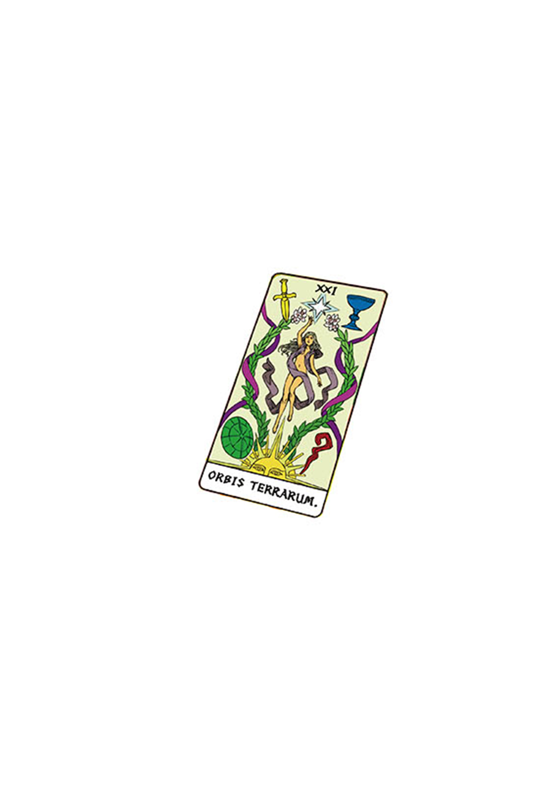

# 简介

**新约·魔法禁书目录21**

作者：镰池和马

## 内容简介

**科学与魔法。跨越百年的决战就在此刻……！**

亚雷斯塔终于到达了打破大恶魔科隆尊的关键点，威斯敏斯特教堂的墓地。在那里他看到了——

世界最大的魔法结社「黄金」的首领，马瑟斯。100年前，在因缘之地·布莱斯路就已完全与之一刀两断的男人。

不仅仅是马瑟斯。他所率领的强大「黄金」的魔法师们也齐齐向科学之长露出獠牙。在魔法实力上无法胜过马瑟斯，亚雷斯塔无计可施，但在科学领域建立起来并积累的一百年并非徒劳。

上条当麻和一方通行(Accelerator)。这两人是科学的大本营·学园都市中积攒的「成果」，他们终于要与最强大的马瑟斯对抗——！

## 制作信息

* 翻译：Seeker
* 台版：网翻
* 组织：星之翔
* 图源：佚名
* 友情协助：フムロ
* 翻译：Edster792、上条美琴、天海霜月、万象之金、绿酒°、吐槽星1234、人生能有几次梦、孤独的滑膛枪、喵姬、林中的挪威、Earth终极、为毛取ID这么难
* 校对：JOJO扬、不漆黑的子弹、吐槽星1234、为毛取ID这么难
* 润色：银某人
* 整合：吐槽星1234
* 修图：中二
* EPUB制作：当麻10032号
* 贴吧汉化组：特别献给为汉化工作做出过杰出贡献的蔬菜盖饭
* 整合：知一一（禁书目录X系列，[index-X](https://github.com/1204244136/index-X)）


**版权声明**

转载时请保留录入信息。

本站内容仅供试看、学习与交流使用，禁止用于商业用途；下载后请在24小时内删除。请支持官方正版。


## 封面与封底

