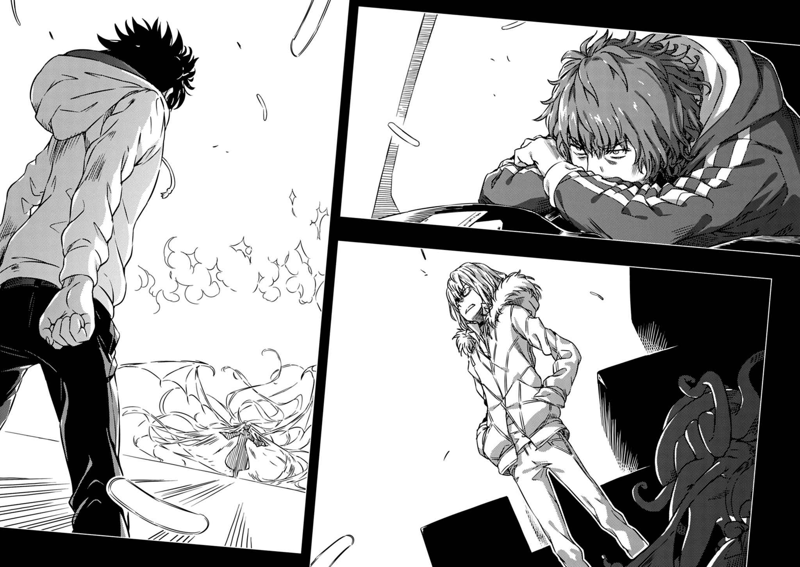

# 终章 能允许这种结局吗

> Go_for_Broke!!

朝阳已经升起，天空染成蓝色。

冬季的早晨。

「王室派」的马车队列平安抵达爱丁堡城堡。

虽然用地内似乎原本就有几间博物馆与纪念馆，不过眼前众人显然不是观光地点的工作人员。也不知道究竟有多少人待命，大批官员与骑士出城迎接，但是问题来了。没带护照的参战者上条当麻会被大家捧上天吗？不。如此判断的上条当麻立刻跳下马车顶，开始鬼鬼祟祟。

「……所以呢，到头来究竟是怎样？『黄金』那些人途中就不见了呢。」

「（算了，也没必要勉强让他知道。）」

他的肩上，依然翘着脚的欧提努斯只是轻轻叹气。

「话说回来，没理由继续奉陪英式的国家典礼了吧。反正我们也没用到那些家伙的福利与服务。绕过他们，直接去墓地。这次一定要确保那个马瑟斯的尸体，人类。」

「『王室派』是政府的人吧？我反倒担心被逮到后会惨遭修理……」

骑着超大型摩托的美琴靠了过来。看样子那种怪物火箭引擎要用低速慢慢前进反而麻烦。如果没有悬浮的辅助脚搞不好会翻车。

「喂，等等，你要去哪里啊？！」

「事到如今瞒也没用，跟我来御坂！还有蜂蜜人也是！」

心脏。

光是这句话，就差点让御坂美琴的心脏停止跳动，也不知道少年有没有发现这件事。

「～～～～～～」

微微低头。

咬住嘴唇。

现在才知道，事到临头，那种夸张又含蓄的话根本说不出口。

原原本本的自己脱口而出。

「啊啊真是的，一开始这么讲就好啦，你真——的早就该讲啦！」

「……还有该怎么讲，我该不会因为没有正常力地被记住，所以开始被丢进了奇怪的记忆分类……？」

超大型摩托发出嘎锵嘎锵的声音变形，贴在美琴背后。按照那个模样看来，应该会被成吨的负重压垮，但是机械辅助脚似乎会支撑自己的重量，避免对美琴造成负担。

「爱丁堡城堡的规划是怎样啊？」

「你还没弄清楚就往前冲吗！」

「唉，他就是这样的人。」

「黏糊糊的人，看你一副很明白的表情，可是你到底了解我多少啊！」

「（……分类果然有问题？！如果我不是恋爱中的少女早就气昏头了啦……！）」

总之他们没跑进石造建筑里，沿着城门内侧转一圈后，找到一处阴暗的区块。这片以城墙和植树巧妙遮起的地方，正是城内的墓地。

总算。

这回终于到了。

踏进死者沉眠的场所一看，银色长发随风飘扬的少女已经先到一步。也不知道是靠着哪里捡来的铲子，她似乎正准备拖出某具棺木。

只要有把扫帚，少女哪里都飞得了。

「你还真慢呢。」

「亚雷斯塔，你……该怎么讲，全身上下都是伤啊……？」

美琴与食蜂大为惊讶。

对于不知道亚雷斯塔·克劳利传说的两人而言，说起亚雷斯塔只会是学园都市的统括理事长。

「咦？怎么回事，『没有窗户的大楼』里的人，是这种年纪和我们差不多的女孩子？」

「（……不，怎么可能。我记得头下脚上浮在那里的……可是等一下，这种排斥感……该不会，里面的构造力完全一样……？）」

「你先安静点御坂，还有色色人也是。」

「这回我总该可以对那种随便的标签生气了吧！」

然而现在没空理会有蜂蜜香气的黏糊糊色色人。上条往亚雷斯塔与棺木的方向看去。

「做得到吗？」

「嗯。这回是真的。山缪·李德·麦奎恩·马瑟斯。将这具遗体当成中继器，制造对大恶魔科隆尊下达停止命令的管道。过程本身很简单。上条当麻，你待在那里。要是让幻想杀手(Imagine Breaker)毁掉可就没辙了。」

叩叩叩，她在棺盖上摆了各式各样的道具。

杖、杯、剑、盘。

「喂，那是……」

「这类道具一般认定该自己制作。但是要打破禁忌时，也有特地使用他人祝圣道具的方法。既然东西在那里，就没有不用的理由。虽然这是邪法中的邪法所以不推荐。」

每样东西分别有什么意义，上条毕竟还是无法解读。总而言之，银色少女摆弄起棺盖上的四样道具。很类似那种将三个纸杯倒过来盖着，把骰子或硬币塞进其中一个里面调换位置的游戏。

「真是漫长……」

终于，跪在棺木前的亚雷斯塔如此呢喃。

手边的动作已经停了。

「真是漫长。」

&nbsp;

&nbsp;

也有人无法接受。

大气层之外。高度三千五百千米，次轨道上。

『嗯，是啊。真是漫长。』

蝙蝠翼相伴左右的扭曲存在，漂浮于此。她紧盯着大不列颠岛的北方。

现在还来得及。

既然以为山缪·李德·麦奎恩·马瑟斯就是结束的话……

『真是漫长啊，亚雷斯塔啊啊啊啊啊啊啊啊啊啊啊啊啊啊啊啊啊啊啊啊啊啊啊啊啊啊啊啊啊啊啊啊啊啊啊啊啊啊啊啊啊啊啊啊啊啊啊啊啊啊啊啊啊啊啊啊啊啊啊啊啊啊啊啊啊啊！！！』

轨道明确地改变。

大恶魔科隆尊瞄准爱丁堡城堡，势如流星。

&nbsp;

&nbsp;

掉落。

落下，突刺。

只要不因为空气阻力烧毁，单凭人类的质量要当凶器绰绰有余。如果维持原形坠落，要让区区爱丁堡城堡从地图上消失大概也做得到。

闪光与巨响炸裂。

空气遭到挤压化为墙壁，朝四面八方散播近似冲击波的打击。

上条还没举起幻想杀手(Imagine Breaker)，美琴的A.A.A.先一步上前。巨大羽翼如钢盾般张开，保护没有装甲的人类。

然后。

然后。

然后。

「什……」

「需要那么惊讶吗，科隆尊？」

两个声音。

祈祷般跪在棺木前的亚雷斯塔，以及落在她身旁的大恶魔科隆尊。可是，近在咫尺。不知道发生什么事，没有直接命中。

不是科隆尊失败了什么。

而是亚雷斯塔成功了什么。

「你这家伙！」

「别动，大恶魔。」

停步——！！！

以纯粹的实力来说应该凌驾于圣守护天使爱华斯之上的大恶魔，只因为一句话就僵在原地不动。

只剩几厘米。

但是右手聚拢的五指，无论如何都碰不到数厘米外的银色少女脸部。

亚雷斯塔笑了。

总是失败的「人类」，到了这个地步，总算掌握内核。

「和我预料的一样，和马瑟斯的联系还在呢。」

「我不……承认。」

「那我就通过他的尸体下令。三三三，扩散。从我的二女儿——萝拉之内离开。污秽的大恶魔在四界表层没有容身之处，即刻离开此地前往深渊彼端！」

「别离与离散应该是自然存在的分解趋势啊！你竟敢抗拒它，这种事我才不接受啊啊啊啊啊啊啊啊啊啊啊啊啊啊啊啊啊啊啊啊啊啊啊啊啊啊啊啊啊啊啊啊啊啊啊啊啊啊啊啊啊啊啊啊啊啊啊啊啊啊啊啊啊啊啊啊啊啊啊啊啊啊啊啊啊啊啊啊啊啊啊啊啊啊啊啊啊啊啊啊！！！」

&nbsp;

磅。

结束得竟是如此干脆。

&nbsp;

仿佛在告诉大家，大恶魔只是个空洞的存在。一头超长金发的少女摇摇晃晃地往前倒。亚雷斯塔轻轻伸出双手。沾满血与泥巴的手。尽管外形改变很多，父亲依旧接住了女儿的身躯。

「欢迎回来。」

亚雷斯塔搂住萝拉。

回想起温暖的魔法师在少女耳边这么告诉她。

「欢迎回来，萝拉。」

什么回应也没有。

寂静使尖锐之处变得圆滑，充满了温柔。

可能正因如此……

&nbsp;

&nbsp;

远方埃及绿洲的露营车里，睡在婴儿床上的赤子睁开眼睛。

理论上她应该无法说话。

但是米娜·马瑟斯猫一般灵敏的耳朵确实听到她通过喇叭玩具出声。

『不，还没结束哦。』

&nbsp;

&nbsp;

噗嗤。

刀刃刺入体内的声音，回荡得异常明显。

「什……」

和挨刀的当事者相比，旁观的上条反而更为混乱。

一把平凡无奇的小刀。

也不知道原先究竟藏在哪里，萝拉·斯图亚特的手染得鲜红。

「……啊？」

为什么、为什么会这样？

完全搞不懂的上条连发问都办不到。

照理说大恶魔科隆尊已经离开。这里应该只剩得救的女孩——萝拉。

但是。

但是。

但是。

「爸爸……」

身上溅了父亲鲜血，静静歪头的少女，以平板得很奇妙的声音这么低语。

「**我啊**，**最讨厌你了**。」

&nbsp;

&nbsp;

「糟糕……」

然后——

场景切换到伦敦，正确说来是大英博物馆修缮室。在阅览桌上堆了大量厚重书籍的茵蒂克丝不由得脱口而出：

「糟糕！」

「怎、怎么了。果然和你担心的一样吗？」

一旁，外套比基尼配兔子天线的乌丸府兰惊慌失措地问。

上条当麻、欧提努斯、一方通行(Accelerator)、亚雷斯塔、滨面仕上、泷壶理后、奈芙蒂斯、娘娘、蕾莎、柏德蔚、女性骑士，以及其他许多人。实际上，有各式各样的人为了解决问题，基于自身意志采取行动。

茵蒂克丝与府兰也一样。

而且，不见得每个人都以苏格兰为目标。

因为她们觉得不对劲。

「萝拉·斯图亚特……亚雷斯塔·克劳利的第二个女儿……」

「怎么了吗？」

「**这件事的依据都是大恶魔科隆尊自己说的**。那个妨碍世界与人类结合的大恶魔会主动把真相照实说出来？不可能吧。」

茵蒂克丝记住了至少十万三千本魔道书，是拥有完全记忆能力的少女。但是从另一方面来说，她只记得自己亲眼看见、亲耳听见的东西。没见过也没听过的数据，只能自己找到并记下来。

「萝拉·斯图亚特初次以英国清教最高主教(Archbishop)身份在数据里登场是一九〇九年。之后就以年龄不详、美貌永驻的样子在历史转折点现身，大概是这种感觉……」

「有什么可疑的吗？应该和**一般认为**亚雷斯塔召唤大恶魔科隆尊的年份一致才对。」

「那么，你认为二女儿萝拉当时就已经长这么大了吗？大女儿莉莉丝出生明明是一九〇四年。」

「……」

实在是无法反驳。

茵蒂克丝和乌丸府兰或许不记得。但如果亚雷斯塔和一方通行(Accelerator)在场，应该会这么想。

和逆源质拼图545的手法一样。

先不论是好是坏，历史会带来说服力。人们会受到听起来最可信的话影响。

真要说起来，截至不久前都没人想过把亚雷斯塔的女儿和最高主教(Archbishop)连在一起。根本无从比较这种数字。

看见外套比基尼哑口无言，茵蒂克丝以指头敲敲手上的纸质数据。

「**那么**，**这人是谁**？」

&nbsp;

&nbsp;

于是——

就这样。

「啪沙」的声音响起。长有许多嫩叶的箭矢插在大地上。细枝绿叶所产生那些悦耳如和弦的话语，来自熟悉的茵蒂克丝。

奥索拉·阿奎纳将棕榈杖插在地上。

通信术式已经由乌丸府兰修复。

无论关联多小，全都会结合成一条线，传播到上条当麻那里。

「放心，亚雷斯塔……」

无能为力。

或许根本没有什么救赎。

即使如此……

无论如何，都不能让她在误以为女儿怀恨自己多年的情况下死去。

「还有已经够了，科隆尊。结束你的把戏吧，萝拉·斯图亚特根本从一开始就不存在。二女儿另有其人，一无所知地过着普通的人生。不管是里面装的东西，还是外面的容器，两边都是编造出来的大恶魔！真正的萝拉绝对不会做出这种事！」

「咿嘻！」

火焰「砰——！」地熊熊燃起。

可能原本就只需要制造这一瞬间的空隙吧。大恶魔科隆尊并未攻击上条当麻或亚雷斯塔·克劳利，而是先以漆黑火焰焚烧马瑟斯的棺木。

为什么之前都没这么做呢？是因为对亚雷斯塔那冷酷的一击，让他得以抹消和马瑟斯定下的契约吗？

「嘻嘻嘻嘻嘻嘻嘻嘻嘻嘻嘻嘻！杀掉啦、杀掉啦！啊、啊、杀、掉、啦！这下子我终于、终于可以斩断和马瑟斯之间的缘分，可以中止契约说再见！啊哈哈，烧掉这具棺木的路真是漫长啊。啊哈哈哈哈哈哈哈哈哈哈哈哈哈哈哈哈哈哈哈哈哈哈哈哈哈哈哈哈！」

科隆尊一脚踏下。

踩在连爬起身都办不到，含恨倒地的银色少女头上。

毫不犹豫。

「想解救女儿？哪有什么机会啊！萝拉·斯图亚特，那是谁？你真的以为自己能重来啊？嘻哈哈，你被人讨厌的理由啊，到头来，该不会是因为连自己的女儿长什么样子都分不出来吧！」

「……」

「就连『晨曦之星』和『蝇之王』都没有自己的肉体。将淫魔、魅魔视为具有肉身容器的存在，也不过是宗教论争里冒出的假说之一……我，只有我科隆尊才是独力获得实体的大恶魔！不可能赢得了我吧？你为了赋予那个圣守护天使肉体而不断挣扎的『计划(Plan)』，也等于是在听到萝拉的名字后自己毁掉的对吧！」

一切都和预期相反。

如果没在「没有窗户的大楼」里产生动摇，继续冷静地推动自己订立的「计划(Plan)」，或许还有机会触及以爱华斯打倒大恶魔科隆尊的方法。

虽然或许也可以说，这就是「人类」亚雷斯塔的人生。

「好啦，该怎么做才好呢？难得的自由呢，既然都忍到今天了，最先放进嘴里的东西可不能是摆了好几天的硬面包。哈哈！对了，就这么办，先去把莉莉丝捏烂吧！啊哈哈哈哈哈哈哈——！」

正牌马瑟斯遗体烧毁的此刻，亚雷斯塔已经无法阻止科隆尊的犯行。

所谓受到冰冷逻辑支配的道理，就是这么回事吧。

不过，事情还没结束。

上条当麻这么认为。

死了。

杀掉了。

尽管大恶魔科隆尊刻意夸张地叫喊，但是上条不会再上当。那个连别人问话都不会老实回答的大恶魔，不可能把没人问的事全都招出来。

倒地的银色少女还在动。

即使被宿敌践踏，甚至内心遭到蹂躏。

除了气若游丝之外。

这样下去会形成致命伤，放着不管或许真的会死。

但是，亚雷斯塔不会在这种地方完蛋。

败北这种东西根本打不垮她！

「御坂，能拜托你帮忙包扎吗？科隆尊我会想办法对付。所以不管能力还是什么都好，能不能用不普通的方法！推翻这个结果！」

「试试看但不能保证。食蜂，你也来帮忙！」

「上条同学要怎么办？」

「我……」

叽！

上条当麻以几乎要弄碎自己骨头的力道，握紧右拳。

头被踩住的银色少女已经让他看不下去。

就连一秒也受不了。

少年朝着凌驾于圣守护天使爱华斯之上的大恶魔这么声明。

「要把那个胡闹的幻想彻底粉碎——！！！」

&nbsp;

&nbsp;

抖动。

大卡车后方的密闭式载货台，缩起身子靠壁休息的一方通行(Accelerator)，微微一动。他缓缓睁开眼睛，伸手摸向颈部。看样子顺利充完电了。由于没窗户看不到外头的景色，但如果速度维持一定，那么应该还在英格兰地区吧。

接着他发现了。

『叽、叽。』

同一个阴暗空间里，某种东西微微颤抖。

密闭式载货台的边缘、角落，缩成一团。原本的位置不知道在哪里。简直就像是爬过去的一样，处处散落着英文报纸的碎片。

缩得比毫无防备的第一位还要小的，是个半透明的恶魔。宛如由人类、蝙蝠、软件动物组合而成一样，虽然惹人怜爱又身材火辣，以人类来说却显得太过不平衡。这名以防水胶布将英文报纸黏合成寒酸礼服穿在身上的少女，正是逆源质拼图545。

『叽叽叽。叽叽叽叽叽叽咿嘻叽嘻！啊啊、啊～啊……咕、咕噗，搞不好到此为止了呢。还好前进得慢，没让亚雷斯塔那一击造成奇怪的效果。看来「契约」还是没办法简单盖过去啊～』

内侧。

从半透明恶魔的柔软轮廓上，可以看见内侧不规则地脉动。复数契约彼此竞争。简直就像好几支遥控器同时操纵一架无人机。一般来说，没有坠落解体反而奇怪。

『……话虽如此，不过能撑到你准备完毕，算是侥幸……』

她忍住了。

忍着不摔下去。

为了不伤害就在眼前的人。

『我在附近的墙上和地板上，呼、呼，留下了爪痕。利用留声机的原理。之后麻烦用指尖读取起伏，将它声音化后解读。能矢量操作的话应该轻而易举吧。科隆尊还在打鬼主意……咿嘻嘻，我先一步去地狱。拜托给那家伙一点教训喽。』

「……」

她究竟从什么时候开始这么做的？

睡着时有事就交给你了。

逆源质拼图545遵守承诺，一直一直孤单地忍耐到现在。在线路混杂没有完整命令的情况下，或许她不会忠实地遵守科隆尊的指示。但是，一方通行(Accelerator)毫无防备地休息，光是任凭混乱摆布挥舞手脚，就可能扯下他的脑袋。

所以，少女忍住了。照理说办不到的事，她一直、一直挑战到现在。

松了口气。

半透明恶魔看见睁开眼睛的怪物第一位时，确实以眉梢表达了自己的情绪。

能够撑到现在，或许才是奇迹。

『之后的事，就拜托你喽？』

「……嗯，别担心。」

充电已经完毕。

缓缓站起身的一方通行(Accelerator)眯起眼睛，伸手触碰颈部，接着微小的「啪叽」声响起。开关切换了。依旧缩着身子的逆源质拼图545，仰望这样的怪物，颤抖着露出微笑。笑容的质不一样。恐怕，那是在大恶魔科隆尊与亚雷斯塔·克劳利面前都没展现过的表情(真实)。

然后。

然后。

然后。

&nbsp;

迸出「磅！！！」的干燥物体爆开声。

&nbsp;

两眼圆睁。

接着，半透明的恶魔少女连呼吸都忘了。

**不是因为**心脏停止。

『……咦、啊……？』

实际上发生什么事？

如果只看眼睛可见的现象，则是缓缓站起身的一方通行(Accelerator)用力往密闭式载货台的地板踩了一下，仅此而已。但是某种近似全方位冲击波的东西一贯穿逆源质拼图545全身，便毫不留情地撕碎了原先试图从内部逼她动作的某种存在——和大恶魔科隆尊之间处于线路混杂状态的契约。

此刻已身在束缚之外。

可以自由行动、前进了吗？

也可以接受这个开阔的世界了吗？

「真是的，有什么好惊讶的啊？」

『……呃、呃，那个，为什么……？？？』

「魔道书的『原典(Origin)』？说穿了只要用足够的能量让空间饱和就能阻断传递让它停止活动吧。以原理来说和打乱神经传导的触电死亡没两样。解决爱德华·贝里奇那家伙时我就学会了。那么便剩下拿捏的问题。只要用不至于压垮你的输出砸下去，单纯去掉引发误判的部分就行了吧。」

『可、可是，咦？是不是混在一起了？我确实是从逆位对应托特塔罗的人造恶魔，但不代表我本身是用塔罗做的呀。居、居然能用和魔道书一样的方法救回来……』

「啊？」

声音里一副「叫你买个饮料也不会啊」的口气。

觉得很无趣的第一位这么回答。

「你自己都没发现啊？逆源质拼图545是拿那个叫『邪恶之树』的东西当基底，以特定顺序让力量流通所产生的存在吧。那么，这个『力量』具体来说是什么？到头来，和从地面吸取某种东西的魔道书不也没什么差别吗？」

『……啊。』

「喂。我记得你是负责补充我不知道的知识对吧。你在跟我开玩笑吗？」

理论上来说确实如此。

不过实际上究竟有多难，连得到解放的逆源质拼图545都无法估算。这种行为乱来到就像拿巨大链锯切生蛋，还要在不弄破蛋黄的情况下精确地将壳一刀两断一样。

因为，他连逆源质拼图545自己没注意到的事都看穿了。

她之所以遭到击破后还能复活，正是因为性质近似于不能破坏的魔道书。

想来就算是亚雷斯塔·克劳利或山缪·李德·麦奎恩·马瑟斯也不行，不是做不做得到，**而是根本想不到**这种极限奥义。

照理说他应该是个外行人。

只是好不容易才得以窥探世界另一面的程度。

真要说起来，第一位就连「将生命力精制成魔力」这种基础中的基础都不会。刚刚也只是借由矢量操作，将原本稀薄的力量集中而已。

但是——

真正的天才只会吸收到这点程度吗？

重点不在于累积的量。

而是起始的想法就不一样。

『……那个，呃……？』

「怎样？」

『那、那个。为什么要救我……？？？』

还有用就会保障她的性命——契约应该是这样才对。然而实际上，一方通行(Accelerator)采取了并未明文化的行动。

白费力气又没效率。

仿佛在说「有没有契约根本不重要」。

怪物第一位只是冷哼一声。

究极脑袋的拥有者并未遗漏。他知道，满肚子疑问的逆源质拼图545，手臂上有看似指甲刮出来的痕迹；也知道少女为了遵守和自己的承诺，忍耐了多久。这些照理说他都可以无视。毕竟恶魔就是这种存在，毕竟逆源质拼图545原本是科隆尊所造。但是他并未如此。

她遵守了承诺。

所以才这么做。

学园都市第一位一方通行(Accelerator)，一副不屑的口气说道。

「……操纵别人和被别人操纵这种事是基本，低俗兴趣的基本。科隆尊、马瑟斯，还有亚雷斯塔，一百年前的因缘源头就是这个吧。那么我当然会提防。见过那么多次，差不多也该找出倾向和对策了。」

活下来了。

活下来真的是好事吗？

慢慢地，对他人给予的机会产生实感。

让一国为之疯狂。

明明打从一开始就只是当成兵器制造的……

恶魔。

『……』

「你，是我的东西。」

『……咿……』

「什么大恶魔还是科隆尊我才不管，事到如今哪能让人抢走。要怎么用、要怎么进展、要怎么收场，都由我决定。全部。听好，我才不准你被完全没意义的低俗兴趣压榨到死，你的命要由我有意义地使用到尽头的尽头。什么符合恶魔风格的生存方式还是下场的我才不管，不管你是要在阳光普照的世界微笑、是要过一百年的平稳日子，还是身边有许多人陪伴，这些全都由我决定！不准怀疑！被创造出来的存在？谁管它。既然生下来就好好享受人生，听到了吗逆源质拼图545！」

『是！！我会铭记在心！！』

啜泣声持续了一阵子。

这份契约非常开放，却又无比稳固。

大概是终于弄懂了吧。

抬起头的恶魔一把鼻涕一把眼泪，模样恐怕丢脸得前所未见。

然而，她没有藏起这张脸，一方通行(Accelerator)对此给予正面评价。

连眉头都不皱一下，摆出一副酷样漂亮地接连取胜，这才不叫真正的战斗。从头到尾装模作样的最强不过是半吊子，就和只会遵照教科书摆练习架势的军人一样。如果找不到不惜在泥巴里爬也要得到的东西，代表这人只是个失败者。

创造出来的恶魔，逆源质拼图545。

她和过去的一方通行(Accelerator)一样。到了这个时候，才终于抛下窃笑尝到泥巴的滋味。

如果自己可能会丧命，害怕也没关系。

就算知晓自己得到解放时流泪，又有谁能瞧不起他们？

要先从这里开始。

天井亚雄、木原数多，以及第三次世界大战也是这样。自认是恶徒的一方通行(Accelerator)擅自放弃了很多很多，还做出愚蠢的自我牺牲行为。但是。正因如此，现在的怪物才能如此回头。无法珍惜自己的人，不可能获得找到并保护重视对象的力量。

舍弃邪恶。

创造自己。

一路走来已经做了很多。但是，从现在开始才能替她打分数。

「……要开始反击喽。」

怎么处理半透明恶魔，由自己决定。

第一位以轻蔑的口气说道：

「大恶魔科隆尊。反正这家伙开始行动，就代表事情没照亚雷斯塔想的发展。苏格兰是吧？下一个舞台在那里。这个被你弄得乱七八糟的国家，由你自己去救。」

『呃。』

依然蹲着的恶魔少女抬头看向他，手指捏着他的裤子，轻轻拉扯。

怪物哼了一声。

「墙上、地板上这些过时的情报没意义。我要听你自己说。不是濒死时阴暗消沉的梦话，而是如今得到力量活下去的你亲口说——你所知道有关大恶魔科隆尊的全部情报。」

统括理事长亚雷斯塔。

只要和他扯上关系，事情就不可能顺利进行。

「全部说出来。果然没结束不是吗？那个大笨蛋。」

&nbsp;

&nbsp;

这是强者的理论。

但是，如果。

碰上悲剧的人力有未逮，又会怎么样呢？

&nbsp;

&nbsp;

完全无关的地方，停着一辆偷来的四轮传动车。

悲惨到连悠哉行驶的大卡车都能追过它。

滨面仕上额头贴在方向盘上，沉默不语。

这回也没赶上。

事态擅自发展，他总是身在局外。

「滨面……」

副驾驶座传来的女友声音，少年无法回答。

后座有处不自然的空白。原本有个今天偶然在这里遇上的女孩。从她说的那些听来，似乎不是普通人。彼此还没创建能为对方两肋插刀的关系。碰上一件令人难过的事。或许也能将它粘贴标签塞进记忆抽屉，就这么向前迈进。

可是。

可是。

可是。

「什么没办法……」

呻吟般的低语。

很快，就转为扭曲的大喊。

「一副『既然变成这样也没办法』的表情。那家伙，迪翁·福春！开什么玩笑！明明哭叫也没关系的！」

不能放着不管。

不能只看快乐的部分，逃进幸福世界。

如果不克服这一关，势必一辈子都无法向前迈进。

「那件事」是否真的做得到，他不知道。这种意见让什么魔法师啦「魔神」啦听到，别说无语，搞不好还会嘲笑。但是，滨面仕上决定以「那件事」为目标。否则他不甘心。

他想起口中口香糖的味道。

滨面仕上答应过，要教福春把口香糖吹得像气球的方法。不只这样。他还要福春有机会买部手机，就算是便宜的也没关系，让安涅莉常驻在里面，努力克服奇怪的恐惧。他们应该已经聊过这些未来的事才对。

说不定，人家从一开始就已知道。

无论有什么样的发展，未来的未来的未来的约定，根本不可能实现。

尽管早已知道。

而且不怎么高兴地叹气。

她依旧为了滨面仕上着想，因此点头答应。

内心有股热流。

仿佛有什么东西沸腾。

能接受吗？

能将事情当成已经过去，任凭它从眼前流逝吗？

这种事。

这种没道理的事！

「我要把那家伙……」

动机最薄弱。适合当旁观者。

那些神明的想法，谁管它。

&nbsp;

「把迪翁·福春带回来。绝对，无论如何都要带回来！」

&nbsp;

就这样。

一名少年再度变回货真价实的主角。

他要拯救……

擅自认为已经漂亮结束的孤独少女。

