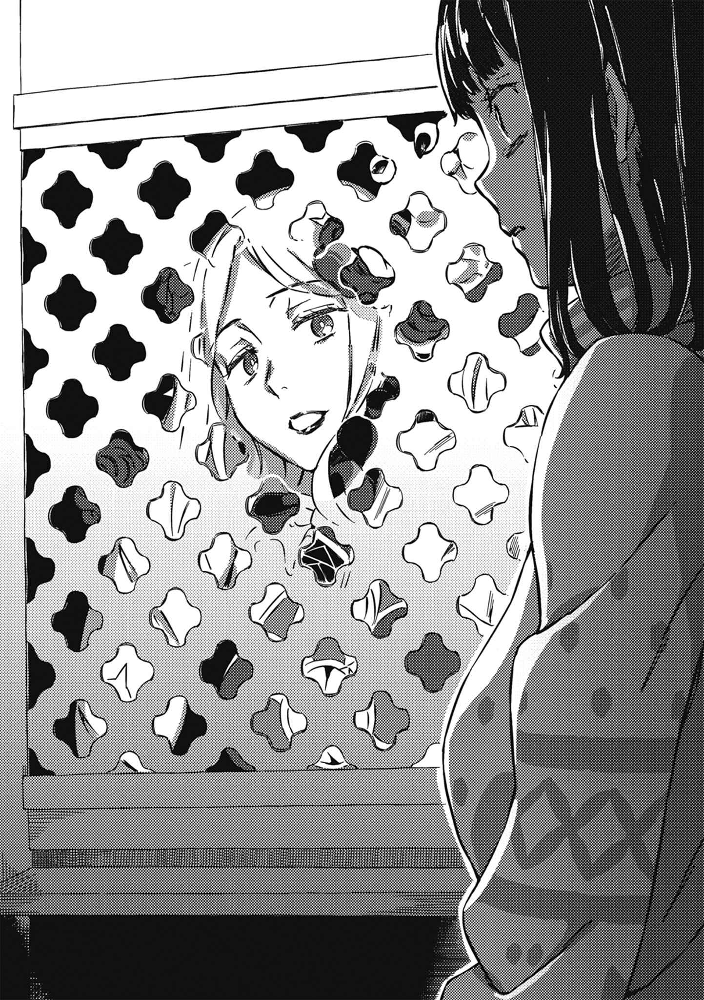

# 第二章 （无题）

> Over_the_Checkmate.

## 1

事情发生在埃及，沙漠中的无名绿洲。

停在绿洲旁的露营车里，堆满了将工具、厨具、日用品等分解组合后弄出的种种实验器具。由于知道原本是哪些商品，所以看上去有点蠢，不过实际上，它们就算出现在技术最尖端——学园都市里的大学和研究机关也不足为奇。在某些国家，甚至光是碰这些东西就可能因为有生化恐攻的嫌疑而被逮捕。

身穿漆黑西洋丧服的黑猫魔女——米娜·马瑟斯盯着某样东西。她弯着腰，微微翘起像猫的尾巴。狗和猫用尾巴传递的信息不一样，如果可以拿猫当标准，那么米娜看来是好奇心受到刺激。正牌的三色猫则在她脚边喵喵叫。

她眼前有张桌子，上头摆着圆底烧瓶和几样装置。泡在热水里维持一定温度的烧瓶，借由电机的力量缓缓转动。半透明的糊状黏液在瓶里晃荡，然而不久前有了小小的变化。

奇妙的景象。

有个柔软的物体浮在瓶里，散发出介于白色与樱花色之间的光芒。

「应该可以说『第一阶段成功』吧？」

青蛙脸医生这么说道，没有特别喜悦也没有显得惊讶。说穿了，他忙着打理其他器材，连看都没看烧瓶这边一眼。

另一方面，隔着薄面纱打量玻璃容器的米娜开口：

「到这个东西形成婴儿的模样，需要花上多久？」

「细胞已经开始增殖，所以大概还差两步吧。虽然需要随着阶段不同更换比较大的容器，不过这时最重要的，是避免混进霉菌和细菌等杂质。尽管是基本，却很困难。一旦失败，便会跑出粉红色或绿色的毛茸茸霉菌人。」

「……」

就算当成玩笑也让人笑不出来。

「原来如此，是『燃烧之剑』的关卡啊。」

「嗯？」

「火焰剑。你应该比我还清楚才对吧，阿伦·贝内特。」

对方面不改色地出言讽刺，青蛙脸医生决定维持扑克脸。

虽说是为了赢得信任，但可能做得有点过头了。

面纱之下的黑猫魔女轻轻叹了口气，也不知道她是否明白医生在想什么。

「在『黄金』里，它是和神圣四文字一同摆出的象征，用意是在亚当和夏娃对智慧树果实伸手的罪行覆盖全世界之际，保护生命之树(Sephiroth)十源质里的三个高阶源质。**分割**，**借由切断联系加以保护**。克劳利的对应表里有具体解释它带有怎样的攻击性哦。那是你的弟子写的吧？」

呜——离实验器具稍远处的婴儿床传来婴儿不满的声音。

亚雷斯塔·克劳利的亲女儿莉莉丝，目前可以说是以灵魂外露的状态接触外界空气。尽管摆脱原罪让她能自由行使种种奇迹，但没有肉体还在这个四界表层长时间停留，未免太过无谋。许多幽灵和残留思念光是存在便会持续自我崩解，就连天使和恶魔也需要通过文字的引导寻求肉体附身，或是待在范围极其限定的魔法阵里维持暂时性的稳定。然而这些方法也不能长久，如果不快点给莉莉丝容器，她将烟消云散。这会让圣守护天使爱华斯在百年之后救回当初死得毫无道理的莉莉丝一事变得毫无意义。

（就算能勉强靠奇迹之力保住存在，又能持续多久呢……）

就在米娜下意识地咬住嘴唇时——

那对和猫很像的耳朵抖了一下，从后腰伸出的尾巴跟着左右摇晃。

刚刚提过，狗和猫的尾巴会传递不一样的信息。

如果以猫为标准，那么左右摇晃代表不高兴。

「……七金属之银，女性，四属性之土，亦即满溢的月光。」

「？」

大白天的却听到月光。这句奇怪的话让青蛙脸医生皱起眉头。婴儿床的声音戛然而止。原先趴在沙发床上的黄金猎犬静静地起身。

究竟是从哪里接受到了什么信息？

带有艺术家气息的米娜·马瑟斯，宛如得到某种神谕(灵感)，严肃地说道：

&nbsp;

「埃提尔·化身。其十五OXO。」

&nbsp;

仓促之间。

将喇叭状猫耳转往各个方向侦测的黑猫魔女，从胸口掏出画刀丢向驾驶座。为了维持电瓶电力以及持续使用空调而让引擎持续运作，对米娜·马瑟斯来说值得庆幸。排挡锁解除按钮一开始就是坏的，所以只要把排挡杆从停车档打到前进档就好。嗡！大号厢型车就像游乐园的玩具车一样，轻而易举地往前奔。

轰！

一阵宛如直接拍打空间的震动迸发。

大卡车与露营车不像一般小客车，纵使有后视镜也没办法确认车后的状况。往代替后视镜的小型液晶屏幕看去，能看见一座巨大的黄金塔从正下方钻出，撕裂沙漠绿洲。

隔着窗户目睹此景的青蛙脸医生，瞬间看穿塔的材质。

「人的……头发？」

「通过文字形式将以诺语阐述的灵性领域划分为三十区，借此转换为容易使用之超常的调色盘，亦即埃提尔。用耗费漫长时间蓄积月光的头发拼出文字，进而运用『化身』。就是这样对吧，大恶魔科隆尊！源头就在第十之埃提尔、潜藏在ZAX的邪恶天使啊！」

『叽叽。』

有个似乎在回应她的声音。

但不是正常的人声，而是露营车的驾驶座挡风玻璃产生振动后，犹如扩音器般发出声音。

『叽叽。叽叽咿嘻嘻！』

没时间悠哉地等待回应。

米娜·马瑟斯穿过露营车内，翻动西洋丧服的裙子跳进驾驶座，用力踩下油门。

咚！轰！形似尖枪又有巨塔规模的金色发束，接连从地下钻出。

『我获释喽。啊啊、啊啊，如你所见，我得到了自由！米娜·马瑟斯，黑猫魔女啊，你的伴侣山缪施加的束缚已经不复存在！』

「呜。」

『具体来说是谁杀了谁，之后你再问**你家主人**就好。只不过，前提你要有机会遇见！』

以庞大的发丝从地下发动攻击。

（想必是从远方的英国，将「蓄积的力量」融入地脉和龙脉传来埃及吧。不过就算是这样好了，特地瞄准莉莉丝的理由又是什么？到了这种时候，还把自己的恶劣嗜好放在国家与世界的未来之前吗，科隆尊！）

米娜这么想。

然而没过多久，握着方向盘的她脑中渗出更糟糕的想象。

就像人体自己产生的毒素，脓。

（不，该不会……）

身在英国的敌人能直接攻击埃及。

地脉和龙脉就类似行星的神经或血管。尽管有固定路径，不过基本上是呈网状覆盖整个行星。

重要的并非「路径」。无论光纤怎么拉，人都会平等和世间情报有所联系。除非是以万分之一秒为单位炒股的券商和交易员，否则应该没什么人会感受到时间上的损失，毕竟只要世界相连，就能获得一致的结果。

也就是说——

（**不只这里**？大恶魔科隆尊究竟可以同时攻击这个地球的多少地方啊！）

真要说起来，自克劳利灾潮算起的一连串纷争，从规模来看，影响不遍及全世界才奇怪。

但是出现在这里的并非那种能轻易了解威胁本质的攻击。

当然，如果停下来不动，导致露营车被从下而上贯穿就完了。但是——

（……要是科隆尊能从远方让玻璃制品振动就糟了。这么一来，为莉莉丝制造容器的实验器具会出事！）

需要治本的方法。

但是，黑猫魔女无暇他顾。

露营车以沙漠里S字蛇行逃窜，金色发束由不远处的地面钻出。不是落空，看上去也不像预判之后先一步「设置」。

看不出根据的攻击。

但是注意到金色长枪带起某种转个不停的盆状物体之后，米娜·马瑟斯当场愣住。

据说……

撒哈拉沙漠里，有许多德军在第二次世界大战时铺设的大量反步兵、反坦克地雷没撤走而留在地下，还发生过几次误触地雷的意外。

「糟糕……！」

胃部感受到沉重的压力，但是大声喊叫也不会有任何改变。

地雷不是单纯埋在地下而已。某种类型的反步兵地雷为了让死亡铁球扩散得更广，似乎内藏收缩的弹簧，设计成会在启动同时窜出地面。那家伙利用了这种原理，将反坦克地雷从地下挑出。

&nbsp;

紧接着，地雷在空中爆炸，朝四面八方释放足以杀人的冲击波。

## 2

「呜……」

发出呻吟后，上条当麻才注意到自己还保有能够呻吟的嘴巴。

消毒水的气味扑鼻而来。

自己似乎躺在某个有屋顶的地方，尽管想要起身，但不知为何少了东西支撑。眼前天旋地转。虽然不会痛，然而感觉就像有只隐形的手抓着脑子摇晃。明明想吐却觉得很舒服，有股无法相信身体信号的醉意。

看来一时之间无法动弹。

仰天而躺的他转过头，看见隔壁躺着一个身穿粉红色体育夹克的波波头少女，少女另一边那个插上很多管子的则是亚雷斯塔。既然她们都躺着，那么上条自己应该也躺在同样的东西上吧。这玩意儿称不上床铺，只是用铁管组合后搭上合成纤维床单而成，说是把网子换成布料的吊床或许比较接近。

现场和「寂静」有些不一样。

混杂着具有一致性的心电图电子音，以及某种泵灌输空气的声音。

「你醒啦，人类。」

「欧提努斯……？」

「好啦，现在该怎么办呢？我虽然自称是你的『理解者』，但是关于这个问题，我也不知道正确答案。夸你会让你得意忘形，但是骂你大概也听不进去吧。」

「……出了什么事？」

「算了，自己处理吧。毕竟笨蛋没药救嘛。」

娇小的妖精欧提努斯显得不太高兴。总之上条决定先摸摸她的头，于是伸出右手。

不，是他打算这么做。

这么说来，一开始想起身时，为什么会失败？没错，简直就像想要用手撑起身子时少了支撑点一样。那种感觉的真相是……

答案已经来到眼前。

没错。

&nbsp;

右手不见了。

手肘以下的部分不翼而飞。

&nbsp;

「……………………………………………………」

一时之间。

一时之间，刺猬头少年连呼吸都忘了。

不会痛。

相反地，这点强调了眼前虚无飘渺而缺乏现实感的画面。

惯用手。

偏偏是惯用手？

「我也搞不清楚是什么状况。」

枕边的欧提努斯轻轻叹了口气。

「不知道是烧焦伤口止血的影响，还是科隆尊或亚雷斯塔的一击带有什么特殊效果。那只原本就算断掉也会自己复活的右手，这回偏偏维持原样……毕竟真要说起来，**我们连它究竟是基于什么理论复活也不知道**。在无法掌握以前是怎么恢复的情况下，即使想弄清楚为什么这次不一样，也无从追究。」

「哈、哈……」

就连「理解者」的话语也逐渐远去。

幻想杀手(Imagine Breaker)并非上条当麻的一切。

可以用，但不能随便用。

他知道，这种事他一清二楚。

可是。

但是。

这件事不仅仅是「碰上一场用到异能的战斗」「具有战术性价值」的程度，而是更切身、更生活化的问题。某方面来说最信赖的惯用手悄悄地消失，这点带给上条当麻前所未有的冲击。

「怎么回事……？那个时候！到底出了什么事？！」

「和你记得的一样。」

只有温柔不算「理解者」。

反倒是直来直往也不怕弄坏关系才算得上是「理解者」。

「如果记忆中断，代表那是正解，不是记忆混乱，也不是脑袋里埋进不该有的资料。当时你什么也做不到，失去意识。亚雷斯塔虽然弄得像是恢复魔法，不过她做的实际上应该比较接近心肺复苏术吧。人类，你啊，被粉碎到连哪里是手脚哪里是脸都分辨不了的状态。你输了，输给大恶魔科隆尊，而且是开场那一招就输了。」

「……」

「就这点来说，科隆尊果然在马瑟斯之上。和『黄金』那些可以先上再确认状况的家伙不一样，随便乱碰那个大恶魔会当场死亡。下次先想好再行动。方便的右手已经不见踪影，会帮忙败者复活(续命)的好用大人医师也没了。小孩子上条当麻，欢迎来到真正的战争，接下来是区区一个九毫米孔洞就会死人的严苛现实。」

说出这番话的是军神，掌管战争的神祇。

一介高中生大概没办法做什么抵抗吧。这么做就像看见X光片照出可疑的影子时，决定赌在器材出问题上头一样无谋。

况且就算上条当麻自顾自地陷入低潮，现实也不会停下脚步。

此时此刻，时钟的指针依旧在前进。

即使默不作声，情况也不可能好转。

该怎么办？

情况和之前不一样。一无所有的上条当麻该怎么办才好？

思考。

思考、思考、思考。

一会儿后，刺猬头少年用不习惯的左手缓缓撑起身子。光是这样，便让他觉得胸口满是异样感，简直就像用方向盘和操纵杆控制双手双脚一样不舒服。

欧提努斯受不了地叹气。

「你起床又能怎么样？」

「……我要阻止科隆尊。」

「你就连在万全的状态下都会被人家一招打爆，现在这副德行能干什么？」

「实际承受科隆尊冲击的只有我吗？其他人呢？」

「……」

「如果停留在这种程度，我就要死守这条线，不能让茵蒂克丝和御坂……总之不能让其他人也碰上那种冲击。你也不例外，欧提努斯。这和什么内行外行无关，我是因为实际承受过才能这么说。假如默不作声会让大家都变成那样，就绝对不能放着不管。根本猜不到那招接下来会落在谁的头上。」

「真拿你没办法……」

欧提努斯也从上条的腹部爬上胸口，朝老位置肩膀移动。不管再怎么无语，「理解者」都不会停下脚步吧。

她不是沿着手臂移动，而是从身体往上爬，令少年胸口有些刺痛。

那条登山道路已经不在了。

「我原本还以为你是受到右手的特殊性摆布，原来如此，你的病灶是在灵魂的部分。明明在丹麦一起逃了那么久，我的理解似乎还是不够。看样子，这毛病应该到死也治不好。」

「抱歉啦，让你担心了。」

「呆子。如果会这么想，以后就别把我丢下。『担心』这种词语啊，不是来自困境或威胁。如果你不一个人烦恼而选择与我同在，这些词语都只是不需要的赘肉。」

慢慢地。

脚踩到地上，提起腰部。

右臂手肘以下的部分现在全都没了，随便一个动作就会让身体往旁边歪。与其说是重量问题，不如说是因为像单摆那样失去平衡。

重新打量四周，发现墙和床的材质一样，是颇厚的合成纤维。比学校教室还要大的帐篷里，除了体育夹克少女和亚雷斯塔之外，还躺了许多看似英国人的人员。尽管没办法区分他们是「骑士派」或「清教派」，但是看得见几张熟面孔，像是那位连名字都不知道的女性骑士。

总而言之，由于「整个人被炸飞」等原因变得惨不忍睹的，看样子只有上条。除非状况已经凄惨到会把死者搬去其他地方，否则伤势最重的似乎就是上条。

「……会因为这样就下意识地松口气，你这人还真的总是抽到下下签。」

「有什么关系。与其推给别人，不如这样就好。」

或许……

就是要这种逻辑，才能说服无法容许魔法副作用伤害别人，甚至愤而与世界最大魔法结社「黄金」分道扬镳的亚雷斯塔·克劳利。

「做好心理准备了吧，人类。」

欧提努斯开口。

对重新站上起跑线的少年说道：

「你是以自己的意志走出医务室，接下来不会再有人将你当成伤患，毕竟英国的状况也是刻不容缓。只要还有力气用两只脚走路的人，大概都会被算进战力吧。下一次会变得更夸张。如果没有做好受到更严重伤害的心理准备，最好现在就躺回去。」

「放心。谢谢你的担心，欧提努斯。」

「不管表面上低头多少次，你依然完全没搞清楚本质啊。我生气的地方是，有空为这种事道谢，还不如快点让我安心，你这个笨蛋。」

就像掀开门帘一样。

上条当麻从带有消毒水气味的合成纤维帐篷往外踏出一步。

瞬间——

&nbsp;

「确认到埃及、布拉格、雅典也遭受同样损害！」「虽然想从受害地点沿着地脉与龙脉回推大恶魔的位置，但失败了，无法确认是在英国国内的哪里！」「罗马正教、俄罗斯成教的联络来了。」「拖住他们！要是弄得更麻烦就摆不平了！」「『清教派』的灵装、神殿、自然物约八成无法使用。似乎被最高主教(Archbishop)权限锁住了！」「能出动多少圣人？」「『苏格兰的荣誉』依然下落不明。伊莉莎陛下最后一次看见时由普通人保管的国家之剑，如果落入科隆尊手里，不只『清教派』，连『王室派』和『骑士派』的装备也可能全被抢走！重要度最大！」「惨叫就免了，想办法解决。」「偶然捡到的幻想杀手(Imagine Breaker)已经不能用了哦！」

&nbsp;

咚——！

一阵令人怀疑为什么先前都没听到的巨大振动。就像看棒球赛或足球赛一样，夸张到能够物理性摇撼大地的人声洪流重击上条当麻。

这里是室外。密度高到会让人忘记是开放空间。和当初奥索拉·阿奎纳承受的冲击一样，但少年无从知晓。

老旧的石造建筑遗址，苏格兰爱丁堡城堡，此处是城里的中庭。可能是因为距离刚刚和科隆尊冲突的地方不远，多处土壤翻起、石墙崩塌，各地都还留着鲜明的爪痕。全副武装的骑士和神父们匆忙地来来去去，各自用上条听不懂的语言半喊叫地报告。光是那种歇斯底里的尖锐音调，就能听出没有任何对己方有利的情报。

里头也有熟面孔。

将黑色长发绑成马尾的神裂火织，瞪着随意摊在木箱上的地图。注意到上条的她看见那只手之后，似乎想说些什么，不过到头来还是没有开口。就在她迟疑时，其他修女又塞了好几份报告书过来。

肩上的欧提努斯没有表现出特别在意的模样。

能够随口说出这种话，原因大概在于她是战争之神吧。

「别乱说话打扰人家。对他们来说，这是一场保卫家园免于国难的决战。」

「我知道……」

上条环顾四周，发现还有不少和刚刚那个很类似的帐篷，显然是后来才搭的。

爱丁堡城堡里可能没有现役的设施吧。

要不然就是大恶魔科隆尊造成的损害，让设施无法使用。

肩上的欧提努斯在他耳边这么低语：

「……没多久，原本留在伦敦的魔道书图书馆她们就会来这边会合。」

「茵蒂克丝她们？」

「总动员。关于这点算是英国的疏忽吧。权限剥夺太慢，在『王室派』和『骑士派』的首脑强行拔掉科隆尊的权限之前，那个大恶魔已经开始动用最高主教(Archbishop)的力量干涉国内所有魔法设施，不管在伦敦还是爱丁堡都没什么差别。没办法正常占卜或领受神谕的状况下，只有她脑中的十万三千零一册知识能够成为有效对抗科隆尊的关键。」

……情况越来越刻不容缓。

与其让茵蒂克丝站到第一线，不如趁她抵达之前短期决战和科隆尊来个了断。当然这只是理想，如果真的想都不想就冲出去，只会再度瞬间变绞肉。不过纵使明白这点，依旧会感到焦躁。

「另一个引起英国注意的，则是那个叫御坂美琴的泳装女孩身上那套A.A.A.。」

「……比圣人更重要？」

「更重要。从『意外的增援比稳定的自国战力更耀眼』这点，能看出战争已经到了末期。虽然听说那玩意儿只是学园都市的机械制品，但是不管怎么看，源自克劳利的魔法——Magick的气息都太过强烈了。**捡到东西的小鬼有没有发现则是另一回事**。他们似乎打算暂时将这东西当成有效战力。不过等到环境安定下来，可能会变成英国和学园都市之间的新火种。」

那可不行。

那是绝对不能推给别人的痛。

「换句话说，科隆尊那家伙也可能瞄准有对抗手段的茵蒂克丝和御坂出手是吧。」

「这就难讲了。」

但是，欧提努斯的回答和上条的预期不同。

「追根究底，你还记得大恶魔科隆尊是掌管什么的存在吗？三三三，意为扩散。如果那家伙始终遵照自己的存在意义行动，目标便可能不是简单易懂的完全胜利或征服世界。」

「什么意思？」

「大恶魔科隆尊最讨厌的东西是什么？大概是微型塑胶吧。」

「理解者」突然将话题带往别的地方。

不，不是这样。

「换句话说，那家伙是自然分解的化身。既有的东西要回归原本的样貌。正因如此，那些会不自然地长期留存的东西，无论是化学物质、文化文明，还是生命种族，全都不能放过。假如目的是彻底破坏，打一场漂亮的胜仗让东西留下就显得半吊子啦。要更激烈、更彻底，把世界夷为平地，什么也不留……如果我的『不祥预感』成真，那家伙会做得非常狠哦，应该会用上已经和什么胜负无关的手段才对。」

说到这里，欧提努斯暂且打住。

有人走近上条，大概是注意到这边了吧。

「（……上条同学？哇哇，你已经没事了吗？）」

对方的口气像是在说悄悄话，还拉着上条的左手将他带到附近的阴暗处。或许是怕被周围看到之后，会不由分说地将上条列入战力之中吧。

有一头金色长发的少女。

是中学生、高中生，还是更年长……？乍看之下不太好分辨。

这名令人联想到蜂蜜般香气的少女，不知为何在泳装上披了件雨衣。

然后——

上条当麻缓缓歪头。

以好奇的表情这么说道：

&nbsp;

「……**呃**？」

&nbsp;

短短的疑问词。

光是这样，就让少女犹如心脏受到重击似的瞪大眼睛。

「喂，人类……？」

肩上的欧提努斯皱起眉头，这位蜂蜜色长发少女却举起一只手制止她。

这样就好。

身材与年纪不相称的少女硬是挤出笑容。

「嘿嘿。**初次见面**，上条同学。我叫食蜂操祈。请多指教喽？」

即使非常勉强，也要挤出这么一句话。

不管多少次，就像永远持续下去的诅咒，就像她一直以来所做的一样。

## 3

『咿嘻嘻。』

响起这样的笑声。

音色明明甜腻似麦芽糖，听上去却是刺耳的老婆婆笑声。

逆源质拼图545。

具备少女外表的她，拥有与稚气脸蛋及小个子不相称的丰满身材……是科隆尊制造的人工恶魔。

尽管随着「沙沙沙沙沙！」的不舒服声响登场，却是从路边的集装箱状垃圾桶里钻出来，所以没什么威严。

看来她是在和贻贝的壳与苏格兰威士忌空瓶玩耍。

学园都市第一位，拄着现代风格手杖的一方通行(Accelerator)以另一只手抱着纸袋，用怀疑的眼神看向她。

「……我是叫你出来没错，但是早餐时间玩什么玩啊？」

『啊，你会在意这种事啊？真意外。恶魔平常没有实体，听从你的无理要求到表层世界露脸需要经过出产仪式。我已经解释过好几次了。』

爱丁堡市街，高峰时段。

这里是苏格兰地区名列前茅的人口密集地带。此刻和夜晚的戒严状态大相径庭，或许是因为克劳利灾潮这个直接的威胁消失，让人们变得松懈。

尽管实际上威胁增加的速度越来越快，但只要它不是以能够明白的形式出现在眼前，人们便没有留在家中的借口。

没什么特别的理由，理所当然地单独行动。

真要说起来，负责将第一位等人整合在一起的亚雷斯塔自己也变成那副德行，他实在不觉得单纯听从指示能让情况好转……这也算是借口吧。

或许反倒是先前一直团体行动才显得奇怪。

况且他来到这个城市也没什么特别的目的。

真要说起来，爱丁堡城堡就和它的名字一样，是一座位于苏格兰首府正中央的古城。若要离开城堡，不管往三百六十度哪个方向走，都会踏入这座城市。

逆源质拼图545从垃圾桶抽身后在空中翻了一圈。一方通行(Accelerator)无语地说道：

「面纸。」

『哦。啊，这个有加乙醇对吧……呼～虽说为了弄掉身上脏污有必要这么做，但是这么一来就把花样年华的女孩子弄得脸上和衣服上都是纸团了。 』

明明正在努力地清洁、消毒，却无法停止亵渎，该说不愧是恶魔吧。

总之呢，就是这种感觉。

半透明恶魔在大街上大嚼外带的早餐虽然很显眼，周围反应却意外地冷淡。

**人们都是一副理所当然的表情**，这点意外地很重要。

可能是因为在灰色街头往来交错的上班族忙着消化自己的时间；可能是把她当成运用科学技术弄出来的立体影像，觉得不值一提；也可能是担心，随便搭理会被录成搞笑视频，上传网络。

「飞碟沿着锯齿路径飞行」「裸女在大街上走」这种只有一点点不可思议的事，在这年头已经不会把人吓得高举双手了。没人会想自我牺牲，出卖私人情报去帮不认识的偷拍混蛋赚取广告收入。每天都要和挤满人的电车奋战，认真工作赚取月薪的上班族想来更是如此。

第一位则是背靠着墙，从纸袋里拿出瓶装咖啡。

（……比想象中来得「普通」呢。崩溃得还不够严重吗？如果需要推一把，我就试着在不弄出死伤的情况下稍微闹一闹吧。）

『咿嘻嘻。话又说回来，这样好吗？』

「怎样？」

『「应该隐瞒魔法的存在」不只是英国清教的看法。而且要是被不容许超常存在的俄罗斯成教盯上，他们可能会跟到天涯海角呢。』

「谁管他。我只是套用『老鼠弃沉船理论』而已。」

『意思是？』

「那个大恶魔科隆尊之前一直在当……英国清教？总之是当取缔方的老大对吧。换句话说，她很清楚这个国家的正规搜索方法——盘问、追踪、情报搜集、人海战术、行为侧写、科学搜查、影像分析……**就是这些玩意儿吧**？总而言之，如果是那家伙，无论用什么手段去找都不难躲，所以要动点手脚，制造对于英国来说算得上超乎常理的状况。如果情况落在准则和流程之外，那个大恶魔应该就没办法冷静地回避，一定会有破绽。」

也就是为了揪出渗透警署的不良警官，将伪造的贪污资料等等扔进服务器。谁干的？不是我。通过这种你来我往，揪出真正的不良警官。尽管乍看之下像是扰乱风纪，但只要把该抓到的问题抓出来，便能确实地产生净化效果。

一般来说会附在人身上，也就是没有实体的恶魔，也需要营养吗？或者兴趣是享受味觉和饱腹感？逆源质拼图545嚼着在英式玛芬上放了半熟蛋、类似意大利面的奶油酱，以及好几块厚培根——这样叫做对刚醒的舌头与胃很温柔的清爽系早餐，实在令人惊讶——的大分量火腿蛋松饼，同时瞄了前往爱丁堡城堡的观光公交车停靠站一眼。

『不去跟那边会合好吗？』

「啊？」

『他们至少有历史哦。毕竟当年受到占卜师约翰·迪摆布的伊丽莎白一世，就连女王加冕日期都会把别人的意见照单全收嘛。而且在约翰·迪的身边总是能看见那个显然是骗子的爱德华·凯利。到头来，虽然以性好女色闻名的凯利没能将魔掌伸向女王，但是这个国家对于「来历不明的魔法师影响国政」的危机感倒是格外强烈，应该可以仰仗他们的经验吧？』

「你傻了吗？结果就是那个科隆尊吧。他们根本深陷其中嘛。」

『你好，我就是因为组织腐败而悄悄诞生的人工恶魔逆源质拼图545！咿嘻嘻，就算是拉斯普京也不会搞得这么夸张吧。不过实质上属于克劳利老巢学园都市的人好像也没资格说三道四就是了。』

「在根本不知道那个最高主教(Archbishop)对哪些地方动过手脚的情况下，只看一面最好是就能弄清事情的全貌啦。那可不行。不管是女王陛下还是什么的，只要掌权者不小心登高一呼，就会把目光固定在一个地方，这么一来，原本看得见的东西也看不到啦。」

『都从科隆尊手里救下他们了，至少报上名字，领个骑士大人的称号怎么样？』

「在广场建个丢脸的铜像有什么用？我又不是来打好关系的。会特地从正面把麻烦杂事全部扛下来的不怕累笨蛋多得是。正面的问题交给他们，我们聪明地从躲到暗处就好。」

『哼～哼哼。』

说到这里。

不知为何笑声与先前有异的报纸礼服少女，从旁把体重压在一方通行(Accelerator)身上。

「干嘛？很恶心呢。」

『不不不没什么。哼哼～哼，这下子短时间内可以独占主人喽～☆』

「……我说了不是来打好关系的吧……？」

『哼哼哼哼哼哼哼～☆』

第一位决定把体重一直压过来的恶魔丢着不管。去搭理只会让对方得寸进尺，他好歹还是有学到这点经验。

这幅温馨画面，让路过的普通人不禁拿出智能手机对准他们想拍照。一方通行(Accelerator)用恐怖的眼神赶跑人家之后，以没握手杖的那只手拿起一次性瓶子并喝了一口里头的咖啡。

「呜……」

『？』

胸口有些许异样感。

大恶魔科隆尊造成的影响还在，虽然用X光可能照不出来就是了。

况且这种事也不需要特地说出口。

毕竟说出来也不会让事态有所改变。

「……这什么玩意儿？早知道就买罐装咖啡了。而且居然还剩这么多啊？明明说了小号量却这么多……」

『靠这几句话很难判断主人你是美食家，还是缺锌导致舌头迟钝耶～』

「啰嗦。重点是科隆尊吧。喂，垃圾恶魔，该测试性能了。你认为那个混蛋为什么会干脆地撤退，说说看。」

『呃？这个嘛，当然是因为包含主人你在内，处处都能看到光用英国式没办法说明的战力吧？有三个学园都市制的超能力者(Level 5)，连A.A.A.也在。不过嘛，那个叫幻想杀手(Imagine Breaker)的弱鸡一开场就被干掉，能不能指望实在很令人怀疑就是了噗噗……』

「…………………………………………………………………………哦？」

『好的我刚刚用力一脚踩在地雷上了呢！而且不是什么反步兵或反坦克那么小家子气的东西是核子地雷等级的总而言之我会全力反省——！无、无论如何，在科隆尊看来，只要把沉睡在爱丁堡城堡的三样宝物和司康石抢走躲起来就等于任务完成，不需要勉强和以主人你为中心的未知战力打一场弄伤自己的可能性应该很高？真要说起来，她好像就是为了应付这种未知的部分，才会指示乌丸府兰怂恿上里翔流混进学园都市，从内部捣乱。』

「……」

这么说也有道理。

一方通行(Accelerator)、超电磁炮(Railgun)、心理掌握(Mental Out)……究竟为什么会在地球的另一边集结虽然仍有不明之处，但是关于这部分，三人都是突发性地参战。说穿了，大恶魔科隆尊将他们纳入计划的可能性很低。如果那家伙另有目的，以达成目的为优先似乎比较好。

不过——

第一位一边与不合胃口的咖啡搏斗，一边说道：

「……好不容易才让亚雷斯塔那家伙倒下，少了最可能碍事的人，这应该是为了『整顿』吧。只要我们待在这个国家，便等于意外状况仍在持续。如果有多余的战力能动用，在搅局者正式出手之前尽快摆平他，不是比较能缩小误差吗？」

『这样啊。』

刚刚那瓶咖啡喝起来就像要把粘在一起的泥块吞下去一样。胸口的异样感让咖啡没办法好好下肚。

人总是在检查出不好的结果时才会意识到要营养均衡。而且手边正好有个不错的选择。

「不行，还是忍不了。喂恶魔，给你个命令，想办法搞定这玩意儿。」

『好——？！』

一方通行(Accelerator)还是那个一方通行(Accelerator)，他把咖啡塞给吃惊的逆源质拼图545，然后径自从恶魔怀里的纸袋拿出其他饮料。

但是，怪物面有难色。

「……这是什么玩意儿，蔬菜奶昔？就没有正常的饮料吗？」

『啊啊啊啊呜啊呜啊呜……』

「怎么啦？」

『不，没事！在被要回去之前我就把这当成赔偿收下了！』

不知为何蹦蹦跳跳的水母恶魔闭上双眼，红着脸啜饮着瓶中的液体。

至于那位抛弃咖啡移情别恋，落得要和颜色诡异的浓稠物搏斗，全世界最不适合健康取向的人则是一脸嫌弃。生病之后，即使摄取健康食品也不能改善症状，这是常见的现象。

「就算放着不管，对方也会自己行动，这点显而易见。时间拖得越久，结果便越会偏离当初的预定，这种事照理说一开始就清清楚楚，却这么摆着不管？况且形势有利的一方居然特地等人家打破这种有利的局面？不可能。科隆尊那家伙难道不是认真地想赢？」

『……感觉今天这一瓶有大人的味道。然后那个～恕我直言，大概是抱着「胜利是当然、成功是应该」之类的心态在人生路上迈进的成功混蛋兼最强无敌主人你，才会有这种天才逻辑吧？』

「对那家伙来说又是如何？」

这番言论让一方通行(Accelerator)受不了地叹了口气。

什么成功啊，自己的人生就是因为一直胜利才会以失败收场。逆源质拼图545要弄懂这些隐情似乎还得花点时间。

第一位轻轻摇晃比刚才那瓶咖啡更能让他忘记宽容之心的蔬菜奶昔，分量超乎想象令他相当不爽。

「大恶魔科隆尊。虽然我不知道她的底细，但是从那个口气，以及彻底瞧不起世上一切的态度，看来实在不像是饱尝挫折与后悔而学会了慎重的样子啊。」

『嗯咕嗯咕。顺带问下主人你的看法呢？』

「……」

大恶魔科隆尊。

若从亚雷斯塔·克劳利的角度来看，想必就和马瑟斯一样惹人厌吧。局外人一方通行(Accelerator)不了解他们之间有什么恩怨，然而在这种情况下，依旧能够感受到那些家伙是一丘之貉，有着一样的气息……虽然如果把这些说出口，亚雷斯塔大概会咬断他的喉管。

换句话说，从科隆尊的身上，能够闻到沉积在学园都市暗处的恶劣癖好。

说不定和亚雷斯塔在很久以前经历过的地狱是同一类。调查连环杀人犯的背景，发现犯人也在年少时遭受严重的暴力——这种事尽管令人遗憾，却不算罕见。

如果是这样……

或许能够用在「暗部」培养的黑暗逻辑解释。

「……那些混蛋丢下眼前猎物跑掉的理由总是很单纯。」

『所以？意思是？？？』

一方通行(Accelerator)对愉悦地捧着咖啡瓶的逆源质拼图545这么说道：

「因为找到更让人感兴趣的玩具，才会把旧的丢掉。那种家伙啊，既没有什么慈悲心，也不会受到良心的谴责啦。」

过去的第一位不也是这样吗？

在调车场准备杀掉想要阻止「实验」的第三位时，挡在他面前那个照理说没有任何力量的无能力者(Level 0)。把目光移到他身上那一刻，原本正被折磨着的第三位应该就变得完全不重要了。

所谓的野兽就是这么回事。

欲望只有一种。

脑袋没有灵活到能够一次追逐两个猎物。

尽管回想过往让一方通行(Accelerator)觉得不太舒服，他依旧吐出了这句话。

怪物好不容易才喝完不习惯的健康饮料，伸出变色的舌头，捏烂手里的空瓶。

「……问题在于，到底是什么东西引起了大恶魔科隆尊的兴趣？」

## 4

「你在看什么啊？」

「船。」

轻描淡写的回答。

头也不回的米色修道服女子将不知为何刺进地面的长长金发抽回。细节当然不明白，但是从动作看来，比起狗更让人联想到蝎子的尾巴，所以滨面仕上没有多嘴提起这件事。他只能在科隆尊背后轻轻叹了口气。

可能这人的兴趣……就是这样吧？

大恶魔科隆尊。隔着带有夸张头衔的她向前望去，发现整排电子看板显示的内容都一样。把安涅莉常驻的手机屏幕叠上风景后，他才知道似乎是「航班取消」的意思。

尽管头发的举动非常诡异，不过这样大概还算好吧。她自称大恶魔，且实力应该是货真价实的。没有直接从修道服背后弹出什么翅膀尾巴，或许代表着她依旧在意人类社会的眼光。

爱丁堡是苏格兰东侧的大都市，而且面向深入内陆的出海口。港的彼方飘来海鸟的鸣叫与海潮的气味，不过到了十二月，可能让人没什么休闲的兴致吧。

克劳利灾潮的威胁消失，先前吓得关在家里的人们也战战兢兢地走出户外……完全不知道一切的罪魁祸首近在咫尺。话虽如此，高层那些知情者当然没有解除战时体制，停止船和飞机的往来也没什么好不可思议的。

罪魁祸首明明应该知道这点。

她该不会厌倦了英国，想要远走高飞吧？

滨面同样生活于岛国，况且还是关在墙里的学园都市，在他看来这只能叫做无谋。和不知道国境划在哪里的沙漠、大草原不一样，在自己引发骚动所搞出的戒严状态下想穿越国境只是自杀。

但是——

「……很好，一如预期。」

「哪里好啊？」

「我在说运用这玩意儿需要的事前准备很顺利。」

说着，大恶魔回过头来，轻轻踢了绿色行李箱一脚。挂上夸张头衔的大人物居然踹破折扣商店大门偷东西，这种场面实在值得一看，不过笑出声可能会被宰掉，因此滨面忍住了。总之她似乎是以坚固耐用为优先。

顺带一提，行李箱之所以看来比想象中还要沉重，是因为里面除了王冠和权杖之外，还塞了一块需要双手环抱的大石头。总之司康石的存在感实在不同凡响。

黑尾鸥的喵喵声自头上洒落。科隆尊干脆地说道：

「一旦情报得手便用不到这里了，也没理由留在这个城镇。」

滨面很随便地找了件大衣把「国家之剑」裹起来抱在怀里。虽然制服警官只要道声早安就可能发展成无法辩解的情况，却也不能将东西塞进车站前的置物柜，只把钥匙带着走。

不过科隆尊倒是不怎么在意。

「无妨，就这么拿着。你要是不至少拿着莫·阿赛亚仪式的其中一项关键，会被不安压垮对吧？还是你觉得『国家之剑』不合胃口，想试试被两百三十千克的司康石压扁？」

「两百——」

「再怎么说我也是大恶魔哦？到现在还因为这点小事就吓一跳怎么行？」

如果穿帮，就杀掉碍事的家伙。

她露出这样的眼神。

「换句话说，事情很简单。」

大恶魔这么表示。

她远离港口立起的进出港预定表，说道：

「即使从头开始教你魔法是什么，地脉又是什么，你也听不进去吧，所以我只讲核心部分。你小心翼翼带在身上的塔罗牌是七十八张一组，用来表现人体。光凭这副牌，顶多只能构成『人类』这种模糊的框架，必须将形成个人的习惯与特征灌进去，才能加入变化，让它成为拥有自我的存在……唉，说穿了就像唱片的沟槽吧。唱片，知道吗？只要有个大概的印象就好。现在我没打算跟你讨论什么媒体规模不同的话题。」

「真要说起来在这种盛行流媒体的时代还谈什么光盘实在太好笑了啦这个老太婆……」

「要我把你的脑子抽出来，用钢丝绒刷洗一番吗？」

只能闭嘴了。

也不知道她是认真还是在开玩笑的。一谈到年龄就显得心灵脆弱的科隆尊闭上一只眼睛，随兴地挥了挥手。

「总而言之，**看不见的伤痕是迪翁·福春的一切**。没这玩意儿就不能动手。」

「这是指……？」

「占卜师的道具都是这样。水晶球如果是新的便派不上用场，那是要施术者自己伸出手，一再观看、摩擦、寝食与共，在这段时间内累积微小的伤痕和磨损，变得容易『和自身内在对话』的工具。塔罗牌也一样，只要盖下去条件都相同？不不不，怎么可能。长期使用会造成折痕和磨损，纵使想平均洗牌也会让牌边产生些微歪斜。塔罗牌若是全新的就没意义，它要成为『谈话的对象』，把每个人的情况、理由一项一项套进去，导出对于当事者来说最适当的答案。」

每一张。

就算把整副牌一张张翻开，滨面也搞不懂上面的图案和数字有什么意义，更别提牌上有什么人眼看不见的伤痕或凹陷了。不过可以知道的是，倘若牌上有类似光盘沟槽或半导体线路的东西，对待它就必须更小心。尽管牌仍放在怀里，却让人觉得无意义抚过脸上的海风都像剧毒。

迪翁·福春的心、身体、记忆、人格，还有那张笑脸，以及约定。

滨面想起口袋里的泡泡糖。自己答应过要教人家把糖吹得像气球一样，在做到之前，不能让那名少女的身体或心灵有所缺漏，连一丁点都不行。

然而——

「……话先说在前面，虽然失去了人类的外形，但魔道书终究是魔道书。就算你抱着骨折的决心打下去，也没办法造成半点伤害哦。」

「咦、啊？是这样吗？」

「关于这点不必担心。另外这个防卫功能特化型呢，就算看了也没办法接收到知识，不需要怕受到『原典(Origin)』特有的毒影响……不过嘛，你连一般魔道书有多恐怖都不知道，讲这些注释也没用呢。忘掉吧。」

可是，话又说回来。

这个拖着沉重绿色行李箱行走的大恶魔科隆尊。尽管事情攸关双方利害，却没想到她会解释得这么干脆。她明明也可以像一开始讲的，选择快快杀掉滨面，进而夺走叫做「国家之剑」的宝物……

对方大概也注意到了吧。

身穿米色修道服的恶魔靠近滨面把脸贴了上来，露出大大的笑容。

「我可是恶魔哦？」

「意、意思是……」

「恶魔的本质是耳语者，以及妨碍者，乱挥四肢让人远离算不上恶魔。所谓恶魔，就是要先招揽、引诱、帮上忙，让人充分享受到成功与繁荣之后，在对方眼前夺走一切，一口气将他推下地狱。这是什么意思你就自己想吧。不过有一件事要先说。这么做对我而言非常普通，可不是因为同情而采取意料之外的行动哦。这就是我的**攻略方式**。」

当冲也好、赌场也罢、土地房屋的转卖也行，就连抢银行和杀人诈领保险金也是，或许不管什么领域都是这样。[^1]

以总数来看不划算，这点谁都知道。地球上没有这么好赚的赌博，人人都知道，不可能让每一个人都幸福，只会从大多数人身上榨取钱财，集中到一部分的胜利者那里。

尽管如此，每个人却都这么想。

只有我不一样，换成我就能漂亮地胜过别人。

明明根本没有例外。

人们总会以为能靠个人的临机应变克服冰冷的概率与统计，毫无据点认为自己有神助还是什么的，却不知道这种天真的念头，正是把人活生生拖进无底欠债地狱的魔性入口。

一直以来都在外围乱转的滨面仕上无从知晓。

……大恶魔科隆尊的意思是，即使是克劳利和马瑟斯这种水平，她也会毫不留情地吞噬。

她并非散播易懂恐惧的显眼天敌。

甜言蜜语者。

三三三，意为扩散。

让人与人难以理解彼此，妨碍世界结合的存在。

「你……到底想做什么？」

「莫·阿赛亚仪式。如果弄懂了，你会站到阻止我的那一边吗？要是考虑那些多余的事，你就没办法把迪翁·福春恢复原状喽。」

「呜。」

「哈哈哈，开玩笑的。毕竟也不是什么需要特地隐瞒的事。我想让自然存在的事物以自然的形式运作，就像星球转动一样。目的仅此而已。」

「自然存在的事物……？」

「不错。三三三，扩散。吾名蕴含的真意就是万象的自然分解。」

科隆尊轻笑。

不远处能看到大概是来得早了点，所以抱着传统风笛却连一个音都不能弹的演奏家，在早晨的街道上无所事事。若问有什么好恐怖的，大概就是这种状况。世界的终结和对于噪音的顾虑同处一个空间，犹如大理石花纹般共存。

和战战兢兢开始动作的爱丁堡街道，仿佛处在两个不同的世界。

「这世上所有的人、事、物，总有一天会消灭。哎呀，别想得太耸动。我只说总有一天，可没限定日期和时间哦。」

「不是指到了那一天大家都会死……？」

「嗯。就这点来说，我讲的并不奇怪吧？小鬼，你总有一天会死。可能是因为叫做衰老的生命极限，也可能是因为意外或疾病而突然落幕。不会经历这种过程的存在反而不自然、非现实。」

滨面仕上想象中的死因总是突发性的暴力，他还没到能够明确想象寿终正寝的年纪。

但是——

既然口口声声说理所当然，科隆尊又为何如此执着？

即使什么都不讲，死亡照样会降临到每个人身上。

尽管几乎完全搞不清楚当前状况，但这个米色修道服女子不是正和很多人类为敌吗？

她拖着绿色行李箱边走边说：

「换句话说，那些不自然又非现实的东西阻碍了世界的循环。」

「……喂，这意思该不会是——」

「理所当然地待在自然循环里的小鬼可能不会懂吧，但是『不灭的存在』到处都有哦。特别是扯上魔法这种半吊子的神秘时。永不腐朽的武器、不会褪色的书卷，以及总是犯错却不知为何始终看不见破灭征兆的文明！人类就会制造一堆根本无法分解的存在然后到处乱扔！！」

呐喊的音量大到仿佛能撕裂行星。

自诩知识分子的她以手扶额。

「实际上，世界面临过的危机要多少有多少。第三次世界大战、『魔神』欧提努斯失控、上里翔流突然崭露头角。这种世界照理说放着不管便应该会自取灭亡才对，这是自然分解的形态之一。之所以没有这样、之所以历史持续到今天，不都是因为有人不肯委身于趋势而不自然地抗拒吗！」

话题或许已经到了滨面仕上跟不上的尺度。

欧提努斯、亚雷斯塔，以及幻想杀手(Imagine Breaker)。

她口中的转折点，总是有无视原本寿命与耐用年数而「持续留下的东西」站在左右结果的地点。对于希望生存的人来说，他们或许是英雄，但在盼望灭绝的人眼里又是什么样子呢？

亚雷斯塔·克劳利试图废弃各种超自然，让现在的世界变得更好。

然而大恶魔科隆尊的想法完全相反。科隆尊认为，最好连亚雷斯塔想保护的底中之底——「成为一切基准的科学层」也包含在内，全部都消失。

防守或攻击。

毫不在意扎根于地的生命，大概是她和亚雷斯塔之间的决定性差异吧。

「你觉得这种充满血栓的世界能维持自然状态吗？不可能！人类或许认为要是自己会灭亡，拖着未来的世界同归于尽也无妨，毕竟人类是一群会把人类灭亡和世界灭亡混为一谈的愚者集团，但是从『外面』观看的我们可不能这样。人类想毁灭可以自己上路，不过别把世界拖下水。我的意思是这样。」

突然间。

滨面仕上感觉自己和这个女人的距离一口气变得无限遥远。

因为他根本毫无实感。

少年之所以来到这里，是为了保护身边的人。将女友泷壶理后留在安全的地方，把迪翁·福春恢复原状，回学园都市和麦野、绢旗、芙蕾梅亚、半藏，甚至是黑夜和黄泉川，总之他要和脑中浮现的人再见一次面。最重要的是，要和泷壶她们幸福地度过只有短短一百年的人生，不留瑕疵和后悔，尽情地活。现在谈的这些，实际上做不做得到不是重点，说穿了只是「能够想象的幸福极限」就在这里，因此他认为这样就好。

他是为了这种事而赌上仅有一条的性命。

结果现在是怎样？

人类？世界？？？这家伙的尺度究竟设定得多大啊？！

「我要让世界恢复自然的样貌。」

科隆尊想必已经发现了。

滨面背上窜过一股寒意。

「这场毁灭始于英国也算是合情合理吧？伊丽莎白一世宠信的约翰·迪将以诺魔法带来世间，那是与第十埃提尔ZAX——也就是我——有直接关联的重大术式。不过另有一说认为这是终结之力，毕竟传说中它会带来毁灭魔法世界的力量嘛。」

但她反而以怜爱的眼神看着毫无力量，只能接受现实的少年。就算什么都不做也会自然死亡，回归尘土遭到分解——科隆尊仿佛在肯定身处这种循环之中的生命。

「……所谓幻想杀手(Imagine Breaker)，既是世界的基准点，也是在历史夹缝徘徊的存在。人、物、地点、建筑，它在各种各样的媒介之中流转。**但它为什么是杀**？倘若单纯当成不受任何异物侵犯的世界标准，也可以有弹开、偏移、穿透等许多反应吧。尽管如此，面对难以接受的超常，它却选择了破坏。换句话说就是这么回事，世界为了维持自然状态，会理所当然地展现獠牙。一旦条件齐全，无论是人还是兽都会平等死亡，这才是原本应有的模样。不能分解的东西，就算必须把它咬碎，也要置换成可以分解的形式，这是理所当然摆在眼前的循环。」

「……」

「好啦，到目前为止，本大恶魔都非常『老实地』传授知识。」

她扬起嘴角。

露出带有黏稠感，却又有点孩子气的笑容。

「从哪里到哪里属于甜言蜜语，你设下标准区分了吗？」

「什……」

「不然你也会变成被吃掉的人之一哦。」

好啦。

截至目前为止的历史之中，大恶魔科隆尊接触过的人类有谁和谁呢？他们又是多么不简单的人呢？至少滨面仕上毫无概念，完全想不到。他们没成为爱迪生和爱因斯坦，这个事实给了个简单的答案。

「**那么**，**这个警告是哪一边**？反面的反面是正面？如果把『一切』都照单全收，你的下场会和马瑟斯一样。至少像和纽堡一起抗拒我的克劳利那样抵抗看看啊，小鬼。」

出类拔萃的专家全都失败了。

连在历史上留名都做不到就沉没。

痛哭、哀号、惨叫，没人听得到。

克劳利？马瑟斯？

**这种东西**，「**普通人**」**哪可能知道啊**。

## 5

「你怎么想？」

『大恶魔科隆尊应该已经用不着爱丁堡了。如果三样宝物和司康石需要在这里使用，应该会在爱丁堡城堡就解决。换句话说，无论她有什么目的，都会尽快离开这里。』

「具体来说要怎么做？」

『科隆尊能冲出大气层，以次轨道飞行飞往地球的另一边，不过可能性很低。虽然英国已经弱化不少，只要在这里使用三样宝物——苏格兰的荣誉，就有机会彻底掌握国家，但如果以科学与魔法来看，主导权仍旧在魔法方手里。要是以魔法起飞，马上就会被感应到而引来大批魔女吧。更何况——』

半透明恶魔顿了一下。

她用拇指指向自己的丰满胸部。

『我可是科隆尊亲手打造的人工恶魔，早已熟知她的习惯，只要科隆尊施展大规模的魔法就感应得到。这方面的直觉完全没反应。』

「如此一来……」

『至少不会施展飞行之类的显眼魔法☆』

一阵低沉的震动声。

现在是高峰时段。

戒备无论如何都会比船和飞机来得松懈的列车，似乎照常运行。

## 6

『爱丁堡发车前往格拉斯哥的快车将从九号站台发车。第一至第四节车厢为对号车厢，第五节以后为自由入座……』

「啧」的一声。

与米色修道服不相称的咂嘴声，令走在附近的上班族吃惊地看了过来。

这里是个通勤通学远多于观光客的拥挤站台。大恶魔科隆尊以双手拖着不知是否真有两百三十千克的沉重行李箱，随意地张望四周。

「……被发现了呢。但是为什么不用公权力让列车停驶？」

「怎么？政府？所以说发生什么事了？」

「试炼的时刻到喽。」

尽管发生了意外状况，一头长长金发的女子依旧愉快地说道：

「要将三样宝物和司康石确实地运往包围网之外。小鬼，这也是考验你能不能当个弃子的试金石哦。敌人应该是规模小却火力强大的游击队，而且是那种会无视报告上级义务的人，换句话说就是专家。只要没摆脱这些家伙，便无法开启拯救迪翁·福春的路。」

「……」

「想站上起跑线就展现你的力量。反正你也没想过事情能简单搞定，对吧？」

## 7

于是。

滨面仕上扮演的角色，基本上是逃亡者。

科隆尊不在现场。况且那位美丽的大恶魔说了是试金石，如果在这里让她失望，会断了拯救迪翁·福春的路。

已知追兵逼近，没理由呆呆留在原地，最好可以离开爱丁堡市街。这么一来，除了搭上科隆尊预先安排好的列车之外别无选择。

在这种情况下，只能以玩抽鬼牌的逻辑去思考。

假设有五张牌。正中间和两端感觉会有什么陷阱，所以很恐怖，如此一来只能考虑挑选半吊子的第二张和第四张。他搭上拥挤的列车，站在靠车门处，几乎要被人潮压扁。

列车开动。

相对地，追兵如果怀疑这班车，一定会从边缘开始依序调查。倘若有什么万一，只能在最近的站下车，或者是按下紧急停车按钮跳车。就像这样（够不够具体再说），总之滨面先用「我已经好好想过了」说服自己，拼命地试图让自己安心。

但是——

玻璃窗外好像有什么像白布的东西翻动。

况且不是配合列车移动往水平方向飘。

而是由下往上。

铿铿、砰……天花板传来微小的金属挤压声。

（啊。）

滨面脑中……

浮现某种不能想象的东西，全身顿时冒出连他自己都觉得不舒服的汗水。

（啊啊啊啊啊啊啊啊啊啊啊啊啊啊啊啊啊啊啊啊啊啊啊啊啊啊啊啊啊啊啊啊啊啊啊啊啊啊啊啊啊啊啊啊啊啊啊啊啊啊啊啊啊啊啊啊啊啊啊啊啊啊啊啊啊啊啊啊啊啊啊啊啊啊啊啊啊啊啊啊啊啊啊啊啊啊啊啊啊啊啊啊啊啊啊啊！「一方通行(Accelerator)」……喂，骗人的吧，喂！）

到底是怎么回事、怎么扯上关系，才会让那个怪物在现场露面，滨面的脑袋完全跟不上。刚到英国时，他或许是跟着亚雷斯塔追赶萝拉·斯图亚特，不过中间绝对还发生了什么事，导致势力图产生严重的差异。

无论如何，应该可以当成大恶魔科隆尊与台面上所有的人和组织为敌。

滨面只知道一件事。

（如果不甩掉他，便救不了迪翁·福春……！）

到了这个地步，他实在不认为在最近的车站下车或按下紧急停止按钮跳车能逃得掉。那个第一位只要有心，就算对手是飞机也玩得了鬼抓人。

口袋里有些许热度。

滨面隔着布料轻敲手机。

「（安涅莉，再怎么计算也没用，所以保留给下次。比较一下彼此的规格，不要拘泥于胜过一方通行(Accelerator)。**就算丢脸也没关系**。应该还有其他办法才对。）」

话虽如此。

不过这状况就像智齿在痛一样。如果可以，他实在不想承认有什么蛀牙，放着不管却也不会有什么好事。

（还有时间思考，应该有才对。那家伙虽然是最糟糕的怪物，然而载客率有百分之两百五十以上。在人挤人的电车里，他应该不会采取那种打破车厢把多余乘客变绞肉的战法才对。先观察情况，就这么在车厢里移动，走到别的车厢……）

尽管感觉到代替镇静剂的计划在眼前瓦解，滨面依旧不能放弃。就在他咬紧牙关，重新列出条件时——

「（嗯、呜……）」

传来像是在压抑什么的女孩子娇喘。

而且比想象中还近。

应该说就贴着滨面。

「（请、请你住手，喂，我会叫人哦、呜呜……）」

「咦、咦，怎么回事？咦？」

吃惊的他打算在拥挤的电车里缩起身子，随便裹在大衣里的剑鞘尖端却有股抵抗感。「咿！」的短促女生惨叫随之响起。糟糕，是不是糟啦？这把调皮的国家之剑该不会在不知不觉间钻进什么奇怪的地方了吧？好比说陌生女孩的右腿和左腿之间！

就在滨面这么想的时候……

他突然注意到一件事。

（**欸**？**她为什么是说日语**……？）

&nbsp;

「好嘞，大家的性感大姐姐蕾莎来喽。仙人跳一份送上。」[^2]

&nbsp;

一阵与其说传进耳里，不如说通过骨头传来的叽叽声。拥挤的车厢内，对方在滨面搞不清楚怎么回事的状况下轻轻扣住他的手掌，就这么往诡异的方向扭去。

仔细一看，这人后腰伸出尾巴……？之类的东西，缠在剑鞘上。

表面上把脸贴着男生胸膛摩擦，甚至抬起头以热情眼神看着滨面的恶魔悄声说道：

「（快、快点住手，我才不会输给这种卑鄙手段☆）」

「这家伙……」

「（喂笨蛋，在下一站下车。真是的，在加油站听到迪翁·福春这个名字的时候，我就觉得很危险了。**不是福春**，**是在旁边看的你啊**。魔法阵营最恐怖的案例并非一步步累积试图成就庞大阴谋的专家，而是什么都不知道的外行人突然三级跳接触精髓。这种人往往会被心灵的失控吞噬，觉得自己什么都做得到，甚至认为错的是这个在妨碍他的世界。详情就用小宇宙、自我意识失控、邪恶之树诸力去搜索！）」

尽管她似乎提出了警告，但滨面也不能乖乖被捕。

单手手腕与手肘遭到固定的滨面，勉强让可以自由活动的另一只手在半空中晃。当然，在这种贴身状态，即使能挥手也造成不了什么伤害。更重要的是，蕾莎稍微对手腕施点力大概就能让他骨折，所以滨面没这种打算。要找的是墙，他以手掌轻抚墙壁，寻找特别的凸起处。

也就是。

开关车窗用的锁扣。

「噗哇？！」

滨面用单手猛力打开车窗的瞬间，十二月的刺骨强风便窜进车内，近似厚重墙壁的风正面打在蕾莎身上，让她失去平衡。不，严格说来应该是吃惊的一般乘客纷纷有所动作，导致她被人潮淹没。

「咕呜呜……！！」

滨面仕上也不是毫无影响。手腕、手肘的骨头一阵刺痛，也不知是蕾莎为了撑住自己的身体需要空出双手，抑或出于慈悲主动放手。总之在关节碎裂前重获自由的滨面，抢回了对方用尾巴（？）缠住的「国家之剑」。

「等等，喂，你这家伙刚刚真的是瞄准我的屁股吧！」

她大概是慌了，开玩笑时用日语，所以周围的上班族听不懂，也因此滨面躲过了遭到善良群众围殴的下场。滨面逆着人潮走，主动往敞开的窗户探出身子。

从载客车厢沿着墙壁爬上车顶。

不过即使他赌命逃离刺客，事情并未就此结束。

应该说，接下来才是重头戏。

「哟。」

「………………………………………………………………………………」

早就料到了。

全都在预期之中，然而光是这样就已让心脏差点停摆。

如果只有自己，那就到此为止。

滨面仕上重新抱好用大衣裹起的剑。

（福春……！）

在解救她并回到泷壶身边之前，不能死。

绝对不能。

只有七人的超能力者(Level 5)，七人之中的第一位，一方通行(Accelerator)。问题还不只是「己方的攻击完全不管用，主动出手又会因为『反射』受到同等伤害」这种程度。如果演变成施展全力的正面冲突，自己会被瞬间解决，连对方的身影都看不见。

天敌。

除此之外，还有什么词能形容？

仓促之间——

滨面顺着风势扔掉大衣，握住外露的「国家之剑」。他将剑刃从木制剑鞘中拔出，以带有黄金光芒的双刃剑指向第一位。

「哼。」

对方只是冷哼一声。

强风吹拂的晃动车顶多处可见空调的室外机与连接部分，一方通行(Accelerator)却显得泰然自若。

光是这样，滨面就已明白。

他不认为能靠这种东西打倒第一位。倘若能**正确使用**或许另当别论，但他并非科隆尊或蕾莎。对于连剑都不会拿的不良少年来说，金属球棒或铁管要来得可靠多了。之所以拔剑，是因为他认为或许能拿这东西当人质，可能有机会让对手退缩、不敢随便出手。

结果只有冷淡一笑。

那家伙只要能解决问题就好。

说得明白一点，就算把剑打断、让滨面粉身碎骨，他也不在乎。

这样根本没得谈。

（得想个办法……）

滨面咽下唾液。

（得想个办法才行！我现在的状况，也不能因为办不到就说放弃。开场的第一招，如果不在这边搞定就完蛋了！对手可是那个排名第一的怪物，哪可能有第二招啊！）

「差不多可以了吧？」

「嘶——！！」

&nbsp;

撕裂空气的声音响起。

&nbsp;

一方通行(Accelerator)的鞋底用力蹬向车顶，从正面以炮弹般的速度冲来；相对地，滨面则在仓促间将手中宝剑转向，不再指向正面，而是脚边。说得更精确一点，是把原本就已不安定的踏脚处变得更危险的凸起祸首——商用车内空调的室外机。

猛兽发出咬破空铝罐似的诡异声响。

原本经过压缩而液化的化学冷媒，突然一口气以白色蒸汽的形式喷出。

当然，滨面不认为这种东西伤得到掌握各种矢量的一方通行(Accelerator)。

即使如此，怪物第一位仍旧脚蹬车顶，加快速度。

换句话说——

「就算没办法突破『反射』的障壁，只要毁掉踏脚处……！」

啪叽啪叽啪叽啪叽！车顶的一部分迅速变成白色。液化的化学冷媒(氟氯碳化物)低达零下数十度，如果迎头泼下去，纵使是金属也会瞬间结冻，更会因为难以承受急遽的温度变化，导致表面开始剥离，就像公园里那些长时间放着没人碰的游乐器材，表面的油漆会逐渐剥落一样。

一方通行(Accelerator)的鞋底突然一滑。

这和下雨天的湿落叶会让自行车轮胎打滑是同样道理。第一位的矢量操作能力只要中间隔了一层别的东西就无法干涉目标，照理说该是这样。

「混、蛋……」

「呜。」

相较于出了些差错而从旁掠过的一方通行(Accelerator)，滨面缩起身子没有乱碰。朝着保有「反射」的怪物伸手，不管在什么状况下都是自杀。等待第一位自己刹不住车就这么摔下车顶才是正解。

「搞定了吗？」

滨面将「国家之剑」从空调室外机上拔出，忍不住回过头喊道。然而他眼前什么也没有。

喀哒砰咚。

只有规律的行车声，以及波浪般摇晃的相连车厢。

「……」

成——

功了？

他并不想看见血肉模糊的尸体，但是这么干净利落让人毫无实感。断手断脚后触感依旧挥之不去，大概就是这种感觉吧。明明威胁已经从眼前消失，不安却隐隐尾随在后。

就在这时。

&nbsp;

轰！！咣咣铿……

&nbsp;

先是爆出一个较大的金属声响，接着又传出几次比较小的。

声音确实传进了滨面耳里。

宛如巨大钩爪卡在钢铁墙壁上的诡异声响。这么说或许也没错，毕竟连相当于古董的宝剑都砍破了空调室外机。若是那位第一位碰上为了减少燃料消耗而大量使用铝材彻底轻量化的列车墙壁，大概用五指就能轻易撕裂吧。

那家伙还没摔下去。

另一方面，滨面却也有「果然如此」的念头。尽管可能不该用单纯的数字排列衡量，然而他并非第四位的麦野也不是第二位的垣根，而是第一位，在那两人之上的地狱，要是用正常方法按部就班设陷阱阴他就逃得掉反而奇怪。

从某处。

传来死神的低语。

「……**哟**……？」

但是，怎么办？

如果是这样该怎么办？！

开场第一招没收拾掉就会完蛋，第二招根本不能期待，这应该是滨面自己定义的。况且靠奇袭逃不掉。装出一副胸有成竹的模样点头没关系，然而接下来该怎么办才好？！

就在这种时候。

轻飘飘地。

某种艳丽的色彩从滨面的视野边缘闯了进来。纤细的银发，蛊惑人心程度更胜健康印象的小麦色肌肤，以及全身上下缠得随随便便的白色绷带。

「嗨～☆」

「奈芙、蒂斯？你是从哪里用什么方法跳过来的啊……？！」

「啰嗦。虽然大姐姐实在太有魅力，不过你没空站在这里闲聊了吧？好啦快逃快逃。」

轻描淡写到极点的奈芙蒂斯以弄尖白色绷带形成的鞋跟把滨面踢下去。虽然是没有压上体重、力道又轻的奖励模式，但现在可不是高兴的时候。

踢下去，是从哪里踢的？

当然只会是列车车顶，没有其他可能。

「呃、啊？」

他反倒不觉得恐惧。

连感受到恐惧的时间都没有。他的脑袋就像齿轮被抽走似的，持续空转。

列车时速七十千米？八十千米？

眼前的影像无法和情绪连接。

「啊啊啊啊啊啊啊啊啊啊啊啊啊啊啊啊啊啊啊啊啊啊啊啊啊啊啊啊啊啊啊啊啊啊啊啊啊啊啊啊啊啊啊啊啊啊啊啊啊啊啊啊啊啊啊啊啊啊啊啊啊啊啊啊啊啊啊啊啊啊啊啊啊啊啊啊啊啊啊啊啊啊啊啊啊啊啊啊啊啊啊啊啊啊啊啊啊啊啊啊啊啊啊啊啊啊啊啊啊啊？？！」

## 8

接着，慢吞吞从列车墙壁爬上车顶的一方通行(Accelerator)对当前的整个状况咂了咂嘴。科隆尊那一击还是老样子，会让胸口靠近心脏的位置发疼，不过此刻没空在意这种事。

啪！

高速流动的车外世界不知为何冒出某种异样感的集合体。

大概是撞破车门出来的吧。是黄金的……什么来着？**以不知是丝线还是头发组成的巨大食虫植物状物体**张开大嘴，包住摔下去的滨面仕上，像链锯一样落向不留情的地面。

虽然不知道发生什么事，但目标活着。

还抱着某样重要物品。

再加上——

「……你是谁？」

「啊，话先说在前面，我可没有站在他那一边哦。」

褐肤绷带女用食指抵住嘴唇。

「我是奈芙蒂斯，『魔神』之一，这次的立场是旁观者。从这个角度来看实在很无聊呢。胜负已经分晓的战斗看了也没意思，我会想快转跳过，如果不能跳过就会想捣乱。虽然这么做就像把爆米花的容器扔向电影院的屏幕，抱歉喽。」

「……」

「也对。棒打出头鸟，把我看成全员共通的敌人会不会比较好呀？难得的擂台对吧，打得有趣一点啦，蹩脚演员。」

又是一道无视重力的流动。

顺着隆冬凛冽寒风飘动的枯叶无视气流，在一方通行(Accelerator)身边形成漩涡。它们先是聚在一起，接着发出响亮的「磅！」一声爆开。

轻盈舞动。

带有少女特有柔软曲线的裸足脚趾没有碰触列车车顶，无视重力在空中游泳。

经由模拟出产仪式在表层世界现身的是——

『嘻、嘻。』

看似将人类少女、杀人水母、报纸混在一起的半透明恶魔。她以双手紧紧搂住一方通行(Accelerator)的脖子。

『糟糕，我还以为是谁，这不是正牌的「魔神」吗！把时间花在这种攀上顶端却完全没打算指引人类的纯粹战斗狂身上根本没意义！我们的目的不是奈芙蒂斯，建议赶快回避战斗，聪明地绕路！！』

「……你以为那玩意儿会放过我吗，垃圾。」

「对吧？很困扰吧？」

褐肤女子轻笑，将食指从嘴边挪开，就这么无声地降下。她以手掌抵住自己丰满胸脯的正中央，然后宣告：

「对于有颈部电极这个具体极限的怪物来说，最怕的就是拖时间。即使一时溜掉也会被追着跑，反而会让电池消耗得更快。与其变成那样，不如趁着威胁还看得见时一招解决比较安全，对吧？」

「……可以宰掉你是吧？」

「没错没错☆光是知道电池存在，对你来说就不能放着不管了。狮子也好，鲨鱼也罢，所谓的最强生物是不是都很胆小，所以极端排斥异类入侵自己的领域呀？」

「逆源质拼图545。」

『恶魔的名字会直接连到口头命令和羊皮纸契约书，所以别在懂魔法的人面前喊出来……咕啊啊？！总之有什么事啊？！』

打倒那家伙、当我的盾牌。

一方通行(Accelerator)不会下这种命令。

白色怪物把手放上颈部的项圈，如此宣告：

「……我会自己搞定。有关那个叫什么魔法的，我不足的地方太多，所以觉得有需要的部分全都由你补上。」

『了～解啦～☆咿嘻。』

轰！！暴风以一方通行(Accelerator)为中心形成漩涡，与列车高速奔驰造成的气流显然有所不同。和方才滨面看到的突击不一样，学园都市第一位，他在独占最强地位的同时也会老实地分析自己的失败并加以弥补。不是固定的最强，而是会进化的最强。或许就是因为这样，第一位才会是第一位。

尽管对上补强弱点后更进一步的一方通行(Accelerator)，奈芙蒂斯依旧只是轻笑。

千万不能忘记。

她是一个把「不会打扰到世上任何人，能够永远战斗下去的异世界」当成理想游乐场的战斗狂。

「他啊……」

奈芙蒂斯轻轻闭上眼睛。

仿佛在为什么已经离去的事物感动似的，这么说道：

「想法没有错，只不过缺了一点点手段。所以，就由我示范真正的正解吧。然后，希望你也能因此得到更为强韧的力量。」

就在这时。

有了变化。奈芙蒂斯的右眼眼角泛出一滴宝石般的泪水。当然，它不会没有任何意义。

「奈芙蒂斯乃号哭者，冥神欧西里斯之妹暨死神赛特之妻的女神。另一半犯下恶行导致欧西里斯死亡，故以滂沱泪水净化其罪之女性神格。吾身乃死之王殉葬者之集合，自我与女神神格叠合者是也。在此唤出起源女神之力，因吾已为奈芙蒂斯……」

真要说起来，奈芙蒂斯在以冥界神欧西里斯为中心的神话里，是为了遇害者欧西里斯而在葬礼上号哭的女性神格，同时却又没有其他正规的情节，是个难以理解的女神。因此，这滴眼泪包含了她身为「魔神」的一切。

喜剧之泪、愤怒之泪、悲哀之泪、乐事之泪。

而在这个场合是——

『……传播之泪。增幅指定对象的魔法……？』

一股恶寒。

为此背脊发凉的，不意外地是清楚魔法的逆源质拼图545。

她不悦地弯起海洋性尾巴说道：

『以系统来说接近安妮·霍尼曼。但是现在应该只有奈芙蒂斯一个人，照理说就算施展增幅用的魔法也没意义才对。』

「哎呀，有啊。目标就在这里。」

奈芙蒂斯噗嗤一笑。

她睁大含着泪水的眼睛，以视线从正面明确地贯穿增幅对象。

&nbsp;

「**对象逆源质拼图545**，**增幅**。」

&nbsp;

啊？！就在身为当事者的恶魔惊叫出声时，状况已经有了爆炸性变化。逆源质拼图545能自由操纵战争的疯狂，效力强大到足以包住整个魔法大国英国，对方将这点加以增幅，不，是从外引爆。奈芙蒂斯再怎么样都是个「魔神」，有她的增幅在背后推一把，事情可不会简单收场。背后有神支持的英雄、猛将，在建立显赫功绩后付出「短命」这个代价，人生就此画下句点并不算罕见，况且往往是战死、被处死等绝对称不上幸福的死法。

奈芙蒂斯将这样的增幅当成「攻击」施展。

为了影响人造恶魔最亲近的人。

就在她身旁的一方通行(Accelerator)。

『答、巴……主人快逃！！』

前面提到了「已经」。

确定的结果无法改变。

「呜……」

之所以会拉出一道红色的螺旋轨迹，可能要怪吐出的血块吧。

「噗！」

正面承受逆源质拼图545之力的第一位既没有「反射」，也没有操纵矢量，甚至像是自备的炮弹爆炸或被引爆时遭受牵连的坦克、战舰。力量越强，伤害就越大。逆源质拼图545所有的力量撞上一方通行(Accelerator)身躯，画出螺旋曲线跌下车顶。

「嗯，差不多就这样吧？」

奈芙蒂斯一手叉腰，让冬季早晨的凛冽寒风吹抚全身，轻轻吐出白色气息。

虽然车厢内似乎还躲着一个结社实习生少女，但她判断不需要勉强击破对方。纵使放着不管大概也没关系，那名少女应该没有办法跳离高速移动的列车。

巧克力色的女神终究只是旁观者。

不会帮任何人，却有可能咬住任何人。

另一方面，如果不觉得有趣，或者没人展现足以让「魔神」觉得有意思的力量，奈芙蒂斯不会采取行动。

规矩就是如此。

不过——

想到这里，奈芙蒂斯轻轻以指尖拭去眼角的泪水。她脑中浮现一名少年。

时间仅有短暂的一晚。

和除了名字之外一无所知的少女交流。

即使如此，依旧为了再次见到化为纸牌散落的某人露出笑容，选择抛下安全的旁观者身份进行搏命豪赌，一个货真价实的主角。

她知道这是自己的坏习惯。

然而——

&nbsp;

「……像这种东西，真要说的话呢，就是爱哭大姐姐的弱点吧。」

&nbsp;

或许……

没有系统化的现象或法则，无论恩惠或天罚都随心所欲的神威，就是亚雷斯塔·克劳利讨厌她的原因。

## 9

于是。

于是。

于是。

『……呜、呜呜……』

铁轨旁，石渣外侧，一个不自然的半透明人影扑向稍微下方的山崖底。不，可能是因为混乱吧，人影是头部着地，而且没有起身，就这么挥舞双手抓着泥土向前爬。

一阵啜泣般的少女吐息。

要说这阵呜咽会引起别人的保护欲，却又显得太难看、太丢脸、太可怜。

『骗人、骗人，呜呜，怎么会这样，主人！！』

是逆源质拼图545。

她紧紧抓着摔下来的另一道身影，象征那个存在的白色沾上了不纯的红色与泥巴色彩。是她害的。如果第一位以第一位的身份君临天下，别管什么多余的东西，就不会这样了。

第一位说有关那个叫什么魔法的，自己不足的地方太多。

这几句话或许轻描淡写，但是那个强大的怪物想来是暴露了自己的脆弱之处，并且将背后交给逆源质拼图545。

选择信赖她。

可是……！！

结果变成什么样子了？真要说起来，像她这种恶魔根本不能有什么正当的愿望。难道忘了自己从一开始便是被写入注定无法得救的存在吗？恶魔光是身为恶魔就已确定要破灭收场，连拥护者都会跟着坠入地底。这个规则正摆在眼前，不容她说不知道。

但是——

「……吵死了。不要为了这点小事就哇哇大哭啦。你该不会染上什么怪习惯了吧？」

『主人……？』

「别哭。」

一方通行(Accelerator)不高兴地扔出这句话，轻轻松松站起身。

既然是能力本身失控，事情就和有没有「反射」的障壁无关。尽管嘴角仍挂着红色血污，但他所过的人生可不会让他因为区区出血就动摇。

眼泪比鲜血更沉重。

既然已经知道有那些连理所当然地哭泣都不被允许，只能遵从命令送死的克隆人存在，他就不得不做出这种结论。

（那个混蛋……）

但是另一方面，第一位也确实感受到。

胸口的异样感消失了。这么说来，下手的科隆尊本身好像也笑着这么说过——把血块吐出来会比较舒服。

（她是故意搞成这样，出手帮忙维修把**堵塞**清掉……？不是单纯站在意料外因子滨面仕上那一边啊，真是麻烦的捣乱者。）

「听好，不可能从一开始就一切完美。至于该怎么拿捏，一边失败一边学就好。不要因为怕有这种结果就畏畏缩缩。」

『呜呜……』

「整体来说慢了科隆尊一步，又碰上意料之外的家伙而慢了两步，大概是这种感觉。为了弥补这三步，我需要你帮忙。我重复一遍，逆源质拼图545，帮我的忙，我需要你的力量。你还有帮助人类的志气吧？」

『是！下次我会帮上主人的忙，一定会！』

他轻轻咂嘴。

不过并非因为逆源质拼图545老是那副哭哭啼啼的模样。

像这种时候，换成那个无能力者(Level 0)会怎么做？

自己虽然擅长用拳头揍人、用五指撕裂目标，却不懂怎么止住别人的眼泪。如果换成他，想来不管是碰到谁，都能理所当然地将心比心、与对方同步。

换句话说，白色怪物也没资格说大话。

**所谓的最强**，**不过就这点程度**。

接着，来思考现实层面的问题吧。列车已经开走。况且真要说起来，目标滨面仕上已经早一步脱离，即使沿着铁轨追踪，大概也没办法重新逮到目标，毕竟大恶魔科隆尊那家伙会用双脚在地上走来走去才显得不可思议。

当然，或许也可以从「离开之后的痕迹」得到些什么。既然没有能抢先对方一步的材料，「回头调查」这个选择大概免不了。

「事不宜迟，我这就问你，刚刚那是什么？『魔神』之类的词我先前好像也有在学园都市听过。」

『是。「魔神」奈芙蒂斯，原本是人类，在魔法这个领域到达极致后变貌，成为神祇之一。内在是以埃及神话圈为底，陪着古代君王遗体遭到活埋的奴隶与佣人集合体。有什么问题吗？』

「……没有。」

现在的一方通行(Accelerator)光听到这些还无法理解，但是那个靠右拳的无能力者(Level 0)想必不一样。纵然眼睛所见相同，抵达的路依旧不同。这部分似乎也有填补的必要。

尽管如此——

却有一名少女遭到敌人攻击后自我伤害。明明受害者与加害者密不可分，她却认为都是自己的错而不停发抖。

若是那名少年会怎么做？

一如自己刚才对恶魔所说的，不可能从一开始就一切都完美。只要从已知处开始填补缺损，画出整体的图样就好。

去看看上条当麻眼中的世界吧。

话虽如此，但只是跟随他的脚步毫无意义。要确保其他的观点，捕捉看不见的部分，做到他做不到的事。

这次的事件不只是逆源质拼图545的门槛。

对于学园都市排名第一的怪物一方通行(Accelerator)来说，也是最初的一步。

## 10

「啧。」

大恶魔科隆尊忍不住表露出自己的不悦。

啪啦啪啦啪啦啪啦。

有个比小客车还要大的巨大黄金花苞状物体，它就像花朵绽放似的，缓缓向外张开。从中现身的是米色修道服女子，以及她抱着的滨面仕上。

他们在铁路旁。

「……虽然讲了是试金石，不过这样有点难评分呢。到头来还是由『魔神』解决啊。」

（不过嘛，以「弃子」来说，光是面对明知赢不了的对手还没逃，或许就可以算及格了。「隐形牢笼」弄得不差。）

没说出口的部分能推测到什么地步呢？

被抱住的滨面从米色修道服女子的胸口抬起头，战战兢兢地往列车离去的方向看。

「奈芙蒂斯那家伙到底想干什么啊……？她明明不需要特地和第一位冲突的。」

她只能把强大到足以毁灭世界的力量拿来玩。理所当然地，滨面无法想象世上居然会有这种存在，更猜不到她看见那么夸张的怪物，当下想到的是「可惜」。

「……接下来要怎么办？虽然姑且算是甩掉追兵了，但是他们会搭上那班车，不就表示你的目的地已经穿帮了吗？希望别在那边碰到伏兵。」

「在他们地毯式搜索全英国的状态下，不管去哪里都没什么差别。而且真要说起来，目的地也不是终点格拉斯哥。」

「？」

「一切都是为了莫·阿赛亚仪式。只要能前往『西边』，到哪里都可以哦。快点站好，我们要用别的方法去海边。」

「海？在这么冷的十二月啊？」

「蠢货，你只会联想到泳装吗？」

另一方面，对于科隆尊来说——

（……奈芙蒂斯啊。难道和迪翁·福春一样，也是路边捡到的吗？如果是这样，照理说根本不需要靠我，通过「魔神」拯救福春就好……看样子，应该没有完全处于控制之下，但又不是毫无感情吧。**有意思**。只要掌握住这家伙，说不定就可以间接操纵「魔神」？这个国家的混乱差不多也到达顶点了呢。）

就在她这么想的时候……

脚步声传来。

「一方通行(Accelerator)吗？」

滨面仓促间重新握住不知道能有多少用处的「国家之剑」，回过头去。

却在准备把剑从木鞘里拔出来时停住了。

来者是个出乎意料的人物。

留着黑色波波头，额前贴着符咒，而且气色很差的小个子少女。改造迷你旗袍的短䙓下能看见危险的裸露大腿，相反地，双手却藏在大大的衣袖里。

和奈芙蒂斯同级别。

「魔神」之一。

「……娘娘……？」

「啊，话说在前面，别来什么感动的重逢哦？说实在话，我可不像奈芙蒂斯那么重感情，也不怎么爱哭。」

窸窸窣窣。

滨面泛起一股仿佛每寸皮肤底下都有无数小虫在钻的诡异恶寒。和一方通行(Accelerator)那种像是出鞘利刃的明确威胁有所不同，这是一种宛如漆黑皮鞭的杀意，会花时间将人折磨致死。于是他这么想——不是突然出手把人粉碎而是事先宣告，或许已经算得上慈悲了。娘娘不是奈芙蒂斯，说不定像她这样，才叫纯粹的「魔神」。

娘娘显然打算一战。

奈芙蒂斯放过的小命，感觉就要被吃个一干二净。

无法解读。

到头来，「魔神」们究竟是自己人，还是敌人？

「……行李箱交给你管了，小鬼。」

科隆尊丢下这句话，好长好长的金发自己动了起来。那个大恶魔会要滨面后退，可能意味着滨面已经及格了吧。

唰！

好长好长的金发上头隐隐浮出一张不祥的脸。

「果然没办法简单掌控啊。不过嘛，毕竟是群会自称什么『魔神』的家伙，如果没有这点程度就太无聊了。」

但是——

有大恶魔护着的滨面倒是忍不住大叫道：

「为什么！刚刚『魔神』不是才救了我吗？」

「嗯？虽然不希望人家把我和她混为一谈，但是奈芙蒂斯刚刚没提吗？毕竟没什么理由特地隐瞒，所以我不觉得她会保密。我只是想战个痛快而已啊，什么聪明机敏的作战根本不重要。可是啊……」

改造旗袍少女露出惊讶的表情。

然后说道：

&nbsp;

「我们是旁观者。观看一场已经知道胜负的战斗很无聊，对吧？」

&nbsp;

物体碰撞声响起。

剑、枪、斧、杖、弩、圈、棍、网、锁、铳、菱、鞭、环、爪、锤、矢、桩、盘、钩、镰、矛、剪、戟、锤、拐、棘、叉、尺、绳、筒、袋、板、锯……

「魔神」娘娘将大量武器像扇子一样从那对宽松衣袖里抖出来。

又一个谁也控制不了的威胁——

确实地爆发。

## 11

「信号增强，这样下去会陷入休克！」

「不可以全身，现在已经很勉强了，要是饱和反而会失去抵抗力。进行局部麻醉，追加五毫克醋托啡！」

这时，有只手抓住军医的手腕。

仰躺的银色少女绷着脸，发出沙哑的声音：

「……不要麻醉，脑袋会变迟钝。你们到目前为止已经打了多少麻醉剂了……？」

「不、不会吧？吸进去的胆碱酯酶应该已经扩散到全身了才对！」

「啧，这么一来就要用体重去换算吗？没时间等它自然排出了呢。有氯胺酮吧，我要在血中分解掉它们。」

银色少女坐起身，抓起摆在旁边平台上的管子。她装好外接针头之后，直接往颈部侧面刺下去，军医连阻止都来不及。

「做什么傻事……居然在这种状况下把麻醉剂中和掉，你想痛到休克而死吗？」

「这种状况？要是这样子就倒下，根本活不到现在。我可是曾经和全体『魔神』硬碰硬，活生生地让半个身子被烤熟过啊。」

尽管全身发烫、喉咙干渴到好像灌下显影剂一样，不过可以无视。只要等变得无害的物质以汗水、尿液的形式排出体外，症状自然会平息。确认腹部的刀伤已经缝完后，亚雷斯塔直接跳下诊疗台。

她走出以厚重合成纤维构成的野战医院规格医疗帐篷一看，发现自己似乎待在爱丁堡城堡的范围内。

可是真要说起来，为什么他们会替自己急救呢？

这里再怎么说也是魔法大国英国，就算最高主教(Archbishop)的位置空着，反魔法战斗机能应该也不至于完全停摆。他们多半已经知道亚雷斯塔干了什么好事，更何况如果把学园都市的统括理事长和克劳利连接在一起，会让他们有什么反应？老实说，没趁亚雷斯塔失去意识时直接枪杀才叫做不可思议。

实在不像单纯出于善意。

这么一来——

（……危机还在持续。如果不想尽办法补充缺少的战力会支撑不住，是吧？）

虽然是合理的推测，不过银色少女想到这里便笑了出来。

真没想到会有靠科隆尊那些恶行保住这条命的一天，实在讽刺到了极点。

「哦哦……这种感觉吗？你说直升机起降场……怎么样，这是正确答案吗？？？」

「哪里正确啦！！完全看不出是个圆嘛！歪歪斜斜的！！」

「有什么关系～只要御坂同学骑那辆麻烦的怪物摩托来个华丽的回转，不就能画出漂亮的圆了吗～？」

「哼哼哼那辆会从正下方戳你弱点的摩托是吧？这样啊，居然特地提出要求，看来你是玩上瘾了呢妖怪赘肉哀求女。」

「能不能把那些愚蠢的抹黑摆到一边去啊！！真、真真真真真要说起来御御御坂同学你怎么偏偏在男生面前提那件事啦！」

「？」

「上条同学也不准歪头装可爱！人家可不会说哦？因为这绝对、完全不是什么需要追究的东西！」

金发少女红着脸摆动双手，显得十分慌张。不过御坂美琴在意的似乎是其他地方。

她皱起眉头，用纤细的下巴指向食蜂手里的东西。

「话说你那个是啥啊？」

「转转转……像、像这样用电机转动外筒，好像有助于加速冷却呢。很好很好，应该是这种感觉吧？」

「……在十二月穿着泳装喝冰红茶？嗜好再怎么特殊也该有个限度吧。话说……」

「怎样啦？」

「那个，呃……跟你东拉西扯，好像让我忘了什么事。嗯……」

美琴脸色发青地搂住自己的身体。至于她面前的食蜂确认夹住保冷垫的双层容器有在动之后，便满意地将大圆筒放进提包。

总而言之。

距离爬出医疗用帐篷的亚雷斯塔不远处传来少年少女的吵闹声，看样子这里已经在准备迎接运输直升机了。刺猬头少年应该是想和魔道书图书馆会合，但他旁边那些穿着泳衣的少女则是神情复杂，偶尔还会往他背上踹一脚。

就在这时——

银色少女亚雷斯塔注意到了。

上条当麻身上，应该已经成为某种象征的记号。

右手，手肘以下的部分消失得无影无踪。

「啊……」

倒吸一口气。

接着，亚雷斯塔不顾一切地这么喊道：

「笨蛋，居然没人动手封印？别让那玩意儿暴露在外！**立刻把那只右手接上去堵住**！！」

可能该怪她情急之下只喊出关键部分吧，三名少年少女听了当场傻住没动作。不过没时间从头开始解释也是事实。

背上的切割伤有时要确认之后才会感受到痛楚。

反倒是……

之前都没发生这种事才让人觉得不可思议。

&nbsp;

啵！！

起泡般的声音响起，某种东西从照理说已经断掉的右臂喷了出来。

&nbsp;

「哦——」

不是血。

也不是肉或骨。

而是更……

更加更加更加不祥又神圣的存在。上条当麻仿佛被它甩来甩去似的，在惨叫的同时试图用另一只手压住自己的断臂。

龙。

**连龙都不是**？

「啊啊啊啊啊啊啊啊啊啊啊啊啊啊啊啊啊啊啊啊啊啊啊啊啊啊啊啊啊啊啊啊啊啊啊啊啊啊啊啊啊啊啊啊啊啊啊啊啊啊啊啊啊啊啊啊啊啊啊啊啊啊啊啊啊啊啊啊啊啊啊啊啊啊啊啊啊啊啊啊啊啊啊啊啊啊啊啊啊啊啊啊啊啊啊啊啊啊啊啊啊啊啊啊啊啊啊啊啊啊？？？！！！」

如果伴随着「多种动物组合而成的神话怪物」「脑袋异常巨大的外星人」等简单易懂的外形，或许脑袋还有办法认定为威胁。

然而它……

有些不一样。

尽管无法用御坂美琴所知的词汇说明，但它是某种更糟糕的东西！

喀喀喀喀啵啵啵啵啵啵啵！！！！！！

暗红色泡泡接二连三地从断面冒出。而且不是常见的球状，而是三角形、平面的集合体。就像电玩游戏的多边形那样，是人为加工的象征。每个泡泡的大小也参差不齐，大的甚至比少年还要高。泡泡表面接连涌出其他的三角泡泡，形成一条巨大却弯来弯去的线。到了这个地步，依旧无法让御坂美琴联想到「手臂」——尽管这些东西是从断臂处冒出来的。

红色无比深沉，却带了点透明。

在里头转圈的蠢动影子究竟是什么……？？？

「什、什么……？」

或许是吓坏了吧。

不然就是对它有印象。美琴瞪大双眼喊道。

（……**跟我之前在某处看到的不一样**？）

「等一下，到底发生什么事？！说要接上去堵住……这种情况到底要怎么做才好啊？！」

然而银色少女仓促间所看的并不是第三位，而是第五位。

亚雷斯塔以可能比食蜂操祈本人还要清楚她能力的口吻喊道：

「『心理掌握(Mental Out)』！感觉误认(类别061)。暂时性的就好，骗过这家伙的脑袋，让他以为右手手肘以下的部分还存在！」

「呜！」

「右手目前不存在，不要去想打消的问题！」

轰！

一阵宛如地铁列车将隧道内空气往外推的沉重风啸。

就差那么一瞬间。

如果食蜂操祈晚了一步才从挂在肩上的包包里拿出电视遥控器，或许她们就会被狠狠地往外扫出去。

应该是叫……幻肢痛吧？

仿佛已经失去的部位仍在发痛。

突然间——

神秘的「由三角面组合而成的泡泡」连接体，宛如溶于空气一般凭空消失。

在里头晃动的不知名影子也一样。

或许等于上了一道隐形的锁。

「嘎……」

「等等，你没事吧？！」

看见上条当麻跪倒在地，少女们连忙跑过去。

（……终究只是暂时蒙混过关，没办法长久持续下去。）

银色少女咬住嘴唇。

然后，她一个人做完了这样的计算。

（太早拿出来了。照这样下去，外面的上条当麻会炸个粉碎。）

## 12

『爱丁堡发车前往格拉斯哥？知道了，放出猎犬。对手的意图还不清楚，现在只能追赶她等她露出破绽。要谨慎行事啊。』

同样在爱丁堡城堡区内。

之所以不是待在合成纤维帐篷，而是带往围着厚重石墙的圣玛格丽特礼拜堂，大概是因为英国人对于身穿粉红夹克配毛衣的少女有所提防吧。这种待遇相当微妙。尽管曾替伊莉莎女王包扎，之后滨面却带着「国家之剑」逃走了。倘若将她当成滨面的同伙，便不该做出宽大的处置。纵使打上叛徒的烙印，她也没得抱怨。

此处是靠墙设置的告解室。

两个和电话亭差不多的小房间并排，中间设有格子窗让双方看不见彼此的脸。一般来说，这是为了让人不受俗世枷锁拘束坦白自身罪状的房间。然而现在用法有微妙的改变。真要说起来，聆听的人也不是神父或修女。

显然是军方的人。

由专家负责的审问。

带有古风的男性嗓音，感觉和「骑士」这个词很合。

『抱歉，女士，容我暂且离席。虽然会换个人，但是我们共享情报，所以请别在意。只要说出你知道的部分就行了。』

「……」

『关于事情的经过还留有不少疑问，但是我判断你个人无害。当然，没带护照就踏上我国领土又偷车，这点涉嫌侵害国家的主权与自治，不过你们也有你们的理由吧，而且也包含了自己以外的部分。期待你基于你的良知采取行动。那么告辞了。』

告解室外响起一声「您辛苦了，骑士团长(Knight Leader)」。一时之间，泷壶理后孤身一人待在这个狭窄的空间里。远方传来的……应该是风笛吧？并非完全安静无声，带了点乐器的音色，反倒令人涌起一股近似学校放学后的寂寥感。

数个报告声里，还夹带了听似日语的女性声音。该不会是在城区里见过好几次的那个马尾带刀女子吧？

（滨面……）

一会儿后。

似乎有人走进隔壁房间。

这次是女性的声音。

也是骑士吗？

『……问题一再重复实在很不好意思。不过这也是手续，希望你别见怪。首先从你的名字开始。』

「泷壶理后……」

『你不但和遭遇相同的人共同行动，还与「黄金」的魔法师及自称「魔神」的人物共同行动。他们的名字是？』

「……」

『哦，不说话啦。你可千万别说不知道。故意惹人生气，想把注意力集中到自己身上吗？哎呀呀，这确实是不错的感性。继续欺负你**可能有损我们的品格**。』

双方交谈到这里，突然产生了偏差。

原先的说话声变成截然不同的东西。

听到对方愉快的声音，令泷壶皱起眉头。

不太对劲。

问题不在告解室的另一边。初次见面，她不可能了解对方的人品如何。泷壶在意的是外面的样子，因为刚刚门的另一边响起打招呼般的说话声，这间告解室在隔音上没下什么工夫，尽管如此，却从某一刻起变得完全听不到声响了。

这种不舒服的感觉，就像在礼服店的试衣间试穿时，整间店的店内广播和电力供应突然被切断了。但她并不想轻率地打开没上锁的门确认状况。与其说是异变，不如说是看不见的威胁在不知不觉间悄悄接近，类似这样。仿佛一旦开了门，地板上满满的毒蛇就会一起扑上来……

『你想帮助正在逃跑的无能力者(Level 0)——滨面仕上吗？』

毛骨悚然。

这样的存在知道自己心上人的名字，这件事本身就像个壮烈的诅咒。

不对。

尽管不知道是什么人，然而这家伙绝对不是什么骑士啦军人啦之类的正派角色。他们不会指着人讲什么等级0。真要说起来，他们甚至不该知道滨面仕上的名字。事情不太对劲。情况偏离了粗大的轨道。虽然不知道对方是什么时候和女性骑士对调的，不过可以知道某种截然不同……应该说「会讲人话的异形」，就坐在隔壁房间……！！

『还是你想再次和那些叫做「魔神」的存在交谈？想解救叫做「黄金」的魔法师吗？』

「你是……？」

『一时兴起。』

轻笑。

和奈芙蒂斯有所不同，一股疑似有毒植物的甜香从格子窗彼端飘来。

感受得到空气逐渐被侵蚀。

『在历史夹缝中浮沉者，只在书简里登场的名字。但是不管形式如何，既然这次的案件与那个魔法结社「黄金」扯上关系，**给予创立许可的我就得负起采用的责任嘛**。』

「……」

泷壶不再仰赖言语。

自己的感觉。她将神经集中到「近似轻微头痛，但介于痛楚与快感之间」的异样感上头。坐着偷来的四轮传动车躲在伦敦街头时，她和叫「黄金」的魔法师们接触过。但是状况不一样，从单薄格子窗另一边传来的感觉就像一只看不见的手，用比较温柔的动作扣住她的脑。

这很危险。

然而，如果仅仅停留在安全的地方，到头来也只是一事无成地让人家关着。

「……我想帮他，当然想帮他。你知道滨面现在的情况吗？！」

『很好。能够听到这些，我已经心满意足。逃离这里的委托我接下了。其他的之后会告诉你，现在就先让你知道这件事吧——』

声音轻轻地从格子窗另一边穿过来。

&nbsp;

『吾乃安娜·施普伦格尔。准许在英国设立「伊西斯·乌拉尼亚」——三号圣堂的德国第一圣堂支配者是也。』

[^1]: 译注：当日冲销，是期货名词，即当天买入当天平仓，是一件很冒险的事。

[^2]: 译注：指用女色骗财的圈套。
