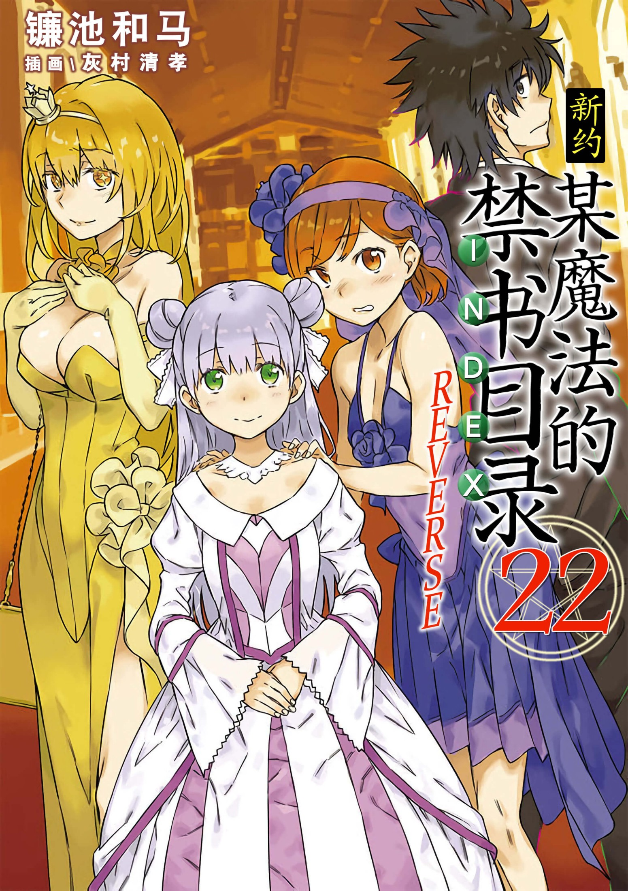

# 简介

**新约·魔法禁书目录22R**

作者：镰池和马

## 内容简介

**「新约篇」终于完结！身着派对礼服的女主们齐聚庆祝会！**

世界毁灭的威胁大恶魔科隆尊已经消失。以「学园都市统括理事长亚雷斯塔的牺牲」为代价，上条当麻终于，终于拯救了科学与魔法的世界。

这里是英国清教的圣地·温莎城。在庆祝会上受到热烈欢迎的上条转过目光，看向茵蒂克丝、御坂美琴、食蜂祈操等人的身影。真的，「和平」降临了。

——然而。

难道忘记了什么吗……没错，在科隆尊战斗结束后，上条的右手应该已经破裂了？！

随即。一只怪物袭击了温莎城。这只拥有翅膀的蜥蜴所代表的是什么呢？

这是一个魔法与科学交汇并集结的故事。请见证「新约」篇章的结局！

该卷为新约第23卷，请在新约22之后观看

## 制作信息

* 翻译：Seeker
* 台版：网翻
* 翻译：当麻10032号、孤独的滑膛枪、Hamster917、万象之金、绿酒°、吐槽星1234、上条美琴、Earth终极、刹那louts、以汝眼眸为镜、林中的挪威、机动战士天空
* 校对：iceRush、Hamster917、孤独的滑膛枪、吐槽星1234、以汝眼眸为镜、Earth终极
* 润色：吐槽星1234、Hamster917
* 修图：无敌王者大怪兽、中二
* 图源：佚名
* 整合：知一一（禁书目录X系列，[index-X](https://github.com/1204244136/index-X)）


**版权声明**

转载时请保留录入信息。

本站内容仅供试看、学习与交流使用，禁止用于商业用途；下载后请在24小时内删除。请支持官方正版。


## 封面与封底

