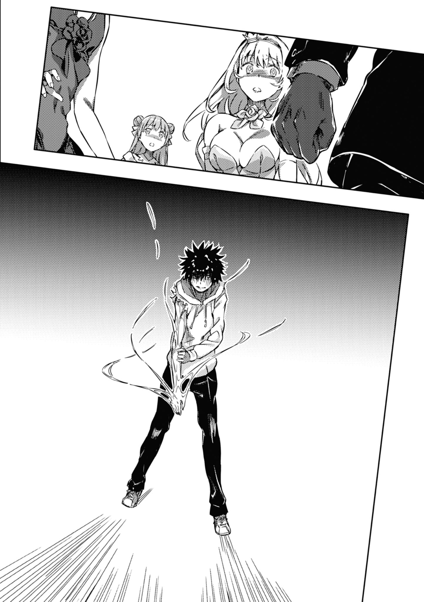

# 第二章 小小的荣冠

> Party_for_Winners.

## 1

玻璃破裂声响起。

&nbsp;

「当麻！」

想来是因为白底配红紫条纹的衣装不适合奔跑吧。茵蒂克丝双手提起宛如绘本中公主一般的蓬蓬裙，赶来走道。

到处都是闪亮亮的锐利光源。

破窗的碎片散落在地毯上。

银色长发绑成两个丸子的茵蒂克丝露面时，现场除了刺猬头少年之外已经多出好几个人。比方说神裂火织与五和等人。大多都是婉拒赴宴而负责警卫工作的「清教派」魔法师。他们似乎正在检查留在地毯上的足迹与破掉的窗户。

连娇小的三色猫也提心吊胆地发抖。人会受到现场气氛影响，这点恐怕连动物也不例外。

至于当事者上条当麻，则是苦笑着以左手举起手机。

他甩了甩原先大概是握成拳头的右手说道：

「可恶，没电了……如果有好好充电，说不定至少能拍下一张啊。」

「没、没受伤就够了啦。要是随便追上去却落得悲惨下场就得不偿失了……」

五和说起话来畏畏缩缩，却穿了一身款式大胆的短摆礼服凸显曲线。对，感觉很适合欧莉安娜·汤姆森。就画面上来看，晚上九点过以后绝对不能让她站在伦敦街角。说到底，那件礼服真是她自己选的吗？

将黑色长发绑成马尾的神裂火织，一只手抵在耳边说道：

「……负责屋外警卫的雅妮丝·桑提斯，也带来不太妙的消息。那道关键的足迹好像途中就消失了。」

「消失了？」

听到一脸惊讶的上条这么问，身穿和洋折中款式礼服的神裂耸耸肩。

「如果不是利用森林在树枝间跳跃，就是**干脆用翅膀**飞上天了吧。如果你的证词没有错，这些可能性都无法否定，对吧？」

茵蒂克丝等人的目光集中到刺猬头身上。

&nbsp;

——比人还要大的怪物。

&nbsp;

——整团的天蓝色与柠檬黄。

&nbsp;

——硬要说的话是只很接近四脚蜥蜴的怪物。

&nbsp;

——有层看似肌肉的东西覆盖全身，背上长出很大的翅膀。

&nbsp;

——形状像人手的前脚会冒出粗大钩爪。

&nbsp;

「慢着慢着先等一下！表情很恐怖呢！那么认真地做笔记会让我很为难，而且很可怕！就算是我，突然遭到袭击一样会陷入恐慌哦？」

「不过你的说辞是最大的线索，这点是事实吧？」

可能因为和洋折中礼服没口袋，神裂火织是从丰满的胸部掏出（！）记事本。她忙着和用千代纸装饰封面的记事本搏斗，没去看上条的脸。不过——

「因为，那个时候我才刚被神裂你揍一顿，脑袋搞不好出错了。」

「这种旧账可以不用翻！」

神裂阖上记事本，红着脸警告上条。

她像个小孩子一样嘟起嘴。

「还有，天蓝和柠檬黄这种色彩虽然令人在意，但如果论外形……在魔法领域，有翅膀的蜥蜴不是什么罕见的象征。诱惑者、恶魔、地底与财宝的守卫，或者是龙。」

神裂或许只是把想到的都列出来。

然而，上条的肩膀此时抖了一下。

「……龙？」

「以题材来说，应该有名到会在电玩游戏出现吧？一般来说常把龙和恶魔相提并论，不过『骑士派』也会将龙当成宣示自身家族与血统的纹章，是一种不可思议的象征哦。十字教文化的善恶二元论明确，会将幽灵当成邪恶消灭而没有半点酌情余地，然而龙在这里却是极少数清浊兼具的记号。」

「……」

随处可见的平凡高中生，终于陷入沉默。

龙。

他不断于脑中重复这个词。

定睛一看，三色猫正在玻璃碎片散落的走道上低吼。

猫依靠的感官是眼睛？耳朵？还是鼻子？在这个现场，该不会还残留着什么只有动物才知道的东西吧？

上条偷偷瞄了自己的右手一眼，然后说道：

「既然对方逃了，那么追上去比较好吧？要是给他机会喘息，不知道什么时候还会再来，也不能保证那家伙只会袭击这里。如果他为了钱或食物闯进附近的住家或店铺……」

神裂叹了口气。

「为什么这种时候一定要找你帮忙啊？我们就是为了这种时刻而准备的战力。真要说起来，从来历不明的家伙闯进女王所在的温莎堡这一刻起，情况就严重到可以发表紧急事态宣言，并且设立检查哨封锁温莎近郊的程度喽。」

「女教皇大人……果、果然是科隆尊残党一类的吗？我接获的报告指出，科隆尊制作过人造恶魔。」

「不，五和。初步调查要抛开先入为主的成见，将所有的可能性都摆到桌上。也可能是其他危险分子，或是排斥英国清教管理的魔法结社。英国根基动摇的此刻被当成好机会了吗……」

至于上条，则是不经意地嘀咕：

「所有的可能性……是吗？」

追根究底。

大恶魔科隆尊。英国的国难，真的到此为止吗？

从一开始，**背后就藏有其他黑幕的可能性**，**真的不存在吗**？

双重伪装。

再不然，就是某种像「云」一样的东西。

某人咽下口水的声音，传进上条耳里。

恐怕在场每个人脑中都满是不安与担忧。

要不然，说不定。

尽管这些都是毫无根据的假设。

由于击破科隆尊，因此大家都放松戒心，举国狂欢。如果连这种状况都是某人设想好的舞台呢……？如果有人事先将这种无论如何都会令人松懈下来的瞬间考虑进去，安排了「某种计划」呢……？？？

没有人说出口。

担忧却从每个人的胸口隐隐渗出。

「首先是强化戒备。外面的搜索交由其他单位负责。既然不清楚对方的目标，那么还是避免温莎堡人员分散比较好。」

讲到这里，英国女王(Queen Regnant)伊莉莎对负责屋内警卫任务的天草式「圣人」耳语。

「……如果有需要，允许服务活动。给『王室派』的公文事后再补无妨。」

「了解。」

伊莉莎「啪啪！」地拍了拍手，驱散现场沉重的气氛。

「我国没有在走廊吃喝的文化。要谈话就回舞厅吧，反正要做的事不变，在有美酒和美食的地方谈更合适吧？」

于是人潮流动。

茵蒂克丝抱起喵喵叫的三色猫，朝宴会场地移动。

上条也想跟着走，不过他还是姑且问了一下神裂：

「『服务活动』是什么啊？」

「暂时放出处刑塔(伦敦塔)囚犯，让他们在守卫监督之下与魔法师战斗的特别措施。也就是说，将第二公主凯莉莎殿下以及和我一样是『圣人』的威廉·奥威尔投入实战。」

「真的假的，太危险了吧！」

「货真价实的最后手段喽。真要说起来，他们自己也不想靠战功带来的特赦缩短刑期。」

这么说来，先前就算是在克劳利灾潮几乎要攻陷首都伦敦的时候，也没采取这种措施。大概是那种「人类还有良知时绝对不能按」的特大号开关吧。

「上条当麻。你是拯救了这个国家的人，不要在意我们的事，把握时光留下美好回忆吧。」

「可是啊……」

和往常一样。

明明没必要却还是想插手的上条，让神裂轻轻一笑。

「放心。虽然还不清楚敌人的目标，但如果是要破坏和平的气氛，将不安散播到国内全土，那么被牵着走就等于让对方称心如意。就这点来说，更不能谈什么结束宴会回归战场。所以，警卫工作交给警卫人员吧。光是一如往常，就能带给社会无法动摇的力量哦。为了和平，还请协助我们的调查。」

「这种说法真是奸诈……」

「是啊。」

一身和洋折中礼服的神裂火织，轻轻用食指抵住上条的嘴唇。

黑色长发散发的香气，刺激着少年的鼻子。

「你忘了吗，我好歹年纪比你大。多少会学到些说话的技巧哦。」

## 2

穿着公主礼服的茵蒂克丝踩出啪喀啪喀的脚步声，回到会场之前，少女先去了一趟别的房间。她似乎没注意到白底带红紫条纹的长裙晃得很危险。

「过来～斯芬克斯。」

（……当麻总是会受伤，先跟人家拿些创可贴吧。）

这里是医务室。

温莎堡，「城堡」一词听起来很不简单，但说穿了就是住家。尽管如此，每层楼墙上都挂着放在显眼防水袋里的AED，还有独立的医疗设施，冷静一想就有种无法抑制的奇妙感受。或许意味着此处不能有个什么「万一」吧。

「打扰喽～」

小手转动门把开门。

里面有一位戴眼镜的女医生，还有三位护士小姐。不过，在明白茵蒂克丝从蕾丝首饰到长裙都沾满了猫毛的那一刻，她们顿时紧张起来。金发护士连忙将猫留在走道上，还用奇怪喷雾往自己的双手和茵蒂克丝的礼服上喷个不停。

也不知这么做是在应付走失儿童还是进入小儿科模式。

听到女医柔声（其实是因为面对了一个不知道接下来到底会做出些什么事的人）问「怎么了吗？」，茵蒂克丝高举双手蹦蹦跳跳地说：

「我来帮当麻拿急救箱！」

少女没拿到急救箱。

短裙女医给她一个很厚的小塑胶包。就像外出过夜用的牙刷组那种感觉，里面装了一些消毒药水、创可贴、绷带之类的东西。准备得这么周到，或许是为了管理温莎堡广大庭园的园丁着想。至于城里的医务室呢，基本上是为了王族和有急病的观光客而设，如果维护城堡的大批员工有点小割伤或被毛虫刺到都跑来看诊，可就要大排长龙了。不过这是秘密。

包装表面是这样。

三层台座上有个十字架，十字架中央则是蔷薇图案。

此时——

「呜……头好重……」

用帘子隔开的地方传来慵懒的声音。

疑惑的茵蒂克丝走过去拉开一看，就在这个瞬间。

她的鼻子仿佛撞在一道厚重的透明墙壁上。

先前被封住的甜香一口气涌来。

那里有张休息用的床。某个人倒在床上。可能是从奢华礼服换成黑色修道服的途中没力了吧，衣服才穿一半就放弃。这人不是规矩地躺着，比较接近屁股翘高高趴在床上。

这位脸沉进大枕头里呻吟的人，正是奥索拉·阿奎纳。

她从耳朵到颈部都是红的。

「呜呜呜呜哦哦哦哦哦哦，似、似乎有什么不好的记忆，从很深很深的海底浮上来……那、那是现实？不，怎么会？不可能有这种事……」

而且她似乎正在和自己战斗。

茵蒂克丝晃着一头银发，疑惑地问：

「你到底在做什么啊？」

颤抖顿时停住。

接着，只见金色短发的丰满美女翻了个身。侧身躺着、犹如婴儿般缩成一团的奥索拉含住自己的拇指。动作虽然可爱，但是那种会撒娇赖上来的危险大姐姐气息变得更为强烈。

顺带一提，十字教虽然倾向禁欲，对于饮酒却没有特别限制。实际上，重要的领圣体仪式甚至有葡萄酒登场。[^1]

当然，从七宗罪包含暴食就能明白，他们并不鼓励过量。

「……虽然这种日子好像不该讲这些，但是可以请你听我告解吗？」

「脸，彼此的脸都看得一清二楚哦。」

茵蒂克丝有完全记忆能力，在这种开放环境实在不适合听人家的罪过或烦恼。还有，就算找这个饿肚子修女倾述烦恼，她也只会要你吃饱之后去睡觉，这点必须注意。

戴眼镜的女医生说，奥索拉倒在化妆室附近。

奥索拉在这场战争中，曾因为「神威混淆(Divine Mixture)」等理由处于极度紧绷的状态。从另一方面来说，她恐怕也觉得没什么脸去面对大家。会去拿平常不太碰的酒杯，倒也不足为奇。

茵蒂克丝轻轻叹口气。

「放心啦，又不会因此完蛋。今天先休息，明天再和大家谈谈或许比较好。」

「不要啦～安慰人家嘛～不要丢下我不管～」

「这人根本没听我说话？虽然不算很明显，但是她酒还没醒呢！」

## 3

顺带一提。

如果要问为什么在这场骚动里，戴着头纱的御坂美琴和把蜂蜜色秀发在脑后束成两层的食蜂操祈，没在通道上露面——

「咿！」

「啊，好啦好啦！都是因为你一受到惊吓身体就紧绷。」

因为一身蓝色系内衣裙款式礼服非常不好意思而缩成一团的美琴，将A.A.A.推到含着眼泪的蜂蜜色少女背后代替椅子，轻轻叹了口气。

此时，形成跨坐姿的食蜂发出怪声。

「哦、哦哦？」

可能是将机车的轮胎部分重新利用吧，外观犹如有轨电车与护送车的A.A.A.前端——食蜂屁股所坐的地方开始鼓起。少女看起来就像坐在一个比海滩球还大的气球上面。

「慢、慢着，御坂同学，这是什么？平衡球？你可能是出于体贴想用柔软一点的材质但是这样反而有点痛——我的腰！咿！」

「不、不是我！A.A.A.镇定一点！还有食蜂，你也不要一直上下乱动！」

现在的蜂蜜色少女，就像健身房令人有点难以直视的天真无邪年轻太太那样，美琴只能抱住她避免她摔下去，因此内衣裙款式礼服少女也落得背面全开的下场。

眼角泛泪的食蜂大概真的很痛，肌肤已经湿了一片，都是汗珠。颈部也染成了浅粉红色。

「好啦，擦得到的地方自己想办法解决。背后我来帮你。」

「我只要血液循环力变好就会散发甜香，所以两者没关系。」

「不要嘟着嘴，一点也不适合你。好啦，脖子那边也要。」

美琴拿起手帕擦拭食蜂的后颈，顺便为她整理已经有些散乱的金发。可能因为食蜂操祈是个彻头彻尾的女王陛下吧，这段时间她只能任人摆布。

「差不多七十分吧。御坂同学，照这样努力下去，将来你或许能成为一个优秀的佣人。」

「A.A.A.，上下晃动。」

蜂蜜色少女的腰，随着神秘的「啊吧啊吧啊哈哈！」叫声而弹起。不至于出人命的痛楚让她处处痉挛。照这样下去，恐怕她会无法洗刷「害怕自行车坐垫」的嫌疑。[^2]

适度发泄之后，美琴下令停止并说道：

「……不过，刚刚那是什么啊？有个像是打破玻璃的声音呢。」

「啊、啊呜……希望他没弄倒走廊上的蔷薇花瓶……」

这倒是很有可能。

尽管这种地方的艺术品和古董通常会有高额保险，不过理所当然地，也有很多物品并非支付相当于时价的现金就足以解决一切。而且，人是一种越刻意避开就越容易掉进洞里的生物。向来不幸的上条先生稍微绊到脚便引发奇迹似的连锁效应，这种可能性实在不算小。

「哦，回来啦。」

美琴往门的方向看去，随口说道。她仿佛在泳池边毫无防备地做热身运动般，背部线条变得平滑。

光是这么一句话，就让食蜂操祈的胸口揪了一下。

蜂蜜色少女的手掌，轻轻放到藏在胸口的防灾哨上头。

要说理所当然也没错，刺猬头少年朝她们的方向挥手。但就是这种理所当然，对少女的泪腺造成难以抵挡的攻击。

他还记得。

看来，这个奇迹还会再持续那么一点点时间。

然而上条当麻过来之后开口第一句话，就全搞砸了。

「嘿，两位小姐。你们有手机吗？」

「「啊？」」

「这玩意儿刚刚没电了，害我漏拍了非常不得了的东西。插座的洞又长得完全不一样，我实在是搞不定。」

「「……」」

「然后，我突然想到一个秘技！我记得有种方法叫无线充电对吧？就是把两部手机贴在一起调整设定，把其中一边当成行动电源。只要一半……不，三分之一就好！能不能分我一些电，让我至少能在需要的时候拍张照片？」

真要说起来，这人也没解释刚刚跑去走道做什么，回来却劈头就讲这些。

慢一步抵达的茵蒂克丝，则是以低沉的声音追问：

「当麻……有人在化妆室发现半裸的奥索拉，这件事你知道吧？」

「哦？」

时机糟糕到极点。

能力开发名门常盘台国中的两大大小姐，气息为之一变。

大概是本能地察觉有危险吧，银发少女怀里的三色猫赶紧溜掉，与这些人保持距离。

「因为电池没电……」

「……漏拍了不得了的东西，是吧？」

「慢着，不是啦，我在讲正经事呢……话说回来，懂得艰深词汇的高中生有话要对笨蛋初中生们说，这种时候要好好遵守一事不再理的原则哦？这是个很基本的提议，打从我被神裂踢飞的那一刻刑期就结束了啦不要一而再再而三地翻旧账真的会死人啊！」

但是，上条当麻还是老样子没把话说清楚。

听到这番话的少女们，不只内心的郁闷没有排解，眼神反而越来越尖锐。变得就像防窃海报等处那种类似歌舞伎妆的样子。

银发的担任代表开口。

「换句话说，当麻你做了会遭到制裁的事？」

「呜哇啊啊啊啊越来越麻烦啦！追根究底都是冤枉的啊奥索拉一开始就衣衫不整啊！！！」

硬质的喀喀声接连响起。

A.A.A.从平衡球变为长椅尺寸的有轨电车形状金属块。原先以优雅姿势坐在它正面边上的食蜂操祈轻轻叹口气，将臀部挪到中段。长裙开的高衩让这个画面显得十分精彩。

突击准备完毕。

排名第五的少女将胯下物体当成一匹凶暴的马，开口说道：

「哈……御坂同学～」

「收到。」

「GO☆」

&nbsp;

磅————————！

载着常盘台女王的长椅尺寸物体，将刺猬头撞飞。

别谈什么一事不再理了，根本是有嫌疑就要处罚。

## 4

故事发生于某个寒冷的夜晚。

寒天之下，有种并非萤火虫的橘色光亮闪烁不定。不过一般来说，大概没什么人看见后会觉得很梦幻吧。

因为那是香烟前端的火光。

史提尔·马格努斯。

及肩的红色长发，配上将近两米的巨躯。尽管身上不是平常的黑色神父装扮而换成了正式场合穿的燕尾服，本质依旧没有改变。隶属于「必要之恶教会(Necessarius)」，以魔法消灭魔法的杀手。出于某种原因，他的路线与之后才来会合的神裂火织及雅妮丝·桑提斯等人有所不同。

同样个子高却能融入任何地方的天草式十字凄教成员建宫斋宇，无奈地嘀咕：

「怎么，居然跑来我们这里啊？既然挂着第一公主随从的名义，不是想去哪里摸鱼都行吗？」

「……我没办法在不能吸这玩意儿的地方待太久。」

背靠温沙堡墙壁的神父，轻轻抖了一下手上的烟后说道。

实际上，也有些他不愿目睹的画面。

换上礼服的银发少女无比耀眼。

人人都希望她露出笑容，史提尔也不例外。但是另一方面，他却无法不意识到某个刺在心头的事实——那张笑脸，是为别人而展露的。

记忆的有无。

单单这一点，就在幸福的彼岸与此岸之间拉起一条极为强大的界线，他无论如何都忘不掉这件事。

（……七宗罪啊。管它是撒旦还是利维坦，心灵居然会被区区感情吞噬，这代表我修行还不够。）[^3]

建宫让他联想到某些事。

地位在建宫之上的神裂火织，实际上又是怎么想的呢？

她已经认清现实，把这些事厘清，塞进某个抽屉了吗？

史提尔轻轻摇头。

原先期望有强化集中力与镇静效果的烟，到头来只让自己血管收缩压的变动率有了不必要的提升。与其说是在吸烟，不如说是烟要自己去吸它——有这种感觉时，脑袋里通常不会有什么可取的念头。

神父就像要转换心情似的，轻声说道：

「你那边呢？天草式基本上是负责屋内的警卫工作吧？」

「没什么可疑之处。毕竟和『那家伙』有关嘛。大概只会把破窗和走道整个调查过一遍，顺便巡视一下外面的状况吧。」

建宫笑着说道，然后往上看去。

二楼的窗户……说是这么说，但这里是城堡，每一个房间都很大，天花板的高度也不一样。不能用一般建商盖的住宅去想。那是摔下来就要有骨折心理准备的高度。

「不过，石墙看起来没受损对吧？代表不是爬墙，是一口气扑进目标窗户……？难怪雅妮丝他们会给出『嫌犯可能是飞上天逃离』这种报告。」

「更重要的是，为什么直接对二楼出手？如果要悄悄潜入，明明可以选择贴地的一楼。」

一开始就撞见上条当麻不知是幸运还是不幸。如果是用那只还搞不清楚原理的右手击退对方，也只能得到「总之好像是用异能之力」的情报。那个少年又是外行人，不懂报告的要点，听他说明也无法想象袭击时的情境。

「真亏他能一直把我们牵着走啊。」

史提尔说到这里打住。

继续谈下去也无妨。

只不过，要是这么做——

「……也就是说，这附近也要变吵了吗？」

「你是第一公主的随从吧？如果想要安静，干脆拿『搜索莉梅亚殿下』当借口溜出城，说不定还比较确实哦。」

虽然很想这么做，但是目前看来似乎不能这么做。

和她待在同一个地方很难受。

可是不能搞错。世间虽然有将爱情转化为愤怒或憎恨的蠢货，但史提尔不是那种人。他的第一条准则，只要那名少女所在的地方有任何一丝危难，那么就非得除去不可。自己承受的伤害与痛楚可以摆到后面。

既然如此——

「脚印在途中消失。」

他丢出一张印有卢恩的卡片。

卡片没贴上任何地方，而是在随风飞舞的状态下，产生形似鬼火的微弱火焰。没有重复施放，所以无法长久持续。塑封过的卡片逐渐失去原形，并且在短暂时间内拭去黑暗。

有些怎么看都不属于人类的脚印。

形状不用说，每个脚印显然隔得太远。与其说是走路或奔跑，不如说比较接近沿着直线跳跃。

这种异质的脚印，也在城堡周围的人工林一带消失得一干二净。

「在树枝之间移动吗？或者只是为了摆脱重力飞上天而『助跑』呢……」

到这里为止，都和负责城外警备的雅妮丝与赫雷葛瑞斯报告一致。

远处森林有些闪烁的光源，大概是女仆和修女们努力在林木与草丛之间搜索想找出痕迹。她们看来没什么成果，派不上用场的蛛足型装备发出叽叽声。

然而史提尔在意的并非这点。

「总觉得从入侵到逃离都做得太利落……这里再怎么说也是君王的第二个家温莎堡哦？哪可能这么容易就闯进来啊。」

「你的意思是，那个怪物明白英国的术式？」

建宫一脸惊讶。

「……面对那场战争时，确实已经没办法管那么多了对吧？印象中似乎也因此亮出了不少底牌……」

这么一来，代表事情牵扯到潜藏于国内外的魔法结社，或者罗马正教、俄罗斯成教等其他宗派？在不清楚萝拉·斯图亚特……不，大恶魔科隆尊扎根到什么程度的情况下，很难判断是否已经彻底铲除。

这么想或许比较妥当。然而——

「不过啊。」

「？」

「话是这么说，却找不到使用魔法的痕迹。」

轻轻的「啪」声响起。

史提尔所抛出那个比气球还要脆弱的鬼火，没发挥半点效果就在空中爆开。

搜索以失败告终。

「……具体来说就是没有魔力的痕迹。有可能吗？对魔法熟悉到足以理解并钻过国际规模的魔法安保机制，却完全不使用魔法。难道设限有什么好处吗？再不然就是……」

「实行犯不见得只有一个人。采取行动的人和提供建议的人，两者的知识水准不一样，对吧？」

「比方说，可能有这么一个人，定位和脑中保有十万三千零一册魔导书的她差不多。不过具体来说究竟是什么人？」

史提尔吐出混着烟味的气息。

「……还有那个简单易懂的蜥蜴混蛋，我觉得这家伙比较难搞。」

## 5

该说是不幸中的大幸吧？

上条当麻所目睹的那只长了翅膀的天蓝色蜥蜴，之后没有再三来袭。宴会不必中止虽然值得高兴，但是换一个角度来说，也等于找不到任何下手者的痕迹。

「呼……」

刺猬头少年按着后腰，吐出白色气息。

这也是理所当然的，因为此处是直接连到舞厅的阳台。

尽管方才那场大骚动似乎是要靠欢笑甩掉宛如雾气般挥之不去的不适感，但是那群人有点过火了。如果奉陪到最后，搞不好会被玩得太过头的抛高高直接送去天堂。

「当麻。」

这时，上条背后传来少女的声音。

白底配红紫条纹。

穿着公主款式礼服，将侧边银色长发绑成丸子的少女。

刺猬头少年回过头来。

「……该怎么说呢，我弄懂了某些事。」

「？」

看见茵蒂克丝微微歪头，上条苦笑。

「或许是因为不想结束。」

「结束什么？」

「统括理事长亚雷斯塔，已经不在了。」

上条当麻以肯定的语气说道。

不是单纯谈论敌人的命运或下场。这件事，也渐渐影响到少年与少女的人生。

「原先站在英国清教顶端的最高主教(Archbishop)萝拉·斯图亚特也是。我们啊，之前等于是卡在缝隙里。不过失去左右的墙壁之后，裂痕就成了峡谷。已经连卡在里面都做不到了。」

科学支配的学园都市里，有着记住一切魔法的茵蒂克丝。

尽管如此，她却理所当然地睡在学生宿舍、和自己一同生活。

能够担保这一切的大人们全都消失了。这和「父母某天突然意外身亡」又有所不同。纯粹的利害关系隐隐浮现，青春期的少年不知该如何看待。

所以——

「若是战斗，至少还能留在现在的地方。」

「……」

「亚雷斯塔和科隆尊的战斗若是持续下去，在学园都市的生活也能一直维持。或许就是因为这样，我才会渴望这种事吧。渴望着会不会还有什么重大的谜，化为实体来袭。」

不过，这都是任性。

就算是罪魁祸首亚雷斯塔和科隆尊，想必也是为了让战斗结束而战。想要延续他们的痛苦保住这种暂时性的生活，根本没道理。

少年心知肚明。

尽管心知肚明，上条当麻依旧咬住嘴唇。

「……怎么办？」

茵蒂克丝有两条路。

就这样留在英国，或是前往学园都市。

「接下来，我们要怎么办呢……」

上条当麻，也有两条路。

亚雷斯塔消失。他的计划(Plan)已毁。要回到没有黑幕的学园都市吗？还是踏上截然不同的路，依靠右手之力奔向魔法世界呢？

只要异能之力还在，无论源头是科学或魔法，幻想杀手(Imagine Breaker)都能发挥作用。也许，说不定，区区学园都市已经无法容纳他了。

茵蒂克丝一时无语。

她陷入沉思。

然后，惹人怜爱的嘴唇轻轻张开，说道。

「……回去吧。」

「……」

做出选择。

茵蒂克丝说想要回去。这个嘛，也是理所当然。毕竟真要说起来，她待在日本的学园都市才叫做不自然。

没错，上条这么想。

接下来只剩自己的选择。

但是，茵蒂克丝笑着这么接下去：

「**回到我们的学园都市**。因为，我们就是为此而战的吧？如果不回去，就没有赌命的意义了嘛。」

「这样……真的好吗……？」

他在发抖。

自己的身体为何会发抖，上条也不清楚理由。

「这里是你出生的故乡，已经没有任何东西束缚你，想要回家随时都回得去！既然如此，你真的还要……！」

「如果是这个，其实有哦。」

身穿公主款礼服的银发少女轻轻一笑。

少女的笑容与往常不一样。

「如果要找束缚我的东西，已经有了。不过，那并不是坏事。当麻，所以我们回去吧。我们该回去的地方，想必就是你脑中浮现的地方哦。那里并没有廉价到能够简单地留在心底。」

少年无言以对。

其实他必须说些什么的。

只要留在伦敦，茵蒂克丝的才能就不会被埋没。而在这个国家，也有史提尔、神裂这些等待她的人。根本不需要勉强回归学园都市的生活。应该再三思量，找出最棒的答案。

但是，做不到。

无论如何都做不到。

不管有多么丑陋、多么肤浅，上条都说不出那种可能让她有一丝机会改变心意的话语。

所以，无言的时间自然而然地持续下去。

没有他人的阳台，唯有四目相交的时间缓慢流逝。

应该是有人放烟火庆祝战争终结吧。阳台之外绽放了好几发大型烟火，以缤纷色彩妆点冬季的黑暗。但是，少年少女都没有将目光转向那里。

「茵蒂克丝……」

他这么说道。

双手自然而然放上她纤弱的双肩。

或许连上条也不明白自己想做什么。

将手放上少女肩膀时，少年的手指可能碰到了左右的丸子吧。

少女两侧绑成丸子的银发。

轻巧地散开。

在月光下更增添了它的光辉。

茵蒂克丝轻轻抬起头。

就这样停住。

少女显得有点疑惑。

就在这时——

&nbsp;

咻！

「某种物体」，随着破风声越过二楼阳台的扶手。

## 6

破碎。

玻璃破碎，冲击波夹带了㭴木窗框断裂的巨响。

「啧！」

强烈的冲撞。

对方翻过阳台扶手闯入后没有减速，直接撞向上条侧腹。仿佛视重力为无物，也没管茵蒂克丝，就这么猛然扑上。来者抓着上条，狠狠撞上玻璃窗，又在宴会会场的地板上翻滚，钩爪仿佛要扯掉豪华地毯。双方都拼命地要压制另一边。

每个人都看见了「那个」。

惨叫与怒吼此起彼伏。

无数于体表沿肌肉线条流泻的线状物，散发湿滑的光泽。整体是天蓝色，还带有一些柠檬黄条纹。尽管有点像南国的蛇或青蛙，不过这东西明显不该存在于自然界。超过两米的巨躯，明确地分出了四肢……应该说手脚，头部则有近似鳄鱼的血盆大口强调自身存在感。身上长有蝙蝠般的翼膜，一条粗尾巴看得出连末端都十分有力。虽然不知它浮躁地左右甩动有何意义，但至少看起来不怎么友善。

长了翅膀的蜥蜴。

或者说，龙。

虽是恶魔的象征，却也会用来代表家族、组织的奇妙意象。在善恶二元论明确的西洋世界，它是横跨两端的例外存在。

「又见面了呢……」

又一次的袭击。不，方才不是逃走，而是为了袭击而躲藏吗？

就连小小的三色猫都竖起了毛。

最后占据上风的是对方。被压在底下的上条当麻别说脸了，全身都紧张地汗水直冒。即使如此，他依旧挤出笑容。

也不知在短短时间内究竟躲到了哪里。诡异的色彩闪动。

亮粉红色。

以及翡翠绿。

出处大概是右手指尖吧。

「而且令人开心，都是真的。只要还有你这个谜团留着，就让人感觉那些可怕的念头都能抛开啦！」

吼！

咆哮响起，右手水平挥动。随着弹簧机关启动般的「轰！」一声，数根粗大的钩爪同时迸出。

但是刺猬头并未和身体分家。

「这家伙是什么啊？」

可能是把不速之客重新认知为「来自他处的目光」了吧。

尽管双手抱住裹着蓝色内衣裙半透明礼服的身躯，还弯腰缩成一团又红着脸，戴着头纱的御坂美琴依旧大吼。

她甩开害羞带来的热度。

将原本遮住上半身的右手往前伸。

——滋咚！宴会会场爆出一道仿佛有人敲打巨大太鼓的冲击波，仅存的窗户一扇扇破裂。毫不留情，起手就是超电磁炮(Railgun)。加速到三倍音速的游乐场代币留下橘色轨迹，狠狠刺中怪物的侧腹。

断了。

某种东西被压烂的声音响起。

即使如此，那家伙……还是没停手？

「轰！」的一声巨响，怪物的右臂再次挥下。闪着天蓝光芒的流星坠落。被压在底下的上条，仓促间不是动自己的头，而是右手。

或许是刚刚那一击让轨道有了些许偏移。

钩爪落下的位置差了那么一点，只将地毯连同坚硬的地板一并掀起。

虽然就算手腕受创也可能成为致命伤，然而少年的目标想来不在这里。

幻想杀手(Imagine Breaker)。

少年的右手，蕴含极为重大的意义。

「哈哈！原来如此，你是这么想的吗！」

怪物没等上条露出战意十足的笑容，又是一击。

高举的钩爪，似乎依旧对准刺猬头的右手腕。

搞不好，是打算砍下来纳为己有？

——或许也有魔法师这么想。

然而并非如此。

那只怪物拘泥于上条当麻右手的理由，只有一个。

&nbsp;

啪叽！

奇妙的声响迸发。

&nbsp;

接触。

就在上条当麻的幻想杀手(Imagine Breaker)碰到长翅膀蜥蜴的钩爪那一刻。

爆出破坏的声响。

可能是力道因此有些松懈吧。

「哈！」

刺猬头少年笑了一声，将腿一缩，脚底对准怪龙腹部，就这么往上一踢。

对方也不再抵抗。

跌在地板上的同时，裂痕扩散。啪叽、啪叽、啪叽！由鲜艳天蓝色纤维构成的蜥蜴皮肤，宛如硬壳碎裂般逐渐崩解。

就在跨越某条线时——

咻！

天蓝色与柠檬黄形成漩涡。不，正确说来是长翅膀蜥蜴的右前脚……或者该称为右手。手腕部分将异形外壳全部吸了进去，宛如拔掉浴缸塞子把缸里的热水全部放掉那样。

看起来就像有只大蝙蝠停在手腕上。

然而，那一团也彻底缩了进去。

没了天蓝色外壳，其他部分自然就会暴露在外。

只剩内在。

这些才是本质。

应该打倒的对象，暴露真身。

前哨战结束。情绪自然紧绷。拼命抵抗的时刻接近。

会场里每一个人都屏息吞声。所有人都成了目击者。

有翅膀的蜥蜴。

从这种特异外形之下现身的东西。

一切的元凶。

&nbsp;

他的真面目，是个留着刺猬头的高中生。

所有人都很熟悉的少年，现身于世。

## 7

追根究底，到底发生什么事？

若要知晓一切，就得换个视角，回溯时光一探究竟。

&nbsp;

「啊、啊啊啊、啊啊啊啊啊啊啊啊啊啊啊啊啊啊啊啊啊啊啊啊啊啊啊啊啊啊啊啊啊啊啊啊啊啊啊啊啊啊啊啊啊啊啊啊啊啊啊啊啊啊啊啊啊啊啊啊啊啊啊啊啊啊啊啊啊啊啊啊啊啊啊啊啊啊啊啊啊啊啊啊啊啊啊啊啊啊啊啊啊啊？？！」

&nbsp;

轰！

英国——爱尔兰之间复上厚重冰块的内海，传出某种东西爆开的巨响。战争终结的前一刻，带着元凶科隆尊与亚雷斯塔沉入海中的不列颠女王号吸引了众人目光，事情就发生于此时。

完全属于另一个次元的事。

不是什么国际、世界的未来等规模浩大的话题，而是非常小的私人问题。

飞舞的冰粒宛如被狂风卷起的雪，此地发生的事，想来就连吊在兔格雷气球上的茵蒂克丝也没看到吧。

上条当麻的右手臂，自肩膀处炸开。

不是遭到外力作用。

而是因为压抑不住内部躁动的力量。

「——呜！」

痛楚已经强烈到无法忍受。

少年不知道自己叫喊了什么。他以空出来的手捂住右肩创口，双脚无力地倒在厚重冰层上。口袋里的钱包和手机掉了出来。然而他没有余力去管，只能拼命避免自己咬到舌头。

即使如此，他依旧无法闭上双眼。

眼前发生了某件事。

（什……？）

右手——

仿佛要对抗重力一样，始终在白色的虚空中飘浮。

不，这也没什么不可思议的。之前应该也见过好几次才对。假如只在对自己有利时假装没看到，一脱离控制就觉得恶心，这样根本说不过去。

脱离上条身体的右肩，滴出鲜红血液的断面产生扭曲。

不对。

还有「喀叽喀叽咔嚓咔嚓锵」的微小声响。

（怎么回事……？）

就在上条浮现疑问的下一秒——

距离右肩断面约十五厘米的空中，浮着一个像是人造物的诡异三角柱。它的侧面宛如键盘般呈现格子状，并自动在柱体上进进出出。

照理说先前不可能没看到。

但实际上异物就在眼前。

「风zh……**不**，**不对**！」

呐喊。

三角柱放出苍白光芒，令上条眯起眼睛。

&nbsp;

接着，静静地。

三角柱长出了头，肩膀长出了右手。

和自己如出一辙，容貌完全一致的少年，就站在上条眼前。

&nbsp;

现在已经不是思考他从哪里来、怎么冒出来的时候。

想要以生物的逻辑来解释就行不通了。

不仅如此，怪物身上的衣服也和上条穿的完全一样。

「你……？」

他只能愣在原地。

不，愣住算不上选择。

失去右手的上条当麻，什么也做不到。他只能对长相与自己完全一样的刺猬头高中生问：

「你到底是……？」

「**幻想杀手是王牌之一**？**使用者是自己**？」

这句话就像是在嘲笑他。

疑似破裂的声音撼动空气。

那家伙的嘴角闪着亮粉红色，眼角则是翡翠绿。虽然表面上很干净，但是难以区别属于内还是外的黏膜部分，对方似乎也不知该如何处理。

那家伙……

用那只焕然一新的右手，悠哉地捡起落在厚重冰层上的手机。

「别笑死人了，小屁孩。区区小鬼头失去了右手(这玩意)之后还剩下什么？谁还会承认这样的上条当麻是上条当麻啊？」

啪。

宛如沾水长发打在混凝土墙壁上的声音。

上条当麻的右肩。天蓝色丝线纠结扭曲，仿佛要填补断臂后什么也不剩的空白一样。丝线宛如强韧的肌束，转眼之间已经形成与人类手臂相似的轮廓。在完成的同时，也带来一股就像脑袋里爆出火花般的剧痛。和握住手机的对方不同，上条用新生的手拿起脚边的钱包。

（手臂……？）

眼前异常的情景先放一边。

痛楚消失，代表身体比脑更早开始接受现状，这让刺猬头少年为之战栗不安。「眼见为凭」这种理所当然的思维，却因为目睹难以置信、难以接受的现实而产生抗拒。

眼前的东西，是自身的一部分。

不需要抗拒的东西。

（这个像幻觉的玩意儿，是我的手臂……？？？）

连感受到疑问的时间都没有。

爆炸声再度响起，原本还能维持原形的天蓝色手臂张开血盆大口。不是为了对付眼前的敌人，而是要吞噬上条当麻自己。

压抑它的东西已不复存在。

幻想杀手(Imagine Breaker)落入对方手里。

「没了『这个』，还算什么上条当麻？」

那家伙窃笑着握起五指又张开。

仿佛在炫耀那股本该收藏于上条当麻体内的「力量」。

&nbsp;

「失去之后会怎么样，你就亲身体会一下吧。」

## 8

换言之。

换言之。

也就是说。

&nbsp;

「……到底哪一个才是真正的上条当麻？」

&nbsp;

英国女王(Queen Regnant)伊莉莎这句话，在历史悠久的温莎堡舞厅之内回荡。

与周围格格不入的地方有两处。

破裂声响起。

其中一边，是和先前一样身着燕尾服与阿斯科特式领带的刺猬头少年。

至于另一边，则是失去了右臂，以异样到极点、犹如用合成染料染色的天蓝色肌肉取而代之的高中生。

长相几乎没有差别。

既然如此，在场所有人的目光，自然而然会集中到某一点。

没错。

某个少年先前托付自身性命的右臂——聚焦在这个差异上。

「可、可是……」

大家都认得的少年开口了。

也就是那个先前都在会场和大家谈笑，一身穿不惯燕尾服的少年。

「这种事，大家都很清楚吧！」

他很紧张。

语焉不详。

就像突然遭到盘问时、没来由地遭到怀疑时会惊慌失措一样，举止可疑到反而会让人觉得他清白。

&nbsp;

「**靠着任何异能之力都能消除的右手**『**幻想杀手(Imagine Breaker)**』，**为了解救误闯学园都市的茵蒂克丝而战**，**一开始是这个吧**？**没错没错**，**最先来的是史提尔**，**不过接下来的神裂才难搞啊**！**呃**、**呃**，**对了**，**虽然在最后的最后落得必须和安装在茵蒂克丝本人里的**『**自动书记(John's Pen)**』**正面冲突**，**没错吧**？**仔细一想**，**那个时候萝拉**……**应该说大恶魔科隆尊已经出手了对吧**。」

&nbsp;

似乎没有错。

拥有天蓝色混柠檬黄手臂的少年，稍微眯起眼睛。

他并未惊讶。仿佛别人扔了个早就料到会碰上的问题。

上条当麻这名少年走过的路，伊莉莎已经接获「清教派」的报告，听到打斗声赶来的雅妮丝和露琪亚也没表示异议。

但是——

当事者茵蒂克丝一脸惊讶，这点就不太对劲了。

&nbsp;

「**先前发生过的事我全都说得出来哦**。**测谎器**？**要对我用那个也行**，**对了**，**要不然叫那边的食蜂调查也没关系**！**她的**『**心理掌握(Mental Out)**』**货真价实**，**只要和人心有关**，**精神系最强什么都做得到**。**只要让她看我的脑袋**，**就会知道我说的全都没错**！**看**，**我都答得出来**！**对吧**！」

&nbsp;

果然，内容没有错。

方才和大家待在一起的燕尾服少年，美琴见过他的手机。连细微的伤痕位置都记得。

「能用幻想杀手(Imagine Breaker)的，是这个对吧……」

「既、既然如此，不就确定了吗？」

五和与薇莉安也这么说。

但是——

「……」

另一方面，神裂火织的眼神有了转变。神情逐渐从静观其变转为怀疑。

在这种情况下，究竟有多少人会注意到呢？

注意到「机械性地说出正确的事并非正解」这个矛盾。

看见蜂蜜色少女泫然欲泣的脸，在旁边搀扶她的御坂美琴，似乎也肯定了心中的异样感。

「不就是这样吗？既、既然分辨怪物的方法是看有没有正确的记忆，那么全都知道的我就是上条当麻！对吧？要反过来根本不可能。**没有记忆的那一边才是正确的上条当麻**，这、这种事根本一说出来就知道不合理啦！」

「……！」

即使知道有哪里不对劲，只要没明确说出口……不，只要没得到认可，那么也就到此为止。

湿滑的光泽。

天蓝色配柠檬黄。自然界绝对不存在，但称为兵器或装备又显得太有生命力。

「右手它……**坏了**……」

「怪物」的声音，仿佛是挤出来的。

他被迫解释连自己也无从解释的现象。

按住变形右手的他，让人感受到这样的苦恼。

「要让你们相信或许有困难。可是，我的右臂里面还有东西！那家伙握有这个秘密！因为，另一个人就是从手臂——」

燕尾服少年往旁边伸出手。

从愣在原地的爱哭痣女仆手中那个银色托盘，抓起某样东西。

接着……

&nbsp;

砸下去。

倒握的酒瓶，狠狠砸在天蓝色手臂高中生的头上。

&nbsp;

「嘎！」

玻璃破碎的暴力巨响，令在场每个人都缩了一下。

这种时候，一般人大概显得坐立难安吧。只有身着燕尾服与阿斯科特式领带的少年笑了出来，并且缓缓叹了口气。

他看似放松了下来。

而右手——那只一直以来都不愿取人性命的手，握住了闪闪发光的凶器。

「……不需要问。让这种家伙讲话只会造成混乱。突然闯进来，谁会上这种混蛋的当啊？」

还没倒下。

有天蓝色手臂的高中生，尽管身体已经弯成ㄑ字，依旧咬紧牙关撑住了。

从额头和太阳穴滴落的，也不知究竟是红酒还是人血。

三色猫叫了一声，凑上前去。

它并未靠向先前都待在一起的少年，而是拥有彩色异形手臂的怪物。猫基本上是种排斥强烈气味的生物，一般来说不会想靠近血和酒混合的地方才对。即使如此，它依旧贴了上去。

也许……

是讨厌两者之间产生了差异吧。

眼角有些抽动的燕尾服少年，用空出来的手扫开长桌上的银餐具。成捆的锐利餐叉，随着暴雨洒落的声响扑向三色猫所在处。

「斯芬克斯！」

即使拿着急救包不知所措的茵蒂克丝悲痛地叫喊，身穿燕尾服的少年依旧不为所动。

一声仿佛要用全身威吓对手的低吼响起。

虽然看起来躲过了严重出血的下场，但刚刚不过是偶然。猫的身体结构基本上无法往后跳。如果着弹点再偏那么一些些，不知会发生什么事。

然而……

就算是这样——

右手拿着破酒瓶的少年依旧没看向眼眶含泪的少女。他环视全场，如此宣告：

「战争好不容易才结束呢，大家已经受够了，哪能让这种家伙冒出来捣乱啊？我，没有失去任何人。我已经撑过了战争，到这个地步，我绝对不容许任何人死亡。」

燕尾服少年没有放开破酒瓶。

拥有天蓝与柠檬黄双色手臂的少年，忍着痛试图站稳，小心地避免碰倒长桌上的餐点。

所以——

抬起脚用鞋底猛力踢翻长桌的，是身穿燕尾服的少年。

或许，是为了让日料用的生鱼片刀、比伞还粗的金属鱼钩等能够当成武器的东西，远离此刻还摇摇晃晃的另一名少年。

这或许是种合理的行为。

不过……

咕叽。

燕尾服少年一脚踩扁主人为东洋少年们着想而准备的怪名字粗卷寿司。

瞬间，诡异的色彩一闪而过。

亮粉红色，以及翡翠绿。

然而……似乎不是破酒瓶与滴落的酒。

少年反倒把瓶子的锯齿状断面当成刀子举起，开口说道：

「为了这点，我什么都肯做。这就是上条当麻吧！右手的力量不管用就干脆地放弃？哪有这回事！能用的东西全都拿来用。就算面对一般来说绝对赢不了的对手也一样，只要有想保护的东西，无论什么手段都肯用，卑鄙、狡猾地骗过对手，赢得胜利！这才叫上条当麻不是吗！是吧，喂！」

如果没有回应，就要刺死对方。

对于他这番太过单纯的动作，伊莉莎大喊：

「情报之后再判断就好。两边都抓起来，关到不同房间！」

实际上，趋势或许在这一刻就已决定。

阻止他杀人。

抱着这种念头行动的时间点，伊莉莎想保护谁已经一清二楚。

但是——

一身燕尾服的少年早就料到了。

所以，他笑着戳向阿喀琉斯之踵。

「**食蜂**。」

「呜！」

带刺的花朵。

神秘、扭曲、异变的中心，引诱蜜蜂。

他看也不看颤抖的礼服少女。

「**你觉得哪边才是上条当麻**？**吹响银色防灾哨时**，**会确实赶来的究竟是哪边**？**帮你认为会这么做的那一边吧**，**那就是答案**。」

「怎……」

反射性暴怒的，并非蜂蜜色少女本人。

在旁搀扶她的御坂美琴大喊：

「这种借口哪可能有用啊！『肉体变化(Metamorphose)』？还是『物质生成(Creation)』的活体组织版？不管是哪种都一样，真亏你之前有办法若无其事地装成熟面孔混进圈子里呢。食蜂，我们联手痛扁这个混蛋！我从物理，你从精神！」

理所当然该这样。

她所认识的那个笨蛋，至少不会突然拿酒瓶砸人家头，或者用锐利的断面刺人家肚子。手机那件事确实还在胸口一角隐隐作痛，但是冷静一想，也有可能是某人抢来当成自己的东西。光是这点，照理说还不足以当成决定性的判断材料。

可是——

仔细一看，变化消失了。

舞厅鸦雀无声。仿佛严重说错话之后让场面尴尬一般，令人不舒服的沉默支配现场。

没得到认可……

……**的相反**。

「……食蜂……？」

御坂美琴发现不对劲，转过头去。

看向身边。

露出难以置信的眼神。

「食蜂，不会吧。难道你……！」

食蜂操祈握着从名牌包包里拿出的电视遥控器，脸上满是泪水。在这里的，不是常盘台国中最大派阀的女王，也不是只有七人的超能力者(Level 5)之一「心理掌握(Mental Out)」，只是个已经被逼到悬崖边缘，却还是找不到答案的迷路少女。

遥控器从她的纤手滑落。

但是，常盘台的女王既没有投降，也没有清醒。

「啪叽」一声响起。

&nbsp;

「……**不起**……」

&nbsp;

是对？是错？

或许她早已心知肚明。

毕竟人类这种生物，即使心知肚明也不见得会采取正确的行动，

即使，三色猫就在脚边喵喵叫。

孤单的少女依旧没有停止。

失控。

操作人体水分支配人心的能力，掀起惊涛骇浪。

&nbsp;

「**因为**，**他记得我**。**奇迹也好**，**偶然也罢**。**说穿了根本不需要什么道理**。**不管**……**不管他变成什么样子**、**做了什么事都无所谓**。」

&nbsp;

她在哭。

少女泪流满面。

即使知道自己的行为有多愚蠢，她依旧无法改正错误。

迷你帽在蜂蜜色秀发上摇晃。

一顶虚伪的王冠。

&nbsp;

「**如果**，**要用记忆的有无来区分**。**如果**，**世界上有两个上条同学**。」

&nbsp;

这个舞厅。

操纵、控制、掌握包含英国女王(Queen Regnant)在内的战争赢家们。

像个迷路小孩般流泪，却咬住嘴唇避免自己哭出声来的食蜂操祈这么喊道。

只有一人。

她盯着用普通方法无法支配的少女，仿佛要一口气贯穿铜墙铁壁似的。

握紧廉价防灾哨。

呐喊。

&nbsp;

「**因为**，**他就是和我度过同一个夏天的上条同学**……！**所以对不起**……**御坂同学**————！」

&nbsp;

「磅」的一声。

通过操控微小水分子支配人心的力量失控，导致了这种结果。长桌上的火鸡像棉絮一样爆开，地上鲜红的酒水瞬间沸腾。

如果不小心被流弹击中，恐怕连银铠甲都会像沙雕一样完蛋吧。

力量以蜂蜜色少女为中心，宛如转动探照灯一般扫过舞厅，然后伸向第三位以头盖骨保护的领域。

粗鲁得像是用电锯动脑外科手术。

「……！」

因此御坂美琴也超过了临界点。

第五位那个「不懂事的家伙(小孩子)」说了。

她已经被逼到悬崖的边缘，只能颤抖着做出错误的选择。

所以——

就由自己代替她做对的事。

啪叽！

一阵仿佛要贯穿美琴太阳穴的痛楚闪过，但很快就消退。她无法抗拒，让力量钻进脑袋里了。

「咿、咿！」

没时间了。

能做的事有限。

状况和以前不同。过去美琴之所以能避开「心理掌握(Mental Out)」，除了排名第三的超能力(Level 5)「超电磁炮(Railgun)」特性以外，还要归功于她对于食蜂操祈能力的强烈不信任感发挥障壁的功能。此刻面对的，则是已经有了失控觉悟的暴力，照这样下去，食蜂操祈的能力将会影响到御坂美琴的大脑。

话虽如此，要立刻重新建立防备也有困难。

因为，这等于逼她重建「看见泪流满面的蜂蜜色少女之后，觉得对方是活该」的心态。

哪做得到啊？

虽然不知道「同一个夏天」具体来说是哪个夏天。

即使是与心灵有关都能操纵的食蜂操祈，也绝对不会用遥控器指自己的脑袋。无论发生什么事、不管有多么难受，她都不愿忘记。这样的思念，外人怎么能擅自践踏、嘲笑呢？

这股力量，甚至已经不是平常的「心理掌握(Mental Out)」了。

没有任何外来辅助，却能瞬间侵蚀整座温莎堡，这根本不正常。

脑后的杂讯越来越强。

想来就算是美琴，照这样下去也撑不到十秒。

不仅如此——

（最优先的是让那个笨蛋逃出重围。我也不知道自己能不能躲过食蜂的支配。不该在骑车时给太多许可的……这样下去会陷入「心理掌握(Mental Out)」的罗网！可是我到底该怎么做？）

「喵」一声传来。

娇小的三色猫，在地板上对她诉说着什么。

没错。

**食蜂操祈的**「**心理掌握(Mental Out)**」，**只对人类有用**。

没有夸张的能力或兵器。但是这毫无杀伤力的小小猫叫，决定了反击的方向。至少，在时间到之前不会什么都做不了。

（漂亮的助攻！）

「啊啊啊啊啊！」

没了原先的耸动武器外观，为了撑住腰痛的食蜂而化成椅子。

长椅尺寸，看似多轮有轨电车或护送车的物体。

换句话说就是——

「动手，A.A.A.！」

纯粹的机械制品，就算是「心理掌握(Mental Out)」也无法支配。一直是手动下令的美琴，在自己的脑袋被控制住之前，给了个绝对不会遭到介入的单纯命令。

就像撞大钟一样。

目标是以柠檬黄妆点天蓝色手臂，与自然界配色大相径庭的少年。

&nbsp;

不。

A.A.A.毫不留情地撞向上条当麻，让他从二楼窗户飞了出去。

&nbsp;

「交给……你喽……」

看见带有鲜艳色彩的少年只身逃出罗网，美琴轻轻一笑。

少年从视野消失。

这样就好。

虽然让他脱离掌握，但是留下了希望。

「眼前有个走投无路的女孩在哭。你总不会没用到看见这种事之后还能默不作声吧！」

到这里就是极限了。

学园都市第三位「超电磁炮(Railgun)」，失去意识。

紧接着。强烈的杂讯从御坂美琴的后脑勺涌上，夺走她眼前的一切。

&nbsp;

「心理掌握(Mental Out)」阖上它的血盆大口。

将战争的赢家全部吞噬，新的威胁就此露面。

完整，却也因此扭曲、顽固，陷入停滞与硬化的支配体制。

某种人们称之为「恶」的强大存在。

[^1]: 译注：圣体，指十字教的重要仪式，信徒在仪式上领受被祝圣的面饼和葡萄酒，象征耶稣的身体和宝血。

[^2]: 译注：自行车坐垫，指魔禁新约第十六卷中食蜂操祈的自行车坐垫曾被上条当麻破坏，导致她在骑车时被坐管重创。

[^3]: 译注：利维坦（Leviathan），《旧约圣经》中记载的巨大水怪，也是七宗罪中「嫉妒」的象征。
