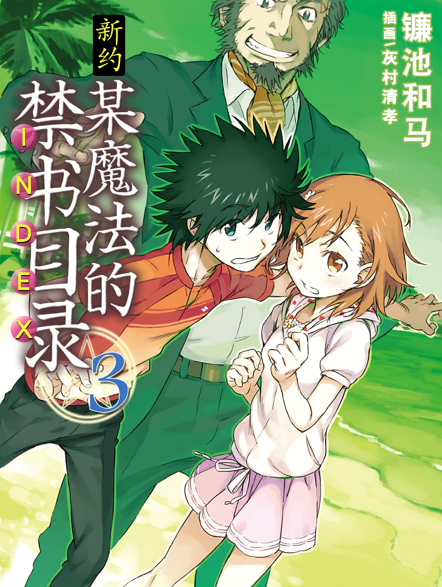

# 简介

**新约·魔法禁书目录3**

作者：镰池和马

## 内容简介

**科学与魔法交汇的学园动作小说，这次的舞台是夏威夷——！**

格雷姆林。魔法与科学融合的世界级敌对势力。一个在第三次世界大战后突然出现的神秘组织，似乎正在美国第五十个州·夏威夷暗中活动。

在英国黄金系魔法结社「黎明晨光」的首领蕾薇妮雅的带领下，上条等人前往夏威夷。成员包括上条当麻、御坂美琴、一方通行(Accelerator)、滨面仕上、番外个体和黑夜海鸟。而就在他们抵达新檀香山国际机场后不久，格雷姆林的魔法师袭击便开始了。

水面下进行着格雷姆林的阴谋。在美国方面唯一察觉到这一点的人，正独自寻求抗争。他是个精力充沛、情绪高涨的家伙。

他的名字是罗伯特·卡崔。

他是人人皆知的美利坚合众国总统。

## 制作信息

* 翻译：黄瀞瑶
* 台版：天使动漫
* 扫图：污驴
* 图源：真妹控
* 录入：污驴
* EPUB制作：鹘鹰⚡
* 网翻：泉川生徒会
* 图源：阿三
* 监督：罗伯特·卡采
* 翻译：阿三、绯月、CC
* 校对：Zadkiel、欢欢
* 整合：知一一（禁书目录X系列，[index-X](https://github.com/1204244136/index-X)）


**版权声明**

转载时请保留录入信息。

本站内容仅供试看、学习与交流使用，禁止用于商业用途；下载后请在24小时内删除。请支持官方正版。


## 封面与封底

