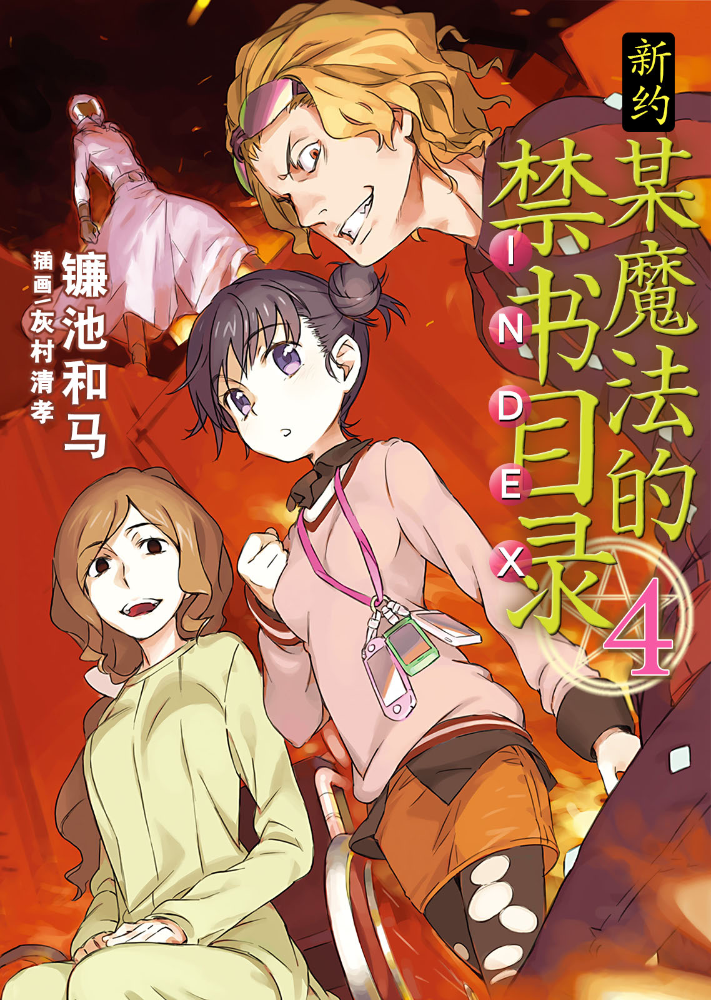
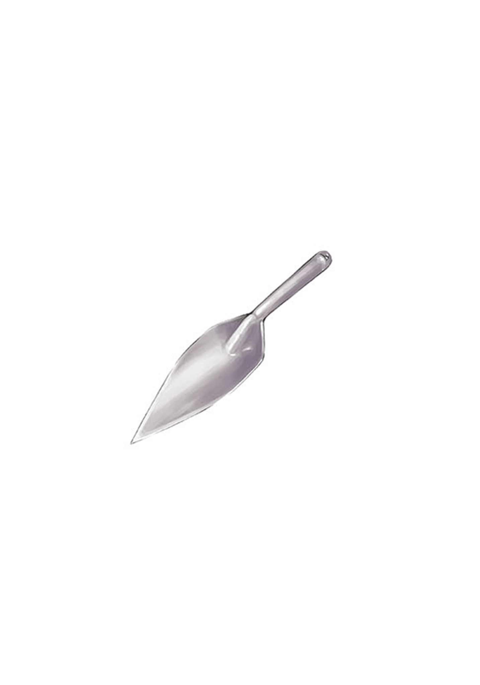

# 简介

**新约·魔法禁书目录4**

作者：镰池和马

## 内容简介

**破坏一切「木原」一族与粉碎万物的「格雷姆林」。两者的激烈冲突，开始了。**

——『11月13日起，我们反学园都市科学守护者二七社将在东欧的巴格吉城举办格斗大会「天择者」』——

这个公告是开始。

以第三次世界大战为契机，反学园都市势力在各地探索各种抵抗运动。在这场「天择者」异种格斗大会中，通过淘汰赛制以证明「超能力所无法比拟的『异能』」。这无疑是从根本上摧毁学园都市的身份认同。

借助魔法与科学融合组织「格雷姆林」的力量，其阴谋得以推进。

而且，

学园都市不会允许这一切发生。

这是仅有三位「木原」和三位「格雷姆林」的事情。绝不仅止于此，这是最糟糕的骚乱。

## 制作信息

* 翻译：黄瀞瑶
* 台版：轻之国度
* 扫图：linpop
* 录入：zbszsr
* 修图：XxalexX
* EPUB制作：鹘鹰⚡
* 网翻：泉川生徒会
* 图源：阿三
* 翻译：阿三、绯月、CC、miliya
* 校对：Zack、D7、蒼某
* Epub制作：黄昏的鸡蛋黄
* 整合：知一一（禁书目录X系列，[index-X](https://github.com/1204244136/index-X)）


**版权声明**

转载时请保留录入信息。

本站内容仅供试看、学习与交流使用，禁止用于商业用途；下载后请在24小时内删除。请支持官方正版。


## 封面与封底

