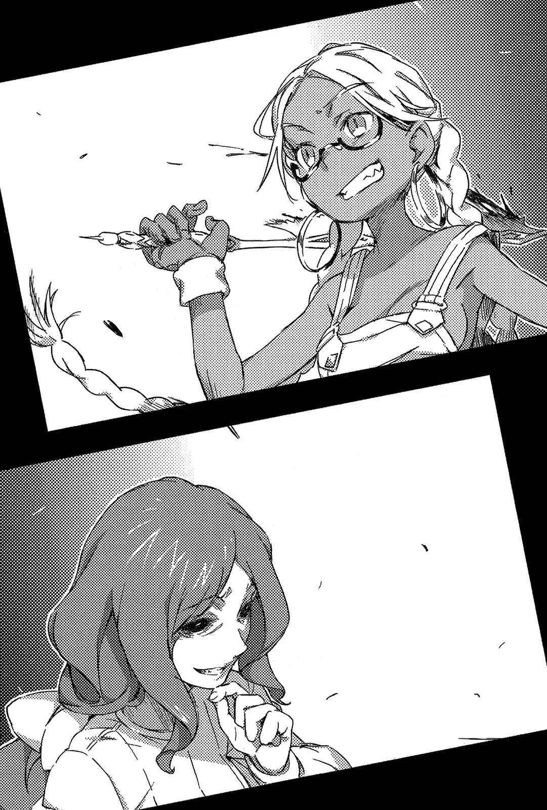
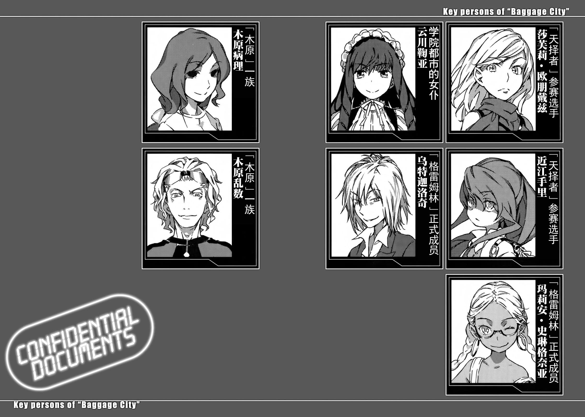

# Main.11

「FU-CK——FU-CK——FUCK～ING」

伴随着荒唐的歌声，一名少女正在巴格吉城掀起腥风血雨。地点是巴格吉城的垃圾处理厂。这里也连接了温水暖气用的水管和通道。由于巴盖吉市二次利用燃烧垃圾的热能来驱动温水暖气设施，要说这里是巴格吉城的核心也行。

这里有好几座火力发电厂和石油提炼厂等设施，是为了运作温水暖气设施而建造的「中枢」；如果这些设备全部被毁，巴格吉城将落入被丢进低于零下二十度地狱的窘境。

没错。

主战场如变形虫般扭曲。

从原本安全的回形擂台，到世界上人命最为不受重视的垃圾处理厂。

由于产生了太多攻击性的红光而不容易判别，但少女是属于防卫方的人物。

银色麻花辫。

褐色皮肤搭配红框眼镜。

少女在肌肤外直接穿上吊带裤，这种无论是走在街上或穿越暴雪地带都有点奇异的服装，手中还握着黄金制的锤子和锯子。原本纯金虽然耐腐蚀和氧化，但硬度却很低。也就是说，黄金是种性质柔软，很难用来当作刀械的金属。但这种常理无法用在褐肤少女身上。她的黄金工具能斩断钢铁、敲碎水泥，也能将人类「改造」得更加奇幻。

她是「格雷姆林」正式成员之一。

现存的黑侏儒(矮人)。

玛丽安·斯琳格奈亚。

她本身的移动速度并不快，甚至可以说很缓慢。根本只有普通少女打发时间慢慢晃回家的那种程度。

但是——

「嘎——呜嘎——呜汪汪！」

玛莉安发出敷衍的低语，将手上的黄金锯子刺向墙壁。不知为何真的刺穿了墙壁。接着在她松手同时，锯子以媲美汽车的速度冲进敌阵。原本对「锯子的距离」深信不疑的学园都市阵营那群刺客，来不及反应锯子的变化而呆若木鸡……

血沫横飞。

「嘎？」

「哇啊！」

「是脂肪！武器在涂满整面墙的脂肪上滑行？」

「真是的——好慢哦。」

离开墙壁在空中画出复杂轨道的黄金锯子，将全部集中在一处的数名士兵砍得四分五裂。

但紧接着，他们的身体又恢复成四肢健全的模样。甚至连血都没流。

「这是……什么情况？」

「唔——？注意看看你们自己的手脚！」

玛莉安抓住沿着墙壁飞回来的锯子，先旋转了好几圈，就以凶器的前端指示那群士兵。

「看起来像不像勉强装上去的？简直就像将好几种拼图乱七八糟地混合起来嘛。」

「不会……吧？」

「因为我没做器官移植的适应检查，所以你们动作不快点，免疫系统就会开始出现排斥反应哦？不想死就赶快从其他人身上抢回自己的身体。」

「哦、哦哦哦哦哦哦哦哦哦哦哦哦哦哦哦哦哦哦哦哦哦哦哦哦哦哦哦哦哦哦哦哦哦哦哦哦哦哦哦哦哦哦哦哦哦哦哦哦哦哦哦哦哦哦哦哦哦哦哦哦哦哦哦哦哦哦哦哦哦哦？」

实际上，那些士兵是否有自相残杀之意并不清楚。

但周围产生了反应。

被异常气氛吞噬的「那些毫无损伤的士兵」，擅自判断其他人一定会动手，并认定他们已经是敌人，于是开始单方面发射铅弹。

「真悲惨啊。」

玛丽安·斯琳格奈亚低声说道，并走向利用「恐怖的注视」暂时移往别处的短暂时间，设法幸存下来的士兵们。

就在此时。

倒卧在几具尸体旁隐藏身形的一名刺客，近距离抽出手枪。

但是玛莉安连看都没看，就挥动黄金锯子。

紧接着，刺客的双手消失。

并不是被切断。

握着枪的双手手腕前端，变成黄金制的水龙头。双手变成一个水龙头。简直就像被手铐铐住的模样，构成那副外形的要素本身，是普通的手臂和水龙头。然而，产生的景象却未免过于怪诞。

人体改造。

超越施术的领域，甚至达到战斗境界的黑侏儒(矮人)技术。

「啊、啊……」

玛丽安·斯琳格奈亚轻轻拍了拍茫然望着形状怪异的双手，发出呻吟的刺客肩膀。

「你很努力了。」

玛莉安露出微笑，说道：

「但是展现不出成果还是零分。真遗憾。」

她毫不犹豫地转动水龙头。

随着哗啦哗啦的水流声，支撑生命的红黑色液体就这样轻易地流泻而出。

「哦哦哦哦哦哦哦哦哦哦哦哦哦哦哦哦哦哦哦哦哦哦哦哦哦哦哦哦哦哦哦哦哦哦哦哦哦哦哦哦哦哦哦哦哦哦哦哦哦哦哦哦哦哦哦哦哦哦哦哦哦哦哦哦哦哦哦哦哦哦哦哦？」

「因为双手被合起来变成一个水龙头，所以没办法自己关上它啊——这下糟了。人类失血的致死量是多少？不过只要装满一个水桶，一定就……奇怪？意识已经模糊了？」

刺客全身痉挛抖动，倒卧在自己喷出的血泊中。

玛丽安·斯琳格奈亚毫不在意地再度迈开脚步。

「……因为我本来就不适合战斗，原本还以为会陷入苦战。巴格吉城居然被这种程度的人耍得团团转……反学园都市科学守护者令人失望的程度，真是超乎预期啊。他们这样子连『争取时间』都算不上啊——」

玛莉安一脸不耐烦地说道，接着将黄金锯子的前端对准脚边。躲在阴影中的刺客发射步枪子弹前，她挖开倒在地上，勉强才能呼吸的士兵喉咙。

瞬间，如幼童般高声尖锐的惨叫，以超越人类声带极限的庞大音量四散。

幼童的惨叫。据说是人类最厌恶的波长。

就在隐身在阴影后的刺客，听见迸发的哀号而全身僵硬的这段时间，玛丽安·斯琳格奈亚迈开大步，从正面接近对手的下方。

玛莉安将黄金锤子当成棒球的球棒全力一挥——

「打达摩！！」[^1]

刺客的肚子整个被敲了出去。如炮弹般喷射而出的肉块钝器，强行撂倒了身在远处的另一名刺客。

「噗、噗呕！」

「怎么还不死啊——」

玛莉安挠着头说道：

「如果你现在死了就不用受人玩弄，可以保个全尸进坟墓啊。」

玛莉安跨出大步，接近被如同玩具般分解的同袍腹部撞击的刺客，刺客放弃掉落的步枪，横卧在地打算直接拔出手枪，但玛莉安踏住刺客的手，以锯子朝刺客双腿释出一道攻击。

刺客的双腿变成两个车轮。

刺客对这阵无痛的变化感到恐惧发出惨叫，玛莉安则如同对恋人低语般向他说道：

「直接送你去堆肥用的肥料槽，你就等着被生鲜垃圾掩埋，窒息而死吧☆」

「哇、哇啊啊啊啊啊啊啊啊啊啊啊啊啊啊啊啊啊啊啊啊啊啊啊啊啊啊啊啊啊啊啊啊啊啊啊啊啊啊啊啊啊啊啊啊啊啊啊啊啊啊啊啊啊啊啊啊啊啊啊啊啊啊啊啊啊啊啊啊啊啊啊啊啊啊？」

他想用手指撑起身体，但已经来不及了。刺客就此倒卧着，在地上以超高速被拖行很长的距离，消失在通道深处。这幅光景，让人联想到有巨大鲨鱼出现的灾难电影中，被海水吞噬的受害者。

「这么不堪一击啊——？」

玛丽安·斯琳格奈亚旋转着黄金凶器。

当她回神时，噪音早已停止。眼前只剩一片寂静。刺客们并没有全军覆没。实际上死亡的只有全体的三分之一，不，还不到四分之一。但看见玛莉安制造出来的尸体，以及经过彻底改造的人肉尸块那骇人的惨状，让那些四肢齐全的人直接瘫软在地，武器也都弃置一旁。

比死还痛苦。

这样的描述在电影或小说中显得陈腐老套，然而一旦亲眼目睹，连思考的根基都会溃散。

期望生存、厌恶死亡。由于人类最基本的本能产生故障，使所有思考模式也随之切断。

「这么不堪一击啊……？你们可是传说中的学园都市呢……若真是如此，那就太令人失望了。你们真的是第三次世界大战的赢家？」

现场每个人都屏住呼吸，甚至拼命想隐藏自己心脏还在跳动的事实。但是微微从口中泄露出来的呼吸，却让玛莉安的眉毛不悦地挑动。她挥舞着黄金锯子与锤子，有的人杀之而后快，有的人则从四肢健全的模样重新组合成其他形状。即使如此，剩下的那些刺客依然不敢动弹。他们心中完全屈服了，没有逃走的勇气，更准确的说法，是连被玛莉安注视的勇气都不存在。

另一方面，玛丽安·斯琳格奈亚则是毫不犹豫。

如果对方抵抗，就紧追其后杀死他；如果对手不抵抗，就如割草般痛下杀手。

「唉。其实让他们『自相残杀』还比较简单……就是因为这种时候还不好好战斗，所以我才无法训练成适合战斗的人员嘛。唔，有点担心会不会影响到减肥呢。」

玛莉安一只手伸入吊带裤内侧摸索着腹部一带，同时以另一只手随意地旋转着黄金锯子。她确实地损害刺客们体内的器官，同时又立刻堵住伤口。随着如水球般的内出血，士兵们没弄脏周围环境就丧命了。

就在玛莉安因为声音一一消失而感到安心时，听见了金属咬合时的吱嘎声响。

「？」

「哎呀？这里是……哎呀哎呀。到底在哪里？」

一名穿着睡衣的女性出现了。从她坐在轮椅上的模样来看，应该是双脚不方便行动。她的膝盖上有个连着电线的按钮，或许是巴格吉城医院里的住院病患，因为学园都市阵营袭击造成的一片混乱，在「总之先逃到外面去再说」的想法下被推出医院。

她的表情非常柔和。

大概是还没看见玛莉安制作出来的「东西」。

「你哪位？」

「你是……呃，你穿着垃圾处理厂的制服，是这里的员工？」

「我负责的焚化炉还要小一点。不过会产生高温哦。」

玛莉安以握着黄金锯子握柄的手轻轻抓了抓自己的头说道：

「如果你要找出口，向右转前方两百米有扇门。你最好快点，因为这里是个有点肮脏的地方。」

……从她所做的这些丑恶行径或许难以想象，不过一如前述，玛莉安是「守卫」巴格吉城的人，至少目前是这样。因此她没有什么理由再改造巴格吉城的人了。

另一方面，坐在轮椅上的女性向她点头行礼，说道：

「你真亲切……哎呀？轮椅被地上的缆线卡住，还有高低差……哎呀呀？」

「啊——真是的，麻烦死了。」

玛丽安·斯琳格奈亚不假思索地走近穿睡衣的女性，绕到轮椅后方。她伸手抓住护理用的把手，用尽全身力气让车轮越过粗大的缆线。

「唔……这台轮椅还真重呢。是电动的？」

「是电动辅助式的。因为如果老是不动，身体会越来越衰弱，所以将轮椅调节成不会太轻松的程度。你看，这个盒子就是控制器。」

「我懂。因为我也是室内派的。不过，我的工作需要挥动榔头，如果我认真起来，手臂上也能挤出肌肉哦。」

「原来你是木匠啊？」

「很可惜。我对建造城堡没兴趣。」

「对了，」玛莉安推着轮椅低声说道：

「郑重其事地这么说有点奇怪，不过坐轮椅很辛苦吧？」

「还好啦。不过就是因为这样，我也有很多机会接触到人们的亲切哦。就像现在的你一样。」

「嗯。然后啊，**像这种充满缆线和高低差距的垃圾处理厂**，**你是如何靠轮椅移动到这里的**？」

「……哎呀？」

「很奇怪呢。不管怎么看，都觉得你是故意被缆线卡住等我主动接近你呢。」

「……」

玛莉安眯起双眼，更为紧握着黄金锯子。

相对地，穿着睡衣的女人依然满面笑容。

&nbsp;

锵铃！

紧接着，金属彼此碰撞的尖锐声响迸出。

&nbsp;

玛丽安·斯琳格奈亚只做了由正上方向下挥动黄金锯子，如此简单的动作。

穿着睡衣的女性则行动不明。

轮椅把手突然从玛莉安手中弹开，整张轮椅高速旋转一百八十度，这是她能理解的行动，但也仅止于此。有某个东西打落了玛莉安的锯子，然而即使遭到攻击，玛莉安依然无法掌握那到底是什么。

玛丽安·斯琳格奈亚的身体被夸张地弹开，背部以仿佛压垮墙边器材的力道撞了上去。

女性的轮椅在地板刻下一道圆形的胎痕。她在微微冒出白烟的圆阵上，抓起膝盖上的有线方盒按下按钮。

那东西究竟是如何收纳进去的？那真的符合质量守恒定律吗？从轮椅的靠背飞出了如机械悬臂般，宽度足以放入轻机枪和人类手臂的大口径霰弹枪（……炮？）。

每把枪的枪身侧面，都刻着一列英文字。

&nbsp;

Made_in_KIHIRA.

&nbsp;

「既·然·被·发·现·了，那就没办法了！」

哒哒哒哒哒哒哒哒！凭声响本身似乎就能伤害内脏的枪声连续不断响起，刮起了一阵钢铁风暴。埋在坍塌器材下的玛丽安·斯琳格奈亚，她的轮廓瞬间崩溃。上半身满是鲜红的黏液，而下半身……

「这是怎样，学园都市在流行这种瞬间搞笑段子？」

「？」

从残存的下半身传出声音。不对，有**另外一个**玛丽安·斯琳格奈亚，正蹲在被压成肉酱的玛莉安脚边。

这种认知也并不正确。

使用「木原」的睡衣女性，迅速地将枪口，或者该说是炮口重新瞄准玛莉安——

「这个才是真的吗……？」

「**那也是诱饵啦**，**你这混账**！」

从旁边传来了声音。

在穿睡衣的女性回头之前，一丝不挂的第三个玛丽安·斯琳格奈亚，挥下了将学园都市那群强壮的士兵变成**只有上半身是线条纤细少女**的道具黄金锯子。

但是，又一次。

嘎哩嘎哩嘎哩！轮椅以几乎快产生残像的超高速小幅度移动，某种器材和玛莉安的锯子碰撞，散发出橘色的火花。

轮胎在地上刻下了痕迹，冒出摩擦产生的白烟。

玛丽安·斯琳格奈亚推测，这家伙就算坐着轮椅，大概都能在西洋剑比赛上获胜。只是不知道她有没有使用随身配刀。

（啧，怪物就是指这种的吧，所以我早说过我不是战斗型了。）

玛莉安大概早在自己的领域四处放了吊带裤，她又从附近的器材后方拿出新的吊带裤穿上。

发出咻咻声响向后退的轮椅，动作流畅圆滑得惊人，让人感受不到地上有高低差和缆线。

玛莉安瞪着那个依旧笑容满面对她微笑的睡衣女性，低声说道：

「我还以为是什么咧，原来是装病啊。就算不站起来还是很能打嘛。」

「我木原病理是『放弃』的专家。自己放弃了很多，也让别人放弃很多。所以你们放弃吧『格雷姆林』」

「……呜哇——原来如此。真是轻松的生活方式。」

「然而这真的是那么不可思议的事吗？我觉得人生中一次也没装过病的人，反而更稀奇。也就是说，基本上对所有人类而言，『放弃的念头』不就是一种主流的欲望？」

借由这种方式维持秩序，就是木原病理的职责。

「让敌人放弃」想毁灭学园都市的恐怖计划。让试图将学园都市技术情报带出外面的人「放弃」。让人「放弃」新型大量破坏武器这种负面的成长和进化。让人「放弃」「放弃」「放弃」……放弃的累积，造就出木原病理丰硕的成功。扭曲、折断、践踏某个人描绘的野心，打造出一座残骸之山。

其实。

那不过是将木原病理原有的「性质」，和社会迁就妥协所产生的结果。

木原病理本身，就已经是「放弃」某种事物的形态。

玛丽安·斯琳格奈亚望着那满是谎言的轮椅，舔了舔嘴唇。

「你说你姓『木原』？我记得好像还有其他也姓木原的人，像你这样大摇大摆地跑来这里，结果被消灭了。」

「我已经放弃乱数了。反正还有圆周呢。」

「……至少有三个人？不过，感觉也不像是来了一百、一千个人。如果来了那么多人，你们的做法应该会不一样。」

「你们也差不多吧？」

「毕竟如果招进五个、十个只知道战斗的笨蛋，**只怕计划会直接从内部毁灭**。」

「我们也很辛苦的。」玛莉安嘀咕着：

「所以，由我来全力击溃你也没问题吧？」

轰！玛莉安轻轻挥动锯子。

她插入刀刃的墙壁流出了血。不，不对。那是模样被改造成墙壁的其中一名「士兵」。如同破裂的气球般，鲜血和脂肪洒满地面和墙上。恐怕是玛莉安为了有利使用黄金工具而进行的仪式。

不久前，玛莉安才让锯子滑过溅满新鲜脂肪的墙壁，袭击了那群士兵。

但是，即使看到那奇异的光景，木原病理依然挂着满面笑容说道：

「你能不能想个办法改变一下你所谓的全力？坦白说这梗实在很冷呢——」

玛莉安拿起黄金锤子与锯子准备应战，木原病理仿佛回应她一般，按下放在膝盖上的按钮。

咔嚓！轮椅的轮子分解了。

将数条车轮辐条重新捆绑，以平均分成数等分的橡胶车轮踏在地面。之后出现的是犹如蜘蛛般，具有好几只脚的装置。

大概是工作魂受到微妙刺激的关系，玛莉安吹了声口哨说道：

「改造得真精细啊。那是带孩子用的叫什么东西来着？」

「那是叫婴儿车啦。」

伴随着温馨的对话，两名怪物以极速正面交锋。

[^1]: 译注：打达摩（日语：だるま落とし），一种将木块垂直叠成好几层的玩具，玩家要轮流拿锤子敲掉中间的木块，将木块堆弄倒者算输。
