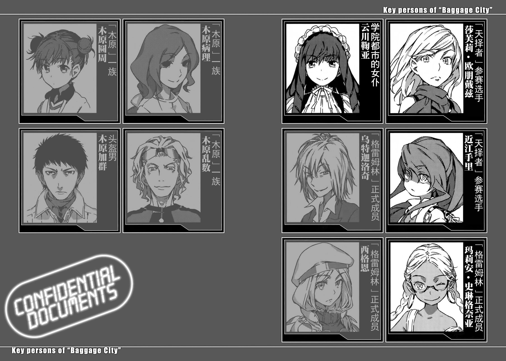

# Period.32

那场暴风，就算是人在地面的云川鞠亚也看得一清二楚。

堆积如山的蔬菜工厂集装箱最上方的几层被砍断、砸碎，在那种破坏中不断互相削蚀血肉的两只怪物。明显跟一般的胜负概念不同，不存在所谓防御。正如字面上的意义般互相厮杀，仅止于此的战斗。击溃、压扁、贯穿、砍走、削落、咬碎。浓缩了所有破坏行为的那场战斗，如同滚雪球般，将他们两人不断逼进死亡中。

云川鞠亚叫出其中一方的名字。

但男人没有回答。

震天巨响传来，天上的两人开始出现变化。其中一方……外形轮廓仿佛人类女性被恐龙吞噬般的怪物滑了一跤。她不断撞击由集装箱山形成的阶梯，落向云川鞠亚所在的地面。

「什……么……」

一声低语。

在雪地粉碎散开的恐龙，低声说着某些话。

用柔美的女性声音。

「这是……怎么回事……其实，我没必要杀他。在这种……这种地方，竟然就有个最适合『让他放弃』的人……」

近似于长颈龙的那东西直盯着云川鞠亚。具有如同人类般排列整齐牙齿的血盆大口张开了。

一瞬间，她想起了一件事。

这种恐惧。

以前曾经感受过。

是跟以前在小学校门附近，被拿着刀的某人盯着瞧当时一样的感觉。

但是，凶手的凶刀这次也没有袭击云川鞠亚。

不是「这次没有」，而是「这次也没有」。

&nbsp;

从正上方。

摆出要将右臂刺进恐龙头上的姿势，那名男子从集装箱山上跳下。

&nbsp;

男子已经失去左臂，上半身遍体鳞伤沾满了鲜血。

即使如此，那名男子还是贯彻了自己的作风。

不知道他到底用了什么技术，但残留的右手直到手肘一带，全插入恐龙头中。接着，胜负分晓。长颈龙发出惨叫想挣扎，但途中似乎连惨叫的力量都消耗殆尽。身体如同往一旁抛开般倒下，之后就不再动弹。身体变成了透明的白色，迅速融化在雪地中。

男人也被恐龙头甩出去扔入雪地。虽然他身上的每个伤口都不是致命伤，但加总起来的出血量却能确实夺走他的性命。而且从伤口的位置来看，甚至能感受到他正期望那种情况发生的想法。

「**老师**！」

向他飞奔而去的云川鞠亚喊的不是男子的名字，而是他以前的称呼。男人倒在地上，试图以他那对失焦的双眼追上声音的来源。然而男子是否真的能分辨出云川鞠亚都值得怀疑。他恐怕早就失去了事件发生前后的记忆，连回想出这里是哪里的能力都丧失了。

虽然男人仰望着云川鞠亚的脸，却仿佛在看着别人。

失去全身力气的男子微微动了动嘴唇。

他的确说出了这句话。

&nbsp;

「对……不……起……」

&nbsp;

之后，男子就不动了。

男子一定是为了说这句话，才耗费了到目前为止的所有人生。

从他口中说出这句话，表示长期以来一直折磨着他的东西，现在终于消失。

抛弃一切。

超越极限地消耗自己。

像这样做到这种地步，直到最后一刻用尽全力挤出的一句话，正是赎罪之言。

云川鞠亚有好一段时间无法动弹。

直到发觉男人的脸已经薄薄覆盖住零下二十度的暴风雪时，她才终于低声说道：

「……我知道。」

在这个就算流泪也会结冻的世界中，云川鞠亚微微俯下身子。

她的声音变成了呐喊，将至今累积的点点滴滴全部释放出来。

「我一直在调查，所以我知道！老师为了救我们所做的事，不希望我们崇拜一个杀人犯而默默消失，是『某人』准备了那个街头杀人魔，还有老师一直对那件事耿耿于怀，这些事我都知道！我也知道老师现在其实是向谁道歉！」

没有回答。

就连微微点头也没有。

逐渐被白雪掩埋的男子脸上，只挂着内心感到满足的胜者微笑。

「就连老师你不知道的事情我也知道！你救回来的那些生命，现在都各自在属于自己的道路上确实地前进！大家都很感谢你，也都很担心你，你的牺牲并没有白费。我不知道老师多么憎恨自己的所作所为，但那绝对不是毫无意义的事情！」

男人的面貌、轮廓逐渐消失。

毫不留情的暴风雪，将静止不动的人渲梁成一片雪白。

「可恶，你别一脸满足的表情死去啊！小心我揍你哦！如果揍你一顿就会醒来，那我真的会把你揍成猪头！你不是最讨厌那样吗！所以，才会彻底地贯彻自己的想法吧！可是为什么……为什么你却这么简单地接受了自己的死啊！」

呐喊、感叹、号啕大哭。

即使如此也无法改变结果。

在那样的世界中，正因为在那样的世界中，所以木原加群画下了一个句号，云川鞠亚只能活在他遗留下来的世界中。

为了不白费让他选择舍弃人生，所救回来的性命。

&nbsp;

&nbsp;

一度席卷巴格吉城的「木原」全部消失了。

只不过这座城市中，还有另一个集团一息尚存。

格雷姆林。

其中一人。

拖着一条腿移动，勉强以一大片纱布覆盖着一只眼睛的玛丽安·斯琳格奈亚站在蔬菜工厂的集装箱山上，看着眼前的光景。木原加群，不，以他们的语言来说是贝尔西的明确死亡。看着这个事实，玛莉安身体摇摇晃晃地靠在集装箱外墙上。

「开……玩笑……吧……？」

听到了她的轻声低语，贝尔西附近的好几个人立刻回过头来。但玛丽安·斯琳格奈亚无法细数人数。她才不在乎其他那一大群人。她眼中只看得见逐渐被白雪掩埋的那个男子。

「我一直认为，你不是会因为一些小事而死的人啊。应该说就是为了避免让你变成那样，我才彻底对你教导我的技术啊。那是……怎样？为什么？这样……简直……就像是为了完成拼图，一丝不苟地选择了死亡！」

从平常的她身上，可能完全想象不出现在这副动摇的模样。

对于甚至能改造活人，并将那个人变成自己武器的格雷姆林魔法师来说。

但并非如此。

她之所以能对很多人做出那种惨无人道的行为，说穿了不过意味着，她想明确画出区分敌我的那条界线。就算是敌人也会出手相助，即使是同伴也不惜背叛，她绝对不会做出那种暧昧不明的事。玛丽安·斯琳格奈亚是那种一旦她认定对方是盟友，就算为了对方毁灭世界，也在所不惜的人。

「是我吗？是我凑齐了所有拼图的碎片……？不，不对，你不是那种人。即使我什么都没给你，你也会使用别的碎片来完成拼图。你就是那种人啊。正是因为你是那种人，所以我一直很想避免这样的结局！我应该已经避掉了啊！」

伤心不已的玛莉安，选择明确地面对。

面对「盟友」之死。

「这算……什么……啊。」

不。

她虽然面对了他的死亡，却无法接受。

「这到底算什么啊————————————————————————————————————————————————————————————————————————————————————————————————————————！」

发生变化了。

玛莉安的周围，空无一物的空间产生了奇怪的声响。

她带在身上的那部智能手机响起了电子音。虽然玛丽安·斯琳格奈亚没接起电话，电话却擅自切换成魔法通信。

欧提努斯。

北欧神话主神的别名。在格雷姆林中众所皆知的魔神，所说的话传了过来。

『玛莉安，不行！输出功率太高了！再那样继续下去，先前的实验都会功亏一篑！』

「……**吵死了**。」

她低声说道。

她充满怨恨的声音，就连魔神的话都能弹开。

「**归根结底**，**事情会演变成这样**，**还不是你舍不得出来的缘故**？**只要像你那样的魔神现身**，**贝尔西就不会死了啊**。**我也一样**。」

『难道……你打算拿出那个？』

「**我会用的**。**不是早就决定要用了**？**难道你要说事到如今已经太迟了**，**然后就这样退出**？**就这样结束我哪受得了啊**！**实验又怎样**？**格雷姆林又算什么**？**魔神程度又怎样**？**你说啊**！**如果不把杀了贝尔西的巴格吉城所有人都挖出来解决掉**，**我怎么能甘心啊**——————！」

玛丽安·斯琳格奈亚发出呐喊，并将自己的手伸入吊带裤中。

她抽出来的不是黄金工具。

而是收在剑鞘里的一把剑。

「战乱之剑(丹因斯莱夫)」。

在北欧神话中，最终战争诸神黄昏的暗号之一。据说挥舞这把剑的王者所发起的战争，会持续到诸神的黄昏开始，是以人类之手可操控之物中，所能制造出最大规模灾难的传说魔剑。

为它冠上此名，比谁都知道其危险性的制造者，毫不犹豫地握着剑鞘。

她紧握着，然后呐喊：

「**来吊唁吧**。**我要叠起你们数百万人的头盖骨**，**来帮贝尔西盖座坟墓**！」

