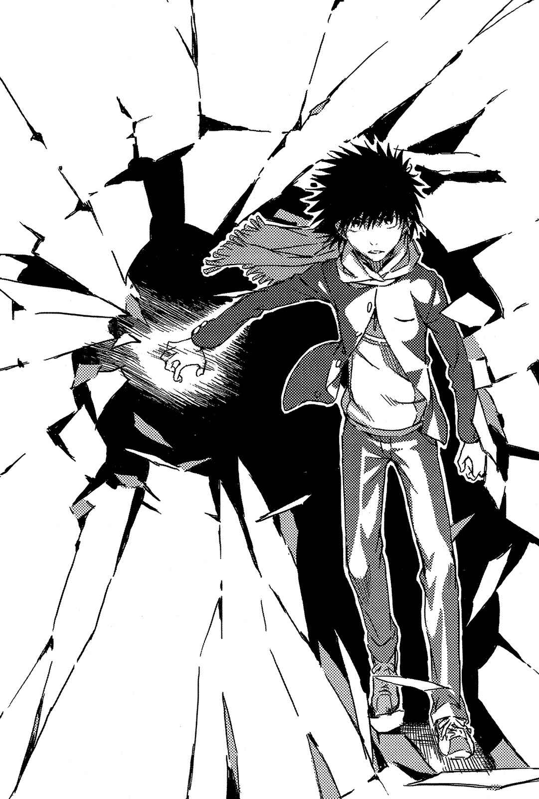

# A_Cardinal_Error.34

云川鞠亚、近江手里、莎芙莉·欧朋戴兹三人都注意到了如此的异变。

飘然出现的新人影。

玛丽安·斯琳格奈亚。

她拖着受伤的那条腿移动，其中一只眼睛上勉强用胶带固定住纱布，一副看了就觉得痛的模样。

然而。

最令人瞩目的不是她的模样。

看着她手里那把收在剑鞘里，西洋风格的剑，云川鞠亚坦率地觉得——

那把剑很危险。

虽然她在学园都市里，也多少跟能使用「不可思议的物体」「不合常理能力」的对手交手过，但是那把剑正散发出连云川鞠亚都被震慑住的压迫感。

站在蔬菜工厂堆积的集装箱山麓下，云川鞠亚吞了一口唾沫。

「……现在似乎不是好好沟通就能解决事情的气氛啊。」

「那里是危险区域。」

低声说出这句话的人是近江手里。

一度击退过玛丽安·斯琳格奈亚的她，也领悟到当时的数值已经无法供作参考了。

那把剑中，存在着让人却步的「某物」。

不仅如此——

「不过从形状看起来是剑，表示攻击范围有限。我们先朝三个不同方向逃走，分散对方瞄准的目标，等她追杀其中一个人时，剩下两人绕向她的死角偷袭她，就有胜利的机会。」

「也就表示我们需要飞行道具？我不太擅长使用飞行道具呢。」

莎芙莉的开朗笑容看来有点勉强，但若是能对自己产生自我暗示就好了。一旦因为被恐惧震慑使双脚无法动弹，那就真的束手无策了。

云川鞠亚将玛莉安纳入视野中心，用余光看着莎芙莉问道：

「你会用什么武器？」

「还没有达到武术的领域，所以我不太想展示给大家看，不过如果是澳洲制狩猎道具……」

「回旋镖？」

「是更单纯的东西啦。在细绳两端绑上石头，靠离心力连绳带石甩出去。那原本是用来缠住鸟脚的东西，不过也可以瞄准人类的脑袋。」

「离心力……是吧？」

云川鞠亚轻声低语之后说道：

「……那种方式似乎跟我的能力很合得来。」

「小姐你呢？」

莎芙莉询问近江手里，她就将园艺铁铲型的苦无拿在手中轻轻转动并说道：

「这种东西在很晚才传入枪支或火药的我国，可是非常发达哦。但传入之后这些技术就全生锈了。」

方针决定了。

不管对方做什么，首先绝对要避免进入她的攻击范围。

说是基本的确非常基本，但是攻击距离的管理在所有较量中，都能直接决定生死。而且无论有多原始，武器的破坏力再怎么微小，只要不断放出飞行道具，一定可以消耗敌人战力。

所以可以获胜。

只要不搞错逃生路线，不被逼进蔬菜工厂集装箱挡住去路的死巷中，胜算就在自己这边。

云川鞠亚她们就这样半强迫地切换自己的意识，让想法变得更积极，然而——

「**填充**。」

玛丽安·斯琳格奈亚说出了一句话。

她随意举高了还收在剑鞘中的黄金之剑。

如此而已。

所有希望在一瞬之间灰飞烟灭。

&nbsp;

轰！

天空降下一道闪光，穿透玛莉安手上的黄金之剑。

&nbsp;

爆炸了。

巨大的闪光以玛丽安·斯琳格奈亚为中心爆开，冲击波朝四面八方四散而去。铺着柏油的地面诡异地晃动，原本就已经岌岌可危的蔬菜工厂集装箱山，仿佛受到致命一击般逐渐崩塌。积雪一口气飞起，接着被冲击波吹散。无论是云川鞠亚、近江手里还是莎芙莉·欧朋戴兹，光是要迅速以双手护住自己的上半身，就已经使出全力。

「什……么……？」

天空，扭曲了。

不仅是产生暴风雪的厚重云层被吹散。

的确因为云层被吹散的关系，天空中可以看见圆形的青空露脸。但是另一边原本应该是蓝色的天色发生了变异，就好像全是杂讯的电视，存在着明显的晃动。

就仿佛——

那道闪光是从别的时空穿破了青空。

「那到底……是……？」

「**反正说了你们也听不懂啦**。」

玛莉安如咒骂般说道。

接着，她高举过头的黄金之剑剑鞘，诡异地散发出蓝白色火花。

要来了。

云川鞠亚察觉到一种不得而知的恶劣预感，她立刻对近江手里和莎芙莉·欧朋戴兹喊着：

「散开！对方用的毕竟还是剑，照计划分散她的目标……！」

她甚至没时间说完那句话。

玛丽安·斯琳格奈亚只用握着剑鞘的拇指，轻轻将黄金之剑的护手往上推。

短短几厘米。

不祥的红与金色剑刃触及空气。

仅止于此。

她没有释出令人害怕的闪光和威力惊人的大爆炸，那种显而易见的攻击。

只是——

让她们看见那把剑短短几厘米的真面目。

&nbsp;

怦！

近江手里的心脏，毫无前兆地停止了。

&nbsp;

「咦……？」

站在她身旁的云川鞠亚，无法理解究竟发生了什么。

近江手里突然全身无力，就此倒落在白雪上。外表没有明显的出血或骨折。那种状态就算说她其实是睡着了，大家也会同意。但这里是零下二十度的地狱，一眼就能看出她口中是否还在吐出白色气息。很明显地，近江手里的呼吸停止了。被人弄停了。

（怎么……回事？她死了……？真的……就这么……简单利落？发生了什么事？是毒气之类……不对，这里是上风啊。不是可以动那种小手脚的状况……!）

传来「铿」的一声坚硬声响。

那是玛丽安·斯琳格奈亚移动拇指，再次将剑刃完全收入剑鞘的声音。

接着她笔直伸出右臂，将剑鞘推到她们眼前。

不发一言。

只有褐色的拇指有了动作。

试图再次打开封在剑鞘中，那不祥的某种东西。

「不妙……这下糟了！虽然我不知道到底发生了什么事，总之先躲起来……！」

云川鞠亚的话说到一半就停住了。

现在翻着白眼的莎芙莉·欧朋戴兹正缓缓地倒向积雪中。心跳停止，明确地丧命。人类的生命和尊严，就这么轻易地被夺走。

数厘米的恶魔。

剑鞘与护手之间，隐约可见的红金色剑刃。

「……」

一声细碎的声响异样地响起。

那是玛丽安·斯琳格奈亚默默地将剑入鞘的声音。

超乎常理的能力。

天壤之别的差距。

那已经不是论及保有的战斗力，或智慧及策略如何的层次了。归根结底，玛丽安·斯琳格奈亚拥有的剑破坏力实在太过庞大，甚至连战斗都无法成立。

然后。

玛莉安一言不发地，将剑鞘对准云川鞠亚。

剑刃收在剑鞘中，也保持相当的距离。严格来说她的行动算不上瞄准，但是云川鞠亚却自然而然地产生「确实被人瞄准」的感觉。

仿佛有人以刀锋，抵着自己的眉心。

就好像脊椎被铁丝缠绕住，使行动受到阻碍。

当敌人将武器对准自己时，云川鞠亚终于察觉。

她发现了。

近江手里和莎芙莉·欧朋戴兹的心脏，究竟是如何停止的。

她注意到原因了。

「……并不是因为那把剑做了什么。」

云川鞠亚瞪大双眼，茫然地低声说道。

玛丽安·斯琳格奈亚还没让剑出鞘。不过云川鞠亚勉强说出了，即使剑未出鞘却早已侵蚀她全身之物的真面目。

「只是因为我们感到恐惧，不想站在真正发挥能力的黄金之剑前。所以她们心想：与其落得那种下场，**不如先让心脏停止比较好**。」

「一百分满分。」

这跟木原圆周使用的那种依照逻辑，有效提高恐惧数值的方法属于不同种类。比较像从本能或灵魂之类，最原始且无法用理论解释之处所涌出的纯粹恐惧。也因此已经超越了能靠思考做些什么的领域。

无法闪避。

只要拥有足以感应「恐惧」的智慧，那种「恐惧」就会抹消生命存在的证明。

这么说来。

那把剑拥有在出鞘前，就能杀死地球上所有人类的效力。

那么。

既然如此。

假设，如果那把剑完全出鞘，到底会发生什么事……？

「差不多可以了吧。」

玛丽安·斯琳格奈亚的嘴唇动了动。

她的拇指放在黄金之剑的护手上。

「去死吧，元凶。」

剑鞘中的剑如同滑动般移动。已经可以窥见剑身了。面对让人认为抵抗比死亡更为恐怖的那把剑，云川鞠亚完全束手无策。她的恐惧从一开始已经到达顶点。就连逃走或闭上双眼那些细微的动作，也早已被封锁住。

接着。

&nbsp;

明确的

异

变

发

生了。

&nbsp;

「……啊？」

云川鞠亚的意识变得模糊，无法回想前后的记忆。眼前的景色全染上鲜明的色彩，上下的感觉也消失了。她无法感受到冷热，只能呆若木鸡地伫立着，感觉一切都乱七八糟地混成一团。

接着，她发现了。

虽然她还不清楚是否真的发生了什么事，但是她能感受到疑虑，就表示云川鞠亚还活着。表示她并不是来不及思考，心跳就因为恐惧而停止。玛丽安·斯琳格奈亚的剑，因为某些理由没有发动。不，其实那把剑本身什么都没做过。只是云川鞠亚擅自感到恐惧而「放弃活命」。既然如此——

云川鞠亚的意识，与那把剑相比更优先注意到了其他东西。

更异常的现象。

就是因为它，使她感受恐惧的能力得以缓和。因为感觉变得迟钝而避免死亡。

那么是什么东西？

原因就在玛丽安·斯琳格奈亚身旁。

&nbsp;

噼里！

本应空无一物的空间，出现了漆黑的裂痕。

接着从中——

**某个少年的右手猛然飞出**。

&nbsp;

「啧！」

玛丽安·斯琳格奈亚的神色第一次出现变化。看得出来她很焦躁。明明握着那种宝剑，即使拥有威力如此惊人的宝剑她还是显得紧张。少年右手抓住玛莉安握剑的手腕。或许是警戒着以防武器被夺走，她粗暴地甩开少年的手，往后跳开以便跟黑色裂痕拉开距离。

「……我终于追上来了。」

裂痕中传来少年的声音。

他被甩开的手，明确地握拳。

「或许我太慢来到这里，为了进去里面可能花了太多时间。即使如此我还是追上你了，格雷姆林。是你制造出来的空间扭曲告诉我坐标的。而我既然追上来了，就不容许你为所欲为，因为我的右手，蕴含着能破坏你们所操纵那些东西的力量。」

黑色裂痕逐渐扩大。

可以窥见里面有某种东西。

「这就是分界线。到这里为止，是你们支配坐标的世界。」

扩大、扩大、扩大。

仿佛要否定某物。仿佛要推翻前提。

「那么——」

他从大幅龟裂的裂痕中跨出一步。

明确地踏入这个世界。

「从现在起，就依我的规则来吧。」

&nbsp;

上条当麻出现了。

紧接着，除了他以外的一切全都产生裂痕，并碎裂四散。

仿佛——

云川鞠亚至今所看到的一切，都只是一场巨大的幻想。
