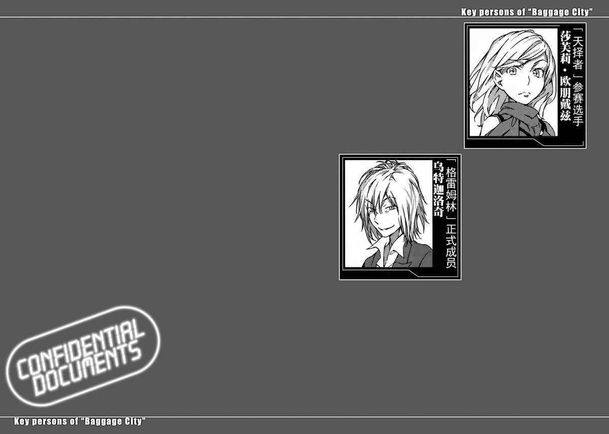

# Sub.05

巴格吉城内有好几个禁止进入的区域，这里是其中一个。在这房间所耗费的金钱，几乎相当于所有开放区域的开发费。超高层酒店的顶楼有张明确的王座，但那是再明显不过的幌子。大部分的首脑，应该都集中在远离那里的地下设施中。

卫斯兰·史特莱尼科夫故意选择使用这个容易被袭击的幌子设施，很可能是基于他的立场。

他所处的并不是可以说漂亮话的立场，但他怎样也不能容许「在白费工夫的状况下，让平民百姓牺牲」。可是他待在这里也很矛盾，毕竟只要卫斯兰在这里，就有可能实际遇袭，也产生了民间人士身亡的风险，然而卫斯兰意见的重点并不在此。

他想避免的，其实是无谓的死亡。

只要有需要，名叫卫斯兰的老人也会毫不犹豫。另外，他也认为将这样的理念套用在四散各地的人们身上，也算得上是一种救赎。

巴格吉城的管理者。

他也是将反学园都市科学守护者二十七企业统合为三个集团，并君临其中一个集团首脑之位的人物。

他掌握了以粮食资源为主的单纯资金来源，以及生化燃料和微生物工学等应用领域；过去是学园都市，而现在则是明确支持反对者的「巨大老人」。

「……虽然这么做容易被误解为毁灭主义，但即使如此我的个性其实是想避免悲剧啊。」

卫斯兰坐在黑檀木大桌前那把柔软的椅子上说道。

外头充分发挥了世界屈指可数的暴雪地区这个特征，是一望无际的雪白景色；但是隔着厚厚玻璃的室内，充满了暖气柔和的热气。

「不过世上所有人都期望获得幸福，因此互相对立，然后产生明确的失败者，就像现在正在进行的『天择者』一样。若要在这种情况下讨论该怎么做，那就有必要以可能会发生悲剧为前提，重建我们的主张了。」

「你想最优先考虑避免悲剧发生，倒还挺敢将赌注押在缺乏证据的黑箱上嘛？」

坐在黑檀木书桌前的，是一名看起来颇轻浮的金发男子。虽然同样穿着西装，但老人和金发男子给人的印象却正好相反。

或者该说那正好显示出这名金发男子的立场，也就是绝不认真看待世间所有事物的态度。

乌特迦洛奇。

魔法结社「格雷姆林」派来的正式成员之一。

「反学园都市科学守护者拥有的力量非常强大。不论片断的科技层面，或是由学园都市出借，却从未收回的那些无人武器都是。但那些力量真的能实际运用吗？将脑袋里的科技实际制成武器，开发、大量生产、实际操作试验、让士兵熟知运用指南，都得花费相当多时间。即使是无人武器，若没有学园都市的技术支援，也很难完美地发挥作用吧？只怕就算充了电，光是要让那些无人武器笔直站立或步履蹒跚地行走，就得耗尽全力哦？」

「这次的『天择者』也一样，」乌特迦洛奇毫无紧张感地说道。

没错。

即使发掘出能对抗学园都市超能力的「某种东西」，要正确分析、建构起足以大量生产的系统，也会耗费相当多时间。

卫斯兰似乎也同意他的看法。

「当然，学园都市绝对不会给我们那些时间。一旦进攻，肯定是闪电战。」

「况且，学园都市还将『那个』寄放在协助机构之中。」

他们指的不是无人武器。

而是在某种意义上，比无人武器更具价值的物体。

便宜，且高性能。

却明显违反国际法的「武器」。

「第三位的军用量产克隆人？只要能弄到一个，说不定情势就会截然不同。」

「那数量将近一万的个体，就像是算好时机一起失踪了。加上她们原先的生活空间发生火灾……还用成分经过掩饰的强酸处理掉DNA图谱检体，并以电子方法破坏掉资料库的记录。」

「……恐怕是『某人』通过她们的网络，下达了战术上的指示吧。我们没有物证，也失去了资料。最终结果就是不可能进行独立研究，即使揭发制造克隆人的罪行，也会被当成『又是都市怪谈』而被舍弃。」

「虽说如此，也不能因此对学园都市掉以轻心。」

「……所以我们才会回应你们的接触。在『破坏学园都市集权体制』这层目标上，我们和『格雷姆林』是共通的。」

「不过，我们并不打算用人海战术制造挡箭牌哦。」

「我们也不想那么做。应该说，只要你们别采取什么具体行动就谢天谢地了。毕竟敌人更忌讳你们。」

卫斯兰像扑克牌一样，将堆叠在书桌上的报告展开成扇形：

「而敌人越是忌讳你们，越会因此试图在攻击前收集情报。换言之，我们也能争取到更多时间。只要争取到一定的时间，就能转换为可战斗状态。和『格雷姆林』联手，举办『天择者』都是为了这个目的，此外我们还运进大量空集装箱，这些物流上的情报工作也是争取时间的其中一环。」

「直到能达到对等战斗的水准？」

「无论学园都市拥有多少技术，或是具有将再利用技术实用化的能力，他们基本上都缺乏资源。我们将广泛宣传反学园都市科学守护者的『胜算』，强行将世界广大地区卷入我们的计划中……资源与粮食的枯竭，是阻止战争继续的最大妙招。」

「也就是利用没有实体的虚构情报战？」

乌特迦洛奇开心地笑了笑，说道：

「这是我喜欢的发展啊，所以我才不远千里来到这里。」

「虽然选择这么做，但这并非我喜欢的做法。我讨厌没有实体的数字战争。提高粮食的价格，只会使存在于现实中的人饥饿。」

「那边那些堆积成山的纸也是其中一环？如果用科学阵营最自豪的记忆装置，只要一枚邮票大小的闪存就够了。」

「那些只是单纯的安全对策。只不过除我之外的人都不赞同，所以没什么意义。」

卫斯兰的书桌上也有台笔记本电脑，但那里面似乎只记录了所需的情报放在哪里，以及那些情报的编号。

这很明显会降低效率，但他或许早已「具体计算」出通过消耗这些纸张，可以拯救某处正处于饥饿中某人的效果。

就像预先推算出木桶店可以赚多少钱，然后以精准的强度刮风的举动。[^1]

但正因为在脑海中如此想象，乌特迦洛奇嘴角浮现轻佻的笑容。

「我认为自己一路走来，也多少牵扯到人类的死亡，却不曾像你这样被数量庞大的生死纠缠。毕竟你一旦说出要用玉米让车子行走这种话，就有可能让好几个国家陷入饥荒吧。但如果反过来说『既然如此，我们放弃吧』，只怕又会有其他国家因为财政困难而饿肚子。」

「……」

「哟，面对这种左右两难的死亡，你还能实际感受到助人的快乐？老实说，我真是搞不懂你的世界。」

「这不是值得说给别人听的好经验，值得学习的地方也不多。」

挤不出奶水喂给只剩皮包骨的幼儿、身体枯瘦的母亲，与讴歌善待地球口号，然后浪费碳水化合物让机器运转的现实。正确理解双方轻重的老人，眼里浮现着比「格雷姆林」更为深不见底的黑暗。

即使如此，在黑暗深处中，还是能确实窥见光点。

「我只是在摸索公平利用生存所需之物的方法。我过去向学园都市寻求支援，而现在则向别处求助。只要知道这星球上每分钟会有多少人断气，你应该就会明白时间上根本刻不容缓。」

「虽然能做的事有限，但是在我能力所及范围内……」

「那就够了。我也只是尽我所能。」

「只要能给学园都市造成伤害，怎样都行。」

「……我不认为你们会只依据那么简单的理念就采取行动，不过大家都是在互相利用啦。」

卫斯兰低语说完这句话的瞬间，他的笔记本电脑跳出了新的视窗。老人神情严肃地说道：

「看来需要你竭尽所能的时机马上就来了。」

「具体内容呢？」

「想拜托你除掉入侵者。」

[^1]: 译注：木桶店，是日本连锁反应型俗语「风一吹，木桶店就赚钱」的主角。中间的逻辑联系是：大风刮起来→飞沙走石变多→被这种天气弄瞎的人变多→流落去做街头琴师的盲人变多→对三味线的需求量变大→猫皮的需求量变大→猫被宰杀得更多→鼠患变严重→木桶被咬坏得更多→木桶店生意就会赚钱。
