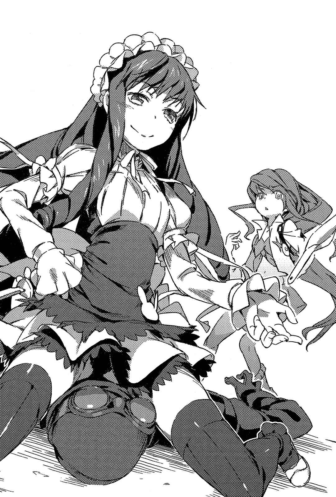
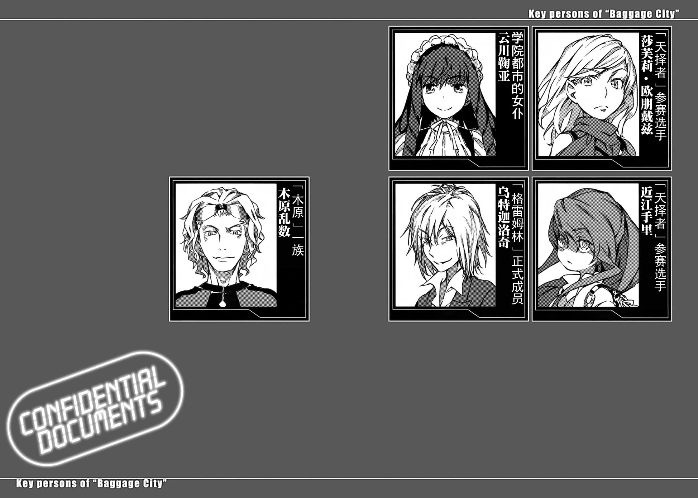

# Sub.10

将黑发烫成纵向卷发的「那个」，打扮成女仆的模样。但那身衣服并不像在法国一带的古堡中工作时所穿的衣裳，而是在某处的电器街上派发传单，一言以蔽之，就是设计令人不禁心生疑窦的荧光黄色女仆装。迷你裙配上有荷叶褶边的膝上袜、黑色紧身衣，以及将历史传统一刀两断的迷幻程度实在惊人。

但是，比这身打扮更乱来的，是「那个」的出现方法。

&nbsp;

穿军服的男人正下方。

如同钻过对方双脚下，放低身子的少女向近江手里展开突击。

&nbsp;

铿！伴随着坚硬的声响，少女以双手压制住了近江手里的园艺铁铲型苦无。穿着女仆装的少女脸上浮现笑容，紧靠在她身旁轻声说道：

「吵闹的时间就到此为止。如果你敢说什么『只有杀了他才能得救』，我就干脆利落地解决你。」

紧接着。

少女保持以双手压制着近江手里苦无的状态，少女突然单脚笔直地伸向天花板。她的目标并不是穿军服的男人脸部。少女将纤细的腿弯曲，膝盖内侧就如手铐般缠住了军服男子握刀的手臂。

接着少女旋转身体。

靠在地板上的另一条腿猛然跃起。以近江手里的苦无为轴心翻身，两腿犹如竹蜻蜓般旋转。近江手里由于被人扭转手腕的疼痛，反射性地放开苦无，以及穿着女仆装的少女以缠住军服男子手臂的膝盖内侧为中心旋转，这两件事几乎足同时发生。在转眼间，少女的头移动到比穿军服的男人更高的位置。为了跃离地面而使用的另一条腿膝盖，则深深压在穿军服的男人下巴上。

「哎呀。」

少女将埋入男人头部的膝盖向外侧移开，并将压制对方手臂的另一条腿的膝盖，放在穿军服的男人肩膀上。她丝毫不在意自己的迷你裙，就这样将全身重量压在他身上。正好是以大腿压住军服男子头部的姿势，让男人向正后方倒下。

「嘿咻。」

响起了沉重的声音。

一屁股坐在军服男子身上的少女，确认自己的屁股与已经将目标——地板上的头部确实压制，并夺走他的意识后起身，把玩着双手上的匕首与苦无两种武器。

「……嗯。我提供的服务是不是太多了点？为了适度伤害他的自尊，我故意选择了更令人感到羞耻的方式，却因此让被我击倒的对手，人生经验变得更丰富，我深深觉得自己的才能还真是麻烦啊。」

看着自言自语的少女，近江手里谨慎地将手绕到后面。

乍看之下像是靠着手臂向前跑，同时甩出双腿，诡异地以四肢攻击的格斗技。但光是如此无法解释她的动作。正因为甲贺忍术是在常理范围中追求合理化的忍术，所以才能知道，刚才的动作不可能光靠人类的肌肉执行。怎么想都有矛盾之处，但那个人却维持这种姿势直冲向终点。

明显是异能之力。

这个人使用了近江手里所追求的能力。

「你到底是何方神圣？」

「嗯——云川鞠亚。」

穿着可疑女仆装的少女简单利落地报上了名号。

「我是学园都市阵营的人，但你不用担心。我跟袭击这座城市的部队没有关系。虽然我不是『天择者』的选手，但我跟你有同样的目的，都是来看那群怪物对战。正确的说法是，我不过是单纯来这里找人啦。」

「……」

她虽然这么说，但是觉悟的程度却不一样。

想顺利消化「天择者」比赛，安全获取「异能之力」情报的近江手里，与一开始就预见学园都市和反学园都市科学守护者之间会有激烈冲突，却依旧闯进这里的云川鞠亚。

老实说，如果近江手里早知道会这么危险，她说不定早就改变方法了。

最重要的是，被对方知道自己的目的是很糟糕的。

近江手里向背在后面的手灌注力量，但云川鞠亚为了制止她开口说道：

「别乱来。光靠颜色火红的辣椒水水枪，弄不瞎我的眼睛。如果你想伤害我的自尊，至少要带火焰喷射器过来。」

「我还有芥末的黄色跟新鲜山葵的绿色。」

「啊唔……我想芥末类的就算了，山葵类可真的有造成失明的风险呢。对了，那上头没有JIS标章吧？」[^1]

「不管怎样，」云川鞠亚略微停顿：

「就算我们对战，输的还是你哦。如果那样你也觉得无所谓，我就只能说随便你了，但我还是想尽量避免无谓的争斗。要再次杀害好不容易救回来的生命，可不是什么有趣的经验。坦白说，那很可能会使我一路走来谨慎小心，受过细腻伤害的自尊一口气断成两半呢。」

「你凭什么断言你能获胜……？」

「我不认为能充分运用四肢的自己，会输给只能用双手战斗的对手。我可以靠右手和左手走路，也可以用右手跟右脚跳远哦？我就给你一些时间，计算一下们我们之间相差了几十倍吧？」

近江手里稍微想了一下，说道：

「你少骗人。」

「被你发现啦？跳远实在是办不到，不过我可以用右手和右脚使出摔技或扭断技哦。还有用右脚比剑道以及用左脚投标枪。不过用脚拿起竹刀会被真正练剑道的人痛斥一顿。但我从来没输过。」

「……」

近江试着取出藏在裙下的辣椒水水枪，并立刻扣下扳机。但紧接着，云川鞠亚的头早已一百八十度向下移动到刚才膝盖所在的位置。她毫不在意迷你裙，单脚笔直伸向天花板保持平衡，以右手和右脚直立。

「我这么做，不仅是攻击的手段变多，就连要害的位置都会大为改变。你那种『为了和双脚站立的敌人战斗而改良过』的战斗技术，反而会造成阻碍。」

咻咻的声音响起，云川如芭蕾舞者般细微地旋转，她的头与手脚就跟着回到原本位置。

「不过我本来应该趁你不备，用手抓住你的脚，然后一脚往下重击你的脑袋。因为现在是试用期间所以就算了，不过免费服务时间差不多快结束了哦？」

但你的技术也不是完美无缺吧？近江手里如此分析。

无论是捶击、寝技还是摔技，威力基本上都和敌人的体重大有关系。原本诡异巧妙的动作应该只会阻碍体重的移动，但云川鞠亚似乎借由独特的旋转运动，来提升攻击威力。

或者，也包含了无法解释的异能之力。

物体旋转时产生的能量。

离心力。

「所以，你想怎么办？要打吗？」

「不用了。」

近江手里伸出了一只手，云川鞠亚将之前没收的园艺铁铲型苦无轻轻抛了出去。取回自己武器的近江手里重新思考情势。

现在自己该做的，不是在对战中取胜以展示存在感。

而是获得所谓异能之力的「宝藏」，迈向胜利之路。

以及将甲贺全体提升到那种程度。

为了这个目的，就算遭人轻视她也不觉得痛苦。倒不如说，执着于无意义也无实际利益的胜利，结果什么也没留下就被打倒，远比遭到轻视更为悲惨。

云川鞠亚向正在思考的近江手里问道：

「你打算怎么办？」

「什么怎么办？」

「转角。我在问你是不是想过去看看？」

爆炸声与震动。

即使是现在，转角的另一边，「木原」和「格雷姆林」席卷一切的攻击似乎还在持续。那正是超越人类认知，充分发挥甲贺追求之物的人们所进行的战斗。

光是要看他们战斗，就费尽全力。

一旦被卷入其中，就必死无疑。

无法否定的是，她可能还来不及区分两者，就在跳下去挑战的瞬间遭战火吞噬。

即使如此，近江手里还是回答道：

「……我要去。」

彻底的肉体改造，外表看起来只有十岁左右，担任「初期行动者」的精英。唯有眼神中蕴含着无论在身体进行过何种改造，都不会丧失的原有光芒。

「我一定要去，并得到提升甲贺力量的基石。『天择者』无法继续进行也无所谓，既然是无论如何都要有人去做的事，那只要我接下任务，就能让未来的某人免于陷入这样的威胁。既然如此我当然要去，无论发生什么事都要去。」

「伤脑筋。」云川鞠亚叹了口气。

她摇了摇头。

接着说道：

&nbsp;

「那就没办法啦，我就伤害自尊来保护你的小命吧。」

&nbsp;

近江手里没时间提出疑问。

紧接着，云川鞠亚的四肢同时扑了上来，近江手里完全失去意识。

[^1]: 译注：JIS，即日本工业标准。
