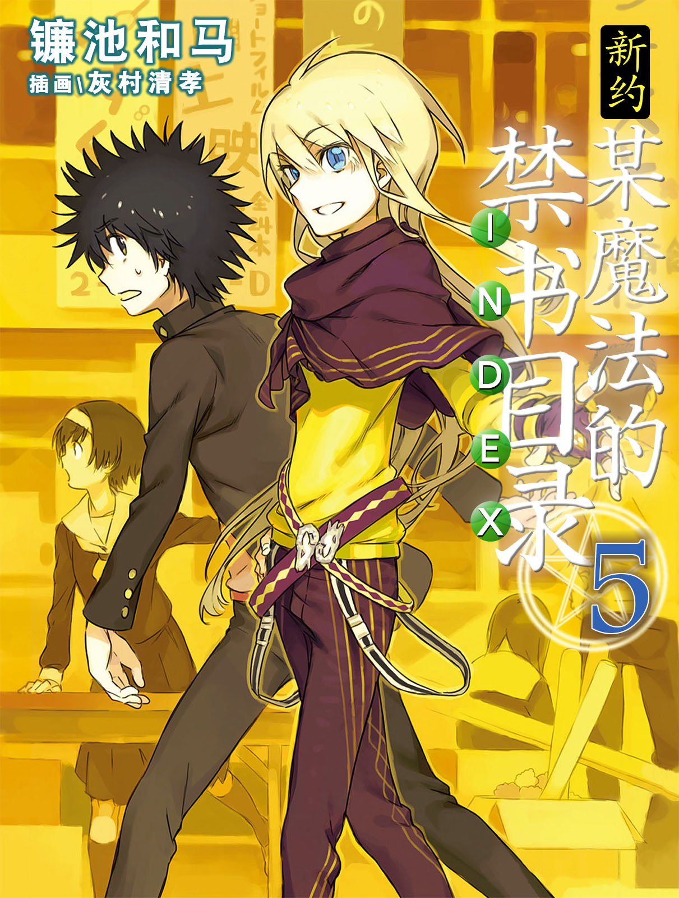
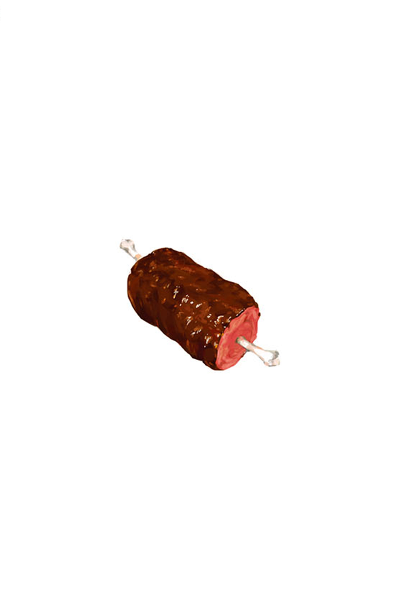

# 简介

**新约·魔法禁书目录5**

作者：镰池和马

## 内容简介

**「新约」系列，进入新展开！**

11月。超巨大文化祭「一端览祭」的季节来临了。

在这样的时刻，终于回到学园都市的上条当麻。在因俄罗斯爆发的第三次世界大战而引发的「对格雷姆林远征」之后，他与茵蒂克丝和御坂美琴之间那种温馨平稳的日常生活终于回归——。本以为可以快乐地享受这一切，但意外人物的出现让他的愿望化为泡影？！出现在他面前的最强「敌人」究竟是谁？

作为路痴芙蕾梅亚的监护人，在学园都市内四处奔波的滨面、一如既往地照顾最后之作的一方通行(Accelerator)，以及顺便做做料理进行康复训练的麦野沉利等等…… 以学园都市为舞台，「新约」系列迎来了新的展开！

## 制作信息

* 翻译：林星宇
* 台版：轻之国度
* 扫图：linpop
* 录入：zbszsr
* 修图：kaaala
* EPUB制作：鹘鹰⚡
* 网翻：泉川生徒会
* 图源：阿三
* 翻译：阿三
* 校对：圈(基)圈(佬) 绯月
* Epub制作：黄昏的鸡蛋黄
* 整合：知一一（禁书目录X系列，[index-X](https://github.com/1204244136/index-X)）


**版权声明**

转载时请保留录入信息。

本站内容仅供试看、学习与交流使用，禁止用于商业用途；下载后请在24小时内删除。请支持官方正版。


## 封面与封底

